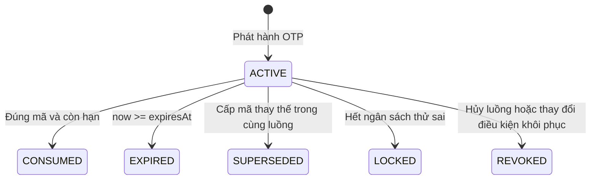

# One time password expiration — Thời hạn hiệu lực của OTP khôi phục

## 1. Thời hạn OTP bảo vệ điều gì?

Trong luồng khôi phục tài khoản, **OTP** (one-time password) là mã dùng một lần để chứng minh người yêu cầu đang kiểm soát một phương tiện xác minh đã được hệ thống chấp nhận. Ví dụ, người dùng quên mật khẩu nhận mã qua số điện thoại khôi phục đã đăng ký. Sau khi mã được xác minh, họ mới được đi tiếp đến bước đổi mật khẩu.

**Expiration** là thời điểm hệ thống ngừng chấp nhận mã, kể cả khi người nhập biết chính xác giá trị của nó. Một mã có thể đúng về giá trị nhưng đã hết hạn, đã được dùng, bị thay thế hoặc thuộc một yêu cầu khôi phục khác. Vì vậy, so sánh chuỗi mã chỉ là một phần của quyết định xác minh.

Thời hạn ngắn giới hạn khoảng thời gian một mã bị lộ còn có thể bị lợi dụng. Tuy nhiên, kẻ tấn công nhận được OTP vẫn có thể sử dụng ngay trong khoảng đó. Expiration cần đi cùng giới hạn số lần thử, kiểm soát gửi lại, ràng buộc ngữ cảnh và cơ chế tiêu thụ mã một lần. OWASP cũng yêu cầu mã khôi phục có thời hạn phù hợp và bị vô hiệu sau khi sử dụng. [OWASP Forgot Password Cheat Sheet](https://cheatsheetseries.owasp.org/cheatsheets/Forgot_Password_Cheat_Sheet.html).

Bài học này tập trung vào việc thiết kế thời hạn OTP trong dịch vụ khôi phục tài khoản: xác định mốc bắt đầu, kiểm tra ranh giới hết hạn, xử lý độ trễ, gửi lại mã và chuyển sang quyền khôi phục có giới hạn. Khi mất MFA, passkey hoặc thiết bị xác thực, một OTP chỉ là bằng chứng mà chính sách khôi phục đánh giá; việc nhập đúng mã không tự động đủ điều kiện gỡ mọi yếu tố xác thực.

Sau bài học, người học có thể giải thích vì sao bộ đếm trên giao diện không quyết định hiệu lực, thiết kế `expiresAt` phía máy chủ và nhận diện các lỗi làm mã sống lâu hơn dự kiến.

## 2. Phân biệt những loại mã có quy tắc thời gian khác nhau

| Loại mã | Cách hình thành | Cách xác định thời hạn |
|---|---|---|
| OTP ngẫu nhiên được gửi qua SMS hoặc email | Máy chủ sinh mã cho một thử thách cụ thể | Máy chủ lưu thời điểm phát hành và hạn tuyệt đối của thử thách |
| TOTP từ ứng dụng xác thực | Thiết bị và máy chủ tính mã từ bí mật chung cùng bước thời gian | Kiểm tra bước thời gian và cửa sổ lệch giờ được cho phép |
| Mã dự phòng đã lưu từ trước | Được cấp trước để người dùng cất giữ | Tuân theo chính sách riêng về dùng một lần, thay thế và thu hồi; không mặc nhiên mang TTL vài phút |

**TTL** (time to live) là khoảng thời gian hiệu lực, còn `expiresAt` là mốc hết hạn cụ thể. Bài này chủ yếu xét OTP ngẫu nhiên do máy chủ cấp khi người dùng yêu cầu khôi phục.

TOTP thường có bước thời gian mặc định 30 giây theo RFC 6238. Cửa sổ chấp nhận lệch giờ có thể làm khoảng chấp nhận thực tế rộng hơn một bước; máy chủ vẫn phải ngăn tái sử dụng mã đã xác minh thành công. Không lấy con số 30 giây làm TTL chung cho mã gửi qua email hoặc SMS. [RFC 6238, mục 5.2 và 6](https://www.rfc-editor.org/rfc/rfc6238.html#section-5.2).

Khi viện dẫn chuẩn, phải xác định đúng loại mã và kênh truyền. Chẳng hạn, NIST SP 800-63B-4 quy định giới hạn tối đa của *issued recovery codes* là 10 phút qua tin nhắn hoặc thoại và 24 giờ qua email. Đây là các giới hạn trong phạm vi chuẩn, không phải yêu cầu mọi sản phẩm đặt TTL email thành 24 giờ. [NIST SP 800-63B-4, Issued Recovery Codes](https://pages.nist.gov/800-63-4/sp800-63b.html#issued-recovery-codes).

## 3. Mô hình đe dọa và giới hạn của expiration

Xét ba tình huống liên quan trực tiếp đến thời hạn:

1. Người khác nhìn thấy OTP trong thông báo trên màn hình khóa. TTL ngắn giảm thời gian mã còn hữu dụng nhưng không ngăn họ nhập ngay.
2. Kẻ tấn công thử hàng loạt giá trị trên API xác minh. TTL chỉ giảm số lượt thử nếu số lượt trong khoảng thời gian đó cũng bị giới hạn.
3. Người dùng liên tục bấm gửi lại, còn máy chủ gia hạn mã cũ mỗi lần. Một mã tưởng chỉ có hiệu lực năm phút có thể tồn tại hàng giờ.

Với mã gồm `d` chữ số thập phân được sinh đồng đều, có `10^d` khả năng. Nếu chỉ một mã được chấp nhận và kẻ tấn công thử `q` giá trị khác nhau trong thời hạn đó, xác suất trúng là `q / 10^d`, với `q` không vượt quá không gian mã. Nếu các lượt đoán độc lập có thể lặp, xác suất là `1 - (1 - 1 / 10^d)^q`, xấp xỉ `q / 10^d` khi `q` nhỏ.

Ví dụ, mã sáu chữ số cho phép giá trị từ `000000` đến `999999`. Năm lượt đoán khác nhau tương ứng xác suất `5 / 1.000.000 = 0,0005%` cho một thử thách theo các giả định trên. Nếu không giới hạn lượt thử, một API nhận 1.000 lượt mỗi giây trong 300 giây có thể cho phép thử 300.000 giá trị, tương ứng 30% không gian mã khi các lượt đoán không lặp.

Những con số này chưa tính mã bị đánh cắp, kênh khôi phục bị chiếm quyền hoặc nhiều mã đồng thời hợp lệ. Chúng cho thấy TTL và ngân sách thử mã phải được thiết kế cùng nhau. Khi mã là chuỗi chữ số, cần giữ nguyên số 0 ở đầu thay vì chuyển thành số nguyên làm mất định dạng.

## 4. Xác định mốc bắt đầu và hạn tuyệt đối

Một mô hình đơn giản gồm:

```text
issuedAt       = thời điểm máy chủ phát hành thử thách
codeExpiresAt  = issuedAt + codeTtl
flowExpiresAt  = thời điểm bắt đầu luồng + flowTtl
expiresAt      = min(codeExpiresAt, flowExpiresAt)

Điều kiện thời gian:
issuedAt <= authoritativeNow < expiresAt
```

`authoritativeNow` là thời gian từ nguồn có thẩm quyền trong hệ thống xác minh. Trình duyệt không được gửi thời gian để quyết định điều kiện này.

Trong ví dụ của bài, hệ thống lưu thử thách cùng tác vụ gửi mã trong một giao dịch, rồi gửi qua hàng đợi. `issuedAt` được chốt lúc phát hành thử thách, trước khi nhà cung cấp chuyển SMS/email tới người dùng. Thời gian chờ trong hàng đợi đã tiêu tốn một phần TTL. Phản hồi “đã nhận yêu cầu gửi” của nhà cung cấp không chứng minh người dùng đã đọc được mã.

Có thể xây dựng mô hình kích hoạt mã tại một sự kiện gửi khác, nhưng khi đó phải định nghĩa trạng thái chờ, giới hạn thời gian chờ và tính xác thực của sự kiện. Không được tự suy ra thời điểm người dùng nhận mã để kéo dài TTL từ callback không đáng tin cậy.

### Chính sách minh họa xuyên suốt bài

| Tham số | Giá trị minh họa | Ý nghĩa |
|---|---|---|
| TTL mỗi OTP | 5 phút | Hạn cố định từ lúc phát hành |
| Hạn tuyệt đối của luồng | 15 phút | Các lần cấp mới trong cùng luồng không vượt qua hạn này |
| Khoảng chờ gửi lại | 60 giây | Hạn chế bấm gửi liên tiếp; không phải TTL của mã |
| Số lần sai mỗi mã | Tối đa 5 | Chạm ngưỡng thì khóa thử thách OTP đó |
| Số lần sai cả luồng | Tối đa 10 | Đổi mã không xóa ngân sách đã dùng |
| Quyền đi tiếp sau xác minh | Tối đa 3 phút, không vượt hạn luồng | Chỉ được thực hiện bước khôi phục đã cho phép |

Đây là cấu hình dùng để giải thích thiết kế, không phải bộ thông số tối ưu cho mọi hệ thống. Chính sách thực tế cần xét rủi ro tài khoản, độ trễ từng kênh, khả năng tiếp cận của người dùng và yêu cầu chuẩn áp dụng. Ngân sách theo tài khoản trong cửa sổ thời gian vẫn cần tồn tại bên ngoài từng luồng để ngăn việc tạo luồng mới liên tục.

TTL quá ngắn có thể khiến người dùng không kịp chuyển ứng dụng và nhập mã. TTL quá dài giữ lại nhiều thời gian khai thác mã bị lộ. Khi tỷ lệ mã đến trễ tăng, cần xem xét hàng đợi và kênh gửi trước khi tăng TTL cho tất cả người dùng.

## 5. Ranh giới hết hạn phải được định nghĩa chính xác

Giả sử máy chủ phát hành mã lúc `09:00:00Z`, với hạn `09:05:00Z`:

| Thời điểm quyết định xác minh | Kết quả về thời gian |
|---|---|
| `09:04:59.999Z` | Còn hạn |
| `09:05:00.000Z` | Hết hạn |
| `09:05:00.001Z` | Hết hạn |

Quy tắc là **từ chối khi `now >= expiresAt`**. Dùng điều kiện `now > expiresAt` sẽ vô tình chấp nhận tại đúng mốc hết hạn.

Cũng phải quy định thời điểm nào là thời điểm quyết định. Trong thiết kế của bài, máy chủ kiểm tra thời gian tại bước xác minh được tuần tự hóa với thao tác tiêu thụ mã. Một request đến gateway lúc `09:04:59Z` nhưng chờ khóa đến `09:05:02Z` sẽ bị từ chối. Thời điểm người dùng nhấn nút và thời điểm request đến lớp trung gian không bảo lưu hiệu lực mã.

Lưu thời điểm dưới dạng một instant tuyệt đối, chẳng hạn UTC hoặc epoch với độ chính xác thống nhất. Múi giờ chỉ phục vụ hiển thị. Cần tránh ghi `expiresAt` ở độ chính xác giây nhưng so sánh với thời gian đã làm tròn theo phút tại một lớp khác.

## 6. Dữ liệu tối thiểu để kiểm soát vòng đời

Một bản ghi thử thách OTP có thể chứa các trường sau:

| Trường | Vai trò |
|---|---|
| `challengeId` | Định danh ngẫu nhiên, khó đoán của lần cấp mã |
| `recoveryFlowId` | Luồng khôi phục mà mã thuộc về |
| `accountId` | Tài khoản đích; được máy chủ suy ra từ luồng |
| `purpose` | Mục đích cụ thể, ví dụ `PASSWORD_RESET` |
| `channelBindingVersion` | Phiên bản kênh khôi phục đã được xác lập cho luồng |
| `codeVerifier`, `keyVersion` | Giá trị kiểm chứng mã cùng phiên bản khóa bảo vệ |
| `issuedAt`, `expiresAt` | Mốc phát hành và hạn tuyệt đối |
| `failedAttempts`, `maxAttempts` | Ngân sách thử sai của mã |
| `state`, `consumedAt` | Trạng thái vòng đời và thời điểm dùng thành công |
| `version` | Hỗ trợ cập nhật có điều kiện nếu dùng kiểm soát đồng thời lạc quan |

`recoveryFlowId` không phải bằng chứng danh tính. Nếu dùng cookie hoặc token bí mật để ràng buộc trình duyệt khởi tạo luồng, phải kiểm tra ràng buộc đó ở mỗi thao tác và bảo vệ nó như một bí mật. Không dựa vào riêng IP vì người dùng có thể đổi mạng và nhiều người có thể dùng chung IP.

Mã sáu chữ số có không gian nhỏ. Nếu chỉ lưu SHA-256 của mã, người lấy được cơ sở dữ liệu có thể thử toàn bộ không gian mã ngoại tuyến. Một lựa chọn thiết kế là lưu bộ kiểm chứng dùng HMAC với khóa máy chủ được quản lý tách khỏi cơ sở dữ liệu:

```text
codeVerifier = HMAC(
    serverKey[keyVersion],
    encode(challengeId, recoveryFlowId, accountId, purpose, otp)
)
```

`encode` phải có định dạng rõ ràng, chẳng hạn các trường có độ dài đi kèm, để không tạo hai bộ dữ liệu khác nhau nhưng cùng chuỗi đầu vào. Mã được sinh bằng nguồn ngẫu nhiên mật mã; khóa HMAC không nằm trong cùng bản ghi. Khi so sánh bộ kiểm chứng, dùng hàm so sánh phù hợp để hạn chế rò rỉ thời gian. HMAC hỗ trợ bảo vệ dữ liệu lưu trữ, còn giới hạn thử trực tuyến vẫn phải được thực thi riêng.

Nếu hàng đợi gửi cần chứa mã rõ để chuyển cho nhà cung cấp, bảo vệ payload đó, giới hạn người đọc và thời gian lưu, đồng thời che mã khỏi log và công cụ quan sát. Việc có `expiresAt` không làm dữ liệu bí mật trong hàng đợi trở nên an toàn.

## 7. Vòng đời: hết hạn, đã dùng và bị thay thế



Trong mô hình này, các trạng thái kết thúc không chuyển ngược về `ACTIVE`. Người dùng cần một thử thách mới thay vì phục hồi mã cũ.

`EXPIRED` có thể là trạng thái suy ra từ thời gian, dù cơ sở dữ liệu chưa cập nhật cột `state`. Ví dụ, tác vụ dọn dẹp chưa chạy nên bản ghi vẫn ghi `ACTIVE`; điều kiện `now >= expiresAt` vẫn đủ để từ chối. Job nền chỉ dọn dữ liệu hoặc cập nhật trạng thái để quan sát, không thực thi thay cho kiểm tra thời hạn.

**Hết hạn** và **dùng một lần** là hai thuộc tính độc lập. Nếu mã đúng được dùng lúc `09:02Z`, request lặp lại lúc `09:03Z` phải bị từ chối vì mã đã tiêu thụ, dù đến `09:05Z` mới hết hạn.

Nếu tài khoản đổi kênh khôi phục hoặc phát hiện thiết bị xác thực bị chiếm quyền, hệ thống có thể thu hồi thử thách còn hạn. Một `expiresAt` ở tương lai không vượt qua quyết định thu hồi.

## 8. Gửi lại mã có được đặt lại đồng hồ không?

Có hai mô hình cần phân biệt rõ:

| Mô hình | Giá trị mã | Hạn hiệu lực |
|---|---|---|
| Gửi lại cùng thử thách | Giữ nguyên mã | Giữ nguyên `issuedAt` và `expiresAt` |
| Phát hành thử thách thay thế | Sinh mã mới | Có hạn mới nhưng bị chặn bởi hạn tuyệt đối của luồng |

Nếu gửi lại cùng mã, người nhận có thể chỉ còn một phần nhỏ TTL. Thông báo phải phản ánh hạn gốc; không ghi “có hiệu lực thêm năm phút” sau mỗi lần gửi. Không lưu mã rõ lâu dài chỉ để phục vụ gửi lại.

Ví dụ xuyên suốt bài chọn **phát hành mã mới và thay thế mã trước trong cùng luồng**. Trong một giao dịch, máy chủ khóa luồng, kiểm tra hạn và hạn mức gửi, đánh dấu thử thách hiện tại `SUPERSEDED`, rồi tạo thử thách mới với:

```text
newExpiresAt = min(newIssuedAt + 5 phút, flowExpiresAt)
```

Ngân sách thử sai toàn luồng và theo tài khoản không bị đặt lại. Số lượt gửi còn được giới hạn theo tài khoản, đích nhận và nguồn yêu cầu để ngăn spam cũng như phát sinh chi phí.

Một dòng thời gian cụ thể:

```text
09:00:00Z  Bắt đầu luồng, hạn luồng 09:15:00Z.
09:00:00Z  Cấp A, hạn A là 09:05:00Z.
09:01:00Z  Người dùng yêu cầu mã mới: A bị thay thế.
09:01:00Z  Cấp B, hạn B là 09:06:00Z.
09:01:20Z  SMS chứa A mới đến: A vẫn bị từ chối.
09:02:00Z  Nhập đúng B: B được tiêu thụ một lần.
```

Ở một luồng chưa xác minh, nếu cấp mã lúc `09:14:00Z`, mã chỉ còn hiệu lực đến `09:15:00Z`, không được đến `09:19:00Z`. Hạn toàn luồng ngăn gửi lại biến thành cơ chế kéo dài vô hạn.

Phải phân biệt **retry tác vụ gửi của nhà cung cấp** với **người dùng yêu cầu cấp mã mới**. Retry một tác vụ gửi không được âm thầm tạo mã mới hoặc gia hạn mã cũ. Tác vụ gửi đã quá hạn hoặc thuộc thử thách bị thay thế cần được bỏ qua khi có thể; tin nhắn đã ra khỏi hệ thống vẫn có thể tới muộn và máy chủ phải tiếp tục từ chối mã đó.

API công khai không được cho một người chỉ biết email của nạn nhân tùy ý xoay mã trong luồng đang được nạn nhân sử dụng. Thao tác thay thế phải thuộc đúng luồng có ràng buộc hợp lệ. Nếu sản phẩm cho phép nhiều luồng cùng tài khoản, phải quản lý ngân sách chung và quyết định thu hồi chúng khi khôi phục hoàn tất; giả định “một mã hoạt động trong một luồng” không tự có nghĩa chỉ một mã hoạt động trên toàn tài khoản.

## 9. Xác minh và tiêu thụ mã phải là một quyết định nguyên tử

Một lỗi thường gặp là xử lý thành ba thao tác độc lập:

```text
Đọc mã còn hạn → báo thành công → đánh dấu mã đã dùng
```

Hai request có thể cùng đọc trạng thái còn hạn và đều nhận quyền đi tiếp. Tương tự, nếu gửi lại mã và xác minh mã cũ không dùng chung cơ chế đồng thời, mã cũ có thể được chấp nhận sau khi đã bị thay thế.

Dưới đây là mã giả mô tả giao dịch, không phải một API thư viện có sẵn:

```text
verifyOtp(flowCredential, challengeId, suppliedCode):
    kiểm tra định dạng và hạn mức nguồn yêu cầu
    bắt đầu giao dịch

    khóa bản ghi ngân sách theo tài khoản trong cửa sổ hiện tại
    khóa luồng khôi phục theo thứ tự khóa thống nhất
    xác minh flowCredential thuộc luồng và tài khoản đích
    khóa thử thách thuộc đúng luồng

    kiểm tra purpose, kênh, trạng thái luồng và thử thách
    kiểm tra thử thách hiện tại chưa bị thay thế
    kiểm tra ngân sách thử sai của mã, luồng và tài khoản

    now = thời gian có thẩm quyền lấy sau khi đã chờ khóa
    nếu now < issuedAt hoặc now >= expiresAt hoặc now >= flowExpiresAt:
        kết thúc với từ chối; không cấp quyền đi tiếp

    nếu bộ kiểm chứng mã không khớp:
        tăng các bộ đếm thử sai có liên quan
        khóa thử thách hoặc luồng nếu chạm ngưỡng
        commit các bộ đếm trước khi trả lỗi
        trả từ chối

    decisionTime = lấy lại thời gian có thẩm quyền
    kiểm tra lại hạn tại decisionTime
    nếu hết hạn: kết thúc với từ chối

    chuyển ACTIVE → CONSUMED, consumedAt = decisionTime
    tạo duy nhất một quyền khôi phục có phạm vi hẹp
    lưu quyền khôi phục trong cùng giao dịch
    commit
    trả quyền đã được commit
```

Các thao tác gửi lại, thu hồi và xác minh phải dùng quy tắc khóa hoặc cập nhật có điều kiện tương thích. Quyết định tại `decisionTime` là mốc xét hiệu lực của bài; không hứa mã còn hạn cho đến khi phản hồi đi qua mạng đến trình duyệt.

Nếu dùng optimistic locking, chỉ request cập nhật được đúng phiên bản và trạng thái hiện tại mới thắng. Việc cấp quyền đi tiếp phải cùng giao dịch với chuyển trạng thái; không tạo token trước rồi bỏ qua kết quả cập nhật bằng 0 dòng. Nếu dùng nhiều kho dữ liệu, cần thiết kế cơ chế nhất quán tương đương thay vì giả định hai lần ghi riêng lẻ là nguyên tử.

Lỗi nhập mã không nên làm rollback bộ đếm thử sai. Ví dụ, nếu ứng dụng tăng `failedAttempts` rồi ném ngoại lệ khiến toàn giao dịch rollback, kẻ tấn công có thể có số lượt thử gần như vô hạn. Giới hạn đầu vào và rate limit nguồn yêu cầu cũng cần chặn lưu lượng sai định dạng; không để chúng trở thành đường tránh kiểm soát chống lạm dụng.

Với hệ quản trị cung cấp thời gian tại đầu giao dịch thay vì thời gian thực lúc gọi, cần chọn đúng hàm cho bước quyết định. Chẳng hạn, trong PostgreSQL, không dùng một timestamp cố định từ đầu giao dịch để bỏ qua thời gian đã chờ khóa; nguồn thời gian dùng cho chính sách phải phản ánh mốc kiểm tra đã chọn.

Khi giao dịch đã commit nhưng phản hồi bị mất, retry cùng OTP không được tạo thêm quyền khôi phục. Nếu có cơ chế trả lại kết quả theo idempotency key, nó chỉ trả quyền đã tạo cho cùng yêu cầu và cùng ràng buộc luồng, không xác minh thành công một lần nữa hoặc tạo quyền mới.

## 10. Minh họa kiểm tra thời hạn bằng Java

Java có `Instant` để biểu diễn mốc thời gian tuyệt đối và `Clock` để lấy thời gian qua một phụ thuộc có thể thay thế. Đoạn mã sau chỉ minh họa điều kiện thời gian; bộ đếm, ràng buộc luồng, kiểm tra mã và chuyển trạng thái vẫn thuộc giao dịch xác minh ở trên.

```java
import java.time.Clock;
import java.time.Instant;
import java.util.Objects;

public final class OtpTimePolicy {
    private final Clock clock;

    public OtpTimePolicy(Clock clock) {
        this.clock = Objects.requireNonNull(clock);
    }

    public boolean isWithinWindow(
            Instant issuedAt,
            Instant expiresAt,
            Instant flowExpiresAt) {
        Objects.requireNonNull(issuedAt);
        Objects.requireNonNull(expiresAt);
        Objects.requireNonNull(flowExpiresAt);

        // Reject invalid persisted windows rather than extending them.
        if (!issuedAt.isBefore(expiresAt)
                || expiresAt.isAfter(flowExpiresAt)) {
            return false;
        }

        Instant now = clock.instant();
        return !now.isBefore(issuedAt)
                && now.isBefore(expiresAt)
                && now.isBefore(flowExpiresAt);
    }
}
```

Với một `Clock.fixed(...)` tại đúng `expiresAt`, phương thức trả `false` vì `isBefore` là so sánh nghiêm ngặt. Không viết `!now.isAfter(expiresAt)`, vì biểu thức đó chấp nhận trường hợp bằng nhau.

Trong hệ thống nhiều node, `Clock.systemUTC()` trên từng node chỉ đáp ứng chính sách nếu đồng hồ các node được đồng bộ và sai lệch được quản lý. Đoạn mã Java không tạo ra sự đồng bộ đó. Nếu quyết định tiêu thụ do cơ sở dữ liệu thực hiện, dùng nguồn thời gian thống nhất với thao tác tại cơ sở dữ liệu; đừng để kiểm tra ở Java và cập nhật cuối cùng có hai cách hiểu thời điểm hết hạn.

## 11. TTL trong cache và đồng hồ hệ thống

### Cache hết TTL chưa đủ để đảm bảo hết hiệu lực

Một kho dữ liệu có TTL có thể xóa bản ghi theo cơ chế riêng. Tương tự, một bảng dữ liệu có thể chờ job nền dọn những bản ghi đã hết hạn. Ứng dụng vẫn phải so sánh `expiresAt` trên đường xác minh, kể cả bản ghi còn tồn tại.

Nếu lưu OTP trong Redis hoặc kho tương tự, thao tác kiểm tra trạng thái, thời gian, ngân sách và tiêu thụ phải được thực thi nguyên tử bằng cơ chế phù hợp của kho đó. Không coi chuỗi `GET`, kiểm tra ở ứng dụng rồi `DEL` là bảo đảm dùng một lần. Cũng không đặt lại TTL của bản ghi chỉ vì người dùng nhập sai hoặc đọc lại nó.

### Sai lệch đồng hồ và sự cố nguồn thời gian

Đồng hồ máy chủ chạy chậm có thể làm mã sống lâu hơn dự kiến. Nhiều node lệch nhau có thể khiến cùng một mã bị từ chối trên node này nhưng được chấp nhận trên node khác. Một thiết kế cần chỉ rõ nguồn thời gian có thẩm quyền, theo dõi độ lệch và cách phản ứng khi nguồn đó không đáng tin cậy.

Đối với OTP ngẫu nhiên gửi qua SMS/email, không cần lấy đồng hồ điện thoại làm đầu vào xác minh. Vì vậy, không có lý do tự cộng thêm “khoảng bù lệch giờ của điện thoại” vào `expiresAt`. Cửa sổ lệch giờ của TOTP là cơ chế khác và phải được quản lý riêng.

Nếu không đọc được trạng thái mã hoặc không thể xác định thời gian đáng tin cậy, không cấp quyền khôi phục dựa trên giả định mã chắc vẫn còn hạn. Có thể cho người dùng thử lại hoặc chuyển sang phương án khôi phục khác theo chính sách. Khi phát hiện đồng hồ lùi bất thường, việc chỉ so sánh `now < expiresAt` chưa đủ để chứng minh khoảng hiệu lực thực tế vẫn đúng.

## 12. Giao diện đếm ngược và thông báo lỗi

Giao diện đếm ngược giúp người dùng hành động kịp lúc, nhưng máy chủ là nơi quyết định hiệu lực. Sau khi xác lập luồng hợp lệ, API có thể trả:

```json
{
  "challengeId": "ch_7b4e...",
  "serverTime": "2026-11-23T09:00:00Z",
  "expiresAt": "2026-11-23T09:05:00Z",
  "resendAvailableAt": "2026-11-23T09:01:00Z"
}
```

Đây là dữ liệu minh họa cho luồng đã được ràng buộc, không phải lý do để API yêu cầu khôi phục công khai tiết lộ tài khoản nào tồn tại. Phản hồi công khai cần tránh khác biệt cho phép dò tài khoản.

Trình duyệt có thể lấy khoảng còn lại từ `expiresAt - serverTime`, rồi giảm theo thời gian trôi qua đo bằng đồng hồ đơn điệu của thiết bị. Khi tab trở lại hoặc kết nối gián đoạn, có thể lấy trạng thái mới từ máy chủ. Cách này giảm tác động khi người dùng chỉnh giờ hệ điều hành, nhưng độ trễ mạng vẫn có thể khiến bộ đếm hiển thị lệch một chút.

Nếu giao diện còn hiển thị hai giây nhưng máy chủ xác minh khi mã đã hết hạn, request vẫn bị từ chối. Tải lại trang, đổi giờ điện thoại hoặc sửa JavaScript không được làm thay đổi `expiresAt` phía máy chủ.

Thông báo có thể phân biệt hai thời điểm độc lập:

- “Mã hết hạn lúc 16:05” là hạn xác minh mã.
- “Có thể yêu cầu mã mới sau 40 giây” là thời gian chờ gửi lại.

Khi OTP không thể sử dụng, thông báo ngắn như “Mã không hợp lệ hoặc đã hết hạn. Hãy dùng mã mới nhất hoặc yêu cầu mã mới” giúp người dùng biết bước tiếp theo. Trong luồng đã ràng buộc phù hợp, có thể hướng dẫn cụ thể hơn về hết hạn hoặc mã bị thay thế. Chi tiết nội bộ như `SUPERSEDED`, `FLOW_EXPIRED` và `ATTEMPT_LIMIT` nên được ghi thành mã sự kiện để vận hành thay vì đưa nguyên trạng cho người dùng.

Không yêu cầu người dùng gửi OTP cho nhân viên hỗ trợ để “gia hạn”. OTP đã hết hạn cần một thử thách mới hoặc phương án khôi phục khác, không có thao tác chỉnh sửa hạn của mã cũ theo lời người gọi.

## 13. OTP hết hạn và quyền đi tiếp sau xác minh

Khi người dùng xác minh OTP thành công, hệ thống có thể cấp một quyền khôi phục tạm thời, gọi là `recoveryGrant`. Quyền này có định danh ngẫu nhiên đủ mạnh, được bảo vệ khi lưu và truyền, ràng buộc với tài khoản, luồng cùng mục đích cụ thể.

Với cấu hình minh họa:

```text
grantExpiresAt = min(verifiedAt + 3 phút, flowExpiresAt)
grantPurpose   = PASSWORD_RESET
```

OTP được dùng lúc `09:04:59Z` và hết hạn gốc lúc `09:05:00Z` không có nghĩa quyền khôi phục cũng nhất thiết phải mất hiệu lực lúc `09:05:00Z`. OTP đã tiêu thụ; `recoveryGrant` có vòng đời riêng mà chính sách phải công bố rõ. Trong ví dụ, quyền đi tiếp có thể tồn tại thêm tối đa ba phút, nhưng không được vượt hạn luồng.

Ngược lại, OTP chưa được xác minh trước hạn thì không thể dùng để tạo `recoveryGrant` sau hạn. Giữ trang đổi mật khẩu mở hoặc có `challengeId` không thay thế quyền hợp lệ.

`recoveryGrant` chỉ cho phép hành động đã xác định. Quyền đổi mật khẩu không được tự biến thành quyền đổi email khôi phục, gỡ MFA, đăng ký passkey mới hoặc truy cập toàn bộ tài khoản. Nếu mất cả mật khẩu và MFA, chính sách cần đánh giá bằng chứng bổ sung trước khi cho phép khôi phục những yếu tố đó.

Khi hoàn tất bước khôi phục, tiêu thụ quyền đi tiếp một lần và vô hiệu những mã hoặc quyền khôi phục còn tồn tại theo chính sách. Nếu tài khoản có dấu hiệu bị chiếm quyền, phải xử lý cả session đang hoạt động và yếu tố xác thực bị xâm phạm; chỉ chờ OTP cũ hết hạn sẽ không loại bỏ phiên của kẻ tấn công. Thông báo thay đổi bảo mật cho chủ tài khoản giúp họ phát hiện một lần khôi phục trái phép.

## 14. Các tình huống cần kiểm chứng trong thiết kế

Bảng sau là các tiêu chí hành vi để người triển khai kiểm chứng, không phụ thuộc vào việc job dọn dẹp đã chạy hay chưa.

| Tình huống | Kết quả mong đợi |
|---|---|
| Đúng mã ngay trước `expiresAt` tại thời điểm quyết định | Chấp nhận nếu mọi điều kiện khác đạt |
| Đúng mã tại đúng `expiresAt` | Từ chối |
| Request tới sớm nhưng chờ khóa qua hạn | Từ chối |
| Người dùng chỉnh lùi giờ điện thoại | Không làm thay đổi quyết định máy chủ |
| Mã đã hết hạn còn trong bảng hoặc cache | Từ chối |
| Nhập sai gần hết hạn | Tăng bộ đếm đúng chính sách, không kéo dài TTL |
| Thử sai lần cuối theo ngân sách | Khóa đúng phạm vi, không cho lượt thử thêm |
| Đổi mã sau khi đã dùng một phần ngân sách luồng | Ngân sách luồng không đặt lại |
| Retry tác vụ gửi do timeout nhà cung cấp | Không cấp thêm mã hoặc gia hạn thử thách |
| Mã cũ đến sau khi đã có mã thay thế | Từ chối mã cũ |
| Hai request cùng nhập đúng một OTP | Tối đa một giao dịch tiêu thụ và tạo quyền mới |
| Gửi lại mã và xác minh mã cũ diễn ra đồng thời | Kết quả tuân theo thứ tự nguyên tử; mã cũ không thắng sau thao tác thay thế đã thắng |
| Phản hồi xác minh thành công bị mất | Retry không tạo quyền khôi phục thứ hai |
| Luồng đã hết hạn nhưng OTP riêng vẫn có hạn xa hơn do dữ liệu sai | Từ chối theo hạn luồng |
| Mất kết nối tới kho trạng thái xác minh | Không cấp quyền dựa trên dữ liệu không kiểm chứng được |
| OTP đúng cho mục đích khác hoặc luồng khác | Từ chối |

Chỉ khóa thử thách hoặc luồng phù hợp khi thất bại; không mặc nhiên khóa đăng nhập toàn tài khoản vì một người lạ gửi yêu cầu khôi phục hoặc cố tình nhập sai. Nếu cần hạn chế theo tài khoản để chống lạm dụng, phải cân bằng khả năng chống đoán mã và nguy cơ gây từ chối dịch vụ cho chủ tài khoản.

## 15. Theo dõi expiration trong vận hành

Các tín hiệu có ích gồm tỷ lệ OTP bị từ chối vì hết hạn, thời gian từ phát hành đến xác minh thành công, độ trễ hàng đợi gửi và tần suất yêu cầu mã mới. Độ trễ nhà cung cấp chấp nhận tác vụ gửi chỉ là một chỉ báo; nó không tương đương thời gian người dùng thực nhận mã.

Tách lý do từ chối trong dữ liệu nội bộ: hết hạn mã, hết hạn luồng, mã bị thay thế, mã đã dùng và hết ngân sách. Nếu chỉ ghi chung “OTP sai”, hệ thống khó phát hiện việc SMS thường đến sau khi mã đã hết hiệu lực.

Không ghi OTP, giá trị `recoveryGrant` hoặc bí mật ràng buộc luồng vào log. Các định danh dùng để liên kết sự kiện cần được kiểm soát truy cập và thời gian lưu; chỉ số tổng hợp nên dùng nhãn có số lượng giá trị hữu hạn như kênh, kết quả và phiên bản chính sách.

Một thiết kế expiration đầy đủ có hạn tuyệt đối do máy chủ quyết định, ranh giới so sánh nhất quán, ngân sách thử không bị đặt lại bằng gửi mới và thao tác tiêu thụ nguyên tử. Những điều kiện đó giữ cho lời hứa “mã dùng một lần trong một khoảng thời gian” tiếp tục đúng khi hệ thống có độ trễ, retry và nhiều request đồng thời.
