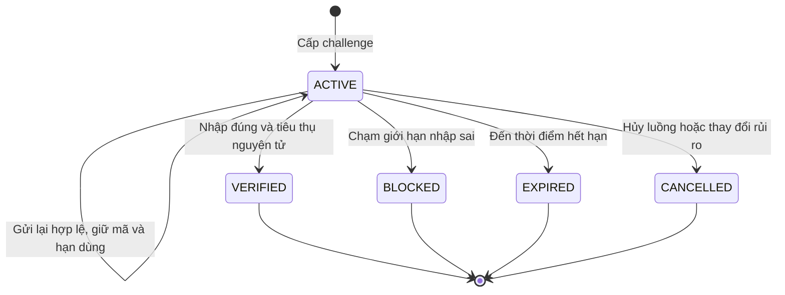

# Quy tắc gửi lại mật khẩu dùng một lần (One time password resend rules)

Trong chương **OTP Recovery**, thao tác “Gửi lại mã” là một phần của luồng khôi phục tài khoản: người dùng chưa nhận được OTP hoặc tin nhắn đến chậm nên yêu cầu hệ thống gửi thêm lần nữa. Thiết kế thao tác này phải bảo vệ cả khả năng khôi phục của chủ tài khoản lẫn ranh giới xác minh danh tính. Một nút gửi lại thiếu kiểm soát có thể gây ngập SMS, tăng chi phí, mở rộng cơ hội đoán mã hoặc liên tục làm mã của người dùng mất hiệu lực.

Bài học thuộc module `SECURITY_AUTHENTICATION_ACCOUNT_RECOVERY`, tập trung vào OTP do máy chủ cấp và chuyển qua SMS hoặc email. Những quy tắc dưới đây hỗ trợ khôi phục khi mất mật khẩu, MFA, passkey hoặc thiết bị xác thực; quyền được khôi phục cuối cùng vẫn phụ thuộc chính sách rủi ro của từng tài khoản.

## 1. Mục tiêu và phạm vi của thao tác gửi lại

Sau bài học, bạn cần giải thích được gửi lại tác động thế nào đến mã, thời hạn và bộ đếm; chọn chính sách giữ mã hoặc thay mã; thiết kế giới hạn ở máy chủ; và xử lý gửi đồng thời, lỗi mạng, hàng đợi mà không tạo thêm quyền khôi phục.

Phải phân biệt ba loại thông tin thường cùng được gọi là OTP:

| Loại | Nơi tạo mã | Ý nghĩa của “gửi lại” |
| --- | --- | --- |
| OTP khôi phục qua SMS/email | Máy chủ hoặc dịch vụ xác minh | Tạo thêm một lần chuyển mã theo chính sách của challenge |
| TOTP trong ứng dụng xác thực | Ứng dụng tính từ khóa bí mật và thời gian | Không có thao tác máy chủ gửi lại; ứng dụng hiển thị mã theo chu kỳ |
| Mã khôi phục dự phòng đã cấp trước | Hệ thống cấp bộ mã để người dùng lưu | Không gửi lại mã đã dùng; cấp bộ thay thế là một nghiệp vụ riêng |

Trong bài này, **challenge** là bản ghi thách thức xác minh, gắn mã với tài khoản, mục đích, kênh nhận và thời hạn. **Recovery flow** là toàn bộ một lượt khôi phục, có thể chứa thêm các bước đánh giá rủi ro hoặc xác minh khác.

Gửi lại chỉ xử lý việc chuyển mã. Nó không được tự động đổi số điện thoại, hạ yêu cầu MFA, bỏ qua xác minh danh tính hay tạo phiên đăng nhập.

## 2. Tách mã xác minh khỏi lần chuyển mã

Hãy dùng các định danh khác nhau cho các đối tượng sau:

| Đối tượng | Ví dụ | Vai trò |
| --- | --- | --- |
| Luồng khôi phục | `flowId` | Gom các bước của cùng lượt khôi phục |
| Challenge | `challengeId` | Xác định bằng chứng đang được kiểm tra |
| Phiên bản mã | `codeVersion` | Phân biệt các mã nếu có thay mã |
| Lần gửi | `deliveryAttemptId` | Theo dõi một lần chuyển mã qua nhà cung cấp |
| Yêu cầu logic | `Idempotency-Key` | Nhận biết lần gửi lại của cùng thao tác sau lỗi mạng |

Một challenge có thể có nhiều lần gửi nhưng chỉ có một mã đang được chấp nhận trong thiết kế minh họa của bài. Các lần gửi không phải các bằng chứng độc lập. Nếu cùng mã được gửi ba lần, xác minh thành công một lần phải làm cả ba bản sao mất khả năng sử dụng.

Máy chủ phải ràng buộc challenge với ít nhất `accountId`, `purpose`, `flowId`, kênh và địa chỉ nhận đã đăng ký. Mã dành cho `RESET_PASSWORD` không được dùng cho `REPLACE_MFA`. Mã gửi để kiểm tra email mới không được dùng thay bằng chứng khôi phục tài khoản cũ.

`flowId` khó đoán và cookie của luồng giúp bảo vệ ngữ cảnh thao tác, nhưng chưa chứng minh người gọi là chủ tài khoản. Cần tiếp tục áp dụng giới hạn lạm dụng và kiểm tra OTP.

## 3. Chọn rõ giữ nguyên hay thay mã

Có hai chính sách thường gặp. Chúng cần được mô tả rõ trong hợp đồng API và thông báo cho người dùng.

| Chính sách | Cách xử lý lần gửi lại | Lợi ích | Điểm phải kiểm soát |
| --- | --- | --- | --- |
| Giữ nguyên mã còn hạn | Gửi lại cùng mã của challenge | Tin đến không đúng thứ tự vẫn dùng được; ít gây nhầm |
| Thay bằng mã mới | Tạo phiên bản mới, vô hiệu phiên bản cũ một cách nguyên tử | Có thể thu hồi mã cũ theo nghiệp vụ | Tin cũ đến muộn; yêu cầu gửi lại có thể làm người dùng nhập mã đã bị thay |

Thiết kế minh họa chọn **giữ nguyên mã và giữ nguyên thời điểm hết hạn** trong cùng challenge. Khi challenge hết hạn, muốn tiếp tục phải bắt đầu một challenge mới qua cổng kiểm soát phát hành mã. Mọi giới hạn tổng hợp vẫn được giữ theo cửa sổ của chúng.

Nếu chọn thay mã, cần đáp ứng đồng thời các điều kiện:

1. Thay mã và vô hiệu phiên bản cũ trong cùng thao tác nguyên tử.
2. Không đặt lại bộ đếm nhập sai hoặc giới hạn gửi tổng hợp.
3. Không kéo dài vô hạn thời gian sống của luồng bằng cách thay mã.
4. Ràng buộc yêu cầu với đúng luồng; không cho người chỉ biết tên tài khoản tùy ý thay challenge đang phục vụ người dùng khác.
5. Thông báo rõ chỉ mã mới nhất còn dùng được, đồng thời có cách nhận diện thứ tự yêu cầu khi cần.

Cho nhiều phiên bản cùng hiệu lực để “dễ nhận mã hơn” làm mở rộng tập mã được chấp nhận và khiến việc dùng một lần phức tạp hơn. Nếu thực sự cần khoảng chồng lấn, phải mô hình hóa giới hạn của nó và vô hiệu toàn bộ các phiên bản liên quan khi một mã được dùng thành công.

Hành vi của dịch vụ xác minh bên ngoài phải được kiểm tra trước khi chọn chính sách. Twilio Verify mô tả việc trả lại cùng token khi yêu cầu tiếp trong thời gian hiệu lực. Không thể giả định mọi lần gọi gửi đều tạo mã mới. [Tài liệu Twilio Verify](https://www.twilio.com/docs/verify/developer-best-practices#token-validity-period).

## 4. Ba mốc thời gian và hai loại bộ đếm

Ba mốc thời gian có ý nghĩa khác nhau:

- `expiresAt`: thời điểm mã hết hạn.
- `nextSendAllowedAt`: thời điểm sớm nhất được xin thêm một lần gửi.
- `flowExpiresAt`: thời điểm lượt khôi phục phải kết thúc hoặc bắt đầu lại qua chính sách phát hành.

Với chính sách giữ mã, một lần gửi lại chỉ có thể thay đổi mốc chờ gửi tiếp. Nó không đổi `expiresAt` hoặc `flowExpiresAt`.

Hai loại bộ đếm cũng phải tách biệt:

- **Bộ đếm gửi** kiểm soát số lần chuyển mã, tần suất làm phiền và chi phí.
- **Bộ đếm xác minh sai** kiểm soát số lần đoán mã. Một lần gửi lại không phải một lần xác minh và không tạo thêm lượt đoán.

Ví dụ challenge được cấp lúc `10:00:00`, hết hạn lúc `10:05:00`. Gửi lại lúc `10:01:00` vẫn tạo bản tin có mã hết hạn lúc `10:05:00`. Người dùng không có thêm năm phút từ lúc nhận bản tin thứ hai.

Mốc hết hạn cần được kiểm tra khi xác minh và trước khi chuyển thông điệp từ hàng đợi. Không dựa riêng vào cơ chế tự xóa dữ liệu của kho lưu trữ: bản ghi chưa bị xóa vẫn có thể đã hết hạn về mặt nghiệp vụ.

NIST quy định trong cơ chế xác thực ngoài băng rằng tạo bí mật mới không được đặt lại số lần xác thực thất bại. Bài học áp dụng cùng nguyên tắc cho luồng khôi phục minh họa để việc xin mã tiếp không trở thành cách có thêm lượt đoán. Đây là lựa chọn thiết kế cho ví dụ, không phải tuyên bố toàn bộ luồng đã đáp ứng một mức bảo đảm NIST. [NIST SP 800-63B, yêu cầu với bộ xác minh ngoài băng](https://pages.nist.gov/800-63-4/sp800-63b.html#oob-verifiers).

## 5. Một chính sách minh họa có thể triển khai

Các con số sau là giả định phục vụ bài học. Khi triển khai, đội ngũ phải điều chỉnh theo mức rủi ro, độ trễ thực tế của kênh gửi, khả năng hỗ trợ người dùng và ngân sách.

| Tham số | Giá trị minh họa | Cách hiểu |
| --- | --- | --- |
| Độ dài mã | 6 chữ số | Giữ cả chữ số `0` đầu; sinh bằng bộ tạo số ngẫu nhiên mật mã |
| Thời hạn challenge | 5 phút từ lần cấp đầu | Gửi lại không gia hạn |
| Thời hạn luồng | 10 phút | Challenge mới trong luồng cũng không được vượt giới hạn này |
| Tổng số lần gửi mỗi challenge | 4 | Gồm lần đầu và tối đa 3 lần gửi lại |
| Chờ sau từng lần gửi | 30, 60, 120 giây | Tăng theo số lần đã ghi nhận; tải lại trang không đặt lại |
| Lần nhập sai mỗi challenge | 5 | Gửi lại không khôi phục số lượt |
| Lần nhập sai theo tài khoản | 10 trong 15 phút | Cộng dồn qua các challenge thuộc phạm vi phục hồi được bảo vệ |
| Lần gửi theo tài khoản | 6 trong 15 phút; 20 trong 24 giờ | Cộng dồn qua các luồng và kênh phục hồi |
| Lần gửi theo địa chỉ nhận | 6 trong 15 phút | Cộng dồn trên các mục đích dùng cùng địa chỉ để tránh né hạn mức |

Trong ví dụ, số lần gửi được tính khi máy chủ **ghi nhận quyền thực hiện một lần chuyển mã** và tạo công việc gửi bền vững. Không chờ thông báo “đã giao” mới tăng bộ đếm. Nếu chỉ tính khi giao thành công, nhiều yêu cầu đang chờ có thể cùng vượt giới hạn trước khi có callback.

Với mã đều trên không gian `10^d` giá trị và tối đa `g` lần đoán, xác suất thành công ngẫu nhiên trong mô hình đơn giản xấp xỉ `g / 10^d`, khi tỷ lệ này nhỏ. Mã sáu chữ số với năm lượt đoán tương ứng khoảng `5 / 1.000.000`. Đây chỉ là rủi ro đoán trực tuyến, chưa bao gồm việc bị lộ mã, chiếm SIM hay chiếm hộp thư.

Nếu gửi lại đặt lại năm lượt đoán, giới hạn trên không còn đúng. Nếu mỗi lần tạo luồng mới lại có hạn mức độc lập, kẻ tấn công có thể lặp lại nhiều luồng. Vì vậy, giới hạn theo challenge cần nằm bên trong các giới hạn tổng hợp theo tài khoản và địa chỉ nhận.

## 6. Kiểm soát gửi lại hoàn toàn ở máy chủ

Nút đếm ngược trên giao diện giúp người dùng hiểu trạng thái, nhưng mọi điều kiện quyết định gửi phải được kiểm tra tại máy chủ:

1. Luồng còn hiệu lực và yêu cầu thuộc đúng ngữ cảnh được cấp.
2. Challenge còn ở trạng thái cho phép nhận mã, chưa được dùng, hủy hay hết hạn.
3. Kênh và địa chỉ nhận được lấy từ dữ liệu đã đăng ký; client không được thay chúng trong yêu cầu gửi lại.
4. Đã qua `nextSendAllowedAt`.
5. Chưa chạm giới hạn gửi hoặc nhập sai của challenge.
6. Các ngân sách tài khoản, địa chỉ nhận, nguồn truy cập và nhà cung cấp đều cho phép.
7. Kết quả đánh giá rủi ro vẫn cho phép dùng kênh này.

Giới hạn theo IP hữu ích để giảm lưu lượng tự động, nhưng không đủ nếu kẻ tấn công dùng nhiều IP. IP cũng có thể được chia sẻ bởi nhiều người trong mạng công ty hoặc nhà mạng. Kết hợp IP với tài khoản, địa chỉ nhận và tín hiệu rủi ro; tránh để một IP dùng chung trở thành lý do khóa lâu mọi người phía sau nó.

Hạn mức tài khoản chống né giới hạn bằng cách chuyển từ SMS sang email. Hạn mức địa chỉ nhận chống dồn yêu cầu từ nhiều tài khoản về cùng một số điện thoại. Giới hạn theo quốc gia, tuyến gửi và tổng chi phí giúp phát hiện việc lạm dụng gửi SMS hoặc gọi thoại đắt tiền.

Mở challenge mới, đổi thiết bị, chuyển kênh hay làm mới cookie đều phải đi qua cổng phát hành và các ngân sách tổng hợp. Việc hết hạn một challenge không làm các cửa sổ ngân sách khác biến mất.

Khi hệ thống không thể xác định an toàn hạn mức vì kho điều phối lỗi, endpoint gửi lại có thể trả kết quả tạm thời không khả dụng. Không để mọi máy chủ ứng dụng tự gửi tự do trong lúc hệ thống giới hạn bị gián đoạn.

## 7. Tránh lộ tài khoản và gây từ chối dịch vụ

Endpoint công khai bắt đầu khôi phục nên phản hồi tương đương cho tài khoản tồn tại và không tồn tại, cả về nội dung lẫn hành vi thời gian. OWASP cũng khuyến nghị chống yêu cầu tự động quá mức để tránh làm ngập kênh nhận của người dùng. [OWASP Forgot Password Cheat Sheet](https://cheatsheetseries.owasp.org/cheatsheets/Forgot_Password_Cheat_Sheet.html#forgot-password-request).

Một thông báo phù hợp cho bước bắt đầu là:

> Nếu thông tin phù hợp với tài khoản, hệ thống sẽ xử lý yêu cầu khôi phục. Vui lòng kiểm tra kênh nhận đã đăng ký.

Với bước gửi lại, nếu trả `429`, thời điểm được gửi tiếp hoặc địa chỉ nhận che bớt chỉ cho tài khoản có thật, những khác biệt đó cũng có thể làm lộ tài khoản. Phải thiết kế cả phản hồi, hạn mức và ngữ cảnh luồng giả lập tương đương khi người gọi chưa có bằng chứng đủ mạnh. Một `flowId` vừa được cấp từ tên tài khoản chưa đủ làm cơ sở tiết lộ thông tin.

Sau khi ngữ cảnh đã được xác minh thích hợp, giao diện có thể hiển thị kênh nhận che bớt theo chính sách riêng tư. Không trả toàn bộ số điện thoại hoặc email từ một truy vấn khôi phục công khai.

Yêu cầu gửi lại quá mức cần làm chậm hoặc chặn **thao tác khôi phục đang bị lạm dụng**. Không tự động khóa đăng nhập thông thường hoặc thu hồi các phiên hợp lệ chỉ vì người ngoài liên tục xin OTP. Nếu cần hạn chế tài khoản do bằng chứng rủi ro khác, đó phải là quyết định riêng có cơ sở.

Giới hạn theo tài khoản vẫn có thể bị kẻ tấn công dùng để làm cạn ngân sách khôi phục của nạn nhân. Có thể giảm tác hại bằng cách loại sớm lưu lượng tự động, giữ các bằng chứng khôi phục mạnh đã đăng ký và cung cấp luồng hỗ trợ được kiểm soát. Luồng thay thế vẫn phải đánh giá rủi ro; không bỏ hạn mức chỉ vì người dùng nói rằng chưa nhận được mã.

## 8. Trạng thái xác minh và trạng thái chuyển tin

Nên mô hình hóa hai nhóm trạng thái riêng:

| Nhóm | Trạng thái minh họa | Ý nghĩa |
| --- | --- | --- |
| Challenge | `ACTIVE`, `VERIFIED`, `EXPIRED`, `BLOCKED`, `CANCELLED` | Cho biết mã có còn được kiểm tra hay đã kết thúc |
| Lần gửi | `QUEUED`, `SUBMITTED`, `DELIVERED`, `FAILED`, `UNKNOWN`, `SKIPPED` | Cho biết quá trình chuyển tin đang ở đâu |

`DELIVERED` chỉ là bằng chứng từ hạ tầng chuyển tin, không chứng minh chủ tài khoản đã nhập mã. Ngược lại, người dùng có thể xác minh thành công trong khi callback giao tin vẫn chưa đến.

Quy tắc chuyển trạng thái của challenge trong ví dụ:



Một callback `DELIVERED` đến muộn không được đưa challenge `EXPIRED` hoặc `VERIFIED` về `ACTIVE`. Tương tự, gửi lại không được hồi sinh challenge `BLOCKED`.

Nếu lần gửi đầu gặp lỗi, challenge có thể vẫn `ACTIVE` trong thời hạn của nó, trong khi lần gửi là `FAILED`. Máy chủ quyết định có cho thêm lần chuyển tin qua cùng chính sách gửi lại hay không; không tạo quyền xác minh chỉ dựa vào tình trạng chuyển tin.

## 9. Xử lý đồng thời và yêu cầu bị lặp

Giả sử người dùng nhấn hai lần hoặc có hai tab cùng gọi gửi lại. Với cách “đọc bộ đếm, kiểm tra, gửi, rồi ghi”, cả hai yêu cầu có thể thấy cùng một giá trị cũ và đều được phép gửi.

Để tránh tình huống này, cần phối hợp nguyên tử việc kiểm tra và cập nhật challenge, ngân sách liên quan, bản ghi idempotency và công việc gửi. Có thể dùng giao dịch cơ sở dữ liệu với khóa phù hợp hoặc cơ chế điều phối tương đương. Khóa một đối tượng Java trong một tiến trình không bảo vệ được hệ thống nhiều instance.

`Idempotency-Key` biểu diễn **một thao tác người dùng**, không phải tài khoản hay challenge. Nếu client không nhận được phản hồi và thử lại cùng thao tác, client dùng lại khóa. Một lần nhấn gửi lại chủ động sau khoảng chờ dùng khóa mới.

Máy chủ lưu khóa cùng fingerprint của yêu cầu, chẳng hạn `flowId`, `challengeId`, mục đích và phiên bản kênh nhận. Cùng khóa nhưng khác fingerprint phải bị từ chối. Bản ghi phải được lưu đủ lâu cho cửa sổ thử lại được hỗ trợ. Gửi lại cùng khóa chỉ trả kết quả đã ghi nhận; không tăng bộ đếm hoặc tạo thêm công việc gửi.

Luồng xử lý dưới đây là mã giả theo phong cách Java, không phải API của một thư viện. Hàm `inAtomicRecoveryScope` biểu diễn cơ chế phối hợp giao dịch cần được triển khai thực sự cho challenge, ngân sách và idempotency.

```java
ResendResult requestResend(ResendRequest req, RecoveryContext ctx) {
    validateRequestShape(req);
    requireBoundRecoveryContext(req.flowId(), ctx);
    protectCookieBasedRequestFromCsrf(ctx);

    return coordinator.inAtomicRecoveryScope(req, () -> {
        var flow = flows.loadBoundFlowForUpdate(req.flowId(), ctx);
        var challenge = challenges.loadForUpdate(req.challengeId());
        requireSameFlowAndPurpose(flow, challenge);

        var fingerprint = fingerprintOf(req, challenge.destinationVersion());
        var previous = idempotency.find(flow.id(), req.idempotencyKey());
        if (previous != null) {
            requireSameFingerprint(previous, fingerprint);
            return previous.result();
        }

        var now = authoritativeClock.instant();
        requireActiveAndUnexpired(flow, challenge, now);
        requireAttemptBudgetRemaining(challenge);
        requireSendCooldownPassed(challenge, now);
        requireChallengeSendBudgetRemaining(challenge);
        requireRiskPolicyAllows(flow, challenge, ctx);

        // Kiểm tra và giữ chỗ hạn mức cùng thao tác nguyên tử này.
        sendBudgets.reserveAllOrReject(flow, challenge, ctx, now);

        var deliveryId = newRandomDeliveryId();
        challenge.recordReservedDelivery(now, resendPolicy);

        // Payload bí mật được mã hóa, có hạn lưu giữ và quyền truy cập riêng.
        outbox.enqueue(deliveryId, challenge.id(), challenge.codeVersion(),
                challenge.encryptedDeliveryPayload(), challenge.expiresAt());

        var result = ResendResult.accepted(
                challenge.nextSendAllowedAt(), challenge.expiresAt());
        idempotency.save(flow.id(), req.idempotencyKey(), fingerprint, result);
        challenges.save(challenge);
        return result;
    });
}
```

Các nhánh từ chối trong giao dịch phải bảo đảm không để lại một phần thay đổi, chẳng hạn đã lấy hạn mức nhưng chưa ghi công việc gửi. Lớp trả HTTP cần chuyển kết quả nội bộ thành phản hồi công khai phù hợp với yêu cầu chống dò tài khoản.

Đường xác minh OTP phải dùng cùng cơ chế phối hợp trên challenge. Khi hai yêu cầu nhập đúng chạy đồng thời, chỉ một yêu cầu được chuyển `ACTIVE` sang `VERIFIED` và cấp quyền tiếp tục khôi phục. Yêu cầu gửi lại thua cuộc sau khi challenge đã được dùng phải bị từ chối.

## 10. Gửi qua nhà cung cấp: hàng đợi, timeout và callback

Không nên giữ khóa giao dịch trong khi chờ API SMS hoặc email. Hãy ghi một công việc gửi bền vững cùng giao dịch nghiệp vụ, rồi để bộ xử lý hàng đợi gọi nhà cung cấp sau khi giao dịch hoàn tất. Cách này thường được gọi là transactional outbox.

Trước khi chuyển tin, bộ xử lý kiểm tra challenge còn hợp lệ, phiên bản mã còn hiện hành và còn đủ thời gian nhận mã. Trong thiết kế minh họa, nếu mã chỉ còn dưới 30 giây thì có thể bỏ qua lần gửi và hướng người dùng bắt đầu lại theo chính sách. Ngưỡng này là lựa chọn sản phẩm, không phải giá trị bắt buộc.

| Tình huống | Cách xử lý |
| --- | --- |
| Nhà cung cấp chấp nhận yêu cầu | Lưu mã yêu cầu nhà cung cấp, cập nhật `SUBMITTED` |
| Nhà cung cấp xác nhận chưa nhận yêu cầu hoặc từ chối rõ ràng | Đánh dấu lỗi; chỉ hoàn hạn mức khi chính sách có thể chứng minh chưa gửi và thực hiện hoàn nguyên đúng một lần |
| Hết thời gian chờ, chưa biết đã nhận hay chưa | Đánh dấu `UNKNOWN`, giữ nguyên hạn mức; đối soát hoặc thử lại cùng định danh nếu nhà cung cấp hỗ trợ |
| Công việc bị xử lý lại | Dùng lại định danh logic của lần gửi; không coi đó là lần nhấn gửi lại mới |
| Challenge đã hết hạn hoặc đã được dùng | Bỏ qua công việc chưa gửi; không đổi lại trạng thái challenge |
| Callback giao tin đến trễ hoặc trùng | Xác minh nguồn, chống xử lý lặp và chỉ cập nhật trạng thái chuyển tin hợp lệ |

Timeout không đồng nghĩa chưa gửi. Nếu hoàn hạn mức ngay rồi tạo một yêu cầu mới, hệ thống có thể gửi trùng nhiều lần trong khi vẫn tưởng chưa tiêu tốn ngân sách.

Transactional outbox bảo đảm công việc được ghi cùng dữ liệu nghiệp vụ, nhưng không tự bảo đảm tin nhắn chỉ được chuyển đúng một lần qua mạng. Nếu nhà cung cấp không hỗ trợ idempotency hoặc truy vấn đối soát, phải chấp nhận khả năng chuyển trùng có kiểm soát và giới hạn số lần thử; không tuyên bố đạt “exactly once”.

Ngay cả khi bộ xử lý vừa kiểm tra xong, người dùng vẫn có thể dùng mã trước lúc nhà cung cấp nhận tin. Một bản tin đến sau khi xác minh là tình huống có thể xảy ra. Kiểm tra trạng thái tại endpoint xác minh mới là hàng rào quyết định: mã đã tiêu thụ phải luôn bị từ chối.

## 11. Lưu bí mật khi cần gửi lại cùng mã

Việc giữ nguyên mã đặt ra một câu hỏi thực tế: nếu chỉ lưu giá trị kiểm tra một chiều, máy chủ lấy đâu ra mã để gửi lại?

Có thể chọn một trong hai mô hình:

- **Nhà cung cấp quản lý mã:** ứng dụng giữ định danh challenge của nhà cung cấp và gọi chức năng gửi lại tương ứng. Ứng dụng vẫn áp dụng giới hạn, ràng buộc mục đích và trạng thái luồng của mình.
- **Ứng dụng quản lý mã:** lưu giá trị kiểm tra và giữ riêng payload chuyển tin được mã hóa, chỉ trong thời gian cần thiết. Bộ xử lý gửi có quyền giải mã; dữ liệu được xóa khi challenge kết thúc hoặc hết hạn theo chính sách lưu giữ.

Mã sáu chữ số có không gian nhỏ. Chỉ lưu `SHA-256(otp)` không đủ chống việc dò ngoại tuyến khi dữ liệu bị lộ. Một thiết kế cho mã ngắn có thể dùng HMAC với khóa bí mật được quản lý riêng, trên biểu diễn có cấu trúc chứa challenge, mục đích, phiên bản và mã. Cần bảo vệ khóa, hỗ trợ phiên bản khóa và so sánh giá trị kiểm tra theo cách tránh rò rỉ thời gian.

HMAC không cung cấp mã gốc để gửi lại, nên không thay thế payload được mã hóa. Ngược lại, mã hóa payload không thay thế hạn mức đoán trực tuyến. Hai cơ chế giải quyết các nhu cầu khác nhau.

Không ghi OTP, payload giải mã, token luồng hoặc cookie vào log, trace, tham số URL hay hệ thống phân tích giao diện. Quyền đọc hàng đợi lỗi và bản sao lưu cũng phải được xem là quyền có thể tiếp cận bí mật nếu payload còn được lưu trong đó.

## 12. API và trải nghiệm người dùng

Một yêu cầu gửi lại minh họa:

```http
POST /account-recovery/flows/{flowId}/otp/resend
Content-Type: application/json
Idempotency-Key: 4b37c90b-3b73-4b8d-98dd-11f8ed4fb262

{
  "challengeId": "opaque-challenge-reference"
}
```

Body không nhận số điện thoại hay email tùy ý. Địa chỉ nhận được lấy từ challenge và đối chiếu dữ liệu hiện hành. Nếu cần chuyển sang kênh khác đã đăng ký, đó là thao tác riêng đi qua chính sách phát hành; không sửa địa chỉ trong lần gửi lại.

Phản hồi được chấp nhận có thể dùng `202 Accepted`, với thông điệp “Yêu cầu đã được ghi nhận”. Trạng thái này không khẳng định tin đã đến thiết bị. Trong ngữ cảnh được phép cung cấp thông tin chi tiết, có thể trả:

```json
{
  "status": "ACCEPTED",
  "message": "Yêu cầu gửi mã đã được ghi nhận.",
  "nextSendAllowedAt": "2026-11-23T03:01:00Z",
  "expiresAt": "2026-11-23T03:05:00Z"
}
```

Nếu gửi quá sớm, có thể dùng `429 Too Many Requests` và `Retry-After`, nhưng vẫn phải bảo đảm hợp đồng phản hồi không tiết lộ sự tồn tại của tài khoản. Thời gian chờ được tính từ máy chủ; giao diện chỉ hiển thị lại và cập nhật khi nhận phản hồi mới.

Thông báo cho người dùng cần giải thích:

- Có thể chờ bao lâu trước lần gửi tiếp.
- Mã giữ nguyên hay đã thay đổi sau lần gửi lại.
- Gửi lại không làm thời hạn mã bắt đầu lại.
- Cách xử lý khi mất quyền truy cập kênh nhận.

Cho phép dán và tự điền mã khi phù hợp, giữ nguyên chữ số `0` ở đầu. Không buộc người dùng bấm gửi lại chỉ vì ứng dụng bị chuyển sang nền hoặc tải lại trang. Khi hết hạn, hiển thị đường bắt đầu lại rõ ràng thay vì để nút gửi lại tiếp tục tạo yêu cầu vô ích.

Twilio khuyến nghị có khoảng chờ thử lại để giảm spam và chi phí, với ví dụ bắt đầu từ một yêu cầu mỗi 30 giây cho mỗi số điện thoại. Chính sách 30, 60, 120 giây trong bài là một lựa chọn minh họa cụ thể. [Twilio: smart retry logic](https://www.twilio.com/docs/verify/developer-best-practices#use-smart-retry-logic-for-delivering-otps).

## 13. Từ OTP đúng đến quyền khôi phục

Một mã đúng chỉ chứng minh bằng chứng mà challenge được thiết kế để thu thập. Nó không tự chứng minh mọi điều kiện cần thiết để thay MFA hoặc khôi phục passkey đã mất.

Sau khi tiêu thụ mã thành công, máy chủ nên cấp quyền tiếp tục ngắn hạn, gắn với tài khoản, mục đích và luồng. Quyền đó chỉ cho phép bước được phê duyệt, chẳng hạn đặt lại mật khẩu; không có quyền đọc dữ liệu tài khoản hay thay mọi phương thức xác thực.

Nếu đánh giá rủi ro yêu cầu thêm bằng chứng hoặc thời gian chờ, bước gửi lại không được bỏ qua chúng. Mất kênh nhận cần chuyển sang phương án khôi phục đã được thiết kế trước, không cho người yêu cầu tự khai báo một địa chỉ mới rồi dùng OTP ở đó để chứng minh sở hữu tài khoản cũ.

Email có thể là kênh nhận mã khôi phục, nhưng không vì vậy mà được xem là yếu tố xác thực ngoài băng đáp ứng mọi yêu cầu. NIST phân biệt mã xác nhận hoặc mã khôi phục qua email với cơ chế xác thực ngoài băng; cần đọc đúng phạm vi khi viện dẫn tiêu chuẩn. [NIST SP 800-63B, bộ xác thực ngoài băng](https://pages.nist.gov/800-63-4/sp800-63b.html#out-of-band).

Tại thời điểm hoàn tất khôi phục, hệ thống mới thực hiện chính sách thay đổi thông tin xác thực, xử lý các session và refresh token liên quan, gửi thông báo an ninh và hướng người dùng đăng nhập theo luồng phù hợp. Chỉ một lần nhấn gửi lại chưa đủ cơ sở để thực hiện các tác động này.

## 14. Ví dụ diễn tiến và các tình huống cần kiểm chứng

Lan mất mật khẩu nhưng vẫn kiểm soát số điện thoại khôi phục đã đăng ký. Hệ thống cho phép dùng OTP làm bằng chứng của bước hiện tại và tạo challenge `C1` lúc `10:00:00`.

| Thời điểm | Sự kiện | Kết quả mong đợi |
| --- | --- | --- |
| `10:00:00` | Ghi nhận lần gửi đầu | `sendCount = 1`, hết hạn `10:05:00`, chờ đến `10:00:30` |
| `10:00:10` | Lan nhấn gửi lại | Bị giới hạn; không tạo công việc gửi, không tăng số lần gửi |
| `10:00:30` | Gửi lại hợp lệ với khóa `K2` | `sendCount = 2`, cùng mã, chờ đến `10:01:30` |
| `10:00:31` | Client thử lại `K2` do mất phản hồi | Trả kết quả cũ; không tăng bộ đếm hoặc tạo lần gửi mới |
| `10:00:40` | Hai tin đến không đúng thứ tự | Cùng mã; thời hạn vẫn là `10:05:00` |
| `10:01:00` | Lan nhập sai một lần | Bộ đếm xác minh sai tăng; bộ đếm gửi không đổi |
| `10:01:30` | Gửi lại hợp lệ lần nữa | `sendCount = 3`; lượt nhập sai trước vẫn được giữ |
| `10:01:50` | Lan nhập đúng | Tiêu thụ challenge đúng một lần, cấp quyền cho bước khôi phục tiếp theo |
| `10:01:51` | Yêu cầu gửi lại đến sau khi đã xác minh | Bị từ chối; callback chuyển tin về sau không thể kích hoạt lại mã |

Các tình huống sau giúp kiểm chứng thiết kế, đặc biệt ở ranh giới giữa API, kho trạng thái và nhà cung cấp:

| Tình huống | Thuộc tính cần giữ |
| --- | --- |
| Hai instance nhận hai khóa mới cùng lúc ngay khi hết khoảng chờ | Chỉ một lần gửi được ghi nhận; yêu cầu còn lại thấy khoảng chờ mới |
| Lặp lại cùng khóa idempotency | Không tăng bộ đếm, không ghi thêm công việc gửi |
| Dùng cùng khóa với challenge khác | Bị từ chối vì fingerprint không khớp |
| Nhập sai đến giới hạn rồi xin gửi lại | Không phục hồi lượt đoán hoặc chuyển challenge về `ACTIVE` |
| Tạo nhiều luồng hoặc đổi kênh | Ngân sách tổng hợp vẫn được kiểm tra |
| Kiểm tra mã đúng tại `now == expiresAt` | Bị từ chối theo quy tắc hết hạn `now >= expiresAt` |
| Nhà cung cấp timeout rồi hệ thống nhận callback đã giao | Không hoàn hạn mức hai lần hoặc tự tạo mã mới |
| Hàng đợi xử lý sau khi challenge hết hạn | Công việc chưa gửi bị bỏ qua; mã không được hồi sinh |
| Gửi lại chạy đồng thời với xác minh đúng | Không tạo thêm quyền khôi phục; challenge chỉ tiêu thụ một lần |
| Callback cũ đến sau khi challenge kết thúc | Chỉ tác động trạng thái chuyển tin hợp lệ |
| Tài khoản có và không có thật | Không có khác biệt công khai đáng tin cậy để dò tài khoản |
| Kẻ tấn công làm cạn hạn mức gửi | Phiên đang đăng nhập và mật khẩu hiện tại không tự bị thu hồi |

Nên theo dõi số yêu cầu được ghi nhận, bị giới hạn, số timeout, độ trễ chuyển tin, tỷ lệ xác minh theo số lần gửi và chi phí theo tuyến. Dùng định danh giả danh hoặc dữ liệu đã che bớt; không đưa OTP hay địa chỉ nhận đầy đủ vào log. Những tín hiệu này giúp điều chỉnh thời gian chờ và phát hiện lạm dụng mà vẫn giữ ranh giới xác minh của luồng khôi phục.
