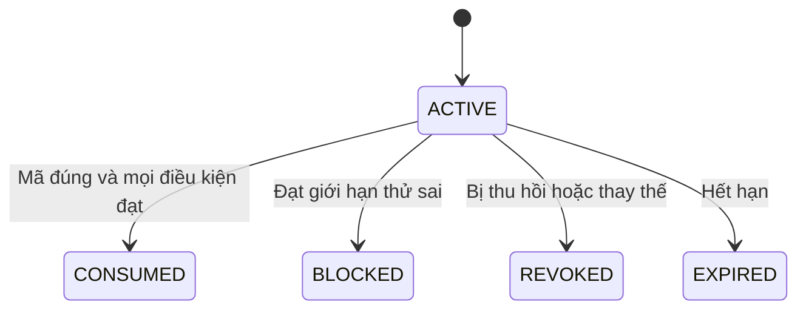

# Xác minh mã dùng một lần trong khôi phục tài khoản

Trong chương **OTP Recovery**, **One time password verification** là bước server kiểm tra mã người dùng nhập và quyết định có ghi nhận một bằng chứng khôi phục hay không. Trong **SECURITY_AUTHENTICATION_ACCOUNT_RECOVERY**, bước này phục vụ việc lấy lại quyền truy cập khi người dùng mất mật khẩu, MFA, passkey hoặc thiết bị xác thực.

Mã đúng chỉ là một điều kiện. Server còn phải xác định mã thuộc tài khoản và yêu cầu nào, dùng cho hành động nào, còn hiệu lực không, có vượt ngân sách thử không và đã được tiêu thụ chưa. Sau xác minh, hệ thống chỉ được trao quyền mà chính sách khôi phục cho phép.

Bài học sử dụng chủ yếu **mã ngẫu nhiên do server cấp cho một challenge rồi gửi qua kênh đã đủ điều kiện**. Challenge là bản ghi đại diện cho một lần yêu cầu chứng minh quyền kiểm soát kênh. HOTP, TOTP và recovery code lưu sẵn cần quy tắc xác minh riêng; không thay thế chúng bằng cùng một phép so sánh chuỗi.

Các giới hạn như tám chữ số, năm lượt thử hoặc thời hạn năm phút trong bài là ví dụ thiết kế, không phải cấu hình bắt buộc hay tuyên bố tuân thủ tiêu chuẩn.

## 1. Tách xác minh mã, ghi nhận bằng chứng và cấp quyền

Ba kết quả sau có ý nghĩa khác nhau:

| Kết quả | Điều server đã xác nhận | Điều chưa tự được phép |
|---|---|---|
| Mã khớp | Đầu vào tạo ra đúng giá trị kiểm tra của challenge | Bỏ qua thời hạn, trạng thái hoặc giới hạn thử |
| Challenge được tiêu thụ | Mã được chấp nhận đúng ngữ cảnh, một lần, theo chính sách | Tự động xóa MFA hoặc đăng ký passkey mới |
| Chính sách cho phép bước tiếp theo | Tập bằng chứng và rủi ro đạt yêu cầu của hành động cụ thể | Dùng quyền này cho mọi API của tài khoản |

Ví dụ, một OTP gửi tới email đã đăng ký có thể tạo bằng chứng rằng người trình mã đang có khả năng nhận thư tại kênh đó. Nó không tự chứng minh danh tính pháp lý của người trình, cũng không khẳng định hộp thư chưa bị chiếm.

Nếu người dùng mất toàn bộ passkey, quyền đăng ký passkey thay thế phải đến từ chính sách khôi phục. Việc “xác minh email thành công” không được âm thầm biến thành quyền thay mọi yếu tố xác thực.

NIST phân biệt các phương thức khôi phục và đặt yêu cầu theo mức bảo đảm của tài khoản. Không thể suy ra rằng một mã email đơn lẻ luôn đủ cho khôi phục MFA. Xem phần **Account Recovery** của [NIST SP 800-63B-4](https://pages.nist.gov/800-63-4/sp800-63b.html#account-recovery).

## 2. Hợp đồng đầu vào và ranh giới tin cậy

Một API minh họa có thể nhận:

```http
POST /recovery/requests/{requestId}/otp/verify
Content-Type: application/json
Cache-Control: no-store

{
  "challengeId": "opaque-challenge-reference",
  "code": "00421937"
}
```

Đây là hợp đồng minh họa. Phản hồi của server cũng cần chính sách không lưu cache phù hợp; một header do client gửi không thay cho cấu hình phản hồi.

Server có thể thiết lập một recovery context riêng, chẳng hạn một phiên khôi phục ngắn hạn được bảo vệ bằng cookie bí mật. Ngữ cảnh này chỉ cho phép tham gia đúng hành trình khôi phục. Người dùng đang mất thông tin đăng nhập nên không thể mặc định yêu cầu họ đã có session đăng nhập đầy đủ.

| Dữ liệu | Nguồn có thẩm quyền | Quy tắc xác minh |
|---|---|---|
| OTP được nhập | Client | Chỉ là một ứng viên cần kiểm tra |
| Request ID, challenge ID | Client gửi tham chiếu | Phải tra cứu và kiểm tra quan hệ phía server |
| Tenant và tài khoản | Bản ghi và ngữ cảnh tenant đã xác thực | Không dùng trường client sửa được để chuyển đích khôi phục |
| Mục đích | Yêu cầu khôi phục được server lập | Mã đặt lại mật khẩu không tự có quyền khôi phục MFA |
| Kênh nhận và phiên bản kênh | Hồ sơ kênh cùng chính sách phía server | Một email mới trong payload không thay thế kênh của challenge |
| Thời gian, hạn dùng, lượt thử | Trạng thái và đồng hồ có thẩm quyền | Không tin đồng hồ hoặc bộ đếm gửi từ trình duyệt |
| Bằng chứng đã đạt | Kho bằng chứng phía server | Không nhận `verified: true` từ client |

Không tra cứu tài khoản chỉ bằng chuỗi OTP. Hai challenge của hai người có thể tình cờ có cùng mã số. Mã chỉ có nghĩa trong ngữ cảnh đã chọn và kiểm tra.

Một challenge ID khó đoán giúp hạn chế việc dò tham chiếu nhưng không thay thế OTP hoặc quyền của recovery context. Ngược lại, OTP đúng cũng không được dùng để vượt qua kiểm tra quyền truy cập một request không thuộc ngữ cảnh hiện tại.

Nếu quy trình cần chuyển sang thiết bị khác, phải có hợp đồng chuyển tiếp và ràng buộc riêng. Không tự bỏ kiểm tra ngữ cảnh chỉ để hỗ trợ việc mở email trên một thiết bị khác.

Với trình duyệt dùng cookie, cần bảo vệ các thao tác thay đổi trạng thái khỏi CSRF theo thiết kế ứng dụng. Giới hạn kích thước body, kiểm tra kiểu dữ liệu và kiểm soát tốc độ phải diễn ra trước các công việc đắt tiền.

## 3. Mô hình trạng thái có thể thực thi tính dùng một lần

Một mô hình tối thiểu cho ví dụ:

```text
RecoveryRequest
  id, tenant_id, account_id, purpose
  context_binding
  state, expires_at
  active_generation
  policy_version

OtpChallenge
  id, recovery_request_id
  channel_record_id, channel_version
  generation, verifier_key_version, verifier_tag
  state, expires_at
  failed_attempts, max_failed_attempts
  consumed_at

RecoveryBudget
  account_id, purpose, window_id
  failed_attempts, max_failed_attempts

RecoveryEvidence
  id, recovery_request_id, challenge_id
  kind, verified_at, expires_at
  policy_version
```

Đây là mô hình minh họa, không phải schema bắt buộc. Hệ thống nhiều tenant cần đưa tenant vào khóa và quan hệ tương ứng. Nếu lưu lặp tài khoản hoặc mục đích trong challenge, phải bảo đảm chúng khớp yêu cầu cha.

Các trạng thái challenge có thể là:



Hết hạn có thể là điều kiện được tính từ `expires_at`, không nhất thiết phải chờ một job chuyển trạng thái. Dù database còn lưu `ACTIVE`, verifier vẫn phải từ chối nếu đã tới hạn.

`CONSUMED` là trạng thái cuối của challenge. Không chuyển lại thành `ACTIVE` khi người dùng tải lại trang, request timeout hoặc hệ thống gửi lại thông báo.

Bằng chứng và quyền khôi phục cũng có thời hạn riêng. Không đặt `verified=true` vĩnh viễn trên tài khoản chỉ vì một challenge từng thành công.

## 4. Kiểm tra định dạng và thời gian trước khi chấp nhận

OTP là chuỗi. Với hợp đồng tám chữ số ASCII, `00421937` hợp lệ về định dạng, còn `421937` không phải cùng biểu diễn. Không chuyển qua kiểu số nguyên rồi tự thêm số 0 để “sửa” đầu vào.

Một hàm Java kiểm tra định dạng minh họa:

```java
public final class OtpInput {
    private OtpInput() {}

    public static boolean isEightAsciiDigits(String code) {
        if (code == null || code.length() != 8) {
            return false;
        }
        for (int i = 0; i < code.length(); i++) {
            char ch = code.charAt(i);
            if (ch < '0' || ch > '9') {
                return false;
            }
        }
        return true;
    }
}
```

Nếu sản phẩm cho phép dấu cách hoặc dấu phân nhóm khi nhập, phải công bố quy tắc chuẩn hóa duy nhất và dùng thống nhất giữa giao diện, API và thành phần xác minh. Không âm thầm nhận mọi ký tự Unicode trông giống chữ số.

Từ chối đầu vào sai định dạng không có nghĩa cho phép gửi chúng vô hạn. Các request này vẫn phải chịu kiểm soát lạm dụng ở endpoint. Chính sách cần xác định khi nào chúng còn bị tính vào ngân sách của một request đã được phân giải hợp lệ.

Quy tắc thời gian trong ví dụ là:

```text
accepted only if:
    authoritative_now < request.expires_at
    authoritative_now < challenge.expires_at
```

Tại đúng hạn cuối, mã không còn được chấp nhận. Thời điểm người dùng bấm gửi hoặc thời điểm email đến không quyết định hiệu lực.

Không lấy thời gian từ client. Với nhiều node, phải thống nhất nguồn thời gian và theo dõi độ lệch. Trong một transaction có thể chờ khóa lâu, không dùng một mốc đã lấy trước khi chờ để quyết định rằng mã “vẫn còn hạn”.

Cần chọn rõ thời điểm tuyến tính hóa quyết định xác minh: trạng thái và thời gian phải hợp lệ tại quyết định tiêu thụ. Một phản hồi mạng đến muộn sau khi quyết định đã commit không tự làm kết quả thất bại.

## 5. Đối chiếu giá trị kiểm tra mà không lưu mã thô

Với mã ngẫu nhiên ngắn, lưu `SHA-256(otp)` hoặc hash có salt vẫn có rủi ro dò hết không gian nếu database bị đọc. Salt không biến không gian tám chữ số thành không gian bí mật lớn.

Một lựa chọn thiết kế là lưu tag HMAC, với khóa do thành phần bảo mật quản lý ngoài bảng challenge:

```text
candidate_tag = HMAC-SHA-256(
    verifier_key_for(stored_key_version),
    canonical_encode(
        format_version,
        stored_tenant_id,
        stored_account_id,
        stored_request_id,
        stored_challenge_id,
        stored_purpose,
        stored_generation,
        submitted_otp
    )
)

match = secret_compare(stored_verifier_tag, candidate_tag)
```

Các trường ngữ cảnh đến từ dữ liệu đã được server kiểm tra. `canonical_encode` cần phân định trường rõ ràng, chẳng hạn mã hóa độ dài từng trường, để không tạo đầu vào mơ hồ khi ghép chuỗi.

Phải dùng đúng cùng thuật toán, khóa phiên bản và cách mã hóa như lúc cấp mã. Không tự thử mọi phiên bản khóa, mọi challenge hoặc mọi mục đích để tìm một kết quả khớp.

Khóa không lấy được, tag sai cấu trúc hoặc phiên bản thuật toán không được hỗ trợ là lỗi vận hành hoặc dữ liệu. Không chuyển chúng thành xác minh thành công; cũng không nhất thiết gọi chúng là “người dùng nhập sai”.

Trong Java, sau khi thành phần HMAC tạo hai tag SHA-256 đủ 32 byte, có thể đối chiếu như sau:

```java
import java.security.MessageDigest;

public final class OtpTagComparison {
    private static final int TAG_BYTES = 32;

    private OtpTagComparison() {}

    public static boolean matches(byte[] storedTag, byte[] candidateTag) {
        if (storedTag == null || candidateTag == null
                || storedTag.length != TAG_BYTES
                || candidateTag.length != TAG_BYTES) {
            throw new IllegalStateException("Invalid verifier tag");
        }
        return MessageDigest.isEqual(storedTag, candidateTag);
    }
}
```

Đoạn mã chỉ minh họa so sánh tag, chưa xác minh toàn bộ challenge. Tài liệu [Java MessageDigest.isEqual](https://docs.oracle.com/en/java/javase/25/docs/api/java.base/java/security/MessageDigest.html#isEqual(byte%5B%5D,byte%5B%5D)) mô tả hành vi so sánh và các điều kiện thời gian xử lý của phương thức. Việc dùng tag cố định độ dài giúp giới hạn các khác biệt đầu vào ở bước này.

Không suy ra rằng toàn endpoint đã có thời gian phản hồi đồng nhất. Tra cứu tài khoản, lỗi định dạng, khóa database và gọi dịch vụ ngoài vẫn có thể tạo khác biệt. Cần kiểm soát lộ thông tin trên toàn đường xử lý.

Không log OTP, tag kiểm tra, khóa HMAC hoặc body của request xác minh. Tag không phải dữ liệu quan sát cần thiết. Tách khóa khỏi database chỉ giúp trong mô hình đe dọa tương ứng; nếu cả khóa và dữ liệu đều bị lộ, vẫn có thể dò mã.

## 6. Ngân sách thử phải tồn tại qua nhiều request và nhiều node

Với mã chọn đều từ không gian `N` giá trị và `q` lần đoán khác nhau cho một mã cố định, xác suất đoán trúng là `q/N` khi `q <= N`.

Ví dụ, mã tám chữ số có `N = 100.000.000`. Năm lần đoán cho một mã có xác suất `5/100.000.000 = 0,000005%`. Phép tính này không bao gồm lộ kênh giao, phishing hoặc việc kẻ tấn công xin thêm nhiều challenge.

Nếu cho mỗi challenge năm lần nhưng cho tạo vô hạn challenge, tổng cơ hội đoán không còn bị giới hạn ở năm. Nếu verifier chấp nhận bất kỳ mã nào trong nhiều challenge đang mở, tập giá trị có thể được chấp nhận cũng lớn hơn.

Có thể phối hợp các lớp kiểm soát:

| Phạm vi | Mục tiêu | Điểm cần tránh |
|---|---|---|
| Challenge | Chặn đoán liên tục trên một mã | Không đặt lại bộ đếm chỉ vì tải lại trang |
| Request khôi phục | Giới hạn cả hành trình | Không kéo dài request vô hạn khi xin mã mới |
| Tài khoản và mục đích | Chặn tạo nhiều request để lấy lượt mới | Không chỉ lưu bộ đếm trong một request |
| Nguồn gửi, thiết bị hoặc dấu hiệu lạm dụng | Hạn chế tự động hóa và tải | Không chỉ dựa vào IP |
| Toàn dịch vụ hoặc tenant | Bảo vệ tài nguyên và phát hiện chiến dịch | Không dùng một ngưỡng duy nhất cho mọi lưu lượng |

Bộ đếm an toàn phải được cập nhật nguyên tử ở phạm vi của nó. Hai luồng không được cùng đọc “còn một lượt” rồi đều đi tiếp. Với các ngân sách nằm cùng database, có thể khóa các bản ghi liên quan theo một thứ tự chung. Với rate limiter bên ngoài, cần quy tắc cấp lượt nguyên tử và hành vi rõ khi dịch vụ đó không sẵn sàng.

Nên phân biệt số request vào endpoint, số lần so sánh mã và số lần so sánh sai. Chúng có thể có hạn mức khác nhau. Trong ví dụ tiếp theo, `failed_attempts` chỉ tăng khi một phép thử được phép thực hiện nhưng mã không khớp; endpoint vẫn có kiểm soát riêng cho mọi request.

Không khóa vĩnh viễn tài khoản đăng nhập chỉ vì người vô danh gửi nhiều mã sai. Có thể chặn challenge, áp dụng thời gian chờ hoặc chuyển sang phương thức khôi phục khác theo chính sách. Cần giữ cân bằng giữa chống đoán mã và khả năng kẻ tấn công cố ý làm người dùng thật mất đường khôi phục.

## 7. Xác minh và tiêu thụ trong cùng một quyết định nguyên tử

Cách làm dễ lỗi là:

```text
read challenge
if code matches and not consumed:
    create recovery permission
    mark challenge consumed
```

Hai request đồng thời có thể cùng đọc `not consumed` rồi cùng tạo quyền. Việc mỗi dòng code “có kiểm tra” không loại bỏ cuộc đua giữa các lần đọc và ghi.

Một luồng minh họa dùng transaction và khóa bản ghi:

```text
validate transport, body size and OTP format
apply endpoint rate limits
resolve and validate the recovery context and tenant

begin transaction
    lock account-purpose budget, recovery request, then challenge
        using the same lock order as issuance and revocation

    require challenge belongs to this request
    require request belongs to this context and tenant
    require stored account and purpose bindings are consistent

    require request and challenge are active
    require generation and channel eligibility are still acceptable
    require all verification budgets permit a comparison

    compute candidate tag with the stored key version and context
    compare candidate tag with the stored tag

    decision_time = authoritative time obtained after lock waits
    require decision_time is before both expiry deadlines

    if tags do not match:
        increment challenge failed_attempts
        increment request/account-purpose failure budgets
        block the challenge if its failure limit is reached
        persist a secret-free failure audit event
        commit
        return a safe verification failure

    conditionally transition challenge from ACTIVE to CONSUMED
    require exactly one row transitioned

    insert scoped recovery evidence with a unique challenge reference
    persist the successful operation result for this context
    append a secret-free success audit event
commit

return the allowed next step after successful commit
```

Đây là pseudocode về các bất biến, không phải implementation đã tích hợp framework. Các điều kiện không đạt phải đi vào đường từ chối hoặc lỗi vận hành phù hợp, không rơi xuống nhánh thành công. Không chấp nhận kết quả trước khi commit.

Thứ tự khóa phải thống nhất giữa xác minh, cấp lại, thu hồi và hoàn tất request. Nếu chỉ verifier khóa request còn thao tác cấp lại sửa generation không tuân cùng cơ chế, verifier vẫn có thể tiêu thụ một mã vừa bị thay thế.

Không thực hiện gửi email hoặc gọi nhà cung cấp SMS trong khi giữ khóa. Các tác dụng phụ cần được ghi nhận bền vững rồi thực thi ngoài transaction, chẳng hạn bằng outbox. Tính tag cũng cần được thiết kế để không giữ khóa qua một lời gọi mạng kéo dài mà chưa có chiến lược xử lý.

### 7.1. Lượt thử sai phải được commit

Trong nhiều framework, ném exception có thể làm rollback transaction. Khi đó luồng sau không bảo vệ được số lượt thử:

```text
begin transaction
    increment failed_attempts
    throw InvalidOtpException
rollback
```

Cần lưu kết quả nghiệp vụ thất bại bằng transaction được commit. Có thể trả về một giá trị kết quả từ hàm transaction rồi ánh xạ sang phản hồi HTTP ở ngoài. Không dùng một exception khiến framework rollback toàn bộ cập nhật bộ đếm.

Nếu thao tác tăng bộ đếm thất bại, không tiếp tục nhận thêm phép so sánh như thể ngân sách đã được lưu. Cần một chế độ suy giảm có kiểm soát; không mặc định cho phép bỏ qua giới hạn.

### 7.2. Bằng chứng không được tách rời trạng thái đã dùng

Nếu đánh dấu `CONSUMED` rồi lỗi trước khi lưu bằng chứng, người dùng có thể mất mã mà không thể tiếp tục. Nếu lưu bằng chứng trước rồi lỗi trước khi tiêu thụ, mã có thể tiếp tục tạo thêm bằng chứng.

Khi cùng nằm trong một database, đặt hai thay đổi trong cùng transaction là lựa chọn dễ lập luận. Một ràng buộc duy nhất trên `RecoveryEvidence.challenge_id` giúp bảo vệ thêm việc không tạo nhiều bằng chứng từ một challenge, nhưng không thay cho kiểm tra quyền, thời hạn và trạng thái.

Một ví dụ cập nhật có điều kiện:

```sql
UPDATE recovery_otp_challenge
SET state = 'CONSUMED',
    consumed_at = :decision_time
WHERE id = :challenge_id
  AND recovery_request_id = :request_id
  AND generation = :expected_generation
  AND state = 'ACTIVE'
  AND expires_at > :decision_time
  AND failed_attempts < max_failed_attempts;
```

Câu lệnh dùng tham số do server xác định. Nó phải nằm trong transaction đã kiểm tra và bảo vệ request cha, ngữ cảnh, kênh và ngân sách; đây không phải một verifier độc lập. Chỉ tiếp tục nếu số dòng cập nhật là một.

Nếu chọn optimistic concurrency thay cho khóa, cần đưa version và các điều kiện liên quan vào quyết định ghi. Khi xung đột, không tự trả thành công dựa trên lần đọc cũ. Cả nhánh tăng bộ đếm sai và nhánh tiêu thụ đúng đều phải được bảo vệ.

## 8. Nhiều node, cache và tính nhất quán

Một `synchronized` trong Java chỉ điều phối các luồng chia sẻ cùng đối tượng trong một JVM. Nó không ngăn node B xác minh đồng thời với node A.

Verifier cần một cơ chế điều phối có hiệu lực trên mọi node có quyền chấp nhận mã:

- Database transaction với khóa hoặc cập nhật có điều kiện, cùng ràng buộc dữ liệu phù hợp.
- Kho trạng thái hỗ trợ thao tác nguyên tử đủ để thực thi các bất biến đã chọn.
- Một thiết kế phân tán có chủ sở hữu quyết định rõ ràng và cách phục hồi khi các bước gián đoạn.

Không lấy trạng thái `ACTIVE` từ replica trễ hoặc cache rồi coi đó là căn cứ cuối để cấp quyền. Cache có thể hỗ trợ đọc, nhưng quyết định tiêu thụ phải được kiểm chứng ở nơi có thẩm quyền hiện tại.

Nếu OTP được tiêu thụ trong Redis còn bằng chứng được lưu trong database khác, hai thao tác không tự thành nguyên tử chỉ vì đều chạy nhanh. Cần xử lý được các tình huống tiêu thụ thành công nhưng lưu bằng chứng thất bại, hoặc retry sau khi mất phản hồi. Một thiết kế đơn giản hơn là giữ trạng thái quyết định và bằng chứng trong cùng ranh giới transaction, rồi dùng cache cho vai trò hỗ trợ.

Khôi phục database từ backup cũng có thể đưa trạng thái đã dùng trở về chưa dùng. Kế hoạch phục hồi phải xem xét vô hiệu hóa các challenge đang mở hoặc dùng một mốc thế hệ có thẩm quyền để không phục sinh bí mật cũ. TTL trong cache không thay cho kế hoạch này.

Khi không xác định chắc challenge có còn hợp lệ hoặc đã tiêu thụ hay chưa, không cấp quyền theo giả định thuận tiện. Người dùng có thể được hướng dẫn tiếp tục từ trạng thái bền vững đã biết hoặc bắt đầu một yêu cầu mới theo chính sách.

## 9. Gửi lại mã, timeout và retry là các trường hợp khác nhau

| Sự kiện | Cách xử lý trong thiết kế minh họa |
|---|---|
| Người dùng gửi lại cùng form do mạng chậm | Không tạo thêm một bằng chứng độc lập |
| Phản hồi thành công mất sau commit | Giữ trạng thái đã dùng; hỗ trợ phục hồi kết quả trong đúng ngữ cảnh nếu hợp đồng cho phép |
| Worker gửi lại cùng tin nhắn | Không tự sinh OTP mới hoặc đặt lại lượt thử |
| Người dùng yêu cầu mã mới | Đi qua chính sách cấp mới, generation, thu hồi và hạn mức |
| Mã cũ tới muộn sau khi đã bị thay | Không nhận lại chỉ vì người dùng vừa đọc được |
| Dịch vụ khởi động lại | Không xóa bộ đếm hoặc phục hồi challenge đã dùng |

Có thể dùng idempotency key để nhận diện một thao tác lặp. Tuy nhiên, key này không phải bằng chứng sở hữu tài khoản. Không trả recovery grant cho bất kỳ ai chỉ cần biết challenge ID hoặc một idempotency key.

Nếu hỗ trợ đọc lại kết quả đã thành công, phải ràng buộc bản ghi kết quả với đúng recovery context và request. Việc trả trạng thái của cùng thao tác không được tạo ra một lần xác minh mới, kéo dài thời hạn bằng chứng hoặc sinh thêm quyền độc lập.

Không lưu OTP thô trong bản ghi idempotency. Một hash không có khóa của OTP ngắn cũng tạo thêm dữ liệu dễ dò nếu bị lộ. Chỉ lưu thông tin tối thiểu cần cho hợp đồng retry, với bảo vệ bí mật tương ứng.

Khi chính sách chỉ chấp nhận generation mới nhất, một cuộc đua giữa cấp lại và xác minh phải có thứ tự kết quả rõ:

```text
Cấp lại thắng trước:
    generation cũ bị vô hiệu -> xác minh mã cũ bị từ chối.

Xác minh thắng trước:
    bằng chứng đã được ghi -> cấp lại phải xét trạng thái request mới.
```

Không để thao tác cấp lại chạy với snapshot cũ và làm sống lại một bước đã hoàn tất. Ngân sách thất bại ở phạm vi tài khoản hoặc hành trình cũng không được đặt lại chỉ vì đổi generation.

Chính sách thay mã cần cân nhắc việc kẻ tấn công liên tục xin mã để hủy mã của người dùng thật. Hạn mức cấp lại và ràng buộc ngữ cảnh là một phần của thiết kế chống lạm dụng, không chỉ giới hạn ở endpoint kiểm tra.

## 10. HOTP và TOTP cần bộ xác minh riêng

Với HOTP, server kiểm tra mã theo bộ đếm và cửa sổ dò có giới hạn. Sau thành công, cần cập nhật trạng thái bộ đếm an toàn. Với TOTP, cửa sổ thời gian và độ lệch được chấp nhận phải hữu hạn. RFC 6238 yêu cầu không chấp nhận lại OTP sau khi đã xác minh thành công trong bước thời gian đó. Xem [RFC 6238, mục 5.2 và 6](https://www.rfc-editor.org/rfc/rfc6238.html#section-5.2).

Khi tích hợp, không chỉ gọi một hàm trả `true` nếu mã khớp bước hiện tại rồi bỏ qua trạng thái chống replay. Thông tin lần sử dụng cần có phạm vi phù hợp với authenticator và được cập nhật nguyên tử qua mọi đường sử dụng liên quan, thay vì chỉ ghi vào một recovery request.

Một thư viện có thể kiểm tra phép tính TOTP nhưng không sở hữu database, ngân sách và policy của sản phẩm. Phải biết rõ trách nhiệm nào do thư viện thực hiện và trách nhiệm nào thuộc dịch vụ.

Nếu người dùng đã mất thiết bị TOTP, không biến việc yêu cầu mã từ thiết bị đó thành đường khôi phục duy nhất. Cần một phương thức còn khả dụng được chính sách chấp thuận.

Không coi HOTP/TOTP và OTP email là những nhãn thay thế cho cùng một loại bằng chứng. NIST cũng không coi OTP nhập tay là cơ chế chống phishing; thời hạn ngắn không ngăn kẻ tấn công chuyển tiếp mã theo thời gian thực. Xem phần **Phishing Resistance** của [NIST SP 800-63B-4](https://pages.nist.gov/800-63-4/sp800-63b.html#phishing-resistance).

## 11. Phản hồi và quan sát mà không lộ bí mật

Cần phân biệt kết quả nội bộ đủ chi tiết với thông tin công khai phù hợp ngữ cảnh:

| Kết quả nội bộ | Hành vi bên ngoài có thể áp dụng |
|---|---|
| Mã sai, challenge không có, đã dùng hoặc không thuộc context | Thông báo xác minh không thành công theo hợp đồng |
| Hết hạn trong context đã được phép xem | Hướng dẫn xin mã mới nếu việc tiết lộ trạng thái được chính sách cho phép |
| Hết ngân sách | Áp dụng thời gian chờ hoặc phương thức khác, không nhận thêm phép thử vượt hạn |
| Khóa kiểm tra hoặc kho trạng thái lỗi | Thông báo tạm thời không thể xử lý; không nhận mã theo đường tắt |
| Commit thành công | Trả bước tiếp theo được phép, không tự trả token đăng nhập đầy đủ |

Không nhất thiết mọi lỗi đều có cùng HTTP status. Điều cần thiết là hợp đồng không làm lộ tài khoản có tồn tại, kênh khôi phục riêng tư hoặc chi tiết giúp dò mã ngoài phạm vi người gọi được phép biết.

OWASP khuyến nghị tránh dò tồn tại tài khoản và áp dụng kiểm soát lạm dụng cho luồng quên mật khẩu. Xem [Forgot Password Cheat Sheet](https://cheatsheetseries.owasp.org/cheatsheets/Forgot_Password_Cheat_Sheet.html). Khi thiết kế endpoint xác minh, cần mở rộng đánh giá này sang thông báo, khác biệt thời gian và cách tra cứu challenge của chính ứng dụng.

Giới hạn kích thước và số lần thử giúp tránh việc giữ nhiều request ngủ để tạo “thời gian phản hồi bằng nhau”. Các truy vấn và thao tác mật mã cần được thiết kế có chi phí hợp lý; không dùng delay tùy tiện làm cơ chế duy nhất che lộ thông tin.

Audit có thể ghi:

```text
event_type: OTP_VERIFICATION_REJECTED
request_ref: internal-safe-reference
challenge_ref: internal-safe-reference
reason: ATTEMPT_BUDGET_EXHAUSTED
policy_version: recovery-policy-version
occurred_at: server-time
correlation_id: non-secret-trace-reference
```

Không ghi mã, tag, recovery grant, cookie hoặc dữ liệu kênh đầy đủ. Các tham chiếu nội bộ vẫn cần phân quyền truy cập và thời gian lưu phù hợp.

Theo dõi tỷ lệ thử sai, số challenge bị chặn, xung đột tiêu thụ, lỗi commit, độ trễ xác minh và số lần xin mã mới. Dùng metric tổng hợp; không đưa bí mật hoặc định danh tài khoản vào nhãn có thể làm tăng mạnh số chuỗi thời gian.

## 12. Sau OTP đúng: tiếp tục khôi phục theo quyền hạn chế

Sau khi ghi bằng chứng, policy engine có thể quyết định:

```text
EMAIL_CONTROL_CONFIRMED
    -> cần thêm bằng chứng cho RECOVER_MFA

EMAIL_CONTROL_CONFIRMED + bằng chứng bổ sung đủ điều kiện
    -> cho phép bước thiết lập phương thức thay thế

Bằng chứng hết hạn hoặc rủi ro vượt ngưỡng
    -> không tiếp tục bằng quyền cũ
```

Các tên trên minh họa trạng thái nghiệp vụ. Không quy định rằng hai bằng chứng bất kỳ đều đủ; hai mã gửi cùng một hộp thư có thể cùng phụ thuộc vào một kênh bị chiếm.

Nếu cấp recovery grant, grant cần gắn với tài khoản, request, mục đích, phạm vi thao tác và thời hạn. Chỉ nơi kiểm tra được grant mới được thực thi bước tiếp theo. Một claim tự ghi `otpVerified=true` từ client không có giá trị.

Tại lúc đổi mật khẩu, gỡ phương thức đã mất hoặc đăng ký passkey mới, server phải kiểm tra lại grant và điều kiện hiện tại. Không chỉ dựa vào việc giao diện từng hiện dấu tích xanh.

Ví dụ, thay đổi kênh khôi phục, phát hiện tài khoản bị chiếm hoặc request bị thu hồi sau lúc xác minh có thể làm quyền cũ không còn phù hợp. Chính sách cần nêu rõ biến cố nào hủy bằng chứng hoặc yêu cầu đánh giá lại.

Hoàn tất thay credential còn cần xử lý session và refresh token theo chính sách, đồng thời gửi thông báo bảo mật qua kênh phù hợp. Việc tiêu thụ OTP không tự thu hồi các session cũ, và không nên mặc định tạo một session đăng nhập toàn quyền ngay trong endpoint xác minh.

## 13. Tình huống xuyên suốt và các hành vi cần kiểm chứng

Lan mất điện thoại chứa MFA nhưng vẫn truy cập được email đã thiết lập. Hệ thống tạo request `R`, challenge `C`, generation `g`, với năm lần thử sai tối đa. Một người khác biết email của Lan cũng tìm cách đoán mã.

1. Những request vô danh hoặc đầu vào sai định dạng chịu hạn mức endpoint; chúng không được quyền chọn lại tài khoản của `C`.
2. Các phép so sánh sai hợp lệ cập nhật bộ đếm của `C` và ngân sách phạm vi rộng hơn bằng dữ liệu bền vững.
3. Khi Lan và một lần gửi trùng cùng nộp đúng mã, chỉ một transaction được tiêu thụ `C` và ghi bằng chứng.
4. Nếu phản hồi tới Lan bị mất, hệ thống vẫn giữ bằng chứng đã commit; một retry không làm `C` trở lại chưa dùng.
5. Policy nhận bằng chứng email, rồi quyết định yêu cầu thêm điều kiện trước khi cho phép thay MFA.
6. Khi được phép hoàn tất, bước thay MFA kiểm tra quyền hiện hành, xử lý phương thức cũ và session theo chính sách.

Nếu kẻ tấn công đã chiếm hộp thư của Lan, verifier có thể thực hiện đúng mọi phép kiểm tra mà người trình mã vẫn là kẻ tấn công. Vì vậy, chất lượng kênh khôi phục và chính sách bằng chứng quyết định giới hạn bảo đảm của cả luồng.

Bảng sau là các yêu cầu hành vi để kiểm chứng khi triển khai, không phải kết quả kiểm thử đã chạy trong bài:

| Tình huống | Kết quả cần đạt |
|---|---|
| Mã có số 0 ở đầu | Giữ nguyên chuỗi và xác minh theo đúng hợp đồng |
| Mã chứa ký tự ngoài bảng cho phép | Từ chối nhất quán, vẫn chịu kiểm soát lạm dụng |
| Mã đúng nhưng sai request, tenant hoặc purpose | Không tạo bằng chứng |
| Hai challenge độc lập có cùng chuỗi mã | Không xác minh chéo tài khoản |
| Mã đúng tại đúng thời điểm hết hạn | Từ chối theo quy tắc biên đã chọn |
| Request chờ khóa đến khi hết hạn | Không dùng thời gian cũ để chấp nhận |
| Nhiều request cùng dùng mã đúng | Chỉ một lần tiêu thụ mới, không nhân đôi quyền |
| Hai lần thử sai khi chỉ còn một lượt | Không vượt ngân sách do cùng đọc trạng thái cũ |
| Framework xử lý mã sai bằng kết quả thất bại | Bộ đếm đã tăng vẫn được commit |
| Lỗi lưu bằng chứng trước commit | Không để lại tiêu thụ đơn độc trong thiết kế cùng transaction |
| Mất phản hồi sau commit | Không hoàn tác trạng thái đã dùng |
| Cấp lại chạy đồng thời với xác minh | Kết quả tuân một thứ tự hợp lệ, không nhận generation đã vô hiệu |
| Xin nhiều challenge mới | Không xóa ngân sách chống đoán ở phạm vi rộng hơn |
| Đọc cache hoặc replica còn trạng thái cũ | Quyết định cuối vẫn bị chặn bởi trạng thái có thẩm quyền |
| Khóa HMAC không sẵn sàng | Không fallback sang so sánh yếu hoặc bỏ kiểm tra |
| OTP đúng nhưng còn thiếu bằng chứng cho thay MFA | Chỉ ghi bằng chứng, chưa cho phép thay MFA |
| Grant hết hạn trước lúc thực thi | Từ chối hành động dù OTP từng đúng |
| Log, trace và báo lỗi hoạt động | Không thu thập bí mật xác minh |
| Khôi phục dữ liệu từ backup | Không vô tình cho dùng lại challenge cũ |

Một verifier có thể được đánh giá bằng câu hỏi: **sau mọi lỗi mạng, retry và cuộc đua đồng thời, có thể giải thích chính xác bằng chứng nào được tạo, cho tài khoản nào, từ challenge nào và dưới quyền nào không?** Câu trả lời phải dựa vào trạng thái đã commit cùng các ràng buộc phía server.
