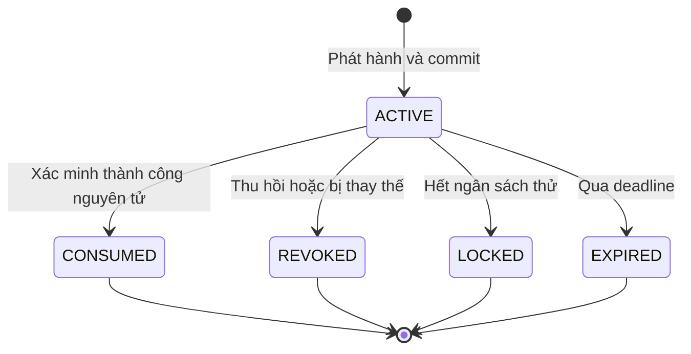

# Vô hiệu hóa mã OTP trong khôi phục tài khoản

## 1. Vô hiệu hóa OTP bảo vệ điều gì?

Trong chương OTP Recovery, **one time password invalidation** là việc làm cho một mã OTP hoặc challenge chứa mã đó không còn được phép tạo ra bằng chứng khôi phục hợp lệ. Việc này phải có hiệu lực ở nơi máy chủ quyết định chấp nhận mã, kể cả khi email hoặc SMS chứa mã vẫn còn trên thiết bị của người nhận.

Một luồng khôi phục có thể dùng OTP để chứng minh người yêu cầu đang kiểm soát một kênh đã đăng ký. Nếu OTP đã dùng vẫn được chấp nhận, mã cũ tiếp tục có hiệu lực sau khi phát hành mã mới, hoặc một request đến muộn có thể vượt qua việc hủy khôi phục, kẻ tấn công có thêm cơ hội chiếm tài khoản.

Phạm vi bài học tập trung vào OTP do máy chủ sinh và gửi qua kênh khôi phục. Phần sau phân biệt thêm với TOTP do ứng dụng xác thực sinh. Các nguyên tắc được đặt trong luồng khôi phục mật khẩu, MFA, passkey hoặc thiết bị xác thực: giá trị OTP chỉ là một phần của chính sách xác minh, không mặc nhiên đủ để gỡ mọi yếu tố bảo vệ tài khoản.

Ví dụ, hệ thống yêu cầu OTP email và một bước kiểm tra bổ sung trước khi cho đăng ký lại MFA. OTP email hợp lệ chỉ hoàn thành bằng chứng thuộc kênh email. Nó không tự cấp session đăng nhập, không tự cho đổi địa chỉ nhận và không tự bỏ bước kiểm tra còn lại.

### Ba khái niệm cần tách biệt

| Khái niệm | Ý nghĩa | Ví dụ |
| --- | --- | --- |
| Hết hạn | Đã vượt quá thời điểm được phép sử dụng. | Mã chỉ hợp lệ trước deadline do máy chủ lưu. |
| Tiêu thụ | Một lần xác minh thành công đã sử dụng quyền chứng minh của challenge. | Hai request cùng mã chỉ được tạo một kết quả xác minh. |
| Thu hồi | Chính sách chủ động hủy quyền sử dụng trước deadline. | Người dùng yêu cầu mã mới hoặc hủy luồng khôi phục. |

Xóa mã khỏi giao diện, gửi thông báo “mã cũ không còn hiệu lực”, hoặc gỡ công việc khỏi hàng đợi gửi thư không thực hiện thay việc vô hiệu hóa trên máy chủ.

## 2. Các bất biến cần giữ

Một thiết kế có thể thay đổi cách lưu trữ và cách gửi mã, nhưng cần diễn đạt rõ những điều luôn phải đúng:

1. Một challenge chỉ có thể tạo **tối đa một kết quả xác minh thành công có hiệu lực**.
2. Một mã chỉ được xét trong đúng tài khoản, recovery attempt, mục đích, kênh và thế hệ đã phát hành.
3. Mã hết hạn, bị thu hồi, bị khóa hoặc đã tiêu thụ không trở lại trạng thái hoạt động.
4. Phát hành lại mã không đặt lại ngân sách thử sai tích lũy của recovery attempt.
5. Callback giao thư, retry gửi và trạng thái trên trình duyệt không có quyền kích hoạt lại mã.
6. Việc hủy hoặc hoàn tất khôi phục phải chặn được các request cũ đang chạy đồng thời.
7. Một lỗi mạng sau khi commit không khiến cùng challenge được dùng để cấp thêm quyền mới.

Các bất biến này khác với mục tiêu “người dùng chỉ nhận một tin nhắn”. Nhà cung cấp có thể gửi trùng hoặc giao muộn. Hệ thống vẫn phải giữ đúng quyền sử dụng OTP.

Một mã ngẫu nhiên sáu chữ số có một triệu giá trị có thể có. Nếu kẻ tấn công có thể thử không giới hạn, thuộc tính “chỉ dùng một lần” không ngăn được việc đoán trúng trước chủ tài khoản. Vì vậy, tiêu thụ một lần phải đi cùng giới hạn thử, giới hạn phát hành và chính sách đánh giá rủi ro.

## 3. Định danh challenge thay vì coi chuỗi chữ số là danh tính

Chỉ lưu một giá trị kiểu `otp:account_id = 123456` làm mất nhiều thông tin cần thiết. Khi cùng tài khoản có nhiều thiết bị, nhiều mục đích hoặc nhiều lần resend, máy chủ khó biết request đang trả lời challenge nào.

Một mô hình minh họa:

| Đối tượng | Trường tiêu biểu | Vai trò |
| --- | --- | --- |
| Tài khoản | `account_id`, `recovery_epoch` | Vô hiệu hóa các luồng cũ khi trạng thái bảo mật thay đổi. |
| Recovery attempt | `attempt_id`, `purpose`, `state`, `expires_at`, `failed_attempts` | Giữ ngữ cảnh nghiệp vụ, deadline tổng và ngân sách thử. |
| OTP challenge | `challenge_id`, `attempt_id`, `channel_binding`, `generation`, `state`, `expires_at` | Đại diện một lần phát hành bằng chứng OTP. |
| Dữ liệu xác minh | `verifier`, `verifier_key_id`, `issued_epoch` | Kiểm tra mã mà không lưu mã rõ trong bảng challenge. |
| Kết quả xác minh | `proof_id`, `source_challenge_id`, `scope`, `expires_at` | Ghi nhận một bằng chứng đã đạt, có phạm vi và vòng đời riêng. |

Recovery attempt có thể lưu `current_challenge_id` và `current_generation` cho kênh đang xét. Nếu chính sách cho phép nhiều challenge hoạt động, phải định nghĩa rõ nhóm nào cùng tồn tại và cách tính ngân sách chung. Ví dụ trong bài dùng chính sách **mỗi attempt và kênh chỉ có một challenge hiện hành**.

`channel_binding` tham chiếu đến đích khôi phục đã được xác nhận theo chính sách. Không lấy một địa chỉ email hoặc số điện thoại tùy ý trong request xác minh làm nơi nhận OTP.

`challenge_id` cần khó đoán và có kiểm tra quyền truy cập phù hợp, nhưng bản thân nó không phải bằng chứng khôi phục. Biết ID không được phép lấy mã, đổi mật khẩu hoặc đọc dữ liệu riêng của tài khoản.

### Một lần dùng là một lần dùng của challenge

Hai challenge khác nhau có thể ngẫu nhiên sinh cùng chuỗi chữ số, đặc biệt khi không gian mã nhỏ. Vì vậy, “mã cũ vô hiệu” phải được hiểu là **challenge cũ không còn được chấp nhận trong ngữ cảnh cũ**. Không thể coi một chuỗi sáu chữ số là định danh duy nhất vĩnh viễn trên toàn hệ thống.

Request cần gắn với challenge hoặc ngữ cảnh attempt hiện hành. Nếu sản phẩm yêu cầu mã mới khác mã liền trước để tránh gây nhầm lẫn, việc chọn mã phải thực thi thêm quy tắc đó khi phát hành. Quy tắc này không thay thế kiểm tra trạng thái và thế hệ.

## 4. Vòng đời và các trạng thái kết thúc

Một state machine đơn giản:



`ACTIVE` chỉ có nghĩa challenge có thể được xét tiếp. Để chấp nhận mã, máy chủ còn phải kiểm tra attempt đang mở, đúng thế hệ, đúng epoch, còn ngân sách và đủ các điều kiện ràng buộc.

Các trạng thái kết thúc không có chuyển tiếp quay lại `ACTIVE`. Gửi lại cùng email hoặc nhận lại webhook delivered không được sửa trạng thái này.

Trạng thái `EXPIRED` có thể được xác định theo điều kiện thời gian mà không cần ghi ngay xuống hàng. Ví dụ, một hàng còn ghi `ACTIVE` nhưng `expires_at <= server_time` đã không hợp lệ. Job dọn dữ liệu chỉ giúp cập nhật báo cáo hoặc thu gom; quyết định chấp nhận OTP không được chờ job chạy.

Các lý do như `SUPERSEDED`, `USER_CANCELLED`, `RECOVERY_COMPLETED` có thể được lưu trong `revocation_reason` để phục vụ audit. Không cần tạo một trạng thái nghiệp vụ mới cho từng nguyên nhân nếu tất cả đều có cùng quy tắc từ chối.

## 5. Khi nào phải vô hiệu hóa và vô hiệu hóa đến đâu?

| Sự kiện | Phạm vi cần xử lý | Điểm cần chú ý |
| --- | --- | --- |
| OTP được xác minh thành công | Tiêu thụ challenge vừa được dùng. | Ghi kết quả xác minh cùng transaction với việc tiêu thụ. |
| Phát hành mã thay thế | Thu hồi challenge cũ trong cùng phạm vi và tăng thế hệ. | Việc thay thế phải có một thời điểm có hiệu lực rõ ràng. |
| Quá deadline | Từ chối challenge ngay trên đường xác minh. | Không phụ thuộc TTL cache hoặc lịch dọn dữ liệu. |
| Hết ngân sách thử sai | Khóa theo phạm vi đã định nghĩa. | Chặn việc tạo lại challenge để có ngân sách mới. |
| Người dùng hủy attempt | Hủy attempt và mọi challenge thuộc attempt. | Không chỉ xóa dữ liệu phía trình duyệt. |
| Khôi phục hoàn tất | Đóng attempt, thu hồi bằng chứng còn dư theo chính sách tài khoản. | Các attempt song song có thể cần bị vô hiệu hóa bằng epoch chung. |
| Đích nhận hoặc yếu tố liên quan bị thay đổi | Thu hồi các challenge dựa vào ràng buộc cũ. | Không tự chuyển mã đã phát hành sang đích mới. |
| Có sự kiện bảo mật cần cắt luồng khôi phục cũ | Tăng epoch hoặc thu hồi nhóm attempt liên quan. | Quyết định phải dựa trên sự kiện đã được xác thực và chính sách rõ ràng. |

Không nên cho mọi request khôi phục chưa xác thực quyền hủy tất cả OTP của một tài khoản. Kẻ tấn công có thể liên tục khởi tạo request để ngăn chủ tài khoản hoàn thành khôi phục. Cần kiểm soát tần suất, rủi ro và quyền thay thế mã, đồng thời xác định thao tác nào chỉ ảnh hưởng attempt của chính nó.

Tương tự, khóa thử OTP không mặc nhiên là khóa toàn bộ tài khoản. Phạm vi quá rộng có thể biến cơ chế chống đoán mã thành công cụ gây từ chối dịch vụ cho người dùng.

## 6. Phân biệt retry gửi, resend và phát hành mã mới

Ba thao tác thường bị gọi chung là “gửi lại” nhưng có ngữ nghĩa khác nhau.

### 6.1. Retry kỹ thuật

Worker gửi tin nhắn thử lại do timeout hoặc lỗi tạm thời. Nó vẫn xử lý cùng thông báo logic và cùng challenge nếu challenge còn hợp lệ.

Retry không được tự:

- Sinh một mã mới.
- Đổi `current_generation`.
- Gia hạn `expires_at`.
- Đặt lại `failed_attempts`.
- Kích hoạt challenge đã bị thu hồi.

Timeout gửi có thể xảy ra sau khi nhà cung cấp đã nhận tin. Cần nhận diện khả năng gửi trùng; không suy ra rằng chưa có email hoặc SMS nào được gửi.

### 6.2. Gửi lại cùng challenge

Chính sách có thể cho gửi lại cùng OTP trong thời gian nó còn hợp lệ. Deadline ban đầu và ngân sách thử giữ nguyên.

Cách này đòi hỏi hệ thống gửi có thể tái tạo hoặc lấy lại bí mật một cách có kiểm soát. Một HMAC verifier trong bảng challenge không cho phép khôi phục OTP. Nếu không có cơ chế giữ payload được bảo vệ trong thời gian ngắn, không thể lấy verifier để gửi lại mã rõ.

### 6.3. Phát hành challenge thay thế

Một chính sách khác là mỗi yêu cầu resend được chấp thuận đều tạo challenge mới. Khi đó, cần thay thế mã trong một transaction:

```text
1. Kiểm tra quyền yêu cầu resend, hạn mức phát hành và rủi ro.
2. Khóa hoặc thực hiện CAS trên ngữ cảnh recovery có thẩm quyền.
3. Kiểm tra attempt còn mở và chưa hết deadline tổng.
4. Thu hồi challenge hiện hành nếu nó còn hoạt động.
5. Tạo challenge thế hệ g + 1.
6. Đổi con trỏ current_challenge_id/current_generation.
7. Ghi công việc gửi tương ứng vào outbox.
8. Commit.
```

Nếu transaction thất bại, việc thu hồi challenge cũ và tạo challenge mới cùng rollback. Nếu commit thành công nhưng nhà cung cấp gửi lỗi, challenge cũ vẫn bị thu hồi theo chính sách thay thế đã chọn. Không tự khôi phục mã cũ chỉ để người dùng có một mã dễ dùng hơn.

Outbox giúp gắn việc phát hành challenge với công việc cần gửi. Nếu outbox chứa OTP hoặc nội dung tin nhắn có OTP, dữ liệu đó cũng là bí mật: cần bảo vệ khi lưu, giới hạn quyền đọc, hạn lưu ngắn và không đưa vào log. Outbox không tự làm cho payload an toàn.

Worker nên bỏ qua công việc đã lỗi thời trước khi dispatch. Tuy nhiên, tin đã được nhà cung cấp tiếp nhận vẫn có thể đến muộn. Hàng rào cuối cùng luôn là kiểm tra challenge hiện hành tại máy chủ.

## 7. Xác minh và tiêu thụ phải là một chuyển trạng thái nguyên tử

Cách triển khai dưới đây có lỗi:

```text
if challenge.state == ACTIVE and matches(input, verifier):
    return success
    // Một tác vụ khác sẽ đánh dấu CONSUMED sau.
```

Hai request có thể cùng đọc `ACTIVE`, cùng so khớp và cùng nhận thành công trước khi tác vụ cập nhật chạy. Chỉ thêm một câu lệnh ghi sau khi kiểm tra chưa bảo đảm tính một lần.

Một mô hình dùng transaction có thể đi như sau. Đây là giả mã mô tả contract, không phải chương trình hoàn chỉnh.

```text
verifyOtp(context, submittedCode):
    áp dụng giới hạn tải và giới hạn thử ở cổng vào
    kiểm tra cấu trúc mã mà không làm mất số 0 ở đầu

    BEGIN

    khóa account, recovery_attempt, otp_challenge
    theo cùng thứ tự khóa đã thống nhất cho mọi đường ghi

    đọc trạng thái bảo mật có thẩm quyền
    kiểm tra tài khoản/ngữ cảnh được phép tiếp tục recovery
    kiểm tra attempt còn OPEN, đúng purpose và channel_binding
    kiểm tra challenge là challenge hiện hành
    kiểm tra generation và issued_epoch còn khớp
    kiểm tra challenge còn ACTIVE, còn hạn và còn ngân sách

    candidate = verifierOf(context, submittedCode)

    nếu so khớp hằng thời gian không đạt:
        tăng bộ đếm thử sai dùng chung của attempt một cách nguyên tử
        nếu đã hết ngân sách: khóa phạm vi OTP tương ứng
        ghi sự kiện thất bại đã lược bỏ dữ liệu bí mật
        COMMIT
        trả kết quả từ chối chung

    kiểm tra lại deadline tại thời điểm chuyển trạng thái
    chuyển ACTIVE sang CONSUMED với điều kiện trạng thái vẫn hợp lệ
    yêu cầu đúng một hàng được cập nhật
    ghi duy nhất một proof có source_challenge_id này
    ghi sự kiện audit/outbox cần thiết

    COMMIT

    trả kết quả của proof theo chính sách luồng khôi phục
```

Nếu hệ thống dùng khóa hàng, các thao tác thay thế mã, hủy attempt và tăng epoch cũng phải phối hợp với cùng mô hình khóa. Ví dụ, thứ tự nhất quán là account → attempt → challenge. Chỉ khóa challenge trong verify nhưng bỏ qua khóa account khi thu hồi toàn tài khoản có thể để hở một race khác.

Không gọi API gửi thư hoặc dịch vụ mạng chậm trong lúc giữ các khóa này. Transaction cần ngắn; retry do deadlock phải dựa trên idempotency và trạng thái đã commit.

### Cập nhật có điều kiện là hàng rào cuối

Một câu lệnh SQL minh họa cho phần tiêu thụ:

```sql
UPDATE otp_challenge
SET state = 'CONSUMED',
    consumed_at = :db_now
WHERE challenge_id = :challenge_id
  AND attempt_id = :attempt_id
  AND generation = :expected_generation
  AND state = 'ACTIVE'
  AND expires_at > :db_now;
```

Trong ví dụ này, việc kiểm tra verifier, con trỏ hiện hành, ngân sách, trạng thái attempt và epoch đã được thực hiện khi giữ khóa trong cùng transaction. `:db_now` là thời gian đáng tin cậy lấy sát bước cập nhật, không phải thời gian do client gửi.

Nếu bỏ các khóa, riêng câu SQL này không đủ ngăn một attempt vừa bị hủy hoặc một epoch vừa thay đổi. Khi dùng optimistic concurrency, điều kiện cập nhật và transaction phải bao phủ các phiên bản của những đối tượng liên quan.

Kết quả cập nhật bằng không là thất bại xác minh hoặc xung đột cần giải quyết, không phải thành công vì mã từng so khớp trước đó.

## 8. Gắn việc tiêu thụ với kết quả khôi phục

Có hai lỗi đối xứng cần tránh:

- Đánh dấu OTP đã dùng, sau đó lỗi trước khi lưu proof: người dùng mất mã nhưng hệ thống không ghi được bằng chứng.
- Cấp proof hoặc quyền đổi mật khẩu, sau đó lỗi trước khi đánh dấu OTP đã dùng: cùng mã có thể cấp thêm quyền.

Nếu proof và challenge ở cùng cơ sở dữ liệu, ghi chúng trong cùng transaction là một cách giải quyết. Ràng buộc duy nhất trên `source_challenge_id` giúp chặn việc tạo nhiều proof từ một challenge.

Proof cần ràng buộc ít nhất tài khoản, attempt, mục đích, chính sách đã đạt và deadline. Nếu nó được biểu diễn bằng một bearer token, phải dùng bí mật đủ mạnh, lưu verifier phù hợp và bảo vệ khỏi log hoặc URL có khả năng bị thu thập ngoài ý muốn.

Deadline của proof là vòng đời riêng. OTP phải còn hạn tại thời điểm được tiêu thụ; proof đã cấp có thể có hạn dùng ngắn riêng theo chính sách và không vượt deadline của attempt. Không kéo dài OTP để đồng nhất hai vòng đời này.

Nếu proof được mang sang một dịch vụ khác, cần một giao thức bảo đảm nhận và dùng kết quả theo idempotency, chẳng hạn outbox cùng kiểm tra duy nhất ở bên nhận. Không thể tuyên bố tính nguyên tử xuyên dịch vụ chỉ vì mỗi bên có transaction cục bộ.

### Mất response không cho phép dùng mã lần nữa

Sau khi commit thành công, kết nối HTTP có thể đứt. Khi client gửi lại, OTP vẫn đã tiêu thụ.

Có thể cho client đã được ràng buộc hợp lệ truy vấn hoặc nhận lại cùng kết quả theo một khóa idempotency. Điều này không tạo một proof mới và không cho người chỉ biết mã cũ nhận lại bearer token của người khác.

Nếu chưa có cơ chế phục hồi kết quả an toàn, trả thông báo hướng dẫn tiếp tục theo luồng đã thiết kế. Không chuyển challenge về `ACTIVE` để “bù” một response bị mất.

## 9. Lưu verifier và đếm thử sai đúng phạm vi

OTP ngắn có không gian tìm kiếm nhỏ. Lưu `SHA-256(otp)` đơn thuần, kể cả thêm salt công khai, vẫn cho phép kẻ có bản sao dữ liệu thử hết không gian mã ở chế độ offline.

Một lựa chọn là verifier dùng HMAC với khóa nằm ngoài kho challenge:

```text
verifier = HMAC(
    verification_key,
    encode(
        "recovery-otp-v1",
        tenant_id,
        account_id,
        attempt_id,
        challenge_id,
        purpose,
        channel_binding,
        generation,
        issued_epoch,
        otp
    )
)
```

`encode` phải không nhập nhằng, chẳng hạn có độ dài cho từng trường hoặc dùng định dạng canonical đã thống nhất. Không nối chuỗi tùy ý khiến hai bộ trường khác nhau tạo cùng thông điệp đầu vào.

Khóa HMAC cần được quản lý tách biệt và có `verifier_key_id` để hỗ trợ luân chuyển. Không dùng recovery token hoặc chính OTP làm khóa HMAC. Khi cần vô hiệu hóa một lô challenge, ưu tiên cơ chế trạng thái/epoch rõ ràng; việc bỏ một khóa dùng chung có thể ảnh hưởng nhiều challenge ngoài ý muốn.

HMAC không làm OTP sáu chữ số khó đoán hơn ở API trực tuyến. Các lớp hạn chế vẫn cần thiết:

- Hạn mức theo attempt để nhiều lần phát hành không mở lại ngân sách.
- Hạn mức theo tài khoản hoặc nhóm rủi ro nhằm chặn tạo nhiều attempt.
- Hạn mức theo nguồn yêu cầu và toàn dịch vụ để hạn chế tải và chi phí gửi.
- Giới hạn phát hành/resend riêng với giới hạn xác minh mã.

Bộ đếm phải tăng nguyên tử khi có request đồng thời. Không chỉ đọc “còn một lần thử” rồi cho hàng chục request cùng vượt qua.

Phân biệt đầu vào sai định dạng, mã sai của challenge hiện hành và request gửi tới challenge cũ. Không nên để một request vào challenge đã bị thay thế tùy ý khóa luôn mã mới của người dùng. Cần định nghĩa chính sách tính từng loại request, đồng thời duy trì bộ giới hạn chống lạm dụng ở phạm vi rộng hơn.

OTP phải được xử lý như chuỗi có định dạng xác định. Chuyển `"003921"` sang số nguyên làm mất số 0 và có thể tạo khác biệt giữa các lớp. Sinh mã cần dùng nguồn ngẫu nhiên mật mã và cách chọn phân bố đều trong không gian mã.

## 10. Thời gian, deadline tổng và công việc đến muộn

Thời gian hợp lệ cần được kiểm tra tại máy chủ có thẩm quyền:

```text
challenge hợp lệ về thời gian khi:
    server_time < challenge.expires_at
    và server_time < attempt.expires_at
```

Tại đúng thời điểm `expires_at`, challenge đã hết hạn theo quy ước trên. Giao diện nên phản ánh cùng quy ước nhưng đồng hồ đếm ngược phía client chỉ hỗ trợ trải nghiệm.

Một transaction có thể đợi khóa lâu. Nếu lấy thời gian lúc bắt đầu request rồi dùng lại sau thời gian chờ, hệ thống có thể chấp nhận mã thực tế đã hết hạn. Cần chọn nguồn thời gian và thời điểm đánh giá phù hợp với cơ sở dữ liệu đang dùng, đặc biệt khi hàm thời gian cố định ở đầu transaction.

Khi phát hành mã mới, có thể giới hạn:

```text
new_challenge.expires_at =
    min(trusted_now + otp_lifetime, attempt.expires_at)
```

Như vậy, resend không giữ một recovery attempt sống vô hạn. Việc người dùng nhận được email trễ cũng không tự gia hạn challenge.

Các giá trị như mã sống vài phút hoặc có một số lần thử hữu hạn là tham số chính sách. Chọn chúng theo rủi ro, đặc điểm kênh và độ trễ thực tế; không coi một con số minh họa là cấu hình an toàn cho mọi hệ thống.

Nếu có cửa sổ chấp nhận trễ, nó phải được tính vào thời hạn thực sự và đánh giá rủi ro ngay từ thiết kế. Không âm thầm bỏ qua deadline khi đội hỗ trợ nhận được phản ánh “email vừa mới tới”.

## 11. Tăng epoch để cắt các luồng cũ

Thu hồi từng challenge phù hợp với một attempt nhỏ. Khi một sự kiện cần làm vô hiệu tất cả luồng khôi phục cũ của tài khoản, một `recovery_epoch` tăng đơn điệu có thể giúp giảm số hàng phải cập nhật ngay.

Khi phát hành, challenge và attempt ghi lại epoch hiện hành. Khi xác minh hoặc sử dụng proof, hệ thống yêu cầu epoch đã ghi vẫn khớp epoch hiện tại.

```text
Trước thay đổi bảo mật:
    account.recovery_epoch = 17
    challenge.issued_epoch = 17

Sau sự kiện thu hồi toàn bộ recovery cũ:
    account.recovery_epoch = 18

Kết quả:
    challenge có issued_epoch = 17 bị từ chối,
    dù hàng challenge chưa được job nền đổi state.
```

Cơ chế này chỉ có hiệu lực nếu mọi điểm chấp nhận bằng chứng đều kiểm tra epoch có thẩm quyền. Một proof đã cấp cũng cần bị kiểm tra theo chính sách thu hồi; chỉ thêm epoch vào challenge không tự thu hồi proof đã tách khỏi nó.

Việc tăng epoch và thao tác hoàn tất khôi phục cần được phối hợp nguyên tử với các thay đổi liên quan. Nếu dùng khóa account trong verify, đường tăng epoch cũng phải lấy khóa tương ứng. Nếu dùng phiên bản/CAS, cả hai đường phải kiểm tra phiên bản theo cùng contract.

**Recovery epoch và session revocation là hai trách nhiệm khác nhau.** Tăng recovery epoch không tự đăng xuất các session đang có nếu chúng không kiểm tra cơ chế thu hồi session. Sau khi đổi mật khẩu hoặc đặt lại MFA/passkey, chính sách cần quyết định rõ session nào tiếp tục, session nào bị thu hồi và thông báo nào được gửi cho chủ tài khoản.

## 12. Nhiều instance, cache và nhiều vùng

Khóa trong bộ nhớ của một process chỉ tuần tự hóa request đến process đó. Khi có hai instance xác minh OTP, cần một điểm phối hợp dùng chung có tính nhất quán phù hợp.

Các lựa chọn có thể gồm transaction ở cơ sở dữ liệu, compare-and-set có phiên bản hoặc script nguyên tử trong một kho dữ liệu. Nhưng phải xét **toàn bộ chuyển trạng thái**, không chỉ phép đọc/xóa một key.

Ví dụ, một script Redis có thể so khớp và tiêu thụ một OTP nguyên tử trong Redis. Nếu proof được ghi ở SQL bằng một thao tác rời, hệ thống vẫn còn khoảng lỗi giữa hai kho. Thiết kế cần chỉ ra cách bảo toàn kết quả và chống cấp trùng khi process chết ở khoảng đó.

Một số nguyên tắc vận hành:

- Không chấp nhận OTP chỉ vì replica đọc hoặc cache còn báo `ACTIVE`.
- Không “fallback thành công” khi kho trạng thái hoặc bộ giới hạn cần thiết không truy cập được.
- Không để một vùng xác minh bằng trạng thái cũ sau khi vùng khác đã tiêu thụ mã.
- Khi failover, bảo đảm trạng thái đã tiêu thụ/thu hồi không bị quay lùi do mất ghi đã được xác nhận.
- Khi phục hồi dữ liệu từ backup, không tái kích hoạt các challenge hoặc proof cũ một cách vô ý.

Nếu không bảo đảm được phối hợp ghi giữa các vùng, có thể định tuyến một attempt về một vùng có thẩm quyền. Quyết định này phải đi cùng xử lý chuyển vùng và sự cố, không dựa vào sticky session trên trình duyệt như một biện pháp bảo mật.

## 13. Trường hợp TOTP từ ứng dụng xác thực

OTP gửi qua email/SMS là một challenge mà máy chủ chủ động phát hành. Với TOTP, ứng dụng và máy chủ tính mã từ một secret cùng bước thời gian. Máy chủ không thể làm ứng dụng ngừng hiển thị chuỗi mã chỉ bằng cách xóa một hàng challenge.

| Vấn đề | OTP gửi qua kênh | TOTP |
| --- | --- | --- |
| Đơn vị phát hành | Challenge có ID và thế hệ. | Yếu tố xác thực và bước thời gian được khớp. |
| Chống dùng lại | Tiêu thụ challenge nguyên tử. | Ghi nhận bước đã dùng theo yếu tố và chính sách replay. |
| Hết hạn | Deadline lưu ở máy chủ. | Cửa sổ bước thời gian được chấp nhận. |
| Thu hồi lâu dài | Thu hồi challenge hoặc nhóm attempt. | Vô hiệu hóa/thu hồi yếu tố hoặc thay secret theo quy trình được bảo vệ. |
| Tạo lại sau resend | Do máy chủ quyết định. | Không có resend theo nghĩa phát hành cùng loại challenge gửi thư. |

Nếu đã dùng TOTP ở một bước thời gian, chỉ chạy lại thuật toán tính mã sẽ vẫn cho kết quả khớp trong cửa sổ đó. Muốn thực thi chính sách dùng một lần, cần trạng thái replay gắn với yếu tố và bước đã khớp, cập nhật nguyên tử cùng kết quả xác minh.

Có thể lưu tập bước đã dùng trong cửa sổ còn liên quan hoặc một mốc bước đã chấp nhận lớn nhất. Hai cách có hành vi khác nhau với bước đến sai thứ tự: dùng mốc lớn nhất thường từ chối các bước cũ hơn, kể cả bước chưa từng được dùng. Phải chọn và diễn đạt rõ chính sách, không bỏ qua tình huống cửa sổ có nhiều bước được chấp nhận.

Nếu một mã tình cờ khớp nhiều bước trong cửa sổ, cần quy tắc xử lý nhất quán để cùng giá trị không lần lượt được chấp nhận qua các bước khớp khác nhau. Phạm vi chống replay cũng phải xét việc cùng yếu tố có được sử dụng ở nhiều endpoint xác minh hay không.

Khi người dùng báo mất thiết bị xác thực, việc tạo bằng chứng khôi phục khác không tự làm TOTP từ thiết bị cũ mất hiệu lực. Sau khi xác minh đủ điều kiện, quy trình đặt lại phải xử lý yếu tố cũ và session liên quan theo chính sách.

## 14. Kênh gửi và giao diện phải phản ánh trạng thái máy chủ

Người dùng có thể nhận mã cũ sau mã mới do email/SMS đến sai thứ tự. Giao diện và nội dung tin nhắn cần giúp họ hiểu mã nào đang được yêu cầu, nhưng máy chủ vẫn phải từ chối challenge lỗi thời ngay cả khi thông tin hiển thị gây nhầm lẫn.

Một số hành vi phù hợp:

- Sau phát hành thay thế, hiển thị rõ rằng mã của lần phát hành trước không còn hiệu lực.
- Khi một tab giữ challenge cũ, hướng dẫn tải lại ngữ cảnh hoặc tiếp tục ở luồng hiện hành.
- Không công khai lý do chi tiết về trạng thái tài khoản cho người chưa được xác thực.
- Không cho delivered, opened hoặc link preview của tin nhắn được tính là xác minh OTP.
- Không tự chuyển sang kênh yếu hơn hoặc bỏ MFA chỉ vì người dùng nhập mã cũ nhiều lần.

Thông báo bên ngoài có thể dùng câu chung như “Mã không hợp lệ hoặc đã hết hạn”. Nguyên nhân cụ thể được giữ ở audit nội bộ. Điều này cần đi cùng thiết kế phản hồi của toàn luồng để không biến endpoint thành công cụ dò tài khoản.

Không đưa OTP vào query string, access log, trace, thông báo lỗi hoặc label metric. Nếu có auto-fill hoặc tự động gửi biểu mẫu, vẫn phải bảo vệ các ràng buộc request và việc tiêu thụ ở máy chủ; hành vi của trình duyệt không phải hàng rào dùng một lần.

## 15. Tình huống minh họa: mã cũ, hai tab và request đồng thời

Giả sử attempt R có deadline tổng 10:10 và chính sách mỗi lần phát hành lại sẽ thay thế challenge cũ.

```text
10:00:00  Phát hành challenge C1, generation = 4.
10:00:02  Công việc gửi C1 được nhà cung cấp tiếp nhận.
10:01:00  Yêu cầu phát hành lại được chấp thuận.
10:01:01  Transaction thu hồi C1 và tạo C2, generation = 5, commit.
10:01:03  Tin chứa mã của C2 đến người dùng.
10:01:05  Tin chứa mã của C1 mới đến do chậm giao.
10:01:10  Tab cũ gửi mã với challenge C1: bị từ chối.
10:01:20  Hai request A và B cùng gửi đúng mã cho C2.
10:01:21  A tiêu thụ C2 và ghi proof P trong một transaction.
10:01:22  B thấy C2 đã CONSUMED và không được tạo proof mới.
```

Việc C1 đến muộn không làm thay đổi kết quả thu hồi lúc 10:01:01. Thời điểm delivered cũng không được dùng để tính lại deadline của C1.

Nếu response của A bị mất, request thử lại có thể nhận cùng kết quả P theo cơ chế idempotency đã được ràng buộc an toàn. Đây vẫn là một kết quả từ một lần tiêu thụ, không phải quyền dùng lại OTP.

### Race giữa xác minh và phát hành lại

Có hai thứ tự tuần tự hợp lệ:

| Thứ tự commit | Kết quả mong đợi |
| --- | --- |
| Verify C1 thành công trước khi phát hành lại. | C1 đã tiêu thụ; đường phát hành lại phải kiểm tra trạng thái attempt và không tự mở lại bước đã hoàn thành. |
| Phát hành C2 thay thế trước khi verify C1. | Verify C1 thất bại vì C1 không còn hiện hành. |

Kết quả không hợp lệ là hai đường đều hành động như thể mình thắng: verify C1 cấp proof trong khi reissue bỏ qua kết quả đó và mở một nhánh recovery mới không được chính sách cho phép.

Tương tự, nếu thao tác hủy attempt commit trước, mọi request verify về sau phải thất bại. Nếu verify commit trước nhưng attempt bị hủy sau đó, proof phải bị từ chối tại bước sử dụng tiếp theo theo trạng thái/epoch và chính sách hủy đã định nghĩa.

## 16. Quan sát và các tình huống cần kiểm chứng khi triển khai

Audit nên ghi các sự kiện như challenge được phát hành, thay thế, tiêu thụ, khóa hoặc thu hồi; kèm thời gian máy chủ, attempt/challenge ID nội bộ, thế hệ và nhóm nguyên nhân đã chuẩn hóa. ID cần được kiểm soát quyền truy cập, không mặc nhiên công khai cho mọi dashboard.

Metric tổng hợp có thể đếm tỷ lệ mã bị từ chối do hết hạn, thay thế, replay hoặc hết ngân sách. Không gắn mã OTP, địa chỉ nhận, account ID hoặc challenge ID làm label có số lượng giá trị lớn. Dữ liệu gửi tin và dữ liệu xác minh phải có ngữ nghĩa riêng: “đã giao” không đồng nghĩa “đã tiêu thụ”.

Các tình huống dưới đây là yêu cầu kiểm chứng cho một hệ thống thực thi, không phải kết quả thử nghiệm đã chạy trong bài:

| Tình huống | Điều cần quan sát |
| --- | --- |
| Nhiều request đồng thời dùng cùng OTP đúng | Chỉ một lần tiêu thụ và một proof được commit. |
| Verify chạy đồng thời với reissue | Kết quả theo một thứ tự hợp lệ; mã bị thay thế không lọt qua kiểm tra. |
| Verify chạy đồng thời với hủy hoặc tăng epoch | Không cấp quyền từ trạng thái đã bị thu hồi. |
| Một lần thử còn lại nhưng nhiều request mã sai | Bộ đếm không vượt qua giới hạn vì cập nhật bị mất. |
| Resend nhiều lần trong cùng attempt | Không đặt lại ngân sách thử hoặc vượt deadline tổng. |
| Mã đến trước, đúng tại và sau deadline | Quy tắc biên thời gian nhất quán và do máy chủ quyết định. |
| Request phải đợi khóa lâu | Không dùng mốc thời gian cũ để chấp nhận mã đã hết hạn. |
| Provider giao trùng hoặc callback đến muộn | Không tái kích hoạt challenge. |
| Commit thành công nhưng response thất lạc | Không tạo proof mới từ cùng OTP khi retry. |
| Process chết giữa tiêu thụ và ghi kết quả | Cùng rollback hoặc cùng commit theo contract lưu trữ. |
| Đọc cache/replica sau khi mã đã dùng | Không chấp nhận trạng thái ACTIVE lỗi thời. |
| Khôi phục backup hoặc failover | Không phục hồi quyền dùng của challenge/proof đã hết hiệu lực. |
| Mã có số 0 ở đầu hoặc cùng chữ số ở hai challenge | Đúng định dạng, đúng challenge, không nhập nhằng ràng buộc. |
| TOTP bị gửi lại trong cửa sổ thời gian | Chính sách replay của yếu tố được giữ khi có request đồng thời. |
| Dò log, trace và thông báo lỗi bằng mã giả | Không xuất hiện bí mật OTP hoặc payload gửi tin chưa được bảo vệ. |

Một thiết kế hoàn chỉnh phải chỉ ra được thời điểm quyền dùng OTP chấm dứt, nơi lưu quyết định đó, phạm vi bị ảnh hưởng và cách các request đồng thời cùng tuân theo quyết định. Khi OTP đã hoàn thành vai trò chứng minh, những quyền tiếp theo vẫn cần được kiểm soát bằng trạng thái recovery, proof, yếu tố xác thực và session tương ứng.
