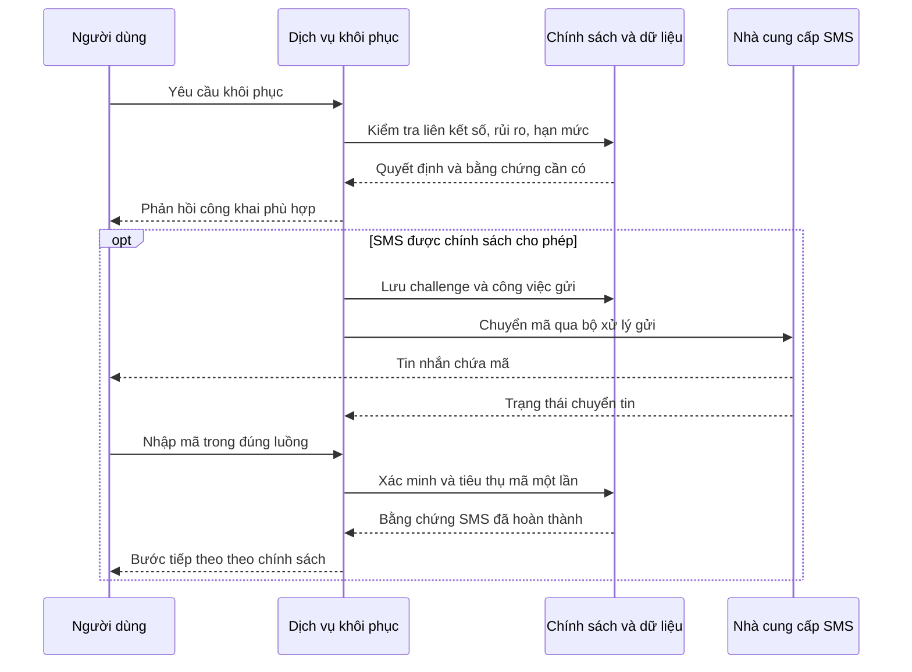

# Kênh khôi phục tài khoản qua SMS (SMS recovery channel)

SMS là kênh chuyển mã khôi phục đến số điện thoại đã được liên kết với tài khoản. Người yêu cầu đọc mã trong tin nhắn và nhập lại vào luồng khôi phục. Kênh này thuận tiện vì nhiều người đã có điện thoại và không cần cài thêm ứng dụng xác thực, nhưng việc nhận được SMS chỉ cung cấp một bằng chứng có giới hạn: người nhập mã đang tiếp cận được thông điệp gửi đến số đó.

Trong chương **SMS Voice Recovery** của module `SECURITY_AUTHENTICATION_ACCOUNT_RECOVERY`, bài học này tập trung vào SMS. Mục tiêu là thiết kế cách dùng SMS khi người dùng mất mật khẩu, MFA, passkey hoặc thiết bị xác thực, đồng thời kiểm soát nguy cơ chiếm đoạt tài khoản. Cuộc gọi thoại chỉ được nhắc đến để làm rõ ranh giới của phương án dự phòng cùng số điện thoại.

## 1. SMS chứng minh điều gì?

Một mã SMS hợp lệ có thể chứng minh khả năng tiếp cận kênh nhận ở thời điểm kiểm tra, với điều kiện mã không bị lộ hoặc chuyển tiếp. Nó không tự chứng minh người nhập mã là chủ thuê bao theo pháp lý, người sở hữu tài khoản từ trước hay người đang giữ đúng thiết bị đã đăng ký.

Cần phân biệt ba câu hỏi:

| Câu hỏi | Bằng chứng cần xem xét |
| --- | --- |
| Số điện thoại có hình thức hợp lệ không? | Phân tích định dạng, mã quốc gia và thông tin khả năng nhận SMS khi có |
| Người yêu cầu có nhận được mã ở số đó không? | Challenge SMS được xác minh đúng, trong hạn, đúng ngữ cảnh |
| Bằng chứng này đủ cho thao tác khôi phục nào? | Chính sách tài khoản, mục đích, lịch sử liên kết số và các bằng chứng độc lập |

Định dạng số hợp lệ không chứng minh số đang hoạt động. Nhà cung cấp báo đã giao tin cũng không chứng minh chủ tài khoản đã nhận hoặc nhập mã. Việc xác minh một số ở ngày đăng ký không bảo đảm số vẫn thuộc về cùng người nhiều tháng sau.

SMS và cuộc gọi đến **cùng một số** không phải hai bằng chứng độc lập. Nếu số đã bị chiếm quyền nhận, cả hai kênh có thể cùng bị ảnh hưởng. Tương tự, cần xem email dự phòng có được khôi phục qua chính số đó hay không trước khi coi hai bằng chứng là độc lập.

NIST xếp việc dùng mạng điện thoại công cộng cho xác minh ngoài băng vào nhóm bị hạn chế và khuyến nghị xem xét tín hiệu thay SIM, chuyển số hoặc thay thiết bị. Điều này không có nghĩa SMS bị cấm trong mọi sản phẩm; việc áp dụng cần phù hợp phạm vi tiêu chuẩn và đánh giá rủi ro. [NIST SP 800-63B, xác thực qua mạng điện thoại](https://pages.nist.gov/800-63-4/sp800-63b.html#pstn).

## 2. Chọn vai trò của SMS trước khi xây endpoint

Đội ngũ phải quyết định SMS là bằng chứng chính, bằng chứng bổ sung hay chỉ là kênh thông báo cho từng loại khôi phục. Không nên dùng chung một kết quả “SMS thành công” để mở tất cả quyền trên tài khoản.

Bảng sau là một **chính sách minh họa**, không phải quy tắc áp dụng cho mọi hệ thống:

| Tình huống | Vai trò SMS trong ví dụ | Điều kiện tiếp theo |
| --- | --- | --- |
| Quên mật khẩu, tài khoản thông thường, số liên kết ổn định | Có thể đủ cho bước chứng minh quyền nhận mã theo chính sách đã phê duyệt | Chỉ cho phép đặt lại mật khẩu; MFA hiện có vẫn được giữ |
| Mất ứng dụng MFA nhưng còn một phương thức mạnh đã đăng ký | Bằng chứng bổ sung nếu cần | Ưu tiên dùng phương thức còn lại; không vô hiệu MFA chỉ vì SMS đúng |
| Mất passkey trên một thiết bị | Có thể hỗ trợ một bước khôi phục | Kiểm tra passkey khác, đồng bộ khóa hoặc quy trình đăng ký khóa mới theo chính sách |
| Mất mọi phương thức, tài khoản có quyền quản trị hoặc dữ liệu nhạy cảm | SMS không đủ để tự hoàn tất | Cần quy trình xác minh mạnh hơn được thiết kế trước |
| Số điện thoại vừa đổi, có tín hiệu chiếm SIM hoặc mất quyền nhận số | Không dựa riêng vào SMS gửi tới số đó | Chuyển sang bằng chứng độc lập hoặc hỗ trợ có kiểm soát |

Khôi phục passkey không phải khôi phục khóa riêng bằng tin nhắn. Khi không thể tiếp cận khóa cũ, một luồng được phê duyệt có thể cho phép đăng ký khóa mới; SMS chỉ đóng góp bằng chứng theo chính sách của luồng đó.

Đối với ứng dụng có giá trị cao hoặc dữ liệu nhạy cảm, cần ưu tiên các phương thức mạnh hơn và tránh để SMS trở thành đường hạ mức bảo vệ. OWASP nhấn mạnh rủi ro của SMS và yêu cầu quy trình khôi phục MFA không tạo lối bỏ qua MFA. [OWASP Multifactor Authentication Cheat Sheet](https://cheatsheetseries.owasp.org/cheatsheets/Multifactor_Authentication_Cheat_Sheet.html#resetting-mfa).

## 3. Liên kết số điện thoại trước khi cần khôi phục

Một số chỉ nên được dùng làm địa chỉ khôi phục khi đã đi qua quy trình liên kết phù hợp. Quy trình minh họa gồm:

1. Người dùng thao tác trong phiên đã được xác thực đủ mạnh cho việc thêm phương thức khôi phục.
2. Máy chủ phân tích số với ngữ cảnh quốc gia, chuẩn hóa sang dạng quốc tế nhất quán, chẳng hạn E.164, và giữ thông tin hiển thị cần thiết.
3. Máy chủ gửi challenge có mục đích riêng để xác minh quyền nhận mã ở số mới.
4. Sau khi nhập đúng, hệ thống ghi nhận thời điểm xác minh, nguồn liên kết và phiên bản số.
5. Chính sách quyết định thời điểm số mới được dùng cho khôi phục nhạy cảm; gửi thông báo thay đổi qua các kênh đã đăng ký thích hợp.

Xác minh mã ở bước 3 chỉ chứng minh tiếp cận số mới. Quyền gắn số đó vào tài khoản đến từ phiên hoặc quy trình xác minh ở bước 1. Đây là hai điều kiện khác nhau.

Không cho người đang bị khóa ngoài tài khoản khai báo số mới, nhận OTP ở số đó rồi dùng kết quả làm bằng chứng sở hữu tài khoản cũ. Kẻ tấn công có thể tự nhận mã ở số của mình theo cùng cách.

Một mô hình dữ liệu tối thiểu có thể gồm:

| Trường | Ý nghĩa |
| --- | --- |
| `phoneRef` | Định danh nội bộ để tham chiếu số, tránh đưa số đầy đủ vào nhiều API |
| `accountId` | Tài khoản được liên kết |
| `normalizedNumber` | Số chuẩn hóa, được bảo vệ như dữ liệu cá nhân |
| `version` | Tăng khi liên kết số thay đổi |
| `verifiedAt` | Thời điểm xác minh quyền nhận mã |
| `recoveryEligibleAt` | Thời điểm chính sách cho phép dùng cho khôi phục |
| `status` | Chẳng hạn `PENDING`, `ACTIVE`, `SUSPENDED`, `REMOVED` |

Challenge phải gắn với `phoneRef` và phiên bản liên kết. Nếu người dùng thay hoặc gỡ số trong lúc challenge đang chờ, mã cũ không được tiếp tục cho phép khôi phục dựa trên liên kết đã bị thay thế.

Số dùng chung trong gia đình hoặc tổ chức cũng cần chính sách rõ ràng. Không mặc định số điện thoại là định danh duy nhất, bất biến của một con người. Nếu sản phẩm cho nhiều tài khoản dùng cùng số, phải tính đến việc một sự cố của số ảnh hưởng nhiều tài khoản và việc hạn mức gửi dùng chung có thể tác động nhiều người.

## 4. Mô hình đe dọa của kênh SMS

Rủi ro không chỉ nằm ở việc đoán một mã ngắn. Cần xem toàn bộ đường đi từ liên kết số đến cấp quyền khôi phục.

| Nguy cơ | Điều có thể xảy ra | Hệ quả đối với thiết kế |
| --- | --- | --- |
| Chiếm SIM hoặc eSIM | Người khác nhận được SMS của số đã đăng ký | Tín hiệu thay SIM có thể buộc yêu cầu bằng chứng độc lập |
| Chuyển số trái phép sang nhà mạng khác | Quyền nhận số bị chuyển đi | Không coi lịch sử số trên tài khoản là bảo đảm quyền kiểm soát hiện tại |
| Số bị thu hồi và cấp lại | Chủ mới nhận tin dành cho người đăng ký cũ | Cần quản lý vòng đời số, nhắc cập nhật và hạn chế dùng liên kết quá cũ trong tình huống nhạy cảm |
| Phishing chuyển tiếp thời gian thực | Người dùng đưa mã cho trang hoặc người giả mạo | Mã ngắn hạn vẫn có thể bị dùng ngay; SMS không thay thế cơ chế chống phishing |
| Điện thoại bị mất, bị mở khóa hoặc có phần mềm đọc tin | Mã bị người khác nhìn hoặc lấy được | Không xem SMS là bằng chứng độc lập với an toàn của thiết bị nhận |
| Can thiệp tuyến chuyển tin hoặc dịch vụ trung gian | Nội dung bị lộ hoặc đổi hướng | Giảm phạm vi quyền sau xác minh, bảo vệ tích hợp và tránh đưa dữ liệu nhạy cảm vào tin |
| Gửi hàng loạt hoặc SMS pumping | Nạn nhân bị làm phiền, hệ thống phát sinh chi phí | Giới hạn nhiều chiều và giám sát tuyến gửi, ngân sách |
| Lộ dữ liệu từ API, log hoặc callback | Lộ số, mã hoặc trạng thái tài khoản | Che bớt dữ liệu, phân quyền, kiểm tra nguồn callback và tránh ghi bí mật |

Dòng chữ “không chia sẻ mã” có ích cho người dùng nhưng không tạo ra ràng buộc mật mã với website thật. Kẻ tấn công vẫn có thể chuyển tiếp mã nếu người dùng nhập nó vào giao diện giả.

Thời gian chờ trước khi đổi yếu tố giúp tạo cơ hội phát hiện và phản đối, nhưng không tự giải quyết việc số đã thuộc về kẻ tấn công. Nếu hết thời gian chờ mà chỉ kiểm tra lại cùng số bị chiếm thì bằng chứng vẫn yếu như trước.

## 5. Ra quyết định bằng rủi ro và trạng thái dữ liệu

Trước khi gửi SMS, máy chủ có thể xem xét tuổi của liên kết số, thời điểm đổi số trên tài khoản, sự kiện thay SIM hoặc chuyển số khi nguồn dữ liệu hỗ trợ, thiết bị truy cập, lịch sử khôi phục và mức nhạy cảm của thao tác. Đánh giá lại trước khi cấp quyền tiếp tục hoặc hoàn tất nếu có thay đổi đáng kể.

Tín hiệu rủi ro giúp chọn yêu cầu bằng chứng. IP quen thuộc, vị trí gần đúng hoặc cookie thiết bị không tự trở thành yếu tố xác thực thay cho bằng chứng bị mất.

Với dữ liệu từ nhà mạng hoặc nhà cung cấp, cần ít nhất ba trạng thái:

| Trạng thái | Cách hiểu |
| --- | --- |
| `DETECTED` | Có sự kiện rủi ro phù hợp điều kiện đã định nghĩa |
| `NOT_DETECTED` | Nguồn dữ liệu đã được kiểm tra, còn mới và không báo sự kiện trong phạm vi hỗ trợ |
| `UNKNOWN` | Không hỗ trợ tuyến này, lỗi dịch vụ, thiếu dữ liệu hoặc kết quả đã cũ |

`UNKNOWN` không tương đương `NOT_DETECTED`. Ngay cả `NOT_DETECTED` cũng chỉ mô tả kết quả trong phạm vi dữ liệu quan sát được, không bảo đảm số không bị chiếm.

Ví dụ, tài liệu SIM Swap của Twilio mô tả độ phủ phụ thuộc nhà mạng và có trường hợp không trả dữ liệu. Từ đó, thiết kế cần phân biệt thiếu tín hiệu với kết quả âm tính; không giả định mọi số ở mọi quốc gia đều được kiểm tra đầy đủ. [Twilio Lookup SIM Swap](https://www.twilio.com/docs/lookup/v2-api/sim-swap#coverage).

Một bảng quyết định minh họa:

| Ngữ cảnh | Quyết định nội bộ |
| --- | --- |
| Số đủ điều kiện, thao tác thông thường, không có tín hiệu đáng ngờ theo chính sách | Có thể gửi SMS và ghi nhận yêu cầu bằng chứng còn lại |
| Có thay SIM gần đây hoặc số vừa được đổi trong tài khoản | Yêu cầu bằng chứng độc lập; có thể tạm dừng vai trò khôi phục của SMS |
| Không có dữ liệu nhà mạng, thao tác thông thường | Áp dụng chính sách cho dữ liệu chưa xác định, dùng các bằng chứng khác đang có |
| Không có dữ liệu nhà mạng, thao tác khôi phục quyền quản trị | Không tự phê duyệt vì dịch vụ kiểm tra bị lỗi; chuyển sang luồng mạnh hơn |
| Người dùng mất quyền truy cập số nhận | Dùng phương án khác đã đăng ký hoặc quy trình hỗ trợ phù hợp |

Khoảng thời gian được coi là “gần đây” phải được định nghĩa trong chính sách sản phẩm. Đổi SIM có thể là thao tác hợp lệ của chủ thuê bao, nên sự kiện này là căn cứ yêu cầu thêm bằng chứng chứ không tự chứng minh gian lận.

## 6. Luồng khôi phục qua SMS từ đầu đến cuối

Một luồng an toàn cần tách việc tiếp nhận yêu cầu, chuyển tin, xác minh mã và quyết định khôi phục:

1. Tiếp nhận định danh tài khoản và mục đích khôi phục; áp dụng kiểm soát tự động hóa trước khi phát sinh chi phí lớn.
2. Tìm liên kết số đủ điều kiện ở phía máy chủ. Phản hồi công khai không tiết lộ tài khoản có tồn tại hay không.
3. Đánh giá việc cho phép dùng SMS và các bằng chứng bổ sung cần thiết.
4. Nếu được phép, cấp challenge gắn với tài khoản, luồng, mục đích và phiên bản liên kết số.
5. Ghi nhận hạn mức và công việc gửi bền vững trong cơ chế phối hợp phù hợp.
6. Bộ xử lý gửi kiểm tra lại điều kiện còn hiệu lực, rồi chuyển mã qua nhà cung cấp.
7. Người dùng nhập mã vào đúng luồng đang thực hiện.
8. Máy chủ kiểm tra hạn dùng, số lượt thử, ngữ cảnh và liên kết số; chấp nhận mã đúng bằng thao tác tiêu thụ nguyên tử.
9. Ghi nhận bằng chứng SMS đã hoàn thành. Nếu còn điều kiện khác, tiếp tục thu thập chúng.
10. Chỉ khi chính sách cho phép, cấp quyền tiếp tục có phạm vi hẹp và thực hiện bước khôi phục được phê duyệt.



Callback chuyển tin không nằm trên đường cấp quyền. Kể cả khi nhà cung cấp báo `DELIVERED`, luồng vẫn phải chờ người yêu cầu chứng minh quyền nhận mã bằng cách nhập mã đúng. Một callback về muộn cũng không thể làm mã đã dùng hoặc hết hạn có hiệu lực trở lại.

## 7. Hợp đồng của challenge SMS

Challenge cần chứa hoặc tham chiếu đủ dữ liệu để máy chủ xác định chính xác bằng chứng đang được kiểm tra:

| Dữ liệu | Mục đích |
| --- | --- |
| `challengeId`, `flowId` | Gắn lần xác minh với luồng cụ thể |
| `accountId`, `purpose` | Ngăn dùng mã cho tài khoản hoặc nghiệp vụ khác |
| `phoneRef`, `phoneVersion` | Gắn với liên kết số đã được phê duyệt |
| `expiresAt`, `status` | Quyết định mã còn được dùng hay không |
| `failedAttempts`, `sendCount` | Kiểm soát đoán mã và chuyển tin |
| Giá trị kiểm tra bí mật | Kiểm tra mã mà không ghi mã rõ vào nơi không cần thiết |
| Phiên bản chính sách hoặc yêu cầu bằng chứng | Hỗ trợ đánh giá quyền tiếp tục và giải thích quyết định |

Một cấu hình phục vụ ví dụ trong bài có thể dùng mã sáu chữ số, thời hạn năm phút, tối đa năm lần nhập sai, ba lần gửi gồm lần đầu và hai lần gửi lại, khoảng chờ gửi lại ít nhất 30 giây. Đây là tham số thiết kế minh họa; không phải bảo đảm an toàn chỉ nhờ đạt những con số này.

Các thuộc tính bắt buộc của thiết kế quan trọng hơn giá trị cụ thể:

- Mã được sinh bằng bộ tạo số ngẫu nhiên mật mã và giữ cả chữ số `0` ở đầu.
- Mã chỉ được chấp nhận cho đúng challenge, mục đích và ngữ cảnh luồng.
- Tại `now >= expiresAt`, mã bị từ chối kể cả bản ghi còn trong cơ sở dữ liệu.
- Xác minh thành công chỉ được tiêu thụ một lần, kể cả khi có nhiều yêu cầu đồng thời.
- Gửi lại không mở thêm lượt đoán hoặc kéo dài vô hạn hạn dùng.
- Mở challenge mới không xóa các giới hạn tổng hợp theo tài khoản và địa chỉ nhận.
- Thay hoặc gỡ liên kết số khiến challenge dựa trên phiên bản cũ không còn được cấp quyền.

Nếu ứng dụng quản lý mã ngắn, chỉ lưu một hàm băm nhanh không khóa như `SHA-256(otp)` vẫn để lộ nguy cơ dò ngoại tuyến do không gian mã nhỏ. Có thể dùng cơ chế kiểm tra có khóa được quản lý riêng, chẳng hạn HMAC trên biểu diễn có cấu trúc của challenge, mục đích và mã. Nếu cần giữ mã để gửi lại, payload chuyển tin phải được mã hóa, giới hạn quyền truy cập và thời gian lưu giữ. Đây là thiết kế riêng cho OTP ngắn hạn, không phải cách lưu mật khẩu người dùng.

Nếu nhà cung cấp quản lý cả sinh và kiểm tra mã, ứng dụng vẫn phải ràng buộc định danh xác minh của nhà cung cấp với tài khoản, mục đích và trạng thái luồng nội bộ. Không nhận một kết quả thành công bất kỳ từ client rồi tin rằng nó thuộc tài khoản đang khôi phục.

## 8. Chống lạm dụng và bảo vệ quyền riêng tư

Hạn mức cần có nhiều phạm vi vì mỗi phạm vi bảo vệ một tài nguyên khác nhau:

| Phạm vi | Điều cần bảo vệ |
| --- | --- |
| Challenge hoặc luồng | Tránh gửi lặp và đoán mã không giới hạn trong một lượt |
| Tài khoản | Tránh né giới hạn bằng cách mở nhiều luồng hoặc chuyển kênh |
| Số nhận đã chuẩn hóa | Giảm làm phiền cùng một số qua nhiều tài khoản hoặc mục đích |
| IP, nguồn truy cập và tín hiệu thiết bị | Giảm lưu lượng tự động; có xét đến IP dùng chung |
| Quốc gia, tuyến nhà mạng và tổng ngân sách | Kiểm soát lạm dụng chi phí và đột biến gửi |

Không chỉ tăng bộ đếm khi tin được báo đã giao. Cần giữ chỗ hạn mức khi chấp nhận một lần gửi để nhiều yêu cầu đang chờ không cùng vượt ngân sách. Yêu cầu bị lặp do lỗi mạng phải dùng idempotency: cùng một thao tác logic không tạo thêm lần gửi và không tính phí nội bộ nhiều lần.

Hạn mức gửi không thay thế hạn mức thử mã. Một người chỉ nhận một tin vẫn có thể gửi rất nhiều lần đoán nếu endpoint xác minh không bị giới hạn.

Endpoint bắt đầu khôi phục nên trả thông báo chung, chẳng hạn:

> Nếu thông tin phù hợp, hệ thống sẽ xử lý yêu cầu qua phương thức khôi phục đã đăng ký.

Không trả các lý do nội bộ như “số vừa thay SIM”, “tài khoản không có số” hoặc toàn bộ số đã lưu cho người chỉ biết định danh tài khoản. Mã HTTP, thời gian phản hồi, địa chỉ che bớt và thông báo hạn mức cũng phải được thiết kế để không trở thành tín hiệu dò tài khoản. Một luồng vừa được tạo từ tên tài khoản chưa tự chứng minh quyền xem thông tin liên hệ của người khác.

Khi người dùng đã có ngữ cảnh đủ tin cậy, có thể hiển thị số được che bớt theo chính sách riêng tư. Không đưa số đầy đủ, OTP, cookie hoặc token tiếp tục vào log, trace, URL hay hệ thống phân tích giao diện.

Việc người ngoài liên tục xin SMS không được tự động khóa đăng nhập bình thường hoặc thu hồi session hợp lệ. Có thể làm chậm luồng khôi phục đang bị lạm dụng, đồng thời giữ đường phục hồi bằng bằng chứng mạnh khác. Cần thừa nhận rằng giới hạn theo số vẫn có thể bị dùng để làm cạn ngân sách của nạn nhân; thiết kế hỗ trợ phải xử lý tình huống này bằng xác minh phù hợp, không bỏ kiểm soát theo lời yêu cầu.

## 9. Nội dung tin nhắn và tích hợp nhà cung cấp

Tin nhắn nên ngắn, nêu rõ tên dịch vụ, mục đích, mã và lời nhắc không chia sẻ. Ví dụ dưới đây dùng tên dịch vụ giả định:

```text
HocLap: Ma khoi phuc tai khoan cua ban la <OTP>.
Ma het han sau 5 phut ke tu khi cap. Khong chia se ma nay.
```

Đây là mẫu nội dung minh họa, không phải payload để gửi thật. Trong hệ thống thực tế, cách diễn đạt thời hạn phải phù hợp với thời điểm hết hạn do máy chủ quyết định, đặc biệt khi hàng đợi hoặc nhà mạng làm tin đến chậm.

Không đưa mật khẩu, toàn bộ định danh tài khoản, dữ liệu cá nhân nhạy cảm hoặc token có quyền rộng vào SMS. Tránh dùng đường dẫn đăng nhập trong ví dụ này để giữ trải nghiệm rõ ràng: người dùng nhập mã trong luồng đã chủ động mở.

Khả năng chuyển tin phụ thuộc tuyến gửi, nhà mạng, vùng phủ sóng, chuyển vùng và cấu hình người nhận. Có điện thoại không có nghĩa luôn nhận được SMS. Trước khi mở một thị trường, cần kiểm tra thực tế khả năng chuyển tin và quy trình vận hành của nhà cung cấp trên tuyến đó. Độ dài và bộ ký tự cũng ảnh hưởng việc chia tin thành nhiều phần và chi phí, nên cần kiểm tra mẫu ngôn ngữ thực tế.

Tách ít nhất hai nhóm trạng thái:

| Nhóm | Ví dụ |
| --- | --- |
| Challenge xác minh | `ACTIVE`, `VERIFIED`, `EXPIRED`, `BLOCKED`, `CANCELLED` |
| Lần chuyển tin | `QUEUED`, `SUBMITTED`, `DELIVERED`, `FAILED`, `UNKNOWN` |

Nếu API nhà cung cấp timeout, trạng thái phù hợp có thể là `UNKNOWN`: chưa biết yêu cầu đã được chấp nhận hay chưa. Không lập tức hoàn hạn mức rồi gửi mã mới liên tục. Dùng định danh yêu cầu ổn định, chức năng đối soát hoặc idempotency nếu nhà cung cấp hỗ trợ; giới hạn thử lại khi không thể biết chắc.

Callback cần được kiểm tra tính xác thực theo cơ chế của nhà cung cấp, đối chiếu với lần gửi đã biết và xử lý lặp an toàn. Không cho tham số `delivered=true` do client gửi làm bằng chứng xác minh OTP.

Khi hàng đợi xử lý trễ, công việc phải bị bỏ qua nếu challenge đã kết thúc hoặc không còn đủ điều kiện gửi. Không kéo dài thời hạn mã để bù lỗi nhà mạng. Hệ thống nên hướng người dùng chờ hợp lý, bắt đầu lại qua chính sách hoặc dùng phương án khác đủ điều kiện.

## 10. API nên tham chiếu liên kết số phía máy chủ

Một hợp đồng minh họa có thể tách tiếp nhận yêu cầu và xác minh mã:

```http
POST /account-recovery/requests
Content-Type: application/json

{
  "accountIdentifier": "<dinh-danh-nguoi-dung-cung-cap>",
  "purpose": "RESET_PASSWORD"
}
```

```http
POST /account-recovery/flows/{flowId}/sms/verify
Content-Type: application/json

{
  "challengeId": "<tham-chieu-challenge>",
  "code": "<ma-nguoi-dung-nhap>"
}
```

Máy chủ chọn địa chỉ nhận từ liên kết đủ điều kiện, không lấy một trường `destinationPhone` tùy ý trong yêu cầu khôi phục. Các tham chiếu trong ví dụ phải được thay bằng định danh khó đoán và được ràng buộc với ngữ cảnh thực tế. `flowId` không phải bằng chứng sở hữu tài khoản.

Nếu ngữ cảnh được giữ bằng cookie, cần bảo vệ cookie và chống yêu cầu giả mạo phù hợp cho các thao tác làm thay đổi trạng thái. TLS bảo vệ đường từ trình duyệt đến máy chủ và đường tích hợp hỗ trợ TLS, nhưng không biến toàn bộ tuyến SMS thành kênh mã hóa đầu cuối.

Kết quả nội bộ nên diễn đạt sự kiện cụ thể như `SMS_EVIDENCE_VERIFIED`, thay vì gộp thành `ACCOUNT_RECOVERED`. Quyền tiếp tục chỉ được cấp khi bộ đánh giá chính sách xác nhận đủ bằng chứng, gắn với tài khoản, mục đích và luồng, có thời hạn ngắn và được tiêu thụ khi hoàn tất thao tác cho phép.

## 11. Hoàn tất khôi phục và phương án khi mất số

Sau khi đủ điều kiện khôi phục, bước hoàn tất cần cập nhật đúng thông tin xác thực đã được phê duyệt. Ví dụ, quyền đặt lại mật khẩu không đồng thời cho phép gỡ MFA, đổi email và thêm passkey mới.

Chính sách session cần xét đến loại sự cố. Hệ thống có thể thu hồi session hoặc refresh token liên quan khi thay thông tin xác thực, đặc biệt khi có nghi ngờ bị chiếm đoạt. Thao tác gửi hoặc nhập mã đơn thuần chưa phải lý do tự động thu hồi mọi phiên. Sau hoàn tất, người dùng đi qua luồng đăng nhập với các yếu tố còn hiệu lực theo chính sách.

Thông báo an ninh nên được gửi qua các kênh đã đăng ký phù hợp để chủ tài khoản biết có sự kiện khôi phục hoặc thay phương thức. Nếu chính số điện thoại bị nghi chiếm, chỉ gửi thông báo vào số đó sẽ không tạo thêm khả năng phát hiện cho chủ tài khoản.

Khi người dùng mất quyền nhận SMS, cần có phương án được chuẩn bị trước, chẳng hạn passkey khác, mã khôi phục đã lưu, phương thức độc lập còn hiệu lực hoặc quy trình xác minh hỗ trợ phù hợp. Không hứa rằng mọi tài khoản đều có thể được phục hồi nếu sản phẩm chưa có đủ bằng chứng thay thế.

Chuyển sang cuộc gọi cùng số có thể cải thiện khả năng tiếp cận trong một số tình huống chuyển tin, nhưng không giải quyết việc số đã bị chiếm hay được cấp lại. Việc chuyển kênh cũng phải dùng chung giới hạn tổng hợp và chính sách rủi ro liên quan, tránh biến fallback thành đường gửi không giới hạn.

## 12. Ví dụ thực tế và các thuộc tính cần kiểm chứng

Minh quên mật khẩu của một tài khoản học tập. Số khôi phục đã liên kết từ trước, chưa thay đổi trong tài khoản, và chính sách cho phép dùng SMS để chứng minh bước đặt lại mật khẩu. Minh nhập đúng mã ở luồng hiện tại, nhận quyền chỉ để đặt mật khẩu mới, rồi đăng nhập lại. Nếu tài khoản còn MFA, yêu cầu MFA vẫn được áp dụng; mã SMS không tự gỡ yếu tố đó.

Ở một tình huống khác, tài khoản quản trị yêu cầu thay MFA từ thiết bị lạ ngay sau một sự kiện thay SIM được nguồn dữ liệu báo về. Dù người yêu cầu nhập đúng OTP, thiết kế minh họa chỉ ghi nhận đã tiếp cận kênh SMS và yêu cầu bằng chứng độc lập theo quy trình quản trị. Đúng mã không làm sự kiện rủi ro biến mất.

Nếu số của Minh đã bị thu hồi và cấp cho người khác, chủ số mới có thể nhận được mã gửi về liên kết cũ. Trường hợp này cho thấy việc xác minh số trong quá khứ không đủ để tự bảo đảm an toàn lâu dài. Các hành động nhạy cảm phải cân nhắc lịch sử, mức rủi ro và bằng chứng khác, đồng thời hỗ trợ người dùng cập nhật hoặc loại bỏ số không còn kiểm soát.

Khi triển khai, cần kiểm chứng các thuộc tính sau ở ranh giới giữa ứng dụng, dữ liệu và nhà cung cấp:

| Tình huống | Thuộc tính mong đợi |
| --- | --- |
| Người yêu cầu cung cấp số mới trong lúc khôi phục | Không chuyển địa chỉ nhận khỏi liên kết được phê duyệt |
| Mã đúng nhưng dành cho mục đích khác | Không được cấp quyền cho thao tác hiện tại |
| Challenge dựa trên phiên bản số đã bị gỡ | Bị từ chối khi xác minh hoặc trước khi cấp quyền |
| Sự kiện thay SIM xuất hiện trong lúc chờ nhập mã | Đánh giá lại điều kiện khôi phục |
| Dịch vụ rủi ro trả thiếu dữ liệu | Giữ trạng thái chưa xác định, không tự coi là an toàn |
| Nhà cung cấp báo đã giao nhưng chưa có mã nhập đúng | Không cấp quyền tiếp tục |
| Hai yêu cầu nhập đúng chạy đồng thời | Chỉ tiêu thụ challenge và cấp kết quả nghiệp vụ một lần |
| Mã hết hạn hoặc đã được dùng | Không có hiệu lực trở lại do gửi lại hay callback đến muộn |
| Chuyển từ SMS sang thoại cùng số | Không được tính thành hai bằng chứng độc lập hoặc bỏ hạn mức |
| Kẻ tấn công làm cạn hạn mức gửi | Không tự khóa đăng nhập thông thường hoặc thu hồi phiên hợp lệ |
| Tin bị gửi đến muộn hoặc gửi trùng do lỗi mạng | Không gia hạn mã hoặc tạo thêm quyền xác minh |
| Tài khoản tồn tại và không tồn tại | Không có khác biệt công khai đáng tin cậy để dò tài khoản |

Theo dõi tỷ lệ tiếp nhận, chuyển tin, nhập đúng, hết hạn, yêu cầu thêm bằng chứng và chi phí theo tuyến giúp phát hiện cả lỗi vận hành lẫn lạm dụng. Dữ liệu quan sát nên dùng tham chiếu nội bộ hoặc dạng đã che bớt, với quyền truy cập và thời gian lưu phù hợp. Một kênh SMS hữu ích phải được đánh giá bằng khả năng hỗ trợ chủ tài khoản hoàn tất đúng thao tác trong mức rủi ro cho phép, cùng các ranh giới xác minh được giữ xuyên suốt luồng.
