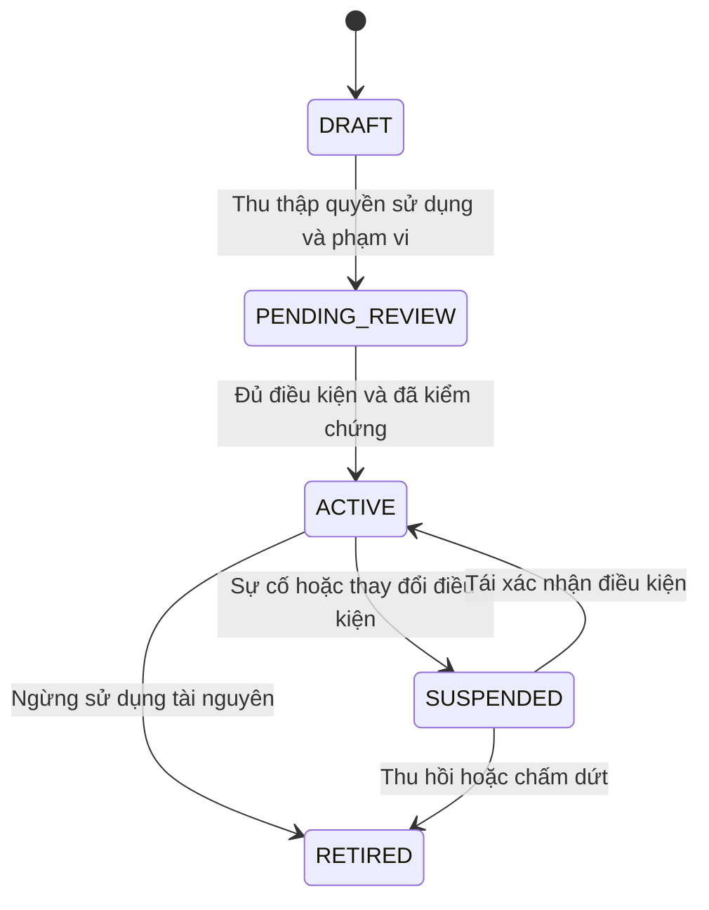

# Short code and sender policy — Chính sách đầu số và người gửi trong khôi phục tài khoản

## 1. Vì sao đầu số gửi là một phần của thiết kế khôi phục?

Khi người dùng mất mật khẩu, MFA, passkey hoặc thiết bị xác thực, hệ thống có thể gửi mã khôi phục qua SMS hoặc đọc mã bằng cuộc gọi tự động. Người dùng thường nhìn tên người gửi hoặc số gọi đến để quyết định có đọc và làm theo hướng dẫn hay không. Vì vậy, việc chọn danh tính gửi ảnh hưởng đồng thời đến khả năng nhận mã, mức độ nhận diện thương hiệu và nguy cơ bị giả mạo.

**Sender policy** là tập quy tắc xác định hệ thống được dùng danh tính gửi nào, với nhà cung cấp nào, tới thị trường nào và cho mục đích nào. Chính sách còn quy định cách thay đổi sender, chuyển tuyến khi lỗi và dừng gửi khi không còn tuyến đáp ứng điều kiện.

Một chính sách đầy đủ phải trả lời được những câu hỏi cụ thể: sender đã được cấp quyền chưa, có hỗ trợ quốc gia đích không, được phép gửi nội dung khôi phục không và tuyến dự phòng có giữ nguyên các điều kiện đó không?

Bài học tập trung vào đầu số ngắn, tên người gửi và số hiển thị cuộc gọi trong luồng khôi phục. Sau bài học, người học có thể thiết kế danh mục sender, lựa chọn tuyến gửi ở phía máy chủ và giải thích vì sao một tên thương hiệu quen thuộc không đủ để chứng minh người dùng hoặc người gửi là đáng tin cậy.

## 2. Short code không phải là mã OTP

**Short code** là đầu số ngắn dùng làm địa chỉ gửi hoặc nhận tin nhắn trong phạm vi được cấp. **OTP** là bí mật dùng một lần nằm trong nội dung tin nhắn hoặc được đọc qua cuộc gọi.

Ví dụ dưới đây chỉ minh họa cách hiển thị; đầu số và mã không đại diện cho tài nguyên gửi thật:

```text
Người gửi: 12345
Nội dung: HocTaiKhoan: Ma khoi phuc cua ban la 482193.
```

Ở đây, `12345` là short code, còn `482193` là mã OTP. Người dùng nhập mã OTP vào luồng khôi phục, không nhập đầu số gửi để xác minh danh tính.

Short code thường phục vụ lưu lượng nhắn tin của ứng dụng. Độ dài và khả năng hoạt động phụ thuộc thị trường; không xây dựng một bộ kiểm tra toàn cầu với giả định mọi short code đều có đúng một độ dài. Định nghĩa của nhà cung cấp cũng cần được đọc trong phạm vi sản phẩm của họ. [Twilio: What is an SMS Short Code?](https://www.twilio.com/docs/glossary/what-is-a-short-code).

Đối với short code do Twilio cấp, tài liệu nhà cung cấp nêu rõ việc cấp được thực hiện theo từng quốc gia. Không suy ra một đầu số đã dùng tại thị trường A sẽ gửi được tới thị trường B. [Twilio: Can Short Codes Be Used Internationally?](https://help.twilio.com/articles/223182328).

Đầu số ngắn cũng không phải số điện thoại quốc tế thông thường. Hệ thống cần lưu loại sender và phạm vi thị trường cùng với giá trị đầu số, thay vì tự thêm dấu `+` rồi xử lý như số đích ở định dạng quốc tế.

## 3. Phân biệt các loại danh tính gửi

| Loại danh tính | Người dùng có thể nhìn thấy | Điểm cần kiểm tra trong chính sách |
|---|---|---|
| Short code | Một đầu số ngắn | Thị trường được cấp, quyền sử dụng, loại nội dung, năng lực gửi và nhận |
| Long code | Một số điện thoại thông thường | Quyền sử dụng số, khả năng nhắn tin ứng dụng và yêu cầu đăng ký tại thị trường đích |
| Toll-free sender | Một số thuộc dải số miễn cước ở thị trường tương ứng | Khả năng gửi SMS, xác minh cần thiết và phạm vi hỗ trợ |
| Alphanumeric sender ID | Tên chữ hoặc chữ kết hợp số, ví dụ tên thương hiệu | Quốc gia hỗ trợ, tên được phê duyệt, khả năng nhận phản hồi |
| Voice caller ID | Số hoặc tên hiển thị khi có cuộc gọi | Quyền dùng số gọi ra, khả năng hiển thị và yêu cầu của tuyến thoại |

Không phải mọi loại sender đều có mặt tại mọi thị trường. Một số có thể chỉ gửi, một số có thể nhận phản hồi; các khả năng đó còn tùy nhà cung cấp và cấu hình cụ thể. Không gán `supportsReply=true` chỉ vì sender nhìn giống một số điện thoại.

Alphanumeric sender ID trong dịch vụ SMS của Twilio là kênh một chiều: người nhận không trả lời trực tiếp được. Một số quốc gia yêu cầu đăng ký trước khi dùng. Vì vậy, một luồng cần nhận phản hồi không thể mặc nhiên sử dụng tên chữ thay cho đầu số hai chiều. [Twilio: Alphanumeric Sender IDs](https://www.twilio.com/docs/numbers-and-senders/alphanumeric-senders).

Một số điện thoại có thể hỗ trợ cả SMS và voice, nhưng hệ thống phải kiểm tra từng năng lực và quyền sử dụng. Không lấy short code hoặc tên chữ trong cấu hình SMS rồi truyền nguyên giá trị đó sang trường caller ID của cuộc gọi.

## 4. Ranh giới tin cậy: nhận diện không thay thế xác minh

Tên thương hiệu nhất quán giúp người dùng nhận diện thông điệp. Tuy nhiên, danh tính xuất hiện trên màn hình có thể bị ảnh hưởng bởi tuyến mạng, danh bạ trên thiết bị, bộ lọc hoặc hành vi giả mạo. Số gọi đến và giọng nói quen thuộc cũng không đủ chứng minh một cuộc gọi thực sự đến từ đội hỗ trợ.

Cần tách ba loại bằng chứng:

| Bằng chứng | Có thể hỗ trợ điều gì? | Không đủ để kết luận điều gì? |
|---|---|---|
| Sender hiển thị đúng tên quen thuộc | Người dùng dễ nhận diện thông điệp | Nội dung chắc chắn hợp lệ hoặc người gọi đáng tin |
| Nhà cung cấp báo đã gửi hoặc đã phát | Quan sát trạng thái truyền tin | Chủ tài khoản đã đọc hoặc đã xác minh mã |
| Người yêu cầu nhập đúng OTP còn hạn trong đúng luồng | Bằng chứng kiểm soát kênh tại thời điểm đó, theo các giả định của chính sách | Người đó mặc nhiên được gỡ MFA, đổi passkey hoặc có toàn quyền tài khoản |

Short code chuyên dụng và tên chữ đã đăng ký cải thiện quản trị danh tính gửi. Chúng không biến SMS thành cơ chế chống lừa đảo bằng mật mã và không loại bỏ việc đánh cắp mã qua social engineering.

NIST xếp xác minh ngoài băng qua PSTN, bao gồm SMS và voice, vào nhóm bị hạn chế trong phạm vi hướng dẫn xác thực của chuẩn. Tài liệu cũng khuyến nghị xem xét tín hiệu đổi SIM, đổi thiết bị và chuyển mạng giữ số. Đây là cơ sở để đánh giá rủi ro kênh, không phải kết luận mọi luồng khôi phục qua điện thoại đều bị cấm. [NIST SP 800-63B-4, mục 3.1.3.3](https://pages.nist.gov/800-63-4/sp800-63b.html#authentication-using-the-public-switched-telephone-network).

Nếu người dùng nhận SMS và cuộc gọi trên cùng một số, hai cách chuyển mã vẫn phụ thuộc phần lớn vào cùng kênh điện thoại. Không đếm chúng thành hai bằng chứng độc lập chỉ vì một bên là tin nhắn và bên kia là âm thanh.

## 5. Xây dựng danh mục sender có chủ sở hữu

Thay vì rải chuỗi `from` trong mã nguồn, hệ thống nên có danh mục sender do máy chủ quản lý. Mỗi mục đại diện cho tài nguyên gửi cùng phạm vi được phép sử dụng.

| Thuộc tính | Vai trò |
|---|---|
| `senderRef` | Định danh nội bộ ổn định, không phải bí mật |
| `senderType` | Phân biệt short code, long code, tên chữ và caller ID thoại |
| `providerRef`, `providerAccountRef` | Nhà cung cấp và tài khoản thực sự được cấp quyền |
| `senderValueRef` | Tham chiếu đến giá trị sender trong cấu hình vận hành |
| `destinationMarkets` | Các thị trường đích được phép dùng |
| `capabilities` | Gửi SMS, nhận SMS, gọi thoại hoặc các năng lực đã xác nhận |
| `approvedPurposes` | Mục đích được phê duyệt, chẳng hạn khôi phục tài khoản |
| `approvalState`, `approvalEvidenceRef` | Trạng thái và bằng chứng quyền sử dụng hoặc đăng ký cần thiết |
| `effectiveFrom`, `effectiveUntil` | Khoảng hiệu lực của chính sách nội bộ hoặc quyền có hạn |
| `templateRefs` | Các mẫu nội dung được phép đi qua sender |
| `owner`, `policyVersion` | Nhóm chịu trách nhiệm và phiên bản thay đổi |
| `operationalState` | Có đang hoạt động, bị tạm dừng hay đã thu hồi không |

Không phải mọi sender đều có một giấy đăng ký với ngày hết hạn cố định. `approvalState` biểu diễn kết luận nội bộ rằng các điều kiện áp dụng đã được đáp ứng; phải lưu cơ sở cho kết luận đó. Giá trị “không cần đăng ký trước” cũng cần được xác nhận theo tài liệu hiện hành và phạm vi hợp đồng, thay vì mặc định mọi sender đều đã hợp lệ.

Trạng thái vòng đời có thể được mô hình hóa như sau:



Trước mỗi lần gửi, chỉ chọn mục đang `ACTIVE` và còn đáp ứng phạm vi phê duyệt. Không gửi qua một sender đang chờ xác nhận chỉ để thử xem nhà mạng có chấp nhận hay không.

Với short code chuyên dụng, cần xác định rõ tổ chức và chương trình nào chịu trách nhiệm. Với tài nguyên dùng chung, cần hiểu giới hạn của nhà cung cấp về nhận diện, định tuyến phản hồi và tách biệt khách hàng. Khả năng tồn tại hoặc được phép dùng chung phải được xác nhận tại thị trường cụ thể; không giả định mô hình này luôn được hỗ trợ.

## 6. Chọn sender ở phía máy chủ

Người dùng có thể chọn một kênh khôi phục được hệ thống cho phép, nhưng không được tự chỉ định `from`, caller ID, provider account hoặc tuyến gửi. Tài khoản đích, số nhận và trạng thái kênh phải lấy từ hồ sơ khôi phục mà máy chủ đã xác lập.

Số nhận có thể được lưu ở định dạng quốc tế chuẩn hóa, thường là E.164. Việc phân tích số giúp xác định kế hoạch đánh số và thị trường đích; ngôn ngữ giao diện, quốc gia của IP hoặc vị trí đang roaming không tự thay đổi quốc gia của số nhận. Với mã quốc gia dùng chung hoặc phạm vi chưa xác định đủ rõ, cần dữ liệu phân tích phù hợp thay vì chỉ kiểm tra tiền tố bằng chuỗi.

Một thứ tự lựa chọn tuyến có thể là:

```text
selectSender(recoveryFlow, requestedChannel):
    xác minh người gọi được thao tác trên đúng recoveryFlow
    lấy số nhận đã được ràng buộc từ hồ sơ máy chủ
    kiểm tra kênh còn đủ điều kiện dùng cho mục đích khôi phục
    xác định thị trường đích bằng dữ liệu số điện thoại phù hợp

    lấy danh sách tuyến trong chính sách đã được phê duyệt
    chỉ giữ các tuyến:
        đang ACTIVE và còn hiệu lực
        hỗ trợ thị trường đích
        hỗ trợ requestedChannel
        có quyền dùng sender trên đúng providerAccount
        được phép gửi nội dung ACCOUNT_RECOVERY
        hỗ trợ mẫu nội dung và ngôn ngữ đã chọn
        không vi phạm hạn mức và giới hạn chi phí

    nếu danh sách rỗng:
        trả trạng thái không có tuyến phù hợp
        hướng dẫn phương án khôi phục khác theo chính sách

    chọn theo độ sẵn sàng, khả năng giao và ưu tiên vận hành
    trả kế hoạch gửi gồm senderRef và policyVersion
```

Bộ lọc điều kiện phải chạy trước bước tối ưu chi phí hoặc tỷ lệ giao tin. Một tuyến rẻ nhưng chưa được phép dùng không trở thành tuyến hợp lệ chỉ vì tuyến chính đang lỗi.

Nhà cung cấp có thể tự chọn sender trong một pool. Ví dụ, Twilio Messaging Service có quy tắc tự chọn alphanumeric sender hoặc short code phù hợp với quốc gia. Vì vậy, cần kiểm soát cả danh sách tài nguyên trong pool và hành vi chọn tự động, thay vì chỉ kiểm tra chuỗi sender mà ứng dụng dự định dùng. [Twilio: Alphanumeric Sender IDs in Messaging Services](https://www.twilio.com/docs/messaging/services/alphanumeric-sender-ids-in-messaging-services).

Nếu không thể giới hạn pool theo chính sách khôi phục, nên dùng cấu hình hoặc service gửi tách biệt để mọi lựa chọn tự động đều nằm trong tập đã phê duyệt. Tách biệt logic không có nghĩa là buộc phải mua một đầu số riêng cho mọi mục đích; yêu cầu cốt lõi là kiểm soát được phạm vi sử dụng thực tế.

## 7. Ví dụ cấu hình chính sách có thể kiểm tra được

Ví dụ sau là mô hình nội bộ giả định. `MARKET_A` là nhãn thị trường minh họa, không phải mã quốc gia thật. Các giá trị tham chiếu phải được thay bằng tài nguyên đã xác nhận trước khi triển khai.

```yaml
policyId: recovery-sender-policy
version: 7
purpose: ACCOUNT_RECOVERY

routes:
  - routeId: market-a-sms-primary
    destinationMarket: MARKET_A
    channel: SMS
    senderType: SHORT_CODE
    senderRef: recovery-shortcode-market-a
    providerRef: provider-a
    providerAccountRef: recovery-account-a
    approvalState: APPROVED
    operationalState: ACTIVE
    approvalEvidenceRef: approval-record-a
    templateRef: recovery-otp-vi-v2
    allowedFallbackRouteIds:
      - market-a-sms-secondary

  - routeId: market-a-sms-secondary
    destinationMarket: MARKET_A
    channel: SMS
    senderType: ALPHANUMERIC
    senderRef: recovery-brand-market-a
    providerRef: provider-b
    providerAccountRef: recovery-account-b
    approvalState: APPROVED
    operationalState: ACTIVE
    approvalEvidenceRef: approval-record-b
    templateRef: recovery-otp-vi-v2
    allowedFallbackRouteIds: []

constraints:
  allowClientSelectedSender: false
  allowUnlistedFallback: false
  requireEligibilityRecheckBeforeDispatch: true
  allowAutomaticVoiceEscalation: false
```

Dòng `approvalState: APPROVED` chỉ là dữ liệu cấu hình, không tự tạo quyền sử dụng sender ở nhà cung cấp. Quy trình vận hành phải đối chiếu `approvalEvidenceRef` với tài nguyên và phạm vi thực tế. Cả hai tuyến trong ví dụ chỉ hợp lệ nếu thị trường giả định thực sự hỗ trợ chúng và từng nhà cung cấp đã cấp quyền tương ứng.

Chính sách cần được kiểm tra khi thay đổi và khi nạp vào hệ thống: tuyến dự phòng có tồn tại không, có cùng mục đích không, có tạo vòng lặp không và mọi sender trong pool có nằm trong phạm vi cho phép không? Việc cập nhật cấu hình cần để lại phiên bản và người chịu trách nhiệm.

Nếu một job chờ trong hàng đợi đủ lâu để chính sách hoặc trạng thái phê duyệt thay đổi, kiểm tra lại ngay trước dispatch. Không tiếp tục gửi chỉ vì job từng được chấp nhận khi sender còn hoạt động. Lưu cả phiên bản lúc lập kế hoạch và kết quả kiểm tra lúc gửi để giải thích được quyết định sau này.

## 8. Quy tắc riêng cho voice recovery

Một cuộc gọi đọc OTP cần số gọi ra hoặc caller ID đáp ứng điều kiện của nhà cung cấp và thị trường. Chẳng hạn, API gọi điện của Twilio yêu cầu số dùng làm caller ID phải là số Twilio hoặc outgoing caller ID đã xác minh cho tài khoản tương ứng. Đây là điều kiện của sản phẩm đó, không phải quy tắc dùng mọi tên chữ SMS làm danh tính cuộc gọi. [Twilio Call Resource, tham số From](https://www.twilio.com/docs/voice/api/call-resource).

Chính sách thoại nên xác định rõ:

- Tập số gọi ra được phép dùng và khả năng hiển thị đã kiểm chứng.
- Ngôn ngữ, giọng đọc, tốc độ và số lần đọc lại tối đa.
- Giới hạn thời lượng, số lượt gọi và ngân sách chi phí.
- Cách xử lý không bắt máy, voicemail, chuyển tiếp cuộc gọi và số dùng chung.
- Quy định ghi âm, chép lời và lưu dữ liệu có chứa mã.

Kịch bản minh họa:

> Đây là cuộc gọi tự động của HocTaiKhoan về yêu cầu khôi phục vừa thực hiện. Mã của bạn là 4, 8, 2, 1, 9, 3. Chỉ nhập mã vào ứng dụng hoặc trang khôi phục chính thức đang mở. Không đọc mã cho người khác.

Không đưa mật khẩu, toàn bộ email hoặc thông tin tài khoản nhạy cảm vào lời chào. Nếu cuộc gọi bị chuyển vào voicemail, mã có thể trở thành dữ liệu được lưu ở một hệ thống khác. Chính sách phải quyết định có chấp nhận rủi ro đó không; khả năng nhận biết máy trả lời tự động không bảo đảm chính xác tuyệt đối.

Nếu dùng bước bấm phím để bắt đầu nghe mã, thao tác đó chỉ cho biết có tương tác với cuộc gọi. Nó không tự chứng minh danh tính chủ tài khoản. Cũng không chuyển quyền khôi phục dựa trên việc cuộc gọi đã kết nối hoặc hoàn thành.

Voice có thể hỗ trợ người dùng không nhận được SMS, nhưng không nên tự động gọi liên tục sau mọi lỗi gửi. Người dùng cần được biết và lựa chọn khi chuyển kênh theo chính sách, đồng thời vẫn chịu các hạn mức chung của luồng.

## 9. Chính sách nội dung phải nhất quán với sender

Nội dung nên nhận diện ứng dụng, nêu mục đích khôi phục, cung cấp mã và nhắc không chia sẻ. Không pha thông điệp quảng cáo vào mẫu khôi phục đã được phê duyệt cho mục đích bảo mật.

Ví dụ minh họa một SMS không dấu:

```text
HocTaiKhoan: Ma khoi phuc la 482193, hieu luc toi da 5 phut.
Chi nhap ma tren ung dung/trang khoi phuc chinh thuc. Khong chia se ma.
```

Mã thật được sinh riêng cho thử thách; giá trị trên chỉ phục vụ minh họa. Nếu hệ thống dùng hạn tuyệt đối hoặc thời gian chờ hàng đợi đáng kể, thông báo phải phản ánh đúng cách tính hạn. Cụm “tối đa năm phút” không có nghĩa tin nhắn tới muộn sẽ được gia hạn thêm năm phút.

Tên hiển thị và mẫu nội dung phải phù hợp hồ sơ được phê duyệt. Không đổi tên thương hiệu bằng dữ liệu do người yêu cầu nhập vào. Trong hệ thống nhiều tổ chức, thương hiệu cũng phải được lấy từ cấu hình của đúng tenant đã xác lập, tránh gửi thông điệp của tổ chức này bằng sender của tổ chức khác.

Ưu tiên hướng dẫn nhập mã tại trang hoặc ứng dụng chính thức mà người dùng đang mở. Nếu có liên kết, chỉ dùng miền do hệ thống kiểm soát và thuộc chính sách được duyệt; không ghép URL từ tham số tùy ý hoặc dùng một miền rút gọn không rõ nguồn gốc.

Tiếng Việt có dấu có thể làm thay đổi cách mã hóa và số phân đoạn SMS tùy nội dung cùng nhà cung cấp. Cần kiểm tra mẫu thực tế sau khi nội suy, vì nhiều phân đoạn ảnh hưởng chi phí, độ trễ và việc người dùng nhìn thấy đầy đủ hướng dẫn. Đổi sang không dấu là một lựa chọn sản phẩm cần cân nhắc khả năng đọc, không phải quy tắc bắt buộc cho mọi thị trường.

Với sender một chiều, không hướng dẫn người dùng trả lời trực tiếp để được hỗ trợ hoặc hủy nhận tin. Chẳng hạn, tài liệu Twilio yêu cầu cơ chế opt-out khác cho alphanumeric sender vì người nhận không thể gửi `STOP` tới tên chữ. Chính sách phải triển khai cơ chế phù hợp với kênh và các yêu cầu áp dụng. [Twilio: Alphanumeric Sender IDs](https://www.twilio.com/docs/numbers-and-senders/alphanumeric-senders).

## 10. Ràng buộc yêu cầu gửi với đúng luồng khôi phục

Một API có thể nhận yêu cầu như sau sau khi đã xác lập luồng:

```json
{
  "recoveryFlowId": "rf_example",
  "channel": "SMS",
  "idempotencyKey": "send-example-001"
}
```

Đây là mẫu thông điệp ứng dụng, không phải API gửi SMS trực tiếp. Máy chủ còn phải xác minh credential ràng buộc luồng, chẳng hạn cookie hoặc token bí mật được bảo vệ. `recoveryFlowId` công khai không tự cấp quyền gửi.

Máy chủ lấy số nhận, tenant, mục đích và mẫu từ dữ liệu đáng tin cậy. Không nhận một số điện thoại mới rồi coi việc gửi thành công tới số đó là bằng chứng khôi phục tài khoản cũ. Quy trình thay kênh khôi phục cần xác minh và phê duyệt riêng theo mức rủi ro.

Kế hoạch gửi nên ràng buộc:

```text
dispatchId
recoveryFlowId + challengeId
accountRef + tenantRef
purpose + destinationBindingVersion
routeId + senderRef + policyVersion
providerRef + providerAccountRef
templateRef + locale
expiresAt + idempotencyKey
```

Không cần gửi toàn bộ dữ liệu này cho trình duyệt. Mục đích của ràng buộc là tránh job của luồng này bị gửi bằng sender hoặc số nhận của luồng khác, và cho phép đối chiếu callback đúng tài khoản nhà cung cấp.

Trước khi gọi nhà cung cấp, kiểm tra lại thử thách còn hiệu lực, chưa bị dùng hoặc thay thế và kênh nhận vẫn đáp ứng chính sách. Khi retry cùng một yêu cầu gửi, không tạo vô hạn thử thách mới hoặc đặt lại hạn của mã. Idempotency key phải được ràng buộc với luồng và nội dung yêu cầu; cùng khóa nhưng đổi kênh hoặc payload không được âm thầm trở thành một lần gửi khác.

## 11. Phân biệt trạng thái giao tin với trạng thái khôi phục

Các trạng thái gửi có thể bao gồm:

```text
PLANNED → SUBMITTED → ACCEPTED → DELIVERED
                       └────→ FAILED
            └───────────────→ UNKNOWN
```

Tên và ý nghĩa chính xác tùy nhà cung cấp. Ứng dụng nên giữ mã trạng thái gốc và ánh xạ sang mô hình nội bộ thay vì giả định mọi nhà cung cấp đều có cùng một chuỗi sự kiện.

`ACCEPTED` thường chỉ cho biết một bên đã nhận tác vụ. `DELIVERED` là tín hiệu giao tin theo khả năng của tuyến. Không trạng thái nào tự chuyển OTP sang `VERIFIED`, cấp session hoặc cho phép đổi mật khẩu. Tương tự, một cuộc gọi `COMPLETED` không chứng minh người nghe là chủ tài khoản.

Callback từ nhà cung cấp là dữ liệu đi vào từ bên ngoài. Cần xác thực theo cơ chế chính thức của nhà cung cấp trước khi dùng. Ví dụ, Twilio cung cấp chữ ký request và khuyến nghị dùng thư viện hỗ trợ để kiểm tra thay vì tự tái tạo thuật toán. [Twilio Security: Validating Requests](https://www.twilio.com/docs/usage/security).

Ngoài kiểm tra chữ ký, bộ xử lý cần đối chiếu provider account, mã thông điệp hoặc cuộc gọi và `dispatchId` đã lưu. Xử lý sự kiện lặp theo cách idempotent, quản lý sự kiện đến không đúng thứ tự và không cho callback làm sống lại thử thách đã hết hạn. Không mặc định mọi cơ chế chữ ký đều tích hợp timestamp chống phát lại; kiểm tra tính mới và chống xử lý lặp theo đúng khả năng sự kiện.

Nếu đi qua proxy, cấu hình xác thực callback cần dùng đúng URL và dữ liệu mà cơ chế chữ ký yêu cầu. Không tin trực tiếp các header chuyển tiếp do bên ngoài gửi vào mà thiếu cấu hình proxy đáng tin cậy.

Nên phân biệt sender dự định dùng với sender thực tế do nhà cung cấp báo lại khi API có cung cấp thông tin đó. Nếu tuyến mạng hoặc pool làm thay đổi danh tính hiển thị ngoài phạm vi đã chấp nhận, cần điều tra hoặc tạm dừng tuyến. Việc API chấp nhận `from` không bảo đảm mọi thiết bị sẽ hiển thị cùng một tên.

## 12. Tuyến dự phòng phải giữ nguyên điều kiện an toàn

Một tình huống phổ biến là sender chính bị chặn hoặc chưa được phê duyệt, rồi ứng dụng tự thử bất kỳ số nào còn gửi được. Cách xử lý đó làm mất ý nghĩa của sender policy.

Một tuyến dự phòng chỉ được dùng nếu nó độc lập đáp ứng các điều kiện về thị trường, quyền sử dụng, mục đích, nội dung và kênh nhận. Nếu lỗi là sender chưa đăng ký hoặc bị hạn chế, không đổi sang một sender ngẫu nhiên để vượt qua giới hạn đó.

| Sự cố | Cách xử lý theo chính sách |
|---|---|
| Nhà cung cấp từ chối rõ ràng vì không đủ quyền dùng sender | Dừng tuyến và kiểm tra hồ sơ; chỉ chọn tuyến khác đã được phê duyệt |
| Hết hạn mức gửi của sender | Xếp hàng trong thời gian còn hiệu lực hoặc dùng tuyến được phép; không liên tục xoay đầu số để vượt hạn mức |
| Request timeout, không rõ đã được nhận chưa | Ghi nhận trạng thái chưa xác định, đối chiếu trạng thái hoặc retry theo cơ chế idempotency được hỗ trợ |
| SMS thất bại nhưng voice có thể dùng | Đánh giá lại điều kiện kênh và cho người dùng chọn chuyển khi phù hợp |
| Không có tuyến đủ điều kiện | Thông báo không thể gửi và cung cấp phương án khôi phục khác theo chính sách |

Timeout cần được xử lý riêng: nhà cung cấp có thể đã gửi tin dù ứng dụng không nhận được phản hồi. Đổi nhà cung cấp ngay và sinh thêm mã có thể khiến người dùng nhận nhiều mã không còn đồng bộ. Khi nhà cung cấp không hỗ trợ chống gửi lặp hoặc đối chiếu đầy đủ, thiết kế cần chấp nhận và quản lý độ bất định đó, thay vì tuyên bố mỗi request chỉ tạo một SMS thực tế.

Nếu người dùng chủ động yêu cầu mã mới hoặc chuyển kênh, phải định nghĩa rõ mã cũ còn hợp lệ không. Một lựa chọn là cấp thử thách mới và thu hồi thử thách trước trong cùng luồng. Thao tác này cần nguyên tử với xác minh mã, không đặt lại ngân sách chống đoán và không kéo dài luồng vô hạn.

Khi đổi sender hoặc nhà cung cấp nhưng giữ cùng thử thách để thử lại một tác vụ gửi, hạn OTP vẫn giữ nguyên. Đổi hạ tầng chuyển tin không tự tạo thêm thời gian hiệu lực cho bí mật.

## 13. Chống lạm dụng và bảo vệ dữ liệu vận hành

SMS recovery có thể bị lợi dụng để tạo lượng tin nhắn tốn phí, còn voice recovery có thể bị dùng để gọi lặp hoặc gọi tới đích chi phí cao. Chính sách sender nên kết hợp kiểm soát lạm dụng trước khi dispatch, thay vì chỉ dựa vào hóa đơn sau sự cố.

Các giới hạn cần có phạm vi phù hợp: theo luồng, tài khoản, số nhận, nguồn yêu cầu và thị trường hoặc tuyến chi phí. Nhiều tài khoản có thể dùng chung một số hợp lệ, nên hạn mức theo số nhận cần được thiết kế để tránh chặn nhầm, đồng thời vẫn phát hiện hành vi tạo tài khoản hàng loạt.

Một ngân sách gửi nguyên tử giúp hai request đồng thời không cùng vượt qua số lượt còn lại. Các tuyến dự phòng và kênh voice phải dùng ngân sách chung thích hợp; nếu mỗi tuyến có bộ đếm hoàn toàn tách biệt, kẻ tấn công có thể chuyển tuyến để tăng số lượt gửi.

Các biện pháp vận hành có thể gồm danh sách thị trường được phục vụ, giới hạn chi phí trong khoảng thời gian, ngưỡng bất thường và cơ chế tạm dừng tuyến. Khi tăng cường kiểm tra, cần giữ phản hồi công khai tránh tiết lộ tài khoản có tồn tại hay không và không tự khóa đăng nhập toàn tài khoản chỉ vì một người lạ yêu cầu gửi mã.

Thông tin cần ghi log gồm `dispatchId`, `senderRef`, `routeId`, phiên bản chính sách, trạng thái nhà cung cấp, độ trễ và mã lỗi đã chuẩn hóa. Không ghi OTP, token của luồng khôi phục hoặc toàn bộ nội dung có bí mật. Số nhận nên được che hoặc thay bằng định danh có kiểm soát; một hash thường của số điện thoại không bảo đảm ẩn danh vì không gian giá trị có thể bị dò.

Thông tin xác thực nhà cung cấp cần được quản lý như bí mật, giới hạn quyền và tách môi trường thử nghiệm với vận hành. Nếu bật ghi âm hoặc chép lời cuộc gọi chứa mã, phải quản lý dữ liệu đó như dữ liệu nhạy cảm; không để tính năng quan sát vô tình trở thành kho OTP.

## 14. Tình huống thiết kế và tiêu chí kiểm chứng

### Tình huống 1: Một short code được dùng cho mọi quốc gia

Nhóm vận hành có short code đang hoạt động tại thị trường A. Ứng dụng mở đăng ký cho thị trường B và tiếp tục dùng đầu số đó vì giá trị cấu hình không đổi.

Vấn đề là hệ thống thiếu điều kiện theo thị trường. Việc người dùng chọn tiếng Việt hoặc đang dùng IP tại thị trường A không làm số nhận của họ trở thành số thuộc thị trường A.

Cách xử lý là xác định thị trường theo số nhận, tra danh mục tài nguyên đã cấp và chỉ lập kế hoạch gửi nếu có tuyến phù hợp. Khi chưa có tuyến, hệ thống cần giữ trạng thái không thể gửi qua kênh đó, thay vì thêm dấu `+` vào short code hoặc thử một đầu số không được quản lý.

### Tình huống 2: Tin nhắn mang đúng tên thương hiệu yêu cầu đọc lại mã

Người dùng nhận một tin nhắn hoặc cuộc gọi mang danh tính quen thuộc, yêu cầu đọc OTP cho “nhân viên hỗ trợ”. Nếu quy trình đào tạo nói chỉ cần kiểm tra tên người gửi, họ có thể cung cấp mã cho kẻ tấn công.

Chính sách nội dung cần nhất quán: mã được nhập tại luồng khôi phục chính thức, nhân viên không yêu cầu người dùng đọc mã. Backend vẫn xác minh đúng luồng, mục đích, hạn và ngân sách thử. Sender đáng nhớ chỉ hỗ trợ nhận diện; nó không thay thế các kiểm tra đó.

### Tình huống 3: Sender bị tạm dừng khi job đang chờ gửi

Một tác vụ được lập lúc 10:00 bằng sender đang `ACTIVE`. Lúc 10:01, sender bị tạm dừng vì phát hiện cấu hình sai. Worker lấy job lúc 10:02.

Nếu chỉ kiểm tra tại thời điểm lập kế hoạch, job sẽ tiếp tục sử dụng sender đã bị dừng. Thiết kế cần kiểm tra lại quyền gửi tại dispatch. Nếu chuyển sang tuyến dự phòng đã được phê duyệt, ghi lại tuyến mới cùng phiên bản chính sách áp dụng; nếu không có tuyến phù hợp, dừng tác vụ và giữ nguyên các giới hạn của luồng.

### Các tiêu chí hành vi cần kiểm chứng

| Tình huống | Kết quả mong đợi |
|---|---|
| Request tự truyền `from` hoặc provider account | Bị từ chối theo schema hoặc không được dùng để chọn tuyến |
| Sender có quyền tại nhà cung cấp A nhưng gửi qua tài khoản B | Không được chọn nếu tài khoản B chưa có quyền tương ứng |
| Short code hợp lệ ở một thị trường nhưng đích thuộc thị trường khác | Không được chọn ngoài phạm vi đã xác nhận |
| Luồng cần nhận SMS phản hồi nhưng sender chỉ gửi một chiều | Không dùng sender đó cho tương tác hai chiều |
| Tên chữ trong pool khiến nhà cung cấp tự chọn sender ngoài chính sách | Cấu hình pool không được chấp nhận cho luồng khôi phục |
| Sender bị tạm dừng trong khi job chờ hàng đợi | Không tiếp tục dispatch qua sender đó |
| Webhook giả mạo báo đã giao tin | Không thay đổi trạng thái theo sự kiện chưa xác thực |
| Webhook hợp lệ báo `DELIVERED` | Chỉ cập nhật trạng thái gửi, không cấp quyền khôi phục |
| Callback được gửi lại nhiều lần | Không nhân đôi tác động nghiệp vụ |
| Timeout không rõ trạng thái gửi | Không tự động tạo vô hạn mã hoặc tin nhắn mới |
| Chuyển từ SMS sang voice trên cùng số nhận | Không coi là thêm một yếu tố độc lập |
| Mọi tuyến đủ điều kiện đều không sẵn sàng | Chuyển sang phương án được phép, không tự chọn sender ngoài danh mục |
| OTP xác minh thành công qua tuyến hợp lệ | Chỉ cấp quyền đi tiếp theo mục đích và mức rủi ro đã xác định |

Sau khi khôi phục hoàn tất, hệ thống vẫn cần xử lý session và yếu tố xác thực theo mức rủi ro, vô hiệu thử thách hoặc quyền khôi phục còn tồn tại theo chính sách và gửi thông báo bảo mật phù hợp. Một sender đã được quản lý tốt giúp chuyển bằng chứng đến đúng kênh; quyết định phục hồi quyền kiểm soát tài khoản vẫn thuộc về chính sách xác minh của toàn luồng.
