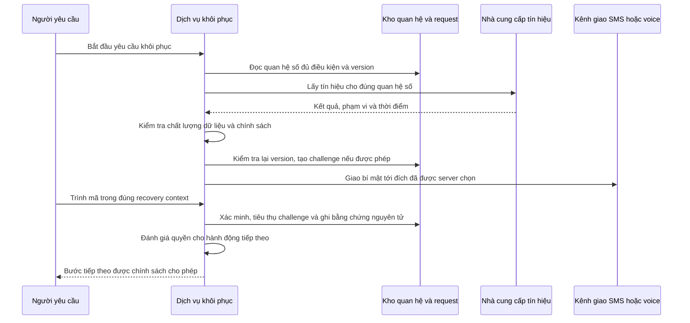

# Tín hiệu quyền kiểm soát số điện thoại trong khôi phục tài khoản

Trong chương **SMS Voice Recovery**, **Phone number ownership signal** là thông tin giúp hệ thống đánh giá người đang khôi phục có còn kiểm soát số điện thoại đã gắn với tài khoản hay không. Trong **SECURITY_AUTHENTICATION_ACCOUNT_RECOVERY**, tín hiệu này hỗ trợ quyết định khi người dùng mất mật khẩu, MFA, passkey hoặc thiết bị xác thực.

Từ “ownership” dễ gây hiểu nhầm. Nhận được một mã SMS hoặc cuộc gọi chủ yếu tạo bằng chứng về **khả năng tiếp nhận và trình lại bí mật ở một thời điểm, trong một ngữ cảnh**. Nó không tự xác nhận người trình mã là chủ tài khoản ban đầu, người đứng tên thuê bao hoặc người duy nhất có thể đọc thông báo.

Bài học tập trung vào cách hiểu, thu thập và sử dụng tín hiệu này. Các trạng thái, thời hạn và quy tắc quyết định trong ví dụ là thiết kế minh họa; không phải hợp đồng của một nhà mạng hoặc cấu hình áp dụng cho mọi sản phẩm.

## 1. Phân biệt số hợp lệ, kênh hoạt động, quyền kiểm soát và danh tính

Không nên gom mọi kết quả liên quan tới số điện thoại vào một biến `phoneVerified`:

| Quan sát | Có thể kết luận ở phạm vi nào? | Không được tự suy ra |
|---|---|---|
| Số vượt kiểm tra định dạng | Biểu diễn phù hợp với quy tắc đánh số mà bộ kiểm tra biết | Số đang được cấp, đang hoạt động hoặc thuộc một người cụ thể |
| Nhà cung cấp nhận yêu cầu gửi | Công việc gửi được tiếp nhận theo hợp đồng | Thiết bị đã nhận mã hoặc người dùng đã đọc |
| Có trạng thái giao tin/cuộc gọi | Một trạng thái giao nhận do nhà cung cấp báo | Danh tính người nhận hoặc quyền kiểm soát độc quyền |
| Người gọi trình OTP đúng | Người trình có được bí mật của challenge còn hợp lệ | Bí mật chắc chắn được đọc trực tiếp bởi chủ tài khoản |
| Xác minh số bằng mạng di động | Mối liên hệ được nhà mạng xác nhận trong phạm vi cơ chế đó | Danh tính pháp lý hoặc tính liên tục với chủ tài khoản cũ |
| Không thấy đổi SIM trong cửa sổ quan sát | Nguồn dữ liệu không báo sự kiện tương ứng trong phạm vi đã kiểm tra | Số chưa từng đổi chủ hoặc không thể bị chiếm |
| Số được xác minh từ lâu | Tài khoản từng chứng minh được một quan hệ với số | Quan hệ đó còn đúng hôm nay |

OTP có thể bị đoán, bị lộ hoặc bị chuyển tiếp. Vì vậy, ngay cả câu “đang kiểm soát số” cũng cần hiểu theo mức bảo đảm của cách thu thập bằng chứng.

Ví dụ, Minh được cấp một số mà Lan đã bỏ dùng. Minh nhập đúng OTP gửi tới số đó. Phép xác minh mã hoạt động đúng nhưng không chứng minh Minh là Lan. Nếu ứng dụng tự cho Minh thay passkey của Lan, lỗi nằm ở cách suy diễn quan hệ giữa số điện thoại và tài khoản.

## 2. Vì sao tín hiệu có thể thay đổi hoặc gây hiểu nhầm?

Số điện thoại là địa chỉ định tuyến có vòng đời. Người sử dụng, thiết bị, SIM, nhà mạng hoặc cách nhận cuộc gọi có thể thay đổi trong khi chuỗi số vẫn giữ nguyên.

| Tình huống | Ảnh hưởng tới bằng chứng | Cách diễn giải phù hợp |
|---|---|---|
| Thay SIM hoặc eSIM hợp lệ | Quan hệ giữa thuê bao và SIM thay đổi | Có thể cần xác minh thêm; chưa đủ để kết luận gian lận |
| SIM swap trái phép | Kẻ khác có thể nhận thông tin gửi tới số | OTP đúng vẫn có thể đến từ kẻ tấn công |
| Chuyển mạng giữ số | Chuỗi số giữ nguyên, nhà mạng phục vụ thay đổi | Phải xét thời điểm và ngữ cảnh, không tự coi mọi lần chuyển là xấu |
| Số bị thu hồi rồi tái cấp | Người mới có thể nhận mã của tài khoản cũ | Quyền nhận mã hiện tại không chứng minh quan hệ lịch sử |
| Chuyển tiếp cuộc gọi, tổng đài hoặc hộp thư thoại | Bí mật có thể tới nơi khác hoặc nhiều người | Voice không mặc nhiên là đường kiểm soát riêng |
| Điện thoại dùng chung hoặc thông báo được đồng bộ | Nhiều người hoặc thiết bị có thể thấy mã | Không giả định quyền kiểm soát độc quyền |
| Phishing hoặc giả danh hỗ trợ | Người dùng thật có thể đưa mã cho kẻ khác | Nhập đúng OTP không tự chứng minh người trình đã chủ động khôi phục |
| Số doanh nghiệp hoặc số của người thân | Người nhận mã có thể không phải chủ tài khoản ứng dụng | Cần chính sách về tính đủ điều kiện của kênh |

NIST xếp việc xác minh ngoài băng qua mạng điện thoại công cộng vào nhóm bị hạn chế trong phạm vi hướng dẫn của họ và đề nghị xem xét các dấu hiệu như đổi thiết bị, đổi SIM, chuyển mạng. Điều này không đồng nghĩa mọi OTP điện thoại đều bị cấm hoặc một lần đổi SIM luôn là tấn công. Xem [NIST SP 800-63B-4, Authentication Using the Public Switched Telephone Network](https://pages.nist.gov/800-63-4/sp800-63b.html#authentication-using-the-public-switched-telephone-network).

Caller ID của một cuộc gọi đến cũng không phải bằng chứng đủ về quyền kiểm soát số. Không dùng việc màn hình hiện đúng số điện thoại làm căn cứ duy nhất để khôi phục.

## 3. Quan hệ với tài khoản phải được thiết lập trước

Một số điện thoại đủ điều kiện khôi phục cần có hồ sơ quan hệ với tài khoản, chẳng hạn:

```text
PhoneBinding
  id
  tenant_id, account_id
  protected_phone_reference
  normalized_number
  version
  state
  enrolled_at
  last_control_verified_at
  recovery_eligibility
  enrollment_authorization_reference
```

Đây là mô hình minh họa. Số đầy đủ cần được bảo vệ theo thiết kế dữ liệu; một tham chiếu mờ không tự mã hóa hoặc bảo vệ giá trị đích mà nó trỏ tới.

Cần phân biệt:

- **Đăng ký một số mới:** chứng minh có thể nhận thông tin tại số đó.
- **Cho phép gắn số vào tài khoản:** cần quyền thay đổi phương thức của chính tài khoản.
- **Dùng số để khôi phục:** cần số đã đủ điều kiện, bằng chứng hiện tại và chính sách phù hợp với hành động.

Một OTP gửi tới số mới chỉ giải quyết bước đầu. Nó không cho người lạ quyền gắn số mới vào tài khoản mà họ biết email.

Nếu còn phương thức xác thực đã đăng ký, thay số có thể yêu cầu xác thực lại bằng phương thức đó. Nếu đã mất mọi phương thức, phải dùng quy trình khôi phục được phê duyệt. Không lấy việc xác minh số mới làm bằng chứng vòng tròn để cho phép chính số mới khôi phục tài khoản cũ.

OWASP coi thay thế yếu tố MFA là thao tác rủi ro cao, cần kiểm tra quyền và thông báo phù hợp. Xem [Multifactor Authentication Cheat Sheet, Changing MFA Factors](https://cheatsheetseries.owasp.org/cheatsheets/Multifactor_Authentication_Cheat_Sheet.html#changing-mfa-factors). Khi số điện thoại đóng vai trò khôi phục, nên đánh giá việc thay số với mức thận trọng tương ứng.

### 3.1. Phiên bản quan hệ ngăn bằng chứng cũ áp dụng cho số mới

Challenge phải gắn với `phone_binding_id` và `binding_version` cụ thể:

```text
Request R -> tài khoản A -> PhoneBinding P, version 7
Challenge C -> Request R -> P, version 7 -> mục đích RECOVER_MFA
```

Nếu thay số hoặc thay thuộc tính bảo mật làm version tăng lên 8, bằng chứng cho version 7 không được tự áp dụng sang version 8. Cần quy tắc thu hồi hoặc đánh giá lại request, challenge và quyền đang mở liên quan tới phiên bản cũ.

Không lưu kết quả OTP thành một cờ xác minh vĩnh viễn có thể tồn tại qua mọi lần đổi số. `last_control_verified_at` là lịch sử của một sự kiện, không phải lời bảo đảm vô thời hạn.

### 3.2. Số điện thoại không phải khóa danh tính bất biến

Dùng ID tài khoản nội bộ ổn định để định danh người dùng trong hệ thống. Việc một số trùng với hồ sơ khác không được tự động gộp tài khoản, chuyển dữ liệu hoặc chuyển quyền sở hữu.

Sản phẩm có thể cho phép hoặc cấm dùng chung số theo nghiệp vụ. Dù chọn cách nào, số trùng vẫn không thay cho xác minh quyền của từng tài khoản. Không mặc định một số luôn tương ứng một con người suốt vòng đời.

## 4. Chuẩn hóa số giúp đối chiếu, không chứng minh quyền kiểm soát

Hai cách nhập có thể chỉ cùng một đích; ngược lại, cùng chuỗi số địa phương có thể có nghĩa khác nhau theo quốc gia. Cần một quy tắc chuẩn hóa nhất quán và ngữ cảnh vùng rõ ràng.

Thư viện chuyên dụng có thể hỗ trợ phân tích, định dạng và kiểm tra vùng số. Tài liệu [libphonenumber FAQ, What does it mean for a phone number to be valid?](https://github.com/google/libphonenumber/blob/master/FAQ.md#what-does-it-mean-for-a-phone-number-to-be-valid) nêu rõ không dùng thư viện để xác định một số hiện được cấp cho người nào hoặc có thể liên lạc được hay không.

Trong luồng khôi phục:

1. Phân tích và chuẩn hóa theo hợp đồng đầu vào.
2. Chọn quan hệ số đã đủ điều kiện từ dữ liệu phía server.
3. Gửi tới đích thuộc quan hệ đó, không lấy một số tùy ý trong payload làm đích thay thế.
4. Ràng buộc bằng chứng với đúng quan hệ và phiên bản.
5. Kiểm tra lại quan hệ trước khi thực thi hành động nhạy cảm.

Nếu cho nhập lại số đầy đủ để xác nhận, thông tin đó chỉ là dữ liệu cần đối chiếu. Biết số điện thoại không phải một yếu tố bí mật đáng tin cậy.

Không suy ra nhà mạng hiện tại chỉ từ đầu số. Không dùng quốc gia của số, IP hoặc loại thiết bị như một phép thay thế cho bằng chứng kiểm soát. Những thông tin này có thể giúp đánh giá rủi ro nhưng không nhận diện chắc chắn một người.

## 5. Tách bằng chứng kiểm soát khỏi tín hiệu rủi ro

Một bộ đánh giá nên giữ riêng các loại dữ liệu:

| Nhóm | Ví dụ | Vai trò |
|---|---|---|
| Quan hệ đã thiết lập | Số đã gắn với tài khoản theo quy trình được phép | Chọn đúng kênh có thể tham gia khôi phục |
| Bằng chứng kiểm soát hiện tại | OTP được xác minh và tiêu thụ trong đúng challenge | Ghi nhận một phép chứng minh ở thời điểm cụ thể |
| Bằng chứng từ mạng | Kết quả number verification theo hợp đồng nhà mạng | Chứng minh một quan hệ kỹ thuật cụ thể |
| Dấu hiệu thay đổi | SIM pairing change, chuyển mạng, thay số gần đây | Điều chỉnh mức tin cậy và yêu cầu bổ sung |
| Ngữ cảnh ứng dụng | Thiết bị mới, thay phương thức liên tiếp, request bất thường | Phát hiện tình huống cần hạn chế hoặc đánh giá thêm |
| Chất lượng dữ liệu | Nguồn, độ mới, phạm vi phủ và lỗi truy vấn | Quyết định kết quả có dùng được không |

CAMARA NumberVerification mô tả khả năng xác minh số liên quan tới SIM dùng trên thiết bị kết nối mạng dữ liệu di động. Đây là phạm vi cụ thể của cơ chế mạng, không phải xác nhận danh tính pháp lý hay việc người dùng là chủ tài khoản ứng dụng. Xem [CAMARA NumberVerification](https://github.com/camaraproject/NumberVerification).

CAMARA SimSwap mô tả thông tin về thay đổi ghép cặp SIM gần đây liên quan tới tài khoản di động. Không nên diễn giải một sự kiện như vậy thành kết luận gian lận nếu chưa xét ngữ cảnh. Xem [CAMARA SimSwap](https://github.com/camaraproject/SimSwap).

Khi tích hợp thực tế, phải đọc hợp đồng và phiên bản API được nhà cung cấp hỗ trợ: phạm vi nhà mạng, cửa sổ lịch sử, điều kiện truy cập, ý nghĩa trạng thái và giới hạn sử dụng có thể khác nhau. Các ví dụ trong bài không phải schema của các API đó.

### 5.1. Không đếm SMS và voice thành hai yếu tố độc lập

Gửi một mã bằng SMS và một mã bằng cuộc gọi tới cùng số không tự tạo hai yếu tố độc lập. Hai đường nhận có thể cùng bị ảnh hưởng bởi việc chiếm số, chuyển tiếp hoặc quyền truy cập thiết bị.

Một kết quả number verification và một SMS OTP trên cùng thuê bao cũng có thể cùng phụ thuộc vào quyền kiểm soát thuê bao hiện tại. Chúng có thể bổ sung thông tin kỹ thuật, nhưng không nên cộng điểm như hai nguồn danh tính hoàn toàn độc lập.

Khi cần bằng chứng bổ sung, phải đánh giá mức phụ thuộc. Ví dụ, email cũng có thể được khôi phục chỉ bằng chính số điện thoại đang bị nghi ngờ. Việc có hai màn hình xác minh không đảm bảo có hai gốc tin cậy khác nhau.

## 6. Độ mới, nguồn gốc và trạng thái không biết

Một quan sát không chỉ có giá trị `true/false`. Nó còn có phạm vi thời gian và nguồn phát sinh:

```yaml
signalType: SIM_CHANGE_OBSERVATION
phoneBindingRef: protected-binding-reference
bindingVersion: 7
source: approved-provider
result: NO_CHANGE_IN_WINDOW
observationWindow:
  from: 2026-11-20T09:00:00Z
  to: 2026-11-23T09:00:00Z
fetchedAt: 2026-11-23T09:00:03Z
validUntil: 2026-11-23T09:05:03Z
providerCorrelationRef: protected-provider-reference
```

Bản ghi là ví dụ nội bộ. Cửa sổ quan sát và thời hạn dùng được chọn để minh họa, không có nghĩa mọi nhà mạng cung cấp cùng lịch sử hoặc dữ liệu còn đáng tin trong đúng năm phút.

Cần giữ ít nhất các khác biệt sau:

| Kết quả | Ý nghĩa cần giữ nguyên |
|---|---|
| `CHANGE_OBSERVED` | Có sự kiện thuộc loại và phạm vi mà nguồn xác nhận |
| `NO_CHANGE_IN_WINDOW` | Không có sự kiện được báo trong cửa sổ và độ phủ đã biết |
| `UNKNOWN` | Không đủ dữ liệu để xác định |
| `UNSUPPORTED` | Số hoặc mạng không được hỗ trợ cho truy vấn này |
| `UNAVAILABLE` | Không lấy được kết quả do lỗi hoặc gián đoạn |
| `STALE` | Kết quả không còn đủ mới cho quyết định hiện tại |

Không viết logic `hasRecentSimSwap != true` rồi cho rằng mọi trường hợp còn lại là an toàn. `null`, timeout, không hỗ trợ và “không có thay đổi trong phạm vi đã kiểm tra” là những trạng thái khác nhau.

Thời điểm tải dữ liệu mới không có nghĩa dữ liệu gốc cũng mới. Một kết quả vừa được trả về có thể chỉ phản ánh một cửa sổ quan sát kết thúc từ trước. Cần phân biệt `fetchedAt` với thời điểm sự kiện và phạm vi quan sát.

Tương tự, số được gắn vào ứng dụng từ ba năm trước chỉ cho biết tuổi của bản ghi quan hệ. Nó không chứng minh cùng một người đã liên tục kiểm soát thuê bao trong ba năm đó.

Nếu kiểm tra nhiều lần, không nối các kết quả rời rạc thành khẳng định liên tục ngoài phạm vi nhà cung cấp cam kết. Một khoảng trống dữ liệu giữa hai lần quan sát vẫn là khoảng trống.

## 7. Chuyển tín hiệu thành quyết định có phạm vi rõ ràng

Không nên dùng một điểm tổng hợp để che mất các điều kiện bắt buộc. Ví dụ, nhiều tín hiệu thuận lợi về vị trí và thiết bị không được bù cho việc OTP thuộc sai tài khoản hoặc số chưa từng được phép dùng để khôi phục.

Có thể tách quyết định thành hai tầng:

```text
Tầng 1: bằng chứng điện thoại có đủ điều kiện tham gia không?
    Quan hệ đúng tài khoản, tenant và phiên bản?
    Kênh được phép dùng cho mục đích này?
    Challenge đúng ngữ cảnh và còn hiệu lực?
    Phép chứng minh kiểm soát đã được server chấp nhận?
    Dữ liệu bổ sung còn đủ mới và có nguồn đáng tin?

Tầng 2: cả hành động khôi phục đã đủ điều kiện chưa?
    Loại credential nào sẽ bị thay?
    Có cần bằng chứng độc lập không?
    Có dấu hiệu số hoặc tài khoản bị chiếm không?
    Có cần quy trình đánh giá bổ sung không?
    Quyền và session sau khôi phục được xử lý thế nào?
```

Một bảng chính sách minh họa:

| Tình huống | Quyết định phù hợp ở phạm vi bài học |
|---|---|
| Số chưa gắn với tài khoản, dù nhận OTP được | Không dùng làm bằng chứng khôi phục tài khoản đó |
| Quan hệ hợp lệ và OTP đúng, không có dấu hiệu bất lợi đã biết | Có thể ghi một bằng chứng điện thoại; tiếp tục kiểm tra chính sách hành động |
| OTP đúng nhưng có thay SIM gần đây | Yêu cầu đánh giá hoặc bằng chứng phù hợp khác; không chỉ dựa vào OTP để cho phép thay yếu tố |
| Có thông tin đáng tin về số đã chuyển sang người khác | Không dùng quan hệ lịch sử đó để tự động khôi phục |
| Dữ liệu nhà mạng không có hoặc không hỗ trợ | Giữ trạng thái không biết, áp dụng nhánh thay thế đã định |
| SMS thất bại nhưng voice tới cùng số thành công | Có thể có bằng chứng qua voice theo chính sách; chưa tạo thêm yếu tố độc lập |
| OTP đúng nhưng binding version đã đổi | Không áp dụng bằng chứng cũ cho quan hệ hiện tại |
| Đủ bằng chứng điện thoại nhưng hành động là thay toàn bộ passkey | Cần quyết định theo chính sách của hành động rủi ro cao, không suy diễn từ một cờ xác minh |

Các nhãn kết quả nội bộ nên nói rõ phạm vi, chẳng hạn:

```text
PHONE_EVIDENCE_RECORDED
ADDITIONAL_EVIDENCE_REQUIRED
PHONE_BINDING_NOT_ELIGIBLE
SIGNAL_DATA_INSUFFICIENT
RECOVERY_POLICY_APPROVED
```

`PHONE_EVIDENCE_RECORDED` và `RECOVERY_POLICY_APPROVED` không phải cùng một trạng thái.

Một khoảng chờ sau đổi SIM có thể là biện pháp giảm rủi ro theo chính sách, nhưng việc hết khoảng chờ không tự biến kẻ đang chiếm số thành chủ tài khoản. Không dùng thời gian trôi qua như bằng chứng danh tính duy nhất.

Không cần luôn từ chối toàn bộ tài khoản khi một tín hiệu không tốt. Hệ thống có thể ngừng dùng kênh điện thoại cho request hiện tại và cung cấp recovery code đã chuẩn bị, một authenticator còn khả dụng hoặc quy trình xác minh danh tính được phép. Chỉ dùng những phương thức đã được sản phẩm thiết kế và vận hành.

## 8. Luồng thu thập và sử dụng tín hiệu an toàn

Một luồng tham khảo:



Không bắt buộc sản phẩm nào cũng có nhà cung cấp tín hiệu mạng. Nếu có, chất lượng và độ phủ của nguồn phải được phản ánh trong quyết định. Nếu không có, không được tự tạo kết quả “không đổi SIM”.

Các nguyên tắc triển khai:

1. **Chọn đích từ server.** Client có thể chọn một kênh đã được phép theo hợp đồng, nhưng không được sửa số đích hoặc chủ tài khoản của request.
2. **Gắn truy vấn với quan hệ cụ thể.** Kết quả phải áp dụng cho đúng số, binding version và phạm vi truy vấn; không dùng nhầm kết quả cache của số khác.
3. **Xác thực nguồn.** Chỉ chấp nhận kết quả từ kết nối hoặc callback đáp ứng cơ chế xác thực của nhà cung cấp. Không tin một JSON do trình duyệt gửi có trường `providerVerified: true`.
4. **Kiểm tra thứ tự sự kiện.** Callback trễ hoặc lặp không được ghi đè một quan sát mới hơn hay phục hồi quan hệ đã thu hồi.
5. **Kiểm tra lại trước khi cấp quyền.** Thời hạn, version và trạng thái request có thể thay đổi sau lần gọi nhà cung cấp.
6. **Ghi phạm vi bằng chứng.** Lưu bằng chứng gắn với request, challenge, mục đích, quan hệ số và thời hạn; không chỉ sửa cờ chung trên tài khoản.

Không giữ khóa database qua một lời gọi mạng lâu mà chưa có chiến lược vận hành. Có thể lấy dữ liệu ngoài transaction, rồi trong transaction kiểm tra lại snapshot quan hệ, version, độ mới và trạng thái trước khi chấp nhận.

Một pseudocode minh họa:

```text
binding_snapshot = resolve_eligible_phone_binding(request_context)
observation = fetch_or_resolve_signal(binding_snapshot)

validate observation source, target, coverage and freshness
decide whether this phone path may continue

issue and deliver a challenge bound to:
    request, account, tenant, purpose,
    binding_id, binding_version and generation

on proof submission:
    begin transaction
        lock request and binding state under a shared protocol
        require binding still matches challenge snapshot
        require request and challenge are active and unexpired
        require attempt budgets allow verification
        verify and atomically consume the challenge
        record scoped phone-control evidence
        persist the operation result
    commit

evaluate the full recovery policy
```

Đoạn trên chỉ mô tả các bất biến. Phần xác minh OTP còn cần nguồn mã an toàn, giá trị kiểm tra được bảo vệ, ngân sách thử bền vững và xử lý retry. Một lần cập nhật thành công của nhà cung cấp giao tin không thay cho bước người dùng trình mã.

Nếu thay số diễn ra đồng thời, cả thao tác thay số và verifier phải dùng cùng cơ chế kiểm soát version hoặc khóa phù hợp. Kết quả được chấp nhận phải tương ứng một thứ tự hợp lệ, không phải sự pha trộn giữa số cũ và số mới.

## 9. Không biến lỗi nhà cung cấp thành tín hiệu thuận lợi

Đoạn logic sau có lỗi suy diễn:

```text
try:
    recent_change = provider.check(number)
catch timeout:
    recent_change = false

if not recent_change and otp_correct:
    approve_recovery()
```

Nó biến “không biết có thay đổi không” thành “không có thay đổi”, đồng thời gộp xác minh OTP với cho phép khôi phục.

Một cách phân nhánh rõ hơn:

```text
if binding mismatch or binding not eligible:
    do not use this phone evidence

else if proof not accepted or proof expired:
    do not record phone-control evidence

else:
    record the accepted proof in its exact scope

    switch usable signal result:
        CHANGE_OBSERVED:
            apply the documented elevated-risk path
        NO_CHANGE_IN_WINDOW:
            continue policy evaluation within the observed coverage
        UNKNOWN, UNSUPPORTED, UNAVAILABLE, STALE:
            apply the documented insufficient-data path

    authorize the requested action only if its full policy passes
```

Đây là minh họa cách giữ nguyên ý nghĩa dữ liệu. Chính sách có thể quyết định không sử dụng bằng chứng điện thoại trong một nhánh cụ thể; việc ghi lịch sử phép chứng minh không đồng nghĩa bằng chứng đó đủ tin cậy để cấp quyền.

Nhánh thiếu dữ liệu cần được thiết kế trước: ví dụ yêu cầu bằng chứng khác hoặc trì hoãn xử lý. Không để hệ thống tự chuyển sang voice, bỏ qua MFA hay dùng một câu hỏi dễ đoán chỉ để hoàn thành luồng.

Cũng không coi lỗi nhà cung cấp là chứng cứ người dùng gian lận. Cần phân biệt rủi ro chưa xác định, sự cố vận hành và dấu hiệu bất lợi thực sự. Thông tin đó giúp chọn đúng cách hỗ trợ người dùng và tránh khóa nhầm.

## 10. Các tình huống điển hình

### 10.1. Nhận OTP đúng sau SIM swap

Lan mất quyền truy cập điện thoại; một bên khác nhận được mã gửi tới số đã đăng ký. Có quan sát mới về thay SIM và yêu cầu thay MFA đến từ ngữ cảnh khác thường.

Verifier có thể chấp nhận mã đúng trong challenge, nhưng policy không nên chỉ dựa vào mã đó để thay MFA. Cần một phương thức phù hợp không phụ thuộc hoàn toàn vào quyền kiểm soát số đang bị nghi ngờ.

Gửi thêm một OTP thoại tới cùng số không giải quyết được vấn đề gốc. Nó thay cách giao bí mật, không chứng minh Lan đã quay lại kiểm soát thuê bao.

### 10.2. Đổi SIM hợp lệ khi thay điện thoại

Hùng chuyển sang điện thoại mới và thay eSIM theo quy trình hợp lệ. Tín hiệu thay SIM có thật, nhưng Hùng vẫn có recovery code được cấp trước hoặc một authenticator khác còn dùng được.

Hệ thống nên cho đi qua nhánh phù hợp với các bằng chứng đó, thay vì gán nhãn gian lận vĩnh viễn. Sau khi được phép, có thể cập nhật quan hệ số và thiết lập phương thức mới theo quy trình.

Sự kiện mạng là dữ liệu đầu vào cho quyết định; nó không tự quyết định động cơ của người dùng.

### 10.3. Người khác được cấp lại số cũ

Lan bỏ dùng số nhưng chưa cập nhật hồ sơ ứng dụng. Minh được nhà mạng cấp số này sau đó và nhận được OTP.

Ngay cả khi không có thay SIM gần đây trong cửa sổ mà nhà cung cấp quan sát, điều đó cũng không loại trừ việc số đã được tái cấp từ trước. OTP mới chứng minh khả năng lấy mã của Minh, không nối Minh với lịch sử tài khoản của Lan.

Đây là lý do không dùng trạng thái “số ổn định” như một phép xác minh danh tính. Với tài khoản lâu không hoạt động hoặc hành động rủi ro cao, chính sách có thể cần thêm bằng chứng đã chuẩn bị trước hoặc quy trình khôi phục khác.

### 10.4. SMS và voice tới các điểm nhận khác nhau

Một số có thể nhận SMS trên một thiết bị, còn cuộc gọi được chuyển tiếp tới tổng đài hoặc hộp thư thoại. Tùy cấu hình thực tế, người nghe cuộc gọi có thể khác người đọc SMS.

Ứng dụng phải hiểu giới hạn của kênh mà mình cho phép. Không mặc định cuộc gọi được trả lời bởi con người đúng chủ tài khoản; không coi việc cuộc gọi được kết nối là bằng chứng người yêu cầu đã đọc một mã.

Nếu cho phép voice làm phương án thay thế vì khả năng tiếp cận hoặc điều kiện mạng, vẫn phải giữ ràng buộc challenge, hạn mức và chính sách bằng chứng. Không tự nâng mức tin cậy chỉ vì đổi phương thức giao.

### 10.5. Người dùng không còn số cũ

Một người dùng thật có thể mất cả số lẫn thiết bị xác thực. Bắt họ chỉ nhập mã gửi tới số cũ sẽ tạo một ngõ cụt.

Hệ thống cần một đường khôi phục thay thế đã được thiết kế. Việc họ cung cấp số mới hoặc biết thông tin hồ sơ không tự cho phép gắn số mới. Quyền gắn lại chỉ xuất hiện sau khi chính sách khôi phục tương ứng đạt yêu cầu.

## 11. Quản lý vòng đời, chống lạm dụng và dữ liệu riêng tư

### 11.1. Kiểm tra lại quan hệ theo biến cố và rủi ro

Một lần xác minh cũ không đủ bảo vệ mọi yêu cầu sau này. Cần xác định những biến cố làm thay đổi tính đủ điều kiện của số, ví dụ thay số trong hồ sơ, thu hồi quyền khôi phục, phát hiện chiếm tài khoản hoặc dữ liệu cho thấy quan hệ số không còn đáng tin.

Không nhất thiết mọi người dùng phải xác minh lại với cùng một chu kỳ. Nếu có chính sách tái kiểm tra, cần cân nhắc mức rủi ro, khả năng tiếp cận và dữ liệu thực tế của sản phẩm.

Việc liên tục gửi mã cũng không tự giải quyết số tái cấp: người đang giữ số mới vẫn có thể nhập đúng. Tái xác minh cần giữ đúng giới hạn kết luận của nó.

### 11.2. Hạn chế cả dò tài khoản và chi phí giao tin

Khởi tạo khôi phục không nên tiết lộ số đầy đủ hoặc xác nhận một email gắn với số nào cho người không có quyền. Hiển thị một phần đích nhận chỉ trong ngữ cảnh mà chính sách cho phép.

Giới hạn phải xét request, tài khoản, số đích, nguồn gọi, tenant và tổng chi phí phù hợp. Không chỉ giới hạn mỗi OTP trong khi cho gửi vô hạn SMS, cuộc gọi hoặc truy vấn nhà mạng.

Các yêu cầu lặp có thể gây quấy rối và tiêu hao chi phí. Cần chính sách gửi lại, chống tự động hóa và kiểm soát các đích không đủ điều kiện trước khi gọi dịch vụ ngoài.

Một yêu cầu khôi phục vô danh không nên tự xóa kênh, thu hồi mọi session hoặc khóa vĩnh viễn tài khoản của nạn nhân. Các thay đổi đó cần căn cứ và quyền phù hợp.

### 11.3. Tối thiểu hóa dữ liệu và bảo vệ tham chiếu

Chỉ thu thập tín hiệu phục vụ quyết định đã xác định. Không lưu lịch sử viễn thông chi tiết vô hạn khi chỉ cần biết một kết quả có thời hạn và phạm vi rõ.

Số điện thoại có không gian dễ liệt kê hơn bí mật ngẫu nhiên dài. Hash không có khóa của số không làm nó trở thành dữ liệu ẩn danh. Nếu cần đối chiếu hoặc hạn mức bằng một fingerprint, có thể dùng cơ chế có khóa và quản lý quyền tương ứng; vẫn phải coi đó là dữ liệu cần bảo vệ.

Bảo vệ số đầy đủ, thông tin nhà cung cấp và lịch sử thay đổi bằng phân quyền, mã hóa phù hợp và thời hạn lưu. Log và trace không được chứa OTP, recovery grant hoặc payload nhà cung cấp có dữ liệu nhạy cảm không cần thiết.

Audit quyết định có thể ghi:

```text
request_reference
phone_binding_reference
binding_version
proof_type
proof_verified_at
signal_source
signal_result
observation_window
signal_freshness
policy_version
decision_reason
```

Các tham chiếu vẫn có thể liên kết tới một người trong hệ thống nên cần kiểm soát truy cập. Không dùng số điện thoại đầy đủ làm nhãn metric.

Theo dõi riêng số lần dữ liệu không hỗ trợ, timeout, tín hiệu cũ, cần bằng chứng bổ sung và người dùng hoàn tất bằng phương thức thay thế. Nếu gộp tất cả thành “xác minh số thất bại”, khó phân biệt sự cố tích hợp với vấn đề chính sách.

## 12. Các hành vi cần kiểm chứng khi triển khai

Bảng dưới là yêu cầu hành vi để kiểm chứng, không phải kết quả kiểm thử đã chạy cùng bài học.

| Tình huống | Hành vi cần đạt |
|---|---|
| Số đúng định dạng nhưng chưa có quan hệ với tài khoản | Không trở thành kênh khôi phục chỉ nhờ định dạng |
| Nhà cung cấp báo giao thành công | Chưa tạo bằng chứng người dùng đã trình bí mật |
| OTP đúng cho binding version cũ | Không áp dụng sang số hoặc phiên bản mới |
| Số mới nhận OTP được | Chưa được gắn vào tài khoản nếu thiếu quyền thay đổi |
| OTP đúng nhưng có thông tin đáng tin về chiếm số | Không tự động cho thay credential nhạy cảm |
| Thay SIM hợp lệ cùng bằng chứng khác đủ điều kiện | Có nhánh xử lý phù hợp, không gán gian lận chỉ từ sự kiện |
| Không có thay đổi trong cửa sổ ngắn | Không kết luận cùng người đã giữ số trong cả lịch sử |
| Kết quả nhà mạng timeout hoặc không hỗ trợ | Giữ trạng thái thiếu dữ liệu, không chuyển thành kết quả thuận lợi |
| Dữ liệu vừa tải nhưng cửa sổ quan sát cũ | Đánh giá độ mới theo dữ liệu gốc và chính sách |
| Callback cũ đến sau kết quả mới | Không ghi đè trạng thái mới hoặc hồi sinh quan hệ đã thu hồi |
| Hai số hoặc tenant có kết quả cache gần nhau | Không dùng nhầm kết quả hoặc trộn bằng chứng |
| SMS và voice cùng thành công trên một số | Không tự đếm thành hai yếu tố độc lập |
| Người mới được tái cấp số nhập OTP đúng | Không suy ra người đó là chủ tài khoản lịch sử |
| Nhiều người dùng chung số doanh nghiệp | Không gộp hoặc chuyển quyền tài khoản tự động |
| Thay số đồng thời với xác minh | Có thứ tự quyết định rõ, không chấp nhận snapshot đã mất hiệu lực |
| Yêu cầu gửi lại liên tục | Hạn mức bảo vệ người nhận và chi phí vẫn có hiệu lực |
| Người dùng mất số cũ | Có đường khôi phục thay thế theo chính sách đã xác định |
| Bằng chứng đủ để tiếp tục một bước | Không tự sinh session toàn quyền hoặc gỡ mọi MFA |
| Bước thay credential đã được cho phép | Kiểm tra quyền hiện tại và xử lý session theo chính sách |
| Log, metric và báo lỗi hoạt động | Không thu thập bí mật hoặc lộ số đầy đủ ngoài nhu cầu |

Sau khi đủ điều kiện khôi phục, việc thay mật khẩu, MFA hoặc passkey vẫn cần quyền có phạm vi và thời hạn, kiểm tra lại trạng thái hiện tại, thông báo bảo mật và xử lý session/refresh token phù hợp. Một phép xác minh số không tự hoàn thành các việc đó.

Câu hỏi cần giữ khi thiết kế là: **nguồn dữ liệu vừa chứng minh điều gì, cho số và quan hệ nào, trong khoảng thời gian nào, và chính sách cho phép dùng kết luận đó tới đâu?** Bằng chứng về khả năng nhận mã hiện tại chỉ có giá trị trong phạm vi mà hệ thống thực sự kiểm chứng được.
