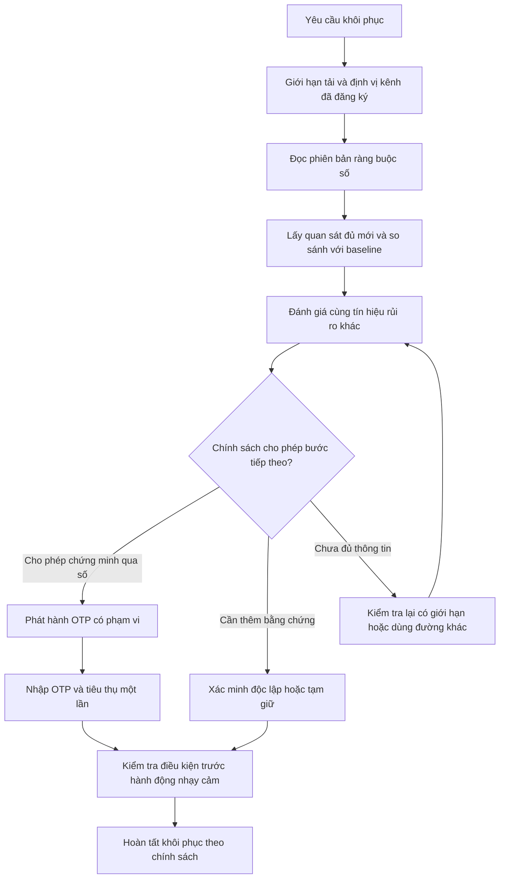

# Phát hiện thay đổi nhà mạng trong khôi phục tài khoản

## 1. Tín hiệu nhà mạng giúp trả lời câu hỏi nào?

**Carrier change detection** là việc nhận biết số điện thoại đang dùng để khôi phục tài khoản có dấu hiệu thay đổi nhà cung cấp dịch vụ hay không, bằng cách so sánh các quan sát có thể đối chiếu hoặc sử dụng dữ liệu sự kiện chuyển mạng từ nguồn phù hợp.

Số điện thoại có thể vẫn giữ nguyên trong khi nơi tiếp nhận SMS và cuộc gọi đã thay đổi. Với luồng khôi phục mật khẩu, MFA, passkey hoặc thiết bị xác thực, điều này quan trọng vì người đang nhận OTP chưa chắc còn là người đã đăng ký số với tài khoản.

Chuyển mạng giữ số là hoạt động hợp lệ. Tuy nhiên, kẻ gian có thể giả mạo khách hàng để chuyển số sang nhà cung cấp và thiết bị do chúng kiểm soát. FCC phân biệt hành vi này với việc chiếm quyền số qua thay SIM, đồng thời chỉ ra rằng cả hai có thể khiến tin nhắn và cuộc gọi dành cho nạn nhân đến tay kẻ gian. [Nguồn: FCC, mô tả SIM swap và port-out fraud](https://docs.fcc.gov/public/attachments/FCC-23-95A1.pdf).

Từ đó, bài học dùng nguyên tắc: **thay đổi nhà mạng là tín hiệu đánh giá rủi ro; nó không tự chứng minh gian lận, cũng không xác minh danh tính**.

Ví dụ, một người vừa chuyển mạng để dùng gói cước tốt hơn rồi mất mật khẩu có thể cần hỗ trợ khôi phục hợp lệ. Cùng tín hiệu đó, nếu đi kèm thiết bị lạ và yêu cầu gỡ toàn bộ MFA, có thể đòi hỏi bằng chứng độc lập trước khi được tiếp tục.

## 2. Phân biệt những thay đổi thường bị gộp nhầm

| Hiện tượng | Điều có thể thay đổi | Điều không được suy ra |
| --- | --- | --- |
| Chuyển mạng giữ số | Nhà cung cấp dịch vụ gắn với cùng số điện thoại. | Người dùng đã đổi số hoặc chắc chắn bị chiếm tài khoản. |
| Thay SIM/eSIM | Liên kết giữa số thuê bao và SIM, có thể trong cùng nhà mạng. | Nhà mạng nhất thiết phải thay đổi. |
| Roaming | Mạng mà thiết bị đang kết nối khi chuyển vùng. | Thuê bao đã chuyển nhà cung cấp dịch vụ. |
| Đổi thiết bị | Thiết bị sử dụng SIM hoặc tài khoản. | Có chuyển mạng hoặc SIM swap trái phép. |
| Thay đổi thương hiệu hoặc dữ liệu ánh xạ | Tên hiển thị, tổ chức hoặc cách nguồn dữ liệu mô tả mạng. | Có một sự kiện chuyển số của riêng thuê bao. |
| Thu hồi và cấp lại số | Người được cấp quyền sử dụng số có thể thay đổi. | Có thể phát hiện chắc chắn chỉ bằng so sánh tên nhà mạng. |
| Chuyển tiếp cuộc gọi | Đích nhận cuộc gọi có thể khác. | SMS và nhà mạng nhất thiết có cùng thay đổi. |

Một SIM swap trong cùng mạng có thể không làm carrier lookup thay đổi. Ngược lại, một lần đổi tên thương hiệu có thể làm chuỗi tên khác đi dù thuê bao không chuyển đi đâu.

CAMARA mô tả SIM Swap API là nguồn thông tin về thay đổi SIM gắn với số điện thoại, có thể trả thời điểm thay đổi hoặc kết quả trong một khoảng thời gian. Đây là loại tín hiệu khác với lịch sử nhà mạng và cần được giữ riêng trong mô hình đánh giá rủi ro. [Nguồn: CAMARA Sim Swap](https://camaraproject.org/sim-swap/).

### Vì sao đổi SMS sang cuộc gọi chưa tạo ra bằng chứng độc lập?

Nếu cùng số điện thoại đã bị chuyển trái phép, kẻ kiểm soát số có thể nhận cả SMS lẫn cuộc gọi. Gọi đọc lại OTP tới chính số đó không giải quyết được nghi ngờ về quyền kiểm soát số.

Kênh độc lập phải dựa vào một gốc tin cậy khác đã được thiết lập, chẳng hạn một passkey còn dùng được hoặc một cơ chế khôi phục dự phòng phù hợp. Nếu người dùng đã mất tất cả các yếu tố đó, cần một quy trình xác minh bổ sung được thiết kế riêng; không tự coi thoại là một yếu tố mạnh hơn chỉ vì khác cách truyền.

## 3. Trước khi so sánh, xác định dữ liệu đang nói về nhà mạng nào

Một trường có tên `carrier` không nhất thiết mang cùng nghĩa ở mọi nguồn.

| Loại dữ liệu | Ý nghĩa có thể có | Cách sử dụng |
| --- | --- | --- |
| Nhà mạng phân bổ đầu số ban đầu | Nguồn cấp dải số gốc. | Hỗ trợ phân loại; không đủ xác định mạng hiện tại sau chuyển mạng. |
| Nhà cung cấp hiện hành | Đơn vị đang phục vụ số theo định nghĩa của nguồn. | Có thể dùng để so sánh nếu dữ liệu có phạm vi và độ mới phù hợp. |
| Mạng truy nhập đang phục vụ thiết bị | Mạng mà thiết bị đang kết nối tại thời điểm quan sát. | Phải tách khỏi thông tin nhà cung cấp thuê bao khi có roaming. |
| Mạng hạ tầng của MVNO | Mạng nền mà một nhà mạng ảo sử dụng. | Không mặc định đồng nhất với thương hiệu hoặc hợp đồng của thuê bao. |
| Thông tin định tuyến | Đơn vị hoặc nút mạng liên quan đến chuyển tiếp lưu lượng. | Không tự diễn giải thành bằng chứng chuyển nhà cung cấp. |
| Sự kiện chuyển mạng | Một nguồn báo số đã được chuyển, có thể kèm thời điểm. | Mạnh hơn phép suy đoán từ tên, nhưng vẫn cần kiểm tra nguồn và ngữ nghĩa. |

Đầu số và quốc gia của số không chứng minh nhà mạng hiện hành. Địa chỉ IP, ngôn ngữ trình duyệt hay tên Wi-Fi cũng không thay thế được dữ liệu về số điện thoại.

Khi tích hợp một nguồn, cần xác định:

- Trường nào là tên hiển thị, trường nào là định danh có thể so sánh.
- Nguồn có tính đến chuyển mạng hay chỉ suy từ phân bổ đầu số.
- Dữ liệu đề cập nhà cung cấp thuê bao, mạng hạ tầng hay mạng truy nhập.
- Thông tin được hỗ trợ ở quốc gia, loại số và nhà mạng nào.
- Thời điểm dữ liệu phản ánh và độ trễ cập nhật được nguồn mô tả ra sao.
- `null`, không có trường, không có quyền truy vấn và lỗi tạm thời có nghĩa gì.

Ví dụ, tài liệu Line Type Intelligence của Twilio mô tả tên carrier, MCC/MNC và loại số là các trường riêng; một số loại số có các trường carrier bằng `null`. Vì vậy, adapter không được coi `null` là “nhà mạng không thay đổi”. Các trường đó cũng không tự cung cấp một lịch sử chuyển mạng. [Nguồn: Twilio Line Type Intelligence](https://www.twilio.com/docs/lookup/v2-api/line-type-intelligence).

Bài học không giả định mọi nguồn có API lịch sử chuyển mạng, timestamp sự kiện hay độ phủ giống nhau. Các cấu trúc dữ liệu bên dưới là mô hình nội bộ minh họa, không phải schema bắt buộc của một nhà cung cấp cụ thể.

## 4. Tạo bản quan sát có nguồn gốc và thời gian rõ ràng

Nên giữ thông tin chất lượng cùng kết quả thay vì chỉ lưu một chuỗi tên nhà mạng.

Một bản quan sát chuẩn hóa có thể gồm:

| Nhóm | Trường minh họa | Mục đích |
| --- | --- | --- |
| Ràng buộc số | `phone_binding_id`, `binding_version` | Bảo đảm đang kiểm tra đúng số đã gắn với tài khoản. |
| Nguồn | `source_id`, `source_schema_version` | Biết dữ liệu và contract đến từ đâu. |
| Mạng | `network_id`, `network_id_type`, `network_role` | So sánh đúng loại định danh và đúng vai trò mạng. |
| Chuẩn hóa | `mapping_version`, `display_name` | Tách tên hiển thị khỏi quy tắc quy đổi định danh. |
| Kết quả truy vấn | `result_status`, `coverage_status` | Phân biệt có dữ liệu, thiếu dữ liệu, thiếu quyền và lỗi. |
| Thời gian | `queried_at`, `data_as_of`, `received_at` | Phân biệt lúc truy vấn với độ mới thực sự của dữ liệu. |
| Sự kiện, nếu có | `port_event_at`, `event_reference` | Giữ thời điểm nguồn báo thay đổi và dấu vết đối soát. |

`queried_at` là lúc hệ thống gửi truy vấn. Nó không chứng minh dữ liệu nhà mạng được cập nhật tại thời điểm đó. `received_at` cũng chỉ cho biết lúc nhận kết quả.

Nếu nguồn không cung cấp `data_as_of`, hãy giữ trạng thái không biết hoặc dùng contract độ mới được nguồn cam kết. Không điền thời gian hiện tại vào trường đó để làm bản quan sát trông mới hơn.

Timestamp sự kiện, nếu có, cần được kiểm tra định dạng, múi giờ, độ chính xác và giới hạn hợp lý. Một thời điểm nằm bất thường trong tương lai là tín hiệu lỗi dữ liệu cần xử lý, không phải lý do tạo thời gian chờ âm.

MCC và MNC nên giữ ở dạng chuỗi với quy tắc định dạng phù hợp, tránh mất số 0 ở đầu hoặc làm nhập nhằng mã có độ dài khác nhau. Việc có mã chuẩn không tự giải quyết được khác biệt MVNO, nguồn dữ liệu hay vai trò mạng.

## 5. Thiết lập baseline mà không tự hợp thức hóa người đang giữ số

**Baseline** là mốc quan sát được chọn để so sánh. Nó không phải một lời khẳng định vĩnh viễn rằng người đang nhận tin là chủ tài khoản.

Khi gắn một số khôi phục, hệ thống cần thực hiện quy trình đăng ký kênh phù hợp: kiểm tra quyền của người thay đổi, xác minh số, đánh giá rủi ro và lưu phiên bản ràng buộc. Nếu chỉ nhận một số mới từ người chưa được xác thực rồi lưu ngay làm baseline, bộ phát hiện sau đó có thể cho kết quả “ổn định” trên chính số của kẻ tấn công.

Nên tách ít nhất hai loại dữ liệu:

- **Quan sát mới nhất:** bản ghi thực tế gần nhất từ nguồn, kể cả khi cho thấy thay đổi đáng ngờ.
- **Baseline được chấp thuận:** mốc tham chiếu có quy tắc cập nhật và bằng chứng phê duyệt rõ ràng.

Một truy vấn cho kết quả nhà mạng B khác baseline A phải được lưu lại để điều tra. Nó không nên tự ghi đè baseline A trước khi quyết định rủi ro hoàn tất.

Nếu cập nhật baseline trên mọi request, lần đầu sau port-out sẽ thấy thay đổi, còn lần thứ hai có thể thấy B so với B và được coi là an toàn. Kẻ tấn công chỉ cần thử lại để xóa dấu hiệu rủi ro.

Quy tắc nâng baseline có thể yêu cầu bằng chứng độc lập hoặc một quy trình xem xét phù hợp. Cần lưu lý do, thời gian, phiên bản chính sách và nguồn xác minh; không dùng duy nhất một OTP tới số đang bị nghi ngờ để chấp thuận trạng thái mới.

Khi người dùng thay hẳn số điện thoại, cần tạo phiên bản ràng buộc mới. Không so nhà mạng của số cũ với số mới rồi báo “carrier changed” như thể đó là một lần chuyển mạng giữ số.

## 6. So sánh có nhiều kết quả hơn đúng hoặc sai

Một kết quả nhị phân `carrier_changed = false` không đủ phân biệt thiếu dữ liệu với quan sát không có thay đổi.

Có thể dùng các trạng thái:

| Kết quả | Điều có thể nói |
| --- | --- |
| `DIFFERENT_NETWORK` | Hai quan sát đủ điều kiện so sánh cho thấy định danh nhà cung cấp khác nhau. |
| `SAME_NETWORK_OBSERVED` | Không thấy khác biệt giữa các quan sát đủ điều kiện. |
| `NO_BASELINE` | Chưa có mốc tham chiếu phù hợp cho phiên bản ràng buộc này. |
| `UNKNOWN` | Không đủ dữ liệu hoặc chất lượng để kết luận. |
| `NOT_COMPARABLE` | Có dữ liệu nhưng khác vai trò mạng, không gian định danh hoặc ngữ nghĩa không quy đổi được. |
| `INCONSISTENT` | Các quan sát có thẩm quyền hoặc thông tin sự kiện đang mâu thuẫn cần đối soát. |

`SAME_NETWORK_OBSERVED` không có nghĩa “đã xác minh chủ số”. Nó cũng không loại trừ SIM swap trong cùng nhà mạng, cấp lại số cho người khác hoặc chuyển A → B → A giữa hai lần quan sát.

Một thuật toán so sánh minh họa:

```text
compareCarrier(binding, baseline, current, timePolicy):
    nếu baseline không thuộc binding.id và binding.version:
        return NO_BASELINE

    nếu current không thuộc đúng binding:
        return UNKNOWN với nguyên nhân BINDING_MISMATCH

    nếu dữ liệu thiếu, không có quyền hoặc truy vấn lỗi:
        return UNKNOWN

    nếu baseline/current không đạt yêu cầu chất lượng:
        return UNKNOWN

    nếu vai trò mạng hoặc không gian định danh không tương thích:
        return NOT_COMPARABLE

    nếu có mâu thuẫn chưa giải quyết giữa các nguồn:
        return INCONSISTENT

    nếu hai định danh canonical khác nhau:
        return DIFFERENT_NETWORK

    return SAME_NETWORK_OBSERVED
```

Trong thuật toán này, “đạt yêu cầu chất lượng” phụ thuộc loại quan sát. Baseline có thể là một mốc lịch sử được giữ lâu; quan sát hiện tại cần đủ mới cho hành động sắp thực hiện. Không buộc baseline lịch sử phải có tuổi như dữ liệu realtime, rồi xóa mọi so sánh hữu ích.

Chỉ chuẩn hóa chữ hoa, dấu cách hoặc tên thương hiệu chưa đủ tạo một định danh canonical. Cần một ánh xạ được quản lý theo nguồn, vai trò mạng và phiên bản. Nếu chưa có quy tắc ánh xạ đáng tin cậy, kết quả đúng là không thể so sánh.

Nếu chuyển nhà cung cấp dữ liệu, nên đối chiếu hoặc chạy song song trong phạm vi được phép trước khi dùng dữ liệu mới để ra quyết định. Không diễn giải mọi khác biệt do đổi nguồn thành một đợt người dùng đồng loạt chuyển mạng.

### Giữ riêng tín hiệu sự kiện trực tiếp

Nếu có một nguồn đủ điều kiện báo sự kiện chuyển mạng, lưu tín hiệu đó song song với kết quả so sánh snapshot. Nó có thể bổ sung thông tin mà hai snapshot không thấy.

Ví dụ, baseline A và hiện tại A không phủ nhận một sự kiện A → B → A trong khoảng giữa. Ngược lại, một sự kiện quá cũ không chứng minh có thay đổi mới ngay trước yêu cầu recovery.

Việc hợp nhất hai loại tín hiệu phải xét thời điểm, phạm vi và nguồn gốc; không ưu tiên tùy tiện một trường chỉ vì nó có tên “fraud”.

## 7. Không đánh đồng “vừa phát hiện” với “vừa chuyển mạng”

Giả sử hệ thống có hai quan sát đáng tin cậy về cùng một loại nhà cung cấp:

```text
01/11 lúc 08:00: quan sát A
21/11 lúc 08:00: quan sát B
23/11 lúc 08:00: người dùng yêu cầu recovery
```

Nếu chỉ có các snapshot, hệ thống thấy khác biệt giữa A và B. Nó không biết chính xác sự kiện diễn ra lúc nào.

Trong điều kiện dữ liệu phản ánh đúng thời điểm đã ghi, ít nhất một thay đổi xảy ra trong khoảng giữa hai quan sát. Nếu dữ liệu có độ trễ, khoảng suy luận phải tính thêm sự không chắc chắn đó. Hệ thống không được tự gán “chuyển mạng cách đây hai ngày” bằng cách lấy thời điểm nhận snapshot B.

Ba mốc thường bị dùng nhầm:

| Mốc | Ý nghĩa |
| --- | --- |
| `event_occurred_at` | Thời điểm sự kiện theo nguồn, nếu thực sự có. |
| `change_first_observed_at` | Lần đầu ứng dụng thấy dữ liệu khác baseline. |
| `decision_at` | Thời điểm hệ thống đánh giá rủi ro cho hành động. |

Nếu chính sách yêu cầu “không có port trong cửa sổ W”, hai snapshot thưa có thể không đủ chứng minh điều kiện đó. Kết quả cần giữ phần không chắc chắn và chuyển sang cách xử lý phù hợp.

Cũng không được cho rằng không nhận webhook đồng nghĩa không xảy ra sự kiện. Có thể subscription chưa hoạt động, thiếu độ phủ, pipeline mất dữ liệu hoặc sự kiện chưa được giao.

### Thiết kế thời gian chờ có điểm bắt đầu rõ ràng

Một khoảng tạm giữ có thể tính từ thời điểm sự kiện đủ tin cậy hoặc từ lần đầu quan sát tùy chính sách. Hai cách có ý nghĩa khác nhau và cần được diễn đạt rõ.

Không tự khởi động lại toàn bộ khoảng chờ mỗi khi người dùng thử lại, nếu điều đó cho phép một tác nhân ngoài kéo dài thời gian khóa vô hạn. Đồng thời, việc hết thời gian chờ không tự chứng minh người đang giữ số là chủ tài khoản.

Đối với hành động nhạy cảm như bỏ MFA hoặc thay toàn bộ passkey, có thể vẫn cần bằng chứng độc lập sau thời gian chờ. Tín hiệu đã cũ đi chỉ làm thay đổi mức độ rủi ro theo chính sách, không biến một kênh bị chiếm thành kênh đáng tin.

## 8. Chuyển tín hiệu thành quyết định khôi phục có phạm vi

Nên tách lớp **quan sát**, **phân loại** và **quyết định hành động**.

Một bảng chính sách minh họa:

| Tình huống | Hướng xử lý có thể chọn | Điều kiện cần giữ |
| --- | --- | --- |
| Không thấy thay đổi; dữ liệu đủ mới; rủi ro khác thấp | Tiếp tục bước OTP nếu kênh này được chính sách cho phép. | OTP chỉ chứng minh quyền kiểm soát kênh tại thời điểm đó. |
| Có thay đổi gần đây theo nguồn phù hợp | Yêu cầu bằng chứng độc lập hoặc tạm giữ bước nhạy cảm. | Không dùng lại chính số nghi ngờ làm bằng chứng duy nhất. |
| Có khác biệt nhưng không biết thời điểm | Đánh giá như tín hiệu có độ không chắc chắn. | Không tự gán tuổi của sự kiện. |
| Chỉ thay tên thương hiệu; định danh và ngữ nghĩa không đổi | Xử lý theo ánh xạ đã kiểm chứng. | Không bỏ qua khác biệt thật khi ánh xạ chưa rõ. |
| Không có baseline hoặc dữ liệu không hỗ trợ | Đi theo chính sách thiếu tín hiệu. | Không chuyển `UNKNOWN` thành rủi ro thấp. |
| Nhiều nguồn mâu thuẫn hoặc dữ liệu lỗi | Đối soát, kiểm tra lại có giới hạn hoặc dùng đường xác minh khác. | Không tự chọn kết quả thuận tiện nhất để cho qua. |
| Carrier change đi kèm SIM swap, thiết bị lạ và yêu cầu bỏ MFA | Siết điều kiện khôi phục theo mức rủi ro tổng hợp. | Không làm lộ chi tiết các tín hiệu cho người chưa được xác thực. |

Đây là lựa chọn thiết kế minh họa, không phải ngưỡng bắt buộc cho mọi sản phẩm. Cửa sổ thời gian, mức rủi ro và yêu cầu bằng chứng cần gắn với tác động của hành động.

Một `ALLOW_PHONE_PROOF` chỉ cho phép thực hiện bước chứng minh qua số điện thoại trong phạm vi quy định. Nó không tương đương `ALLOW_ACCOUNT_RECOVERY`, cũng không phải quyền gỡ MFA, cấp session hoặc đổi địa chỉ nhận.

Khi cần xác minh bổ sung, có thể dùng yếu tố còn giữ được, mã dự phòng đã cấp trước hoặc quy trình hỗ trợ có kiểm soát phù hợp. Không tự yêu cầu một loại giấy tờ cho mọi trường hợp, không cho nhân viên hỗ trợ bỏ chính sách chỉ vì người gọi nói họ vừa chuyển mạng hợp lệ.

## 9. Đặt bước phát hiện vào đúng vị trí của luồng

Một luồng minh họa:



Bước định vị tài khoản và kênh cần giữ phản hồi phù hợp để tránh dò tài khoản. Không trả công khai tên nhà mạng cũ, thời điểm chuyển mạng hoặc lý do nội bộ chỉ từ một số hay email do người chưa được xác thực nhập.

### 9.1. Ràng buộc quyết định với hành động

Một quyết định rủi ro có thể lưu:

```json
{
  "decision_id": "risk-decision-example",
  "attempt_id": "recovery-attempt-example",
  "phone_binding_id": "phone-binding-example",
  "binding_version": 9,
  "action": "ISSUE_PHONE_RECOVERY_CHALLENGE",
  "outcome": "REQUIRE_INDEPENDENT_PROOF",
  "reason_codes": ["CARRIER_DIFFERENCE_OBSERVED"],
  "evaluated_at": "2026-11-23T02:00:00Z",
  "valid_until": "2026-11-23T02:03:00Z",
  "policy_version": "policy-example-v1"
}
```

Tất cả ID, thời điểm và thời hạn trên là minh họa. Khoảng hiệu lực của quyết định không phải thời hạn khuyến nghị chung.

Máy chủ phải dùng quyết định do mình ghi nhận. Không tin một JSON do client tự gửi với `outcome = ALLOW`. Nếu quyết định được truyền giữa dịch vụ, cần bảo vệ tính toàn vẹn, xác thực bên gọi và kiểm tra đúng phạm vi sử dụng.

Khi số được thay đổi hoặc attempt chuyển trạng thái, quyết định cũ không còn áp dụng cho đối tượng mới. Cache key chỉ có `account_id` có thể dẫn tới việc dùng kết quả của số cũ để cho qua số vừa được thay.

### 9.2. Kiểm tra lại trước khi thay đổi yếu tố xác thực

Một lần tra cứu lúc bắt đầu không bảo đảm số không thay đổi trong suốt quá trình khôi phục. Với hành động nhạy cảm, cần quy tắc về thời gian hiệu lực, tín hiệu mới đến và điều kiện kiểm tra lại trước commit.

Việc xác minh OTP đúng không được ghi đè một quyết định đang yêu cầu bằng chứng bổ sung. Challenge nên gắn với attempt, phiên bản ràng buộc số, mục đích và ngữ cảnh đánh giá rủi ro phù hợp.

Khi hoàn tất, máy chủ cần kiểm tra nguyên tử các trạng thái nội bộ có thẩm quyền: attempt còn hợp lệ, challenge/proof chưa bị thu hồi, phiên bản số chưa đổi và điều kiện chính sách đã đạt. Có thể dùng phiên bản hoặc epoch để làm vô hiệu các quyết định và proof cũ khi phát sinh sự kiện đáng kể.

Không giữ transaction cơ sở dữ liệu trong lúc đợi một API mạng chậm. Có thể lấy dữ liệu bên ngoài trước, lưu một quyết định có hạn rồi dùng kiểm tra phiên bản tại transaction hoàn tất.

Tuy nhiên, không có transaction nội bộ nào khóa được sự kiện port-out ở nhà mạng. Thay đổi ngoài hệ thống vẫn có thể xảy ra sau lần kiểm tra gần nhất. Đây là giới hạn còn lại cần được xử lý bằng bằng chứng độc lập, quyền cấp có phạm vi, thời hạn ngắn và các kiểm soát tiếp theo.

## 10. Tích hợp nguồn dữ liệu mà không biến lỗi thành “an toàn”

### 10.1. Timeout và thiếu độ phủ

Nên phân biệt ít nhất:

- Số hoặc định dạng không hợp lệ.
- Quốc gia, nhà mạng hoặc loại số không nằm trong độ phủ.
- Ứng dụng chưa có quyền truy vấn loại dữ liệu đó.
- Nhà cung cấp đang lỗi hoặc quá thời gian.
- Dữ liệu có nhưng thiếu trường cần thiết.
- Dữ liệu có nhưng quá cũ cho hành động.
- Kết quả hợp lệ theo contract và không ghi nhận thay đổi trong phạm vi được hỏi.

Một HTTP 200 với trường cần dùng là `null` không tự trở thành một kết quả âm tính có giá trị. Ngược lại, lỗi xác thực API của ứng dụng cũng không chứng minh có gian lận ở thuê bao.

Khi nguồn gián đoạn, chính sách phải quy định đường đi cụ thể cho từng mức tác động. Có thể trì hoãn bước nhạy cảm, sử dụng bằng chứng độc lập đã được cho phép hoặc cho thử lại có giới hạn. Không tự hạ yêu cầu khôi phục vì hệ thống mất tín hiệu.

Đồng thời, không cần khóa vĩnh viễn tài khoản chỉ vì một lần lookup timeout. Bảo vệ hành động đang được yêu cầu và giữ lối phục hồi hợp lệ cho người dùng.

### 10.2. Cache có nguồn gốc và hạn dùng phù hợp

Cache cần gắn với định danh số được bảo vệ, loại truy vấn, nguồn và ngữ nghĩa dữ liệu. Một bản cache dùng cho tối ưu định tuyến tin nhắn chưa chắc đủ mới để quyết định gỡ MFA.

Thời hạn cache phải tính đến độ mới của nguồn và yêu cầu hành động. “Truy vấn từ cache cách đây 30 giây” không có nghĩa dữ liệu viễn thông mới 30 giây nếu nguồn bên dưới cập nhật chậm hơn.

Khi nhận sự kiện liên quan, có thể đánh dấu cache và quyết định đang mở cần đánh giá lại. Không xóa mù mọi baseline hoặc tự cho qua toàn bộ attempt để giải quyết bất đồng bộ.

### 10.3. Sự kiện đến trùng hoặc sai thứ tự

Nếu nguồn cung cấp webhook hoặc subscription, cần xác thực theo contract của nguồn, bảo vệ chống phát lại và xử lý trùng. Chỉ kiểm tra payload có hình dạng đúng không chứng minh người gửi có thẩm quyền.

Sự kiện cần được gắn đúng số, phiên bản ràng buộc, tài khoản và tenant. Callback cho một số từng thuộc tài khoản nhưng đã được thay ra không được tùy ý áp dụng cho số mới.

Giữ riêng thời điểm xảy ra và thời điểm nhận. Một sự kiện cũ đến muộn có thể cần cập nhật lịch sử hoặc đánh giá lại quyết định, nhưng không được ghi đè quan sát mới hơn bằng quy tắc “bản ghi đến cuối thắng”.

Việc phân xử thứ tự phải dựa vào contract nguồn, phiên bản sự kiện và mức độ chắc chắn. Nếu hai nguồn không thể đối chiếu, giữ trạng thái mâu thuẫn thay vì chọn ngẫu nhiên một bản làm sự thật.

### 10.4. Nhiều nguồn dữ liệu không tạo ra biểu quyết danh tính

Nguồn A báo nhà mạng X và nguồn B báo nhà mạng Y có thể vì khác thời điểm cập nhật, vai trò mạng, cách mô tả MVNO hoặc lỗi dữ liệu. Không nên tự coi “hai trên ba nguồn giống nhau” là bằng chứng người yêu cầu hợp lệ.

Cần biết mỗi nguồn đo cái gì và có phụ thuộc dữ liệu vào nhau hay không. Ba nhà cung cấp cùng lấy một nguồn nền không phải ba xác nhận độc lập.

## 11. Ngăn lạm dụng cơ chế kiểm tra

Endpoint recovery có thể bị dùng để dò số, gây tốn phí lookup, gửi OTP hàng loạt hoặc làm người dùng bị giữ luồng khôi phục.

Các kiểm soát cần phối hợp:

| Nguy cơ | Kiểm soát có thể áp dụng |
| --- | --- |
| Tra cứu hàng loạt để thu thập carrier và lịch sử số | Giới hạn theo nguồn, phạm vi tài khoản và mục đích; không cung cấp API tra cứu công khai qua recovery. |
| Tạo nhiều attempt để có nhiều lần gửi | Hạn mức chung theo kênh đã đăng ký và tài khoản, kèm đánh giá rủi ro phù hợp. |
| Gọi lại để tự ghi đè baseline | Tách quan sát khỏi baseline được chấp thuận; kiểm tra quyền và quy tắc cập nhật. |
| Kích hoạt khóa của nạn nhân bằng request giả | Hạn chế phạm vi tác động của người chưa xác thực; không dùng một tín hiệu yếu để khóa toàn tài khoản vô hạn. |
| Đổi sang số mới do kẻ yêu cầu nhập | Không cho gắn số mới trong recovery nếu chưa đạt quy trình xác minh riêng. |
| Spam SMS/voice sau khi bị từ chối | Hạn mức gửi, cooldown gửi và kiểm soát chi phí độc lập với hạn mức nhập OTP. |
| Lợi dụng nhân viên hỗ trợ để bỏ cảnh báo | Quyền theo vai trò, bằng chứng bắt buộc, audit và phê duyệt phù hợp với tác động. |

Các hạn mức nên có phạm vi rõ ràng. Chỉ giới hạn theo IP dễ gây ảnh hưởng người dùng chung mạng và không chặn được tác nhân phân tán. Chỉ giới hạn theo số cũng có thể bị lợi dụng để gây từ chối dịch vụ cho chủ số.

Quyết định thu hồi session đang đăng nhập cần dựa trên chính sách và bằng chứng có thẩm quyền. Một khác biệt carrier không chắc chắn từ lookup chưa đủ để mặc định đăng xuất mọi thiết bị của nạn nhân.

## 12. Giữ dữ liệu ở mức cần thiết và quan sát được quyết định

Số điện thoại, lịch sử nhà mạng và các thời điểm thay đổi đều có thể liên kết tới một người. Chỉ thu thập những dữ liệu cần cho mục đích bảo vệ khôi phục, trong phạm vi quyền truy cập và điều kiện sử dụng dữ liệu phù hợp.

Kho nghiệp vụ có thể cần số ở dạng có thể gửi tin, nhưng log và metric thường không cần bản rõ. Một `phone_ref` dùng HMAC với khóa được quản lý có thể giúp tương quan nội bộ; nó vẫn là dữ liệu có thể liên kết, không tự trở thành dữ liệu ẩn danh.

Nên tách:

- Kho ràng buộc kênh: giữ số và phiên bản với quyền đọc hạn chế.
- Kho quan sát: giữ dữ liệu đã chuẩn hóa và nguồn gốc cần thiết.
- Kho quyết định: giữ outcome, reason code, phiên bản chính sách và proof liên quan.
- Metric tổng hợp: giữ số lượng, độ trễ và phân bố theo nhóm hữu hạn.

Không ghi toàn bộ request/response nhà cung cấp theo mặc định. Payload có thể chứa số, thông tin thuê bao hoặc trường nhạy cảm ngoài nhu cầu. Khóa API, access token, OTP và bearer proof không được đưa vào log, trace hoặc thông báo cảnh báo.

Một bản audit hữu ích có thể trả lời:

1. Quyết định áp dụng cho attempt và phiên bản ràng buộc nào?
2. Đã dùng baseline và quan sát nào, có nguồn gốc gì?
3. Kết quả là khác mạng, không thấy khác, thiếu dữ liệu hay không thể so sánh?
4. Chính sách nào yêu cầu thêm bằng chứng hoặc cho tiếp tục bước OTP?
5. Ai hoặc thao tác nào đã phê duyệt nâng baseline?
6. Có tín hiệu mới đến sau quyết định không, và nó đã ảnh hưởng bước hoàn tất ra sao?

Metric có thể theo dõi tỷ lệ thiếu baseline, dữ liệu quá cũ, nguồn không hỗ trợ, kết quả mâu thuẫn, thời gian lookup và số attempt phải xác minh bổ sung. Tỷ lệ người khôi phục hợp lệ bị cản trở cũng quan trọng để nhận ra ánh xạ lỗi hoặc chính sách quá rộng.

Không chỉ tối ưu tỷ lệ “khôi phục thành công”. Nếu tăng chỉ số này bằng cách bỏ kiểm tra khi lookup lỗi hoặc tự nâng baseline sau một OTP, hệ thống đang thay đổi ý nghĩa an toàn của luồng.

Một đợt tăng carrier difference ngay sau nâng phiên bản adapter có thể do lỗi chuẩn hóa. Cần kiểm tra theo nguồn, vai trò mạng và phiên bản mapping trước khi kết luận có một chiến dịch chiếm số trên diện rộng.

## 13. Ví dụ: cùng một tín hiệu nhưng các quyết định khác nhau

### 13.1. Có khác biệt nhưng chưa biết chính xác thời điểm chuyển

Dữ liệu minh họa cho cùng một số và cùng phiên bản ràng buộc:

```text
20/11 02:00 UTC:
    Baseline được chấp thuận có network_id = provider-network-A.
    Nguồn mô tả dữ liệu là nhà cung cấp hiện hành.

23/11 02:00 UTC:
    Lookup đủ điều kiện trả network_id = provider-network-B.
    Không có port_event_at.
    Không có thay đổi về vai trò mạng hoặc không gian định danh.

23/11 02:01 UTC:
    Một thiết bị chưa biết yêu cầu khôi phục và đăng ký lại MFA.
```

Hệ thống có thể kết luận quan sát nhà cung cấp khác nhau. Nó chưa thể kết luận chuyển mạng diễn ra lúc 02:00 ngày 23/11, cũng chưa thể kết luận đó là gian lận.

Vì yêu cầu đăng ký lại MFA có tác động lớn và thiết bị mới, chính sách minh họa yêu cầu bằng chứng độc lập. Nếu chỉ gửi thêm cuộc gọi tới số đó rồi cho bỏ MFA, nghi ngờ về quyền kiểm soát số vẫn chưa được giải quyết.

Sau khi người dùng hoàn thành quy trình xác minh phù hợp, hệ thống có thể chấp thuận trạng thái mới theo chính sách. Bản quan sát B được giữ làm dữ liệu; việc nâng baseline là một quyết định riêng có audit.

### 13.2. Carrier không đổi nhưng có SIM swap

Hai snapshot đều có network_id A, nhưng nguồn SIM swap đủ điều kiện cho biết có thay đổi SIM trong cửa sổ mà chính sách quan tâm.

Kết quả so sánh carrier vẫn là `SAME_NETWORK_OBSERVED`. Quyết định tổng thể vẫn có thể yêu cầu thêm bằng chứng do tín hiệu SIM swap. Không sửa kết quả carrier thành “đã đổi nhà mạng” chỉ để có một trường rủi ro duy nhất.

### 13.3. Tên thay đổi do ánh xạ

Adapter cũ hiển thị “Brand A Mobile”; adapter mới hiển thị “A Telecom”. Định danh, vai trò mạng và quy tắc đối chiếu đã được kiểm chứng là tương đương.

Trong phạm vi so sánh này, khác tên không tạo thành sự kiện chuyển mạng. Cần giữ dấu vết thay đổi mapping để đội vận hành hiểu vì sao tên trong lịch sử khác nhau.

Nếu chưa chứng minh được tương đương, kết quả nên là `NOT_COMPARABLE` hoặc được chuyển đối soát. Không thêm một quy tắc “bỏ qua mọi tên có chữ Telecom” để làm giảm cảnh báo.

### 13.4. Nhà cung cấp lỗi đúng lúc người dùng cần khôi phục

Lookup quá thời gian; không có dữ liệu đủ mới trong cache. Hệ thống ghi nhận `UNKNOWN` với nguyên nhân dịch vụ không khả dụng.

Với bước gỡ MFA, chính sách yêu cầu bằng chứng độc lập hoặc tạm hoãn. Người dùng vẫn có đường tiếp tục hợp lệ theo thiết kế. Thông báo bên ngoài không cần tiết lộ rằng hệ thống đang nghi số bị chuyển mạng khi thực tế chỉ là một timeout.

Việc hết timeout, retry thành công hoặc người dùng nhấn “thử lại” không tự thay đổi quyền được cấp. Mỗi bước phải đáp ứng chính sách của chính hành động đó.

## 14. Các tình huống cần kiểm chứng khi triển khai

Bảng sau mô tả những yêu cầu kiểm chứng cho hệ thống thực thi. Đây không phải kết quả thử nghiệm đã được chạy trong bài.

| Tình huống | Kết quả cần giữ |
| --- | --- |
| Chuyển mạng hợp lệ từ A sang B | Phát hiện khác biệt nếu nguồn đủ điều kiện; không tự gán gian lận. |
| SIM swap trong cùng mạng | Carrier có thể giữ nguyên; tín hiệu SIM swap vẫn được xét riêng. |
| Thiết bị roaming | Không so mạng truy nhập với nhà cung cấp thuê bao như cùng một loại dữ liệu. |
| Nguồn chỉ trả carrier theo đầu số ban đầu | Không dùng kết quả đó để khẳng định nhà mạng hiện hành ổn định. |
| Không có baseline cho phiên bản số hiện tại | Trả trạng thái thiếu baseline, không coi là không thay đổi. |
| Tên hiển thị khác nhưng mapping tương đương đã xác minh | Không tạo sự kiện chuyển mạng giả. |
| Đổi nguồn hoặc mapping khiến định danh không tương thích | Giữ `NOT_COMPARABLE` hoặc yêu cầu đối soát. |
| HTTP thành công nhưng trường carrier thiếu | Không chuyển dữ liệu thiếu thành kết quả âm tính đáng tin cậy. |
| Nguồn trả lỗi quyền truy cập hoặc không hỗ trợ quốc gia | Giữ nguyên nhân chất lượng dữ liệu, không quy thành hành vi người dùng. |
| Snapshot quá cũ hoặc không biết thời điểm dữ liệu | Không dùng thời gian vừa truy vấn để giả định độ mới. |
| Hai snapshot A và B cách nhau nhiều ngày | Không bịa timestamp chính xác hoặc tuổi sự kiện. |
| Số chuyển A → B → A giữa hai lần quan sát | Không tuyên bố hai snapshot giống nhau loại trừ mọi lần chuyển. |
| Webhook trùng, giả mạo, đến muộn hoặc sai tenant | Chỉ sự kiện đủ điều kiện được áp dụng; không cập nhật nhầm ràng buộc. |
| Người dùng thử recovery nhiều lần sau khi thấy khác biệt | Không tự ghi đè baseline để lần sau được cho qua. |
| Số được thay trong lúc có quyết định rủi ro cũ | Quyết định cũ không áp dụng cho phiên bản số mới. |
| Sự kiện bất lợi đến sau phát hành OTP nhưng trước hoàn tất | Đánh giá lại hoặc thu hồi quyền tiếp tục theo chính sách. |
| Hai instance xử lý verify và hủy attempt đồng thời | Chỉ trạng thái/phiên bản có thẩm quyền cho phép commit. |
| Chuyển SMS sang voice với cùng số bị nghi chiếm | Không coi hai cách truyền là hai bằng chứng độc lập. |
| Nguồn gián đoạn trên diện rộng | Luồng có cách xử lý thiếu tín hiệu; không hạ chính sách hay khóa vô hạn tùy tiện. |
| Kiểm tra log, trace và metric | Không lộ OTP, token truy cập, số bản rõ hoặc dữ liệu thuê bao không cần thiết. |

Thiết kế nên cho phép tái dựng vì sao một hành động được chấp thuận mà không cần khôi phục bí mật OTP. Khi điều kiện về số điện thoại không còn đủ tin cậy, quyền đổi mật khẩu, gỡ MFA, đăng ký passkey mới và cấp session phải tiếp tục chịu sự kiểm soát của luồng khôi phục, thay vì chỉ dựa vào việc một tin nhắn đã đến nơi.
