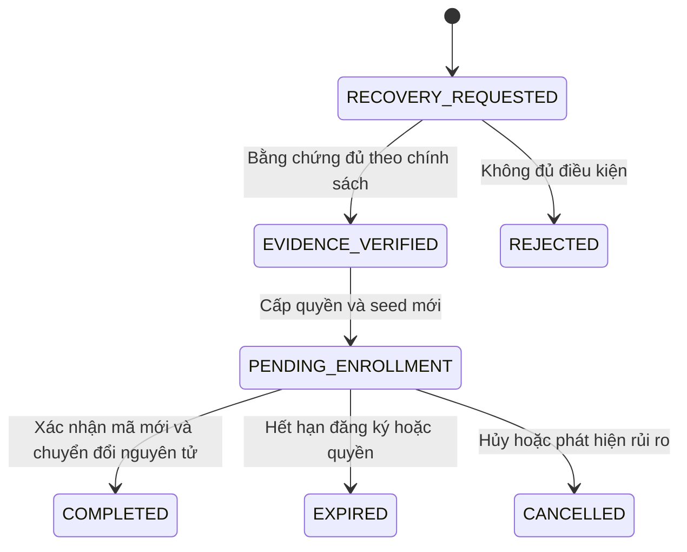

# Time based code recovery — Khôi phục khả năng xác thực bằng TOTP

## 1. Khôi phục mã theo thời gian thực sự có nghĩa gì?

Người dùng thường nói “tôi mất mã authenticator” khi đổi điện thoại, cài lại ứng dụng hoặc thấy mã liên tục bị từ chối. Những tình huống đó có nguyên nhân khác nhau và không nên đi qua cùng một thao tác “tắt MFA”.

**TOTP** (time-based one-time password) là mã dùng một lần được tính từ bí mật chung và thời gian. Trong phạm vi bài học, **time based code recovery** là khôi phục khả năng sử dụng yếu tố TOTP: sửa vấn đề đồng hồ, khôi phục bản sao lưu hợp lệ hoặc thay thế authenticator khi bí mật hay thiết bị không còn an toàn.

Có ba mục tiêu riêng:

- Xác định vì sao người dùng không thể dùng mã hiện tại.
- Đánh giá bằng chứng cho phép khôi phục quyền kiểm soát yếu tố xác thực.
- Đưa tài khoản về trạng thái có thể xác thực an toàn, đồng thời thu hồi những quyền hoặc bí mật đã bị xâm phạm.

Không có chức năng “lấy lại mã TOTP hôm qua” để tiếp tục đăng nhập hôm nay. Mã cũ chỉ có ý nghĩa trong cửa sổ thời gian tương ứng và không phải bằng chứng khôi phục lâu dài.

Bài học tập trung vào TOTP trong luồng khôi phục tài khoản khi mất mật khẩu, MFA hoặc thiết bị. TOTP cũng không thể tái tạo khóa riêng của một passkey; mỗi loại authenticator cần quy trình khôi phục hoặc đăng ký lại phù hợp.

## 2. Nắm mô hình TOTP trước khi thiết kế recovery

Ứng dụng authenticator và máy chủ cùng biết một bí mật dài hạn, gọi là **seed** hoặc `K`. Hai bên tính mã từ seed và chỉ số bước thời gian:

```text
T = floor((UnixTime - T0) / X)
TOTP = HOTP(K, T)
```

`X` là độ dài bước thời gian, thường dùng giá trị mặc định 30 giây; `T0` thường là mốc Unix epoch. Đây là mô hình của RFC 6238, khác với HOTP dùng bộ đếm sự kiện. [RFC 6238, mục 4](https://www.rfc-editor.org/rfc/rfc6238.html#section-4).

Những hệ quả quan trọng đối với khôi phục:

| Thành phần | Vai trò | Ý nghĩa khi gặp sự cố |
|---|---|---|
| Seed `K` | Bí mật tạo ra các mã | Mất mọi bản sao an toàn thì cần đăng ký yếu tố mới |
| Thời gian | Xác định bước hiện tại | Đồng hồ sai có thể làm mã bị từ chối dù seed vẫn đúng |
| Tham số thuật toán | Hàm HMAC, số chữ số, bước thời gian | Khôi phục sai tham số có thể tạo mã không tương thích |
| Mã đang hiển thị | Bằng chứng ngắn hạn | Không thay thế seed và không dùng làm mã dự phòng dài hạn |
| Trạng thái máy chủ | Yếu tố còn hoạt động, lịch sử dùng mã, giới hạn thử | Có thể làm một mã đúng về tính toán vẫn bị từ chối |

Ứng dụng có thể tạo TOTP khi không có mạng nếu seed và đồng hồ đúng. Việc mất kết nối Internet không tự làm seed biến mất. Tuy nhiên, đồng bộ giờ hoặc khôi phục từ dịch vụ sao lưu có thể cần kết nối.

Mã TOTP ngắn không cho phép người dùng suy ngược seed một cách khả thi khi hệ thống được thiết kế đúng. Máy chủ không được coi vài mã cũ, ảnh chụp mã hoặc tên tài khoản hiển thị trong ứng dụng là bằng chứng đủ để xuất lại seed.

## 3. Phân loại sự cố trước khi thay yếu tố xác thực

| Tình huống | Câu hỏi cần làm rõ | Hướng xử lý chính |
|---|---|---|
| Ứng dụng còn đúng mục tài khoản nhưng mã bị từ chối | Giờ thiết bị, tài khoản đã chọn và tham số có đúng không? | Chẩn đoán và đồng bộ giờ trong giới hạn |
| Vừa đổi điện thoại, còn máy cũ an toàn | Có thể xác thực lại bằng yếu tố đang dùng không? | Di chuyển có kiểm soát hoặc đăng ký seed mới |
| Cài lại ứng dụng, có bản sao lưu hợp lệ | Bản sao có đúng seed và tham số không? | Khôi phục theo cơ chế của ứng dụng rồi kiểm tra mã |
| Mất điện thoại, không biết ai có thể mở máy | Seed hoặc session trên máy có thể bị sử dụng không? | Xử lý như sự cố cần đánh giá xâm phạm và thay yếu tố |
| Không còn thiết bị, bản sao lưu hoặc yếu tố thay thế | Có bằng chứng khôi phục nào đã thiết lập trước không? | Đi qua chính sách khôi phục danh tính và đăng ký mới |
| Seed hoặc QR đăng ký đã bị lộ | Còn bản sao nào do người khác kiểm soát không? | Thu hồi seed cũ và cấp seed mới |

Thao tác hỗ trợ ban đầu nên giúp người dùng kiểm tra đúng mục tài khoản, tên dịch vụ và đồng hồ. Không yêu cầu họ gửi mã đang hiển thị, QR, seed hoặc mã dự phòng qua email hỗ trợ.

Một nhãn như “Điện thoại mới” là dữ liệu mô tả, không phải chứng cứ có một authenticator độc lập. Nếu hai thiết bị được khôi phục từ cùng seed, chúng có thể tạo cùng mã và máy chủ thường không phân biệt được thiết bị nào đã tạo mã đó.

Thay SIM hoặc giữ nguyên số điện thoại không tự phục hồi seed của ứng dụng authenticator. Một ứng dụng có tính năng sao lưu đám mây cũng không có nghĩa mọi mục tài khoản đều đã được sao lưu; điều đó phụ thuộc tính năng, cấu hình và trạng thái thực tế của sản phẩm.

## 4. Nhánh sửa lệch giờ: phục hồi khả năng dùng mã, giữ giới hạn xác minh

### Chẩn đoán ở thiết bị và máy chủ

Người dùng nên kiểm tra ngày giờ hệ điều hành và sử dụng cơ chế đồng bộ thời gian đáng tin cậy của thiết bị. TOTP dựa trên thời gian tuyệt đối; chọn múi giờ hiển thị khác không làm sai mã nếu Unix time vẫn đúng. Chỉnh giờ thủ công để “đuổi theo mã” có thể tạo thêm sai lệch.

Máy chủ cũng cần đồng hồ được đồng bộ. Nếu nhiều tài khoản bắt đầu lỗi cùng lúc trên một node, cần kiểm tra hạ tầng thời gian trước khi kết luận mọi người dùng đều mất authenticator.

Không lấy trường `clientTime` do trình duyệt gửi lên làm thời gian xác minh. Nếu kẻ tấn công được chọn thời gian, họ có thể yêu cầu máy chủ kiểm tra mã thuộc những bước mà chính sách không cho phép.

### Cửa sổ xác minh phải được giới hạn

Giả sử cấu hình minh họa dùng bước 30 giây, chấp nhận bước hiện tại và một bước trước để xử lý độ trễ. Khi bước máy chủ là `T`, tập kiểm tra là:

```text
acceptedSteps = { T, T - 1 }
```

Đây là lựa chọn minh họa, không phải quy tắc bắt buộc cho mọi triển khai. Nếu dùng hiệu chỉnh độ lệch riêng cho từng authenticator, phải giới hạn và xác lập độ lệch bằng quy trình có kiểm soát. RFC 6238 bàn về cửa sổ truyền và tái đồng bộ có giới hạn; mở rộng cửa sổ làm tăng phạm vi tấn công. [RFC 6238, mục 5.2 và 6](https://www.rfc-editor.org/rfc/rfc6238.html#section-5.2).

Nếu điện thoại nhanh hơn máy chủ 90 giây trong cấu hình trên, mã của nó có thể thuộc một bước tương lai ngoài cửa sổ. Cách xử lý thông thường là sửa giờ thiết bị, không bật chế độ chấp nhận mọi mã trong mười phút cho toàn bộ tài khoản.

Với mã `d` chữ số và `w` bước được kiểm tra, số giá trị có khả năng được chấp nhận trong một lượt có thể tăng theo `w`. Trong mô hình đơn giản với các giá trị gần đồng đều, xác suất đoán trúng một lượt xấp xỉ `w / 10^d` khi không gian mã lớn; các bước có mã trùng nhau làm số giá trị khác biệt nhỏ hơn. Cửa sổ rộng hơn cần được cân nhắc cùng ngân sách thử.

Đối với mã thuộc bước `[bắt đầu, kết thúc)`, việc chuyển sang bước mới không nhất thiết làm mã cũ bị từ chối ngay nếu chính sách còn chấp nhận một bước trước. Bộ đếm 30 giây trong ứng dụng và cửa sổ xác minh của máy chủ là hai khái niệm cần phân biệt.

### Tái đồng bộ không phải phục hồi seed đã mất

Một quy trình tái đồng bộ nâng cao có thể yêu cầu bằng chứng bổ sung và nhiều quan sát để xác nhận độ lệch của một token. Không quét một khoảng thời gian tùy ý cho bất kỳ người gọi nào rồi tự lưu offset đầu tiên khớp mã. Khi không còn seed trên thiết bị, thay đổi offset không giúp người dùng tạo lại được mã.

## 5. Nhánh bản sao lưu: phục hồi seed cũng có thể phục hồi bản sao bị đánh cắp

Khôi phục authenticator từ bản sao lưu an toàn có thể đưa lại seed và tham số về thiết bị mới. Sau đó, người dùng cần kiểm tra đúng tài khoản và thực hiện một lần xác minh theo chính sách.

Tuy nhiên, sao lưu không tự làm thiết bị cũ mất khả năng tạo mã:

```text
Thiết bị cũ giữ K ──┐
                   ├── cùng tạo mã theo K và thời gian
Thiết bị mới giữ K ─┘
```

Nếu máy cũ bị mất hoặc seed có khả năng lộ, việc phục hồi cùng seed trên máy mới không thu hồi bản sao ở máy cũ. Hệ thống cần cho phép thay bằng seed mới sau khi đã xác lập đủ quyền khôi phục.

Việc lưu cùng seed trên hai thiết bị cũng không cung cấp hai yếu tố xác thực độc lập. Nếu sản phẩm cần nhiều authenticator độc lập, nên quản lý các lần đăng ký riêng với bí mật riêng cùng trạng thái riêng, theo khả năng của hệ thống.

Bản sao lưu chứa seed phải được bảo vệ như bí mật dài hạn. Cần đánh giá cách mã hóa, cách mở khóa và cách khôi phục tài khoản lưu trữ bản sao. Nếu tài khoản đám mây giữ bản sao lại phụ thuộc hoàn toàn vào chính TOTP đang mất, người dùng có thể gặp vòng phụ thuộc khôi phục.

Ở phía dịch vụ, seed TOTP khác với mã OTP ngẫu nhiên đã gửi: bộ xác minh thông thường cần truy cập seed để tính mã mong đợi, nên không thể chỉ giữ một hash không đảo ngược. OWASP khuyến nghị mã hóa seed và không trả lại seed sau khi đăng ký. [OWASP MFA Cheat Sheet, TOTP Seeds and Validation Window](https://cheatsheetseries.owasp.org/cheatsheets/Multifactor_Authentication_Cheat_Sheet.html#totp-seeds-and-validation-window).

Khóa mã hóa nên được quản lý tách khỏi dữ liệu ứng dụng, với quyền giải mã giới hạn. Trang quản trị không nên có nút xuất seed cũ để nhân viên gửi lại cho người dùng. Nếu người dùng không thể phục hồi bản sao thuộc quyền kiểm soát của họ, hướng xử lý là khôi phục quyền đăng ký mới theo chính sách.

## 6. Khi mất hoàn toàn authenticator: xác lập quyền khôi phục độc lập

Nếu người dùng không thể tạo TOTP hợp lệ, hệ thống phải xác định bằng chứng nào đủ để cho phép thay yếu tố. Một số nguồn có thể đã được thiết lập trước:

- Authenticator khác còn hoạt động, chẳng hạn một khóa bảo mật hoặc passkey đáp ứng chính sách.
- Mã dự phòng dùng một lần đã được cấp và lưu an toàn.
- Kênh hoặc người liên hệ khôi phục đã xác minh trước, theo tổ hợp bằng chứng được chấp nhận.
- Quy trình xác minh lại danh tính hoặc hỗ trợ có kiểm soát, nếu hệ thống có cơ sở thực hiện.

Không có một phương án duy nhất phù hợp mọi tài khoản. Tài khoản quản trị hoặc tài khoản có dữ liệu nhạy cảm cần tiêu chí tương ứng với mức rủi ro. Một email trả lời từ địa chỉ tự khai báo, vài thông tin công khai hoặc một ảnh chụp ứng dụng authenticator không tự chứng minh quyền thay MFA.

Nếu áp dụng NIST SP 800-63B-4 ở AAL2, hướng dẫn nêu các lựa chọn như hai mã khôi phục từ các phương thức khác nhau; một mã khôi phục kết hợp authenticator đơn yếu tố đã gắn với tài khoản; hoặc xác minh lại danh tính nếu có cơ sở xác minh danh tính trước đó. Cần đánh giá toàn bộ điều kiện của chuẩn, không suy ra một email bất kỳ đủ để gỡ MFA. [NIST SP 800-63B-4, Recovery at AAL2](https://pages.nist.gov/800-63-4/sp800-63b.html#recovery-at-aal2).

Session đang mở là một tín hiệu hữu ích nhưng có thể đã bị chiếm quyền. Thao tác thay yếu tố nên yêu cầu xác thực lại bằng yếu tố còn dùng được hoặc một quyết định khôi phục đã được phê duyệt. OWASP cũng coi thay MFA là thao tác rủi ro cao và khuyến cáo không chỉ dựa vào session hiện tại. [OWASP MFA Cheat Sheet, Changing MFA Factors](https://cheatsheetseries.owasp.org/cheatsheets/Multifactor_Authentication_Cheat_Sheet.html#changing-mfa-factors).

Mã dự phòng dùng trong nhánh này có vòng đời riêng. Nó không phải một TOTP cũ được ghi lại từ tuần trước. Sau khi dùng thành công, phải tiêu thụ mã dự phòng theo chính sách, không cho replay để mở nhiều quyền thay authenticator.

## 7. Quyền thay TOTP cần hẹp, có hạn và gắn đúng đối tượng

Sau khi bằng chứng đạt yêu cầu, dịch vụ có thể tạo một quyền tạm thời để đăng ký TOTP thay thế. Gọi quyền này là `recoveryGrant`.

Một mô hình dữ liệu minh họa:

| Trường | Mục đích |
|---|---|
| `grantId`, `tokenVerifier` | Định danh và kiểm chứng token bí mật của quyền |
| `accountId`, `tenantId` | Phạm vi tài khoản và tổ chức |
| `recoveryAttemptId` | Lần khôi phục đã được phê duyệt |
| `purpose` | Ví dụ `REPLACE_TOTP` |
| `targetFactorId`, `expectedFactorGeneration` | Yếu tố và phiên bản được phép thay |
| `evidenceDecisionRef` | Quyết định bằng chứng dẫn tới việc cấp quyền |
| `issuedAt`, `expiresAt` | Khoảng hiệu lực tuyệt đối |
| `state`, `usedAt` | Trạng thái và lần sử dụng thành công |
| `flowBindingRef` | Ràng buộc với ngữ cảnh khôi phục được phép tiếp tục |

Quyền thay TOTP không tự cho phép đổi mật khẩu, đổi email khôi phục, xóa các passkey khác hoặc truy cập toàn bộ dữ liệu tài khoản. Nếu cần nhiều hành động, chính sách phải cấp từng phạm vi một cách rõ ràng.

TTL của grant khác với bước 30 giây của TOTP. Ví dụ, một grant có thể cho phép hoàn tất đăng ký trong năm phút, nhưng mỗi mã TOTP mới vẫn chỉ được kiểm tra trong cửa sổ thuật toán đã quy định. Năm phút là tham số minh họa của ứng dụng, không phải TTL mặc định của mọi grant.

Trong thời gian grant còn hiệu lực, máy chủ vẫn phải kiểm tra thu hồi, trạng thái tài khoản và phiên bản yếu tố đích. Nếu yếu tố đã được thay bởi một luồng khác, grant cũ không được tiếp tục thay lần nữa.

Bảo vệ token của grant khỏi log, URL bị rò rỉ và script không cần thiết. Nếu dùng cookie cho luồng, áp dụng bảo vệ cookie và CSRF phù hợp. Một `grantId` dễ quan sát không thay thế token bí mật hoặc việc kiểm tra quyền phía máy chủ.

## 8. Đăng ký seed mới bằng trạng thái chờ xác nhận

Không xóa TOTP cũ rồi cho người dùng vào tài khoản chỉ bằng mật khẩu trong khi họ chưa hoàn tất thiết lập mới. Quy trình cần tách trạng thái chờ và trạng thái có thể dùng để đăng nhập.



Các bước cụ thể:

1. Kiểm tra `recoveryGrant` còn hiệu lực và có mục đích `REPLACE_TOTP` cho đúng tài khoản.
2. Sinh seed mới bằng nguồn ngẫu nhiên mật mã và bộ tham số được hỗ trợ; không tái sử dụng seed đã bị nghi lộ.
3. Lưu một `pendingFactor` có hạn, ràng buộc với grant và phiên bản yếu tố cần thay.
4. Hiển thị QR hoặc chuỗi thiết lập cho người dùng trong phiên đăng ký đã được phép.
5. Yêu cầu mã TOTP từ authenticator mới để xác nhận thiết bị đã nhận đúng seed và tham số.
6. Chuyển yếu tố mới thành hoạt động, thu hồi yếu tố cũ và tiêu thụ grant trong cùng quyết định nhất quán.
7. Gửi thông báo bảo mật và xử lý các quyền truy cập liên quan theo chính sách.

QR đăng ký chứa bí mật hoặc dữ liệu có thể dùng để lấy bí mật. Không đưa QR vào log, công cụ ghi lại phiên người dùng hoặc analytics. Trang thiết lập nên dùng HTTPS, hạn chế lưu cache và tránh tài nguyên bên thứ ba có thể đọc dữ liệu nhạy cảm. Không trả lại seed qua API thông tin tài khoản sau khi đăng ký xong.

**Nhập đúng mã của seed mới chỉ chứng minh người nhập biết seed mới.** Vì hệ thống vừa cung cấp seed đó, bước xác nhận này không thay thế bằng chứng danh tính ở trước. Nếu endpoint phát QR không kiểm tra grant, kẻ tấn công có thể tự đăng ký thiết bị rồi nhập mã do chính họ tạo.

Khi pending enrollment hết hạn, bản ghi đó không được tự kích hoạt. Người dùng phải bắt đầu lại theo quyền còn hợp lệ hoặc xin quyền mới. Nếu cho phép cấp lại seed trong thời gian chờ, cần thu hồi seed chờ trước và giữ nguyên ngân sách cùng hạn tuyệt đối của luồng.

## 9. Thu hồi thiết bị cũ theo mức rủi ro, tránh gây khóa tài khoản tùy ý

Với di chuyển có kế hoạch và máy cũ vẫn an toàn, hệ thống có thể giữ yếu tố cũ hoạt động cho đến khi yếu tố mới được xác nhận. Điều này tránh tạo khoảng thời gian tài khoản chỉ còn mật khẩu.

Với thiết bị bị mất, bị đánh cắp hoặc seed đã lộ, có thể cần tạm dừng yếu tố cũ trước khi thiết lập mới hoàn tất, dựa trên bằng chứng đủ tin cậy hoặc quyết định ứng phó sự cố. Trong khoảng đó, tài khoản đi qua luồng khôi phục hạn chế; không mở quyền truy cập thông thường chỉ để bù cho việc đã tắt MFA.

Một báo cáo chưa xác thực từ người chỉ biết email nạn nhân không nên tự động xóa yếu tố đang dùng. Nếu không, endpoint khôi phục trở thành công cụ gây từ chối dịch vụ.

Cũng không tự khôi phục seed cũ khi đăng ký mới thất bại nếu seed cũ đã bị đánh dấu xâm phạm. Hủy giao dịch đăng ký và việc thu hồi một bí mật bị lộ là các quyết định khác nhau. Rollback cần giữ lại kết luận an toàn đã được xác lập.

Với nhiều yếu tố TOTP độc lập, chính sách phải chỉ rõ đang thay yếu tố nào. Không xóa mọi authenticator khác chỉ vì người dùng mất một điện thoại, trừ khi đánh giá sự cố cho thấy chúng cũng không còn đáng tin cậy.

## 10. Chống replay phải dùng chung giữa đăng nhập và khôi phục

Một mã đúng trong cửa sổ thời gian vẫn có thể đã được dùng. RFC 6238 yêu cầu bộ xác minh không chấp nhận lần dùng tiếp theo sau khi mã đã được xác minh thành công. [RFC 6238, mục 5.2](https://www.rfc-editor.org/rfc/rfc6238.html#section-5.2).

Một lựa chọn triển khai là lưu `lastAcceptedStep` cho mỗi authenticator và phiên bản seed. Khi mã khớp bước `matchedStep`, chỉ cho phép dùng nếu:

```text
factorState == ACTIVE
matchedStep nằm trong cửa sổ hiện tại
matchedStep > lastAcceptedStep
```

Sau đó cập nhật `lastAcceptedStep` nguyên tử với hành động được cấp quyền. Việc từ chối cả các bước trước bước đã chấp nhận là một chính sách chống dùng lại có tính đơn điệu; cần hiểu hệ quả khi cho phép lệch giờ hoặc bước tương lai.

Ví dụ, mã ở bước 100 được dùng để đăng nhập. Trong cùng bước đó, request dùng lại mã ở endpoint khôi phục phải bị từ chối. Nếu hai endpoint lưu lịch sử độc lập, cùng một bằng chứng có thể bị dùng lại để tạo thêm quyền.

Tương tự, khôi phục cùng seed trên thiết bị mới không phải lý do đặt lại `lastAcceptedStep`. Hai bản sao cùng seed cần chia sẻ cùng trạng thái chống replay hợp lý. Không đăng ký lại cùng seed dưới một `factorId` khác rồi coi đó là bí mật hoàn toàn mới.

Khi seed mới được kích hoạt, mã dùng để xác nhận đăng ký cũng cần được ghi nhận theo chính sách dùng một lần. Nếu người dùng lập tức đăng nhập lại bằng cùng mã đó, hệ thống có thể yêu cầu chờ bước tiếp theo hoặc tiếp tục bằng kết quả đăng ký đã được cấp đúng phạm vi; không âm thầm chấp nhận replay để làm giao diện thuận tiện hơn.

Bộ xác minh phải trả về bước đã khớp, không chỉ một giá trị `true`. Nếu nhiều bước có cùng chuỗi mã do trùng ngẫu nhiên, cần quy tắc chọn hoặc từ chối nhất quán; không thử bỏ qua trạng thái đã dùng bằng cách tìm một cách khớp khác tùy endpoint. Đây là một chi tiết cần xác nhận khi lựa chọn thư viện TOTP.

## 11. Giao dịch hoàn tất khôi phục và xử lý đồng thời

Mã giả sau minh họa yêu cầu nhất quán, không phải API thư viện có sẵn:

```text
confirmReplacement(grantToken, pendingFactorId, submittedTotp):
    kiểm tra định dạng, giới hạn nguồn và ràng buộc luồng
    bắt đầu giao dịch

    khóa tài khoản, grant, yếu tố đích và pendingFactor
        theo thứ tự thống nhất
    kiểm tra grant chưa dùng, chưa thu hồi, còn hạn
    kiểm tra purpose, account, tenant và phiên bản yếu tố đích
    kiểm tra pendingFactor thuộc đúng grant và còn hạn
    kiểm tra ngân sách thử sai dùng chung thích hợp

    đọc thời gian máy chủ đáng tin cậy sau khi chờ khóa
    tính các bước được phép theo cấu hình cố định
    kiểm chứng submittedTotp bằng seed chờ, dùng thư viện đã kiểm chứng

    nếu không hợp lệ:
        tăng bộ đếm thử sai
        commit các thay đổi bộ đếm trước khi trả lỗi
        không kích hoạt yếu tố mới

    xác nhận lại thời hạn và cửa sổ tại thời điểm quyết định
    ghi bước TOTP đã được tiêu thụ
    kích hoạt yếu tố mới
    thu hồi yếu tố cũ được chỉ định
    đánh dấu grant và lần khôi phục đã hoàn tất
    cập nhật phiên bản bảo mật theo chính sách
    lưu sự kiện thông báo trong outbox cùng giao dịch
    commit

    chỉ trả kết quả thành công sau commit
```

Nếu kiểm chứng mã được thực hiện bên ngoài giao dịch để tránh giữ khóa trong thao tác giải mã chậm, lúc cập nhật phải xác nhận lại seed, phiên bản, trạng thái, thời gian và các điều kiện liên quan chưa thay đổi. Kết quả tính từ một snapshot cũ không được tự thắng thao tác thu hồi đã xảy ra.

Hai request đồng thời không được cùng kích hoạt hai yếu tố thay thế từ một grant. Có thể đạt điều này bằng khóa, phiên bản cập nhật có điều kiện và ràng buộc dữ liệu phù hợp. Hai lần khôi phục khác nhau cũng cần kiểm tra cùng thế hệ yếu tố đích để lần hoàn tất sau không ghi đè kết quả đã có.

Nếu giao dịch đã commit nhưng phản hồi bị mất, retry cần trả trạng thái của lần khôi phục đã hoàn tất cho đúng người gọi, thay vì tạo một grant hoặc seed mới. Idempotency không cho phép dùng lại OTP để tạo thêm tác động.

Lỗi nhập mã không nên làm rollback bộ đếm thử sai. Ngoài bộ đếm theo pending factor, cần hạn mức ở cấp tài khoản hoặc cửa sổ thời gian để việc mở lại đăng ký không tạo ngân sách đoán mã vô hạn.

## 12. Minh họa xác định bước thời gian bằng Java

Trong Java, `Instant` biểu diễn thời điểm tuyệt đối và `Clock` giúp tách nguồn thời gian khỏi logic. Hàm sau chỉ tính bước thời gian với `T0 = 0`; nó không phải bộ xác minh TOTP hoàn chỉnh:

```java
import java.time.Clock;
import java.util.Objects;

public final class TotpTimeStep {
    private final Clock clock;

    public TotpTimeStep(Clock clock) {
        this.clock = Objects.requireNonNull(clock);
    }

    public long currentStep(int stepSeconds) {
        if (stepSeconds <= 0) {
            throw new IllegalArgumentException("stepSeconds must be positive");
        }

        long epochSeconds = clock.instant().getEpochSecond();
        if (epochSeconds < 0) {
            throw new IllegalStateException("Unsupported time before Unix epoch");
        }

        return Math.floorDiv(epochSeconds, (long) stepSeconds);
    }
}
```

Dùng `long` cho bộ đếm thời gian, không ép Unix time hoặc chỉ số bước vào một kiểu nhỏ vì tiện lưu trữ. `Clock.systemUTC()` không tự sửa đồng hồ hệ điều hành; các node xác minh vẫn cần được đồng bộ và giám sát.

Không tính bước từ `LocalDateTime` thiếu múi giờ, giờ do trình duyệt khai báo hoặc một chuỗi giờ đã làm tròn. Khi xác minh trong giao dịch có thể phải chờ khóa, nguồn thời gian cần phản ánh mốc quyết định đã chọn, không giữ mãi timestamp từ đầu request.

Phần HMAC, cắt mã, xử lý số 0 ở đầu và tương thích tham số nên dùng thư viện phù hợp đã được kiểm chứng với test vector chuẩn. Hàm tính bước phía trên không thay thế kiểm tra trạng thái yếu tố, chống replay hay chính sách khôi phục.

## 13. Session, mã dự phòng và thông báo sau khi thay TOTP

Thay seed cũ không tự làm session đã cấp trước đó hết hiệu lực. Nếu kẻ tấn công đang giữ refresh token hoặc session trên điện thoại bị mất, họ có thể tiếp tục truy cập dù không tạo được TOTP mới.

Chính sách cần quyết định các tác động liên quan:

| Tài nguyên | Xử lý có thể cần thiết |
|---|---|
| Seed TOTP cũ | Thu hồi theo kết quả thay thế hoặc quyết định sự cố |
| Session và refresh token trên thiết bị mất | Thu hồi khi xác định được, hoặc mở rộng phạm vi theo rủi ro |
| Session khác của tài khoản | Yêu cầu xác thực lại hoặc thu hồi nếu có dấu hiệu xâm phạm |
| Cookie ghi nhớ thiết bị | Vô hiệu hoặc đánh giá lại mức tin cậy |
| Grant, pending enrollment và yêu cầu khôi phục khác | Hủy những quyền không còn được phép tiếp tục |
| Mã dự phòng | Đánh giá thay bộ mã nếu có khả năng đã bị lộ cùng thiết bị |

Tăng `securityVersion` chỉ có tác dụng nếu các lớp xác thực thực sự kiểm tra phiên bản đó. Với access token tự chứa, cần cơ chế thu hồi, kiểm tra phiên bản hoặc thời hạn phù hợp; chỉ cập nhật một cột trong cơ sở dữ liệu không bảo đảm mọi dịch vụ ngừng chấp nhận token cũ ngay lập tức.

Nếu phát hành bộ mã dự phòng mới, hiển thị qua kênh đã được phép, bảo vệ dữ liệu lưu và hướng dẫn người dùng giữ bản sao độc lập. Không gửi toàn bộ mã cùng seed mới vào một email thông thường để “tiện khôi phục lần sau”.

Thông báo thay yếu tố nên gửi tới các địa chỉ thông báo đáng tin cậy theo chính sách, nêu thời gian và cách báo cáo hành vi không được phép. Không chứa seed, QR hoặc mã đang dùng. Thông báo giúp phát hiện gian lận nhưng không thay thế kiểm tra quyền trước khi thay authenticator.

## 14. Tình huống thực tế và tiêu chí hành vi

### Điện thoại chạy nhanh nhưng người dùng vẫn giữ đúng seed

Một người dùng thấy tất cả mã bị từ chối sau khi chỉnh giờ thủ công. Ứng dụng vẫn có đúng mục tài khoản, còn hệ thống không ghi nhận thay đổi yếu tố.

Hướng xử lý là kiểm tra đồng hồ thiết bị và máy chủ, đưa về đồng bộ tin cậy rồi thử mã trong cửa sổ bình thường. Không đặt lại MFA ngay, không mở rộng cửa sổ cho toàn hệ thống và không xóa lịch sử chống replay chỉ để mã vừa nhập được chấp nhận.

### Điện thoại bị mất nhưng bản sao lưu vẫn khôi phục được

Người dùng khôi phục ứng dụng trên máy mới và lại tạo được mã. Điều đó chứng minh bản sao chứa seed, nhưng không làm bản sao trên máy mất ngừng hoạt động.

Luồng xử lý cần đánh giá nguy cơ thiết bị cũ bị truy cập. Khi có nguy cơ seed bị sử dụng trái phép, thực hiện xác lập quyền thay thế, đăng ký seed mới, thu hồi seed cũ và xử lý session liên quan. Cài lại ứng dụng trên máy mới không phải biện pháp thu hồi.

### Kẻ tấn công có mật khẩu và một session đang mở

Kẻ tấn công vào trang cài đặt, chọn “mất authenticator” rồi yêu cầu QR mới. Nếu hệ thống cấp QR chỉ vì session đang hợp lệ, họ có thể gắn seed của mình vào tài khoản.

Thiết kế phải kiểm tra quyền thay yếu tố, yêu cầu xác thực lại hoặc quyết định khôi phục phù hợp và giới hạn mục đích của grant. Mã TOTP từ QR mới chỉ xác nhận seed vừa cấp, không xác minh người nhận seed là chủ tài khoản.

### Các tiêu chí cần kiểm chứng khi triển khai

| Tình huống | Kết quả mong đợi |
|---|---|
| Mã thuộc bước hiện tại, đúng seed, chưa dùng | Chấp nhận nếu các điều kiện khác đạt |
| Mã nằm ngoài cửa sổ đã cấu hình | Từ chối; không tự mở rộng cửa sổ |
| Trình duyệt gửi thời gian khác máy chủ | Không làm thay đổi tập bước được phép |
| Mã đã dùng ở đăng nhập được gửi lại ở endpoint recovery | Từ chối replay |
| Hai request xác minh cùng mã, cùng phiên bản seed | Tối đa một tác động thành công theo chính sách dùng một lần |
| Khôi phục bản sao cùng seed trên thiết bị mới | Không đặt lại lịch sử đã dùng mã |
| Người gọi biết `grantId` nhưng không có token hợp lệ | Không được xem QR hoặc đăng ký thay thế |
| Pending factor đã hết hạn | Không được kích hoạt |
| Nhập đúng mã của seed mới nhưng không có grant hợp lệ | Không được thay yếu tố |
| Hai grant cùng nhắm vào thế hệ yếu tố cũ | Kết quả đã hoàn tất không bị luồng còn lại ghi đè |
| Request lặp sau khi commit nhưng mất phản hồi | Trả trạng thái đã hoàn tất cho đúng ngữ cảnh; không tạo seed mới |
| Bằng chứng nhập sai nhiều lần rồi mở lại luồng | Ngân sách chống lạm dụng theo tài khoản vẫn được áp dụng |
| Seed cũ bị lộ nhưng người dùng đã đổi mật khẩu | Seed cũ vẫn phải được thu hồi riêng |
| Đăng ký mới bị hủy trong một sự cố đã xác nhận | Không tự phục hồi yếu tố cũ đã bị coi là xâm phạm |
| Đã thay TOTP nhưng token truy cập cũ còn hạn | Quyết định chấp nhận token phải tuân theo cơ chế quản lý session thực tế |

Các sự kiện vận hành hữu ích gồm thất bại TOTP theo node, sai lệch thời gian được phát hiện, yêu cầu thay yếu tố, grant được cấp, đăng ký chờ hết hạn và thay thế hoàn tất. Dùng định danh sự kiện có kiểm soát, tránh ghi mã TOTP, seed, QR hoặc token khôi phục vào log.

Khôi phục TOTP an toàn bắt đầu từ việc xác định mất thời gian đồng bộ hay mất bí mật. Sửa đồng hồ giải quyết nhánh thứ nhất; bằng chứng khôi phục và đăng ký seed mới giải quyết nhánh thứ hai. Cả hai nhánh đều phải giữ giới hạn thử, chống replay và kiểm soát quyền truy cập của toàn tài khoản.
