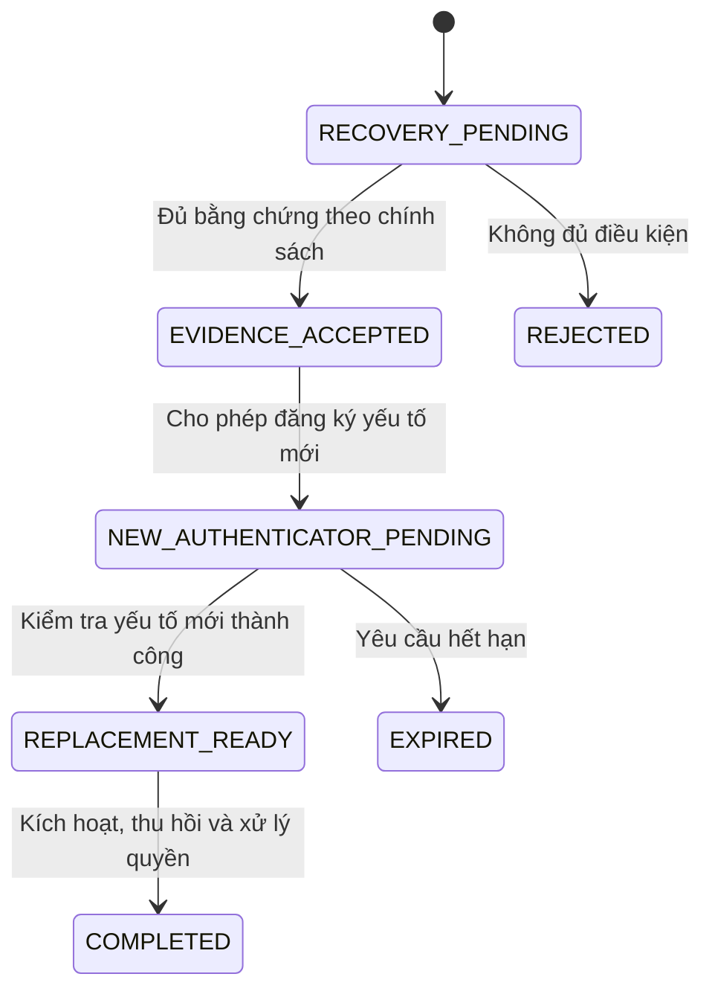

# Khôi phục khả năng xác thực bằng mã dựa trên bộ đếm

Trong chương **Authenticator Recovery**, **Counter based code recovery** đề cập tới xử lý sự cố với bộ xác thực sinh mã theo bộ đếm, thường là HOTP. Trong **SECURITY_AUTHENTICATION_ACCOUNT_RECOVERY**, cần phân biệt việc đồng bộ lại một bộ xác thực còn dùng được với việc khôi phục tài khoản khi bộ xác thực đã mất hoặc bị lộ bí mật.

Hai việc này có ranh giới bảo mật khác nhau. Đồng bộ lại giúp server và thiết bị tiếp tục dùng cùng chuỗi mã. Khôi phục tài khoản phải quyết định ai được phép thay phương thức xác thực và xử lý quyền truy cập hiện có.

Bài học dùng các số cửa sổ, số lượt thử và trạng thái minh họa. Chúng không phải cấu hình bắt buộc cho mọi sản phẩm.

## 1. Xác định đúng loại sự cố trước khi xử lý

| Tình huống | Vấn đề thực sự | Hướng xử lý |
|---|---|---|
| Thiết bị còn hoạt động nhưng người dùng bấm sinh mã nhiều lần | Bộ đếm thiết bị đi trước server | Xác minh trong cửa sổ hữu hạn hoặc đồng bộ lại có kiểm soát |
| Mã từ bản sao lưu ứng dụng không còn được nhận | Bộ đếm hoặc bản sao credential có thể cũ | Kiểm tra trạng thái; không lùi bộ đếm server để nhận mã cũ |
| Không còn thiết bị, không có bản sao được phép | Không thể dùng yếu tố HOTP hiện tại | Đi qua phương thức khôi phục khác rồi đăng ký yếu tố thay thế |
| Có khả năng seed bị sao chép | Bí mật dài hạn không còn đáng tin | Thu hồi hoặc thay credential theo quy trình được phép |
| Server phục hồi database cũ | Trạng thái chống dùng lại có thể bị lùi | Phục hồi trạng thái có thẩm quyền hoặc vô hiệu hóa credential bị ảnh hưởng |
| Sai loại mã, sai tài khoản hoặc sai thuật toán | Lỗi chọn credential hay cấu hình | Sửa đúng nguyên nhân, không mở rộng cửa sổ tùy tiện |

Một mã không khớp không đủ để kết luận thiết bị đã mất đồng bộ. Người dùng có thể đang nhập TOTP vào ô dành cho HOTP, chọn sai tài khoản trong ứng dụng hoặc dùng một credential đã bị thu hồi.

Không bắt đầu bằng thao tác “reset counter về 0”. Khi khóa không thay đổi, quay lại các giá trị bộ đếm cũ có thể khiến mã đã từng được dùng trở lại vùng được chấp nhận.

## 2. HOTP vận hành theo bộ đếm, không theo đồng hồ

HOTP tạo mã từ khóa bí mật dùng chung `K` và bộ đếm `C`. RFC 4226 mô tả thuật toán cùng cơ chế giới hạn thử và đồng bộ bộ đếm. Xem [RFC 4226](https://www.rfc-editor.org/rfc/rfc4226.html).

Biểu diễn khái quát:

```text
HOTP(K, C) = decimal_code(
    dynamic_truncate(HMAC-SHA-1(K, encode_counter(C)))
)
```

Bộ đếm được đưa vào phép tính dưới dạng nhị phân tám byte theo thứ tự byte quy định; không thay nó bằng chuỗi thập phân tùy ý. Độ dài mã và các tham số phải tương thích giữa thiết bị và verifier. Khi triển khai, nên dùng thành phần HOTP đã được kiểm chứng thay vì tự biến đổi thuật toán.

Trong bài, quy ước:

- `C_T`: bộ đếm mà thiết bị sẽ dùng cho lần sinh mã kế tiếp.
- `C_S`: bộ đếm nhỏ nhất mà server còn có thể chấp nhận.
- Khi thiết bị sinh mã tại `c`, lần sinh tiếp theo chuyển sang `c + 1`.
- Khi server chấp nhận tại `c`, server chuyển `C_S` sang `c + 1`.

Thiết bị cụ thể có thể mô tả bộ đếm là “đã dùng gần nhất” thay vì “sẽ dùng tiếp theo”. Cần chuyển đổi nhất quán; không trộn hai quy ước trong code và tài liệu vận hành.

### 2.1. Vì sao hai bên lệch nhau?

Giả sử ban đầu `C_T = C_S = 400`. Người dùng bấm thiết bị bảy lần mà không gửi mã. Thiết bị đã đi qua các giá trị `400..406`, còn server vẫn chờ từ `400`. Lần bấm tiếp theo sinh mã tại `407`.

Server không biết người dùng đã bấm thiết bị bao nhiêu lần. Nếu chỉ so với mã ở `400`, nó sẽ từ chối dù người dùng vẫn giữ đúng thiết bị và khóa.

Đổi giờ điện thoại không sửa được lệch bộ đếm HOTP. Ngược lại, cơ chế TOTP lấy thời gian làm yếu tố thay đổi, nên không xử lý bằng cách tăng một bộ đếm sự kiện như ví dụ này.

### 2.2. HOTP không tự hết hạn sau một khoảng giây

HOTP thuần không mang thời điểm sinh mã. Nếu bộ đếm chưa bị tiêu thụ hoặc bỏ qua, một mã bị lộ có thể còn dùng được lâu hơn người thiết kế dự kiến.

Hạn dùng của recovery request hoặc của bằng chứng phía server vẫn cần thiết, nhưng nó không làm mọi mã HOTP chưa dùng tự hết hạn trên toàn hệ thống. Một request mới không được coi là lý do mã bị lộ trước đó đã mất giá trị.

Recovery code lưu sẵn cũng khác HOTP. Recovery code thường được quản lý như các bí mật riêng có trạng thái đã dùng; HOTP tạo chuỗi mã từ cùng một khóa dài hạn và trạng thái bộ đếm.

## 3. Cửa sổ xác minh phải hữu hạn và định nghĩa rõ biên

Trong ví dụ, `W` là **số giá trị bộ đếm được xét**, gồm cả `C_S`:

```text
candidate counters = C_S, C_S + 1, ..., C_S + W - 1
```

Nếu `C_S = 400` và `W = 5`, server chỉ xét `400..404`. Mã ở `404` nằm trong cửa sổ, còn mã ở `405` nằm ngoài.

Nếu mã khớp tại `m` và phép xác minh được chấp nhận, trạng thái mới là:

```text
C_S_new = m + 1
```

Không chỉ tăng bộ đếm cũ thêm một. Nếu nhận mã ở `404` nhưng đổi `400 -> 401`, server vẫn để các vị trí đã bỏ qua và vị trí vừa dùng trong phạm vi có thể xét lại.

Cũng không đặt bộ đếm thành `m`, vì như vậy vị trí vừa được chấp nhận chưa bị loại khỏi cửa sổ.

### 3.1. Không tìm ngược để làm mã cũ hợp lệ

Với cùng phiên bản credential, server không được giảm `C_S` nhằm nhận một mã từ bản sao lưu cũ. Thiết bị đi sau có thể cần tiến lên theo một quy trình được phép hoặc được thay thế; không giải quyết bằng cách phục hồi vùng mã đã tiêu thụ.

Nếu có dấu hiệu hai bản sao cùng dùng một seed, đồng bộ bộ đếm không xác định được bản sao nào thuộc người dùng thật. Cần đánh giá việc thu hồi và thay khóa.

### 3.2. Mở rộng cửa sổ làm tăng tập mã được chấp nhận

Giả sử mã có `d` chữ số, server xét `W` vị trí và kẻ tấn công có `q` lượt thử. Khi xác suất còn nhỏ và đầu ra được mô hình hóa gần ngẫu nhiên, một ước lượng đơn giản là:

```text
P_success ≈ q × W / 10^d
```

Đây là ước lượng cho mô hình đoán mã, không phải xác suất chính xác cho mọi implementation. Nó chưa bao gồm rò rỉ seed, phishing hoặc việc cộng dồn cơ hội ở nhiều endpoint.

Ví dụ với mã sáu chữ số và năm lượt thử:

| Số vị trí xét mỗi lượt | Ước lượng xác suất đoán trúng |
|---:|---:|
| 1 | 0,0005% |
| 5 | 0,0025% |
| 20 | 0,01% |

Các giá trị cho thấy không nên mở cửa sổ thật lớn chỉ để giảm lỗi hỗ trợ. Cửa sổ còn tác động tới chi phí HMAC trên mỗi request và khả năng làm server xử lý quá nhiều công việc.

Cần đặt giới hạn ở server, không nhận tham số cửa sổ không kiểm soát từ client. Endpoint đồng bộ lại phải có ngân sách riêng phù hợp và cùng tham gia các giới hạn ở phạm vi credential hoặc tài khoản.

## 4. Đồng bộ lại có kiểm soát khi còn thiết bị

Khi lệch vượt cửa sổ thông thường, có thể có một luồng đồng bộ riêng yêu cầu nhiều mã liên tiếp và điều kiện bổ sung theo chính sách. RFC 4226 thảo luận việc dùng chuỗi mã để đồng bộ trong [mục 7.4](https://www.rfc-editor.org/rfc/rfc4226.html#section-7.4).

Một thiết kế minh họa yêu cầu hai mã liên tiếp:

```text
first_code  = HOTP(K, m)
second_code = HOTP(K, m + 1)
```

Server tìm một vị trí bắt đầu `m` trong vùng được phép sao cho cả hai mã khớp đúng thứ tự. Chỉ sau khi cả chuỗi và mọi điều kiện đạt, server mới chuyển sang:

```text
C_S_new = m + 2
```

Không nhận hai mã ở hai vị trí bất kỳ. Một cặp khớp tại `m` và `m + 7` không phải chuỗi liên tiếp theo hợp đồng này.

### 4.1. Ví dụ đồng bộ từ 400 tới 409

Dùng tình huống ở trên:

```text
Server đang chờ:                C_S = 400
Cửa sổ thông thường:            5 vị trí, từ 400 tới 404
Thiết bị sinh mã thứ nhất tại:  407
Thiết bị sinh mã thứ hai tại:   408
Sau khi chấp nhận cả cặp:       C_S = 409
Lần sinh tiếp theo của token:   409
```

Trong luồng đồng bộ minh họa, cho phép tối đa 20 **vị trí bắt đầu**, tức `400..419`. Vì mỗi chuỗi có hai mã, vị trí cuối cùng có thể cần tính là `420`. Phải ghi rõ cách đếm này để tránh lỗi biên hoặc quét quá giới hạn dự kiến.

Các con số chỉ giúp diễn giải. Cửa sổ đồng bộ, độ dài chuỗi và số lượt thử phải được chọn theo mức rủi ro, khả năng thiết bị và vận hành.

### 4.2. Không commit một nửa chuỗi

Nếu mã đầu khớp còn mã thứ hai sai, không cập nhật `C_S` một phần. Luồng cần ghi nhận một lần thất bại theo chính sách và giữ nguyên bộ đếm xác thực.

Nếu bắt đầu bằng cách xác minh mã đầu qua endpoint đăng nhập thông thường rồi mới hỏi mã thứ hai, endpoint đầu có thể đã tiêu thụ mã và thay đổi trạng thái. Phải thiết kế luồng chuỗi riêng, thay vì ghép hai API có tác dụng phụ không tương thích.

Nếu lưu tiến độ nhập hai bước, dữ liệu tạm cần gắn với cùng request, credential version, snapshot bộ đếm và hạn dùng. Một lựa chọn dễ lập luận hơn là thu cả chuỗi rồi đưa ra một quyết định nguyên tử.

Không trả lời “mã đầu đúng, mã sau sai” cho người không có quyền biết. Phản hồi từng phần có thể giúp dò chuỗi hiệu quả hơn dự kiến.

### 4.3. Hai mã vẫn thuộc cùng một yếu tố

Hai mã HOTP liên tiếp giúp tăng thông tin về chuỗi bộ đếm, nhưng đều được tạo từ cùng khóa `K`. Chúng không tự trở thành hai yếu tố MFA độc lập.

Nếu seed đã lộ, kẻ có seed cũng có thể sinh một chuỗi liên tiếp. Cơ chế đồng bộ không thay thế kiểm tra rủi ro và không sửa được việc mất bí mật dài hạn.

## 5. Trạng thái cần lưu và phạm vi tin cậy

Một mô hình tham khảo:

```text
HotpCredential
  id, tenant_id, account_id
  credential_version
  secret_reference
  algorithm, digits
  next_counter
  status
  row_version

RecoveryRequest
  id, tenant_id, account_id
  context_binding
  purpose
  credential_id, credential_version
  state, expires_at
  policy_version

RecoveryBudget
  credential_id or account_scope
  failure_count
  window_or_cooldown_state

RecoveryEvidence
  id, recovery_request_id
  credential_id, credential_version
  first_accepted_counter, last_accepted_counter
  verified_at, expires_at
  policy_version
```

Đây là mô hình minh họa, không yêu cầu sao chép nguyên schema. Mọi quan hệ tenant, tài khoản và credential phải được kiểm tra phía server.

`next_counter` là trạng thái dùng chung của credential. Không tạo một bản sao độc lập cho từng recovery request hoặc từng session đăng nhập, vì cùng mã có thể được nhận lại ở một bản sao khác.

Các bất biến quan trọng:

1. Bộ đếm chỉ tiến lên trong cùng phiên bản credential.
2. Trạng thái thu hồi và thay phiên bản có hiệu lực ở mọi endpoint xác minh.
3. Mã sai không tự làm tăng bộ đếm để “tìm cho tới khi đúng”.
4. Tăng bộ đếm và ghi bằng chứng thành công thuộc cùng quyết định bền vững.
5. Ngân sách chống đoán không bị xóa chỉ vì tạo request mới.
6. Client không quyết định tài khoản, seed, thuật toán hoặc cửa sổ tìm kiếm.
7. HOTP khớp chỉ đóng góp bằng chứng mà chính sách cho phép, không tự tạo toàn quyền tài khoản.

HOTP cơ bản chỉ dùng `K` và `C`, nên mã không tự chứa recovery request ID hoặc mục đích như “thay passkey”. Ứng dụng phải ràng buộc ngữ cảnh ở tầng giao thức. Những kiểm tra đó giúp tránh áp dụng nhầm, nhưng không biến HOTP nhập tay thành bằng chứng chống chuyển tiếp qua phishing.

Không tự thêm request ID vào phép HMAC rồi vẫn gọi đó là HOTP tương thích thiết bị cũ. Nếu thay đổi giao thức, cần một thiết kế và khả năng tương thích riêng.

## 6. Xác minh, cập nhật bộ đếm và ghi bằng chứng trong một transaction

Cách làm sau không an toàn khi có nhiều request:

```text
read next_counter
find a matching HOTP
write next_counter
create recovery evidence
```

Hai luồng có thể cùng đọc giá trị cũ và cùng cho rằng một vị trí chưa được tiêu thụ. Hoặc hệ thống cập nhật bộ đếm thành công nhưng lỗi trước khi ghi bằng chứng, làm người dùng mất mã mà không tiếp tục được.

Một luồng minh họa dùng khóa bản ghi:

```text
validate input size, ASCII digits and expected code count
apply endpoint abuse controls
resolve the authorized recovery context

begin transaction
    lock budget, request and credential in a shared lock order

    require correct tenant, account, credential and purpose
    require request is active and unexpired
    require credential is active and its version still matches
    require applicable budgets allow verification

    snapshot = credential.next_counter
    candidates = find complete matching sequences within server limits

    if there is no acceptable unique match:
        persist the failure or ambiguity outcome under policy
        persist applicable failure counters
        commit
        return a safe non-success result

    match_start = the accepted sequence start
    next_counter = checked_add(match_start, sequence_length)

    recheck request deadline at the decision point
    atomically advance credential.next_counter
    insert scoped evidence for the accepted counter range
    persist the operation result and a secret-free audit event
commit

return the allowed next step
```

Pseudocode này mô tả các bất biến, không phải implementation hoàn chỉnh. Những điều kiện không đạt phải đi vào đường từ chối hoặc lỗi vận hành rõ ràng. Không gửi kết quả thành công trước commit.

Việc tìm mã có thể tốn tài nguyên nếu cửa sổ lớn. Cần giới hạn công việc và thời gian giữ khóa. Nếu tính ngoài transaction từ một snapshot, trước khi ghi phải kiểm tra lại version và bộ đếm; không tiếp tục với kết quả cũ sau khi trạng thái đã thay đổi.

### 6.1. Cập nhật có điều kiện là một hàng rào bổ sung

Ví dụ với optimistic concurrency:

```sql
UPDATE hotp_credential
SET next_counter = :new_counter,
    row_version = row_version + 1
WHERE id = :credential_id
  AND credential_version = :credential_version
  AND status = 'ACTIVE'
  AND next_counter = :snapshot_counter
  AND row_version = :snapshot_row_version;
```

Chỉ khi đúng một dòng được cập nhật mới tiếp tục ghi bằng chứng trong cùng transaction. Các điều kiện request, ngữ cảnh và ngân sách vẫn phải được bảo vệ; riêng câu SQL trên chưa phải một verifier đầy đủ.

Khi không cập nhật được vì có xung đột, không trả thành công dựa trên phép so sánh trước đó. Cần đọc trạng thái có thẩm quyền và xử lý theo hợp đồng retry, với giới hạn công việc rõ ràng.

### 6.2. Lần thử sai phải để lại bộ đếm thất bại bền vững

Một exception nghiệp vụ có thể làm framework rollback toàn bộ transaction. Nếu tăng `failure_count` rồi ném exception khiến cập nhật bị hủy, người gọi có thể thử nhiều hơn mức dự kiến.

Có thể trả một kết quả nghiệp vụ thất bại ra khỏi hàm transaction để transaction commit, sau đó ánh xạ sang HTTP response. Lỗi ghi dữ liệu hoặc lỗi lấy khóa mật mã không được bỏ qua để nhận thêm phép thử vô hạn.

Lần thử sai thông thường không làm tăng `next_counter`. Cần phân biệt bộ đếm thất bại của cơ chế chống đoán với bộ đếm sinh mã của HOTP.

### 6.3. Mọi đường dùng cùng credential phải chia sẻ trạng thái

Endpoint đăng nhập, đồng bộ và khôi phục không được có ba bộ đếm độc lập cho cùng seed. Nếu đăng nhập đã tiêu thụ một vị trí thì khôi phục không được chấp nhận lại chính vị trí đó.

Một khóa `synchronized` trong một JVM không điều phối các node khác. Quyết định cần dựa trên cơ chế có hiệu lực trên mọi verifier, chẳng hạn transaction và version ở kho có thẩm quyền.

Không cấp quyền từ một cache hoặc replica còn bộ đếm cũ. Chúng có thể hỗ trợ đọc, nhưng không thay thế quyết định tiêu thụ bền vững.

## 7. Retry, mã trùng và phản hồi bị mất

### 7.1. Timeout không cho phép lùi bộ đếm

Nếu transaction đã commit mà response bị mất:

```text
Bộ đếm đã tiến lên.
Bằng chứng đã được ghi.
Request gửi lại không tạo thêm một lần tiêu thụ tại cùng vị trí.
```

Có thể lưu kết quả thao tác và cho khôi phục kết quả trong cùng recovery context được phép. Idempotency key chỉ giúp nhận diện thao tác; nó không tự chứng minh quyền sở hữu tài khoản.

Nếu transaction chưa commit và mọi thay đổi đã rollback, chưa có lần chấp nhận bền vững. Retry phải đọc trạng thái hiện tại để quyết định, không suy đoán chỉ từ việc client gặp timeout.

Hủy recovery request sau một lần xác minh thành công cũng không phải lý do hoàn tác bộ đếm HOTP. Credential có thể đã được dùng tiếp ở nơi khác. Hủy quyền khôi phục và hoàn tác trạng thái tiêu thụ là hai việc khác nhau.

### 7.2. Chuỗi số ngắn có thể lặp ở các vị trí khác nhau

HOTP rút gọn đầu ra thành một mã ngắn, nên hai bộ đếm khác nhau có thể tình cờ tạo cùng chuỗi số. Không có lời bảo đảm rằng một chuỗi sáu chữ số chỉ xuất hiện một lần trong cả vòng đời token.

Trong thiết kế minh họa, nếu nhiều vị trí trong cùng cửa sổ khớp toàn bộ đầu vào, verifier coi đó là kết quả mơ hồ và dùng nhánh đã định, chẳng hạn yêu cầu thêm mã hoặc phương thức khác. Không tự chọn vị trí rất xa rồi làm thiết bị lệch thêm ngoài dự kiến.

Chống dùng lại phải bảo vệ ít nhất trạng thái tiêu thụ của credential và vị trí bộ đếm. Nếu sản phẩm còn yêu cầu chặn việc gửi lại cùng chuỗi vừa được chấp nhận trong một khoảng thời gian, cần cơ chế lưu trạng thái bổ sung và cách xử lý mã trùng hợp lệ.

Không lưu mọi chuỗi số đã từng xuất hiện rồi tuyên bố chúng bị cấm vĩnh viễn. Không gian mã hữu hạn sẽ tạo xung đột với các lần sinh hợp lệ về sau. Trạng thái chống replay cần có phạm vi và vòng đời rõ ràng.

### 7.3. Không công khai quá nhiều chi tiết xác minh

Người gọi không có quyền không cần biết bộ đếm hiện tại, khoảng lệch hoặc mã nào trong một cặp đã khớp. Thông báo có thể hướng dẫn người dùng kiểm tra đúng loại token, sinh mã liên tiếp theo giao diện hoặc dùng phương thức khác mà không lộ vị trí nội bộ.

Các đầu vào vẫn phải là chuỗi có độ dài và bảng ký tự đã công bố. Giữ số 0 đầu; không ép sang số nguyên rồi tự điều chỉnh định dạng.

## 8. Trường hợp thiết bị gửi kèm bộ đếm

Một số giao thức có thể cho client gửi cả mã và bộ đếm tương ứng. Dữ liệu bộ đếm từ client chỉ là ứng viên cần kiểm tra, không phải lệnh cập nhật trạng thái.

Một hợp đồng minh họa cần đồng thời kiểm tra:

```text
claimed_counter >= stored_next_counter
claimed_counter is within the server-approved jump bound
submitted_code matches HOTP(K, claimed_counter)
credential and request bindings are still valid
attempt budgets permit the operation
```

Sau khi chấp nhận mới chuyển sang `claimed_counter + 1`. Phải kiểm tra tràn số trước khi ghi.

Cách chỉ kiểm tra một vị trí được client chỉ định khác với quét mọi vị trí trong một cửa sổ. Không áp dụng nguyên xi công thức số ứng viên của một thiết kế sang thiết kế kia. Tuy nhiên, mã ngắn vẫn cần giới hạn thử và kiểm soát giao thức.

Không dùng client counter để cho phép nhảy tùy ý, giảm bộ đếm, ghi vào credential khác hoặc bỏ qua ngân sách. Một yêu cầu nhảy rất xa có thể là lỗi thiết bị, lỗi kiểu dữ liệu hoặc dấu hiệu cần đánh giá thêm.

Nếu thiết bị không hỗ trợ xuất bộ đếm, không yêu cầu người dùng đoán nó hoặc tự sửa dữ liệu ứng dụng. Giữ luồng tương thích với khả năng thực tế của token.

## 9. Giới hạn kiểu số và quản lý seed

### 9.1. Không cho phép bộ đếm quay vòng

Bộ đếm HOTP có biểu diễn tám byte; Java `long` là kiểu có dấu. Code chỉ nhận các giá trị không âm của `long` chưa hỗ trợ toàn bộ miền bộ đếm không dấu tám byte.

Một helper minh họa cho implementation giới hạn ở miền không âm của `long`:

```java
public final class HotpCounterAdvance {
    private HotpCounterAdvance() {}

    public static long afterAcceptedSequence(long start, int codeCount) {
        if (start < 0 || codeCount < 1) {
            throw new IllegalArgumentException("Invalid counter range");
        }
        return Math.addExact(start, (long) codeCount);
    }
}
```

Nếu chuỗi bắt đầu tại `407` và có hai mã được chấp nhận, helper trả `409`. Nó chỉ tính giá trị kế tiếp, chưa kiểm tra HOTP, quyền, cửa sổ hoặc transaction. `codeCount` phải đến từ chính sách server có giới hạn.

Khi vượt miền hỗ trợ, helper báo lỗi thay vì quay về số âm hoặc 0. Việc tính biên cửa sổ cũng cần bảo vệ tương tự. Hệ thống phải có cách thay credential trước khi hết miền vận hành; không bắt đầu lại với cùng khóa bằng một counter đã dùng.

Nếu cần toàn bộ miền không dấu, chọn biểu diễn, mã hóa và thao tác database phù hợp. Không tùy tiện chuyển qua số thực hoặc JSON number trong môi trường có thể làm mất chính xác số nguyên lớn.

### 9.2. Verifier cần khả năng dùng khóa, không chỉ một hash seed

HOTP khác mật khẩu ở chỗ verifier cần tính đầu ra tương ứng với các bộ đếm. Chỉ lưu một hash không thể đảo của seed rồi kỳ vọng dùng nó để tính HOTP như seed ban đầu là sai thiết kế.

Có thể quản lý seed qua kho bí mật, mã hóa có kiểm soát hoặc mô-đun mật mã thích hợp. Chỉ thành phần cần tính HOTP mới được quyền dùng khóa. Bảo vệ dữ liệu provision như QR, URI chứa secret, bản sao lưu và luồng hỗ trợ.

Không gửi seed qua log, analytics, phản hồi lỗi hoặc ticket hỗ trợ. Đổi khóa bọc mã hóa dữ liệu cũng không đồng nghĩa đã thay khóa HOTP mà thiết bị sử dụng.

Nếu seed đã bị sao chép, chỉ tăng bộ đếm không loại bỏ khả năng sinh mã của bản sao. Cần một credential mới với bí mật mới và xử lý thu hồi phù hợp.

## 10. Mất thiết bị hoặc seed bị lộ: đi qua khôi phục tài khoản

Đồng bộ bộ đếm chỉ hữu ích khi người yêu cầu còn chứng minh được quyền kiểm soát credential được phép dùng. Nó không tái tạo seed từ một vài mã cũ và không xác định ai là người dùng thật nếu nhiều bên giữ cùng seed.

Khi không còn bộ xác thực, hệ thống cần một đường khôi phục đã được thiết kế, ví dụ recovery code đã chuẩn bị, một authenticator khác còn dùng được hoặc quy trình xác minh danh tính phù hợp.

NIST phân biệt khôi phục tài khoản với việc sử dụng một authenticator còn khả dụng và quy định điều kiện theo mức bảo đảm. Không thể mặc định một email hoặc một mã HOTP đơn lẻ đủ cho mọi trường hợp thay MFA. Xem [NIST SP 800-63B-4, Account Recovery](https://pages.nist.gov/800-63-4/sp800-63b.html#account-recovery).

Một luồng thay bộ xác thực có thể gồm:



Credential mới cần ID hoặc version mới cùng khóa mới. Nó có thể bắt đầu bằng một bộ đếm khởi tạo theo giao thức của nó, vì đây là một chuỗi bí mật mới; điều đó khác với quay lại 0 cho khóa cũ.

Không vô hiệu hóa nhầm phương thức cuối cùng của người dùng trước khi họ hoàn tất thiết lập mới trong một luồng chuyển đổi thông thường. Nếu có căn cứ credential cũ đã bị chiếm, việc thu hồi sớm có thể cần thiết theo chính sách sự cố. Hai tình huống cần quy tắc rõ thay vì một thao tác reset chung.

Khi thay thế được phép hoàn tất:

- Xác minh quyền thay credential còn hiệu lực.
- Kích hoạt yếu tố mới và thu hồi yếu tố cũ theo quyết định đã phê duyệt.
- Vô hiệu hóa request hoặc grant cũ không còn phù hợp.
- Xử lý session và refresh token theo chính sách.
- Gửi thông báo bảo mật qua các kênh đủ điều kiện.

OWASP coi thay đổi yếu tố MFA là thao tác rủi ro cao và khuyến nghị kiểm tra lại quyền cùng thông báo phù hợp. Xem [Multifactor Authentication Cheat Sheet, Changing MFA Factors](https://cheatsheetseries.owasp.org/cheatsheets/Multifactor_Authentication_Cheat_Sheet.html#changing-mfa-factors).

Việc đồng bộ HOTP thành công không tự gỡ MFA, không tự cho đăng ký passkey mới và không tự tạo một session đăng nhập toàn quyền.

## 11. Bản sao lưu và sự cố trạng thái có thể phục sinh mã cũ

Hai tình huống cần được xét riêng:

| Loại phục hồi | Rủi ro |
|---|---|
| Khôi phục ứng dụng token từ backup | Token có thể đi sau hoặc tồn tại nhiều bản sao cùng seed |
| Khôi phục trạng thái verifier từ backup | Server có thể chấp nhận lại các vị trí đã tiêu thụ sau thời điểm backup |

Ví dụ, trước sự cố server đã tiến tới `900`, nhưng backup chỉ lưu `850`. Nếu khởi động verifier với `850` và giữ nguyên khóa, các vị trí từng dùng sau mốc backup có thể quay lại vùng ứng viên.

Kế hoạch phục hồi phải bảo vệ cả seed lẫn trạng thái tiến đơn điệu của credential. Có thể cần nguồn nhật ký bền vững, điểm mốc được bảo vệ hoặc thu hồi các credential không xác định được trạng thái đúng. Không chỉ khôi phục database rồi giả định tính dùng một lần vẫn còn nguyên.

Cache còn dữ liệu mới hơn không tự trở thành nguồn chuẩn nếu không có thiết kế và tính bền vững tương ứng. Không để hai vùng hoặc hai cụm verifier cùng ghi bộ đếm độc lập khi kết nối bị chia cắt.

Đối với bản sao token, tiếp tục đồng bộ qua lại không giải quyết việc khóa đã tồn tại ở nhiều nơi. Nếu cần chuyển thiết bị, dùng quy trình migration được phép và kiểm soát bản cũ; nếu không bảo đảm được, thay credential là hướng cần đánh giá.

## 12. Ngân sách, quan sát và hỗ trợ người dùng

Ngân sách chống đoán cần áp dụng xuyên request, session và node. Endpoint đồng bộ không được trở thành đường có cửa sổ rộng nhưng hạn mức yếu hơn endpoint đăng nhập.

Cần phân biệt:

| Sự kiện | Điều cần xử lý |
|---|---|
| Mã không khớp trong cửa sổ được phép | Lưu thất bại, không tự tăng bộ đếm HOTP |
| Quá nhiều request hoặc phép thử | Giới hạn và hướng dẫn theo chính sách |
| Chuỗi có nhiều vị trí khớp | Không chọn tùy tiện; xử lý kết quả mơ hồ |
| Request hết hạn | Không tạo bằng chứng mới từ request đó |
| Seed không dùng được hoặc kho trạng thái lỗi | Báo lỗi vận hành; không bỏ qua kiểm tra |
| Dấu hiệu token bị sao chép | Đánh giá thay credential, không chỉ đồng bộ |
| Client gặp timeout sau thành công | Phục hồi kết quả cùng ngữ cảnh, không lùi counter |

Không khóa vĩnh viễn tài khoản chỉ vì một người vô danh gửi nhiều yêu cầu đồng bộ. Cần chống lạm dụng mà vẫn giữ phương thức khôi phục hợp lệ cho người dùng thật.

Audit có thể ghi tham chiếu request, credential version, loại thao tác, độ lệch được chấp nhận, policy version, kết quả và thời điểm server. Chỉ lưu chi tiết bộ đếm khi có nhu cầu vận hành rõ và quyền truy cập phù hợp.

Không log mã, seed, QR provision hoặc grant. Không dùng các bí mật này làm correlation ID hay nhãn metric. Chỉ thu thập thông tin đủ để phân biệt mất đồng bộ, thử sai, xung đột ghi và lỗi hạ tầng.

Giao diện hỗ trợ có thể hướng dẫn người dùng chọn đúng token, sinh đúng số mã liên tiếp và ngừng bấm thêm trong lúc gửi. Nhân viên hỗ trợ không cần xin seed hoặc yêu cầu tắt bảo vệ tài khoản để “thử cho nhanh”.

## 13. Các hành vi cần kiểm chứng khi triển khai

Có thể kiểm tra phép tính HOTP bằng các vector công khai của [RFC 4226, Appendix D](https://www.rfc-editor.org/rfc/rfc4226.html#appendix-D). Chẳng hạn, với khóa thử ASCII `12345678901234567890` và mã sáu chữ số:

| Counter | HOTP mong đợi |
|---:|---|
| 0 | `755224` |
| 1 | `287082` |
| 2 | `359152` |

Đây là dữ liệu thử công khai, không được dùng làm seed production. Khớp vector chỉ kiểm tra một phần phép tính, chưa chứng minh an toàn của cả quy trình khôi phục.

Các yêu cầu hành vi dưới đây chưa phải kết quả kiểm thử đã chạy cùng bài học:

| Tình huống | Hành vi cần đạt |
|---|---|
| Mã đúng tại `C_S` | Chấp nhận theo ngữ cảnh và chuyển tới `C_S + 1` |
| Mã đúng ở vị trí cuối cửa sổ | Chấp nhận đúng biên và chuyển qua vị trí vừa dùng |
| Mã nằm ngoài cửa sổ | Không tự mở rộng phạm vi để tìm cho tới khi khớp |
| Mã từ vị trí đã tiêu thụ | Không chấp nhận lại chính vị trí đó |
| Mã sai | Bộ đếm HOTP giữ nguyên, ngân sách thất bại được lưu |
| Hai mã khớp nhưng không liên tiếp | Không nhận như chuỗi đồng bộ theo hợp đồng hai mã |
| Mã đầu đúng, mã sau sai | Không commit một nửa chuỗi |
| Chuỗi bắt đầu tại `407` và có hai mã | Sau thành công chuyển sang `409` |
| Cùng một vị trí được xác minh đồng thời ở hai node | Không tạo hai lần tiêu thụ bền vững |
| Đăng nhập đã dùng một vị trí trước khôi phục | Khôi phục thấy trạng thái mới và không dùng lại vị trí đó |
| Nhiều vị trí ứng viên khớp toàn bộ đầu vào | Đi vào nhánh xử lý mơ hồ đã định |
| Ghi bằng chứng thất bại trong transaction chung | Không để lại tăng bộ đếm đơn độc |
| Mất response sau commit | Không hạ bộ đếm hoặc tạo thêm bằng chứng độc lập |
| Credential bị thu hồi hoặc đổi version khi đang xử lý | Không nhận kết quả dựa trên snapshot cũ |
| Counter hoặc biên cửa sổ gây tràn số | Từ chối có kiểm soát, không quay vòng |
| Client gửi counter rất lớn hoặc nhỏ hơn trạng thái server | Kiểm tra giới hạn và quan hệ; không cập nhật trực tiếp |
| Khôi phục backup có bộ đếm cũ | Không phục sinh mã đã dùng mà không có xử lý trạng thái phù hợp |
| Seed bị lộ nhưng đồng bộ vẫn thành công | Không coi đó là bằng chứng sự cố đã được khắc phục |
| Mất thiết bị hoàn toàn | Dùng nhánh khôi phục khác, không yêu cầu sinh mã từ thiết bị đã mất |
| HOTP đúng nhưng chưa đủ quyền thay MFA hoặc passkey | Chỉ ghi bằng chứng được phép, chưa thực hiện thay thế |

Một thiết kế đạt mục tiêu khi có thể giải thích bộ đếm đã tiến tới đâu, bằng chứng nào được ghi và quyền nào được cấp sau mọi lần thử, retry hoặc sự cố. Khôi phục bộ đếm phải giữ tính dùng một lần của credential; khôi phục tài khoản phải giữ đúng điều kiện thay phương thức xác thực.
