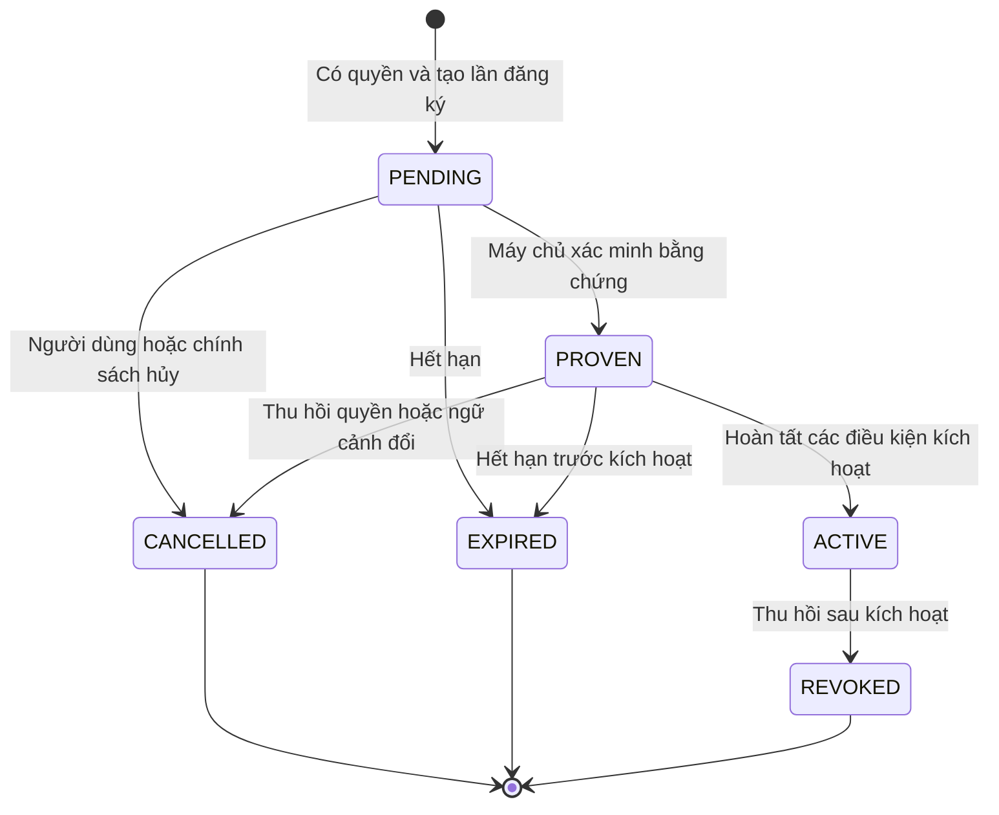

# Bằng chứng đăng ký authenticator trong khôi phục tài khoản

## 1. Đăng ký lại authenticator là một thay đổi quyền truy cập

**Authenticator enrollment proof** là bằng chứng cho thấy quá trình đăng ký một yếu tố xác thực đã đáp ứng các điều kiện cần thiết trước khi yếu tố đó được dùng cho tài khoản.

Trong khôi phục tài khoản, câu hỏi không chỉ là “đã tạo được mã QR hay public key chưa?”. Hệ thống cần trả lời đồng thời:

1. Người yêu cầu đã được phép đăng ký hoặc thay thế yếu tố xác thực của đúng tài khoản này chưa?
2. Yếu tố mới có thực sự tạo được một bằng chứng hợp lệ mà máy chủ kiểm tra được không?
3. Bằng chứng đó có thuộc đúng lần đăng ký, đúng mục đích và còn hiệu lực tại lúc kích hoạt không?

NIST dùng khái niệm *authenticator binding* để chỉ việc thiết lập liên kết giữa một authenticator cụ thể và tài khoản thuê bao, nhờ đó authenticator có thể được dùng để xác thực cho tài khoản. Tạo vật liệu xác thực và gắn quyền sử dụng vật liệu đó vào tài khoản là hai trách nhiệm cần quản lý rõ ràng. [Nguồn: NIST SP 800-63B-4, Authenticator Binding](https://pages.nist.gov/800-63-4/sp800-63b/events/#binding).

Bài học đặt việc chứng minh đăng ký trong luồng khôi phục mật khẩu, MFA, passkey hoặc thiết bị xác thực. Hai ví dụ chính là ứng dụng TOTP và credential WebAuthn/passkey. Các trạng thái, tên trường và giao thức nghiệp vụ trong bài là mô hình thiết kế minh họa, không phải một chuẩn triển khai hoàn chỉnh.

Ví dụ, một người mất điện thoại chứa ứng dụng TOTP được cấp quyền đặt lại yếu tố sau quy trình khôi phục phù hợp. Máy chủ vẫn chưa nên bật TOTP mới ngay khi hiển thị mã QR. Cần kiểm tra mã từ secret mới, ghi nhận kết quả và hoàn tất việc kích hoạt theo chính sách.

## 2. Phân biệt các loại bằng chứng

| Loại bằng chứng | Trả lời câu hỏi | Không tự chứng minh |
| --- | --- | --- |
| Quyền đăng ký | Chủ thể nào được phép thay đổi yếu tố cho tài khoản? | Người đó đã cấu hình được yếu tố mới. |
| Quyền kiểm soát yếu tố mới | Có thể tạo OTP hoặc chữ ký hợp lệ từ vật liệu mới không? | Người tạo bằng chứng là chủ tài khoản hợp lệ. |
| Tương tác hoặc xác minh cục bộ | Có thao tác người dùng hoặc cơ chế mở khóa cục bộ theo yêu cầu không? | Danh tính pháp lý hoặc quyền khôi phục tài khoản. |
| Thuộc tính authenticator | Loại yếu tố và đặc tính của nó có phù hợp chính sách không? | Mọi tuyên bố do client gửi đều đáng tin. |
| Khả năng dùng về sau | Người dùng vừa thử thành công trong ngữ cảnh kiểm tra. | Secret đã được sao lưu an toàn hoặc thiết bị sẽ không bị mất. |

Hai loại đầu đặc biệt dễ bị đánh đồng. Kẻ tấn công có thể tự tạo một ứng dụng TOTP hoặc passkey rồi chứng minh quyền kiểm soát nó rất tốt. Bằng chứng đó vẫn không cấp quyền gắn yếu tố vào tài khoản của nạn nhân.

Ngược lại, người dùng có quyền khôi phục nhưng quét nhầm mã QR, cấu hình sai thông số hoặc đăng ký credential vào ngữ cảnh sai vẫn có thể tự khóa mình nếu yếu tố được kích hoạt trước khi kiểm tra.

Một thông báo từ client như `enrollmentComplete: true`, ảnh chụp ứng dụng, tên thiết bị hoặc lời xác nhận “tôi đã lưu mã” chỉ là dữ liệu giao diện. Máy chủ phải xác minh đầu ra của giao thức và các điều kiện nghiệp vụ có thẩm quyền.

### Bằng chứng độc lập phải tồn tại trước quyền đang được cấp

Không được thiết kế vòng lặp:

```text
Người yêu cầu tạo authenticator mới
    -> authenticator mới tạo được OTP
    -> coi OTP đó là bằng chứng họ là chủ tài khoản
    -> cho phép gắn authenticator vào tài khoản.
```

OTP từ yếu tố mới là bằng chứng sử dụng yếu tố, không phải nguồn ủy quyền để sở hữu tài khoản. Quyền đăng ký phải đến từ một trạng thái xác minh hoặc khôi phục đã được chấp thuận độc lập.

## 3. Những ràng buộc phải giữ từ đầu đến cuối

Một bằng chứng chỉ có ý nghĩa khi gắn đúng ngữ cảnh. Có thể xem quan hệ cần bảo vệ là:

```text
tài khoản + tenant
    + recovery attempt
    + quyền đăng ký
    + enrollment attempt
    + authenticator đang chờ
    + mục đích và loại thao tác
    + challenge hoặc bước OTP
    + phiên bản trạng thái bảo mật
```

Các bất biến quan trọng:

- Pending authenticator chưa được dùng để đăng nhập hoặc nâng quyền ở endpoint thông thường.
- Chỉ kết quả đã được máy chủ xác minh mới có thể làm enrollment chuyển sang đã chứng minh.
- Bằng chứng cho enrollment A không thể kích hoạt pending authenticator B.
- Bằng chứng cho thao tác thêm yếu tố không mặc nhiên cho phép xóa mọi yếu tố đang có.
- Challenge hết hạn, đã dùng hoặc đã thu hồi không được kích hoạt lại bởi retry.
- Thay đổi trạng thái recovery hoặc thu hồi quyền đăng ký phải có hiệu lực cả khi client giữ một trang cũ.
- Kích hoạt yếu tố và tiêu thụ quyền tương ứng phải có cơ chế chống thực hiện trùng.

Tên hiển thị của yếu tố có thể do người dùng nhập để dễ quản lý. Nó không phải định danh bảo mật. “Điện thoại của tôi” không được thay cho `pending_authenticator_id` hoặc credential ID.

Địa chỉ IP, user agent và thiết bị quen thuộc có thể hỗ trợ đánh giá rủi ro. Không nên dùng một thuộc tính dễ thay đổi như IP làm ràng buộc duy nhất của bằng chứng.

## 4. Mô hình dữ liệu và trạng thái chờ

Một mô hình tối thiểu có thể gồm:

| Đối tượng | Dữ liệu tiêu biểu | Vai trò |
| --- | --- | --- |
| Recovery attempt | Tài khoản, mục đích, trạng thái, deadline, phiên bản bảo mật | Ghi quá trình khôi phục đã đạt đến bước nào. |
| Enrollment authorization | Phạm vi thao tác, nguồn xác minh, thời hạn, trạng thái sử dụng | Cấp quyền tạo và kích hoạt yếu tố trong giới hạn cụ thể. |
| Enrollment attempt | ID, loại yếu tố, pending ID, trạng thái, bộ đếm, deadline | Liên kết mọi bước của một lần đăng ký. |
| Pending authenticator | Secret được bảo vệ hoặc public key/credential chờ | Giữ vật liệu chưa được dùng để đăng nhập thông thường. |
| Enrollment proof | Nguồn bằng chứng, pending ID, phiên bản, thời điểm xác minh | Lưu kết quả kiểm tra đã đạt. |
| Active authenticator | Định danh, loại, vật liệu xác minh, trạng thái vòng đời | Yếu tố được phép dùng theo chính sách sau khi kích hoạt. |

Có thể dùng state machine:



`PROVEN` là trạng thái trung gian tùy chọn. Nếu không có lý do trì hoãn, hệ thống có thể xác minh và kích hoạt trong cùng một transaction sau khi mọi điều kiện đạt.

Nếu giữ `PROVEN` để chờ đánh giá rủi ro hoặc xác nhận bổ sung, cần deadline và kiểm tra lại quyền khi kích hoạt. Không để một bằng chứng tồn tại vô hạn rồi dùng sau khi recovery đã bị hủy.

Không cần chuyển một bản ghi đã hết hạn hoặc bị hủy trở lại `PENDING`. Người dùng có thể bắt đầu một enrollment mới trong phạm vi quyền còn hợp lệ, với định danh và challenge mới.

## 5. Cấp quyền đăng ký có phạm vi thay vì mở một session đầy đủ

Sau khi quy trình recovery chấp thuận, có thể cấp một quyền ngắn hạn như:

```text
subject: tài khoản đã được xác định ở máy chủ
scope: ENROLL_REPLACEMENT_AUTHENTICATOR
allowed_type: TOTP
recovery_attempt: R
security_version: V
expires_at: thời hạn của quyền
usage: một lần kích hoạt thành công
```

Đây là một ví dụ về **enrollment authorization**, không phải mẫu bearer token để sao chép nguyên vào sản phẩm.

Quyền này không nên cho phép đọc toàn bộ dữ liệu tài khoản, thay kênh khôi phục, xuất API key hoặc vô hiệu hóa mọi kiểm soát khác. Một trang enrollment chỉ cần những quyền tối thiểu để hoàn thành nhiệm vụ đó.

Có thể dùng một opaque token có bí mật đủ mạnh hoặc trạng thái phía máy chủ gắn với ngữ cảnh recovery. Nếu dùng bearer token, cần bảo vệ khi truyền/lưu, có khả năng thu hồi và tránh đưa vào query string hay log. Nếu dùng cookie, cần kiểm soát session và chống CSRF phù hợp.

Các điều kiện cần kiểm tra khi bắt đầu enrollment:

1. Quyền thuộc đúng tài khoản, tenant và recovery attempt.
2. Loại authenticator và thao tác thay thế nằm trong phạm vi được cho phép.
3. Quyền chưa hết hạn, chưa tiêu thụ và chưa bị thu hồi.
4. Rủi ro và trạng thái bảo mật vẫn đáp ứng chính sách.
5. Số lượng pending enrollment và ngân sách thử chưa vượt giới hạn.

Một cách triển khai là đặt quyền vào trạng thái dành riêng cho một enrollment ID trong lúc xử lý. Khi hủy hoặc thử lại, quy tắc giải phóng quyền phải rõ ràng, có giới hạn chung; không được tạo vô hạn pending authenticator để có thêm ngân sách đoán OTP.

Nếu recovery chưa đủ bằng chứng, việc tạo ra một yếu tố mới không bù được phần thiếu đó. Luồng phải dừng ở bước thích hợp hoặc yêu cầu thêm xác minh.

## 6. Chứng minh enrollment với TOTP

### 6.1. Tạo secret mới ở trạng thái chờ

Máy chủ sinh một secret ngẫu nhiên mới cho pending authenticator, ghi các thông số thuật toán cần dùng và lưu secret bằng cơ chế bảo vệ thích hợp. Không dùng lại secret của yếu tố đã báo mất hoặc bị nghi lộ chỉ để giữ cho mã cũ tiếp tục hoạt động.

TOTP dựa vào secret dùng chung và bước thời gian. Máy chủ và ứng dụng phải thống nhất các thông số; chỉ có hình ảnh một ứng dụng đang hiển thị mã không chứng minh mã đó thuộc secret của lần đăng ký hiện tại. [Nguồn: RFC 6238](https://www.rfc-editor.org/info/rfc6238/).

Mã QR provisioning hoặc khóa nhập tay chứa thông tin có thể tái tạo đầu ra của yếu tố. Vì vậy, cần xử lý chúng như bí mật:

- Chỉ cung cấp trong ngữ cảnh enrollment đã được cho phép, qua kết nối được bảo vệ.
- Không đặt secret trong URL trang có thể đi vào lịch sử, referrer hoặc access log.
- Không cho công cụ phân tích, chụp phiên hoặc tài nguyên ngoài không cần thiết tiếp cận vùng provisioning.
- Không gửi secret vào email, phiếu hỗ trợ hoặc thông báo audit.
- Hủy vật liệu chờ khi enrollment bị hủy hoặc hết hạn theo quy tắc lưu trữ đã định.

Chỉ hash secret như password thường không đủ cho máy chủ tính TOTP về sau. Thiết kế cần cho phép thành phần xác minh sử dụng secret trong môi trường được bảo vệ, chẳng hạn thông qua mã hóa và quản lý khóa có kiểm soát quyền truy cập.

### 6.2. Kiểm tra mã từ đúng secret đang chờ

Người dùng nhập mã do ứng dụng vừa cấu hình tạo ra. Máy chủ lấy pending secret từ enrollment hiện hành và xác minh trong cửa sổ thời gian đã định.

Không nên thử mã nhập vào với mọi secret của tài khoản rồi kết luận enrollment thành công nếu bất kỳ secret nào khớp. Một mã từ yếu tố cũ có thể là bằng chứng ủy quyền nếu chính sách cho phép, nhưng không chứng minh yếu tố mới đã được cấu hình.

Ví dụ contract:

```text
verifyPendingTotp(enrollmentId, code):
    kiểm tra quyền và trạng thái enrollment
    lấy đúng pending authenticator
    kiểm tra deadline và ngân sách thử
    so mã với secret và thông số của pending authenticator
    nếu đạt: ghi bước thời gian đã được dùng cho bằng chứng này
    nếu không đạt: cập nhật thất bại trong phạm vi chung thích hợp
```

Giữ mã ở dạng chuỗi để không làm mất số 0 ở đầu. Không mở rộng cửa sổ thời gian vô hạn khi người dùng liên tục nhập sai; cần xử lý lệch đồng hồ bằng quy tắc rõ ràng.

Ngân sách thử phải được áp dụng nguyên tử khi có request đồng thời. Regenerate QR, đổi tab hoặc tạo lại pending enrollment không được đặt lại mọi bộ giới hạn của cùng quyền recovery.

### 6.3. Mang trạng thái chống replay sang yếu tố hoạt động

RFC 6238 yêu cầu không chấp nhận lại OTP sau một lần xác minh thành công của chính OTP đó. Nếu mã đã được dùng làm bằng chứng enrollment, việc kích hoạt không nên xóa sạch dấu vết sử dụng để cùng mã lập tức được dùng lại ở endpoint đăng nhập. [Nguồn: RFC 6238, Validation and Time-Step Size](https://www.rfc-editor.org/info/rfc6238/).

Cần chuyển trạng thái chống replay phù hợp sang active authenticator, theo chính sách cửa sổ xác minh đang dùng. Việc lưu mốc bước lớn nhất hay tập các bước đã dùng có khác biệt khi nhận request sai thứ tự; phải dùng nhất quán giữa enrollment và xác thực thông thường.

Một mã hợp lệ chỉ cho thấy có bên tạo được đầu ra từ secret mới. Nó không chứng minh secret chỉ tồn tại trên một thiết bị, không bị chụp lại hoặc đã được sao lưu an toàn. Nếu người dùng nhập lại cùng secret vào hai ứng dụng, hai bản sao đó không tự trở thành hai yếu tố độc lập.

## 7. Chứng minh enrollment với WebAuthn hoặc passkey

### 7.1. Lưu credential chờ từ một registration được xác minh

WebAuthn phân biệt registration và assertion. Máy chủ kiểm tra challenge, origin, RP ID cùng yêu cầu của ceremony; assertion còn cần chữ ký hợp lệ từ public key của credential. Attestation `none` không cung cấp chứng thực nguồn gốc authenticator. [Nguồn: W3C WebAuthn, Registration và Assertion Verification](https://www.w3.org/TR/webauthn-3/#sctn-registering-a-new-credential).

Để triển khai, dùng thư viện WebAuthn phía máy chủ được duy trì, cấu hình đúng RP, origin và chính sách yêu cầu. Danh sách khái niệm ở trên không thay thế toàn bộ thuật toán kiểm tra của chuẩn, bao gồm các tùy chọn, cờ và extension liên quan.

Tài khoản và user handle cần được xác định từ ngữ cảnh có thẩm quyền của máy chủ. Không cho client đổi `account_id` trong response rồi gắn credential sang tài khoản khác.

Credential mới được lưu ở trạng thái chờ. Pending record giữ credential ID, public key và các thuộc tính đã được xác minh cần cho chính sách. Những tên thiết bị hoặc mô tả do client cung cấp chỉ hỗ trợ giao diện.

### 7.2. Kiểm tra dùng chính credential mới

Bài học chọn một chính sách minh họa: sau khi registration hợp lệ, thực hiện thêm một assertion bằng chính credential chờ trước khi kích hoạt.

Mục tiêu của bước này là kiểm tra đường sử dụng credential mới trong ngữ cảnh recovery. Đây là bước kiểm tra bổ sung của thiết kế, không phải khẳng định mọi registration của mọi sản phẩm đều bắt buộc có thêm một ceremony như vậy.

Một trình tự có thể là:

```text
1. Registration hợp lệ tạo pending credential C cho enrollment E.
2. Máy chủ tạo challenge mới Q cho thao tác PROVE_PENDING_CREDENTIAL.
3. Q gắn với E, C, quyền đăng ký và phiên bản bảo mật.
4. Client yêu cầu sử dụng C để tạo assertion.
5. Máy chủ xác minh assertion bằng public key của C.
6. Nếu mọi ràng buộc còn hợp lệ, ghi proof cho chính E và C.
```

Không dùng challenge registration làm challenge kiểm tra assertion. Hai bước khác mục đích và cần có trạng thái riêng để tránh phát lại hoặc nhầm response.

Nếu tài khoản còn credential cũ D, assertion của D không được tính là bằng chứng sử dụng C. Nó có thể phục vụ bước ủy quyền riêng, nhưng proof enrollment phải trỏ đúng credential mới.

Chỉ khai báo danh sách credential dự kiến ở client chưa đủ. Máy chủ vẫn phải kiểm tra credential trả về đúng pending record và đúng enrollment. Endpoint đăng nhập thông thường tiếp tục từ chối credential chờ.

### 7.3. Đọc đúng ý nghĩa của thuộc tính xác thực

User presence hoặc user verification của WebAuthn không tự chứng minh danh tính pháp lý hay quyền khôi phục tài khoản. Chúng cần được diễn giải trong đúng ceremony và chính sách. [Nguồn: W3C WebAuthn, Verifying an Assertion](https://www.w3.org/TR/webauthn-3/#sctn-verifying-assertion).

Từ góc độ thiết kế recovery, không suy ra “có sinh trắc học” đồng nghĩa “đúng chủ tài khoản”. Một người kiểm soát thiết bị của họ cũng có thể thực hiện xác minh cục bộ trên thiết bị đó.

Tương tự, một passkey có thể liên quan đến cơ chế đồng bộ. Bằng chứng dùng được credential không tự chứng minh khóa chỉ tồn tại trên một thiết bị vật lý hay độc lập với mọi yếu tố dự phòng khác. Nếu sản phẩm yêu cầu đặc tính cụ thể, cần chính sách chấp nhận và bằng chứng thuộc tính tương ứng.

## 8. Lưu proof đủ để kiểm tra quyết định

Một bản proof có thể lưu:

| Trường | Ý nghĩa |
| --- | --- |
| `proof_id` | Định danh kết quả xác minh phía máy chủ. |
| `enrollment_id` | Lần đăng ký tạo ra bằng chứng. |
| `pending_authenticator_id` | Yếu tố chờ thực sự được kiểm tra. |
| `material_version` hoặc fingerprint phù hợp | Phiên bản secret/credential mà phép kiểm tra đã dùng. |
| `authorization_id` | Quyền cho phép thực hiện enrollment. |
| `proof_method` | Ví dụ TOTP từ secret mới hoặc assertion bằng credential mới. |
| `challenge_id` hoặc thông tin replay cần thiết | Ràng buộc với một lần kiểm tra cụ thể. |
| `verified_at`, `expires_at` | Thời điểm và giới hạn sử dụng kết quả. |
| `policy_version`, `security_version` | Ngữ cảnh chính sách và trạng thái bảo mật. |
| `state` | Ví dụ còn hiệu lực, đã dùng hoặc bị thu hồi. |

Không cần lưu OTP rõ hoặc private key để tạo audit. Với TOTP, secret vẫn được quản lý trong kho vật liệu xác thực; proof chỉ ghi lại kết quả kiểm tra và liên kết cần thiết.

Với chữ ký hoặc dữ liệu ceremony, không mặc định phải lưu toàn bộ response thô vô thời hạn. Cần cân nhắc mục đích điều tra, quyền truy cập và thời hạn giữ; hạn chế thông tin thiết bị có thể dùng để theo dõi người dùng.

Fingerprint của public key có thể giúp phát hiện pending record đã đổi. Hash của một secret TOTP không nên được công khai hoặc đưa vào metric. Việc chọn thông tin ràng buộc phải phù hợp loại vật liệu và mức nhạy cảm.

`proof_id` không tự là một bearer capability. Biết ID không được phép kích hoạt yếu tố hoặc lấy secret. Endpoint xử lý vẫn phải kiểm tra quyền, tài khoản, trạng thái và phạm vi của proof.

Nếu proof được truyền giữa các dịch vụ, bên nhận phải xác thực nguồn và tính toàn vẹn, không tin một cờ `verified = true` trong request do client có thể sửa.

## 9. Kích hoạt nguyên tử với tiêu thụ quyền và proof

Xác minh được mật mã là một phần của quyết định. Trước khi cấp quyền sử dụng cho authenticator mới, trạng thái recovery vẫn phải hợp lệ.

Một mô hình hoàn tất:

```text
completeEnrollment(request):
    đọc ngữ cảnh do máy chủ quản lý
    kiểm tra định dạng và giới hạn tải
    xác minh bằng chứng của đúng pending authenticator
    tạo kết quả kiểm tra nội bộ gắn với các phiên bản đã đọc

    BEGIN

    khóa các đối tượng theo thứ tự thống nhất:
        account -> recovery -> authorization -> enrollment -> pending/challenge

    đọc lại thời gian và trạng thái có thẩm quyền
    kiểm tra recovery còn cho phép hoàn tất
    kiểm tra authorization còn hạn, đúng scope và chưa tiêu thụ
    kiểm tra enrollment còn đúng trạng thái và đúng pending ID
    kiểm tra phiên bản vật liệu, challenge và phiên bản bảo mật chưa đổi
    kiểm tra kết quả mật mã thuộc đúng các đối tượng vừa khóa
    kiểm tra các điều kiện bổ sung của chính sách đã đạt

    ghi proof hoặc tiêu thụ proof đang chờ
    đánh dấu challenge đã dùng theo cơ chế của từng loại yếu tố
    chuyển pending authenticator thành ACTIVE
    mang trạng thái chống replay cần thiết sang ACTIVE
    tiêu thụ quyền kích hoạt
    xử lý yếu tố cũ đúng phạm vi được cho phép
    cập nhật phiên bản/trạng thái recovery liên quan
    ghi audit và công việc thông báo vào outbox

    COMMIT

    trả kết quả đã commit
```

Đây là giả mã nghiệp vụ. Phần xác minh ngoài transaction phải là logic đáng tin cậy của máy chủ, gắn với snapshot bất biến hoặc phiên bản rõ ràng. Không tiếp nhận một “kết quả kiểm tra nội bộ” do trình duyệt tự tạo.

Làm mật mã trước khi giữ khóa có thể giúp transaction ngắn hơn, nhưng bắt buộc kiểm tra lại các phiên bản trong transaction. Nếu public key, pending secret hoặc challenge đã thay đổi, kết quả vừa tính không được áp dụng cho bản ghi mới.

Nếu chọn lưu `PROVEN` trong một transaction trước, transaction kích hoạt phải kiểm tra proof đã lưu, thời hạn và các ràng buộc tương tự. Không thể bỏ kiểm tra quyền chỉ vì proof từng hợp lệ.

### Các thao tác liên quan phải cùng phối hợp

Khóa account ở đường hoàn tất không giúp gì nếu đường hủy recovery hoặc thu hồi authorization không sử dụng cùng cơ chế phối hợp. Mọi đường ghi liên quan cần thống nhất khóa, phiên bản hoặc compare-and-set.

Có thể dùng các ràng buộc duy nhất để bảo vệ thêm, chẳng hạn một authorization chỉ có một kết quả kích hoạt khi chính sách quy định dùng một lần. Credential ID cũng cần quy tắc duy nhất phù hợp phạm vi RP và mô hình tài khoản, tránh gắn nhầm cùng credential cho nhiều chủ thể.

Nếu tăng security version trong lúc hoàn tất, cần nhất quán với trạng thái sau thay đổi của yếu tố vừa kích hoạt. Không để cơ chế thu hồi chung vô tình coi yếu tố mới là bằng chứng cũ ngay sau commit.

Kết quả thành công chỉ được trả sau commit. Một thông báo đã gửi hoặc một callback xử lý xong không thay thế trạng thái giao dịch.

### Không giả định transaction cục bộ bao trùm dịch vụ khác

Nếu authenticator ở một dịch vụ và quyền recovery ở dịch vụ khác, hai lần ghi độc lập có thể thất bại giữa chừng. Cần thiết kế giao thức hoàn tất có idempotency, trạng thái chuyển tiếp và đối soát phù hợp.

Ví dụ, dịch vụ nhận lệnh kích hoạt phải kiểm tra lệnh hợp lệ và không tạo thêm yếu tố khi nhận lại cùng operation ID. Outbox giúp chuyển lệnh sau commit, nhưng không tự bảo đảm mọi thay đổi xuyên dịch vụ xảy ra nguyên tử.

Trong thời gian chưa xác định kết quả, không mở quyền rộng rồi chờ job nền “sửa lại nếu có lỗi”.

## 10. Request đồng thời, retry và response bị mất

### Hai tab cùng đăng ký từ một quyền

Giả sử tab A tạo pending TOTP P1, còn tab B tạo pending TOTP P2. Người dùng nhập mã từ P1 vào trang đang trỏ P2.

Nếu server tìm mã trong mọi pending secret rồi chấp nhận bất kỳ kết quả khớp nào, nó có thể kích hoạt yếu tố không tương ứng với giao diện. Cần ràng buộc request vào đúng enrollment và pending ID.

Có thể chọn chỉ một pending enrollment hiện hành cho mỗi authorization hoặc hỗ trợ nhiều pending với quy tắc rõ ràng. Dù chọn cách nào, quyền cho một lần kích hoạt không được làm hai yếu tố cùng trở thành active do race.

### Verify chạy đồng thời với cancel

Nếu cancel commit trước, proof về sau phải bị từ chối dù phép kiểm tra mật mã đã tính xong.

Nếu activation commit trước, request cancel phải hiểu trạng thái đã chuyển sang active. Nó không được xóa tùy tiện một bản pending đã không còn tồn tại theo cách làm mất audit. Muốn thu hồi yếu tố active cần đi qua quy trình thu hồi có quyền phù hợp.

### Response thất lạc sau commit

Người dùng có thể không nhận được thông báo thành công dù yếu tố đã active. Request thử lại cần nhận lại cùng kết quả đã commit trong ngữ cảnh được phép, hoặc được hướng dẫn kiểm tra trạng thái an toàn.

Không được:

- Kích hoạt thêm một yếu tố mới để “bù” response mất.
- Đưa authorization đã dùng về chưa dùng.
- Đặt challenge đã tiêu thụ thành hoạt động.
- Hiển thị lại TOTP secret chỉ vì trang báo lỗi mạng.

Khóa idempotency cần gắn với chủ thể, enrollment và ý định thao tác. Một khóa do client chọn không thể cho phép nhận kết quả của tài khoản khác.

## 11. Thay thế yếu tố cũ mà không mở khoảng trống bảo mật

Có hai tình huống khác nhau:

| Tình huống | Hướng xử lý |
| --- | --- |
| Đổi thiết bị có kế hoạch, yếu tố cũ còn đáng tin | Có thể giữ yếu tố cũ trong quá trình chờ và thu hồi theo chính sách sau khi yếu tố mới dùng được. |
| Báo mất hoặc nghi bị lộ yếu tố cũ | Cần xử lý thu hồi/hạn chế yếu tố cũ theo rủi ro; không mặc định giữ hoạt động đến khi enrollment mới xong. |

Không có một thứ tự cố định an toàn cho mọi tình huống. Nếu yếu tố cũ bị nghi chiếm, việc tiếp tục tin nó có thể cho kẻ tấn công hủy recovery hoặc tạo enrollment cạnh tranh. Nếu chỉ đang đổi thiết bị bình thường, xóa yếu tố cũ trước khi kiểm tra yếu tố mới có thể tự khóa người dùng.

Authorization cần nói rõ yếu tố nào đang được thay thế và quyền xóa đến đâu. “Đăng ký một TOTP thay thế” không mặc nhiên là quyền xóa mọi passkey hay đổi email khôi phục.

Khôi phục một yếu tố không có nghĩa xóa các phương thức dự phòng hợp lệ khác. Đồng thời, các mã dự phòng hoặc proof đã lộ cần có chính sách thu hồi riêng; không giả định enrollment mới tự làm chúng mất hiệu lực.

Nếu quá trình bị gián đoạn trước activation, pending secret hoặc credential chờ không được dùng để đăng nhập. Có thể dọn vật liệu đó sau khi giữ đủ dữ liệu audit cần thiết. Một bản backup cũ được phục hồi cũng không được tự làm pending enrollment đã hủy sống lại.

## 12. Đăng ký qua nhiều thiết bị và chống gắn nhầm

Một người có thể mở luồng recovery trên máy tính rồi thêm authenticator ở điện thoại mới. Khi đó, mã liên kết hoặc QR ghép cặp chỉ là cầu nối giữa hai endpoint; nó không thay thế bằng chứng ủy quyền.

Thiết kế cần bảo đảm:

- Mã liên kết ngẫu nhiên, có thời hạn, có kiểm soát thử và chỉ được dùng đúng mục đích.
- Mã gắn với enrollment, tài khoản và endpoint đang được chấp thuận.
- Endpoint phê duyệt thực sự có trạng thái xác minh hoặc recovery phù hợp.
- Người dùng thấy rõ họ đang thêm yếu tố nào và cho tài khoản nào, với thông tin hiển thị được giảm lộ phù hợp.
- Không lấy một callback từ endpoint mới làm sự chấp thuận thay cho endpoint có thẩm quyền.
- Việc hủy ở một phía được kiểm tra tại quyết định hoàn tất.

Kẻ tấn công có thể gửi người dùng một QR do chính chúng tạo rồi nói đó là bước “đồng bộ” hoặc “xác minh danh tính”. Nếu người dùng phê duyệt nhầm, một bằng chứng kỹ thuật hợp lệ vẫn có thể nằm trong một giao dịch bị thao túng.

Giao diện cần giải thích tác động bằng ngôn ngữ cụ thể, chẳng hạn “Thêm phương thức xác thực cho tài khoản này”. Không dùng một nút chung “Tiếp tục” cho cả xác nhận địa chỉ, phê duyệt thiết bị và thay thế MFA mà không cho người dùng thấy khác biệt.

Các endpoint thay đổi trạng thái cần kiểm soát quyền và chống CSRF phù hợp. GET tải trang, ảnh QR hoặc link preview không được tự hoàn tất activation. Chống XSS và hạn chế tài nguyên ngoài ở trang provisioning cũng quan trọng vì một phiên trình duyệt bị chiếm có thể làm lộ secret hoặc thao túng ý định đăng ký.

Nếu có quyền hỗ trợ thủ công, nhân viên không nên yêu cầu người dùng gửi TOTP secret, ảnh QR hoặc private key. Quyền phê duyệt của nhân viên phải được giới hạn và có bằng chứng theo quy trình, không dựa vào việc họ nhìn thấy ảnh ứng dụng.

## 13. Session và thông báo sau khi đăng ký thành công

Đăng ký yếu tố mới, hoàn tất recovery và cấp session đăng nhập là các quyết định khác nhau.

Sau activation, hệ thống cần xác định:

| Đối tượng | Quyết định cần có |
| --- | --- |
| Enrollment authorization | Đã được tiêu thụ hoặc thu hồi đúng phạm vi chưa? |
| Recovery proof và attempt còn dư | Có còn được dùng cho thao tác nào nữa không? |
| Session recovery giới hạn | Đóng, giữ phạm vi hẹp hay chuyển qua một bước đăng nhập mới? |
| Session hiện có | Session nào cần thu hồi theo sự kiện mất hoặc lộ yếu tố? |
| Refresh token và trusted-device grant | Có phụ thuộc vào yếu tố hoặc trạng thái bảo mật đã thay đổi không? |
| Phương thức dự phòng | Giữ, cấp lại hoặc thu hồi theo những bằng chứng và phạm vi nào? |

Không nên đặt một cờ chung `mfa_verified = true` cho toàn tài khoản chỉ vì có enrollment proof. Bằng chứng có mục đích và thời điểm cụ thể; các session khác không tự được hưởng mức tin cậy đó.

Nếu cấp session mới sau recovery, cần thực thi chính sách cấp và luân chuyển session tương ứng, tránh tiếp tục dùng một định danh phiên cũ do tác nhân khác đã biết. Một grant chỉ dùng để enrollment không tự được nâng thành session có mọi quyền.

NIST yêu cầu thông báo khi thêm authenticator qua một cơ chế độc lập với giao dịch binding. Trong thiết kế recovery, thông báo như vậy giúp chủ tài khoản phát hiện một thay đổi không do họ thực hiện. [Nguồn: NIST SP 800-63B-4, Post-Enrollment Binding](https://pages.nist.gov/800-63-4/sp800-63b/events/#post-enrollment-binding).

Thông báo cần tránh secret và có hướng xử lý sự cố phù hợp. Không coi delivered, mở email hoặc nhấn xem thông báo là bằng chứng enrollment. Nếu có chức năng báo “không phải tôi”, tác động thu hồi hoặc tạm giữ phải được thiết kế để không biến thành công cụ phá hoại chỉ bằng một liên kết dễ lộ.

Thông báo gửi lỗi không nên làm bật lại quyền đã tiêu thụ. Có thể ghi công việc gửi trong outbox và retry theo chính sách mà giữ nguyên kết quả activation đã commit.

## 14. Audit đủ rõ mà không sao chép bí mật

Các sự kiện có thể quan sát gồm:

```text
enrollment.created
enrollment.proof_failed
enrollment.proof_verified
enrollment.activation_committed
enrollment.cancelled
enrollment.expired
authenticator.revoked
```

Mỗi sự kiện cần có định danh tương quan nội bộ, thời gian máy chủ, loại thao tác, nguồn ủy quyền và nhóm nguyên nhân thích hợp. Không đưa TOTP secret, OTP, provisioning URI, recovery token hoặc cookie vào event.

Để điều tra, cần trả lời được:

1. Quyền đăng ký đến từ trạng thái xác minh nào?
2. Pending authenticator nào thực sự được kiểm tra?
3. Bằng chứng có thuộc challenge và phiên bản vật liệu hiện hành không?
4. Ai hoặc quá trình nào đã kích hoạt yếu tố và xử lý yếu tố cũ?
5. Quyền đăng ký có bị dùng lại hoặc có attempt cạnh tranh không?
6. Session và proof còn dư đã được xử lý ra sao?

Metric tổng hợp có thể theo dõi số enrollment chờ, tỷ lệ hết hạn trước kiểm tra, thất bại proof theo nhóm nguyên nhân, xung đột trạng thái và tỷ lệ activation có lỗi kỹ thuật. Dùng label hữu hạn; không dùng account ID, credential ID hoặc enrollment ID làm label tùy ý.

Nếu một hệ thống mất telemetry, không nên log toàn bộ response WebAuthn hoặc secret để “dễ debug”. Cần khôi phục khả năng quan sát mà vẫn giữ giới hạn dữ liệu.

Các sự kiện này giúp tái dựng quyết định, không thay thế kho trạng thái có thẩm quyền. Một event `proof_verified` còn trong hàng đợi không cho phép bỏ qua việc recovery đã bị hủy sau đó.

## 15. Ví dụ một lần thay TOTP sau khi mất điện thoại

Giả sử người dùng đã hoàn thành một quy trình recovery được chấp thuận và nhận quyền A để thay đúng yếu tố TOTP đã báo mất.

```text
09:00:00  Tạo enrollment E và pending authenticator P1.
09:00:05  Hiển thị provisioning cho P1 trong phiên recovery giới hạn.
09:01:00  Người dùng tạo lại cấu hình theo thao tác được cho phép.
09:01:01  P1 bị hủy; tạo P2 với secret và phiên bản mới.
09:01:10  Tab cũ gửi mã hợp lệ đối với P1.
09:01:11  Server từ chối vì P1 không còn là pending hiện hành.
09:02:00  Tab hiện tại gửi mã từ P2.
09:02:01  Server xác minh P2 và ghi trạng thái chống replay.
09:02:02  Transaction kích hoạt P2, tiêu thụ A và ghi audit/outbox.
09:02:03  Response bị mất trên mạng.
09:02:05  Client thử lại cùng thao tác.
09:02:06  Server trả cùng kết quả đã commit trong ngữ cảnh được phép.
```

Chỉ có P2 được kích hoạt. P1 không hoạt động trở lại do tab cũ hoặc vì mã của nó từng đúng. Retry sau commit không tạo P3 và không mở lại quyền A.

Nếu recovery bị hủy ngay trước transaction lúc 09:02:02, kết quả mật mã của P2 vẫn không đủ để kích hoạt. Kiểm tra trạng thái có thẩm quyền quyết định lần hoàn tất có được phép commit hay không.

Nếu yếu tố cũ bị nghi lộ, việc xử lý nó được thực hiện theo chính sách sự cố; không đợi một mã OTP từ yếu tố cũ để tự chứng minh quyền khôi phục. Nếu đó chỉ là thay thiết bị có kế hoạch, chính sách có thể giữ yếu tố cũ đến mốc phù hợp để giảm nguy cơ tự khóa.

Các thời điểm và định danh trong ví dụ chỉ mô tả thứ tự xử lý, không phải cấu hình deadline được khuyến nghị.

## 16. Các tình huống cần kiểm chứng khi triển khai

Bảng này nêu các yêu cầu kiểm chứng cho một hệ thống thực thi, không phải kết quả thử nghiệm đã được chạy trong bài.

| Tình huống | Điều phải được bảo toàn |
| --- | --- |
| Người chưa được ủy quyền tự tạo TOTP/passkey hợp lệ | Không được gắn yếu tố vào tài khoản chỉ từ proof của yếu tố mới. |
| Trang QR đã tải nhưng người dùng chưa tạo mã | Yếu tố vẫn chờ, chưa được dùng để đăng nhập. |
| Nhập mã đúng từ TOTP cũ vào enrollment mới | Không được tính là proof cho secret mới. |
| Nhập mã có số 0 ở đầu hoặc lệch thời gian | Kiểm tra định dạng và cửa sổ nhất quán, không tự nới vô hạn. |
| Hai tab dùng hai phiên bản pending khác nhau | Chỉ proof của phiên bản hiện hành được áp dụng. |
| Assertion dùng credential khác pending credential | Không được kích hoạt credential chưa được kiểm tra. |
| Response sai challenge, origin hoặc ngữ cảnh RP | Bị từ chối theo bước xác minh WebAuthn tương ứng. |
| Client gửi `verified = true` hoặc tự đổi account ID | Không ảnh hưởng quyết định có thẩm quyền của máy chủ. |
| Pending material đổi sau khi phép kiểm tra mật mã đã tính | Kiểm tra phiên bản chặn áp dụng kết quả cũ. |
| Proof hợp lệ nhưng authorization đã hết hạn | Không được kích hoạt. |
| Verify chạy cùng cancel hoặc thu hồi quyền | Kết quả tuân theo thứ tự commit được bảo vệ. |
| Nhiều request hoàn tất cùng một quyền dùng một lần | Tối đa một kết quả activation theo phạm vi cho phép. |
| Commit thành công nhưng response mất | Retry không tạo yếu tố mới hoặc khôi phục quyền đã dùng. |
| Dùng lại OTP enrollment ở đăng nhập ngay sau kích hoạt | Trạng thái chống replay được giữ theo chính sách. |
| Đăng nhập bằng credential/secret còn pending | Endpoint thông thường từ chối. |
| Service đích nhận lệnh activation trùng | Xử lý idempotent, không nhân đôi yếu tố hoặc tác dụng phụ. |
| Recovery hoàn tất và có session cũ còn tồn tại | Quyền session được xử lý theo chính sách, không hưởng proof enrollment ngoài phạm vi. |
| Job dọn dữ liệu hoặc phục hồi backup | Không làm enrollment đã hủy/hết hạn hoạt động trở lại. |
| Kiểm tra log, trace, thông báo và hỗ trợ thủ công | Không làm lộ secret, QR provisioning hoặc bearer token. |

Bằng chứng enrollment có giá trị khi nó nối được quyền đăng ký đã chấp thuận với đúng authenticator vừa được kiểm tra, rồi được tiêu thụ trong một chuyển trạng thái có kiểm soát. Việc có một mã đúng hoặc một chữ ký hợp lệ chỉ là một mắt xích; quyền sử dụng tài khoản vẫn phụ thuộc toàn bộ luồng khôi phục và các quyết định kích hoạt, thu hồi, session liên quan.
