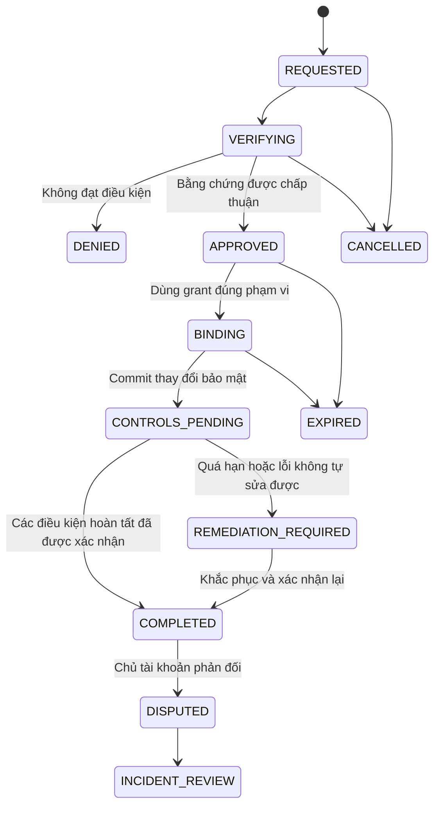
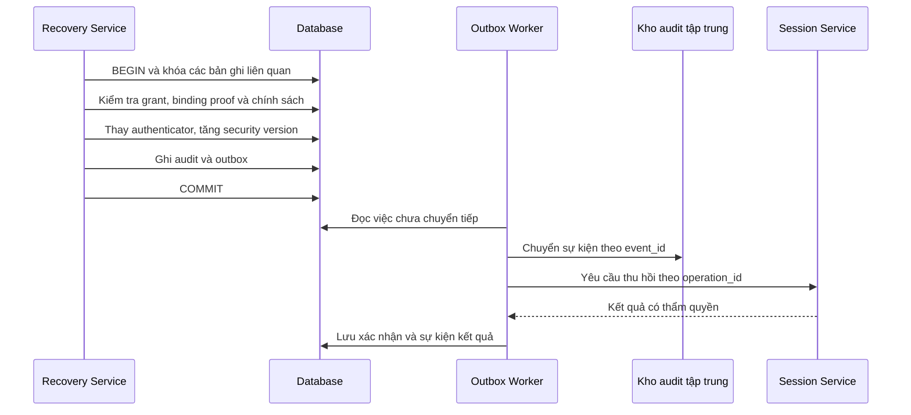

# Authenticator recovery audit

## 1. Mục tiêu và phạm vi

**Authenticator recovery audit** là việc ghi nhận, đối chiếu và đánh giá bằng chứng của quá trình khôi phục phương tiện xác thực, nhằm trả lời: ai được trao quyền thay phương tiện xác thực, dựa trên điều kiện nào, hệ thống đã thực hiện thay đổi gì và còn đường truy cập cũ nào hoạt động?

Trong module `SECURITY_AUTHENTICATION_ACCOUNT_RECOVERY`, “khôi phục thành công” cần được đánh giá theo quyền kiểm soát tài khoản sau toàn bộ quá trình. Một thông báo reset thành công chưa cho biết thiết bị bị mất đã bị vô hiệu hóa, refresh token cũ đã bị thu hồi hay người sở hữu tài khoản đã nhận được cảnh báo.

Bài học thuộc chương **Authenticator Recovery**, tập trung vào thiết kế dấu vết kiểm toán và cách dùng dấu vết đó để phát hiện điểm yếu. Những nội dung về xác minh danh tính, token dùng một lần và kiểm soát session được xem xét dưới câu hỏi: **kiểm toán viên có thể chứng minh chúng đã được áp dụng đúng cho chính lần khôi phục này hay không?**

Sau bài học, người học có thể:

- Xây dựng chuỗi sự kiện từ yêu cầu khôi phục đến khi các biện pháp bảo vệ đã có hiệu lực.
- Phân biệt bằng chứng đã xác minh, lời khai của người yêu cầu và kết quả thực thi.
- Thiết kế sự kiện audit đủ để điều tra mà không làm lộ bí mật xác thực.
- Phát hiện khoảng trống giữa quyết định chấp thuận, thay authenticator, thu hồi session và gửi thông báo.
- Lập kết luận audit có bằng chứng, phạm vi ảnh hưởng và điều kiện xác nhận đã khắc phục.

### 1.1. Những đối tượng cần phân biệt

| Đối tượng | Ý nghĩa trong bài |
| --- | --- |
| Authenticator | Phương tiện giúp chứng minh quyền xác thực, như ứng dụng TOTP, khóa bảo mật hoặc passkey |
| Recovery case | Hồ sơ nghiệp vụ gom toàn bộ bước của một lần khôi phục |
| Recovery grant | Quyền tạm thời, giới hạn mục đích, cho phép thực hiện bước khôi phục cụ thể |
| Audit event | Bản ghi có cấu trúc về một sự kiện hoặc một quyết định đã xảy ra |
| Audit review | Hoạt động đánh giá chuỗi bằng chứng và hiệu lực của các kiểm soát |
| Security incident | Sự cố cần điều tra và xử lý khi có dấu hiệu khôi phục trái phép hoặc mất kiểm soát |

Với TOTP, thay authenticator thường là cấp secret mới và vô hiệu hóa secret cũ. Với passkey, hệ thống dịch vụ đăng ký credential mới và thu hồi credential cũ theo phạm vi đã xác định; dịch vụ không lấy lại private key từ nhật ký. Nếu một credential có nhiều bản sao đồng bộ, xóa bản ghi credential ở phía dịch vụ và xóa các bản sao trên mọi thiết bị là hai việc khác nhau. Audit cần phản ánh đúng phạm vi hệ thống kiểm soát.

NIST SP 800-63B-4 yêu cầu duy trì hồ sơ authenticator gắn với tài khoản và thời điểm của các sự kiện vòng đời quan trọng. Tài liệu cũng yêu cầu thông báo cho chủ tài khoản khi khôi phục. Đây là hai điểm đối chiếu hữu ích cho audit. [NIST — Authenticator Event Management](https://pages.nist.gov/800-63-4/sp800-63b/events/).

Các trạng thái, tên sự kiện và mẫu kiến trúc bên dưới là **đề xuất thiết kế minh họa của bài học**, cần điều chỉnh theo mô hình rủi ro của sản phẩm; chúng không phải một chứng nhận tuân thủ NIST.

## 2. Câu hỏi kiểm toán và các bất biến cần bảo vệ

Audit nên bắt đầu từ câu hỏi về quyền kiểm soát tài khoản, sau đó mới chọn dữ liệu cần thu thập.

| Câu hỏi | Bất biến cần kiểm tra | Bằng chứng cần có |
| --- | --- | --- |
| Ai được quyền thay authenticator? | Quyết định dựa trên chính sách hợp lệ và bằng chứng đủ điều kiện | Quyết định xác minh, phiên bản chính sách, liên kết bằng chứng |
| Có thể dùng bằng chứng của tài khoản A cho B không? | Grant và bằng chứng bị ràng buộc vào tài khoản, tenant, case và mục đích | Các định danh được đối chiếu phía máy chủ |
| Một mã có dùng được hai lần không? | Việc tiêu thụ mã hoặc grant là nguyên tử và có giới hạn thời gian | Trạng thái tiêu thụ, kết quả cạnh tranh, sự kiện từ chối phát lại |
| Quyền tạm thời có trở thành quyền truy cập đầy đủ không? | Recovery grant chỉ cho phép các bước đã cấp | Phạm vi quyền và kết quả kiểm tra phân quyền ở API liên quan |
| Phương tiện xác thực mới có thực sự được kiểm tra không? | Credential mới chỉ hoạt động sau bước xác nhận phù hợp loại authenticator | Kết quả kiểm tra đăng ký và thời điểm kích hoạt |
| Authenticator cũ và session cũ còn dùng được không? | Phạm vi vô hiệu hóa đáp ứng quyết định xử lý rủi ro | Kết quả thu hồi, phiên bản bảo mật, phép thử sử dụng lại |
| Helpdesk có thể tự bỏ qua điều kiện không? | Ngoại lệ được kiểm soát, tách người đề xuất và người duyệt khi chính sách yêu cầu | Danh tính nhân viên, phê duyệt, lý do, thời hạn |
| Người dùng có cơ hội phát hiện hành vi giả mạo không? | Thông báo đi đến kênh phù hợp đã có trước thay đổi | Tham chiếu phiên bản kênh, trạng thái gửi, hướng dẫn phản đối |

Đặc biệt, “tài khoản đã đăng nhập” không tự chứng minh rằng người đang yêu cầu thay MFA là chủ sở hữu. Cookie phiên có thể bị đánh cắp; audit cần lưu kết quả kiểm tra điều kiện xác thực lại thay vì suy ra từ việc có session.

OWASP xem thay yếu tố MFA là thao tác rủi ro cao: cần xác minh phù hợp, tránh chỉ dựa vào session đang hoạt động và thông báo cho người dùng khi yếu tố thay đổi. [OWASP — Changing MFA Factors](https://cheatsheetseries.owasp.org/cheatsheets/Multifactor_Authentication_Cheat_Sheet.html#changing-mfa-factors).

### 2.1. Xác định đầy đủ đường vào

Phạm vi review cần bao gồm:

- Luồng tự phục vụ trên web và ứng dụng di động.
- API dành cho helpdesk, quản trị viên và quy trình phục hồi ngoại lệ.
- Tác vụ nền thay trạng thái, retry gửi thông báo và retry thu hồi session.
- Dịch vụ danh tính hoặc nhà cung cấp xác minh bên ngoài.
- Tình huống bỏ dở, hủy, hết hạn, bị từ chối và bị phản đối sau khi hoàn tất.

Nếu chỉ kiểm tra endpoint tự phục vụ, audit có thể bỏ sót một chức năng quản trị cho phép xóa MFA trực tiếp.

## 3. Mô hình hóa vòng đời để đọc được cả thành công lẫn thất bại

Một mô hình tham khảo:



Các chuyển trạng thái phải do máy chủ kiểm tra. Thông tin ở trình duyệt chỉ là đầu vào yêu cầu. Nhánh hủy và hết hạn trong sơ đồ được rút gọn; thiết kế thực tế phải nêu trạng thái nào còn được hủy và cách xử lý thay đổi đã commit.

Một số điểm chuyển cần giải thích rõ:

- `APPROVED`: điều kiện cấp quyền khôi phục đã được đáp ứng, chưa có nghĩa credential mới đã hoạt động.
- `BINDING`: người yêu cầu đang chứng minh quyền kiểm soát authenticator mới.
- `CONTROLS_PENDING`: thay đổi cục bộ đã commit, còn tác vụ cần xác nhận ở hệ khác.
- `COMPLETED`: bộ điều kiện hoàn tất do chính sách quy định đã đạt; không tự đồng nghĩa email đã được đọc.
- `DISPUTED`: đã nhận phản đối; nội dung phản đối vẫn cần xác minh, chưa tự kết luận tài khoản bị chiếm đoạt.

Trong ví dụ này, điều kiện hoàn tất gồm: credential mới hợp lệ, các credential thuộc diện thu hồi đã bị vô hiệu hóa, kiểm soát session đã được xác nhận và nghĩa vụ thông báo đã đạt trạng thái tối thiểu được chính sách chấp nhận. Nếu chỉ mới xếp thông báo vào hàng đợi thì cần thể hiện đúng trạng thái đó.

Không “quay lui” lịch sử bằng cách sửa sự kiện thành công thành thất bại. Khi xuất hiện vấn đề sau commit, ghi thêm sự kiện bù trừ hoặc khắc phục, kèm liên kết đến sự kiện ban đầu.

## 4. Thiết kế chuỗi sự kiện audit

### 4.1. Tên sự kiện thể hiện sự thật đã biết

Tách ý định và kết quả giúp tránh diễn giải sai:

| Giai đoạn | Sự kiện minh họa | Nội dung cần chứng minh |
| --- | --- | --- |
| Tiếp nhận | `recovery.request_recorded` | Hệ thống đã nhận yêu cầu; chưa khẳng định người yêu cầu là chủ tài khoản |
| Xác minh | `recovery.proof_evaluated` | Bằng chứng nào được đánh giá, bởi bộ kiểm tra nào, kết quả ra sao |
| Quyết định | `recovery.decision_recorded` | Cho phép, từ chối hoặc cần kiểm tra thêm, theo phiên bản chính sách nào |
| Ngoại lệ | `recovery.override_approved` | Ai phê duyệt ngoại lệ và giới hạn áp dụng |
| Grant | `recovery.grant_issued`, `recovery.grant_consumed` | Quyền tạm đã cấp và đã dùng, không chứa giá trị token |
| Đăng ký | `authenticator.binding_verified` | Bước kiểm tra credential mới đã đạt |
| Thay đổi | `authenticator.replacement_committed` | Thay đổi trạng thái đã commit tại nguồn dữ liệu có thẩm quyền |
| Thu hồi | `session.revocation_requested`, `session.revocation_confirmed` | Phân biệt lệnh đã gửi với hiệu lực được xác nhận |
| Thông báo | `notification.queued`, `notification.provider_accepted`, `notification.failed` | Tiến trình giao nhận và giới hạn của từng trạng thái |
| Kết thúc | `recovery.completed`, `recovery.expired`, `recovery.cancelled` | Kết quả nghiệp vụ và điều kiện đạt được |
| Phản đối | `recovery.disputed` | Phản hồi và liên kết hồ sơ điều tra |

Không cần phát sinh đúng toàn bộ tên trên trong mọi sản phẩm. Điều cần giữ là sự phân biệt giữa **yêu cầu**, **quyết định**, **commit thay đổi** và **hiệu lực tại hệ thống đích**.

### 4.2. Các trường nên có trong hợp đồng sự kiện

| Nhóm | Trường minh họa | Lý do cần |
| --- | --- | --- |
| Định danh | `event_id`, `event_type`, `schema_version` | Khử trùng lặp và giải mã đúng phiên bản |
| Liên kết | `recovery_case_id`, `operation_id`, `correlation_id`, `causation_event_id` | Nối sự kiện xuyên dịch vụ và tìm nguyên nhân trực tiếp |
| Thời gian | `occurred_at`, `recorded_at`, `ingested_at` | Phân biệt lúc xảy ra, lúc lưu và lúc nhận tại kho tập trung |
| Thứ tự | `case_sequence`, `account_security_version` | Đọc thứ tự nghiệp vụ khi đồng hồ hoặc mạng không đồng nhất |
| Chủ thể đích | `tenant_ref`, `account_ref` | Xác định phạm vi tài khoản mà không dùng email làm khóa tương quan |
| Tác nhân | `actor_type`, `actor_ref`, `initiator_ref` | Phân biệt người yêu cầu, nhân viên phê duyệt và dịch vụ thực thi |
| Quyết định | `outcome`, `reason_code`, `policy_version` | Giải thích kết quả bằng mã có kiểm soát |
| Bằng chứng | `proof_method`, `proof_result`, `evidence_ref` | Biết điều gì đã được kiểm tra mà không chép tài liệu gốc |
| Thay đổi | `old_authenticator_ref`, `new_authenticator_ref`, `revocation_scope` | Chỉ ra đối tượng bị thay và phạm vi kiểm soát |
| Nguồn | `producer`, `producer_version`, `source_context_ref` | Xác định thành phần tạo sự kiện và ngữ cảnh hỗ trợ điều tra |

`account_ref` và `actor_ref` nên là định danh nội bộ hoặc tham chiếu giả danh có phạm vi phù hợp. Chúng vẫn có thể là dữ liệu cá nhân nếu liên kết ngược được với một người.

Với yêu cầu chưa xác thực, `actor_type=UNVERIFIED_CLAIMANT` phản ánh đúng trạng thái hiểu biết. Không lấy email người gửi nhập vào để gán `actor_ref` của chủ tài khoản. Việc tra cứu tài khoản không thành công cần được ghi nhận ở khu vực truy cập hạn chế, đồng thời phản hồi công khai phải tránh tiết lộ tài khoản có tồn tại hay không.

### 4.3. Ví dụ sự kiện commit

Ví dụ sau sử dụng dữ liệu giả và chỉ lưu tham chiếu không dùng được để xác thực:

```json
{
  "event_id": "evt_demo_008",
  "event_type": "authenticator.replacement_committed",
  "schema_version": 1,
  "occurred_at": "2026-11-23T02:15:04.318Z",
  "recorded_at": "2026-11-23T02:15:04.320Z",
  "recovery_case_id": "rc_demo_042",
  "operation_id": "op_demo_019",
  "case_sequence": 8,
  "correlation_id": "corr_demo_731",
  "causation_event_id": "evt_demo_007",
  "tenant_ref": "tn_demo_01",
  "account_ref": "acct_demo_951",
  "actor": {
    "actor_type": "SERVICE",
    "actor_ref": "recovery-service",
    "initiator_ref": "claimant_demo_17"
  },
  "decision": {
    "outcome": "COMMITTED",
    "policy_version": "recovery-policy-v12",
    "reason_code": "APPROVED_GRANT_AND_BINDING_VERIFIED",
    "approval_event_ref": "evt_demo_004"
  },
  "change": {
    "old_authenticator_ref": "auth_demo_old",
    "new_authenticator_ref": "auth_demo_new",
    "new_authenticator_type": "WEBAUTHN",
    "account_security_version": 19,
    "revocation_scope": "ALL_PRE_RECOVERY_SESSIONS"
  },
  "producer": "recovery-service",
  "producer_version": "release-demo-12"
}
```

Sự kiện này khẳng định thay đổi cục bộ đã commit. Nó chưa khẳng định mọi resource server đã từ chối token cũ. Kết luận đó cần bằng chứng riêng từ cơ chế session và kiểm tra hiệu lực.

## 5. Bằng chứng đủ dùng và dữ liệu phải loại trừ

Audit có thể trở thành điểm rò rỉ nếu nhận toàn bộ request, response hoặc tài liệu nhận dạng. OWASP khuyến nghị loại bỏ hoặc bảo vệ mật khẩu, access token, định danh session và dữ liệu cá nhân nhạy cảm trong log; dữ liệu sự kiện cũng cần được xử lý để chống log injection. [OWASP — Logging Cheat Sheet](https://cheatsheetseries.owasp.org/cheatsheets/Logging_Cheat_Sheet.html#data-to-exclude).

Thiết kế bài học áp dụng danh sách trường cho phép thay vì serialize toàn bộ đối tượng:

| Dữ liệu nghiệp vụ | Cách biểu diễn trong audit |
| --- | --- |
| TOTP secret, QR đăng ký, private key | Loại khỏi audit hoàn toàn |
| OTP, recovery code, recovery token | Chỉ lưu loại bằng chứng, ID bản ghi hoặc kết quả tiêu thụ |
| Cookie, access token, refresh token | Dùng tham chiếu session không có khả năng xác thực |
| Ảnh giấy tờ, ảnh khuôn mặt, nội dung cuộc gọi | Lưu trong kho bằng chứng chuyên biệt khi thật sự cần; audit chỉ chứa tham chiếu |
| Email hoặc số điện thoại nhận thông báo | Tham chiếu kênh và phiên bản kênh; hiển thị che một phần nếu cần |
| IP, thông tin thiết bị | Chọn mức chi tiết theo nhu cầu điều tra và thời hạn lưu phù hợp |
| Nhận xét tự do của helpdesk | Giới hạn độ dài, làm sạch, tách khỏi trường mã quyết định |
| Lý do chấm điểm rủi ro | Lưu mã tín hiệu và phiên bản mô hình trong khu vực có quyền đọc phù hợp |

Không ghi hash của OTP sáu chữ số với giả định như vậy đã an toàn: không gian tìm kiếm nhỏ vẫn cho phép thử toàn bộ. Đối với audit, ID ngẫu nhiên của bản ghi bằng chứng đã đủ để liên kết các lần sử dụng; không cần bản dẫn xuất của chính bí mật.

Tài liệu gốc và sự kiện đánh giá có thời hạn lưu khác nhau. Khi bằng chứng gốc đã hết hạn lưu, hồ sơ audit cần thể hiện trạng thái đó; không tạo liên kết trông như vẫn truy cập được hoặc kéo dài việc lưu tài liệu chỉ vì log còn tồn tại.

Nếu sử dụng HMAC để giả danh định danh người dùng, cần xác định phạm vi khóa, phiên bản khóa và kế hoạch đổi khóa. HMAC giúp hạn chế khả năng tra cứu trực tiếp khi thiếu khóa; nó không biến dữ liệu có thể liên kết thành dữ liệu vô danh.

## 6. Ghi audit cùng thay đổi bảo mật

### 6.1. Hai cửa sổ mất bằng chứng thường gặp

Cách viết sau tạo khoảng trống:

```text
1. Cập nhật authenticator trong database.
2. Commit.
3. Gửi audit đến hệ thống thu thập log.
```

Nếu tiến trình chết sau bước 2, tài khoản đã thay authenticator nhưng kho audit có thể không có sự kiện. Đảo thứ tự cũng có vấn đề: gửi “thành công” trước commit có thể để lại bằng chứng thành công cho một giao dịch đã rollback.

Một thiết kế phù hợp cho thay đổi cục bộ là lưu **trạng thái nghiệp vụ, sự kiện audit bền vững và bản ghi outbox trong cùng transaction**. Outbox là bảng chứa việc cần chuyển tiếp sau commit.



Các consumer cần xử lý lặp an toàn. Việc gửi có thể hoàn tất nhưng acknowledgment bị mất; worker sẽ gửi lại. Vì vậy, dùng ID sự kiện ổn định, ràng buộc duy nhất khi lưu và kiểm soát idempotency cho lệnh tác động bảo mật. Không giả định hàng đợi tự tạo bảo đảm “chỉ thực thi đúng một lần” cho toàn bộ quá trình.

### 6.2. Giả mã Java cho ranh giới transaction

Đoạn sau minh họa thứ tự ghi nhận, không phải một implementation hoàn chỉnh. Các hàm kiểm tra đại diện cho logic phía máy chủ, các ràng buộc dữ liệu và cơ chế phân quyền cần được triển khai riêng.

```java
FinalizeResult finalizeRecovery(
        AuthorizedRecoveryContext context,
        FinalizeCommand command) {

    return transaction.required(() -> {
        // Các luồng thay bảo mật khác cũng phải tuân theo thứ tự khóa này.
        Account account = accounts.lock(
                context.tenantId(), context.accountId());

        RecoveryCase recoveryCase = cases.lock(
                context.tenantId(), command.caseId());

        access.requireCaseAccess(context, recoveryCase, account);
        idempotency.requireSameOperationOrReject(
                context, recoveryCase, command.operationId());

        if (recoveryCase.hasCommittedOperation(command.operationId())) {
            return recoveryCase.previousSafeResult();
        }

        policy.requireFinalizationAllowed(
                recoveryCase, account, clock.instant());

        RecoveryGrant grant = grants.lockForCase(
                recoveryCase.id(), context.grantReference());

        grant.requireBoundTo(
                account.id(), recoveryCase.id(), "REPLACE_AUTHENTICATOR");
        grant.requireUnusedAndUnexpired(clock.instant());

        // Đây là bản ghi kết quả kiểm tra đáng tin cậy do server tạo.
        // Không nhận boolean "verified" từ client.
        VerifiedBinding binding = bindings.lock(
                recoveryCase.id(), command.bindingReference());

        binding.requireFreshUnusedAndBoundTo(
                account.id(), recoveryCase.id(), clock.instant());

        grant.consume();
        binding.consume();

        authenticators.activateVerifiedBinding(account, binding);
        authenticators.revokeSelectedOldBindings(
                account, recoveryCase.revocationPlan());

        long newVersion = account.incrementSecurityVersion();
        recoveryCase.markControlsPending(command.operationId());

        AuditEvent committed = auditFactory.replacementCommitted(
                recoveryCase, account, binding.reference(), newVersion);

        auditRepository.append(committed);
        outbox.enqueueAuditDelivery(committed.id());
        outbox.enqueueSessionRevocation(
                command.operationId(), account.id(), newVersion);
        outbox.enqueueRecoveryNotification(
                recoveryCase.id(), recoveryCase.notificationPlanReference());

        return FinalizeResult.controlsPending(recoveryCase.id());
    });
}
```

Các điều kiện quan trọng của ví dụ:

1. `AuthorizedRecoveryContext` được tạo sau kiểm tra quyền ở máy chủ; nó không phải DTO người gọi tự cung cấp.
2. Binding proof chỉ được tạo sau kiểm tra đăng ký authenticator phù hợp. Với WebAuthn, điều đó bao gồm kiểm tra challenge, origin, RP ID và các yêu cầu xác minh người dùng theo chính sách.
3. Việc chấp thuận ban đầu không thay thế kiểm tra ngay trước commit. Tài khoản có thể đã bị khóa, thay đổi kênh liên lạc hoặc có một recovery case khác làm thay đổi trạng thái bảo mật.
4. Retry cùng thao tác trả kết quả an toàn đã có; tái sử dụng grant cho một thao tác khác phải bị từ chối.
5. Không thực hiện cuộc gọi mạng đến nhà cung cấp trong transaction đang giữ khóa dài. Kết quả kiểm tra từ bên ngoài cần được xác minh, lưu và ràng buộc trước khi sử dụng.
6. Các trường hợp bị từ chối và transaction rollback cần có đường ghi nhận riêng. Một audit row nằm trong transaction đã rollback sẽ không còn tồn tại.

Grant reference trong audit là ID của bản ghi grant, không phải bearer token. Dù một người đọc được ID này, họ vẫn không được phép thực hiện khôi phục.

### 6.3. Chính sách khi thành phần audit gặp lỗi

| Sự cố | Hành vi thiết kế minh họa |
| --- | --- |
| Kho tìm kiếm hoặc SIEM tạm ngừng | Giữ sự kiện trong kho bền vững và outbox; retry, đo độ trễ, cảnh báo tồn đọng |
| Không thể lưu audit bền vững trong transaction thay authenticator | Rollback bước thay đổi; trả lỗi có kiểm soát và tạo tín hiệu vận hành qua kênh độc lập nếu có |
| Worker gửi trùng sự kiện | Kho nhận khử trùng lặp theo `event_id`; không đếm thành hai lần recovery |
| Session Service từ chối hoặc chưa xác nhận | Giữ `CONTROLS_PENDING`; retry có giới hạn và chuyển xử lý khi quá hạn |
| Nhà cung cấp thông báo gặp lỗi | Ghi trạng thái lỗi, thử lại hoặc dùng kênh phù hợp khác theo chính sách |
| Outbox gần cạn dung lượng | Áp dụng giới hạn tiếp nhận và quy trình vận hành đã định; không âm thầm bỏ sự kiện bảo mật |

Đây là chính sách lựa chọn cho thao tác thay quyền kiểm soát tài khoản. Nó không yêu cầu toàn bộ ứng dụng dừng hoạt động khi một hệ quan sát gặp lỗi. Cần tách lỗi kho tìm kiếm tập trung khỏi lỗi mất khả năng lưu bằng chứng cục bộ, đồng thời kiểm soát lưu lượng để kẻ tấn công không dễ làm đầy kho.

## 7. Audit hiệu lực session và authenticator sau khôi phục

### 7.1. Các đối tượng cần kiểm tra riêng

Thay authenticator không tự thu hồi mọi quyền đã được cấp trước đó. Một bản kế hoạch thu hồi có thể gồm:

| Đối tượng | Bằng chứng cần kiểm tra |
| --- | --- |
| TOTP secret cũ | Bản ghi đã vô hiệu hóa; mã tạo bằng secret cũ bị từ chối |
| WebAuthn credential cũ | Credential nằm trong phạm vi thu hồi không còn được chấp nhận |
| Recovery grant đang dùng | Đã tiêu thụ và không thực hiện được thao tác thứ hai |
| Recovery code đã dùng | Bị vô hiệu hóa nguyên tử; bộ mã còn lại được xử lý theo chính sách |
| Browser session | Session cũ bị kết thúc hoặc bị chặn bởi security version |
| Refresh token | Các token hoặc token family thuộc phạm vi thu hồi không đổi được token mới |
| Access token tự chứa | Resource server áp dụng đúng cơ chế chặn và cửa sổ hiệu lực đã công bố |
| Remembered device | Quyền bỏ qua bước xác minh trên thiết bị cũ được xem xét lại |
| API key, application password, OAuth grant | Được đánh giá riêng nếu có dấu hiệu compromise; không suy ra đã bị thu hồi từ việc reset MFA |

Audit cần kiểm tra độ bao phủ và phạm vi hệ thống. “Đã đăng xuất tất cả” trong giao diện có thể chỉ bao gồm session của một ứng dụng, trong khi ứng dụng khác vẫn dùng token từ cùng nhà cung cấp danh tính.

### 7.2. Security version có tác dụng khi được thực thi

Một cách thiết kế là tăng `account_security_version` từ 18 lên 19 tại thời điểm commit. Session hoặc token cũ mang version 18 sẽ bị từ chối **nếu nơi ra quyết định truy cập đối chiếu với version hiện tại**.

Chỉ thêm claim version vào JWT chưa tạo ra thu hồi. Resource server chỉ kiểm chữ ký và thời hạn vẫn có thể chấp nhận token cũ. Nếu version được cache, cần xác định thời gian cache tối đa, cách invalidation, trạng thái khi không đọc được version và phép đo độ trễ thực tế.

Tương tự, thu hồi refresh token ngăn việc xin token mới nhưng không chứng minh access token đã cấp trước đó bị vô hiệu ngay. Hồ sơ audit nên ghi:

- Thời điểm yêu cầu thu hồi.
- Đối tượng hoặc nhóm token thuộc phạm vi thu hồi.
- Hệ thống đích và cơ chế thực thi.
- Thời điểm xác nhận và nguồn xác nhận.
- Cửa sổ còn có thể chấp nhận token cũ, nếu kiến trúc có giới hạn này.
- Kết quả kiểm tra trực tiếp trên các resource server quan trọng.

OWASP khuyến nghị xác thực lại sau các sự kiện rủi ro, trong đó có khôi phục tài khoản, và đổi định danh session khi mức đặc quyền thay đổi. [OWASP — Session Management](https://cheatsheetseries.owasp.org/cheatsheets/Session_Management_Cheat_Sheet.html#reauthentication-after-risk-events).

Trong thiết kế của bài, recovery grant chỉ cho phép đăng ký lại authenticator và hoàn thành bước kiểm tra cần thiết. Khi chuyển sang session đầy đủ, hệ thống đánh giá lại điều kiện truy cập và cấp session thích hợp; không tái dùng nguyên một token đặc quyền hạn chế rồi chỉ đổi nhãn ở client.

### 7.3. Thông báo là một chuỗi trạng thái

Các trạng thái sau có ý nghĩa khác nhau:

```text
QUEUED -> PROVIDER_ACCEPTED -> DELIVERY_REPORTED
                              hoặc DELIVERY_FAILED
```

Nhà cung cấp chấp nhận một email không chứng minh người dùng đã đọc email. Biên nhận giao nhận cũng có giới hạn tùy kênh. Vì vậy, một báo cáo phải mô tả chính xác mức xác nhận có được.

Audit kế hoạch thông báo cần đối chiếu kênh đã có trước lần recovery với kênh được chọn khi gửi. Nếu người yêu cầu vừa đổi số điện thoại rồi chỉ nhận thông báo tại số mới, cảnh báo có thể không đến được chủ tài khoản thật.

Tham chiếu phiên bản kênh giúp chứng minh quyết định đã sử dụng dữ liệu nào. Việc lưu snapshot không miễn trừ kiểm tra kênh đã bị vô hiệu hóa vì compromise; quyết định chọn kênh vẫn cần được đánh giá theo chính sách hiện hành.

## 8. Bảo vệ chính hệ thống audit

### 8.1. Quyền ghi, quyền đọc và quyền vận hành

Trong mô hình đề xuất:

- Dịch vụ nghiệp vụ ghi các loại sự kiện được phép qua danh tính dịch vụ riêng.
- Helpdesk chỉ xem phần hồ sơ cần xử lý và không sửa lịch sử.
- Người duyệt ngoại lệ không có quyền xóa bằng chứng của ngoại lệ.
- Nhân viên điều tra được cấp quyền đọc theo phạm vi và thời gian cần thiết.
- Thao tác xuất dữ liệu, xem bằng chứng nhạy cảm và đổi cấu hình lưu trữ đều có audit riêng.

Đặt kho bằng chứng tách khỏi giao diện helpdesk giúp giảm việc lộ tài liệu cá nhân khi một tài khoản hỗ trợ bị chiếm đoạt. Tuy vậy, tham chiếu bằng chứng cũng phải kiểm tra quyền ở mỗi lần truy cập; biết URL hoặc ID không được coi là quyền đọc.

### 8.2. Chống sửa đổi và nhận biết khoảng trống

Append-only ở lớp ứng dụng giúp ngăn sửa qua API thông thường nhưng chưa ngăn một quản trị viên database sửa trực tiếp. Có thể bổ sung lưu trữ có chính sách bất biến, phân tách quyền quản trị và cơ chế kiểm chứng toàn vẹn ngoài hệ thống nguồn.

Hash chain có thể phát hiện thay đổi khi người kiểm tra có mốc tin cậy độc lập. Nếu kẻ tấn công sửa được cả dữ liệu và mốc kiểm chứng, họ có thể tái tạo chuỗi. Ngay cả một chuỗi hợp lệ cũng không chứng minh producer đã phát đủ mọi sự kiện.

Do đó, cần đối chiếu ít nhất ba nguồn:

1. Thay đổi trạng thái authenticator tại nguồn dữ liệu nghiệp vụ.
2. Sự kiện audit tương ứng.
3. Kết quả thực thi tại session service hoặc hệ đích liên quan.

Giám sát khoảng trống sequence và heartbeat giúp phát hiện pipeline ngừng hoạt động, nhưng không thay thế việc đối chiếu dữ liệu nghiệp vụ.

### 8.3. Thời gian và bằng chứng điều tra

Dùng thời gian UTC có định dạng nhất quán cho sự kiện máy chủ. Lưu thời gian tiếp nhận tại collector để nhận biết sự kiện đến muộn. Thời gian client cung cấp phải được đánh dấu là lời khai, không dùng làm nguồn duy nhất để kết luận thứ tự.

Khi xuất hồ sơ điều tra, lưu bộ lọc đã dùng, khoảng thời gian, thời điểm xuất, danh tính người xuất, nguồn dữ liệu và manifest kiểm tra toàn vẹn. Hồ sơ nên chỉ ra các vùng thiếu dữ liệu hoặc nghi ngờ sai lệch đồng hồ.

Việc lưu trữ cần có thời hạn được xác định theo nhu cầu điều tra và các nghĩa vụ áp dụng cho tổ chức. Không có một số ngày chung phù hợp cho mọi hệ thống. Cần tính cả bản sao lưu, dữ liệu xuất, bảng tạm và liên kết đến kho bằng chứng khi thực hiện quy trình hết hạn lưu.

## 9. Thực hiện một đợt audit có thể tái lập

### 9.1. Chốt phạm vi và tập hồ sơ gốc

Xác định kỳ audit, tenant, loại tài khoản, loại authenticator, phiên bản chính sách và các đường vào. Ghi rõ những hệ thống có tham gia nhưng chưa được cung cấp dữ liệu.

Tập hồ sơ gốc nên lấy từ trạng thái nghiệp vụ có thẩm quyền: hồ sơ recovery, thay đổi authenticator và lệnh thu hồi. Nếu lấy toàn bộ mẫu chỉ từ SIEM, các lần recovery bị mất log sẽ không có cơ hội xuất hiện trong mẫu.

Chọn mẫu theo rủi ro, bao gồm cả:

- Hồ sơ tự phục vụ hoàn tất bình thường.
- Hồ sơ do helpdesk xử lý, có ngoại lệ hoặc thuộc tài khoản đặc quyền.
- Hồ sơ nhiều lần thất bại, nhiều lần retry hoặc bị bỏ dở.
- Hồ sơ khôi phục gần thời điểm đổi kênh liên hệ.
- Hồ sơ phát sinh khi dịch vụ thu hồi hoặc thông báo đang gián đoạn.
- Hồ sơ bị chủ tài khoản phản đối sau khi hoàn tất.

Kết quả kiểm tra một mẫu không đại diện tự động cho mọi tenant và mọi phiên bản triển khai. Phạm vi kết luận phải đi cùng phương pháp chọn mẫu.

### 9.2. Dựng timeline cho từng hồ sơ

Với mỗi case:

1. Tìm yêu cầu ban đầu và trạng thái xác thực của người yêu cầu tại thời điểm đó.
2. Nối các lần đánh giá bằng chứng, kết quả rủi ro và quyết định chính sách.
3. Đối chiếu người đề xuất, người phê duyệt và dịch vụ thực thi nếu có can thiệp thủ công.
4. Kiểm tra grant: ràng buộc đúng tài khoản, tenant, mục đích, thời hạn và lần sử dụng.
5. Tìm binding proof, thay đổi authenticator đã commit và sự kiện vô hiệu hóa đối tượng cũ.
6. Đối chiếu lệnh thu hồi với xác nhận từ hệ thống đích.
7. Đối chiếu kế hoạch thông báo với kênh và trạng thái gửi thực tế.
8. Ghi các khoảng trống, sự kiện đến muộn và hành động sau recovery có liên quan.

Dùng thứ tự trong case và liên kết nguyên nhân để hỗ trợ sắp xếp. Đừng sắp theo thời gian ingest rồi kết luận rằng phê duyệt xảy ra sau commit chỉ vì một sự kiện đến chậm.

### 9.3. Kiểm tra lại các kiểm soát quan trọng

Đọc log có thể cho thấy một nhánh kiểm tra đã chạy. Để đánh giá hiệu lực, cần thêm kiểm tra cấu hình, quyền truy cập và thực nghiệm có kiểm soát trên môi trường phù hợp.

| Tình huống kiểm tra | Kết quả bảo mật mong đợi | Dấu vết mong đợi |
| --- | --- | --- |
| Hai yêu cầu đồng thời dùng cùng grant | Một thay đổi hợp lệ tối đa | Một commit; yêu cầu còn lại bị từ chối hoặc trả kết quả idempotent của cùng thao tác |
| Dùng grant của tài khoản A để thay B | Không có thay đổi ở B | Từ chối do sai ràng buộc; không lộ chi tiết tài khoản khác |
| Dùng recovery grant gọi API lấy dữ liệu cá nhân | Không được cấp quyền ngoài phạm vi | Sự kiện từ chối phù hợp và liên kết case nếu xác định được |
| Dùng secret hoặc credential cũ sau thu hồi | Bị từ chối trong phạm vi đã cam kết | Bằng chứng trạng thái và kết quả xác thực thất bại |
| Dùng session, refresh token cũ | Bị chặn theo kế hoạch và thời hạn | Kết quả tại hệ thống đích, không chỉ log của recovery service |
| Ngắt collector sau commit | Sự kiện vẫn còn để chuyển tiếp | Outbox tồn tại, backlog tăng và được chuyển sau phục hồi |
| Làm transaction thay authenticator rollback | Không có thay đổi thành công | Không có sự kiện commit giả; lỗi được ghi bằng đường thích hợp |
| Nhập chuỗi có CR/LF vào ghi chú | Không tạo sự kiện giả | Một bản ghi có cấu trúc, dữ liệu bị giới hạn và mã hóa an toàn |
| Nhân viên tự duyệt ngoại lệ của mình | Bị chặn nếu chính sách yêu cầu tách nhiệm vụ | Quyết định từ chối và danh tính nhân viên |
| Gửi lại callback nhà cung cấp | Không nhân đôi tác động | Callback được xác minh, đối chiếu yêu cầu và khử trùng lặp |

Dùng dữ liệu và tài khoản thử nghiệm được cấp quyền; không đưa bí mật thật vào bộ bằng chứng kiểm tra. Kết quả cần lưu đủ để một người khác có thể hiểu điều kiện thử và tái lập trên cùng cấu hình.

## 10. Truy vấn và cảnh báo phát hiện khoảng trống

### 10.1. Tìm thay đổi đã commit nhưng thiếu xác nhận thu hồi

Ví dụ SQL giả định:

- `recovery_operations` là bảng nghiệp vụ có thẩm quyền, ghi từng thao tác thay authenticator.
- `audit_events` là biểu diễn phẳng của hợp đồng sự kiện; trường lồng trong JSON được ánh xạ ra cột.
- `operation_id` định danh một thao tác cụ thể; một case có thể có nhiều thao tác.
- `revocation_deadline` được tính theo chính sách áp dụng cho hồ sơ đó.
- `:as_of` là thời điểm chốt của lần kiểm tra, do công cụ truy vấn truyền dưới dạng tham số.

```sql
SELECT
    o.tenant_ref,
    o.recovery_case_id,
    o.operation_id,
    o.replacement_committed_at,
    o.revocation_deadline,
    o.expected_security_version
FROM recovery_operations o
WHERE o.replacement_committed_at IS NOT NULL
  AND o.revocation_deadline < :as_of
  AND NOT EXISTS (
      SELECT 1
      FROM audit_events e
      WHERE e.tenant_ref = o.tenant_ref
        AND e.operation_id = o.operation_id
        AND e.event_type = 'session.revocation_confirmed'
        AND e.outcome = 'SUCCEEDED'
        AND e.account_security_version = o.expected_security_version
  );
```

Kết quả là **danh sách cần điều tra**, chưa phải kết luận mọi session cũ đang hoạt động. Có thể thu hồi đã có hiệu lực nhưng sự kiện xác nhận chưa đến, hoặc producer ghi sai hợp đồng.

Trước khi kết luận, kiểm tra watermark của pipeline, backlog, thời gian đồng hồ và trạng thái trực tiếp ở hệ đích. Nếu có nhiều hệ đích, phải đối chiếu từng hệ bắt buộc trong kế hoạch thu hồi; một xác nhận từ một hệ không đại diện cho tất cả.

Tương tự, tìm thay đổi trong bảng nghiệp vụ nhưng thiếu `authenticator.replacement_committed` giúp phát hiện mất bằng chứng, kể cả khi không có `recovery.completed` trong kho tập trung.

### 10.2. Tín hiệu lạm dụng nên kết hợp nhiều điều kiện

| Tín hiệu | Khả năng cần điều tra | Giới hạn diễn giải |
| --- | --- | --- |
| Một nguồn tạo recovery cho nhiều tài khoản | Tự động hóa dò tìm hoặc tấn công hàng loạt | IP dùng chung có thể là mạng công ty hoặc nhà mạng |
| Một tài khoản liên tục thay phương thức xác minh sau thất bại | Tìm đường xác minh yếu hơn | Người dùng thật cũng có thể mất nhiều thiết bị |
| Đổi kênh liên hệ rồi recovery rất sớm | Chiếm quyền kênh khôi phục | Có thể là chuyển thiết bị hợp lệ |
| Một nhân viên có tỷ lệ ngoại lệ tăng bất thường | Lạm dụng quyền hoặc quy trình thiếu kiểm soát | Cần so sánh loại hồ sơ và ca trực |
| Recovery xong rồi thêm API key hoặc đổi quyền | Tạo đường truy cập bền vững | Cần xét quyền và hành vi bình thường của tài khoản |
| Nhiều case kẹt ở `CONTROLS_PENDING` | Lỗi hệ đích hoặc sự cố pipeline | Chưa thể suy ra có kẻ tấn công |
| Chủ tài khoản phản đối nhưng vẫn có đăng nhập mới | Có thể còn phiên hoặc credential ngoài phạm vi | Cần kiểm tra danh tính và tính hợp lệ của phản đối |

Ngưỡng phụ thuộc sản phẩm, nhóm tài khoản và lưu lượng nền. Một ngưỡng như “ba lần trong mười phút” chỉ là tham số thử nghiệm nếu chưa có dữ liệu đánh giá. Đo độ chính xác, thời gian phát hiện và gánh nặng xử lý trước khi dùng cảnh báo để tự động hạn chế quyền.

Không dùng yêu cầu recovery chưa xác thực làm căn cứ duy nhất để thu hồi mọi session hoặc khóa tài khoản nạn nhân. Nếu không, kẻ tấn công có thể chủ động làm người dùng mất quyền truy cập. Cảnh báo cần đi kèm quy trình xác minh và hành động tương xứng với độ tin cậy.

### 10.3. Chỉ số phản ánh chất lượng kiểm soát

| Chỉ số | Cách tính hoặc cách đọc |
| --- | --- |
| Độ bao phủ sự kiện commit | Số thao tác thay authenticator có sự kiện tương ứng / tổng thao tác commit tại nguồn nghiệp vụ |
| Độ đầy đủ bằng chứng | Tỷ lệ hồ sơ có đủ các loại bằng chứng bắt buộc cho đúng phương thức recovery |
| Độ trễ thu hồi | Khoảng từ commit thay đổi đến thời điểm kiểm soát thu hồi có hiệu lực được xác nhận |
| Hồ sơ quá hạn | Số case chưa đạt điều kiện hoàn tất sau deadline của chính sách |
| Tỷ lệ ngoại lệ | Số hồ sơ được override / số hồ sơ có can thiệp thủ công, kèm phân nhóm rủi ro |
| Mức đạt nghĩa vụ thông báo | Tỷ lệ đạt đúng trạng thái thông báo tối thiểu đã công bố, không gọi chung là “đã nhận” |
| Tỷ lệ phản đối | Số hồ sơ bị phản đối / số hồ sơ recovery trong cùng quần thể, có khoảng trễ quan sát |

Mẫu số phải xuất phát từ nguồn có thẩm quyền và được định nghĩa rõ. Chỉ đếm các sự kiện đã đến SIEM có thể làm tỷ lệ bao phủ trông hoàn hảo trong khi một nhóm sự kiện bị mất hoàn toàn.

## 11. Tình huống: audit tìm thấy phiên cũ sau khi thay passkey

Một người dùng khai báo mất điện thoại chứa passkey. Theo chính sách minh họa của sản phẩm, hồ sơ được chấp thuận sau khi dùng mã recovery đã lưu và xác thực bằng mật khẩu đã gắn với tài khoản. Điều kiện chấp thuận này là bối cảnh của ví dụ; không tự suy ra mọi tổ hợp bằng chứng đều đủ cho mọi cấp bảo đảm.

Timeline được dựng từ các hệ thống:

| Thời điểm UTC | Sự kiện hoặc bằng chứng |
| --- | --- |
| 02:10:00 | Tiếp nhận case `rc_demo_042` |
| 02:12:10 | Hoàn tất đánh giá bằng chứng, lưu phiên bản chính sách |
| 02:13:00 | Cấp grant chỉ cho phép thay authenticator của case |
| 02:15:04 | Credential mới được kiểm tra; commit thay đổi; security version tăng từ 18 lên 19 |
| 02:15:05 | Gửi lệnh thu hồi session trước recovery |
| 02:15:06 | Session Service xác nhận thu hồi refresh token |
| 02:15:08 | Nhà cung cấp chấp nhận thông báo gửi đến kênh đã lưu |
| 02:16:00 | Một access token version 18 vẫn gọi được API hồ sơ |
| 02:25:00 | Access token cũ hết hạn và bắt đầu bị từ chối |

Ban đầu, dashboard hiển thị “thu hồi thành công” vì chỉ đọc sự kiện Session Service. Đối chiếu với resource server cho thấy service đó chỉ thực thi thu hồi refresh token; API hồ sơ chỉ kiểm tra chữ ký và thời hạn access token.

Kết luận cần được viết có giới hạn:

- Credential cũ đã bị thu hồi tại dịch vụ danh tính theo bằng chứng quan sát được.
- Refresh token thuộc phạm vi lệnh đã bị vô hiệu.
- Access token cấp trước recovery tiếp tục được API hồ sơ chấp nhận đến lúc hết hạn.
- Nếu chính sách cam kết chặn toàn bộ truy cập cũ trước 02:16:00 thì kết quả thực tế không đạt cam kết.
- Chưa có bằng chứng xác định người sử dụng access token cũ là kẻ tấn công.

Hướng khắc phục có thể là thêm đối chiếu security version, dùng cơ chế introspection hoặc thay đổi kiến trúc thu hồi phù hợp. Nếu kiến trúc vẫn dựa vào access token sống ngắn, chính sách và giao diện phải phản ánh cửa sổ còn hiệu lực; không ghi nhận “đã thu hồi toàn bộ ngay lập tức”.

Điều kiện đóng phát hiện gồm kiểm tra lại token cũ tại các resource server trong phạm vi, đo độ trễ thực thi, xác nhận event contract và bảo đảm case không chuyển `COMPLETED` sớm hơn điều kiện chính sách.

## 12. Viết phát hiện audit và theo dõi khắc phục

Một phát hiện hữu ích cần nối được điều kiện mong đợi với bằng chứng thực tế:

| Thành phần | Ví dụ diễn đạt |
| --- | --- |
| Tiêu chí | Sau recovery có nghi ngờ compromise, mọi phiên thuộc phạm vi phải bị chặn trong deadline của chính sách |
| Quan sát | Resource server A tiếp tục chấp nhận access token cũ sau deadline |
| Bằng chứng | ID case, operation, sự kiện commit, kết quả thử, cấu hình và phiên bản triển khai |
| Phạm vi | Tenant, ứng dụng, loại token và khoảng thời gian chịu ảnh hưởng đã xác định |
| Nguyên nhân | API chỉ kiểm chữ ký và hạn token; không nhận thông tin thu hồi |
| Rủi ro | Người giữ token cũ có thể tiếp tục truy cập dữ liệu trong cửa sổ còn hiệu lực |
| Hành động | Bổ sung kiểm soát thu hồi và cập nhật tiêu chí hoàn tất |
| Chủ sở hữu | Nhóm có quyền sửa resource server và phối hợp dịch vụ danh tính |
| Điều kiện đóng | Kết quả kiểm tra lại xác nhận token cũ bị từ chối trong giới hạn đã duyệt |

Mức ưu tiên phụ thuộc quyền của tài khoản, dữ liệu có thể truy cập, khả năng khai thác và thời gian tồn tại. Thiếu một sự kiện audit và bằng chứng xác thực trái phép có tác động khác nhau; báo cáo phải nêu đúng điều đã chứng minh.

Khi nghi ngờ chiếm đoạt đang diễn ra, bảo toàn bằng chứng và chuyển quy trình ứng phó sự cố song song với xử lý quyền truy cập. Không chờ kết thúc kỳ audit mới xử lý một đường truy cập trái phép đã được xác nhận.

## 13. Danh sách đối chiếu khi thiết kế

- [ ] Mỗi thay đổi authenticator có thể liên kết với case, thao tác, quyết định và phiên bản chính sách.
- [ ] Lời khai người yêu cầu được phân biệt với bằng chứng đã xác minh.
- [ ] Grant và binding proof bị ràng buộc đúng tài khoản, tenant, mục đích, thời hạn và lần sử dụng.
- [ ] Đường quản trị, helpdesk và ngoại lệ có dấu vết và kiểm tra quyền tương ứng.
- [ ] Thay đổi đã commit có sự kiện bền vững, độc lập với khả năng tìm kiếm tức thời của SIEM.
- [ ] Các trạng thái yêu cầu thu hồi và xác nhận hiệu lực được phân biệt.
- [ ] Access token, refresh token, session và remembered device được xem xét theo phạm vi riêng.
- [ ] Thông báo ghi đúng kênh, phiên bản kênh và mức xác nhận giao nhận.
- [ ] Audit không chứa secret, mã dùng một lần, token hoặc toàn bộ tài liệu xác minh.
- [ ] Quyền đọc, xuất và thay cấu hình audit có kiểm soát và dấu vết riêng.
- [ ] Có phép đối chiếu từ dữ liệu nghiệp vụ để tìm sự kiện bị thiếu.
- [ ] Mọi phát hiện có bằng chứng, phạm vi, chủ sở hữu và điều kiện đóng kiểm chứng được.

## 14. Tài liệu đối chiếu

Các nguồn sau hỗ trợ nguyên tắc nền tảng; cần đọc đúng phạm vi điều khoản trước khi đưa ra tuyên bố tuân thủ:

- [NIST SP 800-63B-4 — Authenticator Event Management](https://pages.nist.gov/800-63-4/sp800-63b/events/): hồ sơ vòng đời authenticator và thông báo liên quan đến recovery.
- [OWASP — Multifactor Authentication Cheat Sheet](https://cheatsheetseries.owasp.org/cheatsheets/Multifactor_Authentication_Cheat_Sheet.html): bảo vệ thao tác reset và thay yếu tố MFA.
- [OWASP — Logging Cheat Sheet](https://cheatsheetseries.owasp.org/cheatsheets/Logging_Cheat_Sheet.html): dữ liệu cần bảo vệ trong log và việc kiểm tra cơ chế ghi nhận.
- [OWASP — Session Management Cheat Sheet](https://cheatsheetseries.owasp.org/cheatsheets/Session_Management_Cheat_Sheet.html): vòng đời session và xác thực lại sau sự kiện rủi ro.
