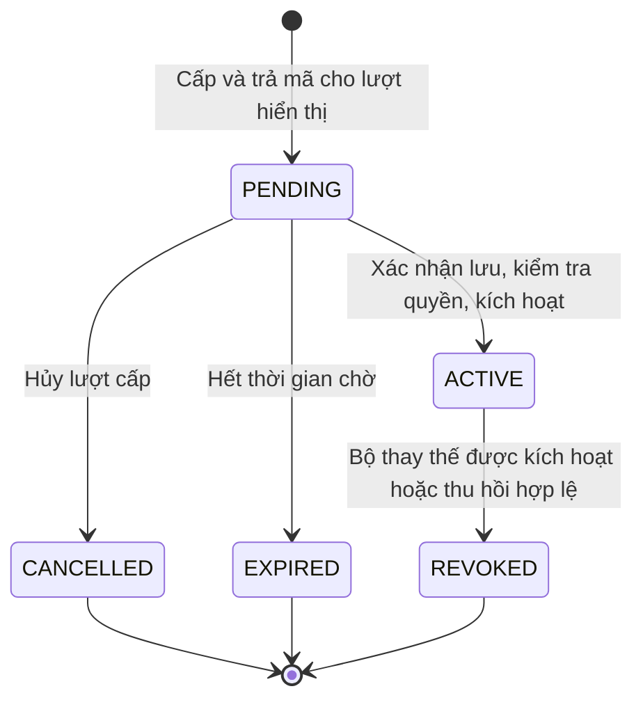

# Hiển thị mã khôi phục dự phòng an toàn (Backup code display)

Màn hình hiển thị backup code trao cho người dùng những bí mật có thể được dùng khi mất phương thức xác thực. Nếu mã bị chụp lại, ghi vào log hoặc hiện cho một phiên không đủ quyền, kẻ tấn công có thể có được đường khôi phục tài khoản mà không cần chiếm thiết bị xác thực chính.

Trong chương **Backup Code Recovery** của module `SECURITY_AUTHENTICATION_ACCOUNT_RECOVERY`, bài học này tập trung vào cách đưa mã dự phòng đến đúng người, giúp họ lưu mã và xử lý các lỗi của quá trình hiển thị. Bối cảnh là khôi phục khi mất mật khẩu, MFA, passkey hoặc thiết bị; việc mã đủ cho thao tác nào vẫn do chính sách xác minh của tài khoản quyết định.

## 1. Phân biệt hiển thị mã với sử dụng mã

Backup code là bí mật được cấp trước để người dùng giữ cho tình huống khẩn cấp. Nó khác OTP vừa được gửi qua SMS hoặc email cho một challenge ngắn hạn. Không áp dụng máy móc thời hạn vài phút của OTP cho mọi bộ mã dự phòng đã cấp.

Cần phân biệt bốn sự kiện:

| Sự kiện | Ý nghĩa |
| --- | --- |
| Cấp bộ mã | Máy chủ tạo các bí mật và dữ liệu cần để kiểm tra chúng |
| Hiển thị mã | Người dùng được tiếp cận giá trị rõ để sao chép, tải hoặc in |
| Xác nhận đã lưu | Người dùng tuyên bố đã giữ bản sao; máy chủ không biết chắc bản sao có an toàn không |
| Sử dụng mã | Mã được kiểm tra và tiêu thụ để hoàn thành một bằng chứng khôi phục |

Nhấn “Hiện mã”, “Sao chép” hoặc “Tôi đã lưu” không được đánh dấu mã là đã dùng. Ngược lại, nút xác nhận lưu cũng không được coi là bằng chứng xác minh danh tính mới.

NIST mô tả mã khôi phục đã lưu là bí mật được người dùng giữ an toàn để sử dụng về sau, đồng thời yêu cầu lưu dạng băm ở phía hệ thống trong cơ chế tương ứng. Bài này đề xuất một luồng hiển thị cụ thể; không tuyên bố chỉ triển khai màn hình đó là đủ đáp ứng toàn bộ yêu cầu khôi phục của tiêu chuẩn. [NIST SP 800-63B, Saved Recovery Codes](https://pages.nist.gov/800-63-4/sp800-63b.html#saved-recovery-codes).

## 2. Chọn rõ chính sách xem một lần hay xem lại

“Chỉ hiển thị một lần” thường được dùng để giảm việc giữ giá trị rõ trên máy chủ. Đây là lựa chọn kiến trúc và trải nghiệm, không phải đặc tính tự có của mọi backup code.

| Mô hình | Hành vi | Hệ quả cần xử lý |
| --- | --- | --- |
| Hiển thị giá trị rõ trong lượt cấp | Sau khi rời lượt này, máy chủ chỉ trả thông tin bộ mã; muốn có mã rõ phải cấp bộ mới | Phải xử lý mất phản hồi, tải lại và xác nhận lưu rõ ràng |
| Cho xem lại qua quy trình được bảo vệ | Người dùng đủ điều kiện có thể mở lại các mã còn được phép hiển thị | Cần kiến trúc có thể cung cấp lại giá trị rõ và kiểm soát quyền tương ứng |

Không thể khôi phục mã gốc từ một giá trị băm một chiều bằng cách “giải mã hash”. Nếu sản phẩm cho xem lại, phải đánh giá riêng cơ chế lưu hoặc tái tạo bí mật và phạm vi ảnh hưởng khi cơ chế đó bị lộ. Không suy đoán cách lưu nội bộ của một dịch vụ chỉ từ việc dịch vụ có nút xem lại.

GitHub là ví dụ về sản phẩm có chức năng xem, tải, in và sao chép recovery code, đồng thời cấp bộ mới làm các mã trước đó mất hiệu lực. Ví dụ này cho thấy cần công bố đúng hợp đồng của sản phẩm, thay vì khẳng định mọi hệ thống chỉ cho xem mã một lần. [GitHub Docs: configuring recovery methods](https://docs.github.com/en/authentication/securing-your-account-with-two-factor-authentication-2fa/configuring-two-factor-authentication-recovery-methods#about-the-recovery-codes-file).

Thiết kế minh họa trong bài chọn **chỉ cung cấp giá trị rõ trong lượt cấp**, không có endpoint đọc lại mã gốc sau đó. Người dùng có thể hiện, ẩn, sao chép, tải hoặc in nhiều lần khi danh sách còn ở bộ nhớ của lượt hiển thị được phép. Những thao tác này không tạo các bộ mã khác nhau.

## 3. Điều kiện trước khi trả mã rõ

Trang cài đặt bảo mật có thể hiện thông tin tổng hợp, nhưng việc cung cấp toàn bộ mã dự phòng là thao tác nhạy cảm hơn một lần xem hồ sơ thông thường.

Trước khi cấp hoặc hiển thị mã, máy chủ cần kiểm tra:

1. Phiên thuộc đúng tài khoản và còn hiệu lực.
2. Người dùng đã xác thực lại đủ gần thời điểm thao tác, bằng phương thức phù hợp với chính sách bảo vệ tài khoản.
3. Quyền vừa xác nhận có phạm vi cho việc quản lý mã dự phòng, không phải quyền tiếp tục hạn chế của một luồng khôi phục khác.
4. Tài khoản không ở trạng thái bị hạn chế vì sự kiện rủi ro chưa được giải quyết.
5. Yêu cầu thay đổi trạng thái được bảo vệ khỏi giả mạo phù hợp nếu dùng cookie.
6. Quyền cấp mã và kết quả chỉ gắn với đúng tài khoản, phiên và thao tác dự kiến.

OWASP khuyến nghị xác thực lại cho chức năng nhạy cảm để giảm tác hại của phiên bị chiếm hoặc trình duyệt bị người khác sử dụng tạm thời. Áp dụng nguyên tắc đó ở đây giúp ngăn một cookie cũ tự trở thành quyền lấy toàn bộ mã dự phòng. [OWASP: Require Re-authentication for Sensitive Features](https://cheatsheetseries.owasp.org/cheatsheets/Authentication_Cheat_Sheet.html#require-re-authentication-for-sensitive-features).

Không mặc định việc nhập lại riêng mật khẩu là đủ cho mọi tài khoản có MFA. Phương thức và mức xác thực lại phải phù hợp với thao tác quản lý phương thức khôi phục. Với tài khoản dùng passkey mà không có mật khẩu, giao diện cần hỗ trợ xác thực lại bằng phương thức đang được phép.

Người đang bị khóa ngoài và chưa chứng minh quyền sở hữu tài khoản không được mở màn hình này để lấy mã thay thế. Đường cấp lại mã không thể trở thành lối bỏ qua chính quy trình mà mã được dùng để bảo vệ.

## 4. Nội dung màn hình và định dạng mã

Màn hình cần giúp người dùng hiểu ba việc: mã dùng khi nào, phải lưu thế nào và khi nào bộ mã có hiệu lực. Không chỉ đặt một danh sách ký tự bên cạnh nút “Tiếp tục”.

Một bố cục minh họa có thể gồm:

```text
Lưu mã khôi phục dự phòng

Dùng các mã này khi bạn không thể dùng phương thức xác thực thông thường.
Mỗi mã chỉ được dùng thành công một lần theo chính sách khôi phục.
Không chia sẻ mã với người khác.

Bộ đang xem: <nhãn bộ mã>
Trạng thái: Chờ xác nhận lưu và kích hoạt

Mã 1: XXXXXXXX-XXXXXXXX-XXXXXXXX-XXXXXXXX
Mã 2: XXXXXXXX-XXXXXXXX-XXXXXXXX-XXXXXXXX
...

[Hiện/ẩn mã] [Sao chép] [Tải xuống] [In]

[ ] Tôi đã lưu bộ mã này ở nơi có thể truy cập khi mất thiết bị.
[Kích hoạt bộ mã này]
```

Các ký tự `X` là chỗ giữ chỗ minh họa, không phải mã có thể sử dụng. Trong thiết kế này, phần chữ “Mã 1” và số thứ tự là nhãn giao diện, không phải một phần của bí mật.

Ví dụ sản phẩm có thể cấp tám mã, mỗi mã chứa 128 bit ngẫu nhiên, biểu diễn bằng 32 ký tự hex chia thành bốn nhóm để dễ đọc. Đây là lựa chọn minh họa về số lượng và định dạng; việc sinh mã phải dùng nguồn ngẫu nhiên mật mã, không dùng số thứ tự hoặc định danh người dùng làm bí mật.

Các yêu cầu trình bày đáng chú ý:

- Mỗi dòng chỉ chứa một mã, khoảng cách đủ để không nhầm hai mã thành một.
- Phông chữ rõ, không bị cắt ký tự ở màn hình hẹp hoặc khi tăng cỡ chữ.
- Giữ nguyên chữ số `0` ở đầu và toàn bộ ký tự của mã.
- Nội dung được sao chép phải khớp mã được hiển thị, không kèm dấu đầu dòng hoặc số thứ tự.
- Máy chủ và giao diện phải thống nhất ký tự nào là dữ liệu, ký tự nào chỉ dùng phân nhóm.

Nếu cho phép nhập mã có hoặc không có dấu gạch phân nhóm, quy tắc chuẩn hóa phải được định nghĩa chính xác. Không âm thầm bỏ mọi dấu câu, cắt bớt ký tự hoặc thay ký tự Unicode trông giống ASCII. Việc định dạng cho dễ đọc không được làm thay đổi bí mật được kiểm tra.

Ẩn mã ban đầu có thể giảm việc bị nhìn trộm, nhưng không bảo vệ trước mã độc đã chạy trong trang nếu danh sách đã được tải về. Máy chủ vẫn phải kiểm soát quyền trước khi gửi dữ liệu rõ, thay vì tải sẵn rồi chỉ che bằng CSS.

## 5. Sao chép, tải xuống và in

Các thao tác lưu cần xuất phát từ hành động chủ động của người dùng, dùng đúng bộ mã đang xem và không tạo thêm bí mật mới.

| Thao tác | Hành vi cần có | Giới hạn cần giải thích |
| --- | --- | --- |
| Sao chép | Sao chép một mã hoặc danh sách với mỗi mã một dòng; chỉ báo thành công sau khi thao tác sao chép hoàn tất | Clipboard có thể được đồng bộ hoặc bị ứng dụng khác tiếp cận; sao chép không chứng minh đã lưu lâu dài |
| Tải xuống | Tạo nội dung từ danh sách đang được phép hiển thị; tên tệp không chứa bí mật hoặc định danh nhạy cảm không cần thiết | Tệp rõ có thể nằm trong thư mục tải chung hoặc được đồng bộ lên nơi khác |
| In | Bản in có đủ ký tự, nhãn bộ mã và chỉ dẫn cơ bản; kiểm tra ngắt trang và độ tương phản | Máy in dùng chung, hàng đợi in và bản PDF có thể tạo thêm bản sao |
| Hiện hoặc ẩn | Thay đổi cách trình bày của danh sách hiện tại | Không thu hồi những bản đã sao chép, tải hoặc chụp lại |

Thông báo “Đã sao chép” chỉ mô tả thao tác clipboard. Không đổi nó thành “Đã lưu mã an toàn”. Nếu tải bị chặn hoặc người dùng hủy hộp thoại, giao diện phải cho họ chọn lại cách lưu thay vì tự đánh dấu đã lưu.

Tệp xuất có thể chứa tên dịch vụ, nhãn bộ mã không bí mật, thời điểm cấp và từng mã trên một dòng riêng. Chỉ thêm thông tin tài khoản đủ để người dùng phân biệt, tránh đưa email đầy đủ hoặc dữ liệu cá nhân không cần thiết vào một tệp có thể bị thất lạc.

Không tự gửi danh sách qua email, SMS hoặc một URL tải công khai. Nếu ứng dụng tạo tệp phía trình duyệt, dữ liệu vẫn phải đến từ danh sách đã được cấp quyền; cần giải phóng tham chiếu tạm sau khi sử dụng. Nếu tải qua máy chủ, endpoint đó phải có cùng yêu cầu bảo vệ như endpoint hiển thị mã, không chỉ dựa vào một đường dẫn khó đoán.

Hướng dẫn lưu nên đề nghị người dùng chọn nơi riêng tư và có thể truy cập khi mất thiết bị xác thực. Có thể dùng bản in được cất an toàn hoặc kho bí mật phù hợp. Nếu kho lưu chỉ mở được bằng chính thiết bị hoặc tài khoản đang được khôi phục, phương án dự phòng có thể không dùng được khi cần.

Không nên dùng việc chụp màn hình làm cách lưu mặc định vì ảnh có thể vào thư viện đồng bộ, album dùng chung hoặc xuất hiện trong trình xem ảnh. Tuy nhiên, ứng dụng web không thể bảo đảm ngăn mọi ảnh chụp, camera hoặc bản sao bên ngoài.

## 6. Một luồng cấp, xem và kích hoạt có kiểm soát

Nếu bộ mới lập tức thay bộ cũ ngay khi máy chủ trả response, mất phản hồi có thể khiến người dùng không giữ được bộ mới trong khi bộ cũ đã bị thu hồi. Một lựa chọn thiết kế là tách bộ **chờ kích hoạt** với bộ **đang hoạt động**.

Trong thiết kế minh họa:

- Tài khoản có tối đa một bộ đang hoạt động và một bộ chờ kích hoạt cho quy trình này.
- Bộ chờ được hiển thị để lưu, nhưng chưa được chấp nhận khi khôi phục.
- Bộ đang hoạt động chỉ bị thay thế khi người dùng xác nhận lưu và máy chủ kích hoạt bộ mới thành công.
- Hủy hoặc hết hạn bộ chờ không tự thu hồi bộ đang hoạt động.
- Việc bật lần đầu chỉ được coi là có backup code sau khi bước kích hoạt hoàn tất.

Luồng gồm các bước sau:

1. Người dùng xác thực lại và chủ động chọn cấp bộ mã.
2. Máy chủ tạo một quyền thao tác ngắn hạn, gắn với tài khoản, phiên, mục đích và trạng thái bảo mật hiện tại.
3. Một yêu cầu thay đổi trạng thái tạo bộ chờ, lưu dữ liệu kiểm tra dạng một chiều và trả giá trị rõ cho lượt hiển thị này.
4. Giao diện cho phép người dùng xem và lưu. Bộ cũ, nếu có, vẫn hoạt động trong thời gian chờ theo chính sách.
5. Người dùng xác nhận đã lưu và yêu cầu kích hoạt đúng bộ đang xem.
6. Máy chủ kiểm tra lại quyền, thời hạn bộ chờ, phiên bản bảo mật và phiên bản bộ đang hoạt động dự kiến.
7. Trong một thao tác nguyên tử, kích hoạt bộ mới và thu hồi bộ cũ. Phản hồi chỉ cần xác nhận trạng thái, không trả lại danh sách mã.
8. Giao diện thông báo bộ nào đang có hiệu lực và hướng dẫn loại bỏ bản cũ khi phù hợp.



Sơ đồ mô tả trạng thái của một bộ mã. Trạng thái đã dùng của từng mã là dữ liệu riêng: dùng một mã không tự có nghĩa tất cả mã trong bộ đều đã dùng. Chính sách cấp mã thay thế sau sử dụng cũng là nghiệp vụ riêng, không được ngầm gộp vào thao tác mở màn hình.

Ví dụ thời gian chờ kích hoạt có thể là mười phút, nhưng đó là hạn của quy trình cấp đang chờ, không phải lời tuyên bố mọi mã dự phòng đã kích hoạt đều hết hạn sau mười phút. Hai vòng đời phải được giải thích tách biệt.

Nếu bộ cũ bị nghi đã lộ, việc giữ nó hoạt động đến lúc xác nhận bộ mới có thể không phù hợp. Khi đó cần quy trình thu hồi khẩn cấp với bằng chứng và cảnh báo rõ, có thể giữ một phương thức mạnh khác để tránh khóa chủ tài khoản ngoài hệ thống. Không hứa vừa thu hồi bộ bị lộ ngay, vừa bảo đảm bộ đó vẫn dùng được khi người dùng chưa lưu xong.

## 7. Tải lại trang, mất response và yêu cầu bị lặp

Với mô hình chỉ lưu dữ liệu kiểm tra một chiều, máy chủ không thể trả lại danh sách gốc sau khi lượt cấp đã kết thúc. Điều này ảnh hưởng trực tiếp đến cách xử lý idempotency.

Một hợp đồng minh họa có thể gồm:

```http
POST /security/backup-code-sets
Idempotency-Key: <khoa-cua-thao-tac-cap>

POST /security/backup-code-sets/{setId}/activate
Idempotency-Key: <khoa-cua-thao-tac-kich-hoat>

GET /security/backup-code-sets/status
```

Các endpoint đều được ràng buộc với đúng tài khoản và quyền phù hợp. Tham chiếu `setId` không thay thế việc kiểm tra quyền. Endpoint trạng thái chỉ trả metadata như bộ hiện hành, số mã còn lại và trạng thái bộ chờ; không trả mã rõ hoặc giá trị kiểm tra.

Trong thiết kế được chọn, response đầu của thao tác cấp chứa danh sách rõ. Bản ghi idempotency chỉ lưu định danh và kết quả nghiệp vụ, không lưu toàn bộ response có bí mật. Khi cùng thao tác được gọi lại, máy chủ trả thông tin đã tạo bộ cùng trạng thái “không thể cung cấp lại giá trị rõ”, thay vì sinh thêm bộ hoặc giả vờ có thể đọc lại mã từ hash.

Đây là hợp đồng idempotency cần được công bố rõ: hiệu ứng cấp bộ chỉ xảy ra một lần, nhưng response chứa bí mật không được phát lại vô hạn. Nếu sản phẩm muốn phát lại trong một cửa sổ ngắn, đó là một mô hình khác cần lưu bí mật tạm được mã hóa, có thời hạn và kiểm soát quyền; không được tuyên bố đang chỉ giữ verifier một chiều trong giai đoạn đó.

| Sự cố | Hành vi mong đợi trong mô hình minh họa |
| --- | --- |
| Response cấp mã bị mất trước khi người dùng nhìn thấy | Bộ chờ có thể đã tồn tại; bộ cũ vẫn hoạt động; truy vấn trạng thái rồi hủy hoặc thay bộ chờ bằng thao tác hợp lệ |
| Người dùng tải lại khi chưa kích hoạt | Không tự cấp mới; không đọc lại danh sách đã mất; giải thích cách bắt đầu một lượt cấp mới |
| Người dùng đóng trang khi chưa xác nhận | Bộ chờ được hủy hợp lệ hoặc hết hạn; không tự kích hoạt vì trang đã đóng |
| Response kích hoạt bị mất | Truy vấn metadata hoặc lặp cùng thao tác kích hoạt để xác định trạng thái; không tự xoay mã |
| Hai tab cùng cố kích hoạt các bộ khác nhau | Kiểm tra phiên bản và trạng thái trong giao dịch; không để tab cũ âm thầm thay bộ mới hơn |
| Phiên bị thu hồi hoặc tài khoản có sự kiện bảo mật quan trọng | Vô hiệu quyền thao tác và bộ chờ liên quan theo chính sách; yêu cầu xác minh lại phù hợp |

Khi chưa biết yêu cầu đã thành công hay chưa, giao diện nên hiển thị trạng thái đang kiểm tra. Không kết luận bộ cũ đã bị thu hồi hoặc bộ mới đã có hiệu lực chỉ từ việc nút đã được nhấn.

## 8. Hạn chế bí mật còn sót trong trình duyệt và hạ tầng

Response có mã phải được bảo vệ trên đường truyền và tránh lưu ngoài nơi cần thiết. Ví dụ header cho response JSON chứa danh sách:

```http
Content-Type: application/json
Cache-Control: no-store
Referrer-Policy: no-referrer
X-Content-Type-Options: nosniff
```

`Cache-Control: no-store` yêu cầu cache không lưu response. `no-cache` chỉ yêu cầu kiểm tra lại trước khi tái sử dụng dữ liệu đã lưu, nên không có cùng ý nghĩa. Header cũng không xóa mọi bản sao do người dùng hoặc thành phần ngoài cơ chế HTTP cache tạo ra. [MDN: Cache-Control](https://developer.mozilla.org/en-US/docs/Web/HTTP/Reference/Headers/Cache-Control#no-store).

Cần áp dụng bảo vệ cho mọi response thực sự chứa bí mật, bao gồm HTML nếu máy chủ nhúng mã vào trang. Hạ tầng CDN, reverse proxy và gateway phải giữ đúng chính sách, không bật cache hoặc ghi body chỉ vì endpoint trả `200`.

Các vị trí dễ làm lộ mã gồm:

| Vị trí | Biện pháp trong thiết kế |
| --- | --- |
| URL, query string và fragment | Không đặt mã hoặc quyền xem nhạy cảm vào đường dẫn được chia sẻ, lịch sử hay referrer |
| `localStorage`, `sessionStorage`, IndexedDB | Không lưu danh sách rõ để tự phục hồi sau tải lại trong mô hình này |
| Service worker và bộ cache dữ liệu của ứng dụng | Không lưu response bí mật hoặc tự phát lại nó ở chế độ ngoại tuyến |
| Log ứng dụng, proxy và tracing | Loại bỏ body chứa mã, giá trị verifier, token thao tác và cookie |
| Session replay, heatmap, ảnh chụp hỗ trợ | Tắt ghi nhận tại vùng nhạy cảm; không dựa riêng vào việc che CSS |
| Global state và công cụ debug | Hạn chế thời gian giữ dữ liệu, tránh đưa vào snapshot hoặc log trạng thái |
| Trang lỗi và báo cáo sự cố | Không kèm response bí mật hoặc bản dump của danh sách mã |

Nên giảm script bên thứ ba trên màn hình này và chống việc nhúng trang vào khung để đánh lừa người dùng thao tác. Cơ chế kiểm soát script, chống XSS và chống clickjacking bổ sung cho kiểm soát phiên; chúng không được thay bằng một hộp xác nhận “tôi tin tưởng trình duyệt”.

Khi người dùng rời quy trình, đăng xuất hoặc phiên mất hiệu lực, giao diện phải bỏ danh sách rõ khỏi trạng thái hiển thị và các tham chiếu không cần thiết. Khi quay lại qua lịch sử trình duyệt hoặc khôi phục tab, ứng dụng cần kiểm tra trạng thái trước khi cho tiếp tục, không tự đưa bí mật trở lại từ dữ liệu được lưu sẵn.

Phải kiểm chứng hành vi đó trên môi trường trình duyệt được hỗ trợ, vì cache HTTP, khôi phục trang và bộ nhớ ứng dụng là các cơ chế khác nhau. Việc xóa một biến JavaScript hoặc tháo một thành phần giao diện không bảo đảm đã xóa an toàn mọi bản sao trong bộ nhớ, ảnh chụp hoặc tệp mà người dùng đã xuất.

## 9. Khả năng tiếp cận và thông báo đúng mức

Mã phải đọc và thao tác được bằng bàn phím, trình đọc màn hình, màn hình hẹp và chế độ phóng to. Một cách trình bày dễ dùng có thể giảm việc người dùng lưu nhầm hoặc bỏ sót ký tự.

Các yêu cầu cụ thể gồm:

- Nút hiện hoặc ẩn có nhãn và trạng thái dễ nhận biết; nút sao chép từng dòng phải cho biết dòng nào được chọn.
- Không dùng màu làm dấu hiệu duy nhất cho bộ chờ, bộ đã kích hoạt hoặc lỗi thao tác.
- Không tự đọc toàn bộ danh sách mã trong một thông báo cập nhật trực tiếp của trình đọc màn hình; để người dùng chủ động tiếp cận nội dung.
- Thông báo thao tác thành công không cần lặp lại bí mật, chẳng hạn “Đã sao chép mã thứ hai”.
- Nếu quy trình sắp hết hạn, báo đủ sớm và giải thích cách cấp lại an toàn; không tự kích hoạt để tránh hết giờ.
- Bản in vẫn có đủ mã và chỉ dẫn cần thiết, không bị cắt vì trạng thái ẩn trên màn hình hoặc quy tắc ngắt trang.

Không buộc người dùng nhập một mã thật vào endpoint khôi phục chỉ để chứng minh đã đọc hoặc đã lưu danh sách. Cách làm đó có thể vô tình tiêu thụ mã hoặc tạo bằng chứng khôi phục ngoài ngữ cảnh dự kiến. Nếu sản phẩm cần một thao tác kiểm tra việc ghi nhận, hãy thiết kế nó riêng, không ghi nhận là sử dụng mã thành công.

Nội dung cảnh báo nên ngắn và gắn với hành động: giữ mã riêng tư, có thể cần mã khi mất thiết bị, bộ cũ sẽ hết hiệu lực sau khi kích hoạt bộ mới. Tránh hứa rằng tải xuống là đã được bảo vệ hoặc chức năng ẩn mã có thể thu hồi những bản sao đã tồn tại.

## 10. Metadata, hỗ trợ và thông báo an ninh

Sau khi rời lượt hiển thị, màn hình quản lý trong mô hình này có thể cho biết:

| Thông tin | Có thể hiển thị cho người đủ quyền? |
| --- | --- |
| Có bộ mã đang hoạt động hay chưa | Có |
| Ngày cấp, nhãn hoặc phiên bản bộ | Có, theo chính sách riêng tư |
| Số mã chưa dùng | Có, theo quyền của tài khoản |
| Có một bộ đang chờ xác nhận hay không | Có, trong ngữ cảnh thích hợp |
| Toàn bộ mã rõ đã cấp trước đó | Không, vì mô hình không cung cấp lại giá trị rõ |
| Hash, salt hoặc dữ liệu kiểm tra | Không có nhu cầu đưa ra giao diện người dùng hoặc công cụ hỗ trợ |

Nhân viên hỗ trợ có thể xem trạng thái phục vụ xử lý sự cố theo phân quyền, nhưng không nên có chức năng lấy toàn bộ mã của người dùng. Người dùng cũng không nên được hướng dẫn gửi ảnh màn hình danh sách hoặc đọc mã còn hiệu lực cho nhân viên hỗ trợ.

Sự kiện audit nên ghi điều máy chủ thực sự biết, chẳng hạn “đã tạo bộ chờ”, “đã chuẩn bị response chứa mã” hoặc “đã kích hoạt bộ mới”. Máy chủ gửi response thành công không chứng minh người dùng đã nhìn thấy, tải về hoặc lưu đúng nơi. Sự kiện client báo đã nhấn sao chép cũng không phải bằng chứng lưu trữ bền vững.

Thông báo an ninh về cấp, kích hoạt hoặc thay thế bộ mã có thể giúp phát hiện hoạt động lạ, nhưng không chứa danh sách mã hoặc một liên kết cho phép xem mã mà bỏ qua xác thực. Việc xem mã không tự gỡ MFA, thay passkey hoặc cấp session với quyền rộng hơn.

Nếu người dùng báo đã để lộ bộ mã qua chia sẻ màn hình, máy in hoặc tệp bị thất lạc, cần hướng họ đến quy trình thu hồi và thay bộ mã phù hợp. Chỉ ẩn danh sách trên trình duyệt không vô hiệu bản sao bị lộ.

## 11. Ví dụ diễn tiến và các thuộc tính cần kiểm chứng

Lan còn phương thức xác thực chính hợp lệ và muốn chuẩn bị cho trường hợp mất điện thoại. Tài khoản đang có bộ `A`; cô yêu cầu tạo bộ `B` theo mô hình chờ kích hoạt của bài.

| Sự kiện | Trạng thái và thông báo mong đợi |
| --- | --- |
| Lan mở trang quản lý | Chỉ thấy metadata; không tự tải danh sách mã rõ |
| Lan xác thực lại và chủ động cấp bộ `B` | Máy chủ tạo bộ chờ, lưu verifier và trả danh sách rõ cho lượt này |
| Lan nhấn sao chép nhưng trình duyệt từ chối | Báo lỗi sao chép; `B` chưa được kích hoạt, `A` vẫn có hiệu lực |
| Lan tải tệp và tự xác nhận đã lưu | Máy chủ kiểm tra điều kiện rồi kích hoạt `B`, thu hồi `A` nguyên tử |
| Response kích hoạt bị mất | Giao diện tra metadata để biết `B` đã hoạt động; không tự tạo bộ `C` |
| Lan quay lại trang sau đó | Thấy nhãn `B` và số mã còn lại; không thể đọc lại danh sách từ verifier |
| Một tab cũ cố kích hoạt một bộ khác | Kiểm tra phiên bản và quyền trước khi thực hiện; không thay bộ hiện hành ngoài dự kiến |

Nếu Lan đóng trang trước khi lưu và kích hoạt `B`, cô có thể tiếp tục dùng `A` theo trạng thái hợp lệ của bộ đó. Nếu đây là lần đầu cấp mã, giao diện phải cho biết chưa có bộ dự phòng hoạt động và hướng dẫn bắt đầu lại khi cần. Không dùng một nhãn chung “thiết lập thành công” chỉ vì danh sách đã từng được tạo.

Các tình huống nên được kiểm chứng khi triển khai:

| Tình huống | Thuộc tính cần giữ |
| --- | --- |
| Phiên thông thường chưa đủ điều kiện xác thực lại gọi API trực tiếp | Không nhận được mã rõ hoặc quyền kích hoạt |
| Quyền tiếp tục từ luồng khôi phục bị dùng để quản lý mọi phương thức | Bị chặn nếu không có quyền tương ứng |
| Cùng yêu cầu cấp bị lặp nhiều lần | Không tạo thêm bộ và không lưu response rõ vào kho idempotency ngoài thiết kế |
| Response chứa danh sách bị mất | Không tự thu hồi bộ cũ hoặc tuyên bố đã lưu thành công |
| Tải lại, quay lại lịch sử hoặc khôi phục tab | Không tự phát lại danh sách rõ từ lưu trữ phía client |
| Hai tab cấp hoặc kích hoạt đồng thời | Trạng thái bộ chờ và bộ hoạt động vẫn theo ràng buộc phiên bản |
| Bấm hiện, sao chép, tải, in hoặc xác nhận lưu | Không đánh dấu bất kỳ mã nào là đã dùng |
| Bản in hoặc tệp xuất trên màn hình hẹp, phóng to | Không thiếu ký tự, nhầm số thứ tự hoặc trộn hai mã |
| Xác nhận lưu đến sau thời hạn bộ chờ | Không tự kích hoạt bộ đã hết hạn |
| Đăng xuất hoặc thu hồi phiên trong lúc đang xem | Ngăn thao tác tiếp theo và bỏ dữ liệu rõ khỏi giao diện theo thiết kế |
| Thu thập log, trace hoặc session replay | Không thu được mã, verifier, cookie hoặc token thao tác |
| Nhân viên hỗ trợ truy cập công cụ quản lý | Chỉ thấy metadata được phép, không có khả năng lấy danh sách rõ |

Theo dõi tỷ lệ người dùng hoàn tất kích hoạt, lỗi sao chép hoặc tải, số bộ chờ hết hạn và số yêu cầu bị từ chối giúp cải thiện màn hình. Dữ liệu quan sát chỉ cần metadata và tham chiếu nội bộ, không cần giá trị mã. Việc hiển thị đạt mục tiêu khi đúng người có thể lưu đúng bộ mã, hiểu trạng thái hiệu lực và vẫn có đường xử lý rõ ràng nếu quá trình bị gián đoạn.
