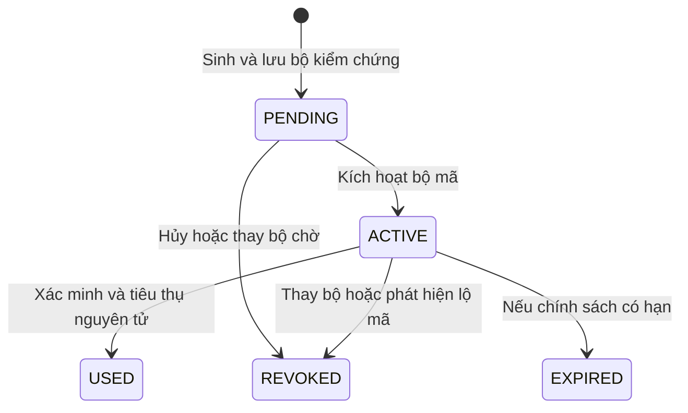

# Backup code storage — Lưu trữ mã dự phòng khôi phục tài khoản

## 1. Hai phía lưu trữ, hai loại dữ liệu khác nhau

**Backup code** là bí mật được cấp trước để người dùng sử dụng khi không còn phương tiện xác thực thông thường, chẳng hạn mất điện thoại chứa authenticator hoặc không dùng được passkey. Một mã thường chỉ được chấp nhận một lần, theo chính sách khôi phục của tài khoản.

“Lưu mã dự phòng” có hai nghĩa cần phân biệt:

- **Phía người dùng:** giữ bản mã rõ có thể đọc hoặc nhập khi cần khôi phục.
- **Phía máy chủ:** giữ giá trị kiểm chứng để xác nhận mã và trạng thái để ngăn dùng lại, không cần phục hồi mã rõ.

Nếu máy chủ lưu mã rõ để hỗ trợ “xem lại bất kỳ lúc nào”, một lần lộ dữ liệu có thể cung cấp ngay đường vượt qua MFA. Nếu người dùng chỉ lưu mã trong chính điện thoại sắp mất, họ có thể không còn cách đọc mã lúc cần nhất. Thiết kế phải giải quyết cả hai vấn đề.

Bài học tập trung vào nơi lưu, dạng dữ liệu lưu và tính nhất quán của trạng thái mã. Những quyết định này ảnh hưởng trực tiếp đến việc khôi phục an toàn khi mất mật khẩu, MFA, passkey hoặc thiết bị xác thực.

Một mã dự phòng hợp lệ là bằng chứng theo chính sách; nó không tự cho phép mọi hành động trên tài khoản. Ví dụ, quyền thay authenticator và quyền đổi địa chỉ khôi phục có thể cần các điều kiện khác nhau.

## 2. Hiểu đúng bí mật đang được cất giữ

Mã dự phòng đã lưu khác với OTP gửi qua SMS và TOTP trong ứng dụng:

| Loại bí mật | Cách sử dụng | Hệ quả về lưu trữ |
|---|---|---|
| Mã dự phòng cấp trước | Người dùng giữ lâu hơn để dùng khi mất yếu tố khác | Cần cất độc lập, bảo vệ như bí mật khôi phục và quản lý dùng một lần |
| OTP gửi khi có yêu cầu | Máy chủ phát hành cho một thử thách ngắn hạn | Cần hạn xác minh, giới hạn thử và trạng thái tiêu thụ |
| Seed TOTP | Ứng dụng và máy chủ dùng để tính nhiều mã theo thời gian | Bộ xác minh thông thường cần truy cập seed; không giống lưu hash từng mã dự phòng |
| Giá trị kiểm chứng mã dự phòng | Máy chủ dùng để kiểm tra mã người dùng nhập | Có thể lưu dưới dạng một chiều, không cần chức năng giải mã |

NIST SP 800-63B-4 mô tả *saved recovery codes* có ít nhất 64 bit ngẫu nhiên, được người dùng giữ an toàn để dùng sau này và được máy chủ lưu dưới dạng hash bằng hàm một chiều phù hợp. Chuẩn cũng yêu cầu vô hiệu mã đã dùng và cấp mã thay thế sau khi sử dụng. Cần đánh giá các điều kiện của chuẩn trong đúng phạm vi áp dụng. [NIST SP 800-63B-4, Saved Recovery Codes](https://pages.nist.gov/800-63-4/sp800-63b.html#saved-recovery-codes).

Bài này dùng một mô hình sản phẩm minh họa: mỗi bộ gồm nhiều mã độc lập, mỗi mã chứa 128 bit ngẫu nhiên. Số lượng mã và chính sách cấp bù là lựa chọn của sản phẩm; không suy ra rằng mọi chuẩn đều yêu cầu cùng số mã hoặc cùng cách thay toàn bộ bộ mã.

Người giữ bản mã rõ có thể sử dụng nó trước chủ tài khoản. Mã dự phòng không tự chứng minh thiết bị đang nhập là thiết bị gốc và không tự chống được trang giả mạo thu thập mã.

## 3. Bắt đầu từ mô hình đe dọa lưu trữ

| Sự cố | Dữ liệu hoặc quyền bị ảnh hưởng | Điều thiết kế cần ngăn |
|---|---|---|
| Lộ bảng mã dự phòng | Giá trị kiểm chứng và trạng thái | Không để kẻ lấy dữ liệu đọc ngay mã rõ hoặc đoán ngoại tuyến dễ dàng |
| Lộ log hoặc dữ liệu giám sát | Request, response hoặc nội dung hiển thị | Không biến công cụ quan sát thành kho mã rõ |
| Mất điện thoại | Ứng dụng xác thực và tệp lưu mã trên cùng máy | Người dùng vẫn có bản độc lập phù hợp |
| Lộ tài khoản lưu trữ đám mây | Ảnh chụp, ghi chú hoặc tệp mã | Hạn chế lộ đồng thời mọi đường khôi phục |
| Hai request dùng cùng mã | Trạng thái `ACTIVE` bị đọc đồng thời | Chỉ một request được tiêu thụ và nhận quyền đi tiếp |
| Khôi phục bản sao cơ sở dữ liệu cũ | Trạng thái trước khi dùng hoặc thu hồi mã | Không làm mã đã mất hiệu lực hoạt động trở lại |
| Nhân viên hỗ trợ bị lừa | Quyền cấp lại hoặc xuất dữ liệu | Không cho xuất mã cũ hay thay bộ mã chỉ dựa vào lời yêu cầu |

Mã hóa ổ đĩa hoặc mã hóa bản sao cơ sở dữ liệu giúp bảo vệ dữ liệu khi thiết bị lưu trữ bị lấy cắp. Nó không thay thế lưu giá trị kiểm chứng một chiều: một ứng dụng có quyền đọc bảng sau khi giải mã ổ đĩa vẫn đọc được các cột rõ nếu hệ thống đã lưu như vậy.

Kiểm soát quyền đọc bảng cũng không đủ nếu mã rõ xuất hiện ở bảng audit, hàng đợi sự kiện hoặc bản xuất dữ liệu dùng cho hỗ trợ. Phải theo dõi toàn bộ đường đi của bí mật từ lúc sinh tới lúc người dùng lưu lại.

## 4. Độ ngẫu nhiên và định dạng trước khi băm

Trong mô hình minh họa, máy chủ lấy 16 byte từ bộ sinh số ngẫu nhiên mật mã cho mỗi mã. Mười sáu byte tương ứng 128 bit; có thể biểu diễn thành 32 ký tự hex rồi chia nhóm để dễ đọc.

Ví dụ định dạng, không phải mã dùng thật:

```text
B7.03.F5A1-7C20-9D44-6E81-2A0B-8F39-C6D2-105E
│  │  └───────────────── phần bí mật 128 bit ─────────────────┘
│  └── chỉ mục mã trong bộ, không tính vào entropy bí mật
└───── nhãn tra cứu bộ, không phải bằng chứng xác thực
```

Các nhãn `B7` và `03` giúp máy chủ chọn bản ghi kiểm chứng sau khi đã xác định tài khoản. Chúng có thể công khai và không được tính như phần ngẫu nhiên bảo vệ mã. Độ dài chuỗi nhìn thấy không đồng nghĩa độ mạnh nếu nhiều ký tự chỉ là nhãn hoặc dấu phân cách.

Không sinh mã từ thời gian, số điện thoại, ID tài khoản hoặc chuỗi tăng dần. Base64, hex và các kiểu chia nhóm chỉ là mã hóa biểu diễn, không tạo thêm độ ngẫu nhiên.

Cần định nghĩa một dạng chuẩn trước khi lưu hoặc kiểm tra. Với ví dụ dùng hex, có thể cho phép chữ thường được chuyển thành chữ hoa và bỏ đúng các dấu gạch phân nhóm đã quy định. Sau đó yêu cầu chính xác 32 ký tự ASCII thuộc `0-9A-F` cho phần bí mật.

Không áp dụng cùng quy tắc cho mọi định dạng. Một mã Base64URL phân biệt chữ hoa và chữ thường không được chuyển hết thành chữ hoa. Không bỏ mọi ký tự lạ theo kiểu “cố sửa” đầu vào, vì có thể làm những chuỗi khác nhau biến thành cùng mã ngoài dự kiến.

Nếu có `m` mã độc lập cùng được chấp nhận cho một tài khoản và mỗi mã có `b` bit ngẫu nhiên, xác suất một lượt đoán trúng bất kỳ mã nào xấp xỉ `m / 2^b` khi `m` nhỏ so với không gian mã. Rate limit vẫn cần thiết để ngăn lạm dụng, còn một hash dài không thể bù cho phần bí mật vốn quá ngắn.

## 5. Máy chủ nên lưu gì?

### Lưu giá trị kiểm chứng một chiều cho từng mã

Một lựa chọn bảo thủ là dùng hàm dẫn xuất khóa dành cho bí mật cần kiểm chứng, với salt riêng và tham số đã được máy chủ phê duyệt:

```text
canonicalSecret = normalizeAccordingToFormat(userSecret)
salt            = randomBytes(16)
verifier        = KDF(canonicalSecret, salt, approvedParameters)
```

Ví dụ KDF có thể là PBKDF2-HMAC-SHA256 hoặc một phương án phù hợp với yêu cầu của hệ thống. Khi chọn thuật toán và tham số, cần xét chính sách mật mã, tài nguyên xác minh và khả năng chống lạm dụng; không nhận tên thuật toán hoặc số vòng lặp trực tiếp từ request của người dùng.

Salt được lưu cùng giá trị kiểm chứng. Salt không phải bí mật; nó giúp tách các phép kiểm chứng và hạn chế lợi ích của việc tính trước. Với mã có entropy thấp, chỉ thêm salt rồi dùng hash nhanh không làm không gian đoán trở nên lớn. OWASP giải thích vai trò khác nhau của salt và pepper trong lưu trữ bí mật. [OWASP Password Storage Cheat Sheet](https://cheatsheetseries.owasp.org/cheatsheets/Password_Storage_Cheat_Sheet.html#salting).

Với mã ngẫu nhiên đủ mạnh, entropy đóng vai trò quan trọng trong chống đoán ngoại tuyến. KDF không tạo thêm entropy nhưng cung cấp một chính sách lưu trữ nhất quán, đặc biệt khi hệ thống phải hỗ trợ hoặc di chuyển các định dạng cũ. Khi áp dụng một chuẩn cụ thể, thuật toán và tham số phải đáp ứng chuẩn đó; tên hàm trong ví dụ không tự chứng minh việc tuân thủ.

### Phân biệt các lớp bảo vệ

| Cơ chế | Bảo vệ chính | Giới hạn |
|---|---|---|
| Lưu mã rõ | Thuận tiện để đọc lại | Người đọc dữ liệu có ngay bí mật sử dụng được |
| Mã hóa đảo ngược mã | Bảo vệ trước người không có khóa giải mã | Ứng dụng hoặc người có khóa vẫn lấy lại mã; không cần thiết nếu chỉ xác minh |
| KDF với salt riêng | Lưu bộ kiểm chứng một chiều, tăng chi phí đoán | Không ngăn sử dụng mã rõ đã bị đánh cắp từ phía người dùng |
| Pepper hoặc HMAC với khóa tách biệt | Thêm rào cản khi chỉ cơ sở dữ liệu bị lộ | Phụ thuộc bảo vệ và vòng đời khóa; không thay giới hạn thử trực tuyến |
| Mã hóa ổ đĩa và bản sao lưu | Bảo vệ phương tiện lưu trữ | Không thay cấu trúc cột và kiểm soát truy cập trong ứng dụng |

Pepper là tùy chọn bổ sung cần được thiết kế đầy đủ. Không lưu pepper ngay cạnh hash rồi coi là một lớp bí mật độc lập. Nếu dùng khóa tách biệt, phải lưu phiên bản khóa, có kế hoạch thay khóa và xác định hệ thống phản ứng ra sao khi khóa không còn khả dụng.

Mã đã cấp mà không còn bản rõ thường không thể được tái băm với một chính sách mới nếu người dùng chưa nhập lại. Vì vậy, cập nhật thuật toán có thể cần hỗ trợ phiên bản kiểm chứng cũ trong giai đoạn giới hạn hoặc yêu cầu cấp bộ mã mới. Không tuyên bố đã “nâng cấp hash toàn bộ” chỉ bằng việc đổi nhãn thuật toán trong dữ liệu.

## 6. Mô hình dữ liệu: giá trị kiểm chứng đi cùng trạng thái

Một cấu trúc gồm bộ mã và từng mã giúp quản lý thay thế, sử dụng và thu hồi:

```text
BackupCodeSet
  id, tenantId, accountId
  generation, lookupLabel
  state, createdAt, activatedAt, revokedAt
  formatVersion, storagePolicyVersion

BackupCode
  id, setId, lookupIndex
  algorithm, algorithmParameters, salt, verifier
  state, createdAt, usedAt, revokedAt
  usedByRecoveryAttemptId
  version
```

Các điều kiện cần kiểm tra không dừng ở việc hash khớp:

```text
đúng tenant và tài khoản
bộ mã thuộc thế hệ còn được phép dùng
bộ mã đang ACTIVE
mã đang ACTIVE và chưa tiêu thụ
chính sách thời hạn, nếu có, còn đáp ứng
ngân sách thử và điều kiện khôi phục vẫn đạt
```

Mỗi mã cần salt riêng. Không lưu một chuỗi chứa cả bộ mã rõ rồi mã hóa chung chỉ để giao diện có thể hiển thị lại.

Nên có ràng buộc duy nhất cho nhãn tra cứu trong phạm vi cần thiết và cho chỉ mục mã trong một bộ. Khi sản phẩm chỉ cho phép một bộ hoạt động, cần ràng buộc hoặc giao dịch bảo đảm điều đó, không chỉ kiểm tra bằng giao diện.

Một mã có thể đi qua vòng đời:



Trong mô hình này, `USED`, `REVOKED` và `EXPIRED` không trở lại `ACTIVE`. Trạng thái thu hồi của bộ mã cũng phải vô hiệu mọi mã bên trong, kể cả một hàng con còn ghi `ACTIVE` do chưa được cập nhật riêng.

Thông tin như số mã còn lại hoặc ngày cấp gần nhất có thể cung cấp trong trang bảo mật sau khi kiểm tra quyền. API công khai không nên trả các chi tiết đó để người lạ dò tài khoản hoặc tình trạng khôi phục.

## 7. Chỉ hiển thị mã rõ ở thời điểm cấp

Cấp hoặc thay bộ mã là thao tác nhạy cảm. Người dùng cần xác thực lại hoặc có quyền khôi phục phù hợp; không chỉ dựa vào việc có một session đang mở. OWASP coi thay yếu tố xác thực là thao tác rủi ro cao và khuyến cáo kiểm tra lại quyền thay đổi. [OWASP MFA Cheat Sheet, Changing MFA Factors](https://cheatsheetseries.owasp.org/cheatsheets/Multifactor_Authentication_Cheat_Sheet.html#changing-mfa-factors).

Một luồng cấp mã có thể thực hiện như sau:

1. Máy chủ kiểm tra quyền cấp mã cho đúng tài khoản và mục đích.
2. Sinh các mã ngẫu nhiên trong bộ nhớ, chuẩn hóa và tạo bộ kiểm chứng riêng.
3. Lưu bộ mã chờ và các bộ kiểm chứng, không lưu danh sách mã rõ.
4. Trả mã rõ một lần qua HTTPS cho phiên đã được phép, kèm lựa chọn in hoặc tải xuống chủ động.
5. Kích hoạt bộ mới theo quy trình của sản phẩm và thu hồi bộ trước một cách nhất quán.
6. Gửi thông báo đã thay bộ mã, không đưa các mã vào thông báo.

Cần phân biệt người dùng đã bấm “tôi đã lưu” với việc hệ thống chứng minh họ có bản sao an toàn. Một checkbox chỉ ghi nhận xác nhận của người dùng; nó không bảo đảm bản in không bị mất hoặc tệp tải xuống đã được mã hóa.

Nếu giữ bộ cũ hoạt động trong khi bộ mới đang chờ, phải giới hạn số bộ chờ và thời hạn của chúng. Khi bộ mới được kích hoạt, mã cũ không được tiếp tục dùng chỉ vì bản ghi cũ vẫn còn trong cơ sở dữ liệu. Nếu bộ cũ đã bị nghi lộ, quyết định thu hồi có thể phải diễn ra sớm hơn, đồng thời giữ luồng khôi phục phù hợp cho chủ tài khoản.

### Nếu phản hồi chứa mã bị mất thì sao?

Máy chủ chỉ còn bộ kiểm chứng một chiều nên không thể hiển thị lại chính những mã cũ từ hash. Có thể cho người dùng yêu cầu bộ mới sau khi kiểm tra quyền, thu hồi bộ chờ trước và cập nhật thế hệ tương ứng.

Không giải quyết retry bằng cách vô tình lưu toàn bộ response chứa mã vào kho idempotency lâu dài. Idempotency có thể trả trạng thái đã tạo bộ và hướng dẫn cấp lại theo chính sách; nó không bắt buộc hệ thống giữ mã rõ để phát lại.

Nếu sản phẩm chủ động thiết kế cơ chế phát lại response bí mật trong thời gian ngắn, đó là một kho bí mật riêng với mã hóa, kiểm soát truy cập, hạn và xóa dữ liệu cần được đánh giá rõ. Không mặc nhiên coi cache response là dữ liệu không nhạy cảm. Mô hình đơn giản của bài không dùng kho phát lại mã rõ đó.

Trang hiển thị mã cần hạn chế cache, analytics, công cụ ghi lại phiên và tài nguyên bên thứ ba. Cơ chế in hoặc tải xuống phải xuất phát từ hành động người dùng; thông báo bảo mật chỉ nêu sự kiện, không chứa các mã.

## 8. Người dùng nên cất bản mã rõ ở đâu?

Không có nơi cất giữ nào phù hợp tuyệt đối cho mọi người. Hai tiêu chí chính là **khó bị người khác lấy được** và **vẫn truy cập được khi yếu tố chính bị mất**.

| Nơi lưu | Lợi ích | Điều cần cân nhắc |
|---|---|---|
| Bản in hoặc ghi chép trong nơi cất an toàn | Độc lập với điện thoại và tài khoản đám mây | Nguy cơ bị đọc, thất lạc, cháy hoặc hỏng; quản lý bản sao và bản cũ |
| Trình quản lý mật khẩu có mã hóa | Dễ tổ chức và bảo vệ truy cập | Phải còn cách mở kho khi mất thiết bị hoặc MFA đang cần khôi phục |
| Tệp mã hóa với cơ chế mở khóa độc lập | Có thể tạo bản sao chủ động | Cần quản lý khóa, bản sao, thiết bị đọc và khả năng phục hồi |
| Ảnh chụp màn hình đồng bộ tự động | Dễ tạo và tìm lại | Có thể lộ qua thư viện ảnh, tài khoản đám mây, thiết bị chia sẻ hoặc bản sao lâu dài |
| Email hoặc ghi chú không được bảo vệ phù hợp | Thuận tiện | Dễ lộ đồng thời với kênh khôi phục hoặc dữ liệu đồng bộ khác |
| Chỉ lưu trên điện thoại chứa authenticator | Ít thao tác | Mất máy có thể làm mất cả yếu tố chính và bản dự phòng |

Một hướng dẫn có ích là kiểm tra bằng tình huống: “Nếu mất điện thoại ngay bây giờ, tôi có còn đọc được mã này mà không cần chính authenticator trên điện thoại đó không?”

Nếu lưu mã trong trình quản lý mật khẩu, cần hiểu mô hình rủi ro. Lưu mật khẩu và mã dự phòng cùng một kho có thể thuận tiện, nhưng người chiếm quyền mở kho có thể lấy cả hai. Kho cũng không nên có một vòng phụ thuộc khiến việc mở nó bắt buộc dùng yếu tố vừa mất mà không có phương án khác.

Có thể giữ hơn một bản sao để chống mất dữ liệu, nhưng mỗi bản bổ sung cũng mở thêm nơi có thể bị lộ. Chỉ tạo số bản cần thiết, biết chúng ở đâu và thay hoặc hủy những bản chứa bộ mã đã bị thu hồi.

Không đưa mã vào repository, issue, tài liệu dùng chung hoặc tin nhắn hỗ trợ. Nhân viên hỗ trợ không cần biết mã để giải thích cách dùng. Người dùng chỉ nhập mã vào trang hoặc ứng dụng chính thức trong luồng khôi phục mà họ đã bắt đầu.

Sau khi dùng một mã, người dùng có thể đánh dấu nó đã dùng trên bản cất giữ để tránh nhập nhầm. Tuy nhiên, máy chủ vẫn phải thực thi dùng một lần; việc đánh dấu trên giấy không phải cơ chế bảo mật của hệ thống.

## 9. Minh họa lưu bộ kiểm chứng bằng Java

Đoạn mã sau dành cho Java 17 trở lên. Nó minh họa sinh phần bí mật 128 bit, tạo salt và dẫn xuất giá trị kiểm chứng. Tham số số vòng lặp phải lấy từ cấu hình máy chủ đã được đánh giá, không lấy từ request.

```java
import java.security.GeneralSecurityException;
import java.security.MessageDigest;
import java.security.SecureRandom;
import java.util.HexFormat;
import javax.crypto.SecretKeyFactory;
import javax.crypto.spec.PBEKeySpec;

public final class BackupCodeStorageExample {
    private final SecureRandom random = new SecureRandom();

    public String newCanonicalSecret() {
        byte[] bytes = new byte[16];
        random.nextBytes(bytes);
        return HexFormat.of().withUpperCase().formatHex(bytes);
    }

    public byte[] newSalt() {
        byte[] salt = new byte[16];
        random.nextBytes(salt);
        return salt;
    }

    public byte[] deriveVerifier(
            char[] canonicalSecret,
            byte[] salt,
            int approvedIterations) throws GeneralSecurityException {
        if (approvedIterations <= 0 || salt.length != 16) {
            throw new IllegalArgumentException("Invalid storage parameters");
        }

        PBEKeySpec spec = new PBEKeySpec(
                canonicalSecret, salt, approvedIterations, 256);
        try {
            return SecretKeyFactory.getInstance("PBKDF2WithHmacSHA256")
                    .generateSecret(spec)
                    .getEncoded();
        } finally {
            spec.clearPassword();
        }
    }

    public boolean sameVerifier(byte[] stored, byte[] candidate) {
        return MessageDigest.isEqual(stored, candidate);
    }
}
```

Đầu ra 256 bit của KDF không làm phần bí mật 128 bit trở thành bí mật 256 bit. Giá trị `approvedIterations > 0` trong ví dụ chỉ là kiểm tra dữ liệu cơ bản; hệ thống thật phải kiểm tra tham số với danh sách phiên bản chính sách và mức chi phí cho phép. Một vòng lặp duy nhất không phải cấu hình bảo vệ hợp lý.

Chuẩn hóa và giới hạn độ dài đầu vào phải xảy ra trước phép dẫn xuất tốn tài nguyên. `sameVerifier` không kiểm tra mã đã dùng, bộ đã thu hồi hoặc quyền của người gọi. Đoạn mã cũng không tạo giao dịch tiêu thụ mã.

`PBEKeySpec.clearPassword()` xóa bản sao mật khẩu trong đối tượng đó; nó không bảo đảm mọi bản sao mã đã biến mất khỏi bộ nhớ JVM. Chuỗi `String`, request buffer và response vẫn có thể giữ dữ liệu. Cần giảm thời gian giữ bản rõ, tránh log và xóa các mảng ký tự tạm khi không còn cần, trong giới hạn của nền tảng quản lý bộ nhớ.

## 10. Trạng thái dùng một lần phải được lưu nguyên tử

Lưu hash tốt nhưng cập nhật trạng thái sai vẫn cho phép cùng mã mở nhiều luồng khôi phục. Một lỗi phổ biến là đọc `ACTIVE`, kiểm tra mã, cấp token rồi mới đánh dấu `USED`.

Một cách xử lý có thể là:

```text
redeemBackupCode(flowCredential, submittedCode):
    kiểm tra ràng buộc luồng, định dạng và hạn mức nguồn yêu cầu
    xác định account và tenant từ ngữ cảnh máy chủ
    phân tích nhãn bộ, chỉ mục và phần bí mật theo formatVersion
    lấy đúng bản ghi kiểm chứng trong phạm vi tài khoản
    áp dụng chính sách chống đoán và giới hạn tài nguyên KDF
    tính candidateVerifier bằng salt và tham số đã lưu, được cho phép

    bắt đầu giao dịch
    khóa trạng thái tài khoản, bộ mã và mã theo thứ tự thống nhất
    xác nhận lại phiên bản cùng dữ liệu đã dùng để kiểm chứng
    kiểm tra bộ đang ACTIVE, đúng thế hệ, mã chưa dùng hoặc thu hồi
    kiểm tra lại quyền luồng và chính sách khôi phục

    nếu kiểm chứng không khớp:
        tăng và lưu bộ đếm thất bại trước khi trả lỗi
        không cấp quyền đi tiếp

    chuyển mã ACTIVE → USED
    ghi usedAt và recoveryAttemptId
    tạo quyền khôi phục đúng phạm vi trong cùng giao dịch
    lưu sự kiện thông báo không chứa mã
    commit
    trả quyền đã được commit
```

Khi KDF chạy ngoài giao dịch để tránh giữ khóa lâu, phải kiểm tra lại bản ghi, thuật toán, salt, giá trị kiểm chứng, thế hệ và trạng thái chưa thay đổi trước cập nhật. Nếu bộ mã bị thu hồi trong lúc tính KDF, kết quả vừa tính không được vượt qua quyết định thu hồi.

Có thể dùng cập nhật có điều kiện hoặc cơ chế khóa phù hợp để chỉ một request thắng. Quyền đi tiếp không được phát hành nếu thao tác đổi trạng thái không thành công. Các node không nên xác minh trạng thái tiêu thụ từ replica bị trễ rồi độc lập cấp quyền.

Nếu commit thành công nhưng phản hồi bị mất, request lặp không được tiêu thụ lại mã hoặc cấp thêm quyền. Hệ thống có thể trả kết quả đã lưu cho cùng yêu cầu và cùng ràng buộc luồng theo cơ chế idempotency được thiết kế rõ.

Ngân sách thử theo tài khoản phải tồn tại ngoài một lần mở form, để việc bắt đầu lại luồng không đặt lại khả năng đoán mã. Hạn mức nguồn và số tác vụ KDF đồng thời cũng cần được kiểm soát để endpoint không trở thành công cụ làm cạn tài nguyên.

## 11. Bản sao lưu cơ sở dữ liệu không được làm mã sống lại

Đây là rủi ro lưu trữ dễ bị bỏ sót. Xét dòng thời gian:

```text
08:00  Snapshot ghi mã C còn ACTIVE trong bộ thế hệ 7.
09:00  Người dùng dùng C; hệ thống ghi USED.
10:00  Người dùng thay bộ mã, thế hệ 7 bị thu hồi.
11:00  Sự cố dữ liệu; khôi phục snapshot lúc 08:00.
```

Nếu hệ thống tin hoàn toàn snapshot vừa khôi phục, C lại có vẻ đang `ACTIVE`. Việc snapshot chỉ chứa hash không ngăn người đang giữ mã rõ C sử dụng lại.

Dữ liệu cần được đối chiếu sau phục hồi gồm trạng thái mã đã dùng, sự kiện thu hồi, thế hệ bộ đang được phép và các quyền khôi phục đã cấp. Chỉ thêm một cột `generation` không đủ nếu chính cột đó cũng bị đưa về giá trị cũ cùng snapshot.

Hai hướng thiết kế có thể cân nhắc:

- Khôi phục và đối chiếu với nguồn trạng thái sử dụng hoặc thu hồi có tính thẩm quyền, được bảo vệ khỏi cùng lần rollback và có cơ chế bảo đảm tính đầy đủ.
- Nếu không chứng minh được trạng thái hiện tại, tạm vô hiệu khả năng dùng các bộ mã từ dữ liệu phục hồi, rồi cấp lại qua phương thức xác thực hoặc khôi phục khác phù hợp.

Một audit log thông thường chỉ giúp nếu nó có đủ sự kiện, tính toàn vẹn và khả năng xác định những phần bị thiếu. Không coi một log rời rạc hoặc sự kiện chưa được ghi nhất quán là nguồn thu hồi hoàn chỉnh.

Quy trình phục hồi nên chặn endpoint liên quan cho đến khi đối chiếu trạng thái bảo mật hoàn tất. Không mở dịch vụ trước rồi hy vọng job nền sẽ sớm thu hồi lại những mã đã dùng.

Các bản sao dữ liệu vẫn cần mã hóa, kiểm soát người đọc, quản lý khóa, thời hạn lưu và kiểm tra quy trình phục hồi. Khi xóa verifier đã dùng theo chính sách lưu trữ, có thể vẫn cần dấu vết không chứa bí mật để ngăn chấp nhận lại trạng thái cũ. Thời hạn giữ dấu vết phải được thiết kế cùng vòng đời snapshot.

## 12. Thay bộ mã, mất mã và nghi ngờ bị lộ

Nếu người dùng làm mất bản mã rõ nhưng máy chủ chỉ giữ giá trị một chiều, hỗ trợ không thể đọc lại mã cũ. Người dùng cần xác thực bằng phương tiện còn dùng được hoặc hoàn tất chính sách khôi phục khác để cấp bộ mới.

Nếu nghi người khác đã nhìn thấy bộ mã, chỉ đánh dấu một mã vừa dùng là không đủ. Có thể cần thu hồi toàn bộ bộ bị lộ, cấp bộ mới sau khi kiểm tra quyền và đánh giá các lần khôi phục hoặc session phát sinh từ bộ đó.

Việc thay bộ phải xử lý đồng thời với redeem. Nếu giao dịch thu hồi bộ đã thắng, một request đang dùng mã của bộ cũ không được tiếp tục cấp quyền mới. Nếu một mã đã được tiêu thụ trước quyết định thu hồi, quyền khôi phục sinh ra từ nó cũng cần được đánh giá hoặc thu hồi theo chính sách sự cố.

Cấp bộ mới không tự xóa bản in, ảnh chụp hoặc tệp tải xuống cũ trên thiết bị người dùng. Những bản đó cần được nhận diện là không còn hiệu lực và xử lý phù hợp. Máy chủ vẫn là nơi quyết định bộ nào được chấp nhận.

Sau một lần khôi phục có rủi ro, cần xem xét session, refresh token, thiết bị ghi nhớ và các yếu tố xác thực liên quan. Lưu mã dự phòng an toàn không thay thế khả năng kiểm soát những quyền đã được cấp từ trước.

## 13. Những đường rò rỉ phải được loại bỏ

| Đường rò rỉ | Cách xử lý trong thiết kế |
|---|---|
| Log request hoặc response | Che trường mã; tránh ghi cả payload chứa bí mật |
| Analytics và công cụ ghi lại phiên | Loại trừ trang hiển thị cùng trường nhập mã |
| Cache phía trình duyệt hoặc service worker | Không lưu phản hồi nhạy cảm; kiểm tra chính sách cache thực tế |
| Thông báo email hoặc push | Chỉ nêu sự kiện, không gửi danh sách mã |
| Đối tượng lỗi, trace hoặc debug dump | Không gắn mã rõ làm metadata; kiểm soát dữ liệu chẩn đoán |
| Tệp xuất hoặc tài liệu hỗ trợ | Chỉ xuất metadata được phép, không có chức năng xuất mã cũ |
| Idempotency store | Không giữ response mã rõ ngoài mô hình bí mật đã được phê duyệt |
| Môi trường thử nghiệm và dữ liệu sao chép | Dùng mã thử tổng hợp, không sao chép bí mật vận hành để tiện kiểm tra |

Các giá trị kiểm chứng cũng không cần xuất hiện trong log. Hạn chế người có quyền truy cập, vì verifier có thể cho phép thử đoán ngoại tuyến và metadata có thể tiết lộ hành vi tài khoản.

Theo dõi các sự kiện như cấp bộ mới, thu hồi, sử dụng thành công, thất bại xác minh và đối chiếu sau phục hồi dữ liệu. Dùng định danh nội bộ cùng mã lý do, không dùng mã rõ hoặc hash của mã làm nhãn metric có số lượng giá trị không giới hạn.

## 14. Các tình huống cần kiểm chứng

| Tình huống | Kết quả mong đợi |
|---|---|
| Người đọc bảng dữ liệu mã dự phòng | Không nhìn thấy mã rõ hoặc có API giải mã để xem lại |
| Hai mã được cấp độc lập | Có bí mật ngẫu nhiên riêng và salt riêng |
| Người dùng yêu cầu xem lại sau khi đã đóng trang cấp mã | Chỉ thấy metadata; cấp lại theo quyền phù hợp nếu cần |
| Phản hồi cấp mã bị mất | Không phát lại mã từ hash; không âm thầm lưu response rõ để retry |
| Người dùng nhập đúng mã đã dùng | Từ chối |
| Hai request đồng thời nhập cùng mã còn hoạt động | Tối đa một tác động tiêu thụ và cấp quyền mới |
| Bộ mã bị thu hồi trong lúc KDF đang chạy | Kiểm tra trạng thái cuối từ chối cấp quyền qua bộ đó |
| Mã của tenant hoặc tài khoản khác | Không được kiểm tra thành công ngoài phạm vi ràng buộc |
| Người dùng mất điện thoại chứa authenticator | Bản cất giữ độc lập vẫn có thể truy cập theo phương án đã chọn |
| Bộ cũ còn trong snapshot sau khi bị thay | Không được hoạt động trở lại chỉ vì snapshot được phục hồi |
| Chỉ mục mã đúng nhưng phần bí mật sai | Không cấp quyền; lưu thất bại theo chính sách |
| Đầu vào sai định dạng hoặc quá dài | Bị giới hạn trước khi thực hiện KDF tốn tài nguyên |
| Client tự yêu cầu thuật toán yếu hoặc số vòng lặp thấp | Không thay đổi chính sách lưu trữ hoặc xác minh máy chủ |
| Người dùng không còn mã và yếu tố khác | Đi qua phương án khôi phục được phép, hỗ trợ không xuất lại mã cũ |

Thiết kế lưu trữ mã dự phòng cần giữ rõ ba sự thật: bản mã rõ thuộc nơi cất giữ có chủ đích của người dùng, máy chủ chỉ cần bộ kiểm chứng phù hợp và trạng thái dùng một lần phải được bảo toàn qua retry, thay bộ lẫn phục hồi dữ liệu. Khi một trong ba phần này bị bỏ sót, đường khôi phục có thể trở thành đường chiếm đoạt tài khoản.
