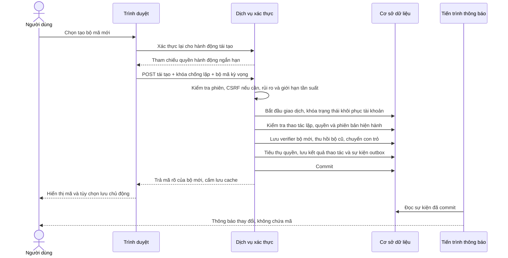

# Tái tạo mã dự phòng khôi phục tài khoản

## 1. Tái tạo mã dự phòng giải quyết vấn đề gì?

Trong chương **Backup Code Recovery**, mã dự phòng là bí mật được cấp trước để người dùng có thể xác thực khi mất một phương thức thông thường, chẳng hạn điện thoại chứa ứng dụng MFA hoặc thiết bị giữ passkey. Mỗi mã chỉ được sử dụng một lần theo chính sách xác thực của hệ thống.

**Tái tạo mã dự phòng — backup code regeneration — là thay bộ mã đang có bằng một bộ mã mới và vô hiệu hóa toàn bộ mã còn lại của bộ cũ.** Đây là thao tác thay đổi thông tin xác thực, không đơn thuần là tải lại một tệp.

Trong phạm vi `SECURITY_AUTHENTICATION_ACCOUNT_RECOVERY`, luồng này phải bảo vệ tài khoản cả khi người dùng mất mật khẩu, MFA, passkey hoặc thiết bị xác thực. Điều cần thiết là phân biệt hai việc: xác minh người yêu cầu có quyền thay mã, và thực hiện việc thay mã một cách nhất quán. Một giao dịch cơ sở dữ liệu hoàn hảo vẫn có thể phục vụ kẻ tấn công nếu bước xác minh đầu vào quá yếu.

Ví dụ, Lan còn ba mã trong bộ cũ và vừa dùng một mã để đăng nhập sau khi mất điện thoại. Khi tạo bộ mới gồm mười mã, hệ thống phải hủy hiệu lực hai mã cũ chưa dùng. Nếu cả hai bộ tiếp tục hoạt động, một bản sao bộ cũ bị lộ vẫn cho phép người khác khôi phục tài khoản.

Các tình huống thường cần tái tạo:

- Người dùng đã sử dụng gần hết hoặc hết mã dự phòng.
- Người dùng làm mất bản in, mất tệp lưu mã hoặc nghi ngờ có người đã sao chép mã.
- Người dùng đã xử lý sự cố mất thiết bị và muốn thay các bí mật khôi phục có thể bị lộ.
- Chính sách bảo mật yêu cầu thay bộ mã sau một lần khôi phục có rủi ro cao.

Sau bài này, người học có thể thiết kế điều kiện cho phép tái tạo, lưu trữ bộ mã, chuyển bộ mã bằng giao dịch nguyên tử, xử lý yêu cầu lặp và xác định tác động tới các phiên đăng nhập.

## 2. Phân biệt sử dụng, xem và tái tạo mã

| Thao tác | Kết quả | Điều kiện bảo mật cần chú ý |
|---|---|---|
| Sử dụng một mã dự phòng | Tiêu thụ một mã của bộ đang hoạt động | Kiểm tra mã đúng, chưa dùng, thuộc bộ hiện hành; đánh dấu dùng một lần một cách nguyên tử |
| Xem số mã còn lại | Hiển thị số lượng, không hiển thị bí mật | Lấy số liệu từ bộ đang hoạt động và kiểm tra quyền của chủ tài khoản |
| Xem lại toàn bộ mã đã cấp | Cần hệ thống còn giữ bí mật hoặc bản có thể giải mã | Không có sẵn trong thiết kế chỉ lưu giá trị kiểm chứng |
| Tái tạo bộ mã | Cấp bộ mới, hủy hiệu lực bộ cũ | Xác thực lại, kiểm soát rủi ro, chuyển bộ nguyên tử và thông báo thay đổi |
| Khôi phục khi mất mọi yếu tố | Xác minh lại quyền sở hữu tài khoản qua quy trình khác | Không được dùng nút tái tạo để bỏ qua quy trình khôi phục danh tính |

Thiết kế trong bài chỉ lưu giá trị kiểm chứng của mã ở phía máy chủ và cung cấp mã rõ cho trình duyệt trong phản hồi cấp mã ban đầu. Vì vậy, giao diện quản lý không có chức năng đọc lại bộ mã cũ. Người dùng đã mất bản lưu phải đi qua thao tác tái tạo có xác thực lại.

Tái tạo mã cũng không mặc nhiên đặt lại mật khẩu, đăng ký passkey mới, thay email khôi phục hoặc kết thúc mọi phiên đăng nhập. Những hành động đó có điều kiện và phạm vi thu hồi riêng, cần được phối hợp khi xử lý sự cố.

## 3. Mô hình đe dọa và các bất biến

### 3.1. Kẻ tấn công có thể đã có một phần quyền truy cập

Không chỉ xem xét người chưa đăng nhập đoán mã. Những trường hợp đáng lo hơn gồm:

1. Kẻ tấn công chiếm được cookie phiên nhưng chưa kiểm soát yếu tố xác thực mạnh.
2. Một mã dự phòng bị sao chép từ ảnh chụp hoặc bản in.
3. Kẻ tấn công dùng mã đó khôi phục tài khoản, rồi tái tạo để loại chủ tài khoản khỏi bộ mã cũ.
4. Một yêu cầu tái tạo bị gửi hai lần do người dùng bấm lại, proxy gửi lại hoặc mất kết nối.
5. Hai thiết bị cùng tái tạo, hoặc một yêu cầu dùng mã chạy đồng thời với yêu cầu tái tạo.
6. Mã rõ lọt vào log, công cụ phân tích giao diện, email, bộ nhớ đệm hoặc hệ thống hỗ trợ.

### 3.2. Những điều hệ thống phải luôn giữ đúng

- Một tài khoản chỉ có một bộ mã đang hoạt động tại một thời điểm theo mô hình chính của bài.
- Chỉ mã thuộc bộ đang hoạt động mới được chấp nhận; kiểm tra riêng trường `consumed_at` là chưa đủ.
- Một mã không tạo ra hai lần xác thực thành công, kể cả khi có yêu cầu đồng thời.
- Chuyển sang bộ mới và hủy bộ cũ cùng thành công hoặc cùng thất bại trong giao dịch tái tạo.
- Chỉ phiên và bằng chứng xác thực được chính sách cho phép mới có quyền tái tạo.
- Gửi lại cùng một yêu cầu đã hoàn tất không tạo thêm bộ mã.
- Mã rõ không đi vào kho lưu trữ lâu dài phía máy chủ, log hoặc thông báo bảo mật trong thiết kế này.

Ngoài ra, hệ thống phải xác định rõ thời điểm việc xác thực bằng mã được coi là hoàn tất. Nếu chỉ kiểm tra mã rồi phát hành phiên ở một bước sau mà không kiểm tra lại phiên bản khôi phục, một kết quả kiểm tra cũ có thể được sử dụng sau khi bộ mã đã bị thu hồi.

## 4. Ai được phép tái tạo?

### 4.1. Có phiên đăng nhập chưa đủ

Thao tác tái tạo cần một lần **xác thực lại cho hành động nhạy cảm**, thường được gọi là step-up authentication. Máy chủ kiểm tra độ mới, phương thức xác thực, mức rủi ro và phạm vi hành động được cấp. Việc nhập lại mật khẩu có phù hợp hay không phụ thuộc loại tài khoản và chính sách; tài khoản dùng passkey không nên bị ép tạo một mật khẩu chỉ để sử dụng chức năng này.

| Trạng thái của người dùng | Cách xử lý phù hợp |
|---|---|
| Còn phương thức mạnh đã đăng ký, phiên hoạt động bình thường | Yêu cầu xác thực lại bằng phương thức đủ mạnh, sau đó cấp quyền tái tạo ngắn hạn |
| Vừa đăng nhập bằng mã dự phòng | Giữ ngữ cảnh phiên khôi phục; áp dụng chính sách riêng trước khi cho thay thông tin xác thực |
| Còn mật khẩu nhưng mất MFA và hết mã | Chuyển sang quy trình khôi phục đã được thiết kế cho trường hợp mất MFA |
| Mất mọi phương thức, chỉ cung cấp email hoặc tên tài khoản | Không cho tái tạo trực tiếp; cần quy trình xác minh danh tính riêng |
| Có dấu hiệu chiếm đoạt hoặc vừa đổi kênh khôi phục | Tăng mức xác minh, trì hoãn hành động hoặc xử lý qua luồng hỗ trợ có kiểm soát |

Không có quy tắc chung rằng mọi phiên khôi phục đều bị cấm tái tạo. Nếu hệ thống cho phép dùng mã dự phòng cuối cùng để tiếp tục thiết lập lại khả năng truy cập, chính sách phải nêu rõ bằng chứng bổ sung, giới hạn của phiên, thời gian chờ nếu có và cách thông báo cho chủ tài khoản. Không tự coi việc vừa dùng một mã dự phòng là đã đáp ứng mọi yêu cầu thay đổi bảo mật.

### 4.2. Quyền hành động ngắn hạn

Sau khi xác thực lại, máy chủ có thể tạo một bản ghi cấp quyền hành động với các thuộc tính:

```text
action_grant:
  account_id
  session_id
  action = REGENERATE_BACKUP_CODES
  authenticated_at
  authentication_method
  recovery_version
  expected_generation_id
  expires_at
  consumed_at
```

Đây là mô hình dữ liệu minh họa, không phải yêu cầu gửi toàn bộ thông tin cho trình duyệt. Trình duyệt chỉ cần một tham chiếu không đoán được; máy chủ giữ và kiểm tra dữ liệu có thẩm quyền.

Quyền phải gắn với đúng tài khoản, đúng phiên, đúng hành động và bộ mã hoặc phiên bản khôi phục đã được xác thực. Quyền hết hạn, đã dùng, bị thu hồi hoặc được cấp trước một thay đổi bảo mật liên quan phải bị từ chối. Nếu dùng token tự chứa, vẫn cần cơ chế phía máy chủ để thực thi tính dùng một lần và thu hồi khi cần.

Nếu một mã dự phòng được dùng để lấy quyền hành động này, bước tiêu thụ mã và cấp quyền phải được bảo vệ bằng giao dịch thích hợp. Khi người dùng bỏ dở trước bước tái tạo, mã đã tiêu thụ không được tự động sống lại. Giao diện nên giúp người dùng hiểu rằng xác thực bằng mã là một lần sử dụng thực sự.

### 4.3. Không tạo vòng phụ thuộc không thể hoàn thành

Một thiết kế yêu cầu MFA đã mất để tạo lại mã dự phòng sẽ làm người dùng mắc kẹt. Cách giải quyết là có luồng khôi phục phù hợp với mức rủi ro, không phải bỏ mọi yêu cầu xác minh ở endpoint tái tạo.

Nhân viên hỗ trợ cũng không nên đọc hoặc gửi bộ mã đang có. Nếu hỗ trợ tham gia khôi phục, cần cơ chế phân quyền và xác minh riêng; sau khi người dùng lấy lại quyền truy cập, họ mới nhận bộ mã mới qua luồng được kiểm soát.

## 5. Sinh mã và lưu giá trị kiểm chứng

### 5.1. Sinh bí mật độc lập

Mã phải được sinh bằng bộ sinh số ngẫu nhiên mật mã. Không suy ra mã từ email, thời gian, số thứ tự tài khoản, mã cũ hay bộ sinh ngẫu nhiên phục vụ mô phỏng.

Một cấu hình minh họa là mười mã, mỗi mã lấy từ 128 bit ngẫu nhiên rồi mã hóa thành chuỗi dễ lưu. Số mã và độ dài này là lựa chọn thiết kế của ví dụ, không phải một ngưỡng bắt buộc cho mọi sản phẩm. Nhóm ký tự bằng dấu gạch nối giúp người dùng đọc và nhập, nhưng không bổ sung entropy. Không đưa một phần entropy vào tiền tố cố định rồi vẫn tính tiền tố đó như dữ liệu ngẫu nhiên.

Các mã trong một bộ cần khác nhau. Nếu bộ sinh ngẫu nhiên báo lỗi, thao tác phải thất bại; không thay bằng một nguồn ngẫu nhiên yếu hơn. Hệ thống không thể biết người dùng còn giữ bao nhiêu bản in hoặc bản sao, vì vậy khi thay bộ phải thu hồi cả bộ cũ.

### 5.2. Không lưu mã rõ như mật khẩu có thể xem lại

Với mã có entropy cao như ví dụ trên, có thể lưu giá trị kiểm chứng bằng HMAC với khóa máy chủ được quản lý tách khỏi cơ sở dữ liệu:

```text
verifier = HMAC-SHA-256(
    server_key[key_id],
    encode(
        "backup-recovery-code:v1",
        tenant_id,
        account_id,
        generation_id,
        canonical_code
    )
)
```

`encode` phải có định dạng xác định và phân định từng trường rõ ràng, chẳng hạn cấu trúc nhị phân có độ dài từng trường. Không nối chuỗi tùy ý bằng một dấu phân cách có thể xuất hiện trong dữ liệu.

Ràng buộc theo tài khoản và bộ mã giúp tránh nhầm phạm vi kiểm tra. `key_id` cho phép xác định khóa cần dùng; không lưu khóa bí mật cùng hàng chứa verifier. Việc đổi khóa phải có kế hoạch cho những bộ mã còn hiệu lực: giữ khóa kiểm chứng cũ trong thời gian phù hợp hoặc yêu cầu cấp lại có kiểm soát. Không thể tính verifier mới từ verifier cũ khi không có mã rõ.

HMAC không làm mã ngắn, dễ đoán trở nên an toàn. Nếu dùng mã có ít entropy, cần đánh giá lại thiết kế lưu trữ, khả năng dò khi dữ liệu bị lộ và chính sách giới hạn thử. Không dùng ví dụ trên để biện minh cho mã chỉ gồm vài chữ số.

Chuẩn hóa mã theo một quy tắc duy nhất ở cả lúc cấp và lúc kiểm tra. Có thể cho phép bỏ các dấu gạch nối do giao diện thêm vào hoặc không phân biệt hoa thường nếu bảng chữ cái hỗ trợ điều đó. Không tự ý chuyển các ký tự Unicode trông giống nhau, cắt bớt mã hoặc chấp nhận nhiều cách diễn giải mơ hồ.

### 5.3. Dữ liệu tối thiểu

| Thực thể | Trường chính | Vai trò |
|---|---|---|
| `recovery_state` | `account_id`, `active_generation_id`, `recovery_version` | Điểm điều phối bộ hiện hành và khóa đồng thời theo tài khoản |
| `recovery_generation` | `id`, `account_id`, `status`, `created_at`, `revoked_at`, `key_id` | Theo dõi vòng đời một bộ mã |
| `recovery_code` | `generation_id`, `verifier`, `consumed_at` | Kiểm tra và tiêu thụ từng mã |
| `action_grant` | Chủ thể, phiên, hành động, phiên bản, hạn dùng, trạng thái | Cấp quyền cho đúng một thao tác nhạy cảm |
| `regeneration_operation` | `account_id`, `idempotency_key`, dấu vân tay yêu cầu, kết quả không chứa bí mật | Chống tạo lại bộ mã khi gửi lại yêu cầu |
| `security_outbox` | Loại sự kiện, tài khoản, mã thao tác, thời gian | Phát thông báo sau khi thay đổi đã commit |

Nên có ràng buộc duy nhất phù hợp, chẳng hạn `(account_id, idempotency_key)` cho một thao tác và `(generation_id, verifier)` cho mã trong bộ. Các khóa ngoại và truy vấn phải bảo đảm bộ mã thuộc đúng tài khoản; không tin `generation_id` do máy khách cung cấp như một bằng chứng phân quyền.

## 6. Luồng tái tạo chính: chuyển bộ ngay trong một giao dịch

### 6.1. Thỏa thuận với người dùng trước khi gửi yêu cầu

Giao diện cần nói rõ: **“Tạo bộ mã mới sẽ làm toàn bộ mã cũ hết hiệu lực ngay khi thao tác thành công.”** Người dùng nên chuẩn bị nơi lưu an toàn trước khi xác nhận. Trình duyệt không được kích hoạt thay đổi bằng một yêu cầu `GET`, chỉ bằng việc mở trang hoặc do tự động tải lại.

Luồng chính trong bài chuyển bộ tại thời điểm commit. Nếu có nút “Tôi đã lưu mã” trên màn hình kết quả, nút đó chỉ ghi nhận xác nhận của người dùng; nó không quyết định mã cũ còn hiệu lực hay không.



### 6.2. Hợp đồng API minh họa

```http
POST /me/recovery-codes/rotate
Idempotency-Key: <gia-tri-ngau-nhien-cho-mot-thao-tac>
Content-Type: application/json

{
  "expectedGenerationId": "<bo-ma-dang-hien-hanh>",
  "actionGrant": "<tham-chieu-quyen-tai-tao>"
}
```

Máy chủ lấy tài khoản từ ngữ cảnh xác thực, không chọn tài khoản bằng một `accountId` tùy ý trong body. Với ứng dụng xác thực bằng cookie, cần biện pháp chống CSRF phù hợp. Khóa chống lặp không thay thế xác thực, phân quyền hoặc CSRF.

Phản hồi thành công có thể chứa `generationId`, thời gian tạo, số mã và danh sách mã rõ. Dữ liệu trả về phải được loại khỏi log phản hồi, log lỗi, bộ thu thập dấu vết và các công cụ ghi lại phiên giao diện.

Các kết quả nên có ý nghĩa riêng:

| Kết quả nghiệp vụ | Cách ứng xử của máy khách |
|---|---|
| Cần xác thực lại | Hoàn thành bước xác thực được yêu cầu trước khi gửi lại |
| Bộ mã kỳ vọng đã thay đổi | Tải lại trạng thái và yêu cầu người dùng quyết định; không tự thay tiếp |
| Đã hoàn tất nhưng không thể trả lại mã rõ | Thông báo rõ tình trạng và hướng dẫn tái tạo có xác thực lại nếu người dùng chưa lưu được |
| Vượt giới hạn tần suất | Hiển thị thời gian thử lại nếu có; không tự gửi vòng lặp |
| Yêu cầu không đủ điều kiện theo chính sách | Đưa người dùng vào bước xác minh hoặc khôi phục thích hợp |

Đây là các trạng thái nghiệp vụ minh họa. Mã HTTP cụ thể phải nhất quán với hợp đồng API của hệ thống.

### 6.3. Mã giả xử lý giao dịch

```text
rotateBackupCodes(authenticatedSession, request):
    requireAuthorizedAccountSession(authenticatedSession)
    enforceCsrfWhenApplicable(request)
    enforceRiskPolicyAndRateLimits(authenticatedSession, request)

    # Sinh bằng CSPRNG; giữ mã rõ tạm thời trong bộ nhớ xử lý.
    candidate = generateNewGenerationAndPlaintextCodes()

    result = transaction:
        state = lockRecoveryStateForUpdate(authenticatedSession.accountId)

        prior = findOperation(state.accountId, request.idempotencyKey)
        if prior exists:
            requireSameRequestFingerprint(prior, request)
            return prior.nonSecretOutcome

        require(state.activeGenerationId == request.expectedGenerationId)
        grant = lockActionGrant(request.actionGrant)
        requireValidSingleUseGrant(
            grant,
            authenticatedSession,
            action = REGENERATE_BACKUP_CODES,
            expectedGenerationId = state.activeGenerationId,
            recoveryVersion = state.recoveryVersion,
            now = authoritativeServerTime()
        )

        insertNewGenerationAndVerifiers(candidate, state.accountId)
        revokeGeneration(state.activeGenerationId)
        setActiveGeneration(state.accountId, candidate.generationId)
        incrementRecoveryVersion(state.accountId)
        markGrantConsumed(grant)
        saveOperationWithoutPlaintextCodes(request, candidate.generationId)
        insertSecurityOutboxEvent(state.accountId, candidate.generationId)

        return newlyCommittedOutcome(candidate.generationId)

    if result identifies candidate as the newly committed generation:
        return oneTimePlaintextResponse(candidate)
    else:
        discardCandidateAndReturnNonSecretOutcome(result)
```

Đây là mã giả để thể hiện thứ tự và ranh giới giao dịch, không phải thư viện hoàn chỉnh. Các bước kiểm tra phiên, chính sách và quyền phải có cơ chế chống sử dụng kết quả đã lỗi thời khi trạng thái bảo mật thay đổi đồng thời. Thời hạn của quyền cần được kiểm tra trong giao dịch, sau khi đã chờ khóa.

Điểm đáng chú ý là kiểm tra thao tác đã hoàn tất trước khi yêu cầu quyền chưa dùng hoặc so sánh bộ mã kỳ vọng. Nếu làm ngược, yêu cầu gửi lại sau một lần thành công sẽ thất bại vì chính lần thành công đó đã tiêu thụ quyền và thay bộ mã. Tuy nhiên, mọi yêu cầu gửi lại vẫn phải được xác thực và ràng buộc với đúng chủ thể trước khi được xem kết quả thao tác.

Các quy trình dùng chung dữ liệu phải tuân theo cùng thứ tự khóa, chẳng hạn khóa `recovery_state` của tài khoản trước rồi mới khóa quyền hoặc mã. Khóa trong bộ nhớ của một tiến trình không đủ khi có nhiều phiên bản dịch vụ.

## 7. Đồng thời: khóa khi tái tạo chưa đủ

### 7.1. Đường xác minh mã cũng phải cùng cơ chế điều phối

Giả sử yêu cầu A tái tạo bộ mã còn yêu cầu B đang dùng một mã cũ. Nếu chỉ A khóa trạng thái, B vẫn có thể xác thực trên dữ liệu cũ và phát hành phiên sau khi bộ mã đã bị thu hồi.

Một cách thực hiện là cả hai đường đều khóa hàng `recovery_state` theo tài khoản, rồi kiểm tra bộ hiện hành trên nguồn dữ liệu có tính nhất quán phù hợp:

```sql
-- Mã SQL minh họa theo cú pháp PostgreSQL.
BEGIN;

SELECT active_generation_id, recovery_version
FROM recovery_state
WHERE account_id = :account_id
FOR UPDATE;

-- Trong cùng giao dịch, kiểm tra bộ hiện hành còn ACTIVE,
-- tính verifier theo tài khoản và chính bộ đó rồi mới cập nhật.
UPDATE recovery_code
SET consumed_at = CURRENT_TIMESTAMP
WHERE generation_id = :locked_active_generation_id
  AND verifier = :computed_verifier
  AND consumed_at IS NULL
RETURNING generation_id;

-- Chỉ khi đúng một hàng được cập nhật, hoàn tất hiệu ứng xác thực
-- hoặc cấp quyền khôi phục có ràng buộc recovery_version tại đây.
COMMIT;
```

Phần kiểm tra bộ hoạt động và tạo hiệu ứng xác thực nằm trong chú thích để giữ ví dụ ngắn; không được bỏ qua trong triển khai. Nếu xác thực và phát hành phiên tách thành nhiều bước, bước cuối phải kiểm tra lại phiên bản khôi phục và các điều kiện có thể bị thu hồi. Không phát hành phiên chỉ dựa vào một cờ `codeWasValid = true` được giữ từ trước.

Kết quả mong muốn theo thứ tự hoàn tất:

- Nếu tái tạo commit trước, yêu cầu dùng mã cũ bị từ chối.
- Nếu sử dụng mã hoàn tất trước, lần sử dụng đó có thể thành công. Việc tái tạo sau đó không thể thay đổi quá khứ; phải dùng chính sách quản lý phiên để xử lý phiên đã được cấp.
- Nếu tạo một quyền trung gian trước rồi mới tái tạo, quyền đó phải bị chặn khi phiên bản hoặc bộ mã ràng buộc không còn khớp.

Không dùng bản sao đọc trễ hoặc cache làm nguồn quyết định cuối cùng cho hiệu lực mã. Truy vấn hiển thị số mã có thể chấp nhận một mức trễ đã xác định, nhưng kiểm tra bí mật cần nhìn thấy trạng thái thu hồi đúng lúc.

### 7.2. Hai yêu cầu tái tạo cùng lúc

Với cùng khóa chống lặp và cùng nội dung, chỉ một thao tác thay bộ được ghi nhận; yêu cầu còn lại nhận trạng thái đã hoàn tất, không tạo bộ khác.

Với hai khóa khác nhau nhưng cùng `expectedGenerationId`, yêu cầu thắng trước thay bộ thành công. Yêu cầu đến sau phải báo xung đột trạng thái. Không tự cập nhật `expectedGenerationId` rồi thực hiện tiếp, vì điều đó có thể làm bộ mã vừa được hiển thị trên thiết bị thứ nhất mất hiệu lực ngay lập tức.

Ràng buộc bộ mã kỳ vọng và quyền dùng một lần có vai trò bổ sung cho khóa dữ liệu. Khóa giúp các giao dịch diễn ra có thứ tự; các điều kiện nghiệp vụ quyết định thao tác đến sau còn được phép làm gì.

## 8. Gửi lại yêu cầu và mất phản hồi

### 8.1. Đã commit không có nghĩa người dùng đã nhận được mã

Một lỗi thường gặp:

1. Máy chủ tạo bộ mới, thu hồi bộ cũ và commit thành công.
2. Kết nối bị ngắt trước khi trình duyệt nhận được mã rõ.
3. Người dùng bấm thử lại.

Nếu mỗi lần thử lại lại sinh bộ mới, người dùng có thể giữ một bộ mã đã bị lần gửi lại tiếp theo hủy mất. Ngược lại, nếu hệ thống chỉ lưu verifier, nó cũng không thể khôi phục mã rõ từ dữ liệu đã lưu để trả lại.

Thiết kế trong bài chọn **chống lặp cho hiệu ứng thay đổi trạng thái**, không cam kết phát lại cùng nội dung bí mật. Bản ghi thao tác chỉ lưu định danh bộ mã và kết quả không chứa bí mật. Khi nhận lại cùng khóa, máy chủ cho biết thao tác đã hoàn tất và mã rõ không thể được trả lại qua lần gửi này.

Hệ thống có thể xác định bộ được thao tác trước đó tạo ra còn là bộ hiện hành hay đã bị thay tiếp. Không được trả trạng thái “đang hoạt động” chỉ từ kết quả lịch sử mà không kiểm tra trạng thái hiện tại.

Nếu người dùng chưa nhận hoặc chưa lưu được mã, họ cần xác thực lại và thực hiện một thao tác mới có khóa chống lặp mới, dựa trên bộ hiện hành. Giao diện phải nói rõ rằng mã cũ đã bị hủy và không có dữ liệu để khôi phục lại bộ vừa cấp.

### 8.2. Những lựa chọn khác cần một thiết kế khác

Một sản phẩm muốn trả lại cùng bộ mã khi gửi lại yêu cầu có thể giữ gói bí mật được mã hóa trong thời gian rất ngắn. Khi đó hệ thống đã thêm kho bí mật có thể khôi phục; cần quy định khóa mã hóa, thời hạn, quyền nhận lại, ràng buộc phiên, cơ chế xóa và bảo vệ bản sao lưu. Không mô tả lựa chọn này như thể chỉ đang lưu hash.

Một biến thể khác là chuẩn bị bộ mới rồi chỉ chuyển bộ khi người dùng xác nhận đã lưu. Biến thể đó có thể cải thiện khả năng hoàn tất, nhưng phải thiết kế rõ bộ `PENDING`, thời hạn, quyền xác nhận và xử lý đồng thời. Nút xác nhận cũng không chứng minh bản lưu của người dùng thực sự an toàn.

Đặc biệt, không trộn hai quy tắc: thông báo “mã cũ đã hết hiệu lực” nhưng thực tế giữ bộ cũ hoạt động cho tới một bước xác nhận không rõ ràng.

## 9. Hiển thị và bảo quản bộ mã mới

Mã chỉ hữu ích khi chủ tài khoản có thể sử dụng sau khi mất phương thức đăng nhập thông thường. Màn hình kết quả nên cho biết rõ đây là bộ mới, thời điểm tạo, số lượng và việc bộ cũ đã hết hiệu lực.

Các biện pháp phù hợp với màn hình chứa bí mật:

- Sử dụng kết nối được bảo vệ và trả chính sách cache thích hợp, chẳng hạn `Cache-Control: no-store`; không để mã trong URL, lịch sử điều hướng hoặc tiêu đề trang.
- Không ghi mã vào `localStorage`, trạng thái được đồng bộ lâu dài hoặc cache của service worker.
- Loại trường bí mật khỏi analytics, log phía máy khách, báo lỗi và công cụ ghi lại phiên. `no-store` không thay thế việc kiểm soát những kênh này.
- Chỉ sao chép vào clipboard khi người dùng chủ động chọn; giải thích rằng clipboard có thể được ứng dụng hoặc thiết bị khác truy cập tùy môi trường.
- Nếu cho tải xuống hoặc in, thực hiện theo hành động rõ ràng của người dùng và nhắc họ cất bản lưu ở nơi an toàn.
- Tránh gửi bộ mã qua email hay tin nhắn vì những kênh này có thể đang nằm trong kịch bản bị chiếm đoạt.

Việc giữ bản dự phòng ngoài thiết bị có thể bị mất là một lựa chọn thực tế, chẳng hạn bản in được cất an toàn hoặc kho bí mật phù hợp với tình huống của người dùng. Nếu chọn kho mật khẩu, cần cân nhắc liệu người dùng còn truy cập được kho đó khi mất thiết bị và không tạo vòng phụ thuộc: cần mã dự phòng để mở chính nơi đang giữ mã dự phòng.

Máy chủ chỉ giữ mã rõ trong phạm vi xử lý cần thiết. Với các runtime có chuỗi bất biến và bộ gom rác, không nên hứa rằng ứng dụng chắc chắn có thể xóa mọi bản sao trong bộ nhớ ngay lập tức. Cần giảm thời gian lưu và số bản sao, đồng thời bảo vệ cơ chế chụp bộ nhớ và dữ liệu chẩn đoán.

## 10. Thu hồi bộ mã và kiểm soát phiên

### 10.1. Bộ mã bị hủy không làm phiên đã cấp tự biến mất

Mã dự phòng là đầu vào xác thực. Khi một phiên đã được cấp, phiên thường dùng token hoặc cookie riêng. Việc đổi `active_generation_id` chỉ chặn việc dùng mã cũ trong tương lai, trừ khi cơ chế kiểm tra phiên còn có chính sách thu hồi liên quan.

Vì vậy, cần quyết định riêng:

| Tình huống | Chính sách phiên cần cân nhắc |
|---|---|
| Tái tạo định kỳ từ phiên tin cậy | Giữ phiên hiện tại theo chính sách; thu hồi quyền hành động cũ liên quan tới bộ mã |
| Mất bản in nhưng chưa có dấu hiệu bị dùng | Xem hoạt động đăng nhập, cung cấp khả năng kết thúc phiên và thông báo thay đổi |
| Có bằng chứng mã dự phòng bị lộ hoặc đã bị dùng trái phép | Chặn mã cũ, thu hồi phiên đáng ngờ và refresh token theo mô hình quản lý phiên |
| Tái tạo sau khi vừa khôi phục bằng mã | Giữ giới hạn của phiên khôi phục cho tới khi đủ điều kiện nâng quyền |
| Mất thiết bị chứa cả yếu tố xác thực và phiên đăng nhập | Phối hợp thu hồi thiết bị, phương thức và phiên; chỉ thay mã dự phòng là chưa đủ |

`recovery_version` có thể dùng để vô hiệu hóa quyền khôi phục đang chờ. Nếu hệ thống muốn thu hồi cả phiên, cần một cơ chế như phiên bản phiên hoặc danh sách phiên có thể thu hồi và phải được thực thi ở nơi kiểm tra phiên. Chỉ tăng một cột trong cơ sở dữ liệu không làm token tự chứa đang được chấp nhận ở dịch vụ khác mất hiệu lực ngay.

Không tự xóa dấu hiệu “phiên được tạo từ khôi phục” sau khi người dùng tạo bộ mã mới. Sở hữu bộ mã mới không phải bằng chứng độc lập rằng rủi ro chiếm đoạt trước đó đã được xử lý.

### 10.2. Cảnh báo bảo mật hỗ trợ phát hiện chiếm đoạt

Thông báo nên nói bộ mã dự phòng vừa được thay, cung cấp thời gian và hướng dẫn xử lý nếu chủ tài khoản không thực hiện. Có thể bổ sung thông tin thiết bị ở mức phù hợp, nhưng không chứa mã rõ, action grant hoặc khóa chống lặp.

Kênh thông báo và kênh khôi phục vừa bị thay đổi cần được xem xét trong đánh giá rủi ro. Không coi việc gửi cảnh báo thành công là xác minh danh tính; chủ tài khoản có thể chưa đọc được hoặc kênh đó đang bị kiểm soát.

Ghi sự kiện vào outbox trong cùng giao dịch với thay bộ giúp tránh gửi cảnh báo thành công cho một giao dịch đã rollback. Tiến trình gửi cần xử lý gửi lại và khử trùng lặp. Lỗi gửi thông báo sau commit không được làm hệ thống âm thầm kích hoạt lại bộ mã cũ.

## 11. Chống lạm dụng và ghi nhận hoạt động

Giới hạn tần suất nên xét theo tài khoản, phiên, nguồn truy cập và mức rủi ro. Chỉ giới hạn theo địa chỉ IP sẽ không đủ trước tấn công phân tán và có thể ảnh hưởng nhiều người dùng chung mạng.

Những dấu hiệu cần quan sát gồm thử xác thực lại liên tục, nhiều yêu cầu tái tạo trong thời gian ngắn, thay đổi phương thức liên tiếp sau khi khôi phục và nhiều xung đột bộ mã từ các thiết bị khác nhau. Không tự động kết luận mọi lần gửi lại là tấn công; mất mạng cũng tạo ra yêu cầu lặp.

Không dùng cơ chế “có vài yêu cầu sai thì khóa vĩnh viễn khả năng khôi phục” vì người khác có thể lợi dụng để gây từ chối dịch vụ cho chủ tài khoản. Phản ứng cần có giới hạn và đường khôi phục phù hợp, chẳng hạn trì hoãn tăng dần hoặc yêu cầu xác minh bổ sung theo chính sách.

Một sự kiện audit hữu ích có thể chứa:

```text
event_type = BACKUP_CODES_REGENERATED
account_id
operation_id
old_generation_id
new_generation_id
actor_session_id
authentication_method
policy_decision
timestamp
```

Chỉ ghi các thuộc tính phiên và môi trường ở mức cần thiết, có kiểm soát quyền đọc và thời gian lưu. Không ghi mã rõ, verifier, cookie phiên, token xác thực, action grant hoặc toàn bộ request body. Những dữ liệu đó không cần thiết để biết ai đã thay bộ mã và khi nào.

Chỉ số vận hành có thể gồm tỷ lệ hoàn tất, số lần mất phản hồi sau commit được người dùng báo, số yêu cầu gửi lại, xung đột bộ mã, độ trễ giao dịch và thất bại thông báo. Không đưa mã hoặc định danh bí mật vào nhãn chỉ số.

## 12. Lỗi từng phần và cách xử lý

| Điểm lỗi | Trạng thái cần giữ | Hành vi phù hợp |
|---|---|---|
| Xác thực lại thất bại | Bộ hiện hành vẫn như trước | Không sinh quyền tái tạo; áp dụng giới hạn thử |
| Sinh ngẫu nhiên thất bại | Không thay bộ | Dừng thao tác; không dùng nguồn ngẫu nhiên yếu hơn |
| Ghi một phần bộ mới rồi lỗi trước commit | Không có bộ mới hoạt động | Rollback mọi thay đổi của giao dịch tái tạo |
| Quyền hết hạn trong lúc chờ khóa | Bộ hiện hành không đổi | Kiểm tra hạn trong giao dịch và yêu cầu xác thực lại |
| Commit thành công nhưng phản hồi mất | Bộ mới hoạt động, bộ cũ hết hiệu lực | Tra kết quả bằng khóa chống lặp; không tự tạo tiếp |
| Người dùng đóng trang trước khi lưu | Trạng thái đã commit không tự quay lại | Tái tạo lại có kiểm soát nếu không còn bản lưu |
| Gửi thông báo thất bại | Bộ mới vẫn hoạt động | Thử gửi lại từ outbox, không khôi phục bộ cũ |
| Không biết commit đã thành công hay chưa | Chưa kết luận từ lỗi kết nối | Tra trạng thái thao tác trên nguồn có thẩm quyền trước khi cho thao tác mới |
| Cơ sở dữ liệu tạm thời không truy cập được | Không dựa vào dữ liệu cũ để xác thực | Từ chối an toàn và thông báo có thể thử lại |

Rollback của giao dịch tái tạo chỉ khôi phục các thay đổi thuộc giao dịch đó. Nếu một mã đã được tiêu thụ trước đó để xác thực lại trong giao dịch khác, lỗi tái tạo không làm mã đó dùng lại được.

Khôi phục cơ sở dữ liệu từ bản sao lưu cũng có thể làm sống lại bộ mã hoặc mã đã tiêu thụ nếu hệ thống quay về trạng thái cũ. Kế hoạch phục hồi sự cố phải xử lý nguy cơ này bằng nguồn thu hồi còn đáng tin cậy hoặc buộc cấp lại sau xác minh; không mặc nhiên tiếp tục chấp nhận mọi mã trong ảnh dữ liệu cũ.

## 13. Các tình huống kiểm chứng thiết kế

Các tình huống dưới đây mô tả tiêu chí hành vi cho người triển khai; chúng không thay thế việc đánh giá chính sách khôi phục của sản phẩm.

| Tình huống | Kết quả mong đợi |
|---|---|
| Tái tạo hợp lệ khi bộ cũ còn nhiều mã | Có đúng một bộ mới hoạt động; mọi mã cũ bị từ chối |
| Tái tạo sau khi hết mã, nhưng còn phương thức mạnh khác | Có thể xác thực lại bằng phương thức đó theo chính sách |
| Hết mã và mất mọi phương thức còn lại | Không được cấp bộ mới trực tiếp; chuyển sang xác minh quyền sở hữu |
| Chỉ có cookie phiên bị lấy cắp | Không vượt qua yêu cầu xác thực lại cho hành động nhạy cảm |
| Quyền hành động của tài khoản hoặc phiên khác | Bị từ chối trước khi thay dữ liệu |
| Quyền cấp trước lần thay bộ gần nhất | Không được dùng để tái tạo tiếp |
| Hai yêu cầu cùng khóa chống lặp và cùng nội dung | Một lần thay bộ; lần gửi lại không nhận thêm bộ mã |
| Cùng khóa chống lặp nhưng nội dung khác | Báo xung đột sử dụng khóa, không âm thầm thay bộ |
| Hai yêu cầu khác khóa cùng trỏ tới bộ cũ | Một lần thành công; yêu cầu còn lại nhận xung đột trạng thái |
| Cùng một mã được dùng đồng thời hai lần | Chỉ một lần tiêu thụ thành công |
| Dùng mã cũ đồng thời với tái tạo | Kết quả theo thứ tự khóa và commit; không phát hành phiên từ kết quả kiểm tra đã hết hiệu lực |
| Mất phản hồi sau commit rồi gửi lại | Không thay thêm bộ; phản hồi chỉ chứa trạng thái không bí mật |
| Lỗi trước commit | Bộ cũ giữ nguyên hiệu lực trong phạm vi giao dịch tái tạo |
| Đăng nhập bằng mã trước khi bộ đó bị thu hồi | Phiên xử lý theo chính sách phiên riêng, không giả định đã tự bị thu hồi |
| Bật đầy đủ log và công cụ theo dõi của môi trường | Không xuất hiện mã rõ hoặc quyền hành động trong dữ liệu thu thập |

## 14. Ví dụ xuyên suốt: mất điện thoại và dùng mã cuối cùng

Minh có mật khẩu, MFA trên điện thoại và một mã dự phòng còn lại. Điện thoại bị mất, nhưng Minh vẫn truy cập được thiết bị tin cậy và bản lưu mã.

1. Minh nhập thông tin cần thiết và dùng mã cuối cùng theo luồng khôi phục. Máy chủ tiêu thụ mã một lần, cấp phiên khôi phục với giới hạn phù hợp và ghi nhận nguồn gốc phiên.
2. Hệ thống đánh giá việc mất điện thoại. Nếu cần xác minh bổ sung trước khi thay yếu tố hoặc tái tạo mã, Minh hoàn thành bước đó; chỉ có phiên khôi phục chưa tự động cấp mọi quyền.
3. Minh xử lý phương thức MFA trên thiết bị mất và đăng ký phương thức thay thế theo chính sách. Với tài khoản có passkey, quy trình tương ứng cần xem xét từng passkey hoặc thiết bị bị mất, thay vì giả định mọi passkey đều mất cùng lúc.
4. Máy chủ cấp quyền ngắn hạn cho thao tác tạo lại bộ mã. Minh xác nhận việc bộ cũ sẽ bị hủy.
5. Trong một giao dịch, máy chủ kích hoạt bộ mới, thu hồi bộ cũ, tăng phiên bản khôi phục, tiêu thụ quyền và ghi sự kiện thông báo.
6. Minh lưu bộ mới ở nơi có thể truy cập khi mất điện thoại. Nếu mạng ngắt khiến Minh không nhận được mã, giao diện tra trạng thái thao tác rồi hướng dẫn xác thực lại để tạo một bộ khác; không nói rằng bộ cũ vẫn dùng được.
7. Hệ thống thông báo thay đổi và áp dụng chính sách thu hồi phiên, thiết bị hoặc token liên quan tới điện thoại mất. Phiên hiện tại chỉ được nâng quyền khi các điều kiện khôi phục đã hoàn tất.

Trong tình huống này, tái tạo mã dự phòng là một bước trong quá trình lấy lại khả năng truy cập an toàn. Hiệu quả bảo vệ đến từ việc gắn quyền tái tạo với bằng chứng phù hợp, chuyển bộ mã nhất quán và kiểm soát những phiên hoặc phương thức có thể đã bị chiếm đoạt.
