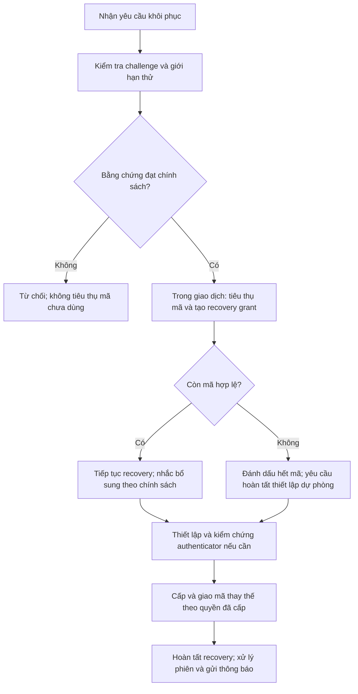

# Backup code exhaustion — Khi dùng hết mã khôi phục dự phòng

## 1. Vấn đề cần giải quyết

Trong chương **Backup Code Recovery** của module `SECURITY_AUTHENTICATION_ACCOUNT_RECOVERY`, backup code là mã dự phòng được chuẩn bị trước để người dùng còn một con đường khôi phục khi mất quyền sử dụng phương thức xác thực chính. Mã có thể hỗ trợ tình huống mất điện thoại chứa TOTP, mất khóa bảo mật hoặc không còn truy cập được passkey. Mỗi hệ thống phải định nghĩa chính xác mã thay thế bằng chứng nào; không mặc định một mã dự phòng đồng thời thay được mật khẩu, MFA và mọi yêu cầu xác minh danh tính.

**Backup code exhaustion** là tình trạng tập mã đang được phép sử dụng không còn mã hợp lệ chưa dùng. Một trường hợp thường gặp là người dùng tiêu thụ mã cuối cùng trong bộ đã cấp. Nếu không có quy trình bổ sung phù hợp, lần mất phương thức xác thực tiếp theo có thể khiến họ không thể tự khôi phục tài khoản.

Ví dụ, Lan có một bộ 10 mã. Sau nhiều lần đổi thiết bị, Lan chỉ còn một mã chưa dùng. Điện thoại lại bị mất; Lan nhập đúng mật khẩu và mã cuối cùng. Hệ thống phải giải quyết hai việc riêng:

- Xử lý lần khôi phục hiện tại bằng bằng chứng đã được xác minh và chính sách tương ứng.
- Khôi phục khả năng dự phòng cho tương lai bằng cách thiết lập lại phương thức xác thực và cấp mã thay thế có kiểm soát.

Giá trị `remaining = 0` không phải bằng chứng nhận dạng, cũng không phải lý do tự động tắt MFA. Nó chỉ mô tả tình trạng dự phòng của một tài khoản.

Sau bài học, người học có thể phân biệt các nguyên nhân không còn mã sử dụng được, thiết kế luồng dùng mã cuối cùng, lựa chọn nhánh khôi phục tiếp theo và xử lý cạnh tranh dữ liệu mà không mở rộng quyền ngoài bằng chứng đã có.

## 2. Phân biệt hết mã, mất mã và nhập sai

Một con số đơn lẻ không giải thích được vì sao người dùng không thể dùng mã. Cần phân biệt trạng thái của **từng mã**, **bộ mã** và **khả năng khôi phục của tài khoản**.

| Tình huống | Dữ liệu hệ thống có thể ghi nhận | Ý nghĩa đối với luồng khôi phục |
| --- | --- | --- |
| Hết mã do sử dụng | Bộ hiện hành không còn mã `UNUSED` hợp lệ | Cần bổ sung bằng một hành động đã được cấp quyền hoặc dùng phương thức khác |
| Mất bản lưu | Máy chủ vẫn có mã chưa dùng, người dùng không tìm thấy chúng | Số lượng trên máy chủ không phản ánh khả năng sử dụng thực tế |
| Bộ cũ bị thay thế | Bộ có trạng thái `REVOKED`, tài khoản trỏ đến bộ mới | Mã chưa dùng trong bộ cũ vẫn không được chấp nhận |
| Mã hết hạn | Mã vượt thời hạn mà chính sách sản phẩm đã quy định | Không được kéo dài hạn chỉ vì người dùng không còn phương án khác |
| Nhập sai hoặc nhập lại mã đã dùng | Không xác minh được một mã hợp lệ cho giao dịch hiện tại | Tăng số lần thất bại phù hợp, không tiêu thụ thêm mã chưa dùng |
| Tạm bị giới hạn thử | Mã có thể vẫn còn nhưng yêu cầu bị throttling | Đây là giới hạn xác minh, không phải hết mã |
| Không đọc được kho xác thực | Dịch vụ hoặc cơ sở dữ liệu lỗi | Trạng thái là chưa xác định, không được chuyển thành `remaining = 0` |

Trong một thiết kế quản lý theo bộ, có thể định nghĩa:

```text
usable(code, now) =
    code thuộc tài khoản cần xác minh
    AND code thuộc bộ ACTIVE hiện hành
    AND code.state = UNUSED
    AND code chưa hết hạn, nếu áp dụng thời hạn

remaining(account, now) = số mã thỏa usable(code, now)
```

Điều kiện “chưa hết hạn” là tùy chọn thiết kế, không hàm ý mọi backup code đều có thời gian sống ngắn như mã OTP gửi qua email.

Trạng thái không còn phương tiện dự phòng cũng có thể xảy ra vì thu hồi hoặc thất lạc, dù chưa tiêu thụ toàn bộ bộ mã. Nên lưu nguyên nhân như `CONSUMED_ALL`, `REVOKED`, `EXPIRED` hoặc `USER_REPORTED_LOST` thay vì gọi tất cả là “đã dùng hết”. Thông tin này giúp giải thích sự cố và chọn nhánh xử lý mà không thay đổi tiêu chuẩn xác minh.

### Hai bộ đếm có mục đích khác nhau

`remainingCodes` đo số mã có thể sử dụng; `failedAttempts` đo số lần xác minh thất bại trong một phạm vi và khoảng thời gian xác định. Không giảm `remainingCodes` khi người dùng nhập sai. Nếu mỗi lần nhập sai làm mất một mã thật, người ngoài có thể gây cạn kiệt mã mà không biết bí mật nào.

Ngược lại, không tăng lại `remainingCodes` khi người dùng báo lỗi kết nối. Phải xác định giao dịch đã commit hay chưa trước khi quyết định có thể tiếp tục luồng nào.

## 3. Chọn chính sách bổ sung trước khi thiết kế màn hình

Bài này dùng mô hình minh họa gồm một bộ hữu hạn nhiều mã dùng một lần. Có hai chính sách bổ sung thường cần phân biệt:

| Chính sách | Cách hoạt động | Điều cần giải quyết |
| --- | --- | --- |
| Thay hoặc bổ sung sau mỗi lần sử dụng | Khi một mã được dùng, luồng có bước cấp mã thay thế | Giao nhận mã mới, xác nhận lưu và tránh tạo bí mật không kiểm soát |
| Tạo lại toàn bộ bộ mã theo yêu cầu | Số mã giảm dần; người dùng yêu cầu thay bộ trong trang bảo mật | Cảnh báo sớm, quyền tạo lại bộ và thu hồi toàn bộ bộ cũ |

Các lựa chọn này không mặc nhiên đáp ứng cùng một tiêu chuẩn. NIST SP 800-63B-4, mục 4.2.1.1, yêu cầu saved recovery code có ít nhất 64 bit ngẫu nhiên, được lưu dạng băm, bị giới hạn số lần thử, bị vô hiệu sau sử dụng và được cấp mã thay thế. Nếu tuyên bố tuân thủ mục đó, không thể chỉ đợi bộ mã cạn rồi nhắc tạo lại. Đây là yêu cầu cho loại mã được NIST mô tả, cần đối chiếu với cách sản phẩm phân loại cơ chế của mình. [NIST SP 800-63B-4 — Account Recovery](https://pages.nist.gov/800-63-4/sp800-63b.html).

Trong phần thiết kế tiếp theo, ngưỡng thấp, số lượng mã, thời hạn phiên và cách kích hoạt bộ mới đều là **giả định minh họa của ứng dụng**, cần được lựa chọn theo rủi ro thực tế.

Ví dụ một ứng dụng chọn cấp 10 mã và cảnh báo khi còn không quá 2 mã. Giá trị 10 và 2 giúp mô tả hành vi, không phải ngưỡng bảo mật phổ quát.

## 4. Các bất biến bảo mật

Một luồng xử lý exhaustion nên giữ được các điều kiện sau:

1. Một mã chỉ được tiêu thụ thành công một lần, kể cả khi có nhiều máy chủ hoặc yêu cầu đồng thời.
2. Việc nhập sai không làm mất mã hợp lệ khác.
3. Chỉ giao dịch đã đủ bằng chứng theo chính sách mới được nhận quyền khôi phục; biết tài khoản đã hết mã không tạo ra quyền đó.
4. Tạo bộ mới là hành động nhạy cảm, cần quyền rõ ràng và còn hiệu lực.
5. Mã đã dùng hoặc thuộc bộ đã thu hồi không được sống lại sau retry, khôi phục dữ liệu hoặc lỗi đồng bộ.
6. Dùng mã cuối cùng không tự động xóa MFA, đổi địa chỉ khôi phục hoặc biến mọi phiên hiện có thành phiên đáng tin cậy.
7. Sự cố lưu trữ phải làm ngừng thao tác cần xác minh, không biến thành đường bỏ qua xác thực.
8. Việc thay bộ, thay authenticator và kết thúc recovery phải để lại sự kiện kiểm toán mà không ghi bí mật.

Đặc biệt, một phiên đăng nhập đang mở chỉ cho thấy máy khách có thông tin phiên. Trước khi cấp bộ mã mới, cần kiểm tra phương thức và thời điểm xác thực, phạm vi quyền, rủi ro hiện tại và thay đổi bảo mật xảy ra sau đó.

## 5. Phát hiện sớm khi mã sắp hết

Thời điểm tốt nhất để xử lý là khi người dùng vẫn còn phương thức xác thực sử dụng được.

Trong trang bảo mật đã xác thực, có thể hiển thị số mã còn lại, thời điểm tạo bộ hiện hành và hành động “Tạo bộ mã mới”. Khi số lượng chạm ngưỡng thấp, hiển thị nhắc nhở sau một lần xác minh thành công hoặc tại lần mở trang bảo mật tiếp theo.

Thông báo minh họa:

> Bạn còn 2 mã dự phòng chưa dùng. Hãy tạo bộ mới và lưu an toàn trước khi mất quyền truy cập phương thức xác thực hiện tại.

Khi người dùng vừa sử dụng mã cuối cùng, thông báo có thể chuyển thành:

> Mã dự phòng cuối cùng đã được sử dụng. Hãy hoàn tất khôi phục phương thức xác thực và lưu mã dự phòng mới trong luồng bảo mật này.

Thông báo cần nói rõ bước tiếp theo và điều kiện của hành động. Nếu phiên không đủ quyền tạo lại bộ, giao diện phải đưa người dùng đến bước xác minh phù hợp thay vì để thao tác thất bại mà không giải thích.

Số mã còn lại không nên xuất hiện trong API tra cứu tài khoản công khai hoặc thông báo lỗi trước xác thực. Thông tin đó có thể giúp người ngoài nhận biết tài khoản và thời điểm khả năng khôi phục của chủ tài khoản đang suy yếu. Thông báo gửi qua email hoặc push chỉ cần mô tả sự kiện và dẫn về ứng dụng; không gửi kèm bộ mã.

## 6. Chọn nhánh xử lý khi không còn mã dùng được

Quyết định dựa trên bằng chứng còn sử dụng được, không chỉ dựa trên số lượng mã.

| Bằng chứng hoặc khả năng còn lại | Nhánh có thể thiết kế | Điều kiện và giới hạn |
| --- | --- | --- |
| Còn authenticator đã đăng ký, như passkey khác hoặc khóa bảo mật khác | Xác thực lại, sau đó cấp bộ mới | Phải xác minh authenticator thực sự đáp ứng chính sách của hành động |
| Vừa hoàn tất giao dịch dùng mã cuối cùng và các bằng chứng đi kèm | Tiếp tục bằng recovery grant có phạm vi hẹp | Không yêu cầu nhập lại chính mã đã bị tiêu thụ |
| Chỉ còn một phiên cũ | Kiểm tra và yêu cầu xác thực lại hoặc chuyển sang recovery | Không dùng riêng sự tồn tại của cookie để cấp bí mật mới |
| Chỉ còn mật khẩu trong mô hình bắt buộc MFA | Dùng nhánh khôi phục đã thiết kế cho việc mất yếu tố còn lại | Không xem hết mã là ngoại lệ cho phép đăng nhập bằng mật khẩu đơn lẻ |
| Mất mật khẩu nhưng còn phương thức đủ mạnh khác | Thực hiện luồng đặt lại mật khẩu tương ứng | Không giả định backup code là bắt buộc cho mọi trường hợp mất mật khẩu |
| Không còn authenticator, mã hoặc phiên có đủ bằng chứng | Chuyển sang khôi phục thay thế đã được đăng ký hoặc quy trình xác minh phù hợp | Có thể phải chờ hoặc không thể khôi phục nếu không đủ căn cứ |

Một địa chỉ email mới được người yêu cầu nhập vào không trở thành kênh đáng tin cậy chỉ vì hệ thống gửi được thư đến đó. Tương tự, giấy tờ mang tên giống tên hiển thị chưa chắc chứng minh quyền sở hữu một tài khoản chưa từng được đối chiếu với danh tính đó.

Phải định nghĩa trước loại bằng chứng được chấp nhận và cách liên kết với tài khoản. Thời gian chờ, IP quen thuộc hoặc đánh giá rủi ro thấp có thể hỗ trợ quyết định, nhưng không thay thế bằng chứng xác thực bắt buộc.

Không phải tổ hợp “một mã bất kỳ + một tín hiệu thuận lợi” đều thỏa yêu cầu khôi phục của một mức đảm bảo. Khi cần đánh giá theo AAL/IAL, phải đối chiếu riêng mục 4.2.2 của tiêu chuẩn. [NIST SP 800-63B-4 — Recovery Requirements by IAL/AAL](https://pages.nist.gov/800-63-4/sp800-63b.html).

## 7. Luồng sử dụng mã cuối cùng

Có thể coi việc khôi phục là một giao dịch gồm nhiều bước, có hạn sử dụng và trạng thái rõ ràng.



Sơ đồ mô tả một lựa chọn cho ứng dụng; không khẳng định mọi lần dùng backup code đều phải thay authenticator. Nếu người dùng chỉ tạm không có thiết bị nhưng authenticator chưa bị mất hoặc lộ, hành động cần thiết có thể khác tình huống thiết bị bị đánh cắp.

### 7.1. Kiểm tra trước khi tiêu thụ mã

Máy chủ cần xác định tài khoản từ ngữ cảnh đáng tin cậy, kiểm tra recovery challenge, các bằng chứng đi kèm, giới hạn thử và tính hợp lệ của bộ mã. Máy khách không được tự gửi `mfaSatisfied=true`, số lượng mã còn lại hoặc danh sách quyền mà máy chủ tin theo.

Ở bước này, mã đúng chưa chắc đủ để hoàn tất recovery. Chẳng hạn, chính sách có thể yêu cầu thêm mật khẩu đang hợp lệ hoặc một bằng chứng độc lập khác. Không tiêu thụ mã chỉ vì cú pháp đúng hoặc vì tìm thấy bản ghi tương ứng.

### 7.2. Tiêu thụ mã và cấp quyền tiếp tục

Khi giao dịch đã được phép, chuyển mã từ `UNUSED` sang `CONSUMED` và ghi nhận kết quả tiếp tục trong cùng giao dịch bền vững. Quyền tiếp tục có thể được biểu diễn bằng **recovery grant**: một quyền ngắn hạn dành riêng cho giao dịch khôi phục.

Grant nên gắn với:

- Tài khoản, recovery transaction và ngữ cảnh máy khách đã được xác thực cho giao dịch.
- Thời điểm xác minh, thời điểm hết hạn và loại bằng chứng đã dùng.
- Các hành động được cho phép, ví dụ `ENROLL_REPLACEMENT_AUTHENTICATOR` và `ISSUE_BACKUP_SET`.
- Phiên bản trạng thái bảo mật để có thể vô hiệu khi xảy ra sự kiện cần thu hồi quyền.
- Trạng thái sử dụng của từng hành động hoặc trạng thái tiến trình để chống lặp lại thao tác nhạy cảm.

Không cần trả những trường nội bộ này nguyên dạng cho trình duyệt. Đặc biệt, không đưa mã dự phòng hoặc giá trị băm vào token gửi cho máy khách.

Một thời hạn minh họa có thể là 10 phút; đây là tham số của ứng dụng. Cần tính cả việc grant hết hạn giữa các bước và cách người dùng tiếp tục bằng bằng chứng hợp lệ, thay vì ngầm kéo dài vô hạn.

### 7.3. Thay phương thức xác thực đúng phạm vi

Nếu đang thay authenticator bị mất, phải kiểm chứng phương thức mới thực sự hoạt động trước khi kết thúc recovery. Ví dụ, hoàn thành nghi thức xác thực với credential passkey mới hoặc xác minh một mã TOTP theo quy trình đăng ký của hệ thống.

Không đưa quyền “đổi mọi cài đặt bảo mật” vào grant chỉ để thuận tiện. Nếu luồng chỉ được phép khôi phục MFA, việc đổi email khôi phục, thêm API key hoặc thực hiện giao dịch giá trị cao vẫn cần chính sách riêng.

OWASP khuyến nghị xác thực lại khi đổi yếu tố MFA, không chỉ dựa vào phiên đang hoạt động, đồng thời kiểm tra rủi ro và thông báo qua kênh ngoài phiên. Trong nhánh mất yếu tố, quyền thay thế phải xuất phát từ một quy trình recovery được chấp nhận. [OWASP — Changing MFA Factors](https://cheatsheetseries.owasp.org/cheatsheets/Multifactor_Authentication_Cheat_Sheet.html#changing-mfa-factors).

## 8. Mô hình dữ liệu và tính nguyên tử

Một mô hình minh họa có thể gồm:

```text
RecoveryState
  accountId
  activeSetId
  securityEpoch

BackupCodeSet
  id, accountId, generation
  state: STAGED | ACTIVE | REVOKED
  createdAt, activatedAt, revokedAt

BackupCode
  id, setId
  verifier, verifierParameters
  state: UNUSED | CONSUMED | REVOKED
  consumedAt, consumedByTransactionId
  expiresAt, nếu có

RecoveryTransaction
  id, accountId, state, expiresAt
  verifiedEvidence, boundClientContext
  grantId

RecoveryGrant
  id, transactionId, accountId
  allowedActions, progressState, expiresAt
  securityEpochAtAuthorization
```

`STAGED` nghĩa là bộ đã chuẩn bị nhưng chưa được chấp nhận trong xác minh recovery. `generation` giúp phân biệt các lần cấp; `securityEpoch` giúp kiểm tra quyền cũ sau thay đổi bảo mật. Khi một bước hợp lệ trong chính giao dịch làm tăng epoch, hệ thống phải cập nhật hoặc chuyển tiếp trạng thái của giao dịch đó theo quy tắc rõ ràng, thay vì để grant tự vô hiệu giữa luồng mà không có đường hoàn tất.

Bản ghi mã chỉ lưu dữ liệu xác minh một chiều thích hợp và tham số cần thiết, không lưu mã gốc lâu dài để hỗ trợ “xem lại”. Thiết kế hàm băm, entropy, salt và giới hạn thử phải thống nhất với chính sách mã; không suy luận rằng mọi chuỗi gọi là backup code đều đủ entropy để dùng cùng một cách lưu trữ.

Có thể lấy `remaining` bằng truy vấn trên bộ hiện hành. Nếu lưu thêm bộ đếm, phải cập nhật cùng giao dịch với việc tiêu thụ hoặc thu hồi, và có cơ chế phát hiện sai lệch. Cache trên giao diện chỉ phục vụ hiển thị, không quyết định chấp nhận mã.

### 8.1. Ngăn hai yêu cầu cùng dùng mã cuối cùng

Lỗi phổ biến là đọc mã chưa dùng, cấp quyền rồi mới đánh dấu đã dùng. Hai luồng cùng đọc có thể cùng vượt qua bước kiểm tra.

Thao tác ghi cần có điều kiện tại cơ sở dữ liệu. Ví dụ với một mã đã được xác minh thuộc bộ hiện hành:

```sql
UPDATE backup_code
SET state = 'CONSUMED',
    consumed_at = CURRENT_TIMESTAMP,
    consumed_by_transaction_id = :transaction_id
WHERE id = :code_id
  AND set_id = :active_set_id
  AND state = 'UNUSED'
  AND (expires_at IS NULL OR expires_at > CURRENT_TIMESTAMP);
```

Chỉ `affected_rows = 1` mới được coi là lần tiêu thụ thành công. Câu lệnh này **chưa phải toàn bộ giao dịch**: cần kiểm tra bộ vẫn `ACTIVE`, challenge còn hiệu lực, quyền chưa bị thu hồi và trạng thái tài khoản vẫn cho phép recovery. Những điều kiện đó không được dựa hoàn toàn vào dữ liệu đọc từ trước một thay đổi đồng thời.

Một chiến lược đơn giản là mọi thao tác tiêu thụ, kích hoạt bộ và thu hồi bộ đều khóa cùng bản ghi `RecoveryState` của tài khoản, rồi khóa recovery transaction theo một thứ tự thống nhất. Ví dụ mã giả Java:

```java
// Mã giả: tx.required có nghĩa commit/rollback thật tại cơ sở dữ liệu.
// Các helper kiểm tra trạng thái, không chỉ đọc thuộc tính từ request.
RecoveryResult consumeBackupCode(VerifiedAttempt attempt) {
    return tx.required(() -> {
        var recoveryState = repository.lockRecoveryState(attempt.accountId());
        var recovery = repository.lockRecoveryTransaction(attempt.transactionId());

        requireBoundClient(recovery, attempt.clientContext());

        if (recovery.hasCommittedResultFor(attempt.requestId())) {
            return resumeForSameAuthorizedClient(recovery);
        }

        requireOpenAndUnexpired(recovery);
        requireCurrentAccountPolicy(recoveryState, recovery);
        requireEvidenceStillValid(recovery, attempt);

        var activeSet = repository.requireActiveSet(recoveryState.activeSetId());
        var verifiedCode = verifier.verifyAgainstActiveSet(activeSet, attempt.code());

        int affected = repository.consumeIfUnusedAndUnexpired(
            verifiedCode.id(), activeSet.id(), recovery.id());
        if (affected != 1) {
            throw new RecoveryRejected();
        }

        var remaining = repository.countUsableCodes(activeSet.id());
        var grant = repository.insertScopedGrant(recovery, recoveryState);
        repository.completeVerification(recovery, attempt.requestId(), grant.id());
        repository.insertAuditEvent("BACKUP_CODE_CONSUMED", recovery, remaining);
        repository.insertOutboxEvent("RECOVERY_VERIFIED", recovery.id());

        return RecoveryResult.continueWith(grant.id(), remaining);
    });
}
```

Ví dụ lược bỏ định tuyến HTTP, cách lưu bí mật trong bộ nhớ, kiểm tra CSRF khi dùng cookie và chi tiết triển khai verifier. Nó minh họa ranh giới giao dịch, không phải mã sản xuất có thể sao chép chạy ngay.

Các điểm cần giữ khi hiện thực:

- Tiền tố `VerifiedAttempt` không có nghĩa có thể bỏ kiểm tra lại trạng thái mới nhất trong giao dịch.
- Giới hạn thử và ghi nhận thất bại cần cơ chế riêng bền vững; không để rollback của giao dịch từ chối xóa luôn bộ đếm chống đoán mã.
- Hàm tiếp tục kết quả đã commit cũng phải kiểm tra grant còn hạn, chưa bị thu hồi và có trạng thái phù hợp; retry không được làm grant hết hạn sống lại.
- Bộ mới phải có đủ bản ghi mã trước khi trở thành `ACTIVE`.
- Mọi đường ghi liên quan đều phải tuân thủ cùng cơ chế khóa hoặc kiểm soát phiên bản; chỉ một hàm dùng khóa là chưa đủ.
- Chỉ trả kết quả chấp nhận sau khi commit thành công. Không gửi grant dùng được từ giữa giao dịch.
- Outbox lưu sự kiện cần giao sau commit, không chứa mã dự phòng dạng rõ.

Khóa trong bộ nhớ của một Java process không bảo vệ được thao tác trên nhiều instance. Nếu dùng optimistic locking thay vì khóa hàng, phải kiểm tra phiên bản và retry toàn bộ đơn vị công việc phù hợp; không chỉ retry riêng câu lệnh cấp grant.

### 8.2. Hai tình huống cạnh tranh khác

**Hai mã khác nhau được dùng cho cùng một challenge:** khóa giao dịch và chuyển challenge khỏi trạng thái mở sau lần thành công đầu tiên. Nếu không, một retry hoặc hai tab có thể tiêu thụ hai mã cho một mục đích duy nhất.

**Tạo bộ mới trong lúc dùng mã bộ cũ:** thao tác đổi `activeSetId` và thao tác tiêu thụ phải có thứ tự nhất quán. Nếu bộ mới được kích hoạt trước, mã bộ cũ bị từ chối. Nếu lần tiêu thụ được commit trước, nó được ghi nhận đúng trên bộ cũ; việc chuyển bộ sau đó không được làm sai trạng thái hoặc hồi sinh mã.

## 9. Mã đã dùng nhưng phản hồi bị mất

Đây là lỗi đặc biệt đáng chú ý khi mã vừa dùng là mã cuối cùng:

1. Máy chủ xác minh mã và commit việc tiêu thụ cùng recovery grant.
2. Kết nối đứt trước khi trình duyệt nhận phản hồi.
3. Người dùng gửi lại yêu cầu vì tưởng lần đầu chưa thành công.

Nếu lần gửi lại được xử lý như một recovery mới, hệ thống chỉ thấy mã đã dùng và từ chối, dù trước đó đã xác minh thành công.

Giải pháp là nhận diện giao dịch bằng request ID hoặc idempotency key đã được ràng buộc với tài khoản, recovery transaction và ngữ cảnh máy khách. Với một retry của **cùng giao dịch đã commit**, trả trạng thái tiếp tục đã lưu hoặc cấp lại phương tiện tiếp tục có cùng phạm vi trong ngữ cảnh được xác thực. Không tạo grant độc lập và không tiêu thụ thêm mã.

Idempotency key không phải bằng chứng danh tính. Một người biết key hoặc biết mã cũ không được tra cứu grant của chủ tài khoản từ một máy khách mới. Nếu không còn chứng minh được quyền tiếp tục giao dịch, phải chuyển sang phương án khôi phục khác; không bật lại mã đã tiêu thụ.

Nếu giao dịch cơ sở dữ liệu thực sự rollback, mã chưa bị tiêu thụ và có thể được thử lại theo chính sách. Nếu client chỉ bị timeout, chưa thể kết luận rollback. API cần đối chiếu trạng thái bền vững thay vì dựa vào cảm nhận của người dùng hoặc log truy cập HTTP.

## 10. Cấp bộ mã mới mà không tạo thêm cửa hậu

### 10.1. Quyền cấp bộ mới

Tách thao tác “xem còn bao nhiêu mã” khỏi “cấp mã mới”. Hành động thứ hai cần xác thực lại phù hợp hoặc một grant recovery còn hạn đã được phép làm việc đó.

Một thiết kế recovery có thể yêu cầu người dùng hoàn tất đăng ký và kiểm chứng authenticator mới, rồi cho phép cấp bộ mã bằng grant của chính giao dịch. Khi đó không yêu cầu người dùng nhập một mã dự phòng khác: bộ cũ đã hết và bằng chứng trước đó đã được thay bằng quyền tiếp tục có kiểm soát.

Nếu chính sách của tài khoản không cho phép nhánh này, phải cung cấp phương án bằng chứng khác đã định nghĩa trước. Không thể giải quyết mâu thuẫn bằng cách bỏ kiểm tra tại endpoint cấp mã.

### 10.2. Chuẩn bị, giao nhận và kích hoạt

Có thể dùng một quy trình hai giai đoạn cho bộ mã không bị nghi lộ:

1. Sau khi kiểm tra quyền, tạo bộ mới ở trạng thái `STAGED`, chưa dùng được để recovery.
2. Hiển thị mã qua kênh bảo vệ cho đúng người vừa được cấp quyền; cho phép lưu hoặc in ở phía người dùng.
3. Yêu cầu xác nhận đã lưu, gắn thao tác xác nhận với đúng bộ và phiên bản dự kiến.
4. Trong một giao dịch, kích hoạt bộ mới, đổi `activeSetId`, thu hồi bộ cũ và hoàn tất quyền cấp bộ của giao dịch.
5. Gửi thông báo thay bộ sau commit và hướng dẫn hủy bản lưu cũ.

Nút “Tôi đã lưu” chỉ là xác nhận thao tác của người dùng, không chứng minh rằng bản sao được lưu đúng hoặc sẽ còn truy cập được. Dù có bước xác nhận này, cần diễn giải rõ toàn bộ mã của bộ trước sẽ ngừng hiệu lực.

Một hệ thống khác có thể chọn kích hoạt ngay khi cấp thay vì dùng `STAGED`. Khi đó phải xử lý rõ trường hợp giao nhận thất bại. Hai cách có đánh đổi khác nhau; không giả định việc ghi dữ liệu thành công đồng nghĩa người dùng đã nhận và lưu mã.

Nếu bộ cũ bị nghi đánh cắp, yêu cầu thu hồi do sự cố phải được xử lý ngay theo chính sách. Không giữ bộ nghi lộ hoạt động chỉ vì người dùng chưa xác nhận lưu bộ mới. Sự thuận tiện của bước chuyển bộ không được kéo dài quyền sử dụng bí mật đã bị coi là không an toàn.

### 10.3. Giới hạn dữ liệu bí mật và retry

Với thiết kế hiển thị một lần, mã rõ được sinh và giao trong luồng đã cấp quyền; kho lâu dài chỉ lưu dữ liệu xác minh. Trang hiển thị cần hạn chế cache, không gửi mã qua query string, không để công cụ analytics hoặc session replay thu nội dung này.

Nếu người dùng mất phản hồi trước khi nhìn thấy bộ `STAGED`, không thể lấy lại mã rõ từ hàm băm. Một phương án là hủy bộ chưa kích hoạt và tạo bộ mới bằng quyền còn hiệu lực. Phải ràng buộc thao tác với cùng giao dịch và giới hạn số lần tạo, tránh sinh nhiều bộ tồn tại song song.

Nếu bộ mới đã `ACTIVE` nhưng người dùng chưa lưu được, cấp lại bộ là một thao tác thay thế mới có kiểm soát. Không trả lại bộ mã rõ từ audit log và không phục hồi một bộ đã thu hồi. Retry của API kích hoạt phải trả kết quả cho đúng bộ đã commit, không kích hoạt thêm bộ khác.

Đường cấp mã cũng cần chống CSRF khi dùng cookie, giới hạn tốc độ và kiểm tra trạng thái quyền trên máy chủ. Nếu không, một người chiếm được phiên có thể liên tục thay bộ để phá hủy bản dự phòng mà chủ tài khoản đang giữ.

## 11. Kiểm soát phiên và chống lạm dụng

### 11.1. Không biến backup code thành cách đăng nhập mặc định

Việc liên tục tiêu thụ mã có thể chỉ ra người dùng đang dùng chúng như phương thức đăng nhập hằng ngày hoặc authenticator chính chưa được sửa. Khi phát hiện xu hướng này, nên hướng dẫn đăng ký phương thức sử dụng ổn định và kiểm tra hoạt động bất thường.

Không tự tạo bộ mới rồi gửi qua email sau mỗi lần nhập sai. Đường gửi đó có thể trở thành nguồn lộ bí mật hoặc công cụ quấy rối chủ tài khoản.

### 11.2. Giới hạn thử mà không tạo cơ chế phá tài khoản

Phối hợp giới hạn theo tài khoản, recovery transaction và nguồn yêu cầu để chống thử mã phân tán. Chỉ giới hạn theo IP không đủ trong môi trường nhiều địa chỉ nguồn; chỉ khóa tài khoản cứng lại dễ bị người ngoài lợi dụng để gây từ chối dịch vụ.

Khi áp dụng trì hoãn hoặc hạn chế, không tiêu thụ các mã chưa được xác minh. Có thể cung cấp nhánh dùng authenticator khác còn hợp lệ, nhưng nhánh đó vẫn phải đáp ứng chính sách xác thực riêng.

Thông báo trước xác thực không cần tiết lộ “tài khoản này còn đúng một mã” hoặc phân biệt chi tiết tài khoản không tồn tại với bộ mã đã hết. Bên trong hệ thống vẫn cần reason code chính xác để điều tra.

### 11.3. Thu hồi và kết thúc recovery

Recovery grant phải hết hạn hoặc bị đóng khi luồng hoàn tất, bị hủy hoặc khi xuất hiện sự kiện an ninh yêu cầu vô hiệu. Nếu dùng token có chữ ký, chữ ký hợp lệ không tự giải quyết việc thu hồi trước hạn; cần cơ chế kiểm tra trạng thái hoặc phiên bản phù hợp với yêu cầu thu hồi.

Trạng thái hết mã, tự nó, không yêu cầu kết thúc mọi phiên của tài khoản. Tuy nhiên, nếu recovery xuất phát từ mất thiết bị hoặc nghi bị chiếm đoạt, cần xử lý các session, refresh token và authenticator liên quan để người đang giữ thiết bị cũ không tiếp tục truy cập.

Tùy mô hình rủi ro, có thể thu hồi toàn bộ phiên khác hoặc thu hồi có chọn lọc theo thiết bị và thời điểm. Phiên được cấp sau recovery cần được tạo hoặc xoay định danh phù hợp, ghi nhận bằng chứng thực tế và chỉ có quyền mà luồng đã chứng minh được. Không gắn nhãn “đã xác thực bằng passkey” cho một phiên thực tế dùng mã dự phòng.

Nếu trước đó phiên chỉ có quyền khôi phục, phải có bước chuyển trạng thái rõ ràng trước khi được dùng như phiên ứng dụng thông thường. Các hành động như đổi kênh khôi phục hoặc cấp quyền quản trị có thể tiếp tục yêu cầu xác minh riêng.

## 12. Quan sát hệ thống mà không ghi lộ mã

Các sự kiện có ích gồm:

| Sự kiện | Trường nên có | Mục đích |
| --- | --- | --- |
| `BACKUP_CODE_CONSUMED` | Account ID nội bộ, set ID, transaction ID, thời điểm, số mã còn lại | Theo dõi việc sử dụng và tính đúng của exhaustion |
| `BACKUP_CODE_LOW` | Tài khoản, thế hệ bộ mã, ngưỡng vừa vượt | Nhắc nhở một lần phù hợp, tránh gửi liên tục |
| `BACKUP_CODE_EXHAUSTED` | Tài khoản, bộ mã, nguyên nhân, giao dịch liên quan | Nhận biết mất khả năng dự phòng |
| `BACKUP_SET_REPLACED` | Bộ cũ, bộ mới, loại quyền cho phép thay, thời điểm | Kiểm toán thao tác thay bộ |
| `RECOVERY_FALLBACK_STARTED` | Loại nhánh, transaction ID, reason code | Theo dõi nhánh recovery khi mã không còn dùng được |
| `RECOVERY_COMPLETED` | Kết quả, thay đổi authenticator, quyết định đối với phiên | Điều tra sự cố và đánh giá luồng hoàn tất |

Không ghi mã rõ, nội dung file tải mã, secret TOTP, recovery grant token hoặc cookie vào log. Giá trị băm của mã cũng không cần xuất hiện trong log nghiệp vụ. Quyền đọc số lượng mã và lịch sử recovery phải được giới hạn như dữ liệu bảo mật của tài khoản.

Có thể theo dõi các tỷ lệ tổng hợp: tài khoản có bộ `ACTIVE` nhưng không còn mã, người chạm ngưỡng thấp rồi bổ sung thành công, recovery dừng sau mã cuối cùng, retry tiếp tục thành công và thao tác thay bộ bị từ chối do quyền hết hạn. Tránh dùng account ID làm nhãn metric có số lượng giá trị quá lớn hoặc làm lộ dữ liệu qua dashboard rộng quyền.

Thông báo gửi cho người dùng nên có thời điểm, loại thay đổi và cách báo hoạt động không nhận ra. Việc gửi thông báo sau commit cần retry bền vững và chống gửi trùng; lỗi nhà cung cấp email không được làm sống lại mã đã dùng.

## 13. Ví dụ xuyên suốt: Lan dùng mã cuối cùng

Giả sử ứng dụng cho phép một nhánh khôi phục MFA dựa trên mật khẩu đã xác minh và backup code; chính sách cụ thể này đã được đánh giá trước cho loại tài khoản của Lan.

1. Lan mất điện thoại TOTP, mở recovery transaction `R1` và hoàn thành các bằng chứng được yêu cầu.
2. Lan nhập mã cuối cùng của bộ `S4`. Máy chủ tiêu thụ mã và tạo grant `G1` trong cùng giao dịch. Số mã khả dụng của `S4` thành 0.
3. Phản hồi bị mất. Trình duyệt retry cùng request, trong ngữ cảnh đã ràng buộc với `R1`. Máy chủ trả trạng thái tiếp tục của `G1`, không yêu cầu mã đã dùng lần nữa.
4. Grant chỉ cho phép hoàn tất thay authenticator và cấp bộ dự phòng. Lan chưa có quyền đổi địa chỉ khôi phục qua grant này.
5. Lan đăng ký authenticator mới và kiểm chứng sử dụng thành công. Authenticator trên điện thoại bị mất được thu hồi theo chính sách.
6. Máy chủ tạo bộ `S5` ở trạng thái `STAGED`; Lan lưu và xác nhận đúng bộ. Giao dịch kích hoạt `S5` và thu hồi `S4`.
7. Recovery hoàn tất; grant đóng, phiên được xử lý theo rủi ro mất thiết bị và thông báo được gửi qua kênh đã thiết lập.

Nếu ở bước 3 Lan mất luôn ngữ cảnh recovery và không còn bằng chứng để tiếp tục, hệ thống không bật lại mã cuối cùng. Lan phải đi theo nhánh khác đã được thiết kế.

Nếu ở bước 6 trang hiển thị mã lỗi trước khi kích hoạt, bộ `S5` chưa được chấp nhận cho recovery. Bộ thay thế tiếp theo chỉ được tạo trong quyền còn hiệu lực; không để các bộ `STAGED` cũ trở thành bí mật còn sử dụng được về sau.

Ví dụ cho thấy exhaustion là vấn đề của cả vòng đời: xác minh, commit, tiếp tục sau lỗi mạng, thay phương thức xác thực, giao mã mới và kết thúc quyền tạm thời.

## 14. Các tình huống cần đưa vào kiểm thử triển khai

Bảng dưới là tiêu chí thiết kế cho hệ thống hiện thực, không phải kết quả đã chạy kiểm thử của một ứng dụng cụ thể.

| Tình huống | Kết quả cần quan sát |
| --- | --- |
| Dùng đúng mã cuối cùng, đủ bằng chứng | Một lần tiêu thụ, một kết quả recovery, số mã còn lại bằng 0 |
| Nhập sai nhiều lần | Mã chưa dùng không mất; cơ chế giới hạn thử hoạt động |
| Hai request cùng dùng mã cuối | Tối đa một lần tiêu thụ thành công; không cấp hai quyền độc lập |
| Hai mã khác nhau cho cùng challenge | Challenge chỉ hoàn tất một lần; không tiêu thụ thêm mã sau khi đã đóng |
| Thay bộ đồng thời với dùng mã cũ | Kết quả tuân theo thứ tự commit; bộ đã bị thay không được chấp nhận lại |
| Mất phản hồi sau commit | Retry đúng ngữ cảnh tiếp tục kết quả cũ, không tiêu thụ mã mới |
| Retry từ máy khách không được ràng buộc | Không nhận được grant chỉ nhờ biết request ID hoặc mã cũ |
| Rollback trước commit | Không tồn tại trạng thái mã đã dùng nhưng không có kết quả recovery tương ứng |
| Kho mã lỗi hoặc cache sai | Không vượt qua xác minh, không báo chắc chắn đã hết mã |
| Grant hết hạn hoặc bị thu hồi | Endpoint cấp bộ từ chối dù giao diện còn nút thao tác |
| Mất phản hồi khi giao bộ mới | Áp dụng đúng quy tắc `STAGED` hoặc thay bộ, không đọc mã gốc từ hàm băm |
| Dùng mã thuộc bộ đã thu hồi | Bị từ chối dù mã chưa từng được tiêu thụ |
| Gửi thông báo thất bại | Sự kiện được retry; trạng thái tiêu thụ và thu hồi vẫn giữ nguyên |
| Phục hồi hệ thống từ bản sao lưu cũ | Không mở endpoint recovery trước khi đối chiếu sự kiện tiêu thụ, thu hồi và phiên bản bảo mật mới hơn |

Trường hợp phục hồi bản sao lưu cần được xem như rủi ro riêng. Nếu chỉ khôi phục một cơ sở dữ liệu cũ, mã đã dùng hoặc bộ đã thu hồi sau thời điểm sao lưu có thể xuất hiện lại là hợp lệ. Cần quy trình đối soát với nguồn sự kiện bền vững thích hợp hoặc vô hiệu các bí mật bị ảnh hưởng trước khi phục vụ lại; không thể trông chờ riêng cờ `CONSUMED` trong bản sao lưu cũ.

## 15. Các quyết định cần được ghi rõ trong thiết kế

Một tài liệu triển khai phải trả lời được: thế nào là mã còn dùng được, khi nào thông báo sắp hết, bằng chứng nào cho phép tạo lại bộ, cách xử lý mã cuối cùng và cách kết thúc quyền recovery. Các quy tắc cần bao phủ cả lỗi mạng, thao tác đồng thời và sự cố khôi phục dữ liệu.

Hết backup code làm giảm khả năng tự khôi phục trong tương lai. Cách khắc phục là bổ sung phương tiện dự phòng bằng quyền đã được xác minh, giữ mã dùng một lần thực sự chỉ dùng một lần và kiểm soát phiên xuyên suốt quá trình. Nếu không còn bằng chứng đạt chính sách, kết quả đúng có thể là chuyển nhánh xác minh hoặc chưa cho khôi phục, thay vì âm thầm hạ mức bảo vệ tài khoản.
