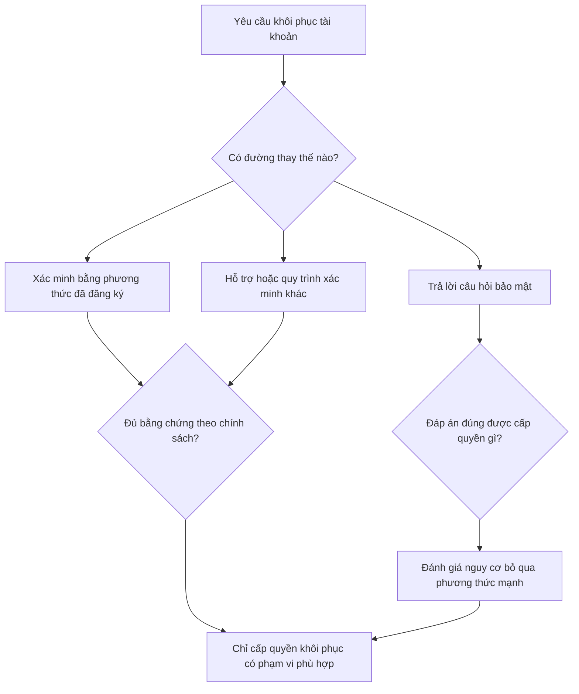

# Phân tích khả năng đoán câu trả lời của câu hỏi bảo mật

## 1. Vì sao câu trả lời đúng chưa chắc chứng minh đúng chủ tài khoản?

Trong chương **Security Questions**, khả năng đoán câu trả lời là một trong những rủi ro quyết định việc câu hỏi bảo mật có thể được sử dụng đến đâu. Những câu như “Bạn sinh ở đâu?” hoặc “Tên trường đầu tiên của bạn là gì?” thường dựa vào thông tin cá nhân. Người dùng có thể nhớ được, nhưng người khác cũng có thể biết, tìm thấy hoặc suy đoán thông tin đó.

**Một câu trả lời khó nghĩ ra đối với người lạ chưa chắc khó đoán đối với người đang nhắm vào một tài khoản cụ thể.** Mức độ an toàn phải được đánh giá theo những gì kẻ tấn công biết, cách hệ thống chấp nhận câu trả lời và số cơ hội thử thực tế.

Trong module `SECURITY_AUTHENTICATION_ACCOUNT_RECOVERY`, hậu quả cần quan tâm không chỉ là một đáp án bị đoán trúng. Cần xem việc trả lời đúng có cho phép đặt lại mật khẩu, bỏ MFA, đăng ký passkey mới, thay kênh khôi phục hoặc tạo phiên đăng nhập hay không. Nếu một câu trả lời dễ đoán có thể mở đường cho những thao tác đó, nó trở thành điểm yếu trong toàn bộ luồng khôi phục.

Bài học này hướng dẫn cách:

- Phân biệt số câu trả lời có thể có với xác suất kẻ tấn công đoán đúng.
- Đánh giá phân bố câu trả lời, thông tin công khai và sự tương quan giữa nhiều câu hỏi.
- Tính đến quy tắc chuẩn hóa, giới hạn thử và các kênh khôi phục khác nhau.
- Thiết kế một phép đánh giá có thể giải thích được mà không thu thập thêm dữ liệu cá nhân không cần thiết.
- Chuyển kết quả phân tích thành quyết định bảo mật cho luồng khôi phục tài khoản.

Các số liệu trong bài đều là **dữ liệu giả lập để giải thích phương pháp**, không phải thống kê thực tế về người dùng hoặc ngưỡng chấp nhận cho sản phẩm.

## 2. Xác định người đoán và mục tiêu của họ

### 2.1. Các đối thủ có lượng thông tin khác nhau

| Đối thủ | Thông tin có thể có | Ảnh hưởng tới việc đoán |
|---|---|---|
| Người tấn công đại trà | Loại câu hỏi và các đáp án phổ biến trong một quần thể | Ưu tiên đáp án xuất hiện nhiều thay vì thử đều mọi đáp án |
| Người nhắm một tài khoản | Hồ sơ công khai, địa phương, tổ chức, dấu vết nghề nghiệp | Thu hẹp và sắp xếp lại tập đáp án phù hợp với nạn nhân |
| Người quen của chủ tài khoản | Quan hệ gia đình, trường học, tên gọi hoặc sự kiện đời sống | Có thể biết sẵn đáp án mà không cần dò kỹ thuật |
| Người có dữ liệu bị lộ | Dữ liệu cá nhân hoặc câu trả lời từ một hệ thống khác | Có thể tái sử dụng thông tin hoặc suy ra câu trả lời tương đương |
| Người đã lấy được một phần quyền truy cập | Phiên đăng nhập, email hoặc một bước khôi phục | Có thể nhìn thấy gợi ý, câu hỏi hoặc dùng nhiều đường thử hơn dự kiến |

Không lấy mức khó đối với người tấn công đại trà làm bảo đảm cho tài khoản đang bị nhắm mục tiêu. Câu trả lời về tiểu sử cũng không thể dễ dàng “thu hồi” theo cách thay một mã khôi phục ngẫu nhiên: người dùng không thể thay nơi sinh thật chỉ vì dữ liệu đã lộ.

### 2.2. Phân biệt đoán trực tuyến và dò ngoại tuyến

**Đoán trực tuyến** xảy ra khi đối thủ gửi câu trả lời tới dịch vụ. Rủi ro phụ thuộc vào giới hạn thử thực sự, phản hồi của máy chủ, khả năng mở nhiều phiên và việc các kênh dùng chung ngân sách thử hay không.

**Dò ngoại tuyến** xảy ra khi đối thủ có dữ liệu kiểm chứng bị lộ và có thể thử trên tài nguyên của họ. Giới hạn tần suất của API không ngăn được kiểu dò này. Cách lưu trữ bí mật và độ khó đoán vốn có của đáp án đều có vai trò.

Không suy ra một cơ chế an toàn ngoại tuyến chỉ vì hệ thống cho phép ít lần thử trực tuyến. Ngược lại, băm câu trả lời cẩn thận không ngăn được người quen nhập đúng đáp án ngay lần đầu.

### 2.3. Xác định điều kiện thắng

Trước khi đo, cần viết rõ điều gì xảy ra sau một câu trả lời đúng:

```text
Trả lời đúng
    -> chỉ hoàn tất một bước chưa đủ để khôi phục?
    -> nhận token đặt lại mật khẩu?
    -> được bỏ qua MFA?
    -> được thay passkey hoặc kênh khôi phục?
    -> được cấp phiên có quyền thay thông tin xác thực?
```

Xác suất trả lời đúng là một thành phần của rủi ro, không đồng nghĩa trực tiếp với xác suất chiếm đoạt tài khoản. Tuy nhiên, nếu đáp án đúng là điều kiện duy nhất để thực hiện một thao tác nhạy cảm, hai kết quả có thể nằm rất gần nhau về mặt luồng nghiệp vụ.

## 3. Không gian câu trả lời không phải phân bố xác suất

Một câu hỏi có thể có hàng nghìn câu trả lời hợp lệ về mặt ngôn ngữ, nhưng phần lớn người dùng có thể tập trung vào một nhóm nhỏ. Kẻ tấn công không cần chọn ngẫu nhiên đều trên toàn bộ không gian đó.

Các dấu hiệu sau không đủ để kết luận câu trả lời mạnh:

- Có nhiều ký tự hoặc nhiều từ.
- Có thể nhập dấu, chữ hoa và dấu câu.
- Có rất nhiều địa điểm, tên người hoặc sự kiện trên thế giới.
- Một câu trả lời chỉ xuất hiện một lần trong một mẫu dữ liệu nhỏ.
- Chủ tài khoản cho rằng “chắc không ai biết”.

Ví dụ, một tên địa điểm dài có thể xuất hiện nguyên văn trên hồ sơ công khai. Một câu trả lời ngắn được sinh ngẫu nhiên có thể khó đoán hơn nhiều. Độ dài chỉ có ý nghĩa khi gắn với cách giá trị được tạo và phân bố thực tế của nó.

Nếu có `N` đáp án và chúng thực sự có xác suất bằng nhau, xác suất đoán đúng trong một lần là `1/N`. Nhưng đó là **giả định phân bố đều**, không phải hệ quả của việc đếm được `N` chuỗi khác nhau.

Vì vậy, báo cáo “câu hỏi có 100 đáp án nên có khoảng 6,64 bit” chỉ đúng trong mô hình đều đó. Không được gán con số này cho dữ liệu câu trả lời cá nhân khi chưa kiểm tra phân bố và thông tin mà đối thủ có.

## 4. Mô hình xác suất đoán đúng

### 4.1. Xác suất cần có điều kiện theo thông tin của đối thủ

Ký hiệu:

- `Q`: câu hỏi được đưa ra.
- `A`: câu trả lời của chủ tài khoản.
- `X`: thông tin mà đối thủ đã biết, kể cả gợi ý do hệ thống cung cấp.
- `N(A)`: câu trả lời sau quy tắc chuẩn hóa chính thức của hệ thống.
- `c`: một giá trị chuẩn hóa được chấp nhận.

Phân bố cần đánh giá là:

```text
p(c | Q, X) = P(N(A) = c | Q, X)
```

Đây không chỉ là phân bố trên tất cả người dùng. Khi `X` thay đổi, đáp án có khả năng cao nhất và thứ tự thử cũng có thể thay đổi.

Giả sử các giá trị chuẩn hóa được xếp theo xác suất giảm dần:

```text
p1 >= p2 >= ... >= pm
```

Với một câu trả lời cố định, không có thêm gợi ý trong quá trình thử và mỗi lần thử một giá trị chuẩn hóa khác nhau, xác suất tốt nhất sau tối đa `k` lần thử là:

```text
P_guess(k | Q, X) = p1 + p2 + ... + p_min(k,m)
```

Đây là xác suất tích lũy của các đáp án dễ đoán nhất. Không dùng công thức `1 - (1 - p1)^k` cho mô hình này: các lần thử không phải những phép thử độc lập với cùng xác suất `p1` trên các câu trả lời mới được lấy ngẫu nhiên. Đối thủ đang lần lượt đoán một đáp án cố định.

### 4.2. Min-entropy cho biết điều gì?

Một đại lượng hữu ích để diễn tả lần đoán tốt nhất là:

```text
H_inf(Q, X) = -log2(max_c p(c | Q, X))
```

Nếu đáp án dễ đoán nhất có xác suất `0,25`, min-entropy trong ngữ cảnh đó là `2 bit`. Đại lượng này nói về rủi ro của lần đoán tối ưu đầu tiên, không có nghĩa rằng cứ thử bốn lần là chắc chắn thành công.

Min-entropy cũng không thay thế đường cong `P_guess(k)`. Hai phân bố có cùng đáp án phổ biến nhất vẫn có thể khác nhau đáng kể ở lần thử thứ hai, thứ ba hoặc thứ mười.

Entropy Shannon mô tả một đặc tính khác của phân bố. Không lấy entropy trung bình hoặc số ký tự làm chứng minh rằng kẻ tấn công bị chặn trong vài lần đoán đầu. Với khôi phục tài khoản, xác suất thành công trong ngân sách thử thực tế thường dễ chuyển thành quyết định hơn.

## 5. Ví dụ tính toán trên dữ liệu giả lập

Giả sử có một tập giả lập gồm 1.000 câu trả lời đã chuẩn hóa cho cùng một câu hỏi. Có 100 giá trị khác nhau, với nhóm phổ biến nhất như sau:

| Giá trị giả lập | Số lần xuất hiện | Xác suất | Xác suất tích lũy |
|---|---:|---:|---:|
| Đáp án A | 260 | 26% | 26% |
| Đáp án B | 190 | 19% | 45% |
| Đáp án C | 120 | 12% | 57% |
| Đáp án D | 80 | 8% | 65% |
| Đáp án E | 50 | 5% | 70% |
| 95 giá trị còn lại | 300 | 30% tổng cộng | 100% khi thử hết |

Từ bảng này:

```text
P_guess(1) = 260 / 1000 = 26%
P_guess(3) = (260 + 190 + 120) / 1000 = 57%
P_guess(5) = (260 + 190 + 120 + 80 + 50) / 1000 = 70%

H_inf = -log2(0,26) ≈ 1,94 bit
```

Nếu giả định sai rằng 100 giá trị có xác suất bằng nhau, người đánh giá sẽ dự đoán ba lần thử chỉ có xác suất thành công `3/100 = 3%`. Trong dữ liệu giả lập, kết quả là `57%`. Giới hạn ba lần thử vẫn có ích, nhưng không biến một câu trả lời quá dễ đoán thành bí mật mạnh.

Nếu cơ chế này là cửa khôi phục trực tiếp, con số 57% trong mô hình giả lập là một cảnh báo về chính thiết kế, không chỉ là lý do để giảm từ ba lần xuống hai lần thử.

Cũng cần tránh diễn giải ngược rằng mọi câu hỏi bảo mật đều có những tỷ lệ trên. Chúng chỉ minh họa việc đếm giá trị khác nhau có thể làm đánh giá sai lệch đến mức nào.

## 6. Thông tin công khai và nhiều câu hỏi có thể làm rủi ro tăng

### 6.1. Phân bố toàn hệ thống có thể che khuất một mục tiêu dễ đoán

Giả sử trong một mô hình giả lập, đáp án đứng đầu trên toàn hệ thống có xác suất 26%. Với một tài khoản mà thông tin liên quan đã được công khai, mô hình đối thủ có thể gán tới 85% cho một đáp án cụ thể.

Hai giá trị đó không mâu thuẫn. Chúng ứng với hai tập thông tin `X` khác nhau. Không thể dùng mức trung bình của hệ thống để khẳng định tài khoản thứ hai chỉ có rủi ro 26%.

Các nguồn làm thay đổi phân bố có thể gồm thông tin đã công khai, dữ liệu bị lộ, kiến thức của người quen và gợi ý của chính giao diện. Không cần tiến hành thu thập dữ liệu của người thật để chứng minh rằng những loại thông tin này có thể phá vỡ giả định “chỉ chủ tài khoản mới biết”.

Quá trình đánh giá nên xây dựng các kịch bản đối thủ với mức thông tin khác nhau trên dữ liệu giả lập hoặc dữ liệu đã được phép sử dụng. Việc một thông tin không xuất hiện trong lần tìm kiếm của người đánh giá không chứng minh rằng mọi đối thủ đều không biết nó.

### 6.2. Nhiều câu hỏi không mặc nhiên độc lập

Giả sử hệ thống yêu cầu hai đáp án cùng đúng. Chỉ được nhân hai xác suất biên khi có cơ sở cho giả định độc lập phù hợp. Công thức tổng quát là:

```text
P(A1 = a1, A2 = a2 | X)
    = P(A1 = a1 | X) * P(A2 = a2 | A1 = a1, X)
```

Ví dụ, nơi sống và trường từng học có thể liên quan. Biết đáp án thứ nhất có thể thu hẹp đáng kể đáp án thứ hai. Người quen hoặc một hồ sơ công khai cũng có thể cung cấp đồng thời cả hai.

Điều kiện “đúng cả hai” phải được phân tích trên các cặp đáp án và giao thức thử thực tế. Nếu giao diện báo riêng câu nào đúng, đối thủ có thể học từng phần rồi tiếp tục; kết quả không còn giống một phép thử kín chỉ trả về đúng hoặc sai cho toàn bộ cặp.

### 6.3. Phép OR có thể mở thêm đường yếu

Nếu trả lời đúng **một trong nhiều câu** là đủ, đối thủ có thể chọn câu dễ nhất hoặc thử nhiều đường. Tương tự, một hệ thống cho chọn “MFA hoặc câu hỏi bảo mật” không buộc đối thủ vượt qua MFA khi đường câu hỏi dễ hơn.

Không lấy xác suất của đường mạnh nhất để đại diện cho toàn bộ luồng. Cần vẽ các đường thay thế và xác định điều kiện tối thiểu mà một người không có quyền vẫn có thể vượt qua.



## 7. Chuẩn hóa và so khớp ảnh hưởng trực tiếp tới độ dễ đoán

### 7.1. Một lần đoán có thể đại diện cho nhiều chuỗi nhập

Giả sử hệ thống bỏ dấu câu, gộp khoảng trắng và không phân biệt hoa thường. Nhiều chuỗi người dùng nhập có thể trở thành cùng một giá trị kiểm chứng. Xác suất của lớp giá trị đó là tổng xác suất của các dạng được gộp:

```text
P(N(A) = c | Q, X)
    = tổng P(A = a | Q, X) với mọi a có N(a) = c
```

Đếm các biến thể trước chuẩn hóa làm không gian đáp án trông lớn hơn mức hệ thống thực sự phân biệt. Một quy tắc chuẩn hóa nhiều-đến-một không tạo thêm bí mật; nó có thể giúp một lần đoán bao phủ nhiều cách viết.

Với tiếng Việt, cần phân biệt các việc:

- Chuẩn hóa biểu diễn Unicode, chẳng hạn về một dạng thống nhất.
- Có hoặc không phân biệt hoa thường.
- Xử lý khoảng trắng ở đầu và cuối.
- Bỏ dấu thanh hoặc thay ký tự có dấu bằng ký tự không dấu.
- Quy đổi tên viết tắt, biệt danh và các biến thể ngữ nghĩa.

Chúng có ảnh hưởng khác nhau. Chuẩn hóa Unicode không đồng nghĩa với bỏ dấu tiếng Việt. Không mặc định gộp những chuỗi chỉ vì chúng trông tương tự hoặc vì muốn tăng tỷ lệ người dùng trả lời được.

Quy tắc cần được thiết kế rõ và áp dụng nhất quán khi đăng ký, kiểm tra và phân tích. Không xem việc giữ bí mật quy tắc chuẩn hóa là một lớp bảo vệ.

### 7.2. So khớp gần đúng cần mô hình khác

Nếu hệ thống chấp nhận câu trả lời gần đúng, một lần đoán `g` có thể được chấp nhận cho một tập đáp án `B(g)`. Các tập này có thể chồng lấn và không còn là những lớp tương đương rời nhau.

Khi đó, xác suất thành công của một chuỗi đoán là:

```text
P_success(g1, ..., gk | Q, X)
    = P(A thuộc hợp của B(g1), ..., B(gk) | Q, X)
```

Không cộng trực tiếp xác suất của từng tập nếu có phần giao nhau. Cũng không giả định việc chọn các chuỗi phổ biến nhất là chiến lược tốt nhất: một chuỗi được chấp nhận cho nhiều biến thể có thể bao phủ một vùng xác suất lớn hơn.

Đối với luồng khôi phục nhạy cảm, cơ chế chấp nhận “gần đúng” rất dễ mở rộng phạm vi đoán thành công ngoài dự kiến. Cần đánh giá riêng thay vì âm thầm bật như một cải tiến giao diện.

## 8. Ngân sách thử phải tính trên toàn bộ luồng

### 8.1. Ba lần trên một màn hình có thể không phải ba lần thật

Một giới hạn chỉ đặt ở giao diện không có hiệu lực với máy khách gửi yêu cầu trực tiếp. Ngay cả giới hạn phía máy chủ cũng có thể bị hiểu sai nếu phạm vi đếm quá hẹp.

Các câu hỏi cần làm rõ:

- Mở một phiên khôi phục mới có làm số lần thử trở về ban đầu không?
- Đổi trình duyệt, địa chỉ IP hoặc thiết bị có tạo ngân sách mới không?
- Web, ứng dụng di động và bộ phận hỗ trợ có dùng cùng chính sách không?
- Người dùng có thể đổi câu hỏi để nhận thêm cơ hội hay không?
- Một yêu cầu chứa nhiều đáp án được tính như thế nào?
- Bắt đầu lại sau khi token hết hạn có tạo được chuỗi thử không giới hạn không?

Số `k` trong phép tính phải phản ánh số lần thử mà một đối thủ có thể thực hiện trong khoảng thời gian và điều kiện đã nêu. Nếu giới hạn chỉ áp dụng theo phiên còn phiên được tạo tùy ý, không được báo cáo `k = 3` cho toàn bộ tài khoản.

### 8.2. Giới hạn tần suất không sửa được đáp án đã biết

Nếu đối thủ biết sẵn đáp án, một lần thử cũng có thể đủ. Giới hạn thử làm giảm khả năng dò nhưng không biến thông tin tiểu sử thành bằng chứng chỉ chủ tài khoản có.

Ngân sách thử phải được thực thi phía máy chủ và phối hợp theo tài khoản, quy trình khôi phục cùng các tín hiệu lạm dụng thích hợp. Giới hạn theo IP có thể hỗ trợ nhưng không đủ trước nhiều nguồn truy cập, đồng thời phải tính đến người dùng chung mạng.

Không thiết kế khóa vĩnh viễn chỉ vì có một số yêu cầu sai do người ngoài có thể chủ động gây ra. Cần cân bằng chống dò với khả năng chủ tài khoản tiếp tục khôi phục qua một đường được kiểm soát.

### 8.3. Phản hồi cũng là thông tin

Không trả các gợi ý như “đúng tên nhưng sai cách viết”, “câu thứ nhất đã đúng” hoặc một phần đáp án đã lưu nếu những gợi ý đó làm đối thủ thu hẹp không gian đoán. Nội dung phản hồi, mã lỗi và sự khác biệt thời gian xử lý cần được xem xét trong thiết kế giao thức.

Nếu phát hành token sau khi hoàn tất bước kiểm tra, token cần có thời hạn, phạm vi hành động và cơ chế dùng một lần phù hợp. Không để máy khách tự gửi cờ `securityQuestionPassed = true` như bằng chứng. Tuy vậy, bảo vệ token tốt vẫn không sửa được việc một đáp án dễ đoán đã đủ để nhận token đó.

## 9. Quy trình đánh giá mà không biến phân tích thành thu thập bí mật

### 9.1. Bắt đầu từ quyền được cấp, không từ danh sách đáp án

Trước hết, lập bản đồ luồng: câu hỏi xuất hiện ở bước nào, ai chọn câu hỏi, đáp án đúng mở ra quyền gì và có đường thay thế nào. Nếu câu trả lời đúng một mình cho phép bỏ qua một phương thức mạnh, đã có lý do để đánh giá lại thiết kế mà chưa cần thu thập toàn bộ câu trả lời thật.

Tiếp theo, xác định các giả định đối thủ và ngân sách thử. Một kết luận tốt có dạng “trong mô hình này, với loại thông tin này và tối đa số lần thử này”, thay vì “câu hỏi này an toàn”.

### 9.2. Dùng dữ liệu phù hợp và tối thiểu

Ưu tiên dữ liệu giả lập để kiểm tra phương pháp, giao thức và tác động của chuẩn hóa. Nếu cần đánh giá thực nghiệm, chỉ sử dụng dữ liệu được phép xử lý cho mục đích đó, có phạm vi, quyền truy cập và thời hạn lưu rõ ràng.

Không yêu cầu người dùng hoặc nhân viên gửi câu trả lời đang dùng vào bảng tính, ticket hỗ trợ hay log để phục vụ phân tích. Không tạo thêm kho câu trả lời rõ chỉ vì muốn đo tần suất. Hash của đáp án entropy thấp cũng không tự trở thành dữ liệu vô hại: nó vẫn có thể bị dò bằng tập ứng viên.

Nếu hệ thống chỉ có dữ liệu kiểm chứng một chiều, không tìm cách “giải mã để thống kê”. Có thể đánh giá cấu trúc câu hỏi, mô hình đe dọa và phép thử trên dữ liệu giả lập hoặc nguồn dữ liệu được cho phép khác. Thiếu số liệu không phải lý do để giả định an toàn, cũng không phải lý do tự thu thập thêm thông tin nhạy cảm.

### 9.3. Tách dữ liệu xây chiến lược và dữ liệu đánh giá

Nếu xếp đáp án phổ biến và đo kết quả trên cùng một mẫu, kết quả chỉ mô tả mức bao phủ tối ưu của chính mẫu đó. Nó không chứng minh rằng một đối thủ có thể đạt cùng tỷ lệ trên người dùng chưa thấy.

Để mô phỏng khả năng khái quát hóa, cần xây thứ tự đoán từ một tập và đánh giá trên tập tách biệt phù hợp. Tránh để dữ liệu của cùng một người hoặc thông tin trực tiếp tiết lộ đáp án của tập đánh giá lọt sang tập xây mô hình ngoài những gì kịch bản đối thủ cho phép.

Với mô hình nhắm mục tiêu, thông tin `X` phải có tại thời điểm trước khi đoán. Không được dùng chính câu trả lời cần dự đoán làm đặc trưng rồi báo cáo rằng khả năng đoán cao.

### 9.4. Xem độ bất định và nhóm rủi ro cao

Báo cáo cần cho biết kích thước mẫu, thời điểm, cách chọn mẫu, tỷ lệ thiếu dữ liệu, số lượng người trong từng nhóm và giới hạn suy rộng. Với số liệu thực nghiệm, cần trình bày độ bất định phù hợp thay vì chỉ một tỷ lệ có nhiều chữ số thập phân.

Một mẫu nhỏ không quan sát thấy đáp án lặp lại chưa đủ chứng minh entropy cao. Mẫu chỉ gồm người còn nhớ đáp án cũng có thể bỏ sót nhóm dễ bị khóa ngoài, làm kết quả về khả năng sử dụng sai lệch.

Không chỉ xem trung bình toàn hệ thống. Cần cân nhắc các nhóm có thông tin liên quan được công khai, những người bị nhắm mục tiêu và các câu hỏi dễ đoán theo bối cảnh. Đồng thời, tránh đưa chi tiết nhóm quá nhỏ vào báo cáo khiến thông tin cá nhân bị suy ra.

## 10. Mã giả tính chỉ số trên dữ liệu giả lập

Đoạn dưới minh họa phép tính trong mẫu cho một câu hỏi có so khớp chính xác sau chuẩn hóa. Nó không gửi yêu cầu đăng nhập, không dò tài khoản thật và không đọc dữ liệu sản xuất.

```text
analyzeSyntheticAnswers(syntheticAnswers, attemptBudgets):
    require(syntheticAnswers is not empty)
    counts = emptyMap()

    for answer in syntheticAnswers:
        canonical = normalizeExactlyAsDesigned(answer)
        counts[canonical] += 1

    frequencies = sortDescending(counts.values)
    total = size(syntheticAnswers)
    probabilities = [frequency / total for frequency in frequencies]

    report = emptyMap()
    report["distinctCanonicalAnswers"] = size(counts)
    report["topOneSuccess"] = probabilities[0]
    report["minEntropyInSample"] = -log2(probabilities[0])

    for k in attemptBudgets:
        require(k >= 0)
        covered = sum(first min(k, size(frequencies)) frequencies)
        report["topKSuccess", k] = covered / total

    return report without plaintextAnswers or answerLabels
```

Kết quả của đoạn này là **đặc tính của tập giả lập**, chưa phải ước lượng hiệu quả trên một tập độc lập. Hàm chuẩn hóa phải phản ánh đúng quy tắc đang đánh giá, không tự gộp thêm đáp án để có kết quả thuận tiện.

Một phép đánh giá tách tập có hình thức khác:

```text
guessOrder = learnRanking(authorizedTrainingData, allowedAttackerContext)

for k in attemptBudgets:
    successes = 0
    for testCase in separateEvaluationData:
        guesses = chooseFirstKGuesses(guessOrder, testCase.allowedContext, k)
        if acceptedByDesignedMatcher(testCase.answer, guesses):
            successes += 1

    report successRate = successes / numberOfEvaluationCases
```

Nếu bộ so khớp cho phép gần đúng, `acceptedByDesignedMatcher` phải mô phỏng đúng tập chấp nhận và phần chồng lấn. Không áp dụng trực tiếp bảng đếm giá trị chuẩn hóa cho một cơ chế khác.

Các đầu ra nên là số liệu tổng hợp đủ cho quyết định. Không đưa các đáp án thật, định danh tài khoản hoặc thông tin giúp tái nhận diện người dùng vào báo cáo chỉ số.

## 11. Lưu trữ an toàn có giới hạn gì?

Nếu một hệ thống cũ vẫn cần kiểm chứng câu trả lời, cần bảo vệ dữ liệu như một bí mật nhạy cảm. Không lưu đáp án rõ để nhân viên hỗ trợ đọc lại. Dùng cơ chế kiểm chứng phù hợp với bí mật entropy thấp, salt riêng và chi phí tính toán được lựa chọn có đánh giá; nếu dùng khóa bổ sung phía máy chủ thì quản lý khóa tách biệt và có kế hoạch vòng đời.

Không tự xây một thuật toán băm mới. Chi phí kiểm chứng còn phải đi cùng giới hạn tài nguyên để yêu cầu sai không trở thành cách gây quá tải dịch vụ.

Tuy nhiên, các lớp bảo vệ có phạm vi khác nhau:

| Biện pháp | Giúp giảm rủi ro nào? | Không giải quyết được điều gì? |
|---|---|---|
| Salt riêng cho từng bản ghi | Giảm lợi thế tiền tính toán và việc so sánh trực tiếp giữa các bản ghi | Một đáp án riêng lẻ vẫn có thể nằm trong tập dễ đoán |
| Cơ chế dẫn xuất có chi phí phù hợp | Tăng chi phí thử ngoại tuyến nếu dữ liệu kiểm chứng bị lộ | Người biết sẵn đáp án vẫn trả lời đúng ngay |
| Khóa bí mật bổ sung quản lý riêng | Có thể bổ sung bảo vệ khi chỉ một phần hệ thống lưu trữ bị lộ | Không cứu được trường hợp cả khóa và dữ liệu cùng bị chiếm hoặc đường đoán trực tuyến quá yếu |
| Giới hạn thử phía máy chủ | Hạn chế dò trực tuyến trong phạm vi thực thi | Không làm đáp án công khai trở thành bí mật |
| Che đáp án trong giao diện | Giảm lộ trực tiếp qua màn hình | Không thay đổi thông tin đã được người khác biết |

Không diễn giải “đã băm” thành “không thể đoán”. Đối với câu trả lời vốn có ít khả năng, lưu trữ tốt làm tăng chi phí tấn công nhưng không tạo thêm entropy cho câu trả lời.

## 12. Chuyển kết quả thành chính sách khôi phục

### 12.1. Không dùng thông tin tiểu sử làm cửa độc lập để thay yếu tố mạnh

Nếu phân tích cho thấy đáp án có thể biết hoặc đoán dễ dàng, không để việc trả lời đúng một mình cho phép đặt lại mật khẩu, bỏ MFA, đăng ký phương thức mới hoặc cấp phiên đủ quyền thực hiện những việc đó.

Trong một hệ thống hiện đại, nên ưu tiên các cơ chế được thiết kế cho việc chứng minh quyền sở hữu, như phương thức đã đăng ký còn dùng được, mã khôi phục ngẫu nhiên có kiểm soát dùng một lần hoặc quy trình xác minh khôi phục phù hợp khi mất mọi yếu tố. Mỗi lựa chọn vẫn cần được bảo vệ theo mô hình đe dọa riêng; ví dụ, một mã khôi phục bị lộ cũng có thể bị lợi dụng.

Nếu chỉ còn thông tin dễ biết, không có một câu hỏi tiểu sử mới nào tự động lấp được khoảng trống xác minh danh tính đó. Cần chấp nhận chuyển sang quy trình khôi phục có kiểm soát hoặc từ chối một hành động chưa đủ bằng chứng.

### 12.2. Biện pháp tăng độ khó có thể chỉ đổi cách thất bại

| Điều chỉnh | Vấn đề còn lại cần đánh giá |
|---|---|
| Yêu cầu đáp án dài hơn | Đáp án dài vẫn có thể công khai hoặc phổ biến |
| Thêm câu hỏi thứ hai | Câu trả lời có thể tương quan hoặc cùng bị lộ |
| Để người dùng tự đặt câu hỏi | Câu hỏi có thể chứa gợi ý, có đáp án hiển nhiên hoặc làm lộ dữ liệu cá nhân |
| Chặn một số đáp án phổ biến khi đăng ký | Không ngăn người quen biết đáp án hoặc rò rỉ về sau; có thể làm người dùng khó nhớ cách trả lời đã chọn |
| Giảm số lần thử | Giảm dò nhưng không chặn một lần đoán có xác suất cao |
| Cho nhập đáp án gần đúng | Có thể tăng tỷ lệ người dùng thật thành công nhưng đồng thời tăng phạm vi đoán thành công |
| Yêu cầu dùng câu trả lời giả | Mất lợi ích nhớ theo tiểu sử, trở thành một bí mật bổ sung cần lưu và quản lý |

Nếu người dùng tạo một đáp án giả ngẫu nhiên rồi lưu trong kho bí mật, độ khó đoán đến từ bí mật ngẫu nhiên đó, không đến từ ý nghĩa của câu hỏi. Cần đánh giá khả năng truy cập kho khi khôi phục và nguy cơ phụ thuộc vòng; không xem lựa chọn này như lý do giữ một cửa khôi phục yếu cho mọi người dùng.

### 12.3. Không tự gán trọng số rủi ro cho câu trả lời đúng

Một hệ thống có thể muốn giữ câu hỏi như tín hiệu bổ sung. Không nên mặc định rằng đáp án đúng luôn là tín hiệu tích cực: người chiếm đoạt có thể biết đáp án, trong khi chủ tài khoản có thể quên cách viết.

Chỉ sử dụng một tín hiệu khi có bằng chứng về giá trị phân biệt trong ngữ cảnh cụ thể và đã đánh giá nguy cơ riêng tư. Nếu không có giá trị đã được kiểm chứng, loại bỏ việc thu thập câu trả lời có thể là quyết định phù hợp hơn.

Dù có dùng như tín hiệu, không để nó âm thầm vượt ngưỡng và thay thế bằng chứng bắt buộc của một thao tác nhạy cảm.

## 13. Tình huống thực tế giả định: đường khôi phục làm yếu MFA

Một nền tảng học tập yêu cầu mật khẩu và MFA khi đăng nhập. Người mất điện thoại có thể chọn “Trả lời câu hỏi bảo mật”, với tối đa ba lần trên mỗi phiên khôi phục. Trả lời đúng sẽ nhận token để tắt MFA và đặt lại mật khẩu.

Nhóm thiết kế ban đầu cho rằng có 100 đáp án khác nhau nên ba lần thử tương ứng khoảng 3% thành công. Đánh giá lại phát hiện ba vấn đề độc lập:

1. Dữ liệu giả lập dùng để kiểm thử phân bố có ba đáp án đầu bao phủ 57%, cho thấy giả định đều không thể được áp dụng chỉ từ số giá trị khác nhau.
2. Tạo một phiên khôi phục mới làm bộ đếm về ban đầu. Ba lần thử là giới hạn trên phiên, không phải ngân sách của một đối thủ đối với tài khoản.
3. Với người công khai thông tin liên quan, đối thủ có thể không cần thử nhiều. Đường khôi phục trực tiếp bỏ qua mục đích bảo vệ của MFA.

Không cần cộng ba vấn đề thành một tỷ lệ duy nhất để kết luận thiết kế cần thay đổi. Mỗi vấn đề phá vỡ một giả định đã được dùng để cấp quyền khôi phục.

Cách xử lý phù hợp gồm:

- Bỏ khả năng dùng riêng đáp án để nhận quyền tắt MFA hoặc đặt lại toàn bộ thông tin xác thực.
- Chuyển người còn phương thức đã đăng ký hoặc mã khôi phục hợp lệ sang luồng tương ứng.
- Dùng quy trình xác minh có kiểm soát cho người mất mọi yếu tố, thay vì mở thêm câu hỏi về tiểu sử.
- Sửa bộ đếm và bảo vệ giao thức ở phạm vi thực tế trong thời gian chuyển đổi.
- Rà soát token khôi phục, phiên và các thay đổi yếu tố phát sinh từ luồng cũ theo mức rủi ro; chỉ sửa câu hỏi không tự thu hồi những quyền đã cấp.

Khi chuyển đổi, cần chuẩn bị đường truy cập thay thế trước khi vô hiệu hóa cơ chế mà người dùng đang phụ thuộc. Việc cần tránh khóa ngoài không có nghĩa phải tiếp tục coi đáp án yếu là bằng chứng đủ; nó đòi hỏi một kế hoạch chuyển đổi rõ ràng.

## 14. Các tình huống kiểm chứng phân tích và thiết kế

| Tình huống | Điều cần xác nhận |
|---|---|
| Có 100 giá trị khác nhau nhưng phân bố lệch | Không dùng `1/100` làm xác suất lần đoán đầu nếu chưa có giả định đều |
| Ba đáp án phổ biến bao phủ 57% trong mẫu giả lập | Phép tính top-3 phản ánh 57% của mẫu, không bị thay bằng 3% |
| Một đáp án chỉ xuất hiện một lần trong mẫu nhỏ | Không kết luận ngay rằng đáp án có entropy cao ngoài mẫu |
| Thông tin liên quan đã công khai cho một tài khoản | Có kịch bản đánh giá có điều kiện, không chỉ trung bình toàn hệ thống |
| Hai câu hỏi liên quan cùng một giai đoạn đời sống | Không mặc định độc lập hoặc nhân xác suất biên |
| Hệ thống báo riêng câu nào đã đúng | Mô hình phản ánh khả năng học từng phần của đối thủ |
| Chuẩn hóa gộp nhiều cách viết | Phân bố được tính trên các lớp chấp nhận thực tế |
| So khớp gần đúng tạo các tập chấp nhận chồng lấn | Tính xác suất của hợp các tập, không cộng trùng |
| Mở phiên mới, đổi IP hoặc dùng kênh khác | Không có cách vô tình nhận ngân sách thử không giới hạn |
| Đối thủ đã biết chính xác đáp án | Không coi giới hạn một lần thử là giải pháp xác minh danh tính |
| Câu trả lời được băm và có salt | Vẫn đánh giá rủi ro entropy thấp và dò ngoại tuyến |
| Đánh giá xếp hạng trên cùng dữ liệu dùng để học | Báo rõ đây là kết quả trong mẫu, chưa chứng minh khái quát hóa |
| Thiếu dữ liệu thực tế được phép sử dụng | Không thu thập thêm bí mật tùy tiện hoặc suy ra mặc định an toàn |
| Người dùng mất mật khẩu, MFA và mọi mã khôi phục | Không dùng một đáp án tiểu sử yếu để lấp toàn bộ khoảng trống bằng chứng |
| Token đã được cấp từ luồng cũ | Có chính sách xem xét thu hồi và giới hạn quyền riêng, không chỉ thay giao diện câu hỏi |

Các tình huống này là tiêu chí hành vi để người triển khai kiểm chứng; không phải kết quả thử nghiệm của một hệ thống cụ thể.

## 15. Ghi kết luận cho một câu hỏi đang tồn tại

Một kết luận hữu ích cần gắn khả năng đoán với quyền mà hệ thống định cấp. Có thể dùng mẫu sau khi đánh giá một câu hỏi cụ thể:

```text
Câu hỏi hoặc nhóm câu hỏi:
Quyền được cấp sau khi trả lời đúng:
Các đường thay thế cùng dẫn tới quyền đó:

Mô hình đối thủ và thông tin được giả định đã biết:
Quy tắc chuẩn hóa hoặc so khớp:
Ngân sách thử và phạm vi thực thi:
Nguồn dữ liệu được phép dùng:

P_guess(1), P_guess(k) trong mô hình đã nêu:
Đánh giá có điều kiện đối với mục tiêu dễ lộ thông tin:
Độ bất định và những điều chưa có bằng chứng:

Quyết định sử dụng, hạn chế hoặc loại bỏ:
Bằng chứng khác bắt buộc cho thao tác nhạy cảm:
Kế hoạch chuyển đổi và xử lý quyền đã cấp:
```

Nếu đáp án có thể được người khác biết hoặc đoán với xác suất cao, kết luận phải phản ánh giới hạn đó trong quyết định cấp quyền. Người dùng nhớ được một thông tin về bản thân không có nghĩa chỉ họ mới có thông tin ấy; luồng khôi phục cần bằng chứng phù hợp với hậu quả của việc trao lại quyền kiểm soát tài khoản.
