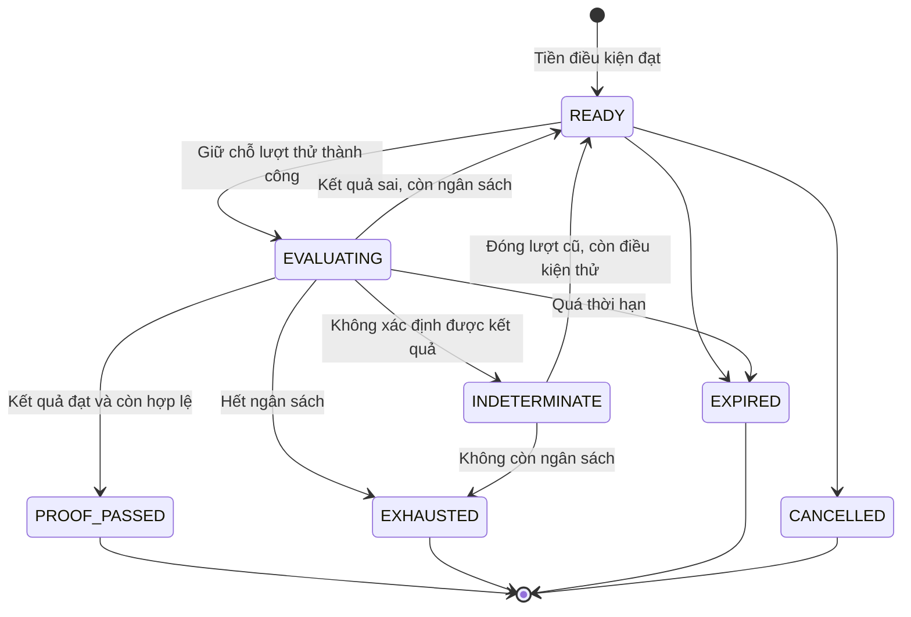
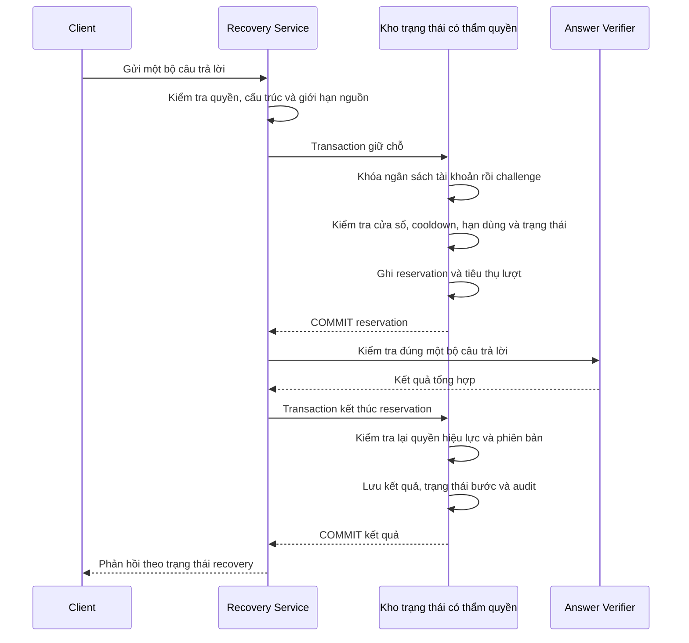

# Question answer attempt limits

## 1. Mục tiêu và bối cảnh sử dụng

**Question answer attempt limits** là chính sách giới hạn số lần hệ thống cho phép kiểm tra câu trả lời cho câu hỏi bảo mật. Chính sách cần xác định rõ: một lượt thử là gì, ngân sách được gắn với đối tượng nào, khi nào được thử tiếp và hành vi nào có thể làm ngân sách thay đổi.

Trong module `SECURITY_AUTHENTICATION_ACCOUNT_RECOVERY`, giới hạn này được xem xét trong luồng người dùng mất mật khẩu, MFA, passkey hoặc thiết bị xác thực. Mục tiêu là giảm khả năng một người không có quyền đoán được câu trả lời rồi chiếm quyền khôi phục tài khoản.

Câu hỏi bảo mật có điểm yếu nền tảng: câu trả lời có thể dễ đoán, được người quen biết hoặc xuất hiện trong dữ liệu công khai. OWASP hiện trình bày hướng dẫn về câu hỏi bảo mật cho mục đích duy trì hệ thống cũ và cảnh báo không coi chúng là yếu tố xác thực chấp nhận được trong phần mềm an toàn. [OWASP — Choosing and Using Security Questions](https://cheatsheetseries.owasp.org/cheatsheets/Choosing_and_Using_Security_Questions_Cheat_Sheet.html#introduction).

Vì vậy, bài học dùng bối cảnh **một hệ thống cũ đang được giảm rủi ro và chuyển sang phương thức recovery phù hợp hơn**. Các giới hạn bên dưới là thiết kế minh họa để kiểm soát phần còn tồn tại. Việc trả lời đúng không tự cấp quyền reset mật khẩu, tắt MFA, thêm passkey hay tạo session đầy đủ.

Sau bài học, người học có thể:

- Phân biệt giới hạn số lượt kiểm tra, giới hạn tốc độ và thời gian chờ.
- Thiết kế ngân sách nhiều lớp để chống đổi IP, tạo case mới và gửi song song.
- Thực hiện việc giữ chỗ lượt thử trước khi kiểm tra đáp án.
- Xử lý retry, hết hạn và lỗi hạ tầng mà không tạo lượt đoán miễn phí.
- Bảo vệ khả năng truy cập của chủ tài khoản và ghi nhận đủ dữ liệu để điều tra.

## 2. Giới hạn lượt thử giải quyết được điều gì?

### 2.1. Câu trả lời không có phân bố ngẫu nhiên

Giả sử câu trả lời có đúng 100 khả năng đồng xác suất, người tấn công biết tập đó và được thử ba giá trị khác nhau. Xác suất đoán đúng trong mô hình đơn giản này là:

```text
P(thành công) = 3 / 100 = 3%
```

Trong thực tế, các câu trả lời không đồng xác suất. Nếu ba giá trị phổ biến nhất chiếm lần lượt 20%, 10% và 8% số tài khoản trong một quần thể giả định, ba lần đoán theo thứ tự đó có thể bao phủ 38% quần thể. Đây là số giả lập để giải thích sự khác biệt, không phải thống kê thực tế của một sản phẩm.

Nếu người tấn công đã biết đáp án qua thông tin cá nhân, chỉ một lượt kiểm tra cũng có thể đủ. Giới hạn lượt thử làm giảm khả năng dò đoán trực tuyến; nó không khắc phục việc bí mật đã bị biết.

Nhiều câu hỏi cũng không tự tạo các xác suất độc lập. Quê quán, trường học và nơi sống có thể liên quan với nhau. Không nhân cơ học xác suất của từng câu rồi kết luận hệ thống có mức an toàn cao.

### 2.2. Ngân sách phải được cộng trên toàn bộ đường vào

Giả sử mỗi challenge cho phép ba lượt nhưng người yêu cầu có thể tạo 100 challenge mới. Nếu không có ngân sách gắn với tài khoản, tổng số lượt kiểm tra có thể đạt 300.

Tương tự:

- Giới hạn năm lượt trên một IP vẫn có thể bị vượt bằng nhiều IP.
- Giới hạn trong cookie có thể bị vượt bằng cách xóa cookie.
- Giới hạn trong bộ nhớ một instance có thể bị nhân lên khi chạy nhiều instance.
- Giới hạn riêng cho web và mobile có thể làm tổng lượt cao hơn dự định.
- Helpdesk kiểm tra lại câu trả lời có thể tạo một đường đoán nằm ngoài bộ đếm.

Câu hỏi thiết kế quan trọng là: **tổng số đáp án ứng viên mà mọi kênh thực sự được phép kiểm tra cho cùng một tài khoản là bao nhiêu?**

## 3. Phân biệt các loại giới hạn

| Cơ chế | Câu hỏi nó trả lời | Ví dụ minh họa |
| --- | --- | --- |
| Attempt budget | Được kiểm tra tối đa bao nhiêu đáp án ứng viên? | Tối đa ba bộ câu trả lời cho một challenge |
| Rate limit | Trong một khoảng thời gian được gửi hoặc kiểm tra bao nhiêu lần? | Giới hạn lưu lượng theo nguồn và theo tài khoản |
| Cooldown | Sớm nhất khi nào được kiểm tra tiếp? | Chờ đến `next_allowed_at` sau một lần sai |
| Challenge expiry | Quyền tiếp tục challenge còn hiệu lực không? | Challenge hết hạn sau thời gian đã định |
| Recovery step restriction | Hết điều kiện thử thì chặn phần nào? | Dừng nhánh câu hỏi bảo mật, chuyển sang phương thức khác |
| Account suspension | Tài khoản có bị hạn chế toàn bộ hay không? | Quyết định xử lý sự cố riêng, cần bằng chứng và chính sách phù hợp |

Một cooldown 30 giây vẫn cho phép rất nhiều lượt trong một ngày nếu không có ngân sách dài hơn. Một ngân sách ba lượt nhưng cho kiểm tra cả ba trong cùng thời điểm vẫn có thể tạo tải và lộ kết quả nhanh nếu không có kiểm soát đồng thời.

Hết hạn challenge không đồng nghĩa xóa lịch sử thử của tài khoản. Thời hạn dùng một challenge và thời gian ghi nhớ các lượt thử là hai khái niệm độc lập.

NIST SP 800-63B-4 có quy định giới hạn thất bại cho các authenticator thuộc phạm vi tương ứng; mức 100 được mô tả là giới hạn trên với các điều kiện áp dụng, có thể đặt thấp hơn. Không lấy con số đó làm khuyến nghị “100 lần trả lời câu hỏi bảo mật”. [NIST — Rate Limiting](https://pages.nist.gov/800-63-4/sp800-63b/authenticators/).

## 4. Định nghĩa chính xác một lượt thử

Trong thiết kế minh họa của bài:

> Một lượt thử là một bộ câu trả lời hợp lệ về cấu trúc, được máy chủ chấp nhận đưa vào bộ kiểm tra sau khi đã giữ chỗ trong tất cả ngân sách bắt buộc.

Một bộ gồm ba câu trả lời được tính là một ứng viên tổng hợp, nếu server chỉ đưa ra kết quả chung và không lưu tiến độ đúng từng câu cho người gọi.

### 4.1. Phân loại trước khi đếm

| Tình huống | Có tiêu thụ ngân sách kiểm tra đáp án? | Cách xử lý |
| --- | --- | --- |
| Request vượt kích thước cho phép hoặc JSON sai cấu trúc | Không | Từ chối trước bộ kiểm tra; vẫn chịu giới hạn lưu lượng theo nguồn |
| Không có challenge hợp lệ hoặc không có quyền truy cập challenge | Không | Không kiểm tra đáp án; phản hồi theo chính sách chống tiết lộ |
| Challenge đã hết hạn | Không | Dừng kiểm tra; không tạo lại ngân sách tài khoản |
| Đang trong cooldown | Không | Không gọi verifier, không kéo dài thời gian chờ chỉ vì có request bị chặn |
| Còn ngân sách và bộ câu trả lời đúng cấu trúc | Có | Giữ chỗ trước khi so sánh |
| Câu trả lời đúng trong lượt đã giữ chỗ | Có | Ghi kết quả đạt bước này; không tự xóa lịch sử tài khoản |
| Client ngắt kết nối sau khi server đã kiểm tra | Có | Lượt đã được sử dụng |
| Hệ thống không xác định được verifier đã chạy hay chưa | Giữ lượt đã giữ chỗ | Xử lý trạng thái chưa rõ; không tự hoàn ngân sách |
| Retry đúng cùng một thao tác đã có kết quả | Không tạo lượt mới nếu idempotency được triển khai đúng | Trả lại kết quả đã lưu, không kiểm tra bộ đáp án mới |
| Retry cùng ID nhưng thay nội dung | Không cho kiểm tra miễn phí | Từ chối xung đột hoặc yêu cầu thao tác mới theo chính sách |

Việc các request bị chặn không tiêu thụ lượt kiểm tra không có nghĩa chúng không bị kiểm soát. Cần giới hạn lưu lượng HTTP và mức đồng thời để tránh người tấn công gây tải bằng request không đến verifier.

### 4.2. Tránh bộ kiểm tra tiết lộ từng phần

Nếu giao diện báo “câu 1 đúng, câu 2 sai”, người tấn công có thể giữ nguyên câu 1 và tập trung đoán câu 2. API cần tránh trả các trường như:

```json
{
  "question1Correct": true,
  "question2Correct": false,
  "matchedAnswers": 1
}
```

Với chính sách trả lời cả bộ, phản hồi chỉ thể hiện kết quả tổng hợp. Không cung cấp điểm tương đồng, số ký tự khớp, đáp án gần đúng hoặc gợi ý được sinh từ câu trả lời đã lưu.

Đổi câu hỏi sau mỗi lần thất bại cũng có thể cho phép người tấn công tìm câu dễ hơn. Bộ câu hỏi của challenge cần được cố định phía máy chủ; ngân sách tài khoản tiếp tục được giữ khi challenge mới được tạo.

### 4.3. Chuẩn hóa không được thành nhiều phép đoán ngầm

Nếu hệ thống thử tất cả biến thể viết hoa, bỏ dấu, phiên âm, sửa lỗi chính tả và biệt danh cho một chuỗi gửi lên, một lượt HTTP có thể tương ứng với nhiều ứng viên thực tế.

Quy tắc chuẩn hóa cần xác định từ lúc lưu câu trả lời, áp dụng nhất quán và có phiên bản. Với tiếng Việt, việc bỏ dấu có thể gộp những câu trả lời vốn khác nhau. Không thay quy tắc chỉ để tăng tỷ lệ khớp mà không xem lại tác động lên khả năng đoán.

Bài học không đưa ra một quy tắc chuẩn hóa chung. Bất biến cần giữ là một lượt được đánh giá theo đúng quy tắc đã công bố, không mở rộng thành tìm kiếm mờ không giới hạn.

## 5. Thiết kế ngân sách nhiều lớp

Một chính sách có thể kết hợp các lớp sau:

| Phạm vi | Khóa gắn ngân sách | Mục tiêu |
| --- | --- | --- |
| Challenge | Challenge ID do server tạo | Giới hạn một phiên câu hỏi |
| Recovery case | Case ID gắn với tài khoản | Ngăn đổi challenge trong cùng hồ sơ để lấy lượt mới |
| Tài khoản và loại bước | Tenant + account ID + `SECURITY_QUESTIONS` | Ngăn tạo nhiều case hoặc đổi kênh để tiếp tục đoán |
| Nguồn | IP hoặc nhóm nguồn được hệ thống xác định đáng tin cậy | Giảm lưu lượng tự động và dò trên nhiều tài khoản |
| Client hoặc thiết bị | Tín hiệu đã được đánh giá độ tin cậy | Hỗ trợ nhận biết lạm dụng, không làm khóa duy nhất |
| Toàn dịch vụ | Hạn mức tài nguyên và mức đồng thời | Bảo vệ bộ kiểm tra và cơ sở dữ liệu |

Các lớp quyết định bằng phép **AND**: chỉ được kiểm tra khi mọi điều kiện bắt buộc đều cho phép. Một lớp còn lượt không bù cho lớp khác đã hết lượt.

### 5.1. Ví dụ chính sách để thảo luận

Những con số sau hoàn toàn là tham số minh họa, chưa được đo lường để áp dụng cho sản phẩm thật:

| Tham số | Giá trị minh họa |
| --- | --- |
| Số bộ câu trả lời tối đa cho một challenge | 3 |
| Ngân sách tài khoản trong cửa sổ trượt 30 phút | 5 lượt đã giữ chỗ |
| Ngân sách tài khoản trong cửa sổ trượt 24 giờ | 10 lượt đã giữ chỗ |
| Thời hạn challenge | 10 phút |
| Cooldown sau các lần sai | 5 giây, 10 giây, 20 giây; có mức trần |
| Số phép kiểm tra đang chạy trên cùng tài khoản | 1 |
| Khi hết ngân sách dài hạn | Tạm dừng nhánh câu hỏi; đưa ra phương thức recovery phù hợp khác |

Tài khoản đã dùng ba lượt trong challenge A rồi mở challenge B chỉ còn hai lượt trong cửa sổ 30 phút, giả sử các lượt trước vẫn nằm trong cửa sổ đó. Challenge B có ngân sách riêng là ba nhưng không thể dùng cả ba.

Giới hạn nguồn cần được cấu hình riêng theo lưu lượng nền và đặc điểm mạng. Mạng dùng chung, NAT hoặc proxy có thể khiến nhiều người hợp lệ cùng xuất hiện tại một IP; IP không đại diện chắc chắn cho một cá nhân.

### 5.2. Chọn thuật toán cửa sổ phù hợp mục tiêu

- **Fixed window:** triển khai đơn giản nhưng có thể nhận gần hai lần hạn mức quanh ranh giới hai cửa sổ.
- **Sliding window:** phù hợp khi cần bảo đảm tổng lượt trong bất kỳ khoảng thời gian xác định nào không vượt giới hạn.
- **Token bucket:** kiểm soát tốc độ trung bình và cho phép burst đến mức cấu hình; không tương đương giới hạn tổng tuyệt đối trong mọi cửa sổ.
- **Cooldown:** quy định thời điểm sớm nhất được thử tiếp; cần phối hợp với ngân sách.

Nếu chính sách ghi “không quá năm lượt trong bất kỳ 30 phút nào”, implementation fixed window theo nửa giờ trên đồng hồ không thực hiện đúng cam kết đó.

Việc đợi qua cửa sổ chỉ làm một số lượt hết ảnh hưởng đến cửa sổ, không làm câu trả lời trở nên bí mật lại. Người tấn công kiên trì vẫn có thể tích lũy lượt theo thời gian. Đây là lý do cần giảm phụ thuộc vào câu hỏi bảo mật.

## 6. Gắn challenge với đúng tài khoản và đúng bước

Challenge cần là trạng thái do máy chủ quản lý, gồm tối thiểu:

| Trường | Mục đích |
| --- | --- |
| `challenge_id` | Định danh ngẫu nhiên, không tuần tự dễ đoán |
| `tenant_id`, `account_id` | Tài khoản đích được xác định phía máy chủ |
| `recovery_case_id` | Hồ sơ chứa bước đang thực hiện |
| `purpose` | Ví dụ `LEGACY_QUESTION_CHECK` |
| `question_set_version` | Bộ câu hỏi và phiên bản đáp án được dùng |
| `normalization_version` | Quy tắc chuẩn hóa đã áp dụng |
| `expires_at` | Thời điểm hết hiệu lực |
| `status` | Trạng thái hiện tại |
| `used_attempts`, `max_attempts` | Ngân sách cục bộ |
| `in_flight_attempt_ref` | Tham chiếu lượt đã giữ chỗ, nếu có |
| `policy_version` | Chính sách chi phối challenge |

Biết challenge ID không đủ để có quyền trả lời. Challenge cần bị ràng buộc với ngữ cảnh recovery đã được cấp quyền, bao gồm kiểm tra tenant, tài khoản, case và mục đích.

Trong bối cảnh minh họa, người yêu cầu chỉ được thấy câu hỏi sau một bước tiền điều kiện, chẳng hạn xác minh quyền truy cập kênh đã đăng ký bằng token recovery phù hợp. Đây là một hàng rào giảm lạm dụng và tiết lộ câu hỏi; nó không tự chứng minh người đó đã đạt toàn bộ điều kiện khôi phục MFA hoặc passkey.

Không tin `account_id`, `max_attempts`, `remaining_attempts` hoặc `verified=true` từ client. Nếu client gửi các giá trị đó, server vẫn phải lấy quyết định từ trạng thái có thẩm quyền.

### 6.1. Trạng thái tham khảo



Cooldown có thể được thể hiện bằng `next_allowed_at` thay vì một trạng thái riêng. Trạng thái `PROOF_PASSED` chỉ cho biết bước câu hỏi đã đạt, không đồng nghĩa tài khoản đã được xác thực hoặc recovery đã hoàn tất.

## 7. Giữ chỗ lượt thử một cách nguyên tử

### 7.1. Lỗi đọc rồi tăng bộ đếm

Đoạn sau không an toàn khi nhiều request cùng chạy:

```java
if (counter.getUsed() < limit) {
    boolean matched = answerVerifier.verify(answers);
    counter.increment();
    return matched;
}
```

Khi bộ đếm đang là 2 và giới hạn là 3, mười request có thể cùng đọc thấy còn một lượt rồi cùng kiểm tra đáp án. Nếu chỉ tăng khi sai, các request đang chạy vẫn có thể vượt ngân sách trước khi kết quả đầu tiên được ghi.

`synchronized` trong một JVM không giải quyết việc nhiều instance, nhiều service hoặc nhiều region cùng xử lý.

### 7.2. Tách giai đoạn giữ chỗ và giai đoạn kết thúc

Một mô hình đề xuất gồm hai transaction ngắn và bước kiểm tra nằm ở giữa:



Các điều kiện của transaction giữ chỗ:

1. Lấy thời gian từ nguồn máy chủ thống nhất.
2. Khóa hoặc cập nhật có điều kiện đối với ngân sách tài khoản và challenge.
3. Kiểm tra mọi ngân sách tài khoản bắt buộc cùng ngân sách cục bộ.
4. Kiểm tra thời hạn, cooldown và giới hạn lượt đang chạy.
5. Tạo reservation duy nhất và tăng bộ đếm hoặc thêm bản ghi ledger.
6. Commit trước khi gọi verifier.

Với cửa sổ trượt chính xác, ledger có thể lưu thời điểm của mỗi lượt đã giữ chỗ. Việc đếm ledger và thêm lượt mới phải cùng tuân thủ khóa ngân sách tài khoản; chỉ chạy `COUNT` rồi `INSERT` ở hai bước không được bảo vệ vẫn có thể vượt hạn mức.

Nếu dùng PostgreSQL, `SELECT ... FOR UPDATE` giữ khóa các hàng được chọn đến hết transaction và phối hợp với các transaction khác lấy khóa tương ứng. [PostgreSQL — Row-Level Locks](https://www.postgresql.org/docs/current/explicit-locking.html#LOCKING-ROWS).

Khóa hàng không có tác dụng nếu bản ghi ngân sách chưa tồn tại. Cần tạo trước hoặc tạo bằng ràng buộc duy nhất và xử lý xung đột, rồi mới lấy khóa. Mọi đường cập nhật phải thống nhất thứ tự khóa để giảm deadlock.

### 7.3. Giả mã Java cho luồng hai giai đoạn

Đây là giả mã về ranh giới xử lý; các thành phần phân quyền, transaction, lưu trữ và verifier cần được hiện thực riêng.

```java
QuestionStepResponse submit(
        AuthorizedRecoveryContext context,
        QuestionSubmission submission) {

    inputPolicy.requireBoundedAndWellFormed(submission);
    sourceLimits.requireAllowed(context.sourceContext());

    // Nội bộ reserve() kiểm tra lại ràng buộc context,
    // mọi ngân sách bắt buộc, cooldown và trạng thái.
    ReserveResult reserve = attemptService.reserve(
            context, submission.challengeId());

    if (!reserve.allowed()) {
        return responsePolicy.forDeniedAttempt(context, reserve);
    }

    AttemptReservation attempt = reserve.reservation();

    VerificationResult result;
    try {
        result = verifier.verifyWholeSet(
                attempt.accountReference(),
                attempt.questionSetVersion(),
                attempt.normalizationVersion(),
                submission.answers());
    } catch (VerifierUnavailableException ex) {
        // Giữ lượt đã tiêu thụ; không thử miễn phí lần nữa.
        attemptService.markIndeterminate(attempt.reference());
        return responsePolicy.temporarilyUnavailable();
    }

    // finish() chỉ nhận kết quả từ server, không nhận cờ
    // "answersCorrect" do client gửi.
    FinishResult finish = attemptService.finish(
            context, attempt.reference(), result);

    return responsePolicy.forFinishedAttempt(context, finish);
}
```

`reserve()` phải commit lượt trước khi trả `allowed=true`. Nếu nó ném lỗi vì không thể giữ ngân sách một cách đáng tin cậy, luồng không được đi tiếp đến verifier.

`finish()` cần kiểm tra lại:

- Reservation còn ở trạng thái có thể kết thúc và đúng tài khoản, case, challenge.
- Challenge chưa bị hủy, thay thế hoặc hết hạn theo chính sách.
- Phiên bản câu hỏi và đáp án chưa bị thay đổi làm kết quả cũ mất hiệu lực.
- Tiền điều kiện recovery và trạng thái an toàn tài khoản còn phù hợp.
- Kết quả chưa được áp dụng từ lần gọi kết thúc trước đó.

Khi đáp án sai, lưu kết quả thất bại, cập nhật cooldown và đóng hoặc tiếp tục challenge theo ngân sách. Khi đáp án đúng, chuyển bước sang `PROOF_PASSED` một lần và đánh dấu challenge đã dùng. Quyết định reset hoặc cấp grant recovery thuộc bước chính sách riêng.

Không ném một exception khiến transaction ghi nhận thất bại bị rollback sau khi đã cần lưu kết quả sai. Lượt giữ chỗ vẫn phải tồn tại, và sự kiện kết quả phải được ghi theo ranh giới transaction đã thiết kế.

### 7.4. Một kho trạng thái có thẩm quyền

Có thể dùng database hoặc một hệ lưu trữ hỗ trợ primitive nguyên tử phù hợp. Những yêu cầu không thay đổi:

- Kiểm tra điều kiện và giữ lượt là một thao tác có hiệu lực nguyên tử theo phạm vi cần bảo vệ.
- Bộ đếm bảo mật không đọc từ replica có độ trễ.
- Các instance và các kênh dùng cùng ngân sách có thẩm quyền.
- Trạng thái không mất sau khi tiến trình ứng dụng khởi động lại.
- Thời gian tồn tại của dữ liệu không ngắn hơn cửa sổ mà nó cần bảo vệ.

Với triển khai nhiều region, chỉ sao chép bộ đếm theo cơ chế nhất quán cuối cùng có thể cấp vượt ngân sách. Cần chọn mô hình như điều phối theo một region có thẩm quyền cho tài khoản, lưu trữ nhất quán mạnh hoặc cấp phát quota có giới hạn tổng được chứng minh.

Cache có thể từ chối sớm để giảm tải, nhưng quyết định cho phép verifier chạy vẫn phải đi qua cơ chế bảo đảm ngân sách đã chọn.

## 8. Cooldown, hết hạn và khôi phục ngân sách

### 8.1. Backoff phải có trần và nguồn thời gian đáng tin cậy

Một công thức minh họa:

```text
delay(f) = min(delay_max, delay_base × 2^(f - 1))
next_allowed_at = thời điểm ghi nhận thất bại + delay(f)
```

Trong đó `f` là số lần thất bại theo phạm vi mà chính sách định nghĩa, chẳng hạn chuỗi thất bại của bước câu hỏi trên tài khoản. Khi tính trong code cần giới hạn số mũ để tránh tràn số.

Không dùng lệnh sleep giữ thread HTTP trong suốt cooldown. Lưu thời điểm được phép thử tiếp và trả phản hồi thích hợp; lần gửi sau được máy chủ kiểm tra lại.

Request đến trong lúc chờ không cần kéo dài `next_allowed_at`. Nếu mỗi request bị chặn lại đẩy thời gian chờ ra xa hơn, người tấn công có thể duy trì việc chặn người dùng chỉ bằng lưu lượng nhỏ.

### 8.2. Những sự kiện không được tạo ngân sách mới

Trong thiết kế này, các thao tác sau không xóa ngân sách dùng chung của tài khoản:

- Refresh trang, đăng xuất hoặc đổi trình duyệt.
- Đổi IP, thiết bị hoặc ngôn ngữ.
- Tạo case mới, xin lại link hoặc tạo challenge mới.
- Chọn bộ câu hỏi khác hay chuyển sang API của kênh khác.
- Một câu trong bộ được trả lời đúng.
- Challenge cũ hết hạn.
- Một request trả lời đúng nhưng toàn bộ recovery chưa đạt yêu cầu.
- Đổi phiên bản triển khai ứng dụng.

Ngân sách cửa sổ phục hồi khi các lượt cũ ra khỏi cửa sổ theo chính sách. Quyết định mở lại nhánh đã bị hạn chế lâu hơn cần điều kiện được định nghĩa rõ, ví dụ hoàn tất phương thức recovery khác có đủ mức bảo đảm hoặc một quy trình hỗ trợ đã kiểm soát.

Nếu người dùng xác thực thành công bằng phương tiện mạnh khác, hệ thống có thể chuyển sang đường recovery phù hợp và bỏ qua nhu cầu dùng câu hỏi. Không cần tự động xóa mọi dấu vết lạm dụng để thực hiện chuyển đường này.

### 8.3. Giữ khả năng truy cập cho chủ tài khoản

OWASP cảnh báo không khóa tài khoản chỉ vì bị tấn công vào luồng quên mật khẩu, vì người biết username có thể lợi dụng điều đó để từ chối dịch vụ đối với nạn nhân. [OWASP — Forgot Password, Account Lockout](https://cheatsheetseries.owasp.org/cheatsheets/Forgot_Password_Cheat_Sheet.html#account-lockout).

Trong thiết kế bài học, hết lượt câu hỏi dẫn đến hạn chế **bước câu hỏi bảo mật**. Nó không tự khóa đăng nhập bằng passkey còn hợp lệ, hủy mọi session hoặc vô hiệu hóa MFA đang dùng.

Đường thay thế có thể là authenticator dự phòng, recovery code đã cấp trước hoặc quy trình xác minh phù hợp tài khoản. Chính sách cần xét mức bảo đảm và rủi ro; không đổi sang câu hỏi dễ hơn, xin thêm thông tin công khai hoặc cho helpdesk bỏ qua điều kiện chỉ vì người yêu cầu nói đang gấp.

CAPTCHA có thể giảm một phần tự động hóa nhưng không làm tăng ngân sách đáp án, không thay thế xác minh danh tính và không khắc phục câu trả lời đã bị biết.

## 9. Xử lý retry, sự cố và dữ liệu hết hạn

### 9.1. Retry không được trở thành phép đoán miễn phí

Giả mã ở phần trước chưa triển khai idempotency cho request. Với mô hình đơn giản đó, một request gửi lại là một yêu cầu mới và có thể tiêu thụ thêm lượt nếu được phép kiểm tra. Client nên ngăn gửi trùng ngoài ý muốn, nhưng việc vô hiệu hóa nút bấm không phải kiểm soát bảo mật.

Nếu sản phẩm hỗ trợ idempotency:

- Khóa idempotency phải gắn với tài khoản, case, challenge và ngữ cảnh được cấp quyền.
- Request đầu tiên tạo một thao tác; những lần gửi lại chỉ nhận trạng thái hoặc kết quả của thao tác đó.
- Không dùng lại ID cũ để đánh giá một bộ câu trả lời mới.
- Không chạy lại verifier chỉ vì response trước bị mất.
- Kết quả được trả lại phải tiếp tục tuân thủ kiểm tra quyền và thời hạn của luồng recovery.

Để nhận biết nội dung đã thay đổi, hệ thống có thể dùng fingerprint HMAC trên biểu diễn request chuẩn hóa, với khóa riêng được bảo vệ, chỉ lưu trong trạng thái idempotency ngắn hạn. Fingerprint này không được ghi vào audit hoặc dùng làm dữ liệu phân tích câu trả lời. Không dùng hash không khóa của câu trả lời ít khả năng làm fingerprint vì có thể bị dò ngược.

Một lựa chọn khác là không hỗ trợ gửi lại payload cho thao tác cũ và chỉ cho phép client truy vấn trạng thái bằng tham chiếu thao tác. Khi cần gửi bộ đáp án mới, phải tạo thao tác mới và đi qua giữ chỗ.

### 9.2. Tiến trình chết sau khi giữ chỗ

Nếu server chết sau reservation, không thể chắc chắn verifier chưa chạy chỉ vì chưa có kết quả lưu. Quy tắc thận trọng của ví dụ là giữ nguyên lượt đã tiêu thụ và chuyển reservation sang `INDETERMINATE` sau thời hạn xử lý.

Tác vụ dọn dẹp cần:

1. Chỉ xử lý reservation thực sự quá hạn.
2. Chuyển trạng thái bằng cập nhật có điều kiện, không ghi đè kết quả vừa hoàn tất.
3. Gỡ dấu lượt đang chạy chỉ khi tham chiếu vẫn trỏ đúng reservation đó.
4. Không giảm số lượt đã dùng trong cửa sổ.
5. Ngăn worker cũ đến muộn áp dụng kết quả sau khi reservation đã bị kết thúc hoặc thay thế.

Có thể dùng version hoặc fencing token để từ chối kết quả đến muộn. Giới hạn “một lượt đang chạy” ở đây là một lượt còn quyền tạo kết quả có hiệu lực; nếu worker cũ vẫn chiếm CPU sau timeout thì cần thêm cơ chế quản lý tác vụ và giới hạn tài nguyên.

Tự động hoàn lại mọi lượt khi timeout có thể tạo đường đoán không tốn ngân sách. Nếu sự cố hệ thống làm người dùng hợp lệ mất lượt, hướng xử lý là một phương thức recovery khác hoặc quy trình hỗ trợ có kiểm soát.

### 9.3. Thời hạn bộ đếm phải bao phủ cửa sổ bảo vệ

Challenge có hạn 10 phút nhưng ngân sách tài khoản xét 24 giờ thì không được xóa lịch sử tài khoản theo TTL của challenge.

Cần phân biệt:

- **Dữ liệu thực thi hạn mức:** tồn tại đủ lâu để tính cửa sổ và xử lý tác vụ đang dở.
- **Dữ liệu idempotency:** tồn tại theo thời gian retry được hỗ trợ và yêu cầu bảo mật liên quan.
- **Nhật ký audit:** có thời hạn riêng theo nhu cầu điều tra và chính sách tổ chức.

Việc đổi khóa HMAC, đổi schema hoặc chuyển nơi lưu trữ cũng không được âm thầm tạo bộ đếm mới cho cùng tài khoản. Nếu dữ liệu thực thi bị mất, hệ thống phải nhận biết trạng thái chưa đáng tin cậy thay vì coi số lượt đã dùng là 0.

### 9.4. Khi kho hạn mức không khả dụng

Không thể xác nhận ngân sách thì không tiếp tục kiểm tra đáp án. Trả lỗi tạm thời hoặc chuyển sang phương thức phù hợp khác theo chính sách, đồng thời tạo tín hiệu vận hành.

Điều này chỉ dừng phần kiểm tra phụ thuộc vào bộ đếm đang lỗi. Nó không yêu cầu khóa toàn bộ tài khoản hay vô hiệu hóa các authenticator còn hoạt động.

Lưu bộ đếm riêng trong từng instance làm phương án dự phòng có thể nhân ngân sách theo số instance. Nếu cần cơ chế dự phòng, phải thiết kế được giới hạn tổng của nó trước khi đưa vào sử dụng.

## 10. Phản hồi cho người dùng và chống tiết lộ

OWASP lưu ý thông báo, mã HTTP và thời gian xử lý có thể tạo khác biệt giúp suy ra trạng thái tài khoản. Thông báo chung ở giao diện chưa đủ nếu API vẫn trả chi tiết hoặc hành vi có thể phân biệt được. [OWASP — Authentication and Error Messages](https://cheatsheetseries.owasp.org/cheatsheets/Authentication_Cheat_Sheet.html#authentication-and-error-messages).

Thiết kế phản hồi nên phân biệt hai ngữ cảnh:

| Ngữ cảnh | Thông tin phù hợp |
| --- | --- |
| Người chỉ nhập username hoặc email ở đầu luồng | Phản hồi thống nhất, không xác nhận có tài khoản hay đã cạn lượt câu hỏi |
| Người đang có challenge recovery hợp lệ | Có thể được hướng dẫn chờ, biết challenge đã hết hạn hoặc chuyển phương thức, theo chính sách |
| Hệ thống audit nội bộ được cấp quyền | Mã lý do chính xác, lớp hạn mức đã chặn và định danh liên kết |
| Công cụ hỗ trợ | Phần trạng thái cần cho hỗ trợ; không xem câu trả lời hoặc tự bỏ qua ngân sách |

Ví dụ phản hồi trong ngữ cảnh challenge đã được cấp quyền:

```json
{
  "status": "WAIT_REQUIRED",
  "message": "Bạn có thể thử lại sau hoặc chọn phương thức khôi phục khác.",
  "retryAfterSeconds": 20
}
```

`retryAfterSeconds` chỉ hỗ trợ trải nghiệm. Dù client sửa thành 0 hoặc bỏ countdown, server vẫn đối chiếu `next_allowed_at`. Nếu ngân sách đã hết hoặc challenge sắp hết hạn trước lần thử tiếp, phản hồi cần hướng dẫn theo trạng thái đó, không hứa rằng chờ xong chắc chắn có lượt.

Có thể dùng HTTP 429 cho tình huống bị giới hạn theo hợp đồng API. Việc lựa chọn mã và header cần giữ nhất quán với yêu cầu chống tiết lộ của từng endpoint.

Một độ trễ ngẫu nhiên đơn lẻ không bảo đảm chống phân tích thời gian khi người tấn công có nhiều mẫu. Cần đánh giá các nhánh xử lý có thể quan sát được, tránh thoát sớm làm lộ kết quả từng câu và hạn chế số mẫu mà nguồn tấn công thu thập được.

Không làm người dùng mất lượt vì lỗi nhập có thể phát hiện trước khi gửi: hướng dẫn định dạng, giới hạn độ dài hợp lý và cảnh báo trường bắt buộc. Những hỗ trợ này không được tiết lộ câu trả lời đã lưu.

## 11. Những đường vượt hạn mức cần chủ động đóng

| Đường vượt | Nguyên nhân | Kiểm soát phù hợp |
| --- | --- | --- |
| Tạo case mới sau ba lần sai | Chỉ đếm theo case | Ngân sách tài khoản dùng chung |
| Chuyển từ web sang mobile hoặc helpdesk | Mỗi kênh có bộ đếm riêng | Dùng cùng dịch vụ hạn mức hoặc cơ chế tương đương có giới hạn tổng |
| Đổi IP liên tục | Chỉ đếm theo nguồn | Kết hợp ngân sách tài khoản và nguồn |
| Tự đặt header IP | Tin header do người gọi cung cấp | Chỉ lấy thông tin nguồn từ chuỗi proxy được cấu hình đáng tin cậy |
| Gửi nhiều request đồng thời | Kiểm tra đáp án trước khi giữ lượt | Reservation nguyên tử và kiểm soát đồng thời |
| Đổi question ID trong payload | Server tin bộ câu hỏi của client | Bộ câu hỏi cố định trong challenge phía máy chủ |
| Dùng cùng idempotency key với đáp án mới | Chỉ khử trùng lặp theo ID | Ràng buộc thao tác với nội dung hoặc cấm đánh giá lại payload |
| Chờ restart hoặc xóa cache | Bộ đếm không bền vững | Kho trạng thái có thẩm quyền và chính sách khi mất trạng thái |
| Khai thác ranh giới thời gian | Fixed window không khớp cam kết | Chọn thuật toán đúng ngữ nghĩa cửa sổ |
| Chủ động gây timeout | Tự hoàn lượt khi không rõ kết quả | Giữ lượt đã reserve, kiểm soát tác vụ đến muộn |
| Xin nhân viên “thử giúp” | Công cụ hỗ trợ nằm ngoài ngân sách | Không cho kiểm tra vô hạn; ưu tiên đường xác minh thay thế phù hợp |

Số lượng khóa trong hệ thống hạn mức cũng là tài nguyên. Nếu mọi username không tồn tại đều tạo một bản ghi dài hạn, người tấn công có thể làm tăng dữ liệu vô hạn. Cần kiểm soát đầu vào công khai và cardinality, đồng thời chỉ tạo trạng thái tài khoản khi server đã xác định đối tượng và quyền tham gia luồng phù hợp.

## 12. Audit và chỉ số vận hành

### 12.1. Ghi đủ để chứng minh giới hạn đang có hiệu lực

Một sự kiện reservation hoặc kết thúc có thể gồm:

```json
{
  "event_type": "recovery.question_attempt_finished",
  "attempt_ref": "attempt_demo_07",
  "tenant_ref": "tenant_demo_01",
  "account_ref": "account_demo_24",
  "recovery_case_ref": "case_demo_09",
  "challenge_ref": "challenge_demo_03",
  "occurred_at": "2026-11-23T03:00:15Z",
  "outcome": "NOT_MATCHED",
  "challenge_used_attempts": 3,
  "challenge_limit": 3,
  "account_window_30m_used": 3,
  "policy_version": "legacy-question-policy-v4",
  "next_state": "EXHAUSTED"
}
```

Các giá trị trên là dữ liệu giả. `account_ref` nên là tham chiếu nội bộ có kiểm soát; không cần dùng email làm khóa tương quan trong log.

Không ghi câu trả lời, request body đầy đủ, giá trị hash của đáp án, fingerprint đáp án, recovery token hoặc nội dung gợi ý. Kết quả chi tiết từng câu nếu không cần cho nghiệp vụ cũng không nên được tạo hoặc lưu.

Phân biệt sự kiện **đã giữ lượt**, **đã kiểm tra**, **đã kết thúc** và **bị chặn trước kiểm tra**. Không tính mọi HTTP 429 thành một lần đoán đáp án thực tế.

### 12.2. Theo dõi cả an toàn và khả năng sử dụng

| Chỉ số | Ý nghĩa |
| --- | --- |
| Lượt verifier chạy không có reservation hợp lệ | Dấu hiệu đường vượt kiểm soát; mục tiêu là không có |
| Số bộ đáp án được đánh giá trên cùng tài khoản trong cửa sổ | Đối chiếu trực tiếp với chính sách |
| Reservation không có kết quả | Tìm lỗi tác vụ, timeout hoặc khả năng bị khai thác |
| Tỷ lệ bị giới hạn theo tài khoản và theo nguồn | Phân biệt tấn công tập trung với nguồn dùng chung bị ảnh hưởng |
| Case mới tạo sau khi challenge cạn lượt | Phát hiện nỗ lực làm mới ngân sách |
| Tỷ lệ người dùng chuyển được sang phương thức khác | Đánh giá khả năng tiếp tục recovery |
| Thời gian người dùng hợp lệ bị chặn ở nhánh câu hỏi | Nhận biết tác động của cooldown và sự cố |
| Tỷ lệ recovery còn phụ thuộc vào câu hỏi | Theo dõi tiến trình loại bỏ cơ chế cũ |

Cảnh báo cần đưa đến một hành động cụ thể: kiểm tra nguồn tấn công, kiểm tra lỗi reservation, hỗ trợ chuyển phương thức hoặc sửa cấu hình. Không tự gửi một email sau mỗi lần sai vì có thể tạo kênh quấy rối hộp thư nạn nhân. Thông báo hoạt động bất thường cần có giới hạn tần suất và chính sách riêng.

## 13. Tình huống minh họa

Một người yêu cầu đã qua tiền điều kiện truy cập challenge. Tài khoản dùng chính sách ở phần 5; các lượt thử dưới đây đều trong cùng cửa sổ 30 phút.

| Thời điểm | Hành động | Kết quả |
| --- | --- | --- |
| 09:00:00 | Gửi bộ đáp án sai thứ nhất ở challenge A | Dùng một lượt; chờ đến 09:00:05 |
| 09:00:05 | Gửi bộ đáp án sai thứ hai | Dùng lượt thứ hai; chờ đến 09:00:15 |
| 09:00:15 | Gửi bộ đáp án sai thứ ba | Challenge A hết lượt; cooldown tài khoản đến 09:00:35 |
| 09:00:16 | Tạo challenge B rồi gửi ngay | Không kiểm tra vì cooldown; ngân sách tài khoản vẫn đã dùng ba lượt |
| 09:00:35 | Gửi bộ đáp án sai ở B | Dùng lượt thứ tư của tài khoản; backoff tiếp theo là 40 giây |
| 09:01:15 | Gửi bộ đáp án sai khác ở B | Dùng lượt thứ năm; hết ngân sách cửa sổ 30 phút |
| 09:01:16 | Đổi IP và gửi hai mươi request song song | Không có lượt kiểm tra mới |
| Sau đó | Chọn phương thức recovery khác | Đánh giá theo chính sách của phương thức đó, không xóa lịch sử câu hỏi |

Vì giới hạn tài khoản đã đạt, challenge B không sử dụng được lượt cục bộ cuối cùng trong cửa sổ đó. Sau khi thời gian trôi qua, khả năng thử lại còn phụ thuộc đồng thời vào ngân sách cửa sổ dài, hạn challenge, cooldown và trạng thái case.

Nếu các request ở dòng gửi song song làm verifier chạy thêm, lỗi nằm ở cơ chế bảo đảm ngân sách, dù giao diện vẫn hiển thị “đã hết lượt”.

## 14. Các tình huống cần kiểm chứng khi triển khai

Bảng sau là tiêu chí kiểm chứng cho người triển khai, không phải báo cáo rằng hệ thống cụ thể đã chạy các phép thử này.

| Tình huống | Điều kiện đạt |
| --- | --- |
| Còn một lượt nhưng gửi nhiều request từ nhiều instance | Không có quá một ứng viên mới được chấp nhận kiểm tra |
| Tạo case hoặc challenge mới | Không xóa lượt tài khoản còn trong cửa sổ |
| Chuyển kênh hoặc đổi IP | Ngân sách tài khoản vẫn giữ nguyên |
| Gửi request trong cooldown | Verifier không chạy; cooldown không bị kéo dài chỉ bởi request bị chặn |
| Sửa countdown ở client | Quyết định phía server không thay đổi |
| Kiểm tra sát ranh giới hai cửa sổ | Số lượt đúng ngữ nghĩa thuật toán đã công bố |
| Server chết sau reservation | Lượt vẫn tồn tại; không tự hoàn; tác vụ đến muộn không áp dụng được kết quả cũ |
| Kho hạn mức không khả dụng | Không kiểm tra đáp án theo đường không có bảo đảm |
| Retry cùng thao tác | Không đánh giá bộ đáp án mới bằng quyền của thao tác cũ |
| Một câu đúng và một câu sai | Không trả kết quả riêng từng câu |
| Challenge hết hạn trong lúc verifier chạy | Không áp dụng kết quả ngoài thời hạn theo chính sách |
| Câu trả lời được cập nhật trong luồng khác | Kết quả theo phiên bản cũ không được tự chấp nhận |
| Có tấn công vào nhánh câu hỏi | Đường đăng nhập hợp lệ và phương thức recovery khác không tự bị khóa theo |
| Restart, scale-out hoặc chuyển region | Không tạo thêm ngân sách ngoài giới hạn đã thiết kế |
| Kiểm tra log, trace và công cụ hỗ trợ | Không có đáp án, hash đáp án hoặc token khôi phục bị ghi lộ |

Điều kiện quan trọng nhất là có thể chứng minh số phép kiểm tra thực tế được giới hạn trên toàn bộ hệ thống. Khi chuyển khỏi câu hỏi bảo mật, cần vô hiệu hóa cả endpoint cũ và đường xử lý hỗ trợ, tránh để cơ chế đã bị loại bỏ khỏi giao diện vẫn tồn tại ở backend.

## 15. Tài liệu đối chiếu

- [OWASP — Choosing and Using Security Questions](https://cheatsheetseries.owasp.org/cheatsheets/Choosing_and_Using_Security_Questions_Cheat_Sheet.html): bối cảnh hệ thống cũ và giới hạn nền tảng của câu hỏi bảo mật.
- [OWASP — Authentication Cheat Sheet](https://cheatsheetseries.owasp.org/cheatsheets/Authentication_Cheat_Sheet.html): chống tự động hóa và tránh tiết lộ qua phản hồi.
- [OWASP — Forgot Password Cheat Sheet](https://cheatsheetseries.owasp.org/cheatsheets/Forgot_Password_Cheat_Sheet.html): phòng chống lạm dụng luồng recovery và nguy cơ khóa tài khoản nạn nhân.
- [NIST SP 800-63B-4 — Authenticator and Verifier Requirements](https://pages.nist.gov/800-63-4/sp800-63b/authenticators/): phạm vi yêu cầu throttling đối với các authenticator.
- [PostgreSQL — Explicit Locking](https://www.postgresql.org/docs/current/explicit-locking.html): hành vi khóa hàng khi xây dựng transaction giữ chỗ.
