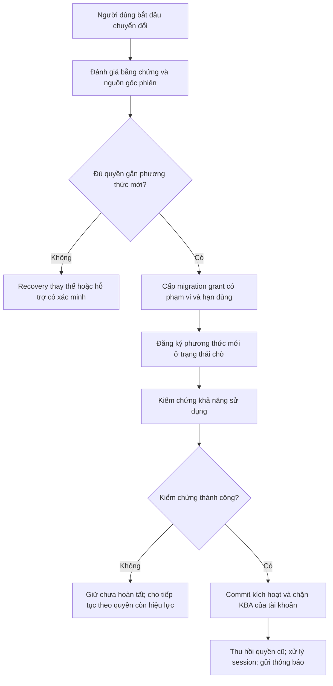

# Legacy question migration — Chuyển đổi khỏi câu hỏi bảo mật cũ

## 1. Mục tiêu của quá trình chuyển đổi

Trong chương **Security Questions** của module `SECURITY_AUTHENTICATION_ACCOUNT_RECOVERY`, legacy question migration là quá trình loại bỏ vai trò xác thực của câu hỏi bảo mật đã tồn tại trong hệ thống, đồng thời giúp chủ tài khoản thiết lập phương thức truy cập và khôi phục phù hợp hơn.

Một hệ thống cũ có thể cho phép đặt lại mật khẩu bằng tên trường học, tên người thân hoặc câu trả lời tự chọn. Sau khi bổ sung MFA hay passkey, đường khôi phục đó vẫn có thể vô hiệu hóa lợi ích của phương thức mới: người biết câu trả lời có thể đặt lại mật khẩu, xóa MFA hoặc đăng ký thiết bị của họ.

Mục tiêu chuyển đổi phải bao phủ cả ba việc:

- Ngừng dùng câu hỏi và câu trả lời cũ để cấp quyền truy cập hoặc thay đổi thông tin xác thực.
- Đăng ký phương thức thay thế cho đúng chủ tài khoản bằng một quy trình có căn cứ tin cậy rõ ràng.
- Thu hồi quyền phát sinh từ cơ chế cũ và xử lý dữ liệu câu hỏi, câu trả lời còn lưu lại.

NIST SP 800-63-4 nêu rằng knowledge-based authentication, tức xác thực bằng câu hỏi về thông tin được cho là chỉ người dùng biết, không tạo thành bí mật được chấp nhận cho xác thực số. Đây là cơ sở để loại bỏ vai trò xác thực của KBA; không nên chỉ đổi nội dung câu hỏi rồi coi việc chuyển đổi đã hoàn tất. [NIST SP 800-63-4 — Digital Identity Model](https://pages.nist.gov/800-63-4/sp800-63/model/).

OWASP cũng cảnh báo câu hỏi bảo mật không còn là yếu tố xác thực được chấp nhận; phần hướng dẫn lựa chọn câu hỏi trong tài liệu của họ phục vụ bối cảnh hệ thống cũ. Vì vậy, bài học này hướng tới việc ngừng phụ thuộc vào câu hỏi, thay vì xây dựng thêm bộ câu hỏi mới. [OWASP — Choosing and Using Security Questions](https://cheatsheetseries.owasp.org/cheatsheets/Choosing_and_Using_Security_Questions_Cheat_Sheet.html).

Các trạng thái, mốc triển khai và ví dụ trong bài là thiết kế minh họa cho ứng dụng. Chúng không tự chứng minh một hệ thống đáp ứng AAL hoặc một tiêu chuẩn cụ thể.

## 2. Phân biệt chuyển đổi giao diện, dữ liệu và quyền xác thực

Ẩn màn hình câu hỏi chỉ thay đổi trải nghiệm người dùng. Nếu API cũ vẫn phát reset token sau khi kiểm tra câu trả lời, đường chiếm đoạt tài khoản vẫn còn.

| Thay đổi | Giải quyết được gì | Phần còn thiếu |
| --- | --- | --- |
| Xóa câu hỏi khỏi giao diện web | Người dùng web không còn thấy lựa chọn cũ | Ứng dụng di động, API và helpdesk có thể vẫn dùng |
| Băm lại câu trả lời bằng thuật toán tốt hơn | Có thể giảm một số rủi ro khi dữ liệu lưu trữ bị lộ | Không làm thông tin công khai trở thành bí mật khó đoán |
| Chép câu trả lời sang trường `recoverySecret` | Chỉ đổi mô hình hoặc tên dữ liệu | Không tạo ra bằng chứng mới hay entropy mới |
| Cho đăng ký passkey sau khi trả lời đúng | Tạo được credential mới | Có thể gắn credential của kẻ tấn công vào tài khoản nạn nhân |
| Chặn cơ chế cũ trên máy chủ và chuyển đổi bằng bằng chứng phù hợp | Thay đổi ranh giới cấp quyền | Còn phải thu hồi token cũ, hỗ trợ tài khoản chưa chuyển và xử lý dữ liệu |

Không chuyển trực tiếp câu trả lời hoặc giá trị băm của nó thành backup code, secret TOTP, mật khẩu mới hoặc đầu vào sinh khóa. Những bí mật mới phải được tạo và đăng ký theo quy trình riêng của loại phương thức đó.

Ngay cả khi người dùng trước đây nhập một chuỗi ngẫu nhiên vào ô câu trả lời, không nên tự động nâng toàn bộ trường dữ liệu này thành authenticator mới. Hệ thống thường không có bằng chứng đáng tin cậy về entropy, cách lưu, khả năng bị dùng lại và lịch sử cấp quyền của từng câu trả lời.

## 3. Kiểm kê toàn bộ nơi câu hỏi đang có quyền

Trước khi lập lịch ngừng hỗ trợ, cần biết cơ chế cũ có thể cấp những quyền gì. Việc kiểm kê nên mô tả **đầu vào, quyết định và tác động**, không chỉ tìm tên bảng cơ sở dữ liệu.

| Bề mặt | Ví dụ cần kiểm tra | Rủi ro nếu bỏ sót |
| --- | --- | --- |
| Đăng ký và cài đặt bảo mật | Tạo câu hỏi, sửa câu trả lời, bật lại tùy chọn | Tiếp tục sinh dữ liệu và tài khoản phụ thuộc mới |
| Quên mật khẩu | Đổi mật khẩu trực tiếp hoặc phát reset token | Vẫn có đường lấy lại mật khẩu bằng KBA |
| Mất MFA hoặc passkey | Xóa yếu tố cũ, thêm thiết bị, cấp backup code | Bỏ qua phương thức xác thực mạnh hơn |
| API và phiên bản ứng dụng cũ | Endpoint khác tên, tham số tương thích, SDK cũ | Ẩn giao diện mới nhưng vẫn gọi được luồng cũ |
| Helpdesk và công cụ quản trị | Nhân viên hỏi đáp án rồi bấm bỏ MFA | Cơ chế cũ chuyển sang kênh con người |
| Tác vụ nền và tích hợp | Job khôi phục, import tài khoản, adapter IdP | Dữ liệu hoặc quyền cũ được tạo lại sau cutover |
| Token, session và cache | Challenge đã phát, reset token, quyền recovery chưa hết hạn | Quyền cấp trước cutover vẫn dùng được sau đó |
| Kho dữ liệu phụ | Log, search index, replica, export, bản sao lưu | Câu trả lời còn bị lộ hoặc quay lại sau phục hồi |

Không cần thu thập câu trả lời dạng rõ để làm báo cáo. Các số liệu cần thiết thường là số tài khoản có dữ liệu cũ, thời điểm sử dụng, phương thức khác còn hoạt động và loại tác động mà mỗi đường xác minh cho phép.

Đầu ra của kiểm kê nên có người chịu trách nhiệm cho từng đường cấp quyền. Một endpoint do đội khác vận hành nhưng vẫn có khả năng đặt lại MFA phải nằm trong phạm vi ngừng hỗ trợ.

Đồng thời xác định tài khoản có giá trị cao, tài khoản đặc quyền, tài khoản không hoạt động lâu ngày và tài khoản đã từng recovery bằng KBA. Những nhóm này có rủi ro và khả năng hoàn thành chuyển đổi khác nhau.

## 4. Không dùng câu hỏi cũ để chứng minh quyền chuyển đổi

Rủi ro lớn nhất là một luồng trông có vẻ nâng cấp bảo mật nhưng lại xác nhận nhầm người đang chiếm tài khoản.

Ví dụ:

```text
Biết câu trả lời cũ
  -> đặt lại mật khẩu
  -> đăng nhập bằng mật khẩu vừa đặt
  -> được coi là đã xác thực lại
  -> đăng ký passkey của người tấn công
  -> xóa bằng chứng và cơ chế khôi phục cũ
```

Ở bước cuối, tài khoản có passkey nhưng quyền sở hữu đã chuyển sang người khác. Việc đăng nhập lại bằng mật khẩu mới không xóa nguồn gốc yếu của lần đặt lại trước đó.

### 4.1. Theo dõi nguồn gốc của bằng chứng

Hệ thống nên có đủ thông tin để đánh giá session và credential được cấp như thế nào, chẳng hạn:

```text
AuthenticationEvidence
  accountId
  method
  verifiedAt
  credentialId
  credentialBindingSource
  lastCredentialResetMethod
  recoveryTransactionId
  securityEpoch
```

Đây là dữ liệu do máy chủ tạo và bảo vệ, không phải các trường client tự khai. Nó giúp phân biệt một lần xác thực bằng authenticator đã được gắn hợp lệ trước đó với một credential vừa được gắn nhờ đường khôi phục bằng câu hỏi cũ.

Không nhất thiết giữ mọi dấu vết yếu mãi mãi. Cần một quy tắc rõ ràng về loại bằng chứng độc lập nào có thể tái thiết lập độ tin cậy và ai được quyết định điều đó. Nếu dữ liệu cũ không ghi nguồn gốc, không được tự gán toàn bộ session thành “đã xác minh mạnh”; cần một chính sách xử lý nhóm chưa xác định.

### 4.2. Chọn nhánh theo bằng chứng thực sự còn lại

| Tình trạng tài khoản | Hướng chuyển đổi | Điểm kiểm soát |
| --- | --- | --- |
| Còn authenticator hợp lệ, có nguồn gốc đáp ứng chính sách | Xác thực lại, đăng ký phương thức thay thế và vô hiệu KBA | Kiểm tra thời điểm xác thực và quyền gắn authenticator |
| Trước đây chỉ có mật khẩu | Đánh giá theo chính sách gắn thêm authenticator cho loại tài khoản đó | Không khẳng định tài khoản đã có MFA trước khi đăng ký và kiểm chứng yếu tố mới |
| Có mật khẩu hoặc session vừa phát sinh từ KBA | Yêu cầu bằng chứng độc lập hoặc recovery bổ sung được chấp nhận | Không dùng mật khẩu vừa đặt lại để tự nâng quyền chuyển đổi |
| Có kênh khôi phục đã thiết lập từ trước | Dùng quy trình recovery tương ứng nếu đáp ứng yêu cầu | Kiểm tra lịch sử đổi kênh, khả năng kiểm soát và tổ hợp bằng chứng cần thiết |
| Không còn bằng chứng đạt chính sách | Chuyển sang quy trình hỗ trợ có xác minh phù hợp | Có thể chưa cho khôi phục nếu không đủ căn cứ |

Địa chỉ email đã được xác minh từ trước không tự động chứng minh mọi yêu cầu khôi phục đều đủ an toàn. Nếu email vừa được đổi bằng session có nguồn gốc KBA, nó không tạo ra một bằng chứng độc lập đáng tin chỉ nhờ đã nhận được mã xác nhận.

Tương tự, biết tên hiển thị, lịch sử công khai hoặc có giấy tờ cùng tên không tự chứng minh quyền sở hữu một tài khoản chưa từng được liên kết với danh tính đó. Quy trình hỗ trợ phải dựa vào căn cứ liên kết đã xác lập, thay vì sáng tạo thêm bộ câu hỏi cá nhân.

NIST SP 800-63B-4 quy định việc gắn thêm authenticator theo mức xác thực hiện có và mức sử dụng của authenticator mới; một tài khoản hiện chỉ có khả năng AAL1 không bị đánh đồng với tài khoản đã có AAL2. Khi cần công bố tuân thủ, phải áp dụng đúng quy tắc này cùng các yêu cầu recovery tương ứng. [NIST SP 800-63B-4 — Authenticator Event Management](https://pages.nist.gov/800-63-4/sp800-63b/events/).

## 5. Tách trạng thái thay thế khỏi trạng thái cơ chế cũ

Một cờ `migrated = true` thường không đủ. Nó có thể bị hiểu là đã gửi thư, đã mở trang cài đặt, đã tạo credential hoặc đã hoàn tất toàn bộ luồng.

Có thể dùng hai trục trạng thái độc lập:

| Trục | Giá trị minh họa | Ý nghĩa |
| --- | --- | --- |
| `replacementStatus` | `MISSING` | Chưa có phương án thay thế đáp ứng chính sách |
| `replacementStatus` | `ENROLLING` | Đang đăng ký; chưa được coi là hoàn thành |
| `replacementStatus` | `READY` | Phương thức mới đã được kiểm chứng và gắn bằng quyền hợp lệ |
| `legacyStatus` | `PRESENT` | Dữ liệu câu hỏi còn tồn tại; không đồng nghĩa đang được phép dùng |
| `legacyStatus` | `BLOCKED` | Máy chủ cấm câu hỏi cũ cấp quyền |
| `legacyStatus` | `PURGED` | Dữ liệu đã được xử lý xóa theo phạm vi được ghi nhận |

Ngoài trạng thái từng tài khoản, cần một chính sách ngừng hỗ trợ toàn hệ thống, ví dụ `legacyKbaAllowed = false` từ mốc cutover. Khi chính sách này đã cấm, tài khoản còn `MISSING` vẫn không được xác thực bằng câu hỏi cũ.

Việc tài khoản chưa chuyển đổi không được trở thành ngoại lệ tự động kéo dài KBA vô hạn. Cần phân biệt “không còn đường khôi phục cũ” với “đã có phương án thay thế sẵn sàng”; cả hai phải được báo cáo trung thực.

Một tài khoản có thể chuyển từ `PRESENT` sang `BLOCKED` trước khi xóa dữ liệu. Cũng có thể đang `MISSING + BLOCKED` sau cutover. Trạng thái thứ hai cần nhánh hỗ trợ phù hợp, không phải thao tác bật lại xác thực bằng câu hỏi.

## 6. Luồng chuyển đổi cho người còn truy cập được



**Migration grant** là quyền ngắn hạn dành riêng cho việc chuyển đổi, không phải một phiên ứng dụng đầy đủ. Grant cần gắn với tài khoản, giao dịch, ngữ cảnh client, loại bằng chứng đã được chấp nhận, phiên bản chính sách và các hành động được phép.

Không đưa quyền đổi email khôi phục, xóa mọi thiết bị hoặc tạo API key vào grant chỉ để thuận tiện. Nếu cần những hành động đó, phải định nghĩa điều kiện cấp quyền riêng.

Phương thức mới cần được kiểm chứng. Ví dụ, sau đăng ký passkey có thể yêu cầu một lần xác thực bằng credential mới trong phạm vi luồng; với TOTP, thực hiện xác minh theo nghi thức đăng ký. Credential chờ không được dùng để cấp một session đầy đủ trước khi bước gắn với tài khoản được commit hợp lệ.

Nếu cấp backup code, mã phải được sinh độc lập, có vòng đời dùng một lần và được giao qua luồng bảo vệ. Việc hiển thị một trang có mã không chứng minh người dùng đã lưu được; cần xử lý trường hợp mất phản hồi hoặc bỏ dở mà không ghi mã vào log.

Một passkey mới trên cùng thiết bị duy nhất chưa giải quyết mọi tình huống mất thiết bị. Kế hoạch dự phòng cần tính đến phương thức thứ hai, mã khôi phục hoặc nhánh hỗ trợ được thiết kế phù hợp. Không yêu cầu người dùng mua hay sử dụng một loại thiết bị duy nhất nếu sản phẩm cần phục vụ người không thể tiếp cận nó.

## 7. Commit chuyển đổi và kiểm soát cạnh tranh dữ liệu

Thao tác hoàn tất nên có một ranh giới giao dịch rõ ràng. Không đánh dấu `READY` ngay khi client gửi yêu cầu tạo passkey hoặc ngay khi bắt đầu cấu hình TOTP.

Những thay đổi nghiệp vụ cần được phối hợp gồm:

1. Kiểm tra quyền chuyển đổi còn hiệu lực theo trạng thái mới nhất.
2. Kiểm tra bằng chứng sở hữu phương thức mới gắn đúng tài khoản và đúng giao dịch.
3. Kích hoạt phương thức mới, ghi nhận nguồn gốc gắn credential.
4. Chuyển `replacementStatus` sang `READY` và `legacyStatus` sang `BLOCKED`.
5. Tăng phiên bản bảo mật khi cần, đóng quyền chuyển đổi và vô hiệu quyền recovery cũ.
6. Ghi sự kiện kiểm toán và sự kiện gửi thông báo sau commit.

Ví dụ mã giả Java:

```java
// Mã giả: các repository dùng cùng giao dịch cơ sở dữ liệu.
// grant, proof và policy được đọc từ nguồn tin cậy trên máy chủ.
MigrationResult completeMigration(MigrationRequest request) {
    return tx.required(() -> {
        var profile = repository.lockRecoveryProfile(request.accountId());
        var migration = repository.lockMigration(request.migrationId());
        requireSameAccount(profile, migration);
        requireBoundClient(migration, request.clientContext());

        if (migration.isCompleted()) {
            return MigrationResult.completed(migration.id());
        }

        var grant = repository.lockGrant(migration.grantId());
        policy.requireCurrentMigrationAuthority(profile, migration, grant);
        // Bao gồm hạn dùng, phạm vi, epoch, nguồn bằng chứng và thu hồi.

        var pending = repository.lockPendingAuthenticator(migration.pendingId());
        var proof = repository.requireVerifiedBindingProof(migration.id());
        requireProofForExactAuthenticator(proof, pending, profile);
        requireProofStillValid(proof, grant);

        repository.activateAuthenticator(pending, grant.evidenceReference());
        repository.setReplacementReady(profile);
        repository.blockLegacyQuestions(profile);
        repository.advanceSecurityEpoch(profile);
        repository.invalidateLegacyRecoveryArtifacts(profile.accountId());
        repository.consumeGrant(grant);
        repository.completeMigration(migration);
        repository.insertAuditEvent("LEGACY_QUESTIONS_RETIRED", migration.id());
        repository.insertOutboxEvent("MIGRATION_COMPLETED", migration.id());

        return MigrationResult.completed(migration.id());
    });
}
```

Ví dụ chỉ mô tả ranh giới nghiệp vụ, không phải triển khai WebAuthn hay TOTP. Việc xác minh nghi thức phải dùng thư viện phù hợp và kiểm tra challenge, tài khoản, credential, mục đích và các thuộc tính bảo mật tương ứng.

Nếu cập nhật epoch làm session đang chuyển đổi hết hiệu lực, cần một bước chuyển tiếp được kiểm soát để tạo hoặc xoay session sau commit. Không bỏ kiểm tra phiên bản chỉ để giao diện có thể tiếp tục.

### 7.1. Chuyển đổi và recovery cũ cùng chạy

Giả sử giao dịch A đang hoàn tất migration, còn giao dịch B đang đổi mật khẩu bằng token phát từ câu hỏi cũ. Hai giao dịch phải có thứ tự quyết định nhất quán.

- Nếu A đã commit việc chặn KBA, B phải kiểm tra lại trạng thái tại lúc đổi mật khẩu và bị từ chối.
- Nếu B commit trước, A phải nhìn thấy thay đổi phiên bản hoặc nguồn gốc xác thực và đánh giá lại quyền chuyển đổi.
- Không chấp nhận quyết định từ cache cũ hoặc từ kiểm tra token đã thực hiện trước khi trạng thái thay đổi.

Có thể dùng khóa hàng chung hoặc kiểm soát phiên bản có điều kiện. Mọi đường thay đổi liên quan phải tuân thủ cùng quy tắc. Khóa trong một Java process không bảo vệ được hệ thống có nhiều instance.

Trong hệ thống tách nhiều dịch vụ, không nên giả định một giao dịch cơ sở dữ liệu bao phủ toàn bộ kho token và session. Cần một điểm kiểm tra quyền có tính nhất quán đủ mạnh, chẳng hạn epoch hoặc trạng thái thu hồi được kiểm tra trước tác động nhạy cảm. Outbox giúp giao sự kiện bền vững, nhưng riêng sự kiện gửi bất đồng bộ không bảo đảm token cũ bị chặn ngay lập tức.

### 7.2. Mất phản hồi và yêu cầu lặp

Nếu commit thành công nhưng phản hồi bị mất, retry của cùng giao dịch và đúng client có thể trả lại trạng thái hoàn tất. Không tạo thêm authenticator, không phát thêm grant và không bật lại câu hỏi cũ.

Migration ID hoặc idempotency key không phải bằng chứng nhận dạng. Client khác biết ID không được lấy quyền tiếp tục hoặc nhận session của tài khoản. Việc trả lại trạng thái hoàn tất cũng không tự cấp quyền mới.

Nếu giao dịch rollback, trạng thái thay thế chưa được coi là hoàn tất. Tuy nhiên, chính sách toàn hệ thống đã ngừng KBA vẫn giữ nguyên: rollback của một lần đăng ký không được mở lại phương thức xác thực đã bị loại bỏ.

## 8. Triển khai theo giai đoạn với điểm ngừng rõ ràng

Chuyển đổi theo nhóm giúp phát hiện lỗi trước khi tác động toàn bộ người dùng. Tuy nhiên, cần tách lịch hỗ trợ người dùng khỏi quyết định tiếp tục cho phép cơ chế cũ cấp quyền.

| Giai đoạn | Công việc chính | Điều kiện để tiến tiếp |
| --- | --- | --- |
| Kiểm kê và chuẩn bị | Xác định mọi đường KBA, nhóm tài khoản và phương án hỗ trợ | Có chủ sở hữu cho đường cấp quyền và nhóm rủi ro |
| Ngừng tạo phụ thuộc mới | Bỏ tạo/sửa câu hỏi ở mọi client và máy chủ | Không còn tài khoản mới được yêu cầu thiết lập KBA |
| Thử nghiệm chuyển đổi | Cho nhóm nhỏ đăng ký phương thức thay thế, chặn KBA sau hoàn tất | Không có lỗi gắn sai tài khoản hoặc cấp quyền từ bằng chứng không đủ |
| Mở rộng và nhắc nhở | Nhắc trong phiên hợp lệ, gửi thông báo, chuẩn bị helpdesk | Theo dõi hoàn tất, bỏ dở, người bị kẹt và dấu hiệu chiếm đoạt |
| Cutover | Chặn KBA trên toàn bộ đường quyết định, vô hiệu quyền cũ | Mọi instance phục vụ đều thực thi chính sách mới |
| Loại bỏ và xử lý dữ liệu | Gỡ verifier cũ, dọn dữ liệu phụ, quản lý bản sao lưu | Không thể khôi phục quyền KBA bằng rollback hoặc restore thông thường |

Nếu KBA còn hoạt động trong giai đoạn chuẩn bị, hệ thống vẫn mang rủi ro đó. Cần ghi nhận phạm vi, thời hạn loại bỏ và biện pháp hạn chế tạm thời; không báo cáo đã an toàn chỉ vì chiến dịch đăng ký passkey đã bắt đầu. Với đường đang bị khai thác hoặc nhóm đặc quyền, có thể cần chặn sớm hơn lịch chung.

Mốc cutover phải được thực thi ở máy chủ. Việc người dùng không đọc thư hoặc không cập nhật ứng dụng không tự gia hạn phương thức cũ.

### Tài khoản không hoạt động lâu ngày

Không chờ mọi tài khoản quay lại đăng nhập mới đóng cơ chế cũ. Tài khoản không hoạt động có thể chưa đọc thông báo nhưng vẫn bị tấn công bằng câu hỏi có dữ liệu công khai.

Sau cutover, một tài khoản chưa có phương thức thay thế đi theo nhánh recovery còn hợp lệ hoặc quy trình hỗ trợ phù hợp. Nếu chưa đủ căn cứ, hệ thống có thể chưa cho truy cập hay thay đổi nhạy cảm. Đây là trạng thái cần quản lý minh bạch, không phải lý do tự động quay về câu hỏi cũ.

### Giao tiếp với người dùng

Thông báo nên giải thích việc ngừng dùng câu hỏi, thời điểm thay đổi, hành động người dùng cần làm và nơi nhận hỗ trợ. Hướng dẫn người dùng mở ứng dụng hoặc vào trang bảo mật quen thuộc; không yêu cầu gửi mật khẩu, đáp án hay mã khôi phục qua email.

Một mẫu thông điệp trong ứng dụng:

> Chúng tôi đang ngừng dùng câu hỏi bảo mật để khôi phục tài khoản. Hãy xác thực lại và thiết lập phương thức dự phòng trong phần Bảo mật trước mốc được thông báo. Nếu không còn truy cập được phương thức hiện có, hãy dùng quy trình hỗ trợ khôi phục.

Tránh thông báo kiểu “Trả lời câu hỏi lần cuối để nhận passkey mới”. Nó vừa tạo quyền từ bằng chứng yếu, vừa huấn luyện người dùng làm theo một kịch bản lừa đảo dễ bắt chước.

## 9. Thu hồi toàn bộ quyền phát sinh từ câu hỏi cũ

Chặn endpoint phát token mới chưa xử lý token đã phát trước cutover. Cần lập danh sách các loại quyền mà KBA từng tạo ra:

- Password reset token và MFA reset token chưa được sử dụng.
- Challenge hoặc phiên recovery đang mở.
- Migration grant bị cấp từ quy trình cũ không đạt yêu cầu.
- Session, refresh token hoặc credential được tạo qua recovery cũ, theo phạm vi xử lý rủi ro đã xác định.

Không nhất thiết mọi session trong hệ thống đều phải bị kết thúc. Nhưng phải biết tiêu chí chọn nhóm cần thu hồi. Nếu không có dữ liệu nguồn gốc, có thể phải xử lý rộng hơn đối với nhóm bị ảnh hưởng thay vì mặc định tất cả đều đáng tin.

Token cần được kiểm tra **mục đích**, nguồn cấp, tài khoản, hạn dùng, trạng thái đã dùng và trạng thái chính sách tại lúc thực hiện tác động. Một token có chữ ký đúng vẫn có thể đã không còn được phép dùng sau cutover.

Không đổi tên `LEGACY_QUESTION_RECOVERY` thành `RECOVERY` rồi cho qua. Nếu token chỉ được kiểm tra chữ ký ngoại tuyến, hệ thống cần bổ sung một cơ chế thu hồi hoặc phiên bản có thể được kiểm tra đúng lúc; chờ hết hạn tự nhiên có thể không đáp ứng điểm ngừng đã công bố.

### Chặn đường vòng trên mọi kênh

Ứng dụng cũ có thể còn hiển thị màn hình câu hỏi. Máy chủ phải trả kết quả hướng đến luồng mới mà không thực hiện xác minh KBA hay phát quyền tương đương. Không hỗ trợ một tham số như `useLegacy=true` để vượt cutover.

Nếu dùng feature flag, cần xác định hành vi khi dịch vụ cờ lỗi, cache chưa cập nhật hoặc instance khởi động với cấu hình cũ. Sau điểm ngừng, thiếu thông tin chính sách không được mặc định cho phép KBA. Các node chưa đáp ứng phiên bản chính sách tối thiểu không được phục vụ đường thay đổi nhạy cảm.

Kiểm tra cả tenant, vùng triển khai và IdP adapter. Một vùng đã tắt nhưng vùng khác vẫn cho recovery có thể đủ để khôi phục quyền truy cập vào cùng tài khoản.

## 10. Cập nhật helpdesk và quy trình ngoại lệ

Việc bỏ câu hỏi khỏi ứng dụng nhưng để nhân viên hỗ trợ tiếp tục hỏi đáp án chỉ chuyển cùng một cơ chế sang kênh khác.

Helpdesk cần một quy trình nêu rõ loại bằng chứng được chấp nhận, cách liên kết với tài khoản, quyền mà nhân viên được cấp, khi nào cần đánh giá bổ sung và cách thông báo cho chủ tài khoản. Các bước hỗ trợ nên được công cụ thực thi, không chỉ nằm trong một tài liệu hướng dẫn.

Trong công cụ quản trị, có thể thực hiện các thay đổi sau:

- Bỏ nút xem hoặc so sánh đáp án cũ; không hiển thị đáp án như gợi ý cho nhân viên.
- Bắt buộc ghi loại quy trình và mã hồ sơ đã xác minh trước khi cấp quyền recovery nhạy cảm.
- Giới hạn quyền theo vai trò, theo phạm vi tài khoản và theo thời gian xử lý.
- Áp dụng đánh giá bổ sung hoặc phê duyệt theo rủi ro cho tài khoản đặc quyền, thay vì cho phép một nhân viên bỏ mọi yếu tố.
- Gửi thông báo phù hợp qua kênh đã thiết lập và lưu sự kiện quyết định mà không ghi bí mật.

Không coi thời gian chờ, giọng nói quen thuộc, chức danh hay lời xác nhận của một người gọi điện là bằng chứng thay thế tự động. Chúng có thể là dữ liệu hỗ trợ điều tra, nhưng quy trình vẫn phải đáp ứng điều kiện cấp quyền đã được thiết kế.

Ngoại lệ cần có phạm vi, thời hạn và người chịu trách nhiệm; nó không nên là công tắc bật lại KBA cho tài khoản. Một luồng hỗ trợ khôi phục riêng có kiểm soát tốt hơn việc phục hồi âm thầm đường xác thực đã loại bỏ.

Với tài khoản chưa từng được xác minh danh tính ngoài đời, không thể hứa rằng chỉ cần xuất trình một giấy tờ bất kỳ là luôn lấy lại được tài khoản. Đặc điểm liên kết danh tính của sản phẩm giới hạn những gì helpdesk có thể kết luận.

## 11. Xử lý câu hỏi, câu trả lời và bản sao dữ liệu

Vô hiệu hóa cơ chế và xóa dữ liệu là hai việc khác nhau. Có thể chặn KBA ngay cả khi chưa được phép hoặc chưa thể xóa hết các bản sao theo chính sách lưu giữ của tổ chức.

Nên lập bản đồ dữ liệu theo loại:

| Dữ liệu | Hướng xử lý khi loại bỏ | Bằng chứng cần lưu về công việc |
| --- | --- | --- |
| Câu hỏi và đáp án dạng rõ | Ngừng truy cập nghiệp vụ, loại bỏ theo chính sách | Phạm vi kho, số bản ghi và trạng thái xử lý |
| Giá trị băm và salt của đáp án | Loại bỏ khi không còn mục đích lưu giữ hợp lệ | Không giữ chỉ vì cho rằng dạng băm không nhạy cảm |
| Câu hỏi tự viết và gợi ý | Xem là dữ liệu có thể chứa thông tin cá nhân | Kiểm tra cả trường tự do và phiên bản lịch sử |
| Cache, replica, search index | Lan truyền việc loại bỏ và xác minh hoàn tất | Không chỉ kiểm tra cơ sở dữ liệu chính |
| Log, export, kho phân tích | Ngừng ghi mới, hạn chế truy cập, xử lý bản đã lưu | Không sao chép đáp án sang kho khác để “đối soát” |
| Bản sao lưu không thể sửa từng bản ghi | Áp dụng thời hạn lưu, hạn chế truy cập và quy trình restore | Ghi rõ bản nào còn chứa dữ liệu và thời điểm hết vòng đời |

Không giải mã hoặc xuất đáp án hàng loạt để chuyển đổi. Các báo cáo tiến độ chỉ cần metadata thích hợp. Nếu phát hiện đáp án đang nằm trong log, đó là một vấn đề cần xử lý trong phạm vi kho log, không phải lý do sao chép thêm chúng vào báo cáo migration.

Trạng thái `PURGED` phải được định nghĩa theo phạm vi. Ví dụ, “đã xóa khỏi kho đang phục vụ” khác với “đã hết mọi bản sao lưu còn chứa dữ liệu”. Không báo cáo xóa hoàn toàn khi bản sao bất biến vẫn tồn tại đến hết thời hạn lưu.

### Restore không được làm KBA sống lại

Một bản sao lưu cũ có thể chứa `legacyStatus = PRESENT`, token chưa bị đánh dấu thu hồi và cấu hình cho phép KBA. Vì vậy, kế hoạch restore phải tái áp dụng chính sách ngừng hỗ trợ, trạng thái thu hồi và các bước xử lý dữ liệu trước khi mở lại dịch vụ xác thực.

Có thể cần một nguồn chính sách hoặc nhật ký quyết định không bị lùi cùng bản sao lưu được phục hồi. Nếu không có cách đối chiếu đáng tin cậy, giữ đóng đường recovery liên quan cho đến khi thực hiện biện pháp vô hiệu phù hợp. Chỉ nhìn trạng thái trong bản sao lưu cũ không đủ để biết quyền nào đã bị thu hồi sau thời điểm sao lưu.

### Rollback triển khai phải giữ ranh giới bảo mật

Nếu giao diện đăng ký phương thức mới bị lỗi, có thể dừng chiến dịch, sửa màn hình hoặc đưa người dùng sang hỗ trợ. Không gắn cờ tắt tính năng migration với hành động bật lại KBA.

Tương thích ngược về schema cũng không có nghĩa được khôi phục quyền xác thực cũ. Cần kiểm tra phiên bản ứng dụng rollback có tôn trọng `BLOCKED`, chính sách tối thiểu và việc thu hồi token hay không. Nếu phiên bản cũ bỏ qua những kiểm soát đó, nó không phù hợp để phục vụ đường xác thực sau cutover.

## 12. Đo tiến độ và phát hiện chuyển đổi giả

Số người đã bấm nút đăng ký chưa phản ánh số tài khoản đã có phương án thay thế. Nên đo ít nhất ba khía cạnh riêng:

| Khía cạnh | Chỉ số minh họa | Cách diễn giải |
| --- | --- | --- |
| Sẵn sàng của người dùng | Tỷ lệ tài khoản `READY` trong từng nhóm | Phương thức mới đã được kiểm chứng và gắn hợp lệ |
| Loại bỏ quyền cũ | Số quyết định cấp quyền thành công từ KBA sau cutover | Phải bằng 0 trên mọi đường được kiểm kê |
| Khả năng hoàn tất | Tỷ lệ bỏ dở, lỗi đăng ký, trường hợp cần hỗ trợ | Phát hiện vấn đề trải nghiệm và vận hành |
| Nguồn gốc quyền | Lần migration bị từ chối vì session hoặc credential có nguồn gốc KBA | Phát hiện người dùng bị kẹt và dấu hiệu cố nâng quyền |
| Xử lý dữ liệu | Phạm vi đã xóa và bản sao còn trong thời hạn lưu | Phân biệt chặn xác thực với xóa dữ liệu |

Các chỉ số cần có mẫu số, thời điểm và định nghĩa trạng thái. Ví dụ, “80% đã chuyển đổi” không có ý nghĩa nếu không biết đó là 80% người hoạt động tuần qua hay 80% toàn bộ tài khoản từng có câu hỏi.

Log quyết định có thể ghi account ID nội bộ, migration ID, policy version, loại bằng chứng, trạng thái trước/sau và reason code. Không ghi nội dung câu hỏi tự viết, đáp án, mã khôi phục, token hoặc dữ liệu xác minh danh tính thô vào log nghiệp vụ.

Giới hạn quyền đọc dashboard và báo cáo có danh sách tài khoản chưa chuyển đổi. Danh sách này có thể tiết lộ nhóm còn thiếu phương án dự phòng hoặc nhóm đang cần hỗ trợ.

### Ví dụ tính tiến độ

Giả sử có 10.000 tài khoản từng thiết lập câu hỏi, trong đó 6.000 tài khoản được xem là đang hoạt động theo định nghĩa của chiến dịch. Có 4.800 tài khoản đang hoạt động hoàn tất chuyển đổi; chưa có tài khoản nào khác hoàn tất.

```text
Tỷ lệ hoàn tất trong nhóm hoạt động = 4.800 / 6.000 = 80%
Tỷ lệ hoàn tất trên toàn bộ phạm vi = 4.800 / 10.000 = 48%
Số chưa hoàn tất = 10.000 - 4.800 = 5.200
```

Đội vận hành không nên lấy con số 80% để tuyên bố gần như mọi tài khoản đã có phương án thay thế. Sau cutover, cả 10.000 tài khoản đều không được dùng KBA, trong khi 5.200 tài khoản chưa hoàn tất cần được quản lý bằng các nhánh truy cập và recovery còn hợp lệ.

Đăng nhập thông thường vẫn tuân theo chính sách dành cho từng tài khoản và bằng chứng thực tế còn sử dụng được. Việc ngừng câu hỏi không tự động xóa mật khẩu hợp lệ hoặc thu hồi một authenticator độc lập đã được đăng ký đúng cách.

## 13. Những tình huống cần kiểm thử khi hiện thực

Bảng sau mô tả yêu cầu kiểm thử cho một hệ thống triển khai, không phải kết quả đã chạy kiểm thử của một ứng dụng cụ thể.

| Tình huống | Kết quả mong đợi |
| --- | --- |
| Người còn authenticator hợp lệ bắt đầu migration | Được xác thực lại và cấp đúng phạm vi chuyển đổi |
| Trả lời đúng câu hỏi cũ rồi xin migration grant | Không được dùng riêng đáp án để cấp quyền |
| Đổi mật khẩu bằng KBA rồi đăng nhập lại | Nguồn gốc yếu vẫn được xem xét; không tự đủ quyền gắn credential mới |
| Email khôi phục vừa được đổi qua session KBA | Không được mặc định xem là bằng chứng độc lập đáng tin |
| Đăng ký credential nhưng chưa kiểm chứng hoặc chưa commit | Chưa đánh dấu `READY`, chưa cấp session đầy đủ bằng credential chờ |
| Thay pending credential sau khi đã có proof | Proof không còn khớp; yêu cầu bị từ chối |
| Hai yêu cầu hoàn tất cùng giao dịch | Có một kết quả nhất quán, không gắn credential hoặc phát quyền trùng |
| Mất phản hồi sau commit | Retry đúng ngữ cảnh nhận trạng thái cũ, không mở lại KBA |
| Client khác biết migration ID | Không nhận được grant, session hay quyền chuyển đổi |
| Token KBA được phát trước cutover nhưng dùng sau đó | Bị từ chối trước tác động thay đổi mật khẩu hoặc MFA |
| Migration và đổi mật khẩu chạy đồng thời | Kiểm tra trạng thái mới nhất, không vượt ranh giới phiên bản bảo mật |
| Gọi API cũ từ ứng dụng chưa cập nhật | Không xác minh KBA hay phát quyền cũ; có hướng sang luồng được hỗ trợ |
| Cache chính sách lỗi hoặc instance cấu hình cũ | Không mặc định cho phép KBA sau cutover |
| Gọi công cụ helpdesk bằng vai trò không đủ quyền | Không thể bỏ MFA hoặc cấp recovery chỉ bằng dữ liệu câu hỏi |
| Tài khoản chưa chuyển đổi quay lại sau cutover | Dùng nhánh hợp lệ còn lại hoặc hỗ trợ, không tự bật lại câu hỏi |
| Gửi thông báo thất bại | Sự kiện được retry; trạng thái chặn KBA vẫn giữ nguyên |
| Rollback phiên bản ứng dụng | Ranh giới ngừng KBA và trạng thái thu hồi vẫn được thực thi |
| Restore từ bản sao lưu trước cutover | Tái áp dụng chính sách và thu hồi trước khi phục vụ xác thực |
| Kiểm tra log, export và kho phụ | Không tạo mới dữ liệu đáp án; phạm vi dữ liệu còn lại được ghi nhận |

Khi kiểm thử đường đăng ký bằng cookie, cần bao phủ CSRF và việc ràng buộc hành động với đúng tài khoản. Khi recovery có thể được gọi trước đăng nhập, cần kiểm tra giới hạn thử và thông báo không làm lộ tài khoản có tồn tại hay đã chuyển đổi hay chưa.

Không chỉ kiểm thử màn hình mới. Cần gọi trực tiếp những đường cũ đã kiểm kê, dùng token được tạo trước mốc ngừng và mô phỏng trạng thái khác nhau giữa các instance để xác nhận quyết định nằm ở máy chủ.

## 14. Khi nào có thể coi việc loại bỏ đã hoàn tất?

Việc hoàn tất cần được đánh giá theo phạm vi, thay vì một phần trăm duy nhất. Một bộ tiêu chí có thể gồm:

- Không còn tạo hoặc cập nhật câu hỏi dùng cho xác thực trên bất kỳ kênh nào.
- Mọi đường recovery và công cụ hỗ trợ đều không thể cấp quyền từ câu trả lời cũ.
- Token và quyền liên quan đã bị vô hiệu theo phạm vi rủi ro; việc sử dụng kiểm tra trạng thái chính sách hiện hành.
- Phương thức thay thế chỉ được gắn sau quy trình cấp quyền phù hợp và có kiểm chứng sử dụng.
- Nhóm chưa sẵn sàng có trạng thái, hướng hỗ trợ và số liệu riêng, không bị đánh dấu hoàn tất giả.
- Dữ liệu câu hỏi, đáp án và bản sao được xử lý theo phạm vi đã công bố; restore và rollback không khôi phục quyền cũ.
- Có bằng chứng vận hành và kiểm thử cho các đường đã kiểm kê, bao gồm hệ thống cũ và helpdesk.

Legacy question migration là thay đổi cách hệ thống quyết định ai được lấy lại tài khoản. Chất lượng của phương thức mới chỉ có ý nghĩa khi chính người được phép đã đăng ký nó và mọi đường cấp quyền từ câu hỏi cũ thực sự bị loại bỏ.
