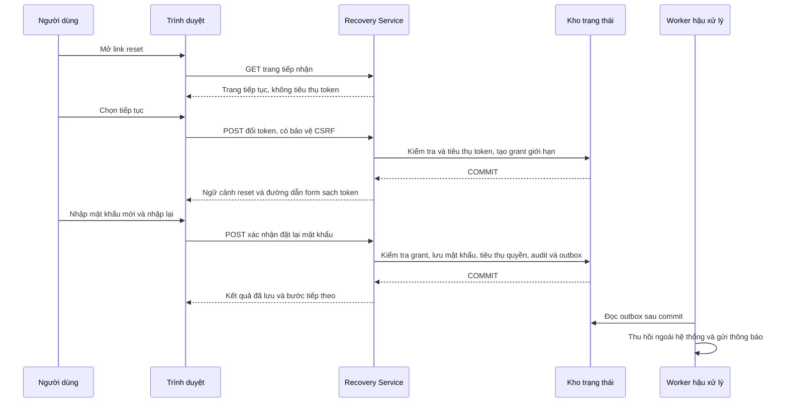

# Password reset confirmation

## 1. Mục tiêu và ý nghĩa của “confirmation”

**Password reset confirmation** là bước xác nhận và hoàn tất việc đặt lại mật khẩu sau khi người yêu cầu đã có bằng chứng hoặc quyền recovery phù hợp. Thiết kế cần bảo đảm mật khẩu chỉ thay đổi cho đúng tài khoản, đúng mục đích, đúng một lần và giao diện phản ánh đúng kết quả đã lưu.

Trong module `SECURITY_AUTHENTICATION_ACCOUNT_RECOVERY`, reset mật khẩu là một nhánh của khôi phục tài khoản. Người dùng có thể đồng thời mất MFA, passkey hoặc thiết bị xác thực, nhưng hoàn tất nhánh mật khẩu không tự giải quyết các mất mát đó.

Từ “xác nhận” thường được dùng cho nhiều thao tác khác nhau:

| Loại xác nhận | Câu hỏi được giải quyết | Giới hạn ý nghĩa |
| --- | --- | --- |
| Xác minh quyền recovery | Người yêu cầu có được phép đặt lại mật khẩu tài khoản này không? | Cần bằng chứng và chính sách phù hợp |
| Nhập lại mật khẩu mới | Hai lần nhập có khớp nhau không? | Giúp giảm lỗi nhập, không chứng minh danh tính |
| Xác nhận chủ ý | Người dùng có gửi thao tác cuối cùng để đổi mật khẩu không? | Cần request hợp lệ và kiểm tra phía server |
| Xác nhận giao dịch | Mật khẩu mới và trạng thái liên quan đã được commit chưa? | Không thể suy ra từ việc nhận request |
| Thông báo sau reset | Chủ tài khoản có được báo về thay đổi không? | Được nhà cung cấp nhận gửi chưa có nghĩa người dùng đã đọc |

OWASP khuyến nghị người dùng nhập mật khẩu mới hai lần, được thông báo sau reset và quay lại đăng nhập qua cơ chế thông thường. [OWASP — User Resets Password](https://cheatsheetseries.owasp.org/cheatsheets/Forgot_Password_Cheat_Sheet.html#user-resets-password).

Bài học tập trung vào việc nối các lớp xác nhận trên thành một luồng nhất quán. Các endpoint, trạng thái và giả mã bên dưới là thiết kế minh họa, cần điều chỉnh theo mức rủi ro và kiến trúc của sản phẩm.

Sau bài học, người học có thể:

- Thiết kế màn hình và API xác nhận mà không coi mở link là đồng ý đổi mật khẩu.
- Ràng buộc token hoặc quyền tạm với tài khoản và mục đích reset.
- Cập nhật mật khẩu cùng việc tiêu thụ quyền reset một cách nguyên tử.
- Xử lý double click, hai tab, timeout và tác vụ hậu xử lý.
- Viết thông báo hoàn tất đúng sự thật và hướng dẫn tiếp theo phù hợp.

## 2. Các bất biến của bước xác nhận

Một thiết kế an toàn cần bảo vệ những điều kiện sau:

| Bất biến | Ví dụ sai cần tránh |
| --- | --- |
| Đúng tài khoản và tenant | Token của A nhưng client gửi `accountId=B` và B bị đổi mật khẩu |
| Đúng mục đích | Token xác minh email được sử dụng để reset mật khẩu |
| Quyền reset còn hiệu lực tại thời điểm thay đổi | Token hợp lệ khi mở form nhưng đã hết hạn lúc submit vẫn được chấp nhận |
| Một quyền không tạo hai thay đổi | Hai request song song cùng dùng một grant để ghi hai mật khẩu |
| Mật khẩu và quyền reset nhất quán | Token bị tiêu thụ nhưng mật khẩu chưa lưu, hoặc mật khẩu đã lưu nhưng token vẫn dùng được |
| Mật khẩu mới tuân thủ chính sách chung | Endpoint reset chấp nhận mật khẩu mà endpoint đổi mật khẩu sẽ từ chối |
| Phản hồi thành công xuất phát từ kết quả commit | Frontend hiển thị thành công ngay sau click |
| Quyền recovery không biến thành quyền truy cập đầy đủ | Sau reset, client được cấp session bỏ qua MFA |
| Thông báo và thu hồi có trạng thái rõ | Ghi “đã đăng xuất mọi thiết bị” khi mới xếp lệnh thu hồi vào hàng đợi |

Mật khẩu nhập lại không phải một yếu tố xác thực bổ sung. Hai người cùng biết một token bị lộ đều có thể nhập hai chuỗi khớp nhau. Cơ sở cho quyền reset phải được kiểm tra độc lập.

## 3. Luồng xác nhận từ link đến thay đổi đã commit

### 3.1. Mở link không phải là thao tác đổi mật khẩu

Không thiết kế:

```text
GET /password-reset/confirm?token=...
    -> lập mật khẩu tạm
    -> thay mật khẩu
    -> đánh dấu reset thành công
```

Một công cụ quét liên kết, trình xem trước hoặc cơ chế prefetch có thể mở URL mà không thể hiện chủ ý của người dùng. Ngay cả khi chưa đổi mật khẩu, tiêu thụ quyền reset ngay trên GET cũng có thể làm link mất hiệu lực trước khi người dùng thao tác.

RFC 9110 định nghĩa các phương thức safe, trong đó có GET, với ngữ nghĩa cơ bản là đọc; thiết kế cần cho phép hoạt động tự động như theo liên kết mà không gây thay đổi nghiệp vụ ngoài chủ ý. [RFC 9110 — Safe Methods](https://www.rfc-editor.org/rfc/rfc9110.html#section-9.2.1).

Trong thiết kế bài học:

- GET hiển thị trang và hướng dẫn, không đổi mật khẩu, không tiêu thụ token reset.
- Một POST có kiểm soát chuyển bằng chứng sang quyền reset giới hạn, nếu dùng mô hình này.
- POST xác nhận cuối cùng mới gửi mật khẩu mới và thực hiện thay đổi.
- Mở trang hoặc nhấn “Tiếp tục” không được ghi là “mật khẩu đã được đặt lại”.

Việc yêu cầu POST giảm tác động của các hệ thống chỉ mở GET. Nó không bảo đảm mọi chương trình tự động đều không thể gửi POST, và không thay thế kiểm tra quyền.

### 3.2. Hai cách mang quyền đến bước xác nhận

| Cách | Hành vi | Điểm cần kiểm soát |
| --- | --- | --- |
| Dùng trực tiếp reset token | Form cuối gửi token cùng mật khẩu mới | Token được kiểm tra và tiêu thụ trong giao dịch thay mật khẩu |
| Đổi token lấy reset grant giới hạn | POST đổi token thành quyền tạm; form cuối dùng quyền tạm đó | Token chỉ dùng để đổi một lần; grant bị giới hạn mục đích, thời hạn và số lần dùng |

Bài học dùng cách thứ hai để tách link trong email khỏi form cuối. Cách thứ nhất vẫn có thể được thiết kế đúng nếu giữ được các bất biến.

Luồng tham khảo:



POST đổi token và POST cuối đều là thao tác nhạy cảm. Ngữ cảnh reset bằng cookie cần chống CSRF ngay từ lúc tạo hoặc gắn quyền, tránh gắn nhầm một quyền do kẻ khác cung cấp vào trình duyệt của người dùng.

### 3.3. Reset grant phải có phạm vi hẹp

Grant được tạo từ token cần chứa hoặc tham chiếu tới:

- Tài khoản và tenant do server xác định từ token.
- Mục đích `RESET_PASSWORD`.
- Reset request hoặc recovery case tương ứng.
- Thời hạn, trạng thái sử dụng và phiên bản hiệu lực.
- Ngữ cảnh trình duyệt được cấp quyền, theo mô hình session của sản phẩm.
- Phiên bản chính sách hoặc yêu cầu xác minh bổ sung đã đáp ứng.

Không nhận tài khoản đích từ một hidden input làm nguồn sự thật. Hidden input và đường dẫn URL đều có thể bị sửa.

Thời hạn grant cần bị giới hạn theo chính sách và không kéo dài vô hạn quyền của token gốc. Ví dụ minh họa: token còn hai phút thì không cấp grant mới có thêm một giờ hiệu lực chỉ vì người dùng vừa đổi token thành công.

Cookie reset nên tách với session đăng nhập đầy đủ, có thuộc tính bảo vệ phù hợp và chỉ được middleware cho phép vào nhóm endpoint recovery cần thiết. Giới hạn `Path` của cookie hỗ trợ phạm vi gửi cookie; phân quyền phía server mới quyết định grant được làm gì.

## 4. Thiết kế form xác nhận mật khẩu mới

### 4.1. Mẫu form tối thiểu

Ví dụ HTML minh họa cho một form được server render trong ngữ cảnh reset hợp lệ:

```html
<form method="post" action="/account/password-reset/confirm">
  <input type="hidden" name="csrfToken" value="{{csrfToken}}">
  <input type="hidden" name="operationId" value="{{operationId}}">

  <label for="newPassword">Mật khẩu mới</label>
  <input id="newPassword"
         name="newPassword"
         type="password"
         autocomplete="new-password"
         required>

  <label for="confirmPassword">Nhập lại mật khẩu mới</label>
  <input id="confirmPassword"
         name="confirmPassword"
         type="password"
         autocomplete="new-password"
         required>

  <p id="resetEffects">
    Sau khi đặt lại, hãy đăng nhập bằng mật khẩu mới.
    Các phiên thuộc phạm vi thu hồi sẽ được xử lý theo chính sách tài khoản.
  </p>

  <button type="submit" aria-describedby="resetEffects">
    Xác nhận đặt lại mật khẩu
  </button>
</form>
```

Các placeholder phải được encode đúng theo ngữ cảnh thuộc tính HTML. CSRF token và operation ID cần được server cấp, kiểm tra và ràng buộc; việc có hai hidden input không tự làm request an toàn.

Giao diện nên cho phép dùng password manager, dán mật khẩu và tùy chọn hiện mật khẩu có chủ ý. Thông báo lỗi cần chỉ đúng trường có vấn đề và đọc được bằng công nghệ hỗ trợ.

### 4.2. Client hỗ trợ nhập liệu, server quyết định

Server cần tự kiểm tra:

1. Cả hai trường có mặt và nằm trong giới hạn độ dài đầu vào.
2. Hai lần nhập khớp nhau theo quy tắc biểu diễn mật khẩu đã xác định.
3. Mật khẩu mới đạt chính sách áp dụng cho tài khoản.
4. Grant reset vẫn hợp lệ và còn quyền thực hiện thay đổi.
5. Mọi yêu cầu xác minh bổ sung của case đã đạt.

Không gửi riêng `passwordsMatch=true` từ frontend rồi tin kết quả đó. Không cắt ngắn chuỗi trước khi so sánh hoặc hash. Không tự trim, bỏ dấu hay đổi chữ hoa chữ thường ngoài quy tắc xử lý mật khẩu được áp dụng nhất quán.

Nếu sản phẩm áp dụng chuẩn hóa Unicode, việc chuẩn hóa phải được xác định rõ và giống nhau giữa tạo, đổi, reset và xác thực mật khẩu. “Nhập lại” không phải dịp tự thêm một quy tắc chuẩn hóa khác.

### 4.3. Mật khẩu mới phải theo cùng chính sách

Reset không được trở thành đường đi vòng qua chính sách mật khẩu. Các quy tắc nên được dùng chung ở server thay vì sao chép riêng trong controller reset.

NIST SP 800-63B-4 phân biệt độ dài tối thiểu theo cách dùng mật khẩu, yêu cầu so sánh với blocklist phù hợp và không áp đặt các quy tắc pha trộn loại ký tự. Cần đối chiếu đúng phạm vi yêu cầu của hệ thống khi thiết lập chính sách. [NIST — Password Verifiers](https://pages.nist.gov/800-63-4/sp800-63b/authenticators/).

Trong phạm vi confirmation, những điều cần giữ là:

- Hướng dẫn chính sách xuất hiện trước khi người dùng gửi form.
- Kiểm tra chính sách thực sự chạy ở server.
- Không dùng mật khẩu mới để gọi dịch vụ bên ngoài dưới dạng plaintext.
- Mật khẩu được đưa vào thuật toán hash lưu mật khẩu phù hợp; không lưu dạng đọc được.
- Mật khẩu nhập lại chỉ phục vụ kiểm tra đầu vào, không được lưu thành một trường riêng.

## 5. Bảo vệ request xác nhận

### 5.1. CSRF và quyền reset là hai kiểm tra khác nhau

Nếu reset grant được gửi tự động bằng cookie, một website khác có thể cố khiến trình duyệt gửi request thay mật khẩu. Vì vậy, endpoint thay đổi trạng thái cần cơ chế chống CSRF phù hợp với framework và mô hình ứng dụng.

OWASP khuyến nghị dùng cơ chế chống CSRF đã có của framework, kiểm tra token ở server và không dùng GET cho thao tác thay đổi trạng thái. SameSite là một lớp hỗ trợ với các giới hạn cần xem xét. [OWASP — CSRF Prevention](https://cheatsheetseries.owasp.org/cheatsheets/Cross-Site_Request_Forgery_Prevention_Cheat_Sheet.html).

Trong mô hình minh họa:

- CSRF token bị ràng buộc với ngữ cảnh reset, không phải chuỗi tĩnh dùng chung.
- Server kiểm tra nguồn request theo chính sách origin của ứng dụng.
- Cookie có thuộc tính `Secure`, `HttpOnly` và `SameSite` được chọn theo luồng thực tế.
- Thao tác đổi token lấy grant cũng được bảo vệ; không chỉ bảo vệ form cuối.
- Origin không hợp lệ, CSRF sai hoặc grant sai đều ngăn thay đổi mật khẩu.

CSRF token không chứng minh người dùng có quyền reset tài khoản. Reset grant không mặc nhiên chứng minh request xuất phát từ form hợp lệ. Hai lớp phục vụ hai mục đích khác nhau.

### 5.2. Hạn chế rò rỉ bí mật trong trang reset

Các biện pháp thiết kế cho trang tiếp nhận và form cuối gồm:

```http
Cache-Control: no-store
Referrer-Policy: no-referrer
Content-Security-Policy: default-src 'self'; form-action 'self'; frame-ancestors 'none'
```

Đây là ví dụ cấu hình cần điều chỉnh theo tài nguyên thực tế. CSP không thay thế việc encode đầu ra hoặc kiểm tra quyền.

Các điểm cần chú ý:

- Không đặt mật khẩu, token hoặc grant vào URL của form xác nhận.
- Sau khi đổi token thành grant, chuyển sang đường dẫn sạch token.
- Không nhúng công cụ ghi lại màn hình, session replay hoặc script bên thứ ba vào trang chứa bí mật reset.
- Tắt ghi body nhạy cảm ở API gateway, APM, trace và log lỗi.
- Kiểm soát cả query string tại proxy đối với trang đầu nhận link.
- Không cho phép redirect sau reset đến URL bất kỳ do người gọi truyền vào.

Redirect sạch URL chỉ giảm nơi token tiếp tục xuất hiện. Nó không xóa những bản ghi đã có tại hạ tầng hoặc lịch sử trước đó; việc hạn chế thu thập cần bắt đầu ngay ở endpoint tiếp nhận.

### 5.3. Hạn chế lạm dụng trước thao tác tốn tài nguyên

Hash mật khẩu có chi phí có chủ đích. Endpoint xác nhận cần kiểm tra kích thước đầu vào, giới hạn nguồn, quyền reset sơ bộ và mức đồng thời trước khi thực hiện hash tốn tài nguyên.

Kiểm tra sơ bộ giúp giảm tải nhưng không thay thế kiểm tra có thẩm quyền ngay tại bước ghi dữ liệu. Giữa lúc precheck và lúc cập nhật, token có thể hết hạn hoặc bị luồng khác sử dụng.

Sai định dạng hay mật khẩu chưa đạt chính sách không nên tự tiêu thụ quyền reset hợp lệ. Tuy nhiên, các lần gửi lỗi vẫn chịu kiểm soát lạm dụng để tránh dùng một grant còn hiệu lực làm phương tiện gây tải.

## 6. Giao dịch xác nhận phải thay đổi những gì?

### 6.1. Ràng buộc token và grant bằng phiên bản hiệu lực

Có thể duy trì `reset_epoch` trên tài khoản. Mỗi token và grant được cấp ghi lại epoch tại thời điểm phát hành.

Khi reset thành công:

1. Lưu password hash mới.
2. Đánh dấu grant hiện tại đã dùng.
3. Tăng `reset_epoch`.
4. Tăng phiên bản mật khẩu hoặc phiên bản bảo mật theo mô hình hệ thống.
5. Ghi sự kiện commit và tác vụ hậu xử lý.

Sau khi epoch tăng, những token và grant cũ mang epoch trước đó bị từ chối khi sử dụng, kể cả nếu bản ghi của chúng chưa được dọn.

Cơ chế chỉ có hiệu lực khi tất cả nơi sử dụng token và grant đều kiểm tra epoch. Kiểm tra chữ ký hoặc hạn dùng của một token tự chứa mà bỏ qua trạng thái này có thể để token cũ tiếp tục hoạt động.

Việc phát hành token, đổi token thành grant và xác nhận reset phải phối hợp qua cùng trạng thái tài khoản có thẩm quyền. Nếu luồng phát hành đọc epoch từ replica chậm, nó có thể tạo ra trạng thái không nhất quán với reset vừa hoàn tất.

### 6.2. Những thay đổi cần nguyên tử trong cùng kho dữ liệu

Trong mô hình sử dụng một cơ sở dữ liệu giao dịch, transaction xác nhận nên bao gồm:

| Thay đổi | Vì sao cần nằm cùng transaction? |
| --- | --- |
| Cập nhật password hash | Là hiệu ứng nghiệp vụ chính |
| Tiêu thụ grant hiện tại | Ngăn grant tạo lần thay đổi thứ hai |
| Tăng reset epoch | Vô hiệu hóa quyền reset cũ cùng phạm vi |
| Cập nhật phiên bản bảo mật | Làm căn cứ thực thi session theo chính sách |
| Lưu kết quả thao tác | Phân biệt commit với timeout ở phía client |
| Ghi audit bền vững | Không để mất bằng chứng khi tiến trình chết sau commit |
| Ghi outbox | Bảo đảm tác vụ ngoài hệ thống có thể được tiếp tục |

Nếu transaction rollback, các thay đổi trên cùng rollback. Mật khẩu cũ và quyền reset còn hiệu lực theo trạng thái trước đó, trừ khi một transaction khác đã tác động độc lập.

Không tiêu thụ grant trong một transaction rồi cập nhật mật khẩu ở transaction khác mà không có giao thức bảo đảm tương ứng. Cửa sổ lỗi ở giữa có thể khiến người dùng mất quyền reset mà mật khẩu chưa được đổi.

### 6.3. Giả mã Java cho bước commit

Đoạn dưới minh họa thứ tự và ranh giới transaction, không phải một implementation có thể sao chép để triển khai ngay.

```java
ResetResult confirm(
        AuthorizedResetContext context,
        ResetForm form) {

    transportPolicy.requireValidCsrfAndOrigin(context, form);
    abuseLimits.requireAllowed(context);
    inputPolicy.requireBounded(form);

    if (!passwordInput.matches(
            form.newPassword(), form.confirmPassword())) {
        return ResetResult.invalidInput("PASSWORD_CONFIRMATION_MISMATCH");
    }

    // Chưa tiêu thụ grant; chỉ tránh hash cho yêu cầu rõ ràng không hợp lệ.
    ResetPreview preview = grants.precheck(context, form.operationId());

    // Tạo bởi server, dùng chung chính sách với các luồng mật khẩu khác.
    // Không gọi mạng và không hash tốn tài nguyên trong lúc giữ khóa.
    PreparedPassword prepared = passwordPolicy.prepareAndHash(
            preview.accountPolicy(), form.newPassword());

    return transaction.required(() -> {
        // Context được xác minh phía server, không lấy accountId từ form.
        Account account = accounts.lock(
                context.tenantId(), context.accountId());

        ResetGrant grant = grants.lock(context.grantReference());

        grant.requireBoundTo(
                account.id(), context.flowId(), "RESET_PASSWORD");
        grant.requireActiveAt(clock.instant());
        grant.requireEpoch(account.resetEpoch());

        recoveryPolicy.requireResetAllowed(account, grant);
        passwordPolicy.requirePreparedPolicyStillApplicable(
                prepared, account);

        operations.requireNewAndBoundTo(
                form.operationId(), context.flowId(), grant.id());

        account.replacePasswordHash(prepared.encodedHash());
        grant.markConsumed();

        account.incrementResetEpoch();
        long securityVersion = account.incrementSecurityVersion();

        ResetOperation operation = operations.recordPasswordUpdated(
                form.operationId(), account.id(), context.flowId());

        audit.appendPasswordResetCommitted(
                operation, grant.id(), securityVersion);

        outbox.enqueueSessionPolicy(
                operation.id(), account.id(), securityVersion);
        outbox.enqueueResetNotification(
                operation.id(), account.notificationPlanReference());

        return ResetResult.passwordUpdated(operation.id());
    });
}
```

Các điều kiện quan trọng của ví dụ:

- `AuthorizedResetContext` do server tạo sau khi kiểm tra ngữ cảnh reset; client không được tự khai mình đã được cấp quyền.
- `PreparedPassword` là giá trị nội bộ, không chấp nhận password hash client cung cấp.
- Kiểm tra thời hạn được thực hiện lại sau khi lấy khóa, sát điểm quyết định ghi thay đổi.
- Nếu chính sách mật khẩu thay đổi trong lúc chuẩn bị, server phải đánh giá lại hoặc yêu cầu gửi lại theo chính sách mới.
- Mọi đường ghi cần tuân thủ cùng thứ tự khóa và các ràng buộc duy nhất.
- Kết quả chỉ được gửi như thành công sau khi transaction wrapper thực sự commit; lỗi commit phải được xử lý như kết quả chưa xác nhận hoặc thất bại phù hợp.
- Code không tự cấp access token, không tắt MFA và không xóa passkey.

Nếu session nằm cùng database, một phần vô hiệu hóa có thể thực hiện ngay trong transaction. Nếu session ở hệ khác, outbox chỉ ghi công việc cần làm; không được diễn giải nó thành bằng chứng mọi session đã bị chặn.

### 6.4. Khi credential do nhà cung cấp danh tính bên ngoài quản lý

Một transaction database cục bộ không làm cho API đổi mật khẩu của nhà cung cấp trở nên nguyên tử với grant cục bộ.

Trong kiến trúc đó, cần một giao thức khác: thao tác có định danh ổn định, quyền reset được giữ cho đúng thao tác, lời gọi bên ngoài có khả năng chống lặp hoặc có thể đối chiếu kết quả, cùng trạng thái xử lý khi timeout. Không đánh dấu grant “chưa dùng” rồi cho phép thực hiện lại tùy ý khi chưa biết lời gọi trước đã đổi mật khẩu hay chưa.

Nếu không thể xác minh trạng thái bên ngoài, phản hồi cần thể hiện đang xử lý hoặc cần kiểm tra lại. Không dựng một thông báo thành công chỉ vì request đã được gửi đi.

## 7. Double click, hai tab và kết quả không rõ sau timeout

### 7.1. Hai request cạnh tranh dùng cùng quyền

Giả sử hai tab đang mở cùng một reset grant. Người dùng gửi mật khẩu P1 ở tab A và P2 ở tab B gần như đồng thời.

Với khóa và epoch trong ví dụ:

1. Request A lấy khóa tài khoản và grant.
2. A xác nhận grant còn hiệu lực, ghi P1, tiêu thụ grant và tăng epoch.
3. A commit.
4. B lấy khóa sau A, đọc trạng thái mới.
5. B bị từ chối vì grant đã dùng hoặc epoch không còn khớp.

Kết quả là tối đa một thay đổi bằng quyền đó. Không để B ghi P2 rồi mới phát hiện grant đã tiêu thụ.

Vô hiệu hóa nút submit hỗ trợ tránh thao tác nhầm nhưng không bảo đảm điều kiện trên. Trình duyệt khác, API client hoặc mạng retry vẫn có thể tạo request đồng thời.

### 7.2. Chống phát lại và idempotency có nhiệm vụ khác nhau

- **Chống phát lại:** một quyền reset không thể tạo thay đổi mới sau khi đã được dùng.
- **Idempotency:** gửi lại đúng cùng một thao tác không gây thêm hiệu ứng và có thể nhận lại trạng thái của thao tác trước.

Giả mã ở phần 6 bảo vệ việc ghi một lần; nó chưa tự trả lại thành công cho mọi request lặp. Sản phẩm có thể bổ sung tra cứu kết quả hoặc idempotency có kiểm soát.

Không dùng lại một operation ID để chấp nhận mật khẩu mới khác. Nếu server chỉ trả kết quả cũ, giao diện phải diễn đạt “thao tác trước đã được lưu”, tránh khiến người dùng tưởng bộ dữ liệu mới vừa được áp dụng.

Không lưu plaintext mật khẩu hoặc hash đơn giản của mật khẩu làm khóa idempotency. Nếu cần phân biệt payload, phải có thiết kế bảo vệ riêng cho dữ liệu nhạy cảm; một luồng tra cứu trạng thái tách biệt thường dễ quản lý hơn.

### 7.3. Commit thành công nhưng response bị mất

Ví dụ:

```text
Server commit thay mật khẩu thành công.
Kết nối mạng bị ngắt trước khi response đến trình duyệt.
Trình duyệt thấy timeout.
```

Timeout phía client không chứng minh mật khẩu chưa đổi. Giao diện nên hiển thị:

> Chưa nhận được kết quả của thao tác. Hệ thống đang kiểm tra trạng thái; bạn cũng có thể quay lại trang đăng nhập.

Một mô hình đề xuất là tạo operation ID và ngữ cảnh đọc kết quả ngay khi render form. Endpoint trạng thái chỉ cho phép đọc kết quả của thao tác thuộc ngữ cảnh đó; nó không cho phép tiếp tục reset sau khi grant đã dùng.

Operation ID không phải bằng chứng sở hữu tài khoản. Quyền đọc trạng thái cần được kiểm tra riêng bằng ngữ cảnh hoặc receipt không đoán được, đã được ràng buộc. Không cung cấp API công khai “nhập email để biết mật khẩu vừa đổi chưa”.

Sau khi server xác nhận đã commit, client không tự gửi lại một thao tác đổi mật khẩu mới. Người dùng có thể đăng nhập bằng mật khẩu đã chọn. Nếu đã quên giá trị đó hoặc không xác định được mật khẩu có hiệu lực, họ bắt đầu một luồng reset mới theo chính sách bình thường.

## 8. Phản hồi xác nhận phải phản ánh đúng trạng thái

### 8.1. Tách kết quả mật khẩu khỏi tác vụ hậu xử lý

Một mô hình kết quả có thể gồm hai chiều trạng thái:

```json
{
  "operationId": "reset_op_demo_104",
  "credentialStatus": "PASSWORD_UPDATED",
  "followUpStatus": "PENDING",
  "nextAction": "SIGN_IN"
}
```

Ví dụ này chỉ được trả trong ngữ cảnh có quyền đọc kết quả. Nó cho biết mật khẩu đã commit nhưng các tác vụ hậu xử lý chưa được xác nhận hoàn tất. `SIGN_IN` là bước tiếp theo khi chính sách cho phép; không phải cam kết mọi tài khoản đều được mở truy cập ngay.

Không dùng một cờ `success=true` để đồng thời biểu diễn:

- Server đã nhận request.
- Mật khẩu mới đã được lưu.
- Tất cả token reset cũ đã mất hiệu lực.
- Mọi session ở các hệ thống liên quan đã bị chặn.
- Thông báo đã đến người dùng.

Các điều kiện có thể đạt ở những thời điểm khác nhau.

### 8.2. Mẫu thông báo theo kết quả

| Trạng thái có thẩm quyền | Thông báo phù hợp |
| --- | --- |
| Hai lần nhập không khớp | “Hai mật khẩu chưa khớp. Vui lòng nhập lại.” |
| Mật khẩu chưa đạt chính sách | Nêu yêu cầu cần đáp ứng, không lặp lại mật khẩu đã nhập |
| Link hoặc grant không còn dùng được | “Liên kết này không còn khả dụng. Bạn có thể yêu cầu liên kết mới.” |
| Đang gửi request | “Đang xử lý yêu cầu đặt lại mật khẩu…” |
| Đã commit mật khẩu | “Mật khẩu mới đã được lưu. Hãy đăng nhập để tiếp tục.” |
| Đã commit, thu hồi còn chờ | “Mật khẩu mới đã được lưu. Việc kết thúc các phiên cũ đang được xử lý.” |
| Chưa xác định được commit | “Chưa xác nhận được kết quả. Vui lòng kiểm tra trạng thái hoặc quay lại đăng nhập.” |
| Đã rollback và biết chắc chưa đổi | “Chưa thể lưu mật khẩu mới. Vui lòng thử lại theo hướng dẫn.” |

Thông báo lỗi ở endpoint công khai cần tránh tiết lộ tài khoản có tồn tại hay không. Trong ngữ cảnh reset đã được cấp quyền, có thể cung cấp hướng dẫn cụ thể hơn nhưng không trả toàn bộ dữ liệu tài khoản chỉ vì người gọi có một mã thao tác.

Sau POST thành công ở ứng dụng server-rendered, có thể dùng Post/Redirect/Get để tránh trình duyệt gửi lại form khi refresh. Trang đích đọc trạng thái từ server, không tin tham số như `?success=true` làm bằng chứng reset thành công.

### 8.3. Phân biệt rollback với lỗi sau commit

Nếu gửi email thất bại sau khi mật khẩu đã lưu, không trả “mật khẩu chưa đổi” và không tự khôi phục mật khẩu cũ.

Nếu hệ thống thu hồi session gặp lỗi, trạng thái cần thể hiện rằng mật khẩu đã đổi nhưng biện pháp hậu xử lý còn thiếu. Tùy rủi ro, có thể hạn chế truy cập nhạy cảm, retry hoặc chuyển xử lý sự cố. Lịch sử phải ghi rõ từng bước.

Khi đã có commit hợp lệ, thay đổi lại mật khẩu là một thao tác bảo mật mới cần quyền mới. Không dùng cơ chế retry thông báo để phát lại giao dịch thay mật khẩu.

## 9. Session, MFA và quyền truy cập sau xác nhận

### 9.1. Chọn kế hoạch session trước khi người dùng submit

Chính sách cần xác định các đối tượng sẽ bị tác động:

| Đối tượng | Câu hỏi cần quyết định |
| --- | --- |
| Session ứng dụng | Có kết thúc tất cả session được tạo trước reset không? |
| Refresh token | Thu hồi token nào, token family nào, tại nhà cung cấp nào? |
| Access token tự chứa | Có cơ chế chặn trước hạn hay phải chấp nhận một cửa sổ còn hiệu lực? |
| Remembered device | Có hủy quyền ghi nhớ hoặc bỏ qua MFA trên thiết bị cũ không? |
| Session SSO | Thay đổi tại ứng dụng có tác động đến session của nhà cung cấp danh tính không? |
| API key hoặc application password | Có thuộc phạm vi xử lý compromise không, và cần quy trình riêng nào? |
| Reset grant hiện tại | Đã hết quyền thay đổi mật khẩu, chỉ còn quyền đọc receipt nếu được thiết kế |
| Token reset và grant khác | Các quyền phát hành trước thay đổi có bị vô hiệu theo epoch không? |

OWASP coi recovery là sự kiện rủi ro cần xem xét xác thực lại và quản lý vòng đời session phù hợp. [OWASP — Session Management](https://cheatsheetseries.owasp.org/cheatsheets/Session_Management_Cheat_Sheet.html#reauthentication-after-risk-events).

Trong ví dụ của bài, sau reset qua nhánh recovery, các phiên trước reset nằm trong kế hoạch thu hồi tự động. Đây là lựa chọn thiết kế minh họa. Nếu sản phẩm cho người dùng lựa chọn trong một số tình huống thông thường, lựa chọn phải được trình bày rõ và vẫn tuân thủ chính sách xử lý compromise.

Khi đã có bằng chứng phiên bị chiếm đoạt, không để một checkbox mặc định “giữ đăng nhập” làm bỏ qua kiểm soát bắt buộc.

### 9.2. Tăng security version chưa tự chặn token

Nếu account chuyển từ security version 8 sang 9, session hoặc token cũ chỉ bị chặn khi nơi cấp quyền thực sự đối chiếu phiên bản hoặc nhận tín hiệu thu hồi tương đương.

Resource server chỉ kiểm chữ ký và thời hạn JWT có thể tiếp tục chấp nhận access token cũ. Thu hồi refresh token cũng không tự làm mọi access token đã cấp hết hiệu lực.

Vì vậy:

- `session_revocation_requested` nghĩa là đã yêu cầu.
- `session_revocation_confirmed` cần dựa trên kết quả có thẩm quyền và phạm vi cụ thể.
- Giao diện chỉ nói “đã đăng xuất mọi thiết bị” khi có cơ sở tương ứng.
- Nếu kiến trúc có cửa sổ hiệu lực còn lại, cần xác định, đo và phản ánh nó trong chính sách.

Việc kiểm tra session cũ sau reset cần thực hiện tại các ứng dụng hoặc resource server quan trọng, không chỉ nhìn vào log của service gửi lệnh.

### 9.3. Reset mật khẩu không bỏ qua MFA

Một tài khoản có MFA vẫn cần đi qua yêu cầu MFA khi đăng nhập sau reset, trừ khi một quy trình recovery riêng đã xử lý thay đổi đó theo chính sách.

Không thực hiện tự động các thao tác sau chỉ vì mật khẩu mới đã được xác nhận:

- Xóa TOTP secret hoặc các khóa bảo mật.
- Đổi địa chỉ email recovery.
- Thêm passkey do request cuối gửi kèm.
- Mở khóa một tài khoản đang bị giữ vì điều tra compromise.
- Cấp session có mức bảo đảm cao hơn bằng chứng thực tế.

Nếu người dùng đã mất cả mật khẩu lẫn MFA, thông báo tiếp theo nên dẫn đến nhánh khôi phục MFA phù hợp. Không hứa “đặt lại mật khẩu xong là truy cập được ngay” nếu còn điều kiện xác thực khác.

Người dùng được đưa về đăng nhập thông thường. Session mới được cấp theo kết quả xác thực hiện tại, với định danh mới và chính sách tài khoản hiện hành.

## 10. Thông báo sau khi đặt lại mật khẩu

### 10.1. Phân biệt email cấp quyền và email thông báo

Email chứa reset token phục vụ trao một quyền recovery có giới hạn. Email sau commit phục vụ giúp chủ tài khoản nhận biết thay đổi và phản đối nếu cần.

Email thông báo không nên chứa:

- Mật khẩu mới, mật khẩu tạm hoặc một phần mật khẩu.
- Token hoặc grant đã dùng.
- Một link cho phép hoàn tác bằng GET.
- Một cơ chế khôi phục mật khẩu cũ.
- Dữ liệu cá nhân không cần thiết.

Nội dung minh họa:

```text
Tiêu đề: Mật khẩu tài khoản của bạn đã được đặt lại

Mật khẩu đã được cập nhật lúc 10:15 ngày 23/11/2026, giờ Việt Nam.

Nếu bạn thực hiện thao tác này, hãy đăng nhập từ ứng dụng
hoặc địa chỉ dịch vụ mà bạn thường sử dụng.

Nếu bạn không thực hiện thao tác này, hãy mở mục Trợ giúp bảo mật
của dịch vụ để báo cáo và kiểm tra hoạt động tài khoản.

Thông báo này không chứa mật khẩu và không yêu cầu bạn trả lời
bằng mã xác thực hoặc mã khôi phục.
```

Trong sản phẩm thật, thời gian, tên dịch vụ, đường hỗ trợ và mô tả tác động session phải được lấy từ dữ liệu và cấu hình đáng tin cậy.

### 10.2. Kênh nhận phải có cơ sở tin cậy

Thông báo nên đi đến kênh đã được thiết lập phù hợp với hồ sơ tài khoản. Không gửi độc quyền đến một email mới do request xác nhận truyền vào.

Nếu tài khoản có dấu hiệu kênh recovery vừa bị thay đổi trái phép, cần đánh giá kênh an toàn và bằng chứng độc lập. Không tự khôi phục một địa chỉ cũ chỉ vì nó cũ: địa chỉ đó có thể từng bị thay thế vì mất quyền kiểm soát.

NIST mô tả yêu cầu thông báo đối với account recovery và hướng dẫn rõ cho người nhận khi họ phản đối sự kiện. Cần đối chiếu đúng loại sự kiện và cấu hình tài khoản của hệ thống. [NIST — Account Notifications](https://pages.nist.gov/800-63-4/sp800-63b/events/).

### 10.3. Gửi sau commit và retry độc lập

Outbox được ghi cùng transaction thay mật khẩu. Worker chỉ xử lý bản ghi đã commit, gửi với định danh ổn định và khử trùng lặp theo thao tác.

Các trạng thái có thể gồm:

```text
QUEUED -> PROVIDER_ACCEPTED -> DELIVERY_REPORTED
                              hoặc DELIVERY_FAILED
```

Không đồng nhất provider acceptance với người dùng đã đọc. Nếu nhà cung cấp không có bằng chứng giao nhận đáng tin cậy, lưu đúng mức xác nhận hiện có.

Lỗi email dẫn đến retry và cảnh báo vận hành, không rollback mật khẩu. Retry email cũng không cấp token reset mới hoặc gửi lại bí mật cho người nhận.

Một đường “Tôi không thực hiện thao tác này” nên dẫn vào quy trình báo cáo và xác minh phù hợp. Không để bất kỳ ai có link email đều có thể lập tức khóa vĩnh viễn tài khoản hoặc đưa nó về mật khẩu cũ.

## 11. Audit, vận hành và tiêu chí kiểm chứng

### 11.1. Sự kiện cần phân biệt

| Sự kiện minh họa | Ý nghĩa |
| --- | --- |
| `password_reset.token_exchanged` | Token đã được đổi thành grant giới hạn |
| `password_reset.confirmation_rejected` | Request cuối bị từ chối, có mã lý do nội bộ |
| `password_reset.password_updated` | Password hash mới và trạng thái liên quan đã commit |
| `password_reset.session_revocation_requested` | Tác vụ thu hồi đã được gửi hoặc xếp xử lý |
| `password_reset.session_revocation_confirmed` | Hệ đích xác nhận kết quả trong phạm vi cụ thể |
| `password_reset.notification_provider_accepted` | Nhà cung cấp đã nhận yêu cầu gửi thông báo |
| `password_reset.follow_up_failed` | Tác vụ hậu xử lý chưa đạt, cần retry hoặc can thiệp |

Sự kiện nên có operation ID, case hoặc reset request ID, tham chiếu tài khoản và tenant, thời gian, phiên bản chính sách và producer. Mỗi retry không được tạo thêm một sự kiện đổi mật khẩu thành công nếu không có lần commit mới.

Audit không lưu raw token, cookie, mật khẩu, mật khẩu nhập lại hoặc password hash. Password hash là dữ liệu lưu trữ credential trong kho được bảo vệ; sao chép nó sang log làm tăng phạm vi rủi ro mà không cần thiết cho điều tra.

Các cảnh báo hữu ích gồm tỷ lệ replay tăng, nhiều grant bị từ chối sau epoch thay đổi, tác vụ thu hồi quá hạn và chênh lệch giữa thay đổi credential với sự kiện audit. Việc so sánh nên bắt đầu từ nguồn dữ liệu credential có thẩm quyền để không bỏ sót các lần mất log.

### 11.2. Tình huống cần kiểm chứng khi triển khai

Đây là tiêu chí dành cho người triển khai; bảng không tuyên bố một hệ thống cụ thể đã được chạy kiểm thử.

| Tình huống | Kết quả cần đạt |
| --- | --- |
| Chỉ mở GET từ link reset | Mật khẩu và quyền dùng token chưa bị thay đổi |
| POST đổi token thiếu CSRF hoặc sai ngữ cảnh | Không cấp grant dùng được |
| Token thuộc A nhưng payload chỉ B | B không bị thay đổi; server không tin tài khoản từ form |
| Dùng token sai mục đích hoặc sai tenant | Không được reset |
| Grant hết hạn giữa precheck và lấy khóa | Bị từ chối trước cập nhật |
| Hai mật khẩu không khớp | Không cập nhật, không tiêu thụ grant vì lỗi nhập này |
| Mật khẩu không đạt chính sách | Không đi vòng được qua API reset |
| Hai request đồng thời dùng cùng grant | Tối đa một lần thay đổi có hiệu lực |
| Hai grant cũ cạnh tranh trên cùng tài khoản | Epoch và khóa ngăn grant cũ ghi sau reset đã commit |
| Lỗi giữa lưu hash và ghi outbox trong cùng transaction | Cả transaction rollback |
| Commit thành công nhưng response mất | Có cách kiểm tra kết quả mà không thực hiện reset lần hai |
| Gửi email hoặc thu hồi ngoài hệ thống thất bại | Mật khẩu đã commit không bị mô tả sai hoặc tự hoàn tác |
| Thử dùng session và token cũ | Kết quả đúng phạm vi và thời hạn chính sách |
| Đăng nhập lại tài khoản có MFA | MFA vẫn được thực thi |
| Back, refresh hoặc mở trang success bằng URL tự chế | Không tạo thay đổi và không xác nhận thành công giả |
| Kiểm tra log, trace, cache và công cụ phân tích | Không lộ bí mật reset hoặc credential |

Kiểm chứng giao dịch cần tiêm lỗi tại những ranh giới thực sự có thể xảy ra, như trước commit, sau commit nhưng trước response và trong lúc worker retry. Chỉ kiểm tra đường đi thành công không chứng minh được tính nhất quán của confirmation.

## 12. Tình huống: mật khẩu đã đổi nhưng người dùng thấy timeout

Người dùng mở link hợp lệ, đổi token lấy grant và nhập mật khẩu mới hai lần khớp nhau.

Timeline minh họa:

| Thời điểm | Diễn biến |
| --- | --- |
| 03:15:00 UTC | Form cuối được gửi với operation `reset_op_demo_104` |
| 03:15:01 UTC | Server kiểm tra lại grant và chính sách |
| 03:15:02 UTC | Transaction lưu hash, tiêu thụ grant, tăng epoch và ghi outbox đã commit |
| 03:15:02 UTC | Kết nối đến trình duyệt bị ngắt |
| 03:15:03 UTC | Trình duyệt hiển thị chưa nhận được kết quả |
| 03:15:04 UTC | Trang trạng thái có quyền đọc xác nhận `PASSWORD_UPDATED` |
| 03:15:05 UTC | Worker xác nhận thu hồi session theo phạm vi |
| 03:15:06 UTC | Nhà cung cấp nhận gửi thông báo |
| Sau đó | Người dùng đăng nhập bằng mật khẩu mới và hoàn thành MFA |

Điểm quyết định là commit lúc 03:15:02, không phải việc trình duyệt có nhận được response hay không. Nếu frontend tự kết luận thất bại và tạo request reset khác, trải nghiệm có thể khiến người dùng không biết mật khẩu nào đang có hiệu lực.

Một luồng confirmation đúng cho người dùng biết kết quả có thẩm quyền, ngăn thay đổi lặp bằng grant cũ và dẫn họ qua đăng nhập thông thường. Nếu tác vụ hậu xử lý còn chờ, hệ thống giữ trạng thái đó rõ ràng để tiếp tục xử lý và kiểm toán.

## 13. Tài liệu đối chiếu

- [OWASP — Forgot Password Cheat Sheet](https://cheatsheetseries.owasp.org/cheatsheets/Forgot_Password_Cheat_Sheet.html): bước đặt lại, nhập lại mật khẩu và thông báo sau reset.
- [OWASP — CSRF Prevention Cheat Sheet](https://cheatsheetseries.owasp.org/cheatsheets/Cross-Site_Request_Forgery_Prevention_Cheat_Sheet.html): bảo vệ các request thay đổi trạng thái.
- [OWASP — Session Management Cheat Sheet](https://cheatsheetseries.owasp.org/cheatsheets/Session_Management_Cheat_Sheet.html): vòng đời session và sự kiện rủi ro.
- [NIST SP 800-63B-4 — Authenticator and Verifier Requirements](https://pages.nist.gov/800-63-4/sp800-63b/authenticators/): yêu cầu đối với mật khẩu và verifier.
- [NIST SP 800-63B-4 — Authenticator Event Management](https://pages.nist.gov/800-63-4/sp800-63b/events/): recovery và thông báo liên quan.
- [RFC 9110 — Safe Methods](https://www.rfc-editor.org/rfc/rfc9110.html#section-9.2.1): ngữ nghĩa safe của phương thức HTTP.
