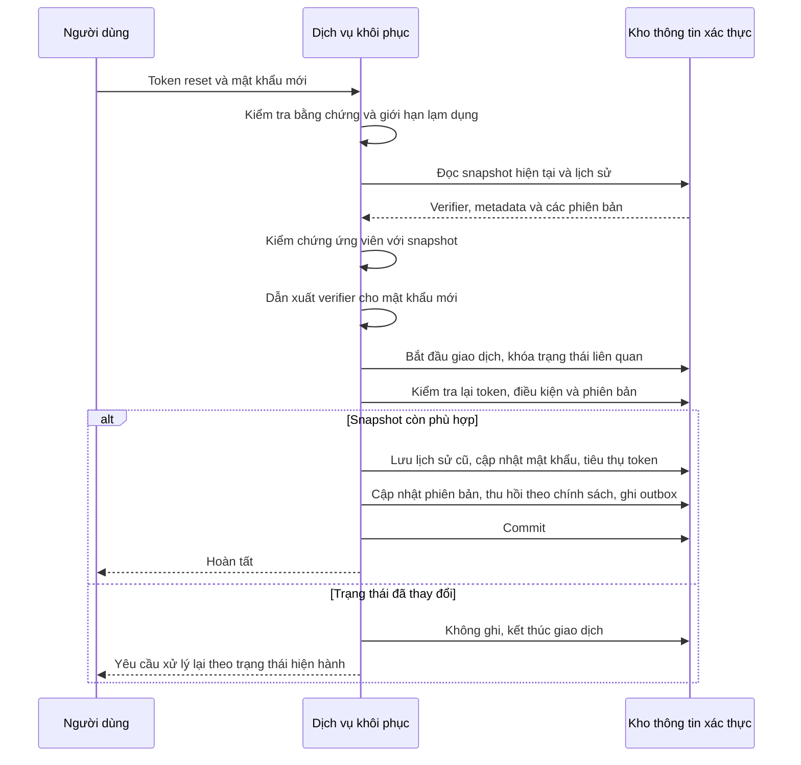

# Thực thi lịch sử mật khẩu trong luồng đặt lại mật khẩu

## 1. Lịch sử mật khẩu bảo vệ điều gì?

**Password history enforcement** là việc kiểm tra và ngăn một mật khẩu mới trùng với những mật khẩu còn nằm trong phạm vi lịch sử mà chính sách không cho tái sử dụng. Trong chương **Password Reset**, kiểm tra này phải có mặt ở luồng đặt lại mật khẩu, không chỉ ở màn hình đổi mật khẩu khi đã đăng nhập.

Trong phạm vi `SECURITY_AUTHENTICATION_ACCOUNT_RECOVERY`, người dùng có thể cần khôi phục khi mất mật khẩu, MFA, passkey hoặc thiết bị xác thực. Nếu hệ thống đã cho phép reset bằng bằng chứng phù hợp nhưng lại chấp nhận ngay mật khẩu vừa bị lộ, quá trình khôi phục có thể chưa loại bỏ được bí mật mà đối thủ đã biết.

Ví dụ, Huy phát hiện mật khẩu cũ bị lộ và đặt mật khẩu mới. Sau đó Huy quên mật khẩu mới, mở luồng khôi phục và nhập lại mật khẩu đã bị lộ vì dễ nhớ. Nếu luồng reset bỏ qua lịch sử, hệ thống có thể chấp nhận chính bí mật cần tránh quay lại.

Lịch sử mật khẩu có phạm vi bảo vệ hữu hạn:

- Ngăn tái sử dụng trong số lần thay hoặc khoảng thời gian mà chính sách thực sự giữ được dữ liệu kiểm chứng.
- Không tự phát hiện mọi mật khẩu bị lộ ở nơi khác.
- Không ngăn được mọi biến thể gần giống mật khẩu cũ.
- Không thay thế bằng chứng khôi phục, chính sách chất lượng mật khẩu, chống lạm dụng hoặc thu hồi phiên.
- Không yêu cầu hệ thống phải ép đổi mật khẩu theo chu kỳ. Chính sách yêu cầu thay mật khẩu và chính sách cấm dùng lại là hai quyết định khác nhau.

Thiết kế tốt phải vừa kiểm tra đúng, vừa hạn chế số bí mật kiểm chứng được giữ lại. Lưu lịch sử vô hạn có thể làm tăng hậu quả khi dữ liệu bị lộ mà không đem lại một lợi ích tương xứng đã được xác định.

## 2. Định nghĩa chính xác phạm vi bị cấm dùng lại

### 2.1. “Không dùng lại ba mật khẩu” có thể bị hiểu theo hai cách

Một nhóm có thể hiểu là mật khẩu hiện tại cộng hai mật khẩu trước đó. Nhóm khác có thể hiểu là mật khẩu hiện tại cộng ba mật khẩu trước đó. Hai cách hiểu dẫn tới kết quả kiểm tra và số bản ghi lưu khác nhau.

Trong bài này, quy tắc minh họa được định nghĩa rõ:

```text
N = số mật khẩu trước đây cần giữ, không tính mật khẩu hiện tại.

Mật khẩu mới không được khớp với:
    1. Mật khẩu hiện tại.
    2. Tối đa N mật khẩu trước đây còn trong phạm vi chính sách.
```

`N = 3` chỉ là ví dụ để giải thích, không phải cấu hình khuyến nghị cho mọi sản phẩm. Nếu chính sách đặt `N = 0`, việc không cho reset thành chính mật khẩu hiện tại vẫn là một điều kiện riêng trong thiết kế của bài.

Giả sử các ký hiệu `P1`, `P2`, ... đại diện cho những bí mật khác nhau, không phải chuỗi mật khẩu dùng thật:

| Trạng thái | Mật khẩu hiện tại | Lịch sử giữ lại với N = 3 | Tập bị cấm |
|---|---|---|---|
| Sau lần đặt P3 | P3 | P2, P1 | P3, P2, P1 |
| Sau lần đặt P4 | P4 | P3, P2, P1 | P4, P3, P2, P1 |
| Sau lần đặt P5 | P5 | P4, P3, P2 | P5, P4, P3, P2 |

Ở trạng thái cuối, P1 không còn bị chặn bởi riêng quy tắc đếm này. Nó vẫn có thể bị từ chối bởi một điều kiện khác, chẳng hạn chính sách về mật khẩu đã biết là bị lộ. Không mô tả một cửa sổ hữu hạn như khả năng nhớ mọi mật khẩu người dùng từng có.

### 2.2. Nếu dùng cửa sổ thời gian, phải định nghĩa mốc tính

Một quy tắc theo thời gian cần nêu rõ tính từ lúc mật khẩu được đặt hay lúc nó thôi là mật khẩu hiện tại. Không dùng thời điểm đăng nhập gần nhất một cách ngẫu nhiên rồi coi đó là thời điểm thay mật khẩu.

Nếu kết hợp số lần và thời gian, cần nói rõ phép kết hợp. “Cấm nếu thuộc N lần gần nhất **hoặc** chưa qua W ngày kể từ khi ngừng sử dụng” khác với điều kiện nối bằng **và**. Với phép hoặc, không thể xóa hết các bản ghi ngoài N nếu một số bản ghi vẫn nằm trong cửa sổ W.

Các thuật toán chính trong bài dùng cửa sổ theo số lần để giữ ví dụ nhất quán. Quy trình dọn dữ liệu của sản phẩm phải theo đúng quy tắc thực tế, không sao chép nguyên giới hạn số bản ghi sang một chính sách thời gian khác.

## 3. Lịch sử không được làm yếu những lớp bảo vệ còn lại

Đặt lại mật khẩu vẫn là một hành động nhạy cảm. Trước khi kiểm tra lịch sử, máy chủ phải có cơ sở cho phép người yêu cầu đi vào bước này. Không tạo một API công khai cho phép bất kỳ ai hỏi “chuỗi này có từng là mật khẩu của tài khoản kia không?”.

Cần phân biệt ba câu hỏi:

1. Người yêu cầu có đủ quyền đặt lại đúng thông tin xác thực này không?
2. Mật khẩu mới có đạt những điều kiện áp dụng, bao gồm lịch sử, không?
3. Khi ghi thay đổi, quyền và kết quả kiểm tra có còn hợp lệ không?

Một mật khẩu vượt qua lịch sử chưa chứng minh người nhập là chủ tài khoản. Ngược lại, người có token reset hợp lệ vẫn phải tuân thủ chính sách mật khẩu hiện tại.

Đối với tài khoản chỉ dùng SSO hoặc chỉ dùng passkey, ứng dụng không tự tạo mật khẩu cục bộ chỉ để chạy kiểm tra lịch sử. Phải xác định dịch vụ nào có thẩm quyền quản lý mật khẩu và liệu phương thức đó có được phép tồn tại hay không.

Lịch sử cũng không nên được kiểm tra chéo giữa các tài khoản bằng một kho mật khẩu dùng chung. Phạm vi trong bài là một thông tin xác thực của một chủ thể trong đúng miền quản lý. So khớp bí mật giữa người dùng khác nhau vừa thay đổi mô hình riêng tư, vừa mở thêm nguy cơ liên kết dữ liệu.

## 4. Mô hình lưu trữ: giữ giá trị kiểm chứng, không giữ mật khẩu rõ

### 4.1. Mỗi bản ghi phải tự mô tả cách kiểm tra

Hệ thống cần lưu đủ metadata để kiểm chứng mật khẩu với cách xử lý đã dùng khi tạo bản ghi:

| Trường | Vai trò |
|---|---|
| `credential_id`, `account_id`, `tenant_id` nếu có | Ràng buộc đúng phạm vi chủ thể |
| `secret_version` | Phiên bản của bí mật mật khẩu, tăng khi mật khẩu thực sự thay đổi |
| `encoded_verifier` | Giá trị kiểm chứng chứa hoặc tham chiếu thuật toán, tham số, salt và kết quả dẫn xuất |
| `input_processing_version` | Xác định quy tắc xử lý đầu vào đã dùng |
| `pepper_key_id` nếu áp dụng | Xác định khóa bí mật bổ sung cần thiết để kiểm chứng |
| `password_set_at` | Thời điểm bí mật đó được đặt |
| `retired_at` trong lịch sử | Thời điểm bí mật thôi là mật khẩu hiện tại |
| `password_change_id` hoặc khóa tương đương | Chống lưu trùng cùng một sự kiện thay đổi |

Một mô hình khái niệm:

```text
password_credential:
  credential_id
  current_encoded_verifier
  input_processing_version
  pepper_key_id
  secret_version
  history_revision
  password_set_at

password_history:
  credential_id
  prior_secret_version
  encoded_verifier
  input_processing_version
  pepper_key_id
  password_set_at
  retired_at
  password_change_id
```

Mỗi mật khẩu mới được dẫn xuất bằng cơ chế phù hợp cho mật khẩu, với salt và tham số theo cấu hình được quản lý. Không lưu mật khẩu rõ hoặc bản mã có thể giải mã chỉ để sau này so sánh lịch sử.

Khi mật khẩu hiện tại trở thành lịch sử, có thể lưu lại chính giá trị kiểm chứng và metadata hiện có của nó. Không cần biết mật khẩu rõ cũ để làm việc này. Bản ghi lịch sử phải được bảo vệ quyền truy cập như dữ liệu thông tin xác thực, không như nhật ký thông thường.

### 4.2. Phiên bản bí mật khác phiên bản cách lưu

Nếu người dùng đăng nhập đúng và hệ thống nâng tham số băm của mật khẩu hiện tại, bí mật chưa đổi. Không vì thay salt hoặc nâng chi phí dẫn xuất mà tạo thêm một mục lịch sử.

Có thể cần một `storage_revision` hoặc cơ chế tương đương để điều phối cập nhật cách lưu. Nó có vai trò khác `secret_version`. Phân biệt hai loại giúp tránh việc một lần nâng thuật toán vô tình tiêu tốn một vị trí trong lịch sử hoặc làm các quy tắc “thay mật khẩu gần đây” bị sai.

## 5. Không thể phát hiện tái sử dụng bằng cách so sánh hai hash mới

### 5.1. Salt làm cùng một mật khẩu có các giá trị lưu khác nhau

Đoạn mã giả sau sai về ý tưởng:

```text
newHash = hashWithFreshSalt(candidatePassword)

if newHash == currentHash or newHash in historicalHashes:
    rejectAsReused()
```

Với salt khác nhau, cùng một mật khẩu thường tạo ra những giá trị lưu khác nhau. Việc hai chuỗi hash không bằng nhau không chứng minh hai mật khẩu khác nhau.

Không sửa lỗi bằng cách bỏ salt hoặc dùng một hàm băm nhanh cố định cho mọi mật khẩu. Cách đó làm suy yếu bảo vệ dữ liệu khi bị lộ và có thể cho phép liên kết mật khẩu giữa nhiều bản ghi.

### 5.2. Dùng hàm verify cho từng giá trị kiểm chứng

Phương pháp đúng về nguyên tắc là:

```text
for record in [currentCredential] + relevantHistory:
    result = verifyCandidateUsingRecordScheme(candidatePassword, record)

    if result == MATCH:
        rejectAsReused()
    if result == ERROR:
        stopWithoutChangingPassword()

acceptHistoryCheckOnlyIfAllResultsAreNO_MATCH()
```

Hàm kiểm chứng lấy salt, thuật toán, tham số và các metadata cần thiết từ bản ghi. Không dẫn xuất một giá trị duy nhất rồi dùng nó so sánh bằng với toàn bộ lịch sử có salt và cấu hình khác nhau.

Kết quả `ERROR` phải được phân biệt với `NO_MATCH`. Thiếu khóa pepper, thuật toán không được hỗ trợ hoặc bản ghi hỏng không có nghĩa mật khẩu mới chưa từng được sử dụng.

Thư viện kiểm chứng cần xử lý các phép so sánh nhạy cảm phù hợp. Tuy nhiên, việc một phép so sánh bên trong có thời gian ổn định không có nghĩa toàn bộ endpoint gồm nhiều lần kiểm chứng sẽ tự có thời gian giống nhau.

### 5.3. Không lưu dấu vân tay nhanh như một lối tắt tùy tiện

Một giá trị băm nhanh không có khóa của mật khẩu có thể trở thành mục tiêu dò ngoại tuyến dễ hơn chính các giá trị kiểm chứng được dẫn xuất chậm. Không thêm nó để tăng tốc tra lịch sử mà không đánh giá hậu quả.

Ngay cả một dấu vân tay có khóa cũng cần mô hình riêng về phạm vi tài khoản, bảo vệ khóa, khả năng liên kết dữ liệu và đổi khóa. Nó không tự thay thế cơ chế lưu mật khẩu phù hợp. Thiết kế cơ bản trong bài không cần lớp chỉ mục bí mật bổ sung này.

## 6. Xử lý đầu vào và khả năng tương thích với lịch sử cũ

### 6.1. Không biến đổi mật khẩu như một trường văn bản thông thường

Không tự `trim`, chuyển toàn bộ sang chữ thường, bỏ dấu tiếng Việt hoặc gộp khoảng trắng trong luồng reset nếu đó không phải quy tắc đầu vào được thiết kế và áp dụng nhất quán cho mật khẩu.

Nếu quy tắc xử lý Unicode được áp dụng, nó cần có định nghĩa và phiên bản rõ ràng ở lúc đặt, đăng nhập và kiểm tra lịch sử. Không để giao diện và máy chủ dùng hai quy tắc khác nhau rồi lưu một giá trị người dùng không thể tái tạo.

Độ dài ký tự và độ dài byte cũng không giống nhau. Cần hiểu giới hạn của cơ chế xử lý đầu vào và thư viện, không âm thầm cắt chuỗi rồi coi phần còn lại là mật khẩu đầy đủ.

### 6.2. Lịch sử phải được kiểm tra theo cách bản ghi từng chấp nhận đầu vào

Một hệ thống cũ có thể đã xử lý đầu vào khác hệ thống mới. Nếu chỉ áp dụng cách xử lý mới cho mọi bản ghi cũ, hệ thống có thể bỏ sót một mật khẩu mà bản ghi cũ sẽ chấp nhận.

Ví dụ, nếu cơ chế cũ từng làm mất một phần thông tin đầu vào, nhiều chuỗi có thể được kiểm chứng như cùng một bí mật. Trong trường hợp đó, hệ thống không thể từ hash suy ra chính xác chuỗi gốc người dùng đã nhập. Lịch sử thực tế đang đại diện cho lớp đầu vào được cơ chế cũ chấp nhận, không phải một bản ghi văn bản gốc có thể khôi phục.

Điều này có thể làm một số ứng viên bị từ chối dù người dùng nghĩ chúng khác nhau. Cần có chính sách tương thích và thông báo phù hợp, không giả vờ rằng hệ thống biết chính xác mật khẩu rõ trong quá khứ.

### 6.3. Không được âm thầm bỏ qua bản ghi không kiểm chứng được

Nếu thiếu khóa cũ hoặc bản ghi bị hỏng, cần dừng thao tác theo hướng an toàn và có đường xử lý sự cố phù hợp. Không tự đổi kết quả lỗi thành “không trùng” để cho reset tiếp.

Nếu tổ chức quyết định loại bỏ một phần lịch sử do chuyển đổi kỹ thuật, đó là một thay đổi chính sách có phê duyệt và truy vết, kèm giới hạn bảo vệ được ghi nhận. Nó không nên xảy ra chỉ vì một lời gọi thư viện ném exception.

## 7. Đặt kiểm tra lịch sử đúng chỗ trong luồng khôi phục

Một thứ tự hợp lý về mặt trách nhiệm:

1. Kiểm tra request và áp dụng các giới hạn tài nguyên ban đầu.
2. Xác minh sơ bộ token hoặc quyền khôi phục và chủ thể đích.
3. Đánh giá điều kiện reset, phạm vi bằng chứng và các lệnh chặn áp dụng.
4. Kiểm tra chính sách mật khẩu mới, bao gồm lịch sử có thẩm quyền.
5. Kiểm tra lại quyền, trạng thái và tính nhất quán ngay trước khi ghi.
6. Ghi mật khẩu mới, lịch sử, hiệu lực token và thay đổi phiên trong một ranh giới nguyên tử thích hợp.

Không kiểm tra hàng loạt hash lịch sử cho người chưa có bằng chứng phù hợp chỉ vì họ biết email. Các phép dẫn xuất tốn tài nguyên và phản hồi có thể làm lộ thông tin về mật khẩu cũ.

### 7.1. Phản hồi không được chỉ rõ mật khẩu khớp bản ghi nào

Sau khi có quyền vào bước đặt mật khẩu, giao diện có thể thông báo ứng viên không đáp ứng chính sách tái sử dụng. Không cần cho biết nó khớp mật khẩu tháng nào, ở vị trí thứ mấy hoặc trước sự cố nào.

Không trả thông tin lịch sử cho bước yêu cầu reset công khai. Không gửi hash hoặc dữ liệu kiểm chứng về trình duyệt để kiểm tra tại máy khách.

### 7.2. Từ chối ứng viên và tiêu thụ token là hai quyết định khác nhau

Một lựa chọn giao diện là không tiêu thụ ngay token reset khi người dùng nhập mật khẩu không đạt chính sách, để họ có thể sửa. Nếu chọn cách này, phải giới hạn số lần kiểm tra ứng viên trong phiên khôi phục và theo tài khoản phù hợp.

Token còn hạn không nên trở thành quyền kiểm tra không giới hạn những chuỗi có từng là mật khẩu cũ hay không. Các lần bị từ chối vì lịch sử cũng cần nằm trong chính sách chống lạm dụng, không chỉ đếm token sai.

Ngược lại, tiêu thụ token ở mọi lỗi nhập liệu có thể làm người dùng liên tục phải bắt đầu lại. Chính sách cần được thiết kế rõ, với giới hạn có thể phục hồi, thay vì vô tình chọn một trong hai hành vi do cách viết exception.

## 8. Kiểm tra và ghi phải nhất quán khi có nhiều yêu cầu

### 8.1. Lỗ hổng kiểm tra trước, ghi sau

Giả sử yêu cầu A đọc mật khẩu hiện tại và lịch sử rồi kết luận ứng viên hợp lệ. Trong lúc A đang dẫn xuất hash mới, yêu cầu B thay mật khẩu và cập nhật lịch sử. Nếu A vẫn ghi theo kết quả cũ, nó đã quyết định dựa trên tập bí mật không còn là tập cần kiểm tra.

Khóa hoặc kiểm tra phiên bản phải bao phủ quan hệ giữa kết quả kiểm chứng và dữ liệu được ghi. Chỉ thêm một câu `if` gọi hàm kiểm tra lịch sử ở đầu request là chưa đủ.

### 8.2. Hai cách tổ chức phổ biến

| Cách | Điểm mạnh | Điều phải xử lý |
|---|---|---|
| Giữ khóa trong lúc đọc và kiểm chứng toàn bộ lịch sử | Dễ nhìn thấy ranh giới nhất quán | Giữ khóa qua nhiều phép dẫn xuất tốn tài nguyên; cần đánh giá độ trễ và quá tải |
| Kiểm chứng ngoài khóa trên snapshot, rồi kiểm tra phiên bản khi commit | Giảm thời gian giữ khóa | Phải phát hiện mọi thay đổi làm kết quả hết hiệu lực và kiểm chứng lại khi cần |

Không có cách nào tự đúng chỉ từ tên gọi. Thuật toán minh họa của bài dùng cách thứ hai.

Snapshot cần có các giá trị đủ để xác định kết quả còn dùng được, chẳng hạn:

```text
snapshot:
  account_security_version
  credential_id
  secret_version
  history_revision
  effective_history_policy_version
  current_verifier_and_metadata
  relevant_history_verifiers_and_metadata
```

Các thay đổi có thể làm đổi kết luận, như thêm hoặc xóa bản ghi trong phạm vi, đổi quy tắc đầu vào hay đổi chính sách, phải được phản ánh trong cơ chế phiên bản tương ứng. Snapshot nằm trong xử lý tin cậy phía máy chủ, không được gửi ra máy khách rồi tin một cờ “đã kiểm tra”.



## 9. Mã giả thực thi bằng snapshot và giao dịch

```text
resetPasswordWithHistory(request):
    enforceRequestAndResourceLimits(request)
    proof = precheckResetProof(request.token)
    requireEligibleForPasswordReset(proof)

    snapshot = loadConsistentPasswordAndHistorySnapshot(proof.credentialId)
    validateCandidateAgainstCurrentPasswordPolicy(request.newPassword)

    records = [snapshot.currentCredential] + snapshot.relevantHistory
    for record in records:
        result = verifyWithStoredMetadata(request.newPassword, record)
        if result == MATCH:
            recordBoundedPolicyRejectionWithoutSecrets()
            return PASSWORD_NOT_ALLOWED_BY_HISTORY
        if result == ERROR:
            recordOperationalFailureWithoutSecrets()
            return HISTORY_CHECK_UNAVAILABLE

    candidateVerifier = deriveNewPasswordVerifier(request.newPassword)

    transaction:
        account = lockAccountSecurityState(proof.accountId)
        credential = lockPasswordCredential(proof.credentialId)
        challenge = lockResetChallenge(proof.challengeId)

        requireResetProofStillValid(challenge, request.token)
        requireCurrentResetEligibility(account, credential, challenge)
        requireRelevantVersionsStillMatch(snapshot, account, credential)
        requireCurrentPolicyMatchesCheckedPolicy(snapshot)

        insertPreviousCredentialIntoHistoryOnce(
            credential,
            passwordChangeId = challenge.operationId
        )
        replaceCurrentVerifier(credential, candidateVerifier)
        incrementSecretVersion(credential)
        setPasswordChangedAt(credential, authoritativeServerTime())
        pruneHistoryAccordingToCheckedPolicy(credential)
        incrementHistoryRevision(credential)

        consumeResetChallenge(challenge)
        invalidateOtherResetProofsForOldCredentialVersion(credential)
        applySessionRevocationPolicy(account)
        insertAuditAndSecurityNotificationOutboxWithoutSecrets(account)

    return RESET_COMPLETED_WITHOUT_AUTOMATIC_LOGIN
```

Đây là mã giả để thể hiện trách nhiệm và ranh giới nhất quán. Nó không thay thế một triển khai quản lý token, thư viện mật khẩu hoặc chính sách phiên hoàn chỉnh.

`loadConsistentPasswordAndHistorySnapshot` phải đọc một tập dữ liệu nhất quán. Nếu đọc các phần ở những thời điểm khác nhau mà không kiểm tra phiên bản, snapshot ngay từ đầu có thể đã không đại diện cho trạng thái nào có thật.

`requireRelevantVersionsStillMatch` phải so sánh các điều kiện ảnh hưởng tới kết quả lịch sử và quyền reset. Những luồng khác thay thông tin xác thực, lịch sử hoặc chính sách cần tuân thủ cơ chế điều phối tương thích. Một kiểm tra phiên bản không được các luồng ghi khác cập nhật sẽ không bảo vệ được điều gì.

Nếu phiên bản thay đổi, không bỏ qua lỗi để ghi tiếp. Có thể yêu cầu xử lý lại hoặc thực hiện số lần thử lại giới hạn với snapshot mới và đầy đủ kiểm tra. Không tạo vòng lặp dẫn xuất không giới hạn khi tài khoản liên tục có thay đổi.

Việc cập nhật mật khẩu, lưu lịch sử, dọn lịch sử, tiêu thụ token và ghi trạng thái thu hồi cần thành công hoặc thất bại theo cùng ranh giới đã thiết kế. Không để mật khẩu mới có hiệu lực trong khi token cũ vẫn được phép thay nó lần nữa.

## 10. Đồng thời, gửi lại và nâng cấp hash khi đăng nhập

### 10.1. Hai yêu cầu reset cùng một phiên bản

Nếu hai token đều được cấp cho cùng `secret_version`, lần reset thành công đầu tiên tăng phiên bản đó. Lần thứ hai phải bị từ chối hoặc đưa về luồng khôi phục thích hợp, không tiếp tục ghi theo snapshot cũ.

Điều này bảo vệ cả token và lịch sử. Không dựa chỉ vào việc mỗi token riêng lẻ là dùng một lần, vì hai token khác nhau vẫn có thể cùng nhắm một bí mật.

### 10.2. Lưu bản ghi lịch sử theo sự kiện, không theo chuỗi hash

Một ràng buộc duy nhất phù hợp có thể gắn với `credential_id` và phiên bản bí mật trước đó hoặc định danh lần đổi. Không dùng việc hai verifier giống nhau làm điều kiện duy nhất để chống lưu trùng.

Nếu commit thành công nhưng phản hồi mất, lần gửi lại không được thêm một bản lịch sử nữa hoặc thay mật khẩu lần hai. Có thể xử lý bằng trạng thái thao tác không chứa bí mật hoặc báo bằng chứng đã hoàn tất theo hợp đồng API. Không trả mật khẩu rõ trong một “kết quả đã lưu”.

### 10.3. Rehash không phải thay mật khẩu

Khi xác thực thành công, hệ thống có thể nâng cách lưu của mật khẩu hiện tại. Nếu bí mật và ngữ nghĩa đầu vào không thay đổi, không thêm mục lịch sử và không tăng phiên bản bí mật chỉ vì thao tác lưu này.

Nhưng việc nâng hash vẫn cần chống ghi đè đồng thời. Ví dụ, một yêu cầu đăng nhập đã kiểm chứng mật khẩu cũ, sau đó luồng reset ghi mật khẩu mới. Yêu cầu đăng nhập không được lưu lại hash vừa nâng của mật khẩu cũ lên bản ghi hiện tại.

Cần cập nhật có điều kiện hoặc cơ chế khóa bảo đảm `secret_version` vẫn là phiên bản đã xác thực. Nếu không còn khớp, bỏ cập nhật nâng hash đó. Đây là một ví dụ cho thấy phân biệt phiên bản bí mật và phiên bản cách lưu có tác dụng trực tiếp với an toàn khôi phục.

## 11. Đổi liên tục để đi vòng lịch sử và chính sách thời gian

### 11.1. Một cửa sổ hữu hạn có thể bị đẩy qua

Với chính sách chỉ giữ N mật khẩu trước đây, nhiều lần thay thành công có thể đẩy một bí mật ra ngoài phạm vi. Người dùng hoặc đối thủ có đủ quyền thay mật khẩu có thể tìm cách quay lại bí mật đó sau khi cửa sổ đã dịch chuyển.

Điều này không phải lỗi của hàm verify. Nó là giới hạn của quy tắc chỉ dựa trên số lần. Chính sách phải đánh giá xem cần giới hạn thao tác, cửa sổ thời gian hoặc kiểm soát khôi phục bổ sung hay không.

Mỗi lần reset vẫn cần bằng chứng hợp lệ theo phiên bản hiện hành. Không cho phép dùng một token để thực hiện nhiều lần đổi nhằm đẩy lịch sử. Chỉ gửi yêu cầu quên mật khẩu cũng không được làm dịch chuyển lịch sử; chỉ một lần thay bí mật được commit mới tạo sự kiện tương ứng.

### 11.2. Tuổi tối thiểu của mật khẩu có thể xung đột với xử lý sự cố

Một điều kiện “chưa đủ thời gian từ lần đổi trước” có thể giảm việc đổi liên tiếp, nhưng cũng có thể chặn người vừa phát hiện mật khẩu mới bị lộ. Không áp dụng một khoảng chờ cứng cho mọi tình huống mà không có đường xử lý khẩn cấp.

Nếu có ngoại lệ do sự cố, ngoại lệ cần được cấp theo chính sách và ghi nhận rõ. Không cho máy khách tự gửi `emergency = true` để bỏ qua. Ngoại lệ đối với thời gian chờ cũng không mặc nhiên cho phép quay lại mật khẩu bị cấm bởi lịch sử.

Giới hạn tốc độ reset và tuổi tối thiểu là những công cụ khác nhau. Cần xác định chúng áp dụng ở luồng đổi mật khẩu, luồng reset hay cả hai, với hậu quả cụ thể đối với người dùng đang khôi phục.

### 11.3. Lịch sử chính xác không phải bộ phát hiện mọi biến thể

Một mật khẩu thay vài ký tự có thể không khớp với hash của mật khẩu trước, dù người dùng coi chúng là gần giống. Không hứa rằng kiểm tra lịch sử chính xác sẽ phát hiện mọi phép biến đổi có ý nghĩa.

Không giải quyết bằng cách lưu mật khẩu cũ dạng rõ để tính độ giống. Nếu sản phẩm có chính sách bổ sung về chất lượng hoặc mật khẩu bị lộ, cần triển khai và mô tả phạm vi riêng, không gộp chúng vào khả năng của lịch sử.

## 12. Chi phí, lưu giữ và chuyển đổi kỹ thuật

### 12.1. Nhiều bản ghi nghĩa là nhiều phép kiểm chứng

Với `m` bản ghi cần kiểm tra, chi phí gần đúng là tổng chi phí kiểm chứng từng bản ghi cộng chi phí tạo verifier mới. Khi các bản ghi dùng thuật toán hoặc tham số khác nhau, không thể chỉ lấy một chi phí cố định rồi nhân số lượng mà không đánh giá thực tế.

Điều này ảnh hưởng trực tiếp tới luồng reset:

- Giới hạn số bản ghi theo chính sách đã xác định và khả năng vận hành.
- Chỉ thực hiện kiểm tra tốn tài nguyên sau bằng chứng sơ bộ phù hợp.
- Có giới hạn đồng thời, tài nguyên và số lần thử ứng viên.
- Đo độ trễ và lỗi theo loại xử lý, không đưa mật khẩu hoặc verifier vào nhãn chỉ số.

Dừng sớm khi gặp bản ghi khớp có thể tạo khác biệt thời gian; chạy tất cả bản ghi lại tốn thêm tài nguyên. Cần đánh giá trong mô hình đe dọa và bảo vệ phản hồi. Không tuyên bố toàn bộ endpoint có thời gian cố định chỉ vì gọi một hàm so sánh an toàn.

### 12.2. Các verifier cũ cũng là tài sản nhạy cảm

Nếu một hash cũ dùng cấu hình yếu hơn, đối thủ có thể tập trung dò nó khi dữ liệu bị lộ. Bí mật tìm được có thể vẫn liên quan tới người dùng hoặc nơi khác, dù không còn là mật khẩu hiện tại.

Không thể nâng cấp mọi hash lịch sử theo thuật toán mới khi không có mật khẩu rõ tương ứng. Không giữ mật khẩu rõ để khắc phục giới hạn này. Cần quản lý thời hạn lưu, khả năng hỗ trợ thuật toán cũ và lộ trình chuyển đổi với hậu quả được nêu rõ.

Tương tự, bỏ một khóa pepper còn cần cho lịch sử có thể làm các bản ghi không kiểm chứng được. Phải có kế hoạch vòng đời khóa và chính sách xử lý trước khi xóa khóa; không để việc này biến thành một ngoại lệ bỏ qua lịch sử trong lúc reset.

### 12.3. Tăng độ sâu lịch sử không tạo lại dữ liệu đã xóa

Nếu trước đây chỉ giữ hai mật khẩu và nay tăng lên năm, hệ thống không thể biết lại ba mật khẩu đã bị xóa. Cần ghi nhận phạm vi bao phủ hiện có và để lịch sử đầy dần theo các lần thay tiếp theo.

Không tạo các bản ghi giả hoặc báo rằng đã kiểm tra đủ năm mật khẩu khi dữ liệu không tồn tại. Với tài khoản mới cũng vậy: số bản ghi ít có thể là trạng thái hợp lệ, khác với lỗi làm mất bản ghi cần có.

Giảm độ sâu hoặc rút ngắn thời gian giữ phải phối hợp với chính sách dọn dữ liệu. Audit có thể giữ sự kiện thay đổi theo nhu cầu riêng mà không cần giữ verifier vô hạn; nhật ký sự kiện không thay thế dữ liệu kiểm chứng đã bị xóa.

## 13. Kiểm soát phiên và các phương thức khác sau reset

Mật khẩu mới không tự làm cookie hoặc refresh token cũ mất hiệu lực. Nếu chính sách khôi phục yêu cầu thu hồi phiên, trạng thái thu hồi phải được cập nhật và được thực thi ở nơi xác minh phiên.

Không tự tắt MFA hoặc thu hồi mọi passkey chỉ vì mật khẩu đã đổi. Người mất nhiều yếu tố cần quy trình khôi phục tương ứng; quyền reset mật khẩu không phải quyền thay toàn bộ thông tin xác thực.

Luồng minh họa không tự đăng nhập sau reset. Người dùng đăng nhập theo chính sách hiện tại, bao gồm MFA nếu còn được yêu cầu. Nếu sản phẩm cấp một phiên khôi phục hạn chế, cần giữ nguồn gốc bằng chứng và không nâng quyền chỉ vì ứng viên vượt qua kiểm tra lịch sử.

Thông báo bảo mật có thể nói mật khẩu vừa được thay và hướng dẫn xử lý nếu người dùng không thực hiện. Không gửi mật khẩu, hash hoặc danh sách lịch sử trong email. Ghi outbox trong cùng giao dịch giúp chỉ thông báo cho thay đổi đã commit; lỗi gửi sau đó không được làm bí mật cũ sống lại.

## 14. Ví dụ xuyên suốt: reset sau khi mật khẩu bị lộ

Một tài khoản có mật khẩu hiện tại P4 và ba mục lịch sử P3, P2, P1. Người dùng đã hoàn tất bằng chứng khôi phục phù hợp. Các ký hiệu trong ví dụ chỉ đại diện cho bí mật, không phải mật khẩu mẫu để sử dụng.

1. Người dùng thử P2. Dịch vụ kiểm chứng ứng viên với các verifier và metadata; bản ghi lịch sử tương ứng trả về `MATCH`. Hệ thống từ chối ứng viên mà không tiết lộ vị trí khớp, đồng thời áp dụng giới hạn thử đã định nghĩa.
2. Người dùng nhập P5. Nó không khớp mật khẩu hiện tại hoặc ba mục lịch sử và đạt những điều kiện mật khẩu khác.
3. Dịch vụ tạo verifier mới ngoài thời gian giữ khóa. Trước khi ghi, nó khóa trạng thái liên quan, kiểm tra lại token, điều kiện reset và các phiên bản của snapshot.
4. Không có thay đổi cạnh tranh, nên giao dịch lưu P4 thành lịch sử, đặt P5 làm hiện tại, tăng phiên bản bí mật và lịch sử, loại P1 khỏi cửa sổ đếm, tiêu thụ token và ghi trạng thái thu hồi phiên theo chính sách.
5. Một token khác được cấp cho phiên bản P4 không còn quyền đặt mật khẩu. Yêu cầu gửi lại không thêm bản ghi P4 lần nữa.
6. Người dùng đăng nhập lại với P5 và đáp ứng các yếu tố còn lại. Nếu họ cũng mất thiết bị MFA, hệ thống chuyển sang luồng khôi phục yếu tố đó thay vì tự bỏ yêu cầu.

Nếu ở bước 3 một yêu cầu khác đã đổi mật khẩu hoặc chính sách lịch sử đã thay đổi, kết quả kiểm chứng cũ không được dùng để ghi. Dịch vụ phải xử lý lại theo trạng thái hiện hành trong giới hạn tài nguyên được phép.

Ví dụ cho thấy giá trị của lịch sử không chỉ nằm ở việc tìm một hash khớp. Nó phụ thuộc vào việc kiểm tra đúng tập dữ liệu, giữ đúng phiên bản và ghi thay đổi nhất quán với quyền khôi phục.

## 15. Các tình huống kiểm chứng và dấu vết vận hành

### 15.1. Tiêu chí hành vi

| Tình huống | Kết quả mong đợi |
|---|---|
| Mật khẩu mới trùng mật khẩu hiện tại | Bị từ chối theo điều kiện riêng đã định nghĩa |
| Mật khẩu mới trùng một mục lịch sử còn trong phạm vi | Bị từ chối dù salt và thuật toán lưu khác nhau |
| Cùng mật khẩu được băm lại với salt mới | Không bị kết luận là mật khẩu khác chỉ vì chuỗi hash khác |
| Ứng viên khác mọi mục cần kiểm tra | Chỉ vượt qua điều kiện lịch sử; vẫn cần đạt điều kiện reset và chính sách khác |
| N = 0 theo mô hình của bài | Không kiểm tra mật khẩu trước đây, nhưng vẫn chặn việc đặt lại chính mật khẩu hiện tại |
| Tài khoản chưa có đủ N lần thay | Kiểm tra dữ liệu hiện có, không tự tạo bản ghi lịch sử giả |
| Không có quyền reset hợp lệ | Không được sử dụng endpoint làm dịch vụ dò mật khẩu từng dùng |
| Thử nhiều ứng viên với cùng token | Bị giới hạn theo chính sách, kể cả các lần từ chối do lịch sử |
| Một verifier hỏng hoặc thiếu khóa cần thiết | Không biến lỗi kiểm chứng thành kết quả không khớp |
| Bản ghi cũ có quy tắc xử lý đầu vào khác | Dùng metadata tương ứng và ghi nhận giới hạn tương thích |
| Hai yêu cầu dùng cùng snapshot rồi ghi cạnh tranh | Kết quả lỗi thời không được dùng để commit |
| Chính sách tăng độ sâu giữa lúc kiểm tra và ghi | Đánh giá lại theo chính sách có hiệu lực và dữ liệu thực sự tồn tại |
| Đăng nhập nâng hash cùng lúc reset | Không ghi đè mật khẩu mới bằng hash nâng của mật khẩu cũ |
| Nâng tham số băm nhưng bí mật không đổi | Không thêm một lần thay mật khẩu vào lịch sử |
| Giao dịch thất bại khi lưu lịch sử hoặc tiêu thụ token | Không để mật khẩu mới có hiệu lực một phần |
| Phản hồi mất sau commit | Không đổi lần nữa hoặc thêm trùng lịch sử khi gửi lại |
| Lịch sử theo thời gian kết hợp số lần | Dọn dữ liệu đúng phép kết hợp đã định nghĩa, không chỉ cắt còn N một cách máy móc |
| Phát hiện mật khẩu vừa đặt bị lộ khi còn thời gian chờ | Có đường xử lý sự cố được kiểm soát, không phụ thuộc vào cờ bỏ qua từ máy khách |

Đây là các tiêu chí cho người triển khai kiểm chứng, không phải kết quả kiểm thử của một hệ thống cụ thể.

### 15.2. Ghi nhận đủ để vận hành mà không lưu bí mật

Audit có thể giữ loại thao tác, chủ thể nội bộ, định danh lần thay, phiên bản chính sách, phiên bản bí mật trước và sau, kết quả, mã lý do cùng thời gian. Số bản ghi đã kiểm tra và loại lỗi có thể hỗ trợ vận hành nếu được bảo vệ phù hợp.

Không ghi mật khẩu mới, mật khẩu cũ, verifier, salt kèm digest, khóa pepper, token reset hoặc toàn bộ request body. Cần chú ý cả exception, đối tượng tự chuyển thành chuỗi và công cụ ghi lại dữ liệu giao diện.

Một hồ sơ chính sách hoàn chỉnh cần trả lời được: lịch sử tính thế nào, phạm vi thuộc thông tin xác thực nào, kiểm chứng bằng cách nào, khi nào dữ liệu được xóa, ai được phép xử lý lỗi và cơ chế nào ngăn kết quả kiểm tra lỗi thời được dùng để ghi. Khi các câu trả lời đó rõ ràng, lịch sử mật khẩu mới trở thành một điều kiện được thực thi nhất quán trong khôi phục tài khoản.
