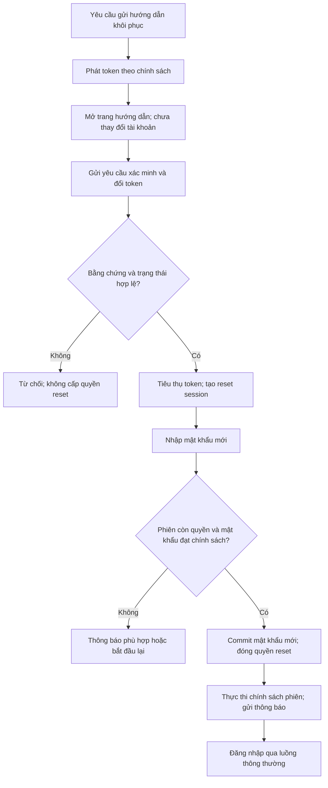

# Password reset session — Phiên giới hạn cho việc đặt lại mật khẩu

## 1. Password reset session giải quyết vấn đề gì?

Trong chương **Password Reset** của module `SECURITY_AUTHENTICATION_ACCOUNT_RECOVERY`, password reset session là một phiên có phạm vi hẹp, được tạo sau khi người yêu cầu đã cung cấp bằng chứng khôi phục được hệ thống chấp nhận. Phiên này cho phép hoàn tất việc đặt lại mật khẩu cho một tài khoản xác định.

Ví dụ, Mai quên mật khẩu nhưng vẫn kiểm soát một kênh khôi phục đã thiết lập. Sau khi Mai xác minh liên kết hoặc mã gửi qua kênh đó, ứng dụng tạo một phiên chỉ có quyền `RESET_PASSWORD`. Mai được nhập mật khẩu mới, nhưng phiên này không cho đọc hồ sơ, đổi email, xóa MFA hay tạo khóa API.

Đây là một cách tổ chức luồng, không phải thành phần bắt buộc của mọi triển khai. Hệ thống đơn giản có thể xác minh token và đổi mật khẩu trong cùng một lần gửi cuối. Khi tách thành nhiều bước, reset session giúp giữ quyền đã xác minh ở phía máy chủ, giảm việc truyền lại token gốc và quản lý tiến trình rõ ràng hơn.

OWASP mô tả việc tạo một phiên giới hạn từ PIN hoặc URL token, chỉ cho phép đặt lại mật khẩu. Tài liệu cũng khuyến nghị đăng nhập qua cơ chế thông thường sau khi đặt lại, thay vì tự động đăng nhập. Bài học áp dụng hướng thiết kế đó để giữ ranh giới giữa recovery và truy cập ứng dụng. [OWASP — Forgot Password Cheat Sheet](https://cheatsheetseries.owasp.org/cheatsheets/Forgot_Password_Cheat_Sheet.html).

Quyền của reset session phải phản ánh bằng chứng thực sự đã được chấp nhận. Một token từ email không tự chứng minh người yêu cầu còn kiểm soát MFA hoặc passkey; nếu tài khoản cần tổ hợp bằng chứng khác, luồng phải đáp ứng chính sách trước khi cấp quyền tương ứng.

## 2. Phân biệt ba loại bằng chứng và phiên

| Thành phần | Mục đích | Có thể làm gì trong thiết kế minh họa? | Không được suy ra |
| --- | --- | --- | --- |
| Password reset token | Mang bằng chứng khôi phục ban đầu, thường qua liên kết hoặc mã | Được đổi một lần thành quyền reset nếu hợp lệ | Không phải access token cho ứng dụng |
| Password reset session | Giữ quyền tạm thời sau xác minh | Xem trạng thái luồng, gửi mật khẩu mới, hủy luồng | Không phải phiên đăng nhập đầy đủ |
| Authentication session | Duy trì truy cập sau đăng nhập theo chính sách | Dùng các chức năng được phân quyền | Không tự có quyền recovery nếu thiếu xác thực lại cần thiết |

Một người có thể đang đăng nhập tài khoản B trong trình duyệt nhưng mở liên kết đặt lại mật khẩu cho tài khoản A. Tài khoản đích của reset phải được lấy từ dữ liệu khôi phục đã xác minh, không lấy từ session đăng nhập đang tồn tại hoặc từ trường `accountId` do client tùy ý gửi.

Không dùng chung một cờ như `authenticated = true` cho cả reset session và authentication session. Nếu middleware chỉ thấy cờ đó rồi mở mọi API, một luồng quên mật khẩu sẽ trở thành đường đăng nhập ngoài ý muốn.

Nên dùng loại principal hoặc cơ chế kiểm tra quyền tách biệt. Ví dụ, `PasswordResetPrincipal` chỉ được chấp nhận tại các endpoint phục vụ reset; API nghiệp vụ vẫn yêu cầu principal đăng nhập thông thường và các quyền tương ứng.

## 3. Vòng đời và các bất biến

Có thể thiết kế vòng đời như sau:



Trong mô hình này, reset token có thể có trạng thái `ISSUED`, `EXCHANGED`, `EXPIRED` hoặc `REVOKED`. Reset session có thể là `ACTIVE`, `COMPLETED`, `EXPIRED`, `REVOKED` hoặc `CANCELLED`. Hai vòng đời khác nhau: token đã được tiêu thụ để đổi quyền không còn sử dụng lại, còn session vừa tạo vẫn có thể đang `ACTIVE`.

Những điều kiện cần giữ:

1. Mỗi reset session gắn với đúng một tài khoản, một mục đích và một nguồn bằng chứng đã được xác minh.
2. Không tạo reset session chỉ từ yêu cầu “quên mật khẩu” chưa có bằng chứng hợp lệ.
3. Một token không tạo được nhiều reset session độc lập qua các lần dùng lại.
4. Một reset session chỉ hoàn tất việc đổi mật khẩu một lần.
5. Kiểm tra hạn dùng, trạng thái và phiên bản bảo mật ở máy chủ trước tác động nhạy cảm.
6. Không nâng reset session thành quyền đổi MFA, passkey hoặc kênh khôi phục.
7. Không coi việc xóa cookie là bằng chứng quyền ở máy chủ đã bị thu hồi.
8. Ghi mật khẩu mới và đóng quyền reset phải có ranh giới commit nhất quán.

Ở các phần tiếp theo, thời hạn, tên cookie, cấu trúc dữ liệu và chính sách thu hồi là lựa chọn minh họa của ứng dụng. Chúng cần được điều chỉnh theo rủi ro và kiến trúc thực tế.

## 4. Đổi token thành quyền reset có kiểm soát

### 4.1. Mở liên kết chưa phải tiêu thụ quyền

Hệ thống email, trình duyệt hoặc phần mềm bảo vệ có thể tự mở liên kết trước người dùng. Vì vậy, nên để `GET` hiển thị trang bắt đầu mà không đổi mật khẩu, không đóng token và không thu hồi session đăng nhập của tài khoản.

Một thiết kế có thể yêu cầu người dùng chủ động gửi `POST` để đổi token thành reset session. Cách này giảm việc tiêu thụ liên kết bởi thao tác xem trước, nhưng không tự chứng minh chủ tài khoản: tính hợp lệ vẫn dựa vào token, các bằng chứng bổ sung và chính sách của hệ thống.

Nếu token nằm trong query string, cần kiểm soát việc ghi URL ở reverse proxy, máy chủ, APM và công cụ phân tích. Trang chứa token không nên tải tài nguyên bên thứ ba có thể thu dữ liệu. Sau khi đổi quyền thành công, chuyển đến URL sạch không còn token.

Không tạo liên kết khôi phục từ một `Host` tùy ý do người gọi gửi. Địa chỉ đích cần dựa trên cấu hình đáng tin cậy để tránh đưa token đến tên miền do người khác kiểm soát.

### 4.2. Những gì máy chủ cần kiểm tra

Trước khi cấp reset session, cần xác định token có đúng tài khoản, đúng mục đích, còn hạn, chưa sử dụng và chưa bị thu hồi không. Đồng thời kiểm tra trạng thái tài khoản, phiên bản mật khẩu hoặc phiên bản bảo mật liên quan và những bằng chứng đi kèm mà chính sách yêu cầu.

Client không được quyết định tài khoản đích, phạm vi quyền, thời hạn hoặc nhãn “đã qua MFA”. Những giá trị đó được suy ra từ bản ghi đã xác minh tại máy chủ.

Một giao dịch đổi quyền có thể thực hiện:

```text
Khóa trạng thái khôi phục của tài khoản
  -> kiểm tra lại token và chính sách hiện hành
  -> đổi token từ ISSUED sang EXCHANGED bằng ghi có điều kiện
  -> tạo reset session ACTIVE với bí mật mới
  -> liên kết session với token và phiên bản bảo mật
  -> commit
  -> gửi cookie reset cho trình duyệt
```

Chỉ ghi token thành `EXCHANGED` khi đồng thời có thể lưu quyền tiếp tục bền vững. Ngược lại, không trả cookie hoặc token phiên dùng được trước khi giao dịch commit.

Nếu mã PIN có không gian giá trị nhỏ, cần giới hạn thử phù hợp. Việc nhập sai làm tăng bộ đếm thất bại chứ không xác minh thành công hoặc tạo một session có quyền thấp hơn để “thử tiếp” trên API đổi mật khẩu.

## 5. Dữ liệu của reset session

Trong một triển khai sử dụng phiên có trạng thái ở máy chủ, có thể lưu:

```text
PasswordResetSession
  id                         // định danh nội bộ, không phải bí mật bearer
  secretHash                 // dữ liệu kiểm tra bí mật phiên
  accountId
  sourceResetTokenId
  purpose = RESET_PASSWORD
  state = ACTIVE
  createdAt
  absoluteExpiresAt
  lastActivityAt
  idleTimeout
  passwordVersionAtIssue
  securityEpochAtIssue
  policyVersion
  csrfBinding
  completedAt
  completionOperationId
```

Giá trị cookie có thể là một bí mật ngẫu nhiên mạnh, ví dụ 32 byte sinh từ CSPRNG rồi mã hóa Base64URL. Đây là lựa chọn minh họa. Máy chủ chỉ cần lưu giá trị kiểm tra một chiều của bí mật phiên; không đưa mật khẩu, email hoặc quyền quản trị vào nội dung cookie.

Phải phân biệt `id` nội bộ dùng đối soát với bí mật thực tế cấp quyền. Người biết session ID trong log nghiệp vụ không được mặc nhiên có khả năng đổi mật khẩu. Nếu thiết kế dùng cùng một giá trị cho cả hai, giá trị đó phải được bảo vệ như thông tin xác thực và không ghi thẳng vào log.

JWT có thể biểu diễn quyền tương tự, nhưng chữ ký và `exp` chưa giải quyết việc dùng một lần hoặc thu hồi trước hạn. Vẫn cần trạng thái hoặc cơ chế kiểm tra phù hợp để không chấp nhận một quyền đã được tiêu thụ.

### Giới hạn tuyệt đối và giới hạn không hoạt động

Ví dụ ứng dụng chọn session có thời hạn tuyệt đối tối đa 10 phút và thời gian không hoạt động 5 phút. Trong thiết kế bảo thủ này, thời hạn tuyệt đối còn bị chặn bởi thời điểm token gốc hết hạn:

```text
absoluteExpiresAt = min(tokenExpiresAt, exchangedAt + 10 phút)

usable = state == ACTIVE
         AND now < absoluteExpiresAt
         AND now - lastActivityAt < 5 phút
         AND phiên bản bảo mật còn phù hợp
```

Như vậy, đổi token ngay trước lúc hết hạn không tạo ra một cửa sổ mới dài hơn dự kiến. Đây là lựa chọn của ứng dụng, không phải quy tắc thời hạn bắt buộc cho mọi hệ thống.

Gọi API trạng thái hoặc tải lại trang không được kéo dài giới hạn tuyệt đối. Hoạt động nền tự động cũng không nên làm phiên sống mãi qua cơ chế idle timeout. Hạn cookie ở trình duyệt không thay thế kiểm tra thời gian tại máy chủ.

Địa chỉ IP và User-Agent có thể hỗ trợ đánh giá rủi ro, nhưng không nên là bằng chứng duy nhất để ràng buộc chủ thể. IP có thể thay đổi trên mạng di động hoặc được nhiều người dùng chung.

## 6. Truyền reset session qua trình duyệt

Một cookie minh họa:

```http
Set-Cookie: __Host-reset_ctx=<random-secret>; Path=/; Secure; HttpOnly; SameSite=Strict; Max-Age=600
Cache-Control: no-store
Referrer-Policy: no-referrer
```

Trong thực tế, `Max-Age` cần phù hợp với thời gian còn lại của phiên trên máy chủ; 600 giây chỉ minh họa một lần cấp đủ thời hạn tối đa.

Tiền tố `__Host-` yêu cầu cookie có `Secure`, có `Path=/` và không có thuộc tính `Domain` trên trình duyệt hỗ trợ. Vì vậy, không ghép tiền tố này với `Path=/reset`. `HttpOnly` hạn chế JavaScript đọc cookie; `SameSite` kiểm soát việc gửi cookie trong ngữ cảnh khác site. [MDN — Set-Cookie](https://developer.mozilla.org/en-US/docs/Web/HTTP/Reference/Headers/Set-Cookie).

Vì cookie trên có `Path=/`, trình duyệt có thể gửi nó đến nhiều endpoint cùng host. Giới hạn quyền phải nằm trong kiểm tra mục đích và principal ở máy chủ, không dựa vào đường dẫn cookie.

`SameSite=Strict` cần được kiểm tra với hành trình mở liên kết từ email. Một luồng có thể mở trang đầu trước, rồi thực hiện trao đổi quyền trong ngữ cảnh cùng site và cấp cookie reset tại đó. Không giảm bảo vệ cookie tùy tiện để che một lỗi thiết kế chuyển hướng.

Nếu dùng một host khôi phục riêng, cần xác định rõ host nào nhận token, host nào đặt cookie và cách chuyển kết quả. Không mong đợi cookie host-only tự được gửi sang một tên miền khác.

### Chống session fixation

Khi quyền thay đổi từ ngữ cảnh chưa xác minh sang reset session, phải cấp một định danh phiên mới do máy chủ tạo. Không tái sử dụng ID từ URL, trường form hoặc cookie tùy ý do client đề xuất.

OWASP khuyến nghị thay session ID khi mức quyền thay đổi và chỉ chấp nhận những ID hợp lệ đã được máy chủ cấp. Áp dụng nguyên tắc này giúp ngăn người tấn công cố định trước một ID rồi chờ nạn nhân hoàn tất xác minh. [OWASP — Session Management](https://cheatsheetseries.owasp.org/cheatsheets/Session_Management_Cheat_Sheet.html).

Cookie reset nên có tên và cách xử lý riêng với cookie đăng nhập. Việc gửi yêu cầu bằng cookie reset tới API hồ sơ, đổi email hoặc quản trị phải bị từ chối ngay cả khi cookie đó đang hợp lệ.

### Chống CSRF và nhầm ngữ cảnh tài khoản

Yêu cầu tạo hoặc sử dụng reset session bằng cookie cần cơ chế chống CSRF phù hợp, ví dụ token chống CSRF gắn với luồng cùng kiểm tra nguồn yêu cầu theo chính sách. Chỉ dùng `POST`, CORS hay `SameSite` không tự thay thế toàn bộ kiểm tra này.

Form đổi mật khẩu cần gắn với đúng giao dịch đang hiển thị. Nhiều tab có thể chia sẻ cùng một cookie; nếu tab khác bắt đầu reset tài khoản B và thay cookie, form của tài khoản A không được âm thầm áp dụng mật khẩu cho B. Có thể gửi một transaction ID để kiểm tra khớp với phiên ở máy chủ, nhưng ID đó không được trở thành nguồn quyết định quyền hoặc tài khoản đích.

Sau xác minh, giao diện có thể hiển thị thông tin tài khoản đích ở mức cần thiết để người dùng nhận biết ngữ cảnh. Tránh biến trang tra cứu công khai trước xác minh thành nơi liệt kê tài khoản.

## 7. Đổi mật khẩu và tiêu thụ quyền trong cùng ranh giới commit

Một lỗi nghiêm trọng là cập nhật mật khẩu trước rồi mới đóng reset session. Nếu bước đóng lỗi, cùng một quyền có thể tiếp tục đổi mật khẩu lần nữa. Thứ tự ngược lại cũng có vấn đề: session bị đóng nhưng mật khẩu chưa đổi khiến người dùng mất quyền mà không hoàn tất.

Trong một kiến trúc dùng chung cơ sở dữ liệu, có thể đặt các thay đổi sau vào cùng giao dịch:

- Cập nhật giá trị băm của mật khẩu mới bằng cơ chế lưu mật khẩu được ứng dụng lựa chọn.
- Tăng phiên bản mật khẩu và phiên bản bảo mật cần thiết.
- Đánh dấu reset session `COMPLETED` với operation ID và thời điểm.
- Thu hồi token và reset session khác đã cũ theo chính sách tài khoản.
- Ghi trạng thái thực thi chính sách thu hồi phiên và sự kiện outbox.

Không thay đổi mật khẩu nếu session đã hết hạn, bị thu hồi, sai mục đích hoặc được cấp trước một thay đổi bảo mật khiến quyền đó không còn hợp lệ.

### 7.1. Ví dụ mã giả Java

```java
// Mã giả: ResetContext được tạo sau kiểm tra bí mật cookie ở máy chủ.
// Nó chỉ hỗ trợ precheck; trạng thái quyền vẫn được đọc lại trong tx.
ResetResult completePasswordReset(ResetContext context, NewPassword input) {
    resetGuard.precheckContextAndRateLimit(context);
    csrfGuard.requireValidBinding(context);
    requireExpectedTransaction(context);
    passwordPolicy.validate(input);

    // Tính toán tốn tài nguyên sau precheck và trước khi giữ khóa dài.
    var encodedPassword = passwordEncoder.encode(input.value());

    return tx.required(() -> {
        var account = repository.lockAccount(context.accountId());
        var reset = repository.lockResetSession(context.resetSessionId());
        requireSameAccount(account, reset);
        requirePossessionOfResetSecret(reset, context);
        requireCsrfAndTransactionBinding(reset, context);

        if (reset.isCompleted()) {
            return receiptPolicy.existingResultOnly(reset, context);
        }

        resetPolicy.requireActiveAuthority(account, reset, clock.instant());
        // Kiểm tra mục đích, hạn dùng, trạng thái, phiên bản và chính sách.

        repository.updatePasswordHash(account, encodedPassword);
        repository.incrementPasswordVersion(account);
        repository.advanceAuthenticationEpoch(account);
        repository.completeReset(reset, context.operationId());
        repository.invalidateOtherOutstandingResets(account, reset.id());
        repository.recordSessionRevocationPolicy(account);
        repository.insertAuditEvent("PASSWORD_RESET_COMPLETED", reset.id());
        repository.insertOutboxEvent("PASSWORD_RESET_NOTIFICATION", reset.id());

        return ResetResult.completedWithoutLogin();
    });
}
```

Ví dụ lược bỏ chi tiết HTTP, định dạng lỗi, việc xóa dữ liệu nhạy cảm khỏi bộ nhớ và triển khai password encoder. Nó không định nghĩa một thuật toán băm mới và không phải mã sản xuất có thể sao chép chạy ngay.

Các kiểm tra trước giao dịch giúp loại yêu cầu không có quyền và hạn chế tấn công tiêu tốn CPU của hàm băm. Tuy nhiên, trong lúc tính toán, session có thể hết hạn hoặc trạng thái tài khoản thay đổi; vì vậy kiểm tra lại dưới khóa hoặc bằng ghi có điều kiện vẫn bắt buộc.

Không giữ mật khẩu rõ trong reset session, bản ghi idempotency hoặc audit log. Chỉ lưu dữ liệu mật khẩu theo cơ chế lưu credential của ứng dụng. Lỗi xác thực đầu vào cần được phản hồi mà không in nội dung mật khẩu ra log.

Nhánh trả receipt trong mã giả chỉ trả một kết quả đã hoàn tất cho đúng ngữ cảnh còn được phép xem kết quả. Nó không cấp quyền reset, không kéo dài hạn và không đăng nhập. Có thể giữ quyền xem receipt trong một khoảng hữu hạn; không để session `COMPLETED` trở thành credential có thể sử dụng lâu dài.

### 7.2. Hai yêu cầu cùng hoàn tất

Nếu hai tab cùng gửi mật khẩu mới cho một reset session, chỉ một lần chuyển từ `ACTIVE` sang `COMPLETED` được phép thành công. Yêu cầu sau nhận kết quả đã hoàn tất hoặc lỗi trạng thái phù hợp, không ghi đè bằng mật khẩu khác.

Nếu hai reset session khác nhau cùng thuộc một tài khoản, cần tuần tự hóa quyết định trên trạng thái tài khoản. Trong thiết kế dùng `passwordVersionAtIssue`, lần reset đầu tiên tăng phiên bản; session còn lại được cấp theo phiên bản cũ bị từ chối.

Mọi đường đặt lại hoặc thay đổi mật khẩu liên quan phải tuân thủ quy tắc phiên bản. Chỉ khóa một endpoint trong khi endpoint quản trị bỏ qua nó vẫn để lại cạnh tranh dữ liệu.

## 8. Xử lý phiên đăng nhập sau khi đặt lại

Password reset session và những phiên đăng nhập có từ trước cần được xử lý riêng. Đóng phiên reset chỉ chấm dứt quyền tạm thời; nó không tự kết thúc các phiên khác của người đang giữ cookie hoặc token cũ.

Trong thiết kế minh họa, một lần quên mật khẩu hoàn tất sẽ vô hiệu toàn bộ phiên đăng nhập cũ của tài khoản và yêu cầu đăng nhập lại. Đây là lựa chọn chính sách của ứng dụng. Với sản phẩm chọn cách thu hồi khác, phải ghi rõ các trường hợp, tác động và mức rủi ro chấp nhận.

| Loại quyền đang tồn tại | Cách thực thi thu hồi cần xem xét |
| --- | --- |
| Session có trạng thái ở máy chủ | Xóa hoặc đánh dấu thu hồi; hoặc kiểm tra phiên bản xác thực tại mỗi lần sử dụng |
| Refresh token | Thu hồi token hoặc cả họ token liên quan theo mô hình của hệ thống |
| Access token tự chứa | Kiểm tra trạng thái/epoch, introspection hoặc cơ chế thu hồi đáp ứng yêu cầu |
| Cookie ghi nhớ đăng nhập | Vô hiệu dữ liệu tương ứng ở máy chủ và ngăn tạo phiên mới từ cookie đó |
| Reset token và reset session cũ | Vô hiệu hoặc từ chối do phiên bản mật khẩu/bảo mật đã thay đổi |

Thu hồi refresh token không tự làm access token đã phát hết hiệu lực ngay. Một JWT vẫn có chữ ký hợp lệ có thể tiếp tục dùng đến `exp` nếu dịch vụ chỉ kiểm tra chữ ký và hạn dùng. Nếu yêu cầu ngắt quyền ngay, cơ chế kiểm tra quyền phải hỗ trợ điều đó trên các đường cần bảo vệ.

Trong hệ thống phân tán, sự kiện bất đồng bộ hữu ích cho việc dọn session nhưng có độ trễ. Có thể cần epoch trong một kho đủ nhất quán được kiểm tra tại điểm cấp quyền, thay vì chỉ chờ mọi dịch vụ xử lý sự kiện. Khi không xác minh được trạng thái thu hồi cho một thao tác nhạy cảm, không nên mặc định cho phép bằng dữ liệu cũ.

### Không bỏ qua MFA và passkey

Sau khi đổi mật khẩu, người dùng đăng nhập qua quy trình thông thường, bao gồm MFA nếu tài khoản yêu cầu. Reset session không chứng minh đã qua yếu tố đó.

Nếu người dùng đồng thời mất MFA hoặc passkey, cần chuyển sang luồng recovery tương ứng với bằng chứng phù hợp. Không gắn chức năng “xóa MFA” vào endpoint đổi mật khẩu chỉ vì người dùng không đăng nhập được sau reset.

Các authenticator độc lập đã đăng ký hợp lệ không nhất thiết phải bị xóa chỉ vì đặt lại mật khẩu. Nếu có nghi ngờ tài khoản bị chiếm đoạt, phải đánh giá authenticator, kênh khôi phục và thay đổi đáng ngờ trong quy trình xử lý sự cố riêng.

### Chỉ thu hồi theo thời điểm được phép

Yêu cầu gửi thư quên mật khẩu chưa xác minh không được tự động làm tất cả phiên đăng nhập hết hiệu lực. Nếu có hành vi đó, người chỉ biết email có thể liên tục đẩy chủ tài khoản ra khỏi hệ thống.

Ranh giới áp dụng chính sách thu hồi trong ví dụ là lúc đặt lại mật khẩu thành công, hoặc một sự kiện an ninh khác đã được xác minh và định nghĩa riêng.

## 9. Lỗi mạng, retry và nhiều liên kết khôi phục

### 9.1. Mất phản hồi khi đổi token

Máy chủ có thể commit việc tiêu thụ token và tạo reset session, nhưng cookie mới không đến được trình duyệt. Không được coi timeout là bằng chứng giao dịch rollback rồi bật lại token đã dùng.

Nếu hệ thống có một ngữ cảnh trình duyệt đã được ràng buộc bền vững với giao dịch, có thể thiết kế cơ chế tiếp tục an toàn cho cùng client. Ngữ cảnh đó phải được kiểm tra trước khi trả quyền tiếp tục; request ID hoặc token đã tiêu thụ không đủ để cấp lại quyền từ một máy khác.

Nếu không có cách chứng minh quyền tiếp tục, người dùng cần yêu cầu liên kết mới theo chính sách. Không đọc bí mật phiên dạng rõ từ log hoặc cho phép dùng lại token vô hạn để sửa trải nghiệm mất phản hồi.

### 9.2. Mất phản hồi sau khi mật khẩu đã đổi

Một lần gửi cuối có thể commit thành công rồi mất kết nối. Retry đúng ngữ cảnh có thể nhận receipt rằng giao dịch đã hoàn tất; không thực hiện lần đổi thứ hai.

Nếu người dùng nhập một mật khẩu khác trong lần retry, kết quả “đã hoàn tất” chỉ nói rằng giao dịch cũ đã thành công, không có nghĩa mật khẩu nhập lại được áp dụng. Giao diện cần hướng dẫn đăng nhập hoặc bắt đầu quy trình mới khi thực sự cần thay đổi tiếp.

Idempotency phải có phạm vi rõ ràng, ràng buộc tài khoản và giao dịch, thời hạn lưu kết quả hữu hạn và cơ chế xử lý yêu cầu không nhất quán. Không lưu mật khẩu rõ để so sánh các lần gửi.

### 9.3. Nhiều thư và nhiều phiên reset

Sản phẩm cần định nghĩa liên kết mới có thu hồi liên kết cũ ngay không, cho tồn tại bao nhiêu yêu cầu và khi nào các quyền cũ cùng bị đóng. Một lựa chọn là giới hạn số yêu cầu đang hoạt động, gắn chúng với phiên bản mật khẩu hiện tại và vô hiệu tất cả khi một lần đổi hoàn tất.

Nếu mọi yêu cầu gửi lại chưa xác minh đều làm liên kết trước hết hiệu lực, người ngoài có thể liên tục phá liên kết hợp lệ mà chủ tài khoản vừa nhận. Cần đánh giá hành vi đó trong chính sách resend và chống lạm dụng, thay vì coi “chỉ liên kết mới nhất dùng được” luôn tốt hơn.

Yêu cầu cấp token mới chạy đồng thời với việc đổi mật khẩu cũng cần đọc phiên bản tài khoản nhất quán. Không phát một quyền có phiên bản cũ ngay sau commit rồi xử lý như một quyền mới hợp lệ.

## 10. Chống lạm dụng và quan sát vòng đời

Các bước cấp token, đổi token, kiểm tra trạng thái và hoàn tất mật khẩu có chi phí, bằng chứng và nguy cơ khác nhau. Nên giới hạn theo từng bước, phối hợp tài khoản, giao dịch và nguồn yêu cầu thay vì chỉ dùng một hạn mức IP cho toàn bộ luồng.

Trước xác minh, phản hồi không nên tiết lộ tài khoản có tồn tại hay đang có bao nhiêu reset session. Bên trong hệ thống vẫn cần reason code đủ rõ để phân biệt hết hạn, dùng lại, sai phiên bản, thiếu quyền và lỗi hạ tầng.

Không ghi mật khẩu, token từ URL, bí mật cookie, header `Cookie` hoặc `Set-Cookie` vào log. Cần kiểm tra cả proxy, APM, trace, error tracker và session replay; chỉ lọc log trong controller là chưa đủ.

Một bộ sự kiện minh họa:

| Sự kiện | Trường nghiệp vụ có thể ghi | Điều cần tránh |
| --- | --- | --- |
| `RESET_SESSION_CREATED` | ID nội bộ, transaction ID, thời điểm, loại bằng chứng, hạn dùng | Bí mật dùng trong cookie hoặc token gốc |
| `RESET_SESSION_REJECTED` | Reason code, policy version, correlation ID | Phản chiếu token sai từ request vào log |
| `RESET_SESSION_EXPIRED` | Loại timeout, ID nội bộ, thời điểm | Dùng URL có token làm nhãn metric |
| `PASSWORD_RESET_COMPLETED` | Account ID nội bộ, operation ID, phiên bản mới, chính sách phiên | Mật khẩu mới hoặc giá trị băm của mật khẩu |
| `AUTH_SESSIONS_REVOKED` | Phạm vi thu hồi, epoch, kết quả thực thi | Token còn hiệu lực của các phiên bị thu hồi |

Có thể theo dõi tỷ lệ đổi token thành công nhưng không hoàn tất mật khẩu, số lần thất bại do hết hạn, tỷ lệ retry nhận lại kết quả và độ trễ thực thi thu hồi ở các dịch vụ. Các chỉ số này giúp tìm vấn đề thiết kế mà không cần xem bí mật.

Thông báo sau hoàn tất nên nói rằng mật khẩu đã được đặt lại, thời điểm và cách báo hoạt động không nhận ra. Không gửi mật khẩu mới. Nếu gửi thông báo thất bại, sự kiện cần được retry bền vững; không rollback mật khẩu hoặc mở lại quyền reset chỉ vì nhà cung cấp email lỗi.

Job dọn dữ liệu hết hạn chỉ giúp giảm lưu trữ. Reset session phải bị từ chối theo thời gian và trạng thái ngay cả khi job chưa chạy. Tương tự, đóng trình duyệt không phải cơ chế thu hồi đáng tin cậy.

## 11. Ví dụ xuyên suốt

Giả sử ứng dụng của Mai đã chọn một nhánh đặt lại mật khẩu qua kênh khôi phục phù hợp với chính sách tài khoản. Phiên reset không có quyền thay MFA và mọi phiên đăng nhập cũ sẽ bị vô hiệu khi đổi mật khẩu thành công.

1. Mai yêu cầu hướng dẫn khôi phục. Hệ thống phản hồi chung; tài khoản và các phiên đang dùng chưa bị thay đổi.
2. Mai mở liên kết. `GET` chỉ hiển thị trang bắt đầu; chương trình quét liên kết mở trước cũng không làm token bị tiêu thụ.
3. Mai gửi bước xác minh. Máy chủ đổi token một lần, tạo reset session mới và đưa trình duyệt đến URL sạch.
4. Mai nhập mật khẩu mới. Hệ thống kiểm tra cookie reset, CSRF, giao dịch, chính sách mật khẩu và trạng thái quyền hiện hành.
5. Một giao dịch ghi mật khẩu mới, tăng phiên bản, hoàn tất reset và vô hiệu các quyền cũ liên quan. Sự kiện thông báo được lưu cùng ranh giới commit.
6. Phản hồi bị mất. Trình duyệt retry trong ngữ cảnh hợp lệ và nhận kết quả hoàn tất; không có lần ghi mật khẩu thứ hai.
7. Mai đến trang đăng nhập, dùng mật khẩu mới và hoàn thành MFA đang được yêu cầu. Phiên đăng nhập mới được cấp qua luồng đăng nhập đó.

Nếu Mai mất cả thiết bị MFA, bước 7 không được giải quyết bằng cách dùng cookie reset để bỏ qua MFA. Mai phải sử dụng phương thức khác còn hợp lệ hoặc một nhánh khôi phục yếu tố được chấp nhận.

Nếu người tấn công giữ access token cũ, hiệu quả ngắt quyền phụ thuộc vào cơ chế thực thi thu hồi đã được thiết kế. Việc mật khẩu mới đã lưu thành công không tự làm mọi token cũ biến mất.

## 12. Các tình huống cần kiểm thử khi triển khai

Bảng dưới là tiêu chí thiết kế cho một hệ thống hiện thực, không phải kết quả đã chạy kiểm thử của một ứng dụng cụ thể.

| Tình huống | Kết quả mong đợi |
| --- | --- |
| Yêu cầu gửi thư nhưng chưa xác minh | Không có reset session có quyền; phiên đăng nhập không bị thu hồi |
| Trình quét email gọi `GET` liên kết | Không đổi mật khẩu, không tiêu thụ token trong thiết kế minh họa |
| Token đúng, còn hạn, đủ bằng chứng | Một lần đổi token tạo một quyền reset đúng tài khoản |
| Hai yêu cầu đổi cùng token | Không tạo hai reset session độc lập |
| Cookie phiên do client tự đặt | Không được chấp nhận chỉ vì có đúng tên cookie |
| Gọi API hồ sơ hoặc đổi email bằng cookie reset | Bị từ chối vì sai loại quyền |
| Client sửa `accountId`, scope hoặc thời hạn | Quyền và tài khoản vẫn lấy từ trạng thái đã xác minh ở máy chủ |
| Form tài khoản A nhưng cookie bị tab B thay | Phát hiện không khớp giao dịch, không đổi nhầm tài khoản |
| Gửi yêu cầu từ nguồn không được phép hoặc thiếu CSRF | Bị từ chối theo cơ chế bảo vệ đã chọn |
| Phiên hết hạn trong lúc tính giá trị băm mật khẩu | Kiểm tra trong giao dịch từ chối trước khi ghi |
| Hai lần hoàn tất cùng reset session | Tối đa một lần ghi mật khẩu; lần sau không đổi lại |
| Hai reset session cùng phiên bản mật khẩu | Lần thành công đầu làm quyền cũ còn lại không hợp lệ |
| Cập nhật mật khẩu lỗi giữa giao dịch | Không tồn tại trạng thái hoàn tất giả hoặc quyền tiếp tục đổi nhiều lần |
| Mất phản hồi sau commit | Retry đúng ngữ cảnh chỉ nhận kết quả cũ, không phát phiên đăng nhập |
| Access token cũ còn chữ ký hợp lệ | Bị xử lý đúng chính sách thu hồi đã công bố, không giả định refresh token đủ giải quyết |
| Reset mật khẩu của tài khoản có MFA | Đăng nhập mới vẫn phải đáp ứng MFA; không tự xóa authenticator |
| Cookie còn nhưng bản ghi đã bị thu hồi | Máy chủ từ chối, không tin thời hạn cookie phía client |
| Kho reset session hoặc kho epoch không đọc được | Không mặc định cho phép đổi mật khẩu bằng trạng thái chưa xác định |
| Thông báo sau reset gửi thất bại | Retry thông báo; mật khẩu và trạng thái đóng quyền giữ nguyên |
| Job dọn session hết hạn chưa chạy | Quyền hết hạn vẫn bị từ chối |
| Restore bản sao lưu chứa token và session trước khi bị thu hồi | Đối chiếu trạng thái bảo mật trước khi phục vụ lại, không làm quyền cũ sống lại |

Kiểm thử cần bao phủ nhiều instance và các đường thay mật khẩu khác, không chỉ một controller. Với hệ thống có cache hoặc JWT, phải kiểm tra thời điểm quyết định quyền thực tế sau reset, thay vì chỉ kiểm tra một sự kiện “đã gửi yêu cầu thu hồi”.

Khi phục hồi dữ liệu từ bản sao lưu, các phiên bản bảo mật và trạng thái thu hồi có thể bị lùi. Quy trình vận hành phải tái áp dụng hoặc đối chiếu quyết định mới hơn từ nguồn đáng tin cậy trước khi mở lại luồng; nếu không làm được, cần vô hiệu quyền bị ảnh hưởng theo phương án đã định nghĩa.

## 13. Những quyết định phải được ghi rõ

Một bản thiết kế password reset session cần trả lời được các câu hỏi thực tế: bằng chứng nào cho phép tạo phiên, phiên có đúng những quyền nào, khi nào hết hạn, quyền được tiêu thụ ở giao dịch nào và các session cũ bị xử lý ra sao.

Đồng thời phải mô tả hành vi khi token đã được đổi nhưng cookie thất lạc, khi nhiều tab cùng thao tác, khi mật khẩu đã đổi nhưng phản hồi mất và khi dịch vụ thu hồi chậm hoặc lỗi. Những trường hợp này quyết định liệu quyền tạm thời có thật sự giới hạn hay trở thành một đường truy cập ngoài dự kiến.

Password reset session hoàn thành nhiệm vụ khi cho phép đúng người có bằng chứng được chấp nhận đặt lại mật khẩu một lần, rồi chấm dứt quyền đó. Quyền truy cập ứng dụng sau cùng phải được thiết lập qua quá trình đăng nhập và chính sách xác thực của tài khoản.
