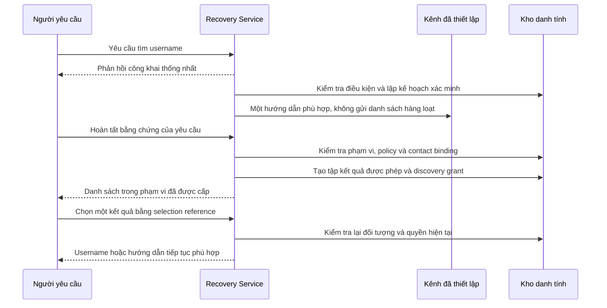

# Multiple username handling

## 1. Mục tiêu và phạm vi

**Multiple username handling** là cách hệ thống xử lý trường hợp thông tin khôi phục dẫn đến nhiều tên đăng nhập hoặc nhiều tài khoản có thể liên quan. Mục tiêu là giúp người dùng nhận diện đúng username mà không vô tình tiết lộ quan hệ giữa các tài khoản, cấp quyền truy cập sai tài khoản hoặc vượt ranh giới tenant.

Trong module `SECURITY_AUTHENTICATION_ACCOUNT_RECOVERY`, tìm lại username là bước hỗ trợ nhận diện tài khoản. Người dùng vẫn phải đáp ứng yêu cầu đăng nhập hoặc khôi phục mật khẩu, MFA, passkey của tài khoản được chọn.

Một địa chỉ email nhận được mã xác minh không đồng nghĩa người đang đọc email sở hữu hợp lệ mọi tài khoản từng gắn với địa chỉ đó. Hộp thư có thể dùng chung, được bàn giao, bị chiếm đoạt hoặc chỉ là kênh nhận thông báo.

Bài học sử dụng các tình huống và kiến trúc minh họa, không quy định rằng mọi sản phẩm phải cho phép một email liên kết nhiều tài khoản. Người thiết kế cần xác định mô hình định danh của sản phẩm trước khi chọn cách xử lý.

Sau bài học, người học có thể:

- Phân biệt nhiều alias của một tài khoản với nhiều tài khoản độc lập.
- Xác định kết quả nào được phép tiết lộ sau xác minh kênh khôi phục.
- Thiết kế danh sách lựa chọn và chuyển tiếp đến đúng tài khoản.
- Ngăn dò tìm tài khoản, vượt tenant và sử dụng kết quả đã lỗi thời.
- Kiểm soát phân trang, gửi thông báo và công cụ hỗ trợ khi có nhiều kết quả.

## 2. “Nhiều username” có thể là những mô hình khác nhau

### 2.1. Không suy ra số tài khoản từ số dòng truy vấn

| Tình huống | Ví dụ minh họa | Cách hiểu phù hợp |
| --- | --- | --- |
| Một tài khoản có nhiều alias đăng nhập | `minh.an` và `an.minh` cùng trỏ tới account A | Một tài khoản, nhiều tên có thể dùng để đăng nhập |
| Một tài khoản đã đổi username | `an2020` đổi thành `an.nguyen` | Tên cũ có thể là lịch sử, không còn là tên đăng nhập hợp lệ |
| Một kênh recovery liên kết nhiều tài khoản | Email cá nhân gắn với account A và B | Hai tài khoản riêng, cần lựa chọn đúng |
| Username chỉ duy nhất trong từng tenant | `minh` ở tenant X khác `minh` ở tenant Y | Cần ngữ cảnh tenant để xác định tài khoản |
| Một principal toàn cục có nhiều membership | Một tài khoản tham gia ba không gian làm việc | Có thể chỉ có một username toàn cục, không phải ba tài khoản |
| Một tài khoản chỉ đăng nhập qua SSO | Có display name nhưng không có username/mật khẩu cục bộ | Cần hướng dẫn về nhà cung cấp danh tính hoặc cổng đăng nhập phù hợp |
| Dữ liệu cũ hoặc liên kết trùng | Một contact binding bị nhập hai lần | Lỗi dữ liệu, không phải thêm tài khoản để hiển thị |

Nếu truy vấn join tài khoản, contact và alias trả về sáu dòng, hệ thống có thể chỉ có hai tài khoản thật. Giao diện không được tự hiển thị sáu lựa chọn.

### 2.2. Tách các định danh trong mô hình dữ liệu

Một mô hình khái niệm có thể gồm:

```text
Account:
  account_id ổn định
  tenant_id hoặc phạm vi định danh tương ứng
  account_state
  identity_version

LoginName:
  account_id
  tenant_id
  username
  normalized_username
  loại tên: PRIMARY / ALIAS / HISTORICAL
  trạng thái được phép đăng nhập

RecoveryContactBinding:
  binding_id
  account_id
  tenant_id
  contact_reference
  trạng thái xác minh
  được phép dùng cho username recovery hay không
  binding_version
  thời điểm thu hồi nếu có
```

Định danh nội bộ ổn định là cơ sở liên kết. Username là dữ liệu có thể thay đổi, không nên là khóa duy nhất để định tuyến một tác vụ đã tồn tại.

Phạm vi duy nhất của username phải được định nghĩa rõ: toàn hệ thống hay trong từng tenant. Nếu sản phẩm dùng principal toàn cục, cần mô hình hóa membership riêng; đừng nhân bản giả tạo tài khoản chỉ để khớp một thiết kế tenant cố định.

## 3. Các bất biến của luồng nhiều kết quả

| Bất biến | Hệ quả thiết kế |
| --- | --- |
| Không lộ số tài khoản trước khi có quyền xem | Request công khai không trả `matchCount`, username hoặc tenant tìm thấy |
| Xác minh contact chưa đủ cho mọi tài khoản | Mỗi kết quả cần chính sách cho phép tiết lộ riêng |
| Alias không làm nhân số tài khoản | Gom theo định danh tài khoản và phạm vi đúng |
| Username lịch sử không được trình bày như tên hiện dùng | Đọc trạng thái và tên hợp lệ hiện tại |
| Kết quả chỉ nằm trong phạm vi được cấp | Token discovery không cho phép tra cứu account ID bất kỳ |
| Lựa chọn không tự tạo phiên đăng nhập | Chuyển sang đăng nhập hoặc recovery tiếp theo với quyền riêng |
| Không vượt tenant | Dữ liệu và thao tác được kiểm tra theo tenant có thẩm quyền |
| Thông tin được kiểm tra lại lúc sử dụng | Danh sách cũ không cho phép tiết lộ hoặc tiếp tục sau khi liên kết bị thu hồi |
| Không tự thay đổi tài khoản vì có nhiều kết quả | Không gộp tài khoản, reset hàng loạt hoặc đổi username tự động |

OWASP lưu ý thông báo, mã HTTP và khác biệt thời gian có thể giúp người ngoài dò tài khoản. Phản hồi chung cần được thực hiện nhất quán ở cả giao diện và API. [OWASP — Authentication and Error Messages](https://cheatsheetseries.owasp.org/cheatsheets/Authentication_Cheat_Sheet.html#authentication-and-error-messages).

Trong bài học, chống dò tìm không có nghĩa người dùng đã được cấp quyền vẫn chỉ nhận câu trả lời mơ hồ. Sau khi đủ điều kiện, hệ thống cần cung cấp thông tin hữu ích trong phạm vi chính sách cho phép.

## 4. Chuẩn hóa kênh khôi phục mà không gộp nhầm danh tính

### 4.1. Chuẩn hóa phải nhất quán với dữ liệu đã xác minh

Không tự áp dụng mọi quy tắc sau cho tất cả email:

```text
Chuyển toàn bộ địa chỉ thành chữ thường.
Bỏ mọi dấu chấm trước ký tự @.
Bỏ phần bắt đầu bằng dấu +.
Đổi nhiều tên miền thành một tên miền được cho là tương đương.
```

Những biến đổi đó có thể gộp các địa chỉ khác nhau hoặc làm tìm thấy các tài khoản không thuộc phạm vi bằng chứng đã xác minh.

RFC 5321 quy định ngữ nghĩa local-part thuộc về host của domain và lưu ý local-part có thể phân biệt chữ hoa, chữ thường; domain không phân biệt theo quy tắc DNS. Không suy ra một quy tắc alias chung cho mọi nhà cung cấp email. [RFC 5321 — Mailbox and General Syntax](https://www.rfc-editor.org/rfc/rfc5321.html#section-2.4).

Ứng dụng cần có chính sách chuẩn hóa được định nghĩa từ khi đăng ký, xác minh và lưu contact. Khi hỗ trợ địa chỉ quốc tế hoặc quy tắc riêng của nhà cung cấp, dùng thành phần phân tích và chính sách phù hợp thay vì một chuỗi thao tác thay thế tùy ý.

Nếu thay chính sách chuẩn hóa, cần xử lý các xung đột hiện có và đánh giá lại liên kết. Không cho luồng username recovery dùng một thuật toán “rộng hơn” để tăng số kết quả mà các luồng đăng ký chưa từng xác minh.

### 4.2. Không tìm kiếm mờ trước xác minh

Không mở rộng một địa chỉ thành:

- Những địa chỉ gần giống vì sai một ký tự.
- Tên người dùng có âm đọc tương tự.
- Các số điện thoại có hậu tố giống nhau.
- Tài khoản cùng họ tên hoặc cùng công ty suy ra từ domain.

Những suy đoán này có thể hữu ích trong công cụ hỗ trợ có kiểm soát, nhưng không phải bằng chứng cho phép tiết lộ username qua một kênh khác.

Việc sở hữu một domain doanh nghiệp cũng không tự cho người yêu cầu quyền xem mọi username có email thuộc domain đó. Quyền quản trị tenant và quyền dùng một contact recovery là hai quan hệ khác nhau.

### 4.3. Một hộp thư giống nhau không phải một con người duy nhất

Ví dụ `support@example.org` có thể được nhiều nhân viên sử dụng. Địa chỉ cũ của một nhân viên có thể được tổ chức cấp lại cho người khác. Một email đã được xác minh nhiều năm trước không chứng minh chủ thể hiện tại vẫn là người đã tạo tài khoản.

Chính sách cho các trường hợp này có thể yêu cầu thêm bằng chứng đã thiết lập trước, giới hạn chỉ hiển thị gợi ý hoặc chuyển đến hỗ trợ phù hợp. Không mặc định rằng một OTP mới gửi tới hộp thư làm hợp lệ mọi liên kết lịch sử.

## 5. Luồng tìm username có nhiều kết quả

### 5.1. Bước công khai không tiết lộ cardinality

Người dùng nhập contact hoặc chọn ngữ cảnh dịch vụ. Server phản hồi thống nhất, ví dụ:

> Nếu thông tin này đáp ứng điều kiện khôi phục, hướng dẫn sẽ được gửi qua kênh phù hợp.

Không trả các trường sau cho người chưa có quyền:

```json
{
  "found": true,
  "matchCount": 4,
  "usernames": ["minh.an", "minh.work", "minh.admin", "minh.old"]
}
```

Ngay cả chỉ trả “có nhiều tài khoản” cũng xác nhận một liên hệ nhạy cảm giữa contact và hệ thống.

Hạn chế tốc độ xử lý, hợp nhất yêu cầu gửi lặp và gửi bất đồng bộ giúp giảm lạm dụng. Phản hồi công khai không cần đợi truy vấn tất cả tenant hoặc chờ nhà cung cấp email trả kết quả.

### 5.2. Xác minh kênh và cấp quyền discovery giới hạn

Luồng tham khảo:



Discovery grant là quyền tạm để xem kết quả được phép. Nó không phải session đăng nhập tài khoản và không phải reset grant.

Nếu dùng link email, việc mở GET chỉ nên hiển thị trang tiếp nhận. Một bước gửi có chủ ý và được bảo vệ phù hợp mới xác minh token và tạo ngữ cảnh discovery. Không làm hệ thống quét link vô tình tiêu thụ quyền hoặc nhận dữ liệu tài khoản chỉ qua việc mở URL.

Token có thể dùng một lần để đổi thành discovery session có thời hạn. Quyền xem danh sách có thể cần nhiều request để phân trang trong thời hạn đó; không nhầm “token dùng một lần” với “mọi trang kết quả chỉ được đọc đúng một lần”.

### 5.3. Tập kết quả được phép khác tập tài khoản khớp contact

Gọi:

```text
M = những account khớp contact theo dữ liệu hệ thống
E = những account hiện đủ điều kiện username recovery
D = những account được phép tiết lộ trong ngữ cảnh đã xác minh

Kết quả hiển thị = M ∩ E ∩ D
```

Một tài khoản có thể khớp contact nhưng không thuộc D vì yêu cầu bằng chứng mạnh hơn hoặc cấm hiển thị trong một cổng recovery toàn cục.

Do đó, số kết quả hiển thị không phải tổng số tài khoản gắn với contact. Không thêm chú thích “còn hai tài khoản quản trị bị ẩn”, vì chính chú thích đã tiết lộ phần ngoài phạm vi.

Nếu không có kết quả được phép, thông báo nên nói không có username có thể cung cấp trong quy trình hiện tại và hướng dẫn bước khác. Không kết luận chắc chắn rằng người dùng chưa từng có tài khoản.

## 6. Hiển thị nhiều username sao cho người dùng chọn đúng

### 6.1. Chọn mức tiết lộ theo chính sách

Có ba cách trình bày thường cần cân nhắc:

| Cách trình bày | Khi có thể phù hợp | Rủi ro hoặc giới hạn |
| --- | --- | --- |
| Hiển thị username đầy đủ trong ngữ cảnh đã được cấp quyền | Liên kết contact hiện tại, mức nhạy cảm phù hợp và policy cho phép | Hộp thư bị chiếm đoạt có thể làm lộ username |
| Hiển thị gợi ý rồi yêu cầu bước bổ sung để cung cấp đầy đủ | Username hoặc quan hệ tài khoản nhạy cảm hơn | Gợi ý có thể trùng và cần luồng tiếp tục rõ ràng |
| Hướng dẫn vào cổng của tổ chức hoặc nhà cung cấp danh tính | Tài khoản do tenant hoặc SSO quản lý | Không nên tiết lộ tổ chức nếu ngữ cảnh chưa được phép biết |

Username có thể là thông tin công khai ở nơi khác nhưng quan hệ “contact này có tài khoản tại tổ chức kia” vẫn có thể nhạy cảm. Quyết định tiết lộ cần đánh giá cả thông tin định danh lẫn quan hệ được tạo ra từ danh sách.

NIST nhấn mạnh việc đánh giá rủi ro riêng tư, giới hạn sử dụng và khả năng kiểm soát tiết lộ dữ liệu trong dịch vụ danh tính. Đây là căn cứ tham khảo để thiết kế mức thông tin được cung cấp; không phải một quy tắc yêu cầu mọi hệ thống hiển thị cùng một tập trường. [NIST — Privacy Considerations](https://pages.nist.gov/800-63-4/sp800-63b/privacy/).

### 6.2. Đủ thông tin để phân biệt nhưng không đính kèm hồ sơ

Ví dụ danh sách đã được chính sách cho phép:

```json
{
  "items": [
    {
      "selectionRef": "sel_demo_random_A",
      "usernameHint": "m***.an",
      "contextLabel": "Tài khoản cá nhân",
      "nextAction": "CONTINUE_USERNAME_RECOVERY"
    },
    {
      "selectionRef": "sel_demo_random_B",
      "usernameHint": "m***.hoc",
      "contextLabel": "Không gian học tập",
      "nextAction": "CONTINUE_USERNAME_RECOVERY"
    }
  ],
  "nextPageRef": null
}
```

Các tham chiếu trên chỉ là dữ liệu giả; triển khai thật cần giá trị không đoán được và kiểm tra quyền mỗi lần sử dụng.

`contextLabel` chỉ xuất hiện nếu được phép tiết lộ. Không lấy vai trò quản trị, số dư, lịch sử giao dịch hoặc thời gian đăng nhập gần nhất làm nhãn tiện lợi cho người đang ở một luồng recovery có mức bảo đảm thấp.

Nếu hai gợi ý giống nhau, chẳng hạn cả hai đều thành `m***n`, cần một cách phân biệt được phê duyệt: nhãn do người dùng thiết lập trước, ngữ cảnh đã được phép biết hoặc bước xác minh bổ sung. Không để người dùng đoán ngẫu nhiên rồi thực hiện reset để xem đó có phải tài khoản của mình hay không.

Chỉ hiển thị gợi ý mà không có cách hợp lệ để lấy username dùng được sẽ không hoàn thành mục tiêu recovery. Luồng cần dẫn đến username đầy đủ hoặc cổng đăng nhập đúng khi điều kiện chính sách đã đạt.

### 6.3. Alias và username lịch sử

Đối với một account có nhiều alias:

- Chỉ tạo một lựa chọn tài khoản.
- Ưu tiên username chính đang được phép dùng để đăng nhập.
- Chỉ hiển thị alias bổ sung nếu chúng còn hợp lệ và thực sự giúp người dùng.
- Không trả toàn bộ lịch sử đổi tên như một phần thưởng sau xác minh email.
- Nếu không còn login name cục bộ hợp lệ, cung cấp hướng dẫn phù hợp thay vì username cũ.

Khử trùng lặp phải dựa trên account ID và phạm vi danh tính. Hai account khác nhau có cùng username trong hai tenant không được gộp chỉ vì chuỗi username giống nhau.

### 6.4. Không ngầm chọn tài khoản “đầu tiên”

Câu truy vấn `LIMIT 1` không phải một chính sách xử lý nhiều tài khoản. Thứ tự dòng có thể phụ thuộc index, thời gian tạo hoặc một thay đổi triển khai.

Khi có nhiều kết quả được phép, không tự chọn:

- Tài khoản tạo gần đây nhất.
- Tài khoản đăng nhập gần nhất.
- Tài khoản có quyền cao nhất.
- Tài khoản xuất hiện đầu tiên ở database.
- Tài khoản có username giống tên nhập nhất.

Nếu sản phẩm có quy tắc “tài khoản mặc định”, quy tắc đó cần được xác lập trước, có cơ sở nghiệp vụ và không làm người dùng mất khả năng chọn các kết quả khác được phép.

## 7. Phân trang và giới hạn danh sách

### 7.1. Phân trang nằm trong quyền discovery

Một contact có thể liên kết nhiều account do dữ liệu cũ, nhiều membership hoặc lạm dụng tạo tài khoản. Không đưa toàn bộ danh sách vào một email hoặc một response không có giới hạn.

Thiết kế tham khảo:

- Tập kết quả được tạo sau khi lọc theo điều kiện tiết lộ.
- Giới hạn số mục mỗi trang ở server.
- Cursor hoặc page reference bị ràng buộc với discovery session, tập kết quả, phạm vi và thời hạn.
- Mọi trang đều kiểm tra session và điều kiện tiết lộ hiện tại.
- Số tổng, số trang và dấu hiệu “còn kết quả” chỉ phản ánh những mục được phép cung cấp.

Không trả `totalMatches=200` nếu người yêu cầu chỉ có quyền xem ba mục. Cursor không nên mã hóa một vị trí thô trong toàn bộ danh sách tài khoản rồi vô tình làm lộ số mục bị ẩn.

### 7.2. Giới hạn tài nguyên khác với cắt bỏ kết quả âm thầm

Ví dụ minh họa: mỗi trang tối đa năm mục, discovery session tồn tại mười phút và có ngân sách đọc trang theo chính sách. Những con số này cần đo lường trước khi áp dụng.

Nếu backend chạm ngưỡng công việc tối đa, không nói “đây là tất cả username của bạn” trong khi chỉ xử lý phần đầu. Có thể yêu cầu ngữ cảnh cụ thể hơn đã được kiểm tra quyền hoặc hướng người dùng đến hỗ trợ phù hợp.

Không mở một endpoint cho phép thử tenant ID liên tục để tìm xem tài khoản thuộc tenant nào. Thêm bộ lọc ngữ cảnh cũng cần bảo vệ chống dò tìm.

### 7.3. Danh sách ổn định nhưng quyền luôn được kiểm tra lại

Có thể lưu tập kết quả tạm theo các account ID đã được cho phép tại thời điểm xác minh. Cách này giúp phân trang ổn định và tránh tự thêm các tài khoản mới vào quyền discovery cũ.

Tuy nhiên, snapshot không phải giấy phép tiết lộ đến hết thời hạn bất chấp thay đổi. Trước mỗi lần render hoặc chọn, cần kiểm tra lại các liên kết và trạng thái liên quan.

Tài khoản mới gắn vào contact sau khi session được cấp không tự xuất hiện trong tập kết quả cũ. Nếu người dùng muốn tìm lại theo trạng thái mới, hệ thống đánh giá một yêu cầu mới với chính sách hiện hành.

## 8. Ranh giới tenant và chính sách từng tài khoản

### 8.1. Ngữ cảnh người gọi không được tự mở rộng phạm vi

OWASP khuyến nghị coi tenant ID từ client là lựa chọn cần kiểm tra, không phải bằng chứng quyền truy cập; các định danh ngẫu nhiên cũng không thay thế phân quyền. [OWASP — Tenant Identification and Context Management](https://cheatsheetseries.owasp.org/cheatsheets/Multi_Tenant_Security_Cheat_Sheet.html#1-tenant-identification-context-management).

Áp dụng vào username recovery:

- Người nhập một tenant ID không tự có quyền xem username trong tenant đó.
- Một discovery session được cấp ở cổng tenant X không tự truy vấn tenant Y.
- Tài khoản quản trị có thể yêu cầu điều kiện tiết lộ mạnh hơn tài khoản thông thường.
- Cổng discovery toàn cục, nếu có, phải là một khả năng được thiết kế và phân quyền rõ ràng.

Một service nội bộ có thể cần truy vấn nhiều tenant để hỗ trợ discovery toàn cục. Nó phải dùng danh tính dịch vụ và phạm vi công việc được phê duyệt; không giả một tenant từ request để lách cơ chế cách ly.

### 8.2. Chính sách tài khoản có thể khác nhau

| Loại đối tượng | Cách xử lý có thể được chính sách lựa chọn |
| --- | --- |
| Tài khoản cá nhân đang hoạt động | Cho phép cung cấp username qua contact recovery đã xác minh |
| Tài khoản doanh nghiệp | Chỉ cung cấp trong cổng tổ chức hoặc qua quy trình được tenant cho phép |
| Tài khoản đặc quyền | Yêu cầu bằng chứng bổ sung trước khi tiết lộ đầy đủ |
| Tài khoản SSO | Hướng về nhà cung cấp hoặc cổng đăng nhập được cấu hình |
| Tài khoản bị tạm giữ vì sự cố | Không dùng discovery để mở khóa; có đường xử lý an toàn riêng |
| Tài khoản đã xóa | Không khôi phục từ dữ liệu lịch sử hoặc tombstone qua luồng này |
| Tài khoản dịch vụ | Không mặc định đưa vào luồng recovery tự phục vụ của cá nhân |

Đây là các lựa chọn minh họa. Tài khoản bị ẩn do chính sách không được biến thành một mục có nhãn giải thích nhạy cảm cho người chưa đủ quyền.

### 8.3. Cache và tác vụ nền cũng phải giữ phạm vi

Cache kết quả chỉ theo email có thể trả danh sách được cấp cho session này sang session khác. Khóa cache và kiểm tra quyền phải phản ánh các yếu tố làm thay đổi kết quả: discovery session, tập kết quả, tenant scope, phiên bản quyền và chính sách.

Tác vụ nền gửi email hoặc dựng tập kết quả cần giữ nguyên phạm vi có thẩm quyền của yêu cầu. Không để worker truy vấn rộng hơn rồi đưa toàn bộ kết quả vào template.

Dữ liệu username recovery không nên được cache như nội dung công khai tại CDN. Trang nhạy cảm cần cấu hình hạn chế lưu trữ phù hợp và tránh gửi dữ liệu cho công cụ phân tích bên thứ ba.

## 9. Chọn một tài khoản và chuyển tiếp an toàn

### 9.1. Selection reference chỉ là tham chiếu trong một session

Không dùng payload như sau làm cơ sở cấp quyền:

```json
{
  "tenantId": "tenant_do_client_chon",
  "accountId": "account_do_client_chon",
  "action": "RESET_ALL_CREDENTIALS"
}
```

Trong thiết kế đề xuất, client gửi một `selectionRef` được server cấp cho đúng mục trong tập kết quả đã cho phép. Server tìm mục đó **trong session hiện tại**, không tìm toàn cục rồi tin nó hợp lệ.

Một selection reference cần bị ràng buộc với:

- Discovery session và result set.
- Account ID và tenant có thẩm quyền.
- Contact binding hoặc bằng chứng liên quan.
- Phiên bản liên kết, trạng thái và chính sách cần kiểm tra lại.
- Hành động được phép và thời hạn.

Giá trị khó đoán giúp giảm dò tìm nhưng không thay thế các kiểm tra trên.

### 9.2. Giả mã Java cho bước chọn

Đoạn dưới minh họa kiểm tra trước khi tiết lộ và tạo bước tiếp theo; các helper là thành phần nghiệp vụ phía server, không phải API client tự khai trạng thái.

```java
SelectionResult select(
        VerifiedDiscoveryContext context,
        SelectionCommand command) {

    transportPolicy.requireValidCsrfAndOrigin(context, command);
    limits.requireSelectionAllowed(context);

    return transaction.required(() -> {
        DiscoverySession session = sessions.lock(context.sessionRef());
        session.requireBoundTo(context);
        session.requireActiveAt(clock.instant());
        session.requirePurpose("USERNAME_DISCOVERY");

        SelectionEntry entry = selections.lockWithinSession(
                session.id(), command.selectionRef());

        entry.requireUnusedAndUnexpired(clock.instant());
        session.requireContainsResultSet(entry.resultSetId());

        // Đọc trong phạm vi entry có thẩm quyền, không từ accountId của client.
        AccountView account = directory.loadCurrent(
                entry.tenantId(), entry.accountId());

        ContactBinding binding = contacts.loadCurrent(
                entry.tenantId(), entry.bindingReference());

        binding.requireSameAccountAndVerifiedContact(
                account.reference(), session.contactProofReference());
        binding.requireVersion(entry.bindingVersion());

        DisclosureDecision decision = policy.recheckSelection(
                session, entry, account, binding);

        decision.requireAllowed();

        // Helper chỉ cung cấp trường và bước tiếp theo được decision cho phép.
        UsernameDisclosure disclosure = renderer.allowedFields(
                account, decision);

        Continuation next = continuations.createWithinDecision(
                session, account, decision);

        entry.markUsed();

        audit.recordUsernameSelection(
                session.id(), account.reference(), decision.code());

        return SelectionResult.of(disclosure, next);
    });
}
```

Trong ví dụ:

- Session và bằng chứng phải được xác minh trước khi tạo `VerifiedDiscoveryContext`.
- Helper kiểm tra binding phải đối chiếu trạng thái còn hợp lệ, không chỉ địa chỉ có cùng chuỗi.
- `policy.recheckSelection` xử lý cả thay đổi username, trạng thái tài khoản và policy kể từ khi dựng danh sách.
- Nếu chỉ được phép hiển thị gợi ý, continuation không được lén trả username đầy đủ qua URL hoặc trường prefill.
- Nếu tài khoản chưa được phép cung cấp thông tin, không tạo continuation có quyền rộng hơn.
- Thứ tự khóa và độ nhất quán khi đọc dữ liệu cần được thiết kế cho kho trạng thái thực tế.

Nếu directory nằm ở hệ bên ngoài, một transaction cục bộ không tạo ra snapshot nguyên tử của tất cả hệ. Cần hợp đồng phiên bản, cơ chế thu hồi hoặc xác nhận có thẩm quyền trước khi tiết lộ; không giả định dữ liệu cache cũ vẫn hợp lệ.

### 9.3. Bước tiếp theo chỉ gắn với một tài khoản

Khi người dùng chọn account A, hệ thống có thể:

- Cung cấp username đang hợp lệ của A nếu đã đủ điều kiện tiết lộ.
- Mở trang đăng nhập đúng ngữ cảnh với gợi ý được phép.
- Chuyển đến bước xác minh bổ sung của A.
- Bắt đầu một yêu cầu quên mật khẩu riêng cho A khi người dùng chủ động chọn hành động đó.

Không tạo reset grant cho toàn bộ kết quả, không tắt MFA của các account liên quan và không tự đăng nhập chỉ vì đã xem được danh sách.

Nếu có handoff token, nó phải gắn với một account, tenant và mục đích. Quyền `CONTINUE_LOGIN` hoặc `CONTINUE_USERNAME_RECOVERY` không được middleware hiểu thành `AUTHENTICATED_ACCOUNT`.

Người dùng muốn xử lý tài khoản thứ hai quay lại danh sách hoặc thực hiện bước tiếp tục khác trong phạm vi và thời hạn được cấp. Việc chọn account A không làm account B đổi trạng thái.

### 9.4. Username recovery không phải account linking

Hai tài khoản cùng email vẫn là hai đối tượng riêng nếu mô hình sản phẩm quy định như vậy. Recovery không được tự gộp dữ liệu, chuyển quyền sở hữu hay hợp nhất lịch sử của chúng.

Nếu có chức năng liên kết hoặc hợp nhất tài khoản, chức năng đó cần chính sách và bằng chứng riêng cho từng tài khoản. Lựa chọn trong danh sách tìm username không phải sự đồng ý hợp nhất.

## 10. Xử lý dữ liệu thay đổi trong lúc khôi phục

### 10.1. Đổi username và tái sử dụng username cũ

Giả sử khi tạo danh sách:

```text
account A có username: minh.an
```

Sau đó A đổi tên thành `an.minh`, còn `minh.an` được cấp cho account B.

Nếu selection chỉ lưu chuỗi `minh.an`, việc chọn mục cũ có thể trỏ nhầm sang B. Vì vậy, selection phải gắn với account ID ổn định; lúc sử dụng đọc username hợp lệ hiện tại của chính account A.

Một chính sách có thể vô hiệu hóa selection cũ và yêu cầu làm mới danh sách khi identity version thay đổi. Nếu cho phép tiếp tục với tên mới, cần đánh giá lại điều kiện tiết lộ và cập nhật thông tin hiển thị. Không cung cấp tên lịch sử như thể nó vẫn dùng được.

Handoff sang đăng nhập cũng cần giữ tài khoản đích ổn định và kiểm tra lại dữ liệu khi sử dụng. Nếu gợi ý username đã đổi, không âm thầm đăng nhập nhắm vào một account khác hiện giữ tên đó.

### 10.2. Thay hoặc thu hồi contact

Những thay đổi sau có thể làm bằng chứng cũ không còn đủ:

- Contact được gỡ khỏi account.
- Binding chuyển sang trạng thái chưa xác minh.
- Contact được đánh dấu mất quyền kiểm soát.
- Chính sách tenant không còn cho phép dùng kênh đó.
- Tài khoản được chuyển sang phương thức recovery khác.
- Ngữ cảnh discovery bị thu hồi vì nghi ngờ lạm dụng.

Session discovery và selection cần có cơ chế kiểm tra phiên bản liên quan hoặc bị thu hồi tương ứng. TTL ngắn giúp giảm cửa sổ rủi ro nhưng không thay thế kiểm tra trạng thái.

Nếu contact mới được thêm vào account sau khi session discovery đã cấp, session cũ không tự có quyền xem account đó. Việc mở rộng tập kết quả phải qua đánh giá mới.

### 10.3. Tài khoản bị vô hiệu hóa, xóa hoặc chuyển tenant

Danh sách cũ không được hồi sinh một tài khoản đã xóa. Dữ liệu lưu để vận hành hoặc audit không tự trở thành kết quả recovery.

Đối với tài khoản bị vô hiệu hóa, cần phân biệt chính sách cung cấp username với quyền đăng nhập. Cho phép nhận diện một tài khoản không có nghĩa cho phép mở lại tài khoản đó. Ngược lại, nếu chính sách không cho tiết lộ trạng thái vô hiệu hóa, thông báo phải tránh xác nhận riêng lý do nhạy cảm.

Khi account chuyển tenant, selection và handoff cũ cần được đánh giá lại theo phạm vi mới. Không để tham chiếu tạm từ tenant cũ tiếp tục thao tác trong tenant mới.

### 10.4. Người dùng báo một tài khoản trong danh sách không phải của mình

Không tự xóa account hoặc gỡ contact chỉ vì người đang giữ discovery session bấm “không phải của tôi”. Hành động này có thể là báo cáo liên kết sai, hộp thư dùng chung hoặc contact bị tái cấp.

Hệ thống có thể nhận báo cáo trong phạm vi thích hợp và mở quy trình kiểm tra. Những thay đổi quyền sở hữu hoặc kênh recovery cần bằng chứng và phân quyền riêng.

Nếu phát hiện việc một contact bị gắn trái phép với account, cần xử lý cả nguồn gốc liên kết, các session discovery còn hiệu lực và những dữ liệu đã có thể được tiết lộ.

## 11. Chống lạm dụng và tránh gửi hàng loạt

### 11.1. Nhiều tài khoản không nên nhân số email

Một request khớp 20 account không nên tự tạo 20 email, 20 OTP hoặc 20 link reset mật khẩu. Cách đó làm lộ quan hệ tài khoản trong hộp thư, gây phiền nhiễu và tạo tải trên các hệ thống khác.

Một kế hoạch thông báo có thể gồm một hướng dẫn xác minh hoặc một link discovery có phạm vi. Sau khi người dùng chọn đúng account và chủ động yêu cầu hành động tiếp, hệ thống mới đánh giá việc gửi thông báo riêng cho account đó.

Không đặt danh sách username, vai trò quản trị hay tên các tổ chức vào tiêu đề email hoặc thông báo trên màn hình khóa. Nếu chính sách cho phép gửi username qua email sau xác minh, chỉ gửi dữ liệu đúng phạm vi đã được phê duyệt.

### 11.2. Kênh gửi phải xuất phát từ quan hệ đã được thiết lập

Không cho người gọi chỉ định `sendTo` khác để chuyển danh sách đến một địa chỉ tùy ý. Nếu có nhiều contact, lựa chọn kênh cũng phải được kiểm tra theo chính sách và tránh tiết lộ kênh chưa được phép biết.

Địa chỉ người dùng nhập phục vụ tìm kiếm theo chính sách chuẩn hóa; quyết định gửi và cấp quyền cần đối chiếu với contact binding hiện tại đã được thiết lập. Không lấy một bản ghi tương tự rồi gửi dữ liệu đến địa chỉ mới chỉ vì hai chuỗi nhìn gần giống nhau.

### 11.3. Các lớp hạn mức cần phối hợp

| Phạm vi | Mục tiêu |
| --- | --- |
| Nguồn request | Giảm dò contact hàng loạt và tự động hóa |
| Contact hoặc lookup key có bảo vệ | Giảm email bombing và xin mã liên tục |
| Tenant hoặc nhóm dịch vụ | Ngăn một phạm vi làm cạn tài nguyên dùng chung |
| Discovery session | Giới hạn đọc trang, thử selection và tạo handoff |
| Toàn dịch vụ | Giới hạn fan-out, tác vụ nền, số truy vấn và dung lượng tập kết quả |

Hạn mức gắn với contact nên dùng tham chiếu hoặc khóa được bảo vệ phù hợp, tránh đưa email thô vào URL cache hoặc log vận hành. HMAC có khóa có thể hỗ trợ lookup hạn mức; hash không khóa của email không làm địa chỉ trở thành bí mật trước việc dò từ danh sách email phổ biến.

Các giá trị thời gian chờ và số lượt cần được xác định theo rủi ro, lưu lượng nền và trải nghiệm người dùng. Không lấy một ngưỡng minh họa làm tiêu chuẩn chung.

Bị tấn công vào username recovery không nên tự khóa đăng nhập của tất cả account khớp contact. Request chưa xác minh cũng không được tự thu hồi session, vô hiệu hóa MFA hoặc đổi username.

### 11.4. Retry và tác vụ nền phải giữ nguyên phạm vi

Khi worker gửi lại thông báo hoặc dựng lại một trang kết quả, nó không được tự thêm account ngoài result set đã được cấp.

Idempotency key nên bao gồm phạm vi yêu cầu thích hợp. Hai yêu cầu ở tenant khác nhau hoặc hai discovery session khác nhau không được gộp sai chỉ vì contact giống nhau.

Nếu dữ liệu hoặc policy đã đổi, retry phải kiểm tra lại điều kiện trước khi tiết lộ. Đã từng được phép ở lần chạy trước không bảo đảm quyền đó vẫn còn tại lần chạy sau.

## 12. Audit và công cụ hỗ trợ

### 12.1. Ghi quyết định mà không sao chép toàn bộ danh sách

Những sự kiện minh họa:

| Sự kiện | Nội dung cần làm rõ |
| --- | --- |
| `username_recovery.request_accepted` | Đã tiếp nhận yêu cầu và phạm vi cổng vào |
| `username_recovery.contact_proof_completed` | Bằng chứng nào được kiểm tra, thời hạn và kết quả |
| `username_recovery.discovery_scope_created` | Quyền discovery nào được cấp và theo policy nào |
| `username_recovery.result_page_disclosed` | Trang hoặc tập mục được cung cấp trong phạm vi nào |
| `username_recovery.selection_accepted` | Account được chọn và quyết định tiết lộ |
| `username_recovery.selection_rejected` | Lý do nội bộ như hết hạn, sai session hoặc binding đổi |
| `username_recovery.handoff_created` | Tài khoản đích và mục đích của bước tiếp tục |
| `username_recovery.linkage_disputed` | Báo cáo liên kết sai cần được kiểm tra |

Audit có thể lưu case ID, discovery session reference, result set reference, tenant/account reference của quyết định và phiên bản chính sách. Không nhất thiết chép tất cả username và contact vào mỗi sự kiện.

Token, cookie, selection bearer secret và mã xác minh không được ghi vào audit. Nếu selectionRef có vai trò bearer trong một thiết kế, dùng audit reference riêng không thể sử dụng để thao tác.

Số lượng nội bộ và lý do loại trừ có thể hỗ trợ điều tra nhưng cần quyền đọc phù hợp. Không phản chiếu các trường đó ra API công khai hoặc dashboard hỗ trợ không có quyền tương ứng.

### 12.2. Helpdesk cũng phải tuân thủ phạm vi tiết lộ

Một công cụ nội bộ có quyền tìm tất cả account theo email không có nghĩa nhân viên được đọc toàn bộ kết quả cho người gọi điện.

Quy trình hỗ trợ cần:

- Xác định bằng chứng và phạm vi đã được chấp thuận.
- Hạn chế trường thông tin được xem và được cung cấp.
- Ghi tác nhân, quyết định và mục tiêu được chọn.
- Có đường xử lý khi người dùng không còn quyền truy cập contact.
- Không dựa vào họ tên, nơi làm việc hoặc thông tin công khai để tự cấp quyền rộng hơn.

Nếu nhân viên được phép thực hiện tra cứu phục vụ điều tra, quyền điều tra đó phải được tách với quyền tiết lộ cho người đang yêu cầu recovery.

### 12.3. Chỉ số cần quan sát

Các chỉ số hữu ích gồm tỷ lệ yêu cầu có nhiều kết quả được phép, tỷ lệ người dùng chọn sai hoặc báo không nhận ra account, tỷ lệ selection hết hạn do dữ liệu thay đổi, số thông báo trung bình mỗi request và số lần thử truy cập chéo session/tenant.

Đếm kết quả được phép và tổng account khớp là hai chỉ số khác nhau. Các báo cáo cần giới hạn quyền xem nếu việc liên kết contact với nhiều tài khoản có tính nhạy cảm.

Theo dõi cả khả năng hoàn thành: người dùng đã nhận được username dùng được hoặc đã đến đúng cổng đăng nhập chưa? Chỉ đếm email gửi thành công sẽ không đánh giá được hiệu quả của multiple username handling.

## 13. Tình huống minh họa

Một contact đã được thiết lập xuất hiện trong dữ liệu sau:

| Bản ghi | Tình trạng |
| --- | --- |
| Account A: `minh.an` | Tài khoản cá nhân đang hoạt động, cho phép discovery |
| Alias A: `an.minh` | Alias còn dùng được của chính account A |
| Account B: `minh.hoc` | Tài khoản học tập đang hoạt động, chính sách cho phép trong ngữ cảnh hiện tại |
| Account C: `minh.quantri` | Tài khoản đặc quyền ở một tenant khác, không được tiết lộ trong session này |
| Account D: `minh.cu` | Đã xóa; dữ liệu còn trong khu vực lịch sử theo chính sách |

Sau khi bằng chứng và phạm vi được đánh giá:

1. A và alias A được gom thành một lựa chọn.
2. B là lựa chọn riêng.
3. C không xuất hiện, cũng không có thông báo rằng đang ẩn một tài khoản quản trị.
4. D không được đưa trở lại luồng recovery.
5. Người dùng chọn B, server kiểm tra lại binding và policy của B.
6. Hệ thống cung cấp username của B hoặc bước tiếp tục phù hợp với mức tiết lộ được duyệt.
7. Đăng nhập vào B vẫn thực thi mật khẩu, MFA hoặc SSO như bình thường.

Nếu contact của B bị thu hồi sau khi dựng danh sách nhưng trước bước chọn, selection B bị từ chối hoặc yêu cầu quy trình mới theo chính sách. Không cung cấp username chỉ vì nó đã có trong snapshot.

Kết quả đúng của tình huống là hai lựa chọn được phép, không phải năm dòng dữ liệu và cũng không phải tự chọn account A theo thứ tự truy vấn.

## 14. Tiêu chí kiểm chứng khi triển khai

Bảng này là yêu cầu kiểm chứng dành cho người triển khai, không phải báo cáo rằng một hệ thống cụ thể đã chạy thử.

| Tình huống | Kết quả cần đạt |
| --- | --- |
| Contact khớp 0, 1 hoặc nhiều account trước xác minh | Phản hồi công khai không tiết lộ số lượng hoặc username |
| Một account có nhiều alias | Không bị nhân thành nhiều tài khoản |
| Hai tenant dùng cùng chuỗi username | Không bị gộp sai |
| Đổi contact hoặc loại bỏ binding sau khi cấp session | Quyền tiết lộ cũ bị đánh giá lại |
| Đổi username rồi tái cấp tên cũ cho account khác | Selection vẫn gắn đúng account ID, không trỏ sang chủ mới của tên |
| Sửa selectionRef sang session khác | Không đọc hoặc chọn được mục ngoài session |
| Sửa tenant ID hoặc account ID trong request | Không mở rộng phạm vi được cấp |
| Đọc trang tiếp theo bằng cursor của session khác | Bị từ chối |
| Có account ngoài phạm vi bị ẩn | Tổng số và dấu hiệu phân trang không tiết lộ phần bị ẩn |
| Tập dữ liệu lớn hơn giới hạn xử lý | Không báo sai rằng danh sách đã đầy đủ; có đường tiếp tục phù hợp |
| Chọn account A | Không tạo grant reset hoặc thay đổi account B |
| Account chỉ có SSO | Không tạo mật khẩu cục bộ hoặc hướng dẫn reset sai |
| Account đã xóa hoặc tenant đã ngừng hoạt động | Không khôi phục quyền từ dữ liệu lịch sử |
| Hộp thư được dùng chung hoặc bàn giao | Chính sách không mặc định quyền sở hữu mọi account |
| Gửi lặp một request nhiều kết quả | Không nhân thành email hoặc OTP cho từng account |
| Username hoặc nhãn chứa HTML | Hiển thị được encode, không thực thi mã |
| Xem log, cache, trace và công cụ hỗ trợ | Không có token hoặc danh sách ngoài phạm vi được phép |
| Bị tấn công dò username | Đường đăng nhập hợp lệ của người dùng không tự bị khóa hàng loạt |

Điều kiện hoàn thành của luồng là người được cấp quyền nhận diện được tài khoản cần dùng và tiếp tục đúng ngữ cảnh. Mọi quyền đăng nhập, reset mật khẩu hoặc khôi phục yếu tố xác thực vẫn phải được quyết định riêng cho tài khoản đó.

## 15. Tài liệu đối chiếu

- [OWASP — Authentication Cheat Sheet](https://cheatsheetseries.owasp.org/cheatsheets/Authentication_Cheat_Sheet.html): tránh dò tài khoản qua phản hồi và khác biệt quan sát được.
- [OWASP — Multi Tenant Security Cheat Sheet](https://cheatsheetseries.owasp.org/cheatsheets/Multi_Tenant_Security_Cheat_Sheet.html): tenant context, phân quyền đối tượng và cách ly dữ liệu.
- [RFC 5321 — Simple Mail Transfer Protocol](https://www.rfc-editor.org/rfc/rfc5321.html#section-2.4): ngữ nghĩa địa chỉ email và giới hạn của suy đoán chuẩn hóa.
- [NIST SP 800-63B-4 — Privacy Considerations](https://pages.nist.gov/800-63-4/sp800-63b/privacy/): rủi ro riêng tư và kiểm soát sử dụng, tiết lộ dữ liệu danh tính.
