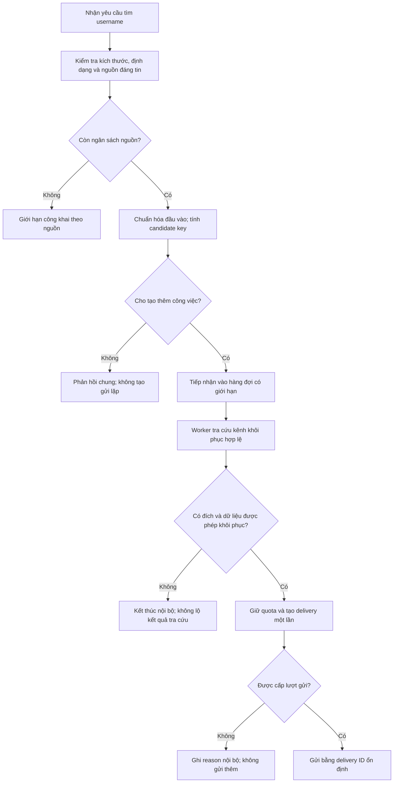

# Username recovery throttling — Giới hạn yêu cầu khôi phục tên đăng nhập

## 1. Vì sao cần giới hạn một luồng chỉ tìm lại username?

Trong chương **Username Recovery** của module `SECURITY_AUTHENTICATION_ACCOUNT_RECOVERY`, username recovery giúp người dùng tìm lại tên đăng nhập qua một kênh khôi phục đã thiết lập. Thao tác này không nhất thiết thay đổi mật khẩu, MFA hay passkey, nhưng vẫn có thể tiết lộ quan hệ giữa một người, một địa chỉ liên hệ và một tài khoản.

Ví dụ, người dùng nhập email để nhận hướng dẫn tìm lại username. Nếu không có kiểm soát, một chương trình tự động có thể thử hàng triệu địa chỉ, làm ngập hộp thư của nạn nhân, phát sinh chi phí SMS hoặc chiếm tài nguyên của dịch vụ recovery.

**Throttling** là việc kiểm soát nhịp độ và số lượng thao tác theo những phạm vi xác định. Trong luồng này, cần giới hạn ít nhất hai loại công việc khác nhau: tiếp nhận yêu cầu công khai và thực hiện tra cứu, gửi thông tin khôi phục. Một API nhận ít request không bảo đảm số thư gửi ít nếu mỗi request có thể tạo nhiều thông báo.

OWASP khuyến nghị các luồng quên mật khẩu có phản hồi nhất quán, tránh khác biệt thời gian và có biện pháp hạn chế yêu cầu tự động để chống dò tài khoản, làm ngập kênh liên hệ. Bài học áp dụng các nguyên tắc đó cho username recovery; những ngưỡng và mô hình triển khai dưới đây là thiết kế minh họa, không phải một chuẩn riêng cho khôi phục username. [OWASP — Forgot Password Cheat Sheet](https://cheatsheetseries.owasp.org/cheatsheets/Forgot_Password_Cheat_Sheet.html).

Mục tiêu không chỉ là giảm lưu lượng. Một thiết kế tốt cần bảo vệ khả năng khôi phục của người dùng thật, không biến quota thành cách người ngoài khóa tài khoản hoặc phát hiện ai đã đăng ký dịch vụ.

## 2. Xác định tác động và ranh giới cấp quyền

Username có thể công khai trong một sản phẩm nhưng là dữ liệu nhạy cảm trong sản phẩm khác. Ngay cả khi tên đăng nhập công khai, việc xác nhận nó thuộc về một email cụ thể vẫn có thể tiết lộ thông tin không được công bố.

| Hành vi lạm dụng | Hậu quả | Điểm kiểm soát cần có |
| --- | --- | --- |
| Thử danh sách email hoặc số điện thoại | Dò tài khoản, liên kết danh tính | Phản hồi công khai nhất quán và hạn chế theo nguồn |
| Gửi liên tục đến một địa chỉ | Quấy rối, làm ngập hộp thư hoặc phát sinh phí | Quota theo địa chỉ nhận thực tế và cooldown |
| Đổi IP liên tục nhưng giữ một đích | Vượt giới hạn chỉ dựa trên IP | Giới hạn độc lập theo đích và giao dịch |
| Một nguồn thử rất nhiều đích | Dò diện rộng và tăng tải tra cứu | Ngân sách nguồn, tổng tải và kiểm soát hành vi |
| Một địa chỉ gắn nhiều tài khoản | Một request tạo nhiều thư hoặc lộ quan hệ tài khoản | Giới hạn fan-out và quy tắc tiết lộ sau xác minh |
| Cố ý làm cạn quota của nạn nhân | Ngăn người thật nhận hướng dẫn | Giữ liên kết hợp lệ, tránh khóa đăng nhập và có nhánh hỗ trợ |
| Worker gửi lại sau timeout | Gửi trùng dù API đã giới hạn | Idempotency và ngân sách gửi ở tầng thực thi |

Vượt qua CAPTCHA hoặc còn quota không phải bằng chứng sở hữu tài khoản. Throttling chỉ quyết định có thực hiện một công việc hay không; nó không cho phép bỏ qua xác minh kênh khôi phục.

Username recovery cũng không tạo một phiên đăng nhập. Nếu dùng liên kết để hiển thị username sau khi xác minh, quyền của liên kết chỉ phục vụ mục đích đó. Đặt lại mật khẩu, thay MFA hoặc xử lý mất passkey tiếp tục cần luồng và bằng chứng tương ứng.

Thông tin khôi phục chỉ được gửi đến kênh đã được thiết lập hợp lệ cho tài khoản. Không gửi username đến một `callbackEmail` do người gọi tùy ý thêm vào request.

## 3. Chia giới hạn theo từng công đoạn

Không nên gom mọi việc vào một bộ đếm `recoveryAttempts`. Cần biết bộ đếm đo request, job, thông báo hay lần xác minh bí mật.

| Công đoạn | Tài nguyên cần bảo vệ | Đơn vị giới hạn minh họa |
| --- | --- | --- |
| Nhận request công khai | Kết nối, CPU, bộ nhớ, lớp chống bot | Request theo nguồn và toàn endpoint |
| Tiếp nhận công việc | Hàng đợi, dung lượng lưu trữ, tải nền | Job theo nguồn, đầu vào và tenant |
| Tra cứu thông tin | Kho định danh, dịch vụ liên kết tài khoản | Lần tra cứu và số đối tượng được đọc |
| Gửi thông báo | Hộp thư người nhận, phí nhà cung cấp, uy tín gửi | Lần gửi theo đích, kênh, tenant và tổng dịch vụ |
| Xác minh PIN hoặc token | Bí mật recovery và tài nguyên xác minh | Lần thử theo giao dịch, nguồn và tài khoản khi đã xác định |
| Hiển thị kết quả sau xác minh | Dữ liệu liên kết danh tính | Lượt dùng quyền, hạn dùng và phạm vi dữ liệu |

Ví dụ, một request có thể được nhận nhưng không tạo thêm thư vì đang trong cooldown. Một thư được nhà cung cấp chấp nhận có thể chưa đến hộp thư. Một lần thử PIN sai không tương đương một lần gửi thư mới.

Các sự kiện và metric cần dùng tên phản ánh đúng đơn vị: `request_received`, `job_admitted`, `delivery_reserved`, `provider_accepted`, `verification_failed`. Tránh gọi tất cả là “recovery thành công”.

Không khóa tài khoản, thu hồi session hoặc xóa phương thức xác thực chỉ vì có nhiều yêu cầu tìm username chưa được xác minh. Điều đó cho phép người ngoài gây tác động đến tài khoản mà không cần sở hữu bằng chứng nào.

## 4. Chọn khóa giới hạn đúng đối tượng

### 4.1. Nguồn yêu cầu

Giới hạn theo IP hữu ích ở lớp đầu nhưng không đủ. Nhiều người có thể dùng chung một IP của trường học hoặc doanh nghiệp; ngược lại, một người tấn công có thể phân phối request qua nhiều IP.

Có thể kết hợp IP, ngữ cảnh trình duyệt do máy chủ cấp và tín hiệu hành vi. Cookie trình duyệt có thể bị xóa nên không được dùng làm lớp duy nhất. Phân nhóm dải mạng, đặc biệt với IPv6, cần đánh giá tác động chặn nhầm thay vì chọn một prefix rồi coi mọi người trong đó là cùng một chủ thể.

Địa chỉ nguồn phải được xác định qua cấu hình proxy đáng tin cậy. Không tin trực tiếp một giá trị `X-Forwarded-For` do client ngoài hệ thống tự đặt; nếu không, client có thể thay khóa giới hạn trong mỗi request.

### 4.2. Thông tin đầu vào chưa biết có tài khoản hay không

Trước tra cứu, có thể giới hạn theo định danh ứng viên mà người dùng nhập. Khóa này phải được tạo cho cả đầu vào có liên kết tài khoản và đầu vào không có liên kết.

Ví dụ khái niệm:

```text
candidateKey = HMAC(
    limiterKey,
    encode(purpose, trustedTenantScope, identifierType, normalizedInput)
)
```

`encode` cần có cấu trúc rõ ràng để tránh nhập nhằng khi nối chuỗi. Namespace của mục đích giúp không trộn ngân sách username recovery với việc đăng nhập hoặc đặt lại mật khẩu.

Dùng HMAC có khóa giúp tránh để email hoặc số điện thoại dạng rõ xuất hiện trong tên khóa limiter. Một hàm băm không khóa không ngăn được việc thử từ điển trên tập email dễ dự đoán. Dù dùng HMAC, khóa và bộ đếm vẫn là dữ liệu cần bảo vệ, không phải dữ liệu đã ẩn danh hoàn toàn.

Đầu vào phải có giới hạn độ dài, định dạng và chi phí chuẩn hóa. Không để chuỗi rất dài hoặc một lượng đầu vào ngẫu nhiên vô hạn tạo ra vô hạn khóa trong kho limiter. Cần TTL, giới hạn dung lượng và ngân sách nguồn trước khi tạo trạng thái theo ứng viên.

### 4.3. Địa chỉ nhận và tài khoản đã được xác định

Sau tra cứu, quota gửi phải dựa trên đích nhận thực tế hoặc ID kênh đã xác minh. Nó giúp gom các biến thể đầu vào cùng dẫn đến một hộp thư và giới hạn tổng số thông báo gửi đến nạn nhân.

Chuẩn hóa phải nhất quán với quy tắc đăng ký và tra cứu của sản phẩm. Không tự bỏ dấu chấm, xóa hậu tố `+...` hoặc viết thường toàn bộ địa chỉ email nếu hệ thống chưa xác định các biến đổi đó là tương đương. Gộp sai có thể hạn chế nhầm người khác; không gộp những alias thực sự cùng đích lại có thể tạo đường vượt quota.

Nếu một đích nhận xuất hiện trong nhiều tenant, giới hạn riêng từng tenant có thể vẫn cho phép tổng lưu lượng quá lớn đến một hộp thư. Có thể cần thêm ngân sách đích ở phạm vi toàn dịch vụ, với trạng thái không được lộ qua phản hồi công khai.

Giới hạn theo account ID vẫn hữu ích sau khi đã xác định tài khoản, nhưng không thay thế khóa đầu vào ở luồng chưa biết username. Một địa chỉ dùng chung cho nhiều tài khoản cần được kiểm soát ở cấp địa chỉ nhận để tránh nhân số thư theo số account.

Tenant scope phải đến từ tuyến hoặc cấu hình mà hệ thống chấp nhận. Không cho client thay một trường tenant tùy ý để tạo vô hạn namespace và né giới hạn.

## 5. Phản hồi công khai mà không lộ quota của tài khoản

Một giới hạn được thiết kế kém có thể trở thành công cụ dò tài khoản. Ví dụ, hệ thống trả `202` khi email không tồn tại nhưng `429` khi email có thật và đã nhận ba thư. Dù thông báo thân thiện giống nhau, status code vẫn tiết lộ khác biệt.

Thiết kế minh họa tách hai lớp:

| Loại quyết định | Dữ liệu quyết định | Phản hồi có thể công khai |
| --- | --- | --- |
| Ngân sách nguồn hoặc tổng tải endpoint | Không phụ thuộc kết quả tồn tại tài khoản | Có thể trả `429` hoặc phản hồi quá tải phù hợp |
| Giới hạn theo ứng viên, địa chỉ nhận hoặc tài khoản | Trạng thái đích cần được giữ riêng | Phản hồi chung; không lộ việc gửi bị bỏ qua |
| Tra cứu không có kết quả phù hợp | Dữ liệu liên kết tài khoản | Cùng phản hồi chung với yêu cầu được xử lý nền |
| CAPTCHA hoặc kiểm tra chống bot | Dựa trên nguồn và hành vi, không dựa riêng vào tài khoản tồn tại | Hành vi nhất quán với đầu vào có và không có tài khoản |

Ví dụ phản hồi chung khi yêu cầu được tiếp nhận hoặc được gộp theo chính sách:

```http
HTTP/1.1 202 Accepted
Cache-Control: no-store
Content-Type: application/json

{"message":"Đã tiếp nhận yêu cầu. Vui lòng kiểm tra kênh khôi phục đã đăng ký."}
```

Phản hồi không cam kết một thư đã được gửi hoặc đã được giao. Không kèm `accountFound`, danh sách username, số thư đã gửi hoặc thời điểm cooldown của một tài khoản.

Khi chặn vì ngân sách nguồn, một phản hồi minh họa là:

```http
HTTP/1.1 429 Too Many Requests
Retry-After: 60
Cache-Control: no-store
Content-Type: application/json

{"message":"Có quá nhiều yêu cầu từ nguồn này. Vui lòng thử lại sau."}
```

RFC 6585 định nghĩa `429` cho trường hợp gửi quá nhiều request trong một khoảng thời gian, cho phép kèm `Retry-After` và không cho cache phản hồi này. RFC không quy định phải nhận diện người gửi hay đếm request theo thuật toán nào. Giá trị 60 giây ở ví dụ là lựa chọn của ứng dụng. [RFC 6585, mục 4 — 429 Too Many Requests](https://www.rfc-editor.org/rfc/rfc6585.html#section-4).

Không thêm header về quota đích hoặc một API kiểm tra thời gian gửi tiếp mà người chưa xác minh có thể truy vấn. Một job ID công khai cũng không nên dẫn đến trạng thái “email này không có tài khoản” hoặc “đã tìm thấy ba username”.

### Khác biệt thời gian cũng là một phản hồi

Không nên tra cứu tài khoản trên nhánh có thật rồi gọi nhà cung cấp email đồng bộ, trong khi nhánh không có thật trả ngay. Có thể đưa việc phân giải và gửi thông báo vào tầng nền để đường tiếp nhận ít phụ thuộc kết quả tra cứu hơn.

Điều đó không tự bảo đảm mọi phân bố thời gian giống nhau. Cần kiểm tra cả status, nội dung, header, kích thước và thời gian trên các nhánh. Thêm một khoảng chờ ngẫu nhiên không xóa được một khác biệt lớn có thể đo lặp nhiều lần.

Nếu dùng trì hoãn, phải có giới hạn tài nguyên; không giữ vô hạn thread hoặc kết nối chỉ để làm phản hồi trông giống nhau. Khi hàng đợi thực sự quá tải, phản hồi lỗi năng lực cần được xác định theo trạng thái hệ thống, không dựa vào tài khoản có tồn tại.

## 6. Thuật toán và chính sách ngưỡng

### 6.1. Chọn thuật toán theo mục tiêu

| Cơ chế | Ưu điểm | Điều cần chú ý |
| --- | --- | --- |
| Fixed window | Dễ hiểu, ít trạng thái | Có thể có hai đợt lớn sát ranh giới hai cửa sổ |
| Sliding window | Diễn đạt được giới hạn trong khoảng thời gian trượt | Tốn trạng thái hoặc cần chấp nhận xấp xỉ có kiểm soát |
| Token bucket | Cho phép một burst hữu hạn và phục hồi dần | Capacity và tốc độ refill không tương đương một quota cửa sổ cố định |
| Cooldown | Ngăn gửi quá sát nhau đến cùng đích | Không thay thế giới hạn tổng số lần trong khoảng dài |
| Giới hạn số công việc đang chờ | Bảo vệ bộ nhớ và hàng đợi | Không tự giới hạn số thông báo đã gửi |

Ví dụ token bucket có capacity `B`, tốc độ thêm token `r` và chi phí mỗi request `c`:

```text
T_now = min(B, T_previous + r * max(0, now - lastRefill))

Nếu T_now >= c:
    cho phép, số token mới = T_now - c
Nếu T_now < c:
    từ chối theo ngân sách này
```

Việc tính, kiểm tra và cập nhật phải là một thao tác nguyên tử đối với bucket. Không đọc số token ở Redis hoặc cơ sở dữ liệu, quyết định ở Java rồi ghi lại bằng một thao tác rời; nhiều instance có thể cùng sử dụng một phần quota.

Cần xác định nguồn thời gian và cách xử lý đồng hồ lùi. Không cho thời điểm refill đã ghi bị lùi rồi cộng lại cùng một khoảng thời gian ở lần sau. Khi dùng số học xấp xỉ hoặc làm tròn, phải kiểm tra rằng sai số không tạo thêm quyền gửi vượt dự kiến.

### 6.2. Một chính sách minh họa

Giả sử ứng dụng chọn các lớp sau để bắt đầu đo lường:

| Phạm vi | Ngưỡng minh họa | Hành vi |
| --- | --- | --- |
| Nguồn yêu cầu | Token bucket capacity 5, thêm 1 token mỗi 30 giây | Hết token thì có thể trả `429` |
| Đầu vào ứng viên | Tối đa 3 job mới trong 10 phút | Gộp hoặc bỏ qua công việc lặp, vẫn phản hồi chung |
| Địa chỉ nhận | Tối đa 3 thông báo trong một giờ trượt | Không tạo thêm lần gửi khi hết ngân sách |
| Khoảng cách gửi cùng đích | Ít nhất 60 giây giữa các lần được cấp quyền gửi | Giảm dồn thư trong một đợt |
| Tenant | Tối đa 500 job đang chờ của loại công việc này | Dừng nhận thêm theo chính sách năng lực |

Các con số chỉ là giả định giảng dạy, không phải mức an toàn chung. Cần điều chỉnh dựa trên tần suất dùng thật, độ trễ giao thư, nguy cơ lạm dụng, chi phí kênh và tỷ lệ người dùng bị chặn nhầm.

Bucket nguồn có burst 5 và refill 1 token mỗi 30 giây có thể cho phép nhiều hơn 20 request trong 10 phút đầu nếu tính cả lượng token có sẵn. Không được mô tả nó là “tối đa 20 request trong mọi cửa sổ 10 phút”.

Quota 3 thông báo trong một giờ và cooldown 60 giây cũng có hai mục đích khác nhau. Cooldown ngăn dồn thư; quota giờ ngăn gửi rải đều liên tục trong thời gian dài.

### 6.3. Không gia hạn hình phạt của đích bằng request bị chặn

Nếu mỗi request bị từ chối lại đặt `nextAllowedAt = now + 60 giây`, người ngoài có thể giữ một hộp thư trong cooldown mãi bằng cách gọi đều đặn. Trong thiết kế minh họa, cooldown của đích được đặt khi cấp một lượt gửi có kiểm soát, không bị đẩy ra xa bởi các lần yêu cầu không được cấp lượt gửi.

Hệ thống vẫn có thể tăng đánh giá lạm dụng hoặc hạn chế nguồn đó. Điều cần tránh là trộn hình phạt dành cho nguồn gửi với khả năng nhận hướng dẫn của nạn nhân.

## 7. Luồng xử lý nhiều tầng



Phản hồi công khai không cần đợi worker tra cứu hoặc gọi nhà cung cấp. Lỗi năng lực tiếp nhận như hàng đợi đầy vẫn cần được xử lý thật; không thông báo đã đưa công việc vào hàng đợi nếu việc lưu bền vững thất bại.

### 7.1. Mã giả Java cho điểm tiếp nhận

```java
// Mã giả: không tra cứu tồn tại tài khoản trong nhánh phản hồi này.
RecoveryResponse requestUsernameRecovery(RecoveryRequest request) {
    var scope = tenantPolicy.resolveTrustedScope(request.route());
    var source = sourceResolver.fromTrustedIngress(request);
    inputPolicy.requireBoundedWellFormedInput(request);

    var sourceDecision = requestLimiter.acquireAtomically(scope, source);
    if (!sourceDecision.allowed()) {
        return RecoveryResponse.sourceLimited(sourceDecision.publicRetryAfter());
    }

    var identifier = identifierPolicy.normalizeForLookup(request.identifier());
    var candidateKey = privateKeys.forUsernameRecovery(scope, identifier);
    var admission = candidateLimiter.acquireAtomically(candidateKey);

    if (!admission.allowed()) {
        return RecoveryResponse.genericAccepted();
    }

    var job = recoveryJobs.newScopedJob(scope, identifier, source);
    if (!recoveryQueue.tryPersistWithinCapacity(job)) {
        return RecoveryResponse.temporarilyUnavailable();
    }

    return RecoveryResponse.genericAccepted();
}
```

Đây là ví dụ ranh giới xử lý, không phải một thư viện rate limiter có thể chạy ngay. Các lớp kiểm tra kích thước và chống quá tải sớm phải bảo vệ cả bước chuẩn hóa; mã giả không yêu cầu thực hiện thao tác tốn kém trước khi có giới hạn nguồn.

Ngân sách nguồn có thể bị tiêu thụ dù bước sau bị gộp hoặc lỗi. Đây là chi phí của một request đã xử lý, cần được định nghĩa rõ; không nhất thiết hoàn lại mọi tầng quota sau lỗi. Riêng quota tạo tác động gửi phải có cơ chế nhất quán để không cấp quá nhiều lượt gửi.

Job chứa thông tin liên hệ vẫn là dữ liệu cần bảo vệ. Giới hạn quyền đọc hàng đợi, thời hạn lưu và cách mã hóa theo kiến trúc; không đưa đầu vào dạng rõ vào tên job hoặc nhãn metric.

### 7.2. Quyết định ở tầng gửi

Worker cần phân giải đầu vào thành dữ liệu được phép khôi phục và đích đã thiết lập hợp lệ. Sau đó, trong một đơn vị công việc nguyên tử thích hợp:

1. Kiểm tra job hoặc delivery tương ứng đã được xử lý chưa.
2. Kiểm tra quota địa chỉ nhận, khoảng cách gửi và các giới hạn gửi bắt buộc khác.
3. Giữ một lượt gửi và lưu bản ghi delivery có ID ổn định.
4. Lưu công việc gửi bền vững để được thực hiện sau commit.

Lượt đang được giữ phải được tính vào ngân sách thích hợp, nếu không nhiều worker cùng thấy quota trống rồi cùng gửi. Khi phải khóa nhiều bản ghi, cần thứ tự nhất quán để tránh deadlock.

Giới hạn chỉ nằm trong bộ nhớ của một instance sẽ tăng theo số instance. Nếu có nhiều vùng xử lý cùng một đích, một quota có yêu cầu nghiêm ngặt cần nguồn trạng thái hoặc cơ chế phân quyền xử lý bảo đảm tổng giới hạn; đồng bộ trễ đơn thuần có thể cho gửi vượt.

Không giả định mọi bucket ở gateway, kho quota và hàng đợi cùng tham gia một giao dịch. Có thể phân biệt các lớp admission chấp nhận xấp xỉ với ngân sách gửi bắt buộc phải kiểm soát chính xác. Những cam kết này phải xuất hiện trong thiết kế và kiểm thử.

## 8. Retry không được nhân số thông báo

Một lần giữ quota không có nghĩa thư đã được gửi. Có thể dùng các trạng thái như `RESERVED`, `DISPATCHING`, `ACCEPTED`, `FAILED` và `UNCERTAIN`, với định nghĩa rõ ràng theo giao tiếp với nhà cung cấp.

`ACCEPTED` chỉ nên nghĩa là nhà cung cấp đã chấp nhận yêu cầu theo giao thức của họ, không mặc nhiên nghĩa là thư đã đến hộp thư. Nếu có sự kiện giao nhận sau đó, cần lưu nó như một trạng thái riêng.

### Timeout khi gọi nhà cung cấp

Giả sử worker gửi một thông báo rồi bị timeout. Nhà cung cấp có thể đã chấp nhận. Nếu worker trả lại quota và tạo delivery mới ngay, một request có thể tạo hai thư.

Nếu nhà cung cấp hỗ trợ idempotency, retry cần dùng cùng delivery ID theo đúng hợp đồng của họ. Nếu không hỗ trợ, không thể chỉ dựa vào giao dịch cơ sở dữ liệu nội bộ để bảo đảm gửi bên ngoài đúng một lần. Cần xử lý trạng thái chưa xác định, đối soát nếu có dữ liệu và chấp nhận một chính sách retry hữu hạn phù hợp.

Không giải phóng lượt giữ chỉ vì client HTTP không nhận phản hồi. Chỉ hoàn lại phần ngân sách tương ứng khi có căn cứ rằng tác động chưa xảy ra và chính sách cho phép. Đồng thời nên có ngân sách riêng cho lần thử gửi, để lỗi nhà cung cấp không tạo vòng lặp thử vô hạn dù quota thông báo đã được hoàn.

### Worker trùng và lease hết hạn

Delivery ID ổn định và thao tác chuyển trạng thái có điều kiện giúp ngăn nhiều worker tạo công việc mới cho cùng một delivery. Tuy nhiên, worker cũ có thể tiếp tục chạy sau khi lease bị coi là hết hạn. Cơ chế lease cần phối hợp với idempotency hoặc biện pháp kiểm soát gửi tương ứng; tên gọi “đã khóa job” chưa đủ chứng minh không gửi trùng.

Retry cần có backoff, độ lệch ngẫu nhiên hợp lý, số lần tối đa và hạn cuối xử lý. Không tiếp tục gửi hướng dẫn đã hết giá trị hoặc giữ backlog vô hạn khi hệ thống email đang lỗi. Khi nhà cung cấp giới hạn tốc độ, worker cần tuân theo tín hiệu và hợp đồng gửi của họ, không tăng thêm worker để cố vượt giới hạn.

### Một request có thể khớp nhiều tài khoản

Nếu cùng một kênh khôi phục được phép liên kết nhiều username, không gửi một thư cho mỗi tài khoản mà không có giới hạn. Có thể gộp một thông báo hoặc yêu cầu xác minh trước khi hiển thị danh sách có phân trang và phạm vi phù hợp.

Việc một email xuất hiện ở vai trò liên hệ thanh toán, người được mời hoặc quản trị viên không tự cho phép tiết lộ mọi username liên quan. Chính sách lựa chọn dữ liệu phải dựa trên quan hệ khôi phục đã được thiết lập.

Vẫn phải giới hạn số bản ghi tra cứu, kích thước nội dung và số thông báo. Một khoản quota tính theo request không bảo vệ được trường hợp một request tạo hàng trăm thư hoặc danh sách quá lớn.

## 9. Giữ khả năng khôi phục cho người dùng thật

### Không dùng account lockout cho yêu cầu chưa xác minh

Quota gửi hết không nên làm người dùng mất quyền đăng nhập bằng mật khẩu, passkey hoặc MFA còn hợp lệ. Nếu cần xử lý một sự cố chiếm đoạt tài khoản, đó là quyết định khác có căn cứ và phạm vi riêng.

OWASP lưu ý rằng cơ chế khóa tài khoản có thể bị lợi dụng để gây từ chối dịch vụ đối với người khác. Với username recovery công khai, cần đặc biệt tránh chuyển một chuỗi request chưa xác minh thành hình phạt khóa tài khoản nạn nhân. [OWASP — Authentication Cheat Sheet](https://cheatsheetseries.owasp.org/cheatsheets/Authentication_Cheat_Sheet.html).

Nếu người dùng còn một phiên hợp lệ hoặc authenticator có thể nhận diện tài khoản theo chính sách, sản phẩm có thể cung cấp cách xem lại username trong luồng đã xác thực. Cách này không cần tạo thêm thư gửi công khai.

### Giữ hướng dẫn đã cấp còn dùng được

Nếu đã gửi liên kết hợp lệ rồi các request sau rơi vào cooldown, không vô hiệu liên kết trước chỉ vì có request mới chưa được xác minh. Nếu không, người ngoài có thể liên tục phá hướng dẫn mà người thật vừa nhận.

Khi dùng PIN hoặc token để mở kết quả, giới hạn thử bí mật là một lớp riêng. Request gửi lại không được reset bộ đếm thử một cách cho phép đoán vô hạn, và vượt quota gửi không tự biến token hợp lệ thành không hợp lệ.

### CAPTCHA không phải vé bỏ qua mọi quota

CAPTCHA có thể hỗ trợ giảm tự động hóa ở một thời điểm, nhưng không chứng minh quyền nhận dữ liệu tài khoản. Token CAPTCHA cần được kiểm tra đúng phạm vi, thời hạn và chống dùng lại theo khả năng của cơ chế được chọn.

Không cho việc giải CAPTCHA xóa mọi quota địa chỉ nhận. Người tấn công vẫn có thể giải hoặc thuê giải để làm ngập hộp thư. Đồng thời cần một phương án sử dụng được cho người gặp khó khăn với thử thách, thay vì buộc mọi người qua một loại tương tác duy nhất.

### Hạn chế tác động của việc làm cạn quota đích

Một quota chung cho hộp thư có thể bị người ngoài tiêu thụ trước người thật. Điều này là đánh đổi cần nhận diện: giảm spam nhưng có thể trì hoãn một yêu cầu hợp lệ.

Có thể giảm tác động bằng cách gộp request, giữ liên kết đã gửi, dùng cửa sổ khôi phục hữu hạn, cung cấp kênh thay thế đã đăng ký và có nhánh hỗ trợ. Nếu dành một phần năng lực cho luồng đã xác minh, quyền sử dụng phần đó phải đến từ bằng chứng độc lập được chấp nhận; không chỉ từ cookie mới tạo hoặc một tham số `priority=true`.

Kênh thay thế cũng cần ngân sách riêng và giới hạn tổng phù hợp. Không biến nút “thử SMS thay vì email” thành cách gửi không giới hạn qua một nhà cung cấp khác.

## 10. Hành vi khi limiter hoặc hàng đợi gặp lỗi

Thiết kế cần xác định trước trạng thái suy giảm, thay vì ngầm mở toàn bộ việc gửi khi kho quota không phản hồi.

| Lỗi | Hướng xử lý minh họa |
| --- | --- |
| Limiter ở lớp nguồn không đọc được | Dùng một chế độ bảo vệ cục bộ có hạn hoặc tạm dừng theo chính sách năng lực |
| Kho quota gửi không xác định được số lượt còn lại | Không tự cho gửi không giới hạn; trì hoãn công việc trong giới hạn hoặc dừng gửi |
| Hàng đợi đầy | Phản hồi quá tải theo trạng thái tiếp nhận, không theo sự tồn tại tài khoản |
| Nhà cung cấp tạm lỗi | Retry hữu hạn trên cùng delivery; kiểm soát quota và trạng thái chưa xác định |
| Cache bị mất hoặc dịch vụ khởi động lại | Không mặc định rằng mọi đích vừa được cấp lại toàn bộ ngân sách gửi |
| Một tenant chiếm phần lớn backlog | Có giới hạn và phân phối năng lực để không làm ngừng toàn bộ dịch vụ |

Một giới hạn cục bộ ở từng instance có thể hữu ích để giảm tải khẩn cấp, nhưng tổng mức cho phép sẽ phụ thuộc số instance. Không dùng nó để tuyên bố đang giữ chính xác một quota đích toàn dịch vụ.

Nếu chọn phản hồi chung cho một job đã nhận nhưng đang trì hoãn do lỗi, phải giới hạn thời gian giữ và theo dõi kết quả. Không cam kết đã gửi thư khi chưa có bằng chứng tương ứng.

Việc khởi động lại, thay khóa HMAC hoặc đổi namespace limiter có thể làm mất liên hệ với bộ đếm cũ. Cần chiến lược chuyển phiên bản để không vô tình tạo một đợt cấp mới toàn bộ quota trong lúc đang bị lạm dụng.

## 11. Ví dụ: nhiều nguồn cùng nhắm một hộp thư

Giả sử một hộp thư khôi phục có một số định danh đầu vào hợp lệ cùng trỏ đến nó. Xét riêng tầng gửi, các công việc dưới đây đã qua những giới hạn admission trước đó. Chính sách đích là tối đa 3 thông báo trong một giờ trượt và khoảng cách ít nhất 60 giây giữa các lượt được cấp quyền gửi.

| Thời điểm tương đối | Yêu cầu tại tầng gửi | Quyết định |
| --- | --- | --- |
| Giây 0 | Chưa có lượt gửi nào trong cửa sổ | Giữ lượt gửi thứ nhất; đặt mốc gửi tiếp không sớm hơn giây 60 |
| Giây 20 | Một job khác cũng trỏ về đích đó | Không giữ thêm lượt; không đẩy mốc cooldown thành giây 80 |
| Giây 61 | Còn quota giờ và đã qua cooldown | Có thể giữ lượt thứ hai |
| Giây 122 | Còn quota giờ và đã qua cooldown | Có thể giữ lượt thứ ba |
| Giây 183 | Đã hết cooldown nhưng đủ 3 lượt trong giờ | Không giữ lượt thứ tư |

Việc các job đến từ IP khác nhau không thay đổi quota hộp thư. Việc nhập alias khác nhau cũng không tạo ngân sách mới khi tầng gửi đã phân giải chúng về cùng một đích.

Người gọi công khai vẫn không nhận danh sách username hoặc trạng thái quota đích. Thông tin chỉ được giao qua luồng khôi phục hợp lệ, và các hướng dẫn còn hạn đã gửi không bị hủy bởi request mới chưa xác minh.

Nếu ba lượt gồm hai lần nhà cung cấp chấp nhận và một lần timeout chưa xác định, không được tự báo cáo rằng chỉ dùng hai lượt rồi cho gửi thêm ngay. Cần phân biệt số lượt đã giữ, số lần thử, số lần được chấp nhận và kết quả giao nhận theo dữ liệu thực tế.

Ví dụ này cho thấy vì sao giới hạn nguồn và giới hạn đích bổ sung cho nhau. Giới hạn nguồn giảm lưu lượng một người gọi có thể tạo ra; giới hạn đích bảo vệ kênh liên hệ ngay cả khi người gọi phân tán.

## 12. Quan sát mà không tạo thêm nơi lộ thông tin

Các reason code nội bộ có thể gồm `SOURCE_LIMITED`, `CANDIDATE_COALESCED`, `DESTINATION_COOLDOWN`, `DESTINATION_QUOTA_EXHAUSTED`, `QUEUE_CAPACITY_REACHED` và `PROVIDER_OUTCOME_UNKNOWN`. Chúng phục vụ vận hành, không nhất thiết được trả nguyên dạng cho người chưa xác minh.

Các chỉ số hữu ích gồm:

- Lưu lượng request, tỷ lệ bị giới hạn nguồn và tỷ lệ bị gộp theo đầu vào.
- Số job đang chờ, độ trễ xử lý và tỷ lệ không thể tiếp nhận.
- Số lượt gửi được giữ, bị chặn bởi cooldown, bị chặn bởi quota và số lần gửi thử.
- Tỷ lệ nhà cung cấp chấp nhận, giao nhận thất bại và kết quả chưa xác định.
- Tỷ lệ người dùng hoàn tất xem kết quả sau xác minh, số trường hợp cần hỗ trợ và dấu hiệu chặn nhầm.
- Phân bố thời gian phản hồi ở các nhánh có và không có liên kết tài khoản trong môi trường kiểm thử được kiểm soát.

Không dùng email, số điện thoại, username hoặc candidate key riêng của từng người làm nhãn metric không giới hạn số giá trị. Nếu cần đối soát sự kiện, dùng ID nội bộ và quyền truy cập phù hợp, giữ dữ liệu trong thời hạn cần thiết.

Dashboard tổng hợp nên thể hiện rõ mẫu số và đơn vị. “90% yêu cầu được tiếp nhận” không có nghĩa 90% người dùng đã nhận thư; “nhà cung cấp chấp nhận” cũng không chứng minh username đã được người dùng xem.

Cảnh báo vận hành có thể dựa trên tăng mạnh lưu lượng, nhiều nguồn cùng nhắm một đích, một nguồn thử nhiều đích, backlog tăng hoặc số delivery chưa xác định bất thường. Chỉ một tỷ lệ `429` thấp không chứng minh hết lạm dụng, vì phần lớn quyết định theo đích được giữ kín sau phản hồi chung.

## 13. Các tình huống cần kiểm thử khi triển khai

Bảng dưới mô tả tiêu chí kiểm thử cho hệ thống hiện thực, không phải kết quả kiểm thử đã chạy trên một ứng dụng cụ thể.

| Tình huống | Kết quả cần quan sát |
| --- | --- |
| Cùng nguồn thử nhiều đầu vào không có tài khoản | Vẫn chịu giới hạn nguồn và năng lực tiếp nhận |
| Đầu vào có và không có liên kết tài khoản | Không khác nhau về dữ liệu công khai tiết lộ tồn tại |
| Đích hết quota nhưng nguồn còn ngân sách | Không gửi thêm; không lộ reason quota đích qua status, body hoặc header |
| Nhiều IP nhắm một đích | Tổng lượt gửi vẫn giữ theo ngân sách đích |
| Nhiều alias hợp lệ cùng đến một địa chỉ | Không nhân quota gửi theo chuỗi đầu vào |
| Nhiều người hợp lệ dùng chung IP | Đo được mức chặn nhầm; có chính sách khôi phục và năng lực phù hợp |
| Client giả `X-Forwarded-For` | Không tự đổi được danh tính nguồn do ingress tin cậy xác định |
| Đầu vào dài hoặc hàng loạt ứng viên ngẫu nhiên | Có giới hạn chi phí, số khóa và thời hạn giữ trạng thái |
| Request bị chặn lặp trong cooldown | Không liên tục đẩy mốc cho phép gửi của nạn nhân ra xa |
| Nhiều worker cùng thấy đích còn một lượt | Chỉ cấp số lượt cho phép qua thao tác nguyên tử |
| Worker nhận lại cùng job | Không giữ thêm quota hoặc tạo delivery mới ngoài chính sách |
| Timeout sau khi nhà cung cấp có thể đã nhận | Không hoàn quota và gửi mới một cách mù quáng |
| Lease worker hết hạn nhưng tiến trình cũ còn chạy | Cơ chế thực thi và idempotency xử lý được nguy cơ gửi trùng |
| Nhà cung cấp liên tục lỗi hoặc giới hạn tốc độ | Retry hữu hạn, không tạo backlog và số lần gửi thử vô hạn |
| Một đầu vào liên kết nhiều account | Giới hạn fan-out và chỉ tiết lộ dữ liệu được phép |
| Giải CAPTCHA rồi gửi lặp | Không xóa quota hộp thư hoặc thay thế xác minh kênh khôi phục |
| Gửi lại yêu cầu trong lúc token trước còn hạn | Không hủy token chỉ vì request mới chưa được xác minh |
| Thử PIN sai rồi yêu cầu gửi lại | Không reset bộ đếm theo cách cho phép đoán bí mật không giới hạn |
| Kho quota hoặc một vùng bị gián đoạn | Hành vi suy giảm không tự mở toàn bộ ngân sách gửi |
| Restart, đổi namespace hoặc luân chuyển khóa HMAC | Không vô tình cấp lại toàn bộ quota đang cần giữ |
| Gọi qua API cũ hoặc kênh SMS thay thế | Vẫn đi qua các giới hạn phù hợp, không có endpoint gửi tự do |

Ngoài kiểm thử từng nhánh, cần kiểm tra phân bố phản hồi bằng nhiều mẫu có kiểm soát; một lần đo thời gian giống nhau chưa chứng minh không có kênh dò tài khoản. Đồng thời kiểm tra tải thật ở hàng đợi và lớp gửi để xác nhận limiter không chỉ hoạt động trên đường xử lý đơn lẻ.

## 14. Các quyết định phải được ghi rõ

Một bản thiết kế username recovery throttling cần nêu được: giới hạn ở công đoạn nào, mỗi bộ đếm đo đơn vị gì, khóa nào nhận diện nguồn và đích, thuật toán nào được dùng và thao tác nào phải nguyên tử.

Cũng cần ghi rõ phần quyết định nào có thể công khai, cách tránh lộ trạng thái tài khoản, cách xử lý retry và thời điểm được hoàn lại lượt gửi. Chính sách khi kho quota lỗi phải nhất quán với mức bảo vệ đã cam kết.

Throttling phục vụ cả chống lạm dụng lẫn duy trì khả năng khôi phục. Giới hạn đúng giúp giảm dò tài khoản và quấy rối kênh liên hệ, trong khi quyền tìm username vẫn được ràng buộc với bằng chứng phù hợp và không mở rộng thành quyền đăng nhập hay thay đổi phương thức xác thực.
