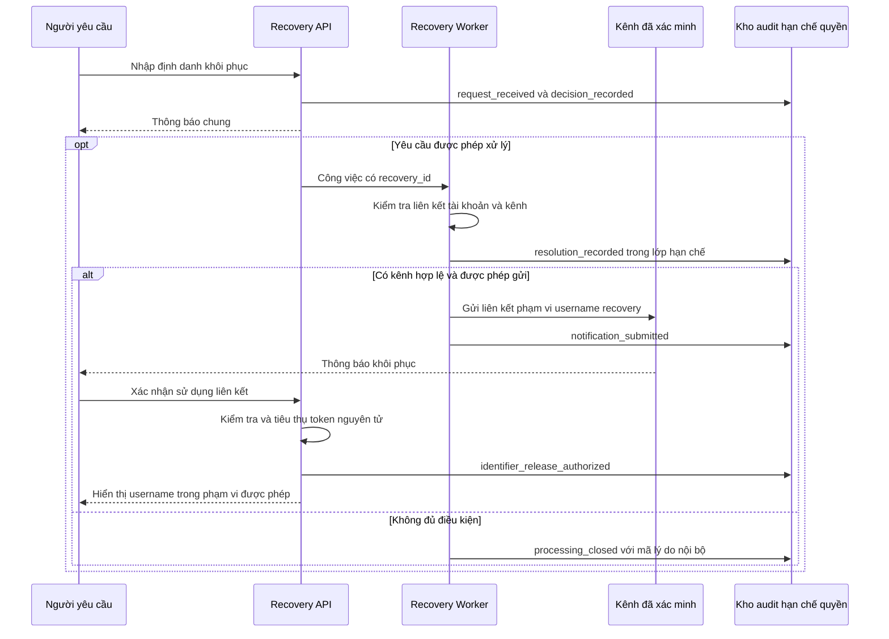

# Username recovery audit — Kiểm toán luồng khôi phục tên đăng nhập

## 1. Mục tiêu và phạm vi

Trong chương **Username Recovery**, kiểm toán luồng khôi phục tên đăng nhập là quá trình thu thập và đánh giá bằng chứng để xác định hệ thống đã tiết lộ thông tin định danh cho đúng đối tượng, áp dụng đúng chính sách và kiểm soát được lạm dụng hay chưa. Audit không chỉ là tìm một dòng log báo gửi email thành công.

Bài học thuộc module `SECURITY_AUTHENTICATION_ACCOUNT_RECOVERY`, tập trung vào thiết kế khôi phục tài khoản an toàn khi người dùng mất mật khẩu, MFA, passkey hoặc thiết bị xác thực. Ở phạm vi username recovery, mục tiêu trực tiếp là giúp người dùng biết lại tên đăng nhập. Việc này chỉ giải quyết một bước trong hành trình khôi phục; nó không tự chứng minh người dùng được phép đặt mật khẩu mới, gỡ MFA, đăng ký passkey hay mở một phiên đăng nhập.

Sau bài học, người học có thể:

- Xác định các khẳng định an toàn cần có bằng chứng trong luồng username recovery.
- Thiết kế chuỗi sự kiện kiểm toán đủ để dựng lại quyết định và kết quả, đồng thời hạn chế dữ liệu định danh.
- Đánh giá nguy cơ dò tài khoản qua API, thông báo, công cụ hỗ trợ và hệ thống quan sát.
- Xây dựng phép đo, cảnh báo và kịch bản kiểm thử phù hợp với đặc điểm luồng khôi phục.
- Viết phát hiện kiểm toán có căn cứ, nêu rõ giới hạn của bằng chứng.

Các tên sự kiện, cấu trúc JSON và ngưỡng cảnh báo dưới đây là **thiết kế minh họa cho bài học**, không phải giao thức chuẩn hay cấu hình áp dụng nguyên xi cho mọi hệ thống.

## 2. Hiểu đúng đối tượng được kiểm toán

### 2.1. Bốn khái niệm cần phân biệt

| Khái niệm | Câu hỏi cần trả lời | Ví dụ bằng chứng |
| --- | --- | --- |
| Audit trail | Các bước nào đã xảy ra và liên hệ với nhau ra sao? | Chuỗi sự kiện cùng `recovery_id` |
| Security monitoring | Có dấu hiệu lạm dụng đang diễn ra không? | Cảnh báo một nguồn gửi nhiều yêu cầu tới nhiều định danh |
| Security audit | Kiểm soát có được thiết kế và vận hành đúng không? | Chính sách, cấu hình, phép thử và mẫu sự kiện được đối chiếu |
| Incident investigation | Điều gì có thể đã xảy ra trong một sự cố cụ thể? | Dòng thời gian của lần tiết lộ username và các lần đăng nhập liên quan |

Một dashboard nhiều biểu đồ chưa đủ để kết luận kiểm soát có hiệu lực. Một bộ log đầy đủ cũng chưa chứng minh dữ liệu trong đó đúng nếu nguồn phát sự kiện có thể bị giả mạo hoặc sự kiện được ghi trước khi giao dịch thực sự hoàn tất.

### 2.2. Username recovery có rủi ro gì?

Username có thể là thông tin công khai trong một sản phẩm, nhưng sự liên kết giữa username, địa chỉ khôi phục và việc có tài khoản trong một dịch vụ vẫn có thể nhạy cảm. Vì vậy, kiểm toán cần dựa trên mô hình dữ liệu và mức độ nhạy cảm của sản phẩm, thay vì mặc định mọi username đều bí mật hoặc đều vô hại.

Ví dụ: biết một người dùng tên `minh.study` trên diễn đàn công khai có thể không nhạy cảm. Biết địa chỉ email của người đó gắn với tài khoản trong dịch vụ chăm sóc sức khỏe lại có thể gây hại. Audit cần xem cả **giá trị định danh được tiết lộ** lẫn **mối liên kết được xác nhận**.

Trong bài, xét một luồng minh họa: người dùng nhập địa chỉ email, hệ thống gửi liên kết tới kênh khôi phục đã xác minh và chỉ hiển thị username sau khi người giữ liên kết hoàn tất bước xác nhận. Nếu sản phẩm gửi username trực tiếp trong email, phải điều chỉnh định nghĩa hoàn tất và đánh giá riêng lượng thông tin nằm trong hộp thư.

### 2.3. Những khẳng định cần chứng minh

| Khẳng định | Bằng chứng cần tìm | Kết luận không được suy diễn |
| --- | --- | --- |
| API công khai hạn chế dò tài khoản | Phép thử các nhóm tài khoản; phản hồi và thời gian xử lý | Cùng thông báo nghĩa là mọi kênh đều an toàn |
| Thông tin chỉ tới kênh được phép | Liên kết tới bản ghi kênh đã xác minh và phiên bản chính sách | Người nhập email là chủ tài khoản |
| Quyền xem username có phạm vi hẹp | Mục đích token, kiểm tra tenant, thời hạn, trạng thái sử dụng | Token hợp lệ cho username recovery dùng được để reset MFA |
| Có thể giải thích quyết định | Mã lý do, phiên bản quy tắc, trạng thái tại thời điểm quyết định | Điểm rủi ro cao chứng minh có tấn công |
| Không phát sinh quyền đăng nhập | Đối chiếu sự kiện session và thay đổi authenticator | Username đã hiện nghĩa là người dùng đã được xác thực đầy đủ |
| Dữ liệu kiểm toán được bảo vệ | Phân quyền, nhật ký truy cập và bằng chứng toàn vẹn | Có checksum nghĩa là không ai có thể sửa log |

## 3. Mô hình đe dọa cho cuộc kiểm toán

Xác định tài sản trước khi chọn trường log: liên kết email–tài khoản, username, token khôi phục, trạng thái xác minh kênh, quyền của nhân viên hỗ trợ và bằng chứng điều tra. Các tác nhân gồm người dùng hợp lệ, bot, người kiểm soát hộp thư bị xâm nhập, nhân viên lạm quyền và dịch vụ nội bộ bị chiếm quyền.

| Tình huống | Rủi ro | Điều audit cần làm rõ |
| --- | --- | --- |
| Bot nhập hàng nghìn email | Dò tài khoản, gây tải | Có phân biệt được quét nhiều mục tiêu với lỗi thao tác đơn lẻ không? |
| Nhiều nguồn nhắm một địa chỉ | Làm ngập hộp thư, quấy rối | Có hạn mức theo đích nhận và kiểm soát gửi lại không? |
| Địa chỉ không tồn tại trả nhanh hơn | Kênh phụ qua thời gian | Đã đo nhiều mẫu, nhiều trạng thái tải hay chỉ kiểm tra thông báo? |
| Token xuất hiện trong APM hoặc access log | Người đọc log có thể dùng lại liên kết | Đã kiểm tra toàn bộ đường đi của URL và request body chưa? |
| Support tra email trong công cụ quản trị | Dò tài khoản qua người nội bộ | Quyền tra cứu, mục đích và lượt xuất dữ liệu có được ghi nhận không? |
| Một email gắn nhiều tài khoản hoặc tenant | Tiết lộ thêm quan hệ định danh | Quy tắc chọn tài khoản và phạm vi tiết lộ có rõ ràng không? |
| Email khôi phục vừa bị thay đổi | Tiết lộ thông tin cho kênh có nguy cơ bị chiếm | Quyết định có xét độ tin cậy của kênh theo chính sách không? |
| Audit sink ngừng hoạt động | Thiếu bằng chứng hoặc xử lý không kiểm soát | Hệ thống có nhận biết mất log và có cơ chế phục hồi không? |

Kiểm soát một IP có thể giảm một phần lạm dụng, nhưng IP không tương đương một người: mạng công ty có thể dùng chung IP, còn kẻ tấn công có thể phân tán qua nhiều nguồn. Tương tự, bằng chứng truy cập hộp thư chỉ cho biết khả năng tiếp cận kênh tại thời điểm đó; nó không loại trừ hộp thư dùng chung, chuyển tiếp thư hoặc hộp thư bị xâm nhập.

## 4. Thiết kế chuỗi bằng chứng theo luồng nghiệp vụ

### 4.1. Luồng tham chiếu



Sơ đồ thể hiện quan hệ nghiệp vụ, không yêu cầu API chờ hệ thống audit tập trung trả lời từng bước. Cách bảo đảm sự kiện bền vững và cách xử lý khi ghi audit lỗi phải được thiết kế riêng.

Thông báo công khai minh họa:

> Nếu thông tin phù hợp với tài khoản đủ điều kiện, bạn sẽ nhận được hướng dẫn qua kênh đã đăng ký.

Thông báo này cần đúng với hành vi sản phẩm. Không hứa “đã gửi email” khi hệ thống mới tiếp nhận yêu cầu hoặc đã quyết định không gửi.

### 4.2. Tách các mốc kết quả

| Mốc | Ý nghĩa có thể khẳng định | Giới hạn |
| --- | --- | --- |
| `request_received` | Hệ thống đã nhận yêu cầu | Chưa nói định danh khớp tài khoản |
| `decision_recorded` | Đã có quyết định xử lý, hạn chế hoặc từ chối | Chưa nói đã gửi thông báo |
| `notification_submitted` | Nhà cung cấp đã chấp nhận yêu cầu gửi | Chưa chứng minh thư tới hộp thư |
| `notification_delivery_reported` | Có báo cáo giao nhận từ nhà cung cấp | Không chứng minh chính chủ đã đọc |
| `proof_accepted` | Bằng chứng qua kênh được chấp nhận cho mục đích đã định | Không tự nâng thành bằng chứng đủ cho mọi hành động khôi phục |
| `identifier_release_authorized` | Server đã cho phép trả username theo chính sách | Không chứng minh con người đã nhìn thấy hoặc ghi nhớ |
| `processing_closed` | Vòng xử lý nội bộ kết thúc với kết quả đã định nghĩa | Có thể là hết hạn, bị hạn chế hoặc không đủ điều kiện |

Trong luồng tham chiếu, dùng `identifier_release_authorized` làm mốc hoàn tất nghiệp vụ tại server. Nếu ứng dụng có đo việc render trang, đó vẫn là tín hiệu phía client với mức tin cậy khác. Không gọi một callback “delivered” là “người dùng khôi phục thành công”.

Một công cụ quét liên kết email có thể truy cập URL trước người dùng. Do đó, lượt mở liên kết không tự chứng minh thao tác có chủ ý. Với thiết kế trong bài, GET chỉ mở trang trung gian; bước xác nhận có bảo vệ phù hợp mới tiêu thụ token. Phép kiểm toán phải bao gồm email scanner, prefetch và gửi lại cùng yêu cầu.

## 5. Danh mục sự kiện kiểm toán

Không cần sao chép mọi dòng debug vào audit trail. Mỗi sự kiện nên đại diện cho một thay đổi hoặc quyết định có ý nghĩa và có hợp đồng dữ liệu rõ ràng.

| Sự kiện minh họa | Khi nào phát | Nội dung đặc thù |
| --- | --- | --- |
| `username_recovery.request_received` | Nhận yêu cầu hợp lệ về cấu trúc hoặc ghi nhận yêu cầu bị loại theo thiết kế | Route chuẩn hóa, loại actor, tham chiếu đầu vào |
| `username_recovery.decision_recorded` | Đánh giá hạn mức và chính sách xử lý | `allow`, `throttle`, `challenge`, `deny`; phiên bản chính sách |
| `username_recovery.resolution_recorded` | Hoàn thành tra cứu trong worker | Kết quả khớp và điều kiện kênh; chỉ lớp điều tra hạn chế |
| `username_recovery.notification_submitted` | Nhà cung cấp chấp nhận công việc gửi | Tham chiếu công việc gửi, loại kênh |
| `username_recovery.notification_failed` | Gửi thất bại sau bước xử lý tương ứng | Nhóm lỗi được chuẩn hóa và số lần thử |
| `username_recovery.proof_rejected` | Kiểm tra bằng chứng thất bại | Hết hạn, đã dùng, sai mục đích hoặc không hợp lệ |
| `username_recovery.proof_accepted` | Bằng chứng được chấp nhận và trạng thái được ghi bền vững | Tham chiếu challenge, loại bằng chứng, phạm vi quyền |
| `username_recovery.identifier_release_authorized` | Quyết định trả định danh đã được ghi nhận | Loại thông tin được trả và phạm vi tài khoản |
| `username_recovery.processing_closed` | Đạt trạng thái kết thúc đã quy định | Mã kết quả kết thúc; không gộp lỗi và thành công |
| `username_recovery.support_action` | Nhân viên tác động vào hồ sơ hỗ trợ | Actor nội bộ, thao tác, ticket và căn cứ quyết định |
| `audit.accessed` / `audit.exported` | Đọc hoặc xuất dữ liệu audit | Phạm vi truy vấn, actor, mục đích và nơi nhận được phép |

Với bằng chứng không hợp lệ đến mức không tìm được challenge, trường `challenge_ref` có thể rỗng. Không biến chuỗi token người dùng nhập thành mã tham chiếu để “tiện tìm kiếm”. Mỗi lần gọi vẫn có request ID do server phát sinh.

`resolution_recorded` có thể chứa thông tin nhạy cảm về sự tồn tại của tài khoản. Nếu cần giữ sự kiện này để điều tra, hãy tách kho hoặc tách quyền ở cấp trường và API; việc chỉ ẩn một cột trên giao diện không đủ. Dashboard vận hành thông thường không cần xem lý do `NO_MATCH` theo từng địa chỉ.

## 6. Hợp đồng dữ liệu: đủ giải thích, hạn chế định danh

### 6.1. Ví dụ một sự kiện

```json
{
  "schema_version": "1.0",
  "event_id": "evt_7d519e",
  "event_type": "username_recovery.decision_recorded",
  "occurred_at": "2026-11-23T08:15:31.420Z",
  "ingested_at": "2026-11-23T08:15:31.512Z",
  "service": "SECURITY_AUTHENTICATION_ACCOUNT_RECOVERY",
  "environment": "production",
  "producer": "recovery-api",
  "producer_version": "release-example-12",
  "tenant_ref": "tenant_demo_01",
  "request_id": "req_f14a6d",
  "recovery_id": "rec_24b5c8",
  "actor": {
    "type": "anonymous",
    "network_ref": "net_opaque_73"
  },
  "target": {
    "lookup_ref": "lr_opaque_b2",
    "lookup_key_version": "k3"
  },
  "decision": {
    "action": "throttle",
    "reason_code": "DESTINATION_SEND_BUDGET_EXCEEDED",
    "policy_version": "username-recovery-policy-example-4"
  },
  "public_response_class": "GENERIC_ACK",
  "data_classification": "restricted_security"
}
```

Các ID trên được rút gọn để dễ đọc. Trong hệ thống thực, chọn cách sinh ID có khả năng tránh va chạm phù hợp; ID để liên kết sự kiện không phải bearer token và không cấp quyền đọc hồ sơ.

### 6.2. Ý nghĩa và ràng buộc của các trường

- `event_id` xác định một sự kiện logic; consumer dùng nó để loại bản phát lại. Các lần thử nghiệp vụ khác nhau vẫn có thể có `event_id` khác nhau.
- `request_id` liên kết một lần gọi; `recovery_id` liên kết một hành trình nhiều lần gọi. Server tạo và kiểm soát các ID này. Trace ID do client đưa vào chỉ là dữ liệu không đáng tin, cần kiểm tra trước khi liên kết.
- `occurred_at` là thời điểm nghiệp vụ tại nguồn; `ingested_at` là thời điểm hệ thống thu thập nhận sự kiện. Hai giá trị giúp phát hiện chậm trễ và dữ liệu đến muộn.
- `actor` là người hoặc dịch vụ thực hiện hành động, còn `target` là đối tượng được nhắc tới. Trong yêu cầu ẩn danh, không gán người gửi thành chủ tài khoản chỉ vì đầu vào khớp.
- `lookup_ref` liên kết các lần nhập cùng một định danh trong phạm vi đã quy định. Nó không có nghĩa là tài khoản tồn tại.
- `account_ref`, nếu thật sự cần, chỉ có ở lớp điều tra hạn chế sau khi phân giải tài khoản. Không đưa nó vào phản hồi công khai.
- `reason_code` lấy từ danh mục kiểm soát; `policy_version` trỏ tới chính sách có thể xem lại. Một điểm rủi ro đơn lẻ khó giải thích nếu thiếu phiên bản mô hình và lý do liên quan.
- `public_response_class` ghi nhóm phản hồi, không sao chép toàn bộ response body có thể chứa username.

Thời gian máy chủ cần có nguồn đồng bộ và được theo dõi sai lệch. Trong hệ phân tán, không ép mọi sự kiện thành thứ tự tuyệt đối chỉ dựa trên timestamp; dùng quan hệ nhân quả, phiên bản trạng thái hoặc số thứ tự trong một aggregate khi cần.

### 6.3. Dữ liệu không đưa vào audit trail thông thường

Không ghi token khôi phục, OTP, mật khẩu, recovery code, khóa bí mật, cookie phiên, header `Authorization`, URL chứa bearer token hoặc nội dung tài liệu xác minh danh tính. Hạn chế email, số điện thoại và username dạng rõ; ưu tiên tham chiếu khi mục đích là liên kết sự kiện.

Kiểm tra cả reverse proxy, WAF, APM, trace, message broker, hàng đợi lỗi, báo cáo lỗi phía client, hệ thống ticket và bản xuất CSV. Bộ lọc trong code nghiệp vụ không bảo vệ được bản sao đã bị middleware ghi trước đó. Nguyên tắc loại bỏ bí mật và xử lý dữ liệu cá nhân trong log được trình bày trong [OWASP Logging Cheat Sheet](https://cheatsheetseries.owasp.org/cheatsheets/Logging_Cheat_Sheet.html#data-to-exclude).

Địa chỉ email đã che một phần vẫn có thể nhận diện được trong tập dữ liệu nhỏ. Cần đánh giá khả năng liên kết dữ liệu, thay vì xem dấu `***` là bằng chứng ẩn danh.

## 7. Liên kết định danh mà không lưu email rõ

Một thiết kế tham chiếu có thể tạo mã bằng HMAC:

```text
lookup_ref = Base64Url(
    HMAC-SHA-256(
        K_version,
        EncodeLengthPrefixed(
            purpose = "username-recovery-audit",
            environment,
            tenant_scope,
            CanonicalizeByAccountPolicy(input_identifier)
        )
    )
)
```

`EncodeLengthPrefixed` biểu diễn các thành phần không nhập nhằng; không nối chuỗi tùy tiện khiến hai bộ dữ liệu khác nhau tạo cùng thông điệp đầu vào. Khóa HMAC nằm trong dịch vụ hoặc cơ chế quản lý khóa được kiểm soát, tách khỏi kho phân tích và người đọc log.

Những điểm cần kiểm toán với thiết kế này:

1. **Không dùng hash thường cho email.** Không gian email có thể đoán được; kẻ có danh sách ứng viên có thể băm để đối chiếu. HMAC hạn chế việc đó khi khóa được giữ kín, nhưng không bảo vệ nếu khóa hoặc dịch vụ tính mã bị lạm dụng.
2. **Không công khai API tính mã hoặc tra mã.** Một công cụ cho phép nhân viên nhập tùy ý email rồi xem lịch sử tương ứng vẫn có thể trở thành công cụ dò quan hệ định danh.
3. **Tách mục đích và tenant.** Mã audit không mặc nhiên dùng làm khóa chia sẻ giữa marketing, fraud và hệ thống bên ngoài. Phạm vi tenant phải lấy từ ngữ cảnh đã kiểm tra; ID tenant trong request không tự cấp quyền.
4. **Chuẩn hóa đúng chính sách tài khoản.** Không tự ý xóa dấu chấm, bỏ phần sau dấu `+` hoặc chuyển toàn bộ email thành chữ thường nếu quy tắc định danh của sản phẩm không làm vậy. Chuẩn hóa khác nhau gây mất hoặc gộp nhầm bằng chứng.
5. **Xoay khóa có kế hoạch.** Ghi phiên bản khóa; xác định cửa sổ có thể tương quan qua lần xoay và cách truy vấn dữ liệu cũ. Không giữ khóa cũ vô thời hạn chỉ để thuận tiện.
6. **Giới hạn thời gian liên kết.** Chọn thời hạn lưu theo mục đích điều tra và yêu cầu thực tế. Mã ổn định lâu dài làm tăng khả năng dựng hồ sơ hành vi.

Các mã HMAC và mã opaque ở đây là **dữ liệu giả danh hóa**. Khi còn cách nối về người dùng hoặc suy ra hành vi cá nhân, chúng vẫn cần được bảo vệ. Không dùng từ “ẩn danh hoàn toàn” trong báo cáo chỉ vì đã bỏ email rõ.

## 8. Kiểm toán phản hồi công khai và quyền tiết lộ

### 8.1. Đo sự khác biệt mà kẻ gọi API có thể quan sát

Chọn các nhóm dữ liệu thử đã được phép sử dụng: có tài khoản, không có tài khoản, chưa xác minh kênh, tài khoản bị vô hiệu hóa, vượt hạn mức và đầu vào gắn nhiều tài khoản. So sánh thông báo, mã HTTP, độ dài phản hồi, chuyển hướng và phân bố thời gian. Cách phân tích khác biệt để phát hiện dò tài khoản được mô tả trong [OWASP WSTG: Testing for Account Enumeration and Guessable User Account](https://wstg.owasp.org/v4.2/4-Web_Application_Security_Testing/03-Identity_Management_Testing/04-Testing_for_Account_Enumeration_and_Guessable_User_Account/).

Với mô hình trong bài, bổ sung kiểm tra `Retry-After`, cookie, cache, endpoint hỏi trạng thái và luồng frontend. Mọi nhánh trả về cùng câu chữ vẫn có thể lộ thông tin nếu một nhánh trả `404`, nhánh kia trả `202`, hoặc chỉ tài khoản tồn tại mới có API đếm ngược thời gian gửi lại.

Đo nhiều lần, xen kẽ nhóm thử và xét cả cache lạnh, cache nóng, tải thấp, tải cao. Một cặp kết quả có độ trễ gần nhau không chứng minh đã loại bỏ kênh phụ. Ngược lại, một lần chậm bất thường chưa đủ kết luận có lỗ hổng.

Xử lý bất đồng bộ có thể giảm khác biệt trên đường phản hồi, nhưng không tự bảo đảm mọi nhánh giống nhau. Hạn mức theo đích nhận cũng có thể lộ trạng thái nếu kết quả áp dụng chỉ phụ thuộc vào việc tài khoản tồn tại. Cần xem hành vi bên ngoài của cả cơ chế hạn chế, không chỉ code tra cứu tài khoản.

OWASP khuyến nghị thông báo và thời gian phản hồi nhất quán trong luồng quên mật khẩu, cùng token khó đoán, có hạn và dùng một lần. Bài học áp dụng các nguyên tắc liên quan cho username recovery; các chính sách reset mật khẩu hoặc MFA vẫn phải được đánh giá theo mục đích riêng. Xem [OWASP Forgot Password Cheat Sheet](https://cheatsheetseries.owasp.org/cheatsheets/Forgot_Password_Cheat_Sheet.html).

### 8.2. Kiểm tra ranh giới tiết lộ và xác thực

Với luồng dùng liên kết trong bài, token phải gắn với đúng purpose, tenant, challenge và phạm vi thông tin được phép trả. Kiểm tra thời hạn và trạng thái sử dụng tại server; việc tiêu thụ phải nguyên tử để hai yêu cầu đồng thời không cùng sử dụng thành công một quyền dùng một lần.

Sự kiện chấp nhận bằng chứng chỉ được phát như một kết quả đã cam kết khi thay đổi trạng thái tương ứng đã bền vững. Nếu cần ghi lúc bắt đầu thử, hãy dùng một loại sự kiện “attempt” khác để tránh báo thành công trước commit.

Các thử nghiệm ranh giới quan trọng gồm:

- Dùng token của tenant A trong tenant B.
- Dùng token username recovery tại endpoint reset mật khẩu hoặc gỡ MFA.
- Đổi tham số tài khoản sau khi đã xác minh kênh.
- Sử dụng token sau khi đã dùng, hết hạn hoặc bị thu hồi theo chính sách.
- Tạo nhiều yêu cầu đồng thời, gửi lại POST sau timeout và xử lý callback trùng.
- Mở luồng trong trình duyệt đã đăng nhập tài khoản khác để kiểm tra nhầm ngữ cảnh.

Nếu chỉ nhắc lại username, không tự tạo session đã xác thực, đổi mật khẩu, gỡ MFA hoặc vô hiệu hóa toàn bộ phiên. Những hành động này cần luồng và căn cứ riêng. Khi người dùng báo mất cả hộp thư hoặc thiết bị, phải chuyển sang cơ chế khôi phục phù hợp với rủi ro; audit ghi nhận lần chuyển luồng và cơ sở quyết định, không hạ chuẩn bằng chứng chỉ để hoàn tất username recovery.

## 9. Bảo vệ độ tin cậy và quyền truy cập audit

### 9.1. Ghi sự kiện gắn với giao dịch nghiệp vụ

Ví dụ, khi token chuyển từ `ACTIVE` sang `CONSUMED`, cùng giao dịch có thể ghi một outbox event. Một worker chuyển sự kiện từ outbox sang kho audit, phát lại khi gặp lỗi và giữ nguyên `event_id` của sự kiện đó. Consumer loại bản phát lại theo `event_id`.

Mô hình này thu hẹp khoảng trống giữa cập nhật trạng thái và ghi bằng chứng, nhưng không tạo “exactly once” cho toàn bộ hệ thống. Hai lần thử gửi email khác nhau cần tham chiếu lần thử riêng; hai sự kiện nghiệp vụ khác nhau không được loại bỏ chỉ vì cùng `recovery_id`.

Nếu nhà cung cấp đã nhận email nhưng phản hồi tới hệ thống bị timeout, trạng thái có thể chưa rõ. Ghi trạng thái không chắc chắn, đối soát theo job ID và tận dụng idempotency của nhà cung cấp nếu có. Không tự ghi `notification_failed` như thể biết chắc thư chưa được gửi.

### 9.2. Xử lý gián đoạn thu thập

Kiểm toán cần tìm được câu trả lời cụ thể cho các câu hỏi sau:

- Sự kiện còn trong outbox được lưu bao lâu, dung lượng tối đa là bao nhiêu?
- Ai nhận cảnh báo khi consumer lag tăng hoặc nguồn ngừng phát sự kiện?
- Cơ chế retry có backoff và giới hạn để tránh tự làm cạn tài nguyên không?
- Khi hàng đợi đầy, có mất sự kiện, ngừng thao tác nhạy cảm hay chuyển sang chế độ hạn chế nào?
- Sau phục hồi, cách nào chứng minh đã nạp bù và phân biệt dữ liệu thiếu với dữ liệu đến muộn?

Không để một ngoại lệ ghi log vô tình quyết định hành vi an toàn. Với thiết kế tham chiếu, bước cho phép tiết lộ username cần có bằng chứng bền vững tại nguồn trước khi trả dữ liệu; hệ thống phân tích trung tâm có thể nhận sau. Khi nguồn không thể ghi bằng chứng bắt buộc, hành vi hạn chế phải có chính sách rõ, phản hồi không tiết lộ thêm thông tin và có thông báo vận hành độc lập.

### 9.3. Phân quyền theo công việc

| Vai trò | Quyền cần thiết trong mô hình minh họa | Ranh giới |
| --- | --- | --- |
| Dịch vụ phát sự kiện | Ghi loại sự kiện của mình | Không sửa hoặc xóa lịch sử trong kho audit |
| Vận hành | Xem tổng hợp lỗi, lag, lưu lượng | Không tra quan hệ email–tài khoản tùy ý |
| Nhân viên hỗ trợ | Xem hồ sơ trong phạm vi ticket và nhiệm vụ | Không dùng quyền xem audit để bỏ qua xác minh |
| Điều tra an ninh | Truy vấn chi tiết theo vụ việc được phép | Truy cập có thời hạn, có mục đích và có audit riêng |
| Quản trị lưu trữ | Vận hành hạ tầng theo nhiệm vụ | Tránh tập trung quyền sửa dữ liệu, quản lý khóa và xóa dấu vết vào một người |

Tách quyền xem audit với quyền đổi kênh khôi phục, mở khóa tài khoản và reset MFA. Một người được xem lịch sử không tự được phép can thiệp tài khoản. Tài khoản khẩn cấp cũng cần được ghi nhận và rà soát.

### 9.4. Toàn vẹn, lưu giữ và trình bày

Đường thu thập cần xác thực nguồn, bảo vệ truyền tải và kiểm tra schema. Dùng serialization có cấu trúc, giới hạn độ dài trường và xử lý ký tự điều khiển; dữ liệu từ client không được tự tạo dòng log hoặc trường giả. Giao diện xem log phải encode khi hiển thị và bản CSV phải xử lý nguy cơ công thức từ dữ liệu không tin cậy.

Kho chỉ ghi thêm, cơ chế khóa lưu trữ hoặc bản sao độc lập có thể hỗ trợ bảo vệ lịch sử. Chuỗi hash chỉ có giá trị phát hiện sửa đổi khi điểm neo và quyền ký được bảo vệ; nếu kẻ tấn công kiểm soát cả log lẫn điểm neo, họ có thể dựng lại chuỗi. Cơ chế chống sửa không bảo đảm nguồn phát đã nói thật.

Thời hạn lưu cần gắn với mục đích, nhu cầu điều tra và nghĩa vụ áp dụng cho tổ chức. Chính sách phải bao phủ bản sao, backup, export và dữ liệu giữ phục vụ điều tra. Không đặt “lưu vĩnh viễn” hoặc một số ngày cố định như yêu cầu chung cho mọi sản phẩm.

## 10. Phân tích lạm dụng và chỉ số có ý nghĩa

### 10.1. Tín hiệu và phản ứng

| Tín hiệu | Diễn giải có thể có | Phản ứng phù hợp để đánh giá |
| --- | --- | --- |
| Một nguồn liên hệ nhiều `lookup_ref` | Quét danh sách email hoặc người dùng trong mạng chung | Kết hợp vận tốc, dấu hiệu tự động hóa và lịch sử nguồn |
| Nhiều nguồn nhắm một `lookup_ref` | Quấy rối hoặc người dùng thử nhiều mạng | Kiểm soát ngân sách gửi theo đích, gộp thông báo phù hợp |
| Nhiều `proof_rejected` | Đoán mã, replay hoặc liên kết cũ | Phân nhóm lý do và số challenge, kiểm tra ngưỡng cảnh báo |
| Nhiều lần tiết lộ sau thay đổi kênh | Chuỗi hành động có rủi ro | Liên kết với sự kiện thay đổi kênh trong phạm vi được phép |
| Support truy vấn nhiều hồ sơ ngoài ticket | Tra cứu không đúng mục đích | Rà soát quyền và lịch sử truy cập nội bộ |
| Số thao tác nghiệp vụ tăng nhưng audit đứng yên | Mất thu thập hoặc lỗi phát sự kiện | Kiểm tra producer, outbox, consumer và độ trễ |

Một cảnh báo biểu thị điều cần xem xét. Chặn vĩnh viễn một người dùng chỉ vì người khác liên tục nhập địa chỉ của họ có thể biến chống lạm dụng thành công cụ từ chối dịch vụ. Các quy tắc phản ứng cần phân biệt hạn chế gửi thông báo với khóa đăng nhập.

### 10.2. Truy vấn minh họa

Giả sử kho điều tra có view đã làm phẳng tên `security_events`, với các cột lấy từ schema ở trên: `tenant_ref`, `environment`, `event_id`, `event_type`, `occurred_at`, `recovery_id`, `actor_network_ref`, `target_lookup_ref`. View đã loại bản phát lại theo `event_id`.

Truy vấn sau tìm nguồn có nhiều yêu cầu và nhiều định danh khác nhau trong một cửa sổ. `:window_start`, `:window_end` và `:tenant_ref` là tham số được ràng buộc; quyền truy cập tenant vẫn phải được thực thi tại lớp dữ liệu hoặc dịch vụ, không dựa vào thiện chí của người viết SQL.

```sql
SELECT
    actor_network_ref,
    COUNT(DISTINCT recovery_id) AS request_count,
    COUNT(DISTINCT target_lookup_ref) AS distinct_lookup_count
FROM security_events
WHERE tenant_ref = :tenant_ref
  AND environment = 'production'
  AND event_type = 'username_recovery.request_received'
  AND occurred_at >= :window_start
  AND occurred_at < :window_end
  AND actor_network_ref IS NOT NULL
  AND target_lookup_ref IS NOT NULL
GROUP BY actor_network_ref
HAVING COUNT(DISTINCT recovery_id) >= 60
   AND COUNT(DISTINCT target_lookup_ref) >= 30;
```

Ví dụ dùng cửa sổ 10 phút, 60 yêu cầu và 30 định danh để thảo luận cách xây dựng tín hiệu. Đây không phải ngưỡng chuẩn. Cần hiệu chỉnh theo lưu lượng, NAT, nhóm khách hàng, lịch sử lỗi và tỷ lệ cảnh báo sai; loại nguồn kiểm thử hợp lệ bằng nhãn được quản trị, không cho client tự khai để miễn kiểm soát.

Truy vấn này không cần biết đầu vào khớp tài khoản hay không. Dữ liệu thiếu tham chiếu được theo dõi ở phép đo riêng để tránh tạo vùng mù. Tên nguồn ở đây là mã mạng trong phạm vi đã định nghĩa, không phải danh tính chắc chắn của kẻ tấn công.

### 10.3. Định nghĩa mẫu số trước khi đặt dashboard

| Chỉ số | Cách tính trong mô hình tham chiếu | Giới hạn cần công bố |
| --- | --- | --- |
| Tỷ lệ xử lý bị hạn chế | Số hành trình có quyết định `throttle` / số hành trình đã có quyết định trong cửa sổ | Không phải tỷ lệ tài khoản bị tấn công |
| Tỷ lệ lỗi gửi | Số job gửi thất bại cuối cùng / số job đã có trạng thái cuối cùng | Job đang chờ và trạng thái chưa rõ báo riêng |
| Tỷ lệ cho phép tiết lộ | Số hành trình có `identifier_release_authorized` / số hành trình đủ điều kiện đã phát challenge trong cohort | Chờ đủ thời gian quan sát; không tính mọi yêu cầu ẩn danh vào mẫu số |
| Độ trễ thu thập | Phân bố `ingested_at - occurred_at` | Kiểm tra sai lệch đồng hồ và dữ liệu đến muộn |
| Độ phủ sự kiện bắt buộc | Số chuyển trạng thái có sự kiện tương ứng / số chuyển trạng thái theo nguồn nghiệp vụ độc lập | Không dùng chính log đang kiểm toán làm cả tử và mẫu |
| Tỷ lệ truy cập audit có mục đích | Lượt truy cập được gắn căn cứ hợp lệ / tổng lượt truy cập cần căn cứ | Ticket tồn tại chưa chứng minh truy cập phù hợp nội dung ticket |

Cohort là nhóm hành trình bắt đầu trong cùng khoảng thời gian và được theo dõi tới hết cửa sổ phù hợp. Đếm tất cả challenge phát hôm nay nhưng chỉ số tiết lộ xảy ra trước cuối ngày sẽ làm sai lệch với người dùng xử lý vào hôm sau.

Dashboard diện rộng nên dùng số tổng hợp đã giảm khả năng suy ngược; hạn chế nhóm quá nhỏ, nhãn có cardinality cao và endpoint tra theo email. Tránh đưa `lookup_ref` hoặc `account_ref` vào nhãn metric để vừa giảm lộ dữ liệu vừa hạn chế chi phí vận hành.

## 11. Ma trận kiểm thử phục vụ kiểm toán

Các tình huống dưới đây là kế hoạch thu thập bằng chứng cho người kiểm toán. Thực hiện trên tài khoản thử và kênh thông báo được kiểm soát, trong phạm vi đã được phép.

| Tình huống | Hành vi cần đối chiếu | Bằng chứng cần giữ |
| --- | --- | --- |
| Địa chỉ tồn tại và không tồn tại | Phản hồi công khai không xác nhận sự tồn tại | Bộ phản hồi đã loại dữ liệu nhạy cảm, mẫu thời gian và cấu hình chạy |
| Tài khoản chưa xác minh hoặc bị vô hiệu hóa | Áp dụng chính sách phù hợp mà không lộ trạng thái ngoài dự kiến | Mã quyết định trong lớp hạn chế và phản hồi ngoài |
| Cùng một đích nhận bị gửi lặp | Ngân sách gửi hoạt động, không khóa đăng nhập do yêu cầu ẩn danh | Số job gửi, quyết định hạn chế, trạng thái đăng nhập |
| Nhiều tài khoản hoặc tenant dùng cùng email | Không trả thêm quan hệ ngoài phạm vi được phép | Chính sách chọn phạm vi và thông tin được tiết lộ |
| Token hết hạn, đã dùng hoặc sai purpose | Không tiết lộ username ngoài quyền | Kết quả thử và sự kiện từ chối đã chuẩn hóa |
| Hai lần xác nhận chạy đồng thời | Quyền dùng một lần được tiêu thụ nguyên tử | Trạng thái challenge và các sự kiện sau commit |
| Scanner mở GET của liên kết | Không tiêu thụ quyền hoặc tạo phiên đăng nhập | Trạng thái trước/sau và luồng xác nhận tiếp theo |
| Header hoặc trường đầu vào chứa CR/LF | Không tạo sự kiện giả hoặc phá định dạng log | Log có cấu trúc và kết quả hiển thị an toàn |
| Nhà cung cấp timeout hoặc callback trùng | Không đếm sai kết quả, không mặc định coi là đã giao | Job ID, lần thử và kết quả đối soát |
| Audit consumer ngắt hoặc hàng đợi đầy | Có cảnh báo, phục hồi và hành vi hạn chế đã định | Độ trễ, trạng thái outbox và phép đối soát sau phục hồi |
| Support xem tenant khác hoặc xuất hàng loạt | Quyền dữ liệu được thực thi và truy cập bị ghi nhận | Quyết định truy cập cùng sự kiện đọc/xuất audit |
| Chỉ khôi phục username nhưng mất MFA | Không tự gỡ MFA, tạo passkey hoặc cấp session đăng nhập | Đối chiếu sự kiện authenticator, session và chuyển luồng |

Mỗi bằng chứng cần gắn môi trường, phiên bản triển khai, thời điểm, ID phép thử và kết quả mong đợi. Kiểm tra tài liệu thiết kế, cấu hình thực tế và hành vi chạy; một unit test đơn lẻ không chứng minh toàn bộ proxy, frontend, worker và nhà cung cấp đang vận hành đúng.

## 12. Ví dụ điều tra: nghi ngờ tiết lộ username

Người dùng phản ánh nhận nhiều email khôi phục rồi có cảnh báo đăng nhập thất bại. Dòng thời gian minh họa:

| Thời điểm UTC | Bằng chứng | Điều có thể kết luận |
| --- | --- | --- |
| 08:00–08:04 | 400 yêu cầu từ nhiều `network_ref` cùng nhắm một `lookup_ref` | Có tập trung yêu cầu vào một định danh; chưa biết ai gửi |
| 08:00:10 | Một job thông báo được nhà cung cấp chấp nhận | Có yêu cầu gửi; chưa chứng minh giao thư hoặc đọc thư |
| 08:01–08:04 | Các lần gửi thêm bị hạn chế theo chính sách | Ngân sách gửi đã được áp dụng ở những lần ghi nhận |
| 08:06:20 | `proof_accepted` rồi `identifier_release_authorized` | Server đã chấp nhận bằng chứng và cho phép trả username |
| 08:07–08:09 | Nhiều đăng nhập thất bại vào tài khoản liên quan | Có hoạt động liên quan về thời gian; chưa chứng minh cùng tác nhân |

Điều tra viên đối chiếu phạm vi token, kênh gửi tại thời điểm đó, lịch sử thay đổi kênh, trạng thái session và độ đầy đủ của audit. Họ cũng kiểm tra khả năng hộp thư bị truy cập trái phép hoặc liên kết bị lộ trong hạ tầng quan sát.

Không kết luận “chính chủ đã khôi phục” chỉ từ `proof_accepted`. Cũng không kết luận đã chiếm đoạt tài khoản chỉ từ đăng nhập thất bại. Nếu thiếu sự kiện, phải nêu rõ khoảng trống và đánh giá nguồn độc lập; thiếu log không đồng nghĩa hành động chưa từng xảy ra.

Biện pháp ứng phó phụ thuộc bằng chứng: hạn chế nguồn lạm dụng, giảm gửi trùng, thu hồi challenge nghi bị lộ, hướng dẫn bảo vệ kênh khôi phục hoặc chuyển sang quy trình xử lý tài khoản nghi bị chiếm. Vô hiệu hóa phiên hay thay đổi authenticator cần quyết định riêng theo rủi ro đã xác định, tránh để kẻ gửi yêu cầu ẩn danh buộc hệ thống gây gián đoạn cho nạn nhân.

## 13. Thực hiện và báo cáo một cuộc audit

### 13.1. Trình tự đánh giá

1. **Chốt phạm vi:** kênh web/mobile/API, tenant, nhánh hỗ trợ, loại tài khoản và đường khôi phục liên quan.
2. **Lập bản đồ quyết định:** đầu vào, điều kiện kênh, token nếu có, hạn mức, trạng thái kết thúc và ranh giới session.
3. **Lập bản đồ dữ liệu:** nơi định danh và bí mật đi qua, nơi phát sự kiện, bản sao và người có quyền truy cập.
4. **Thu thập bằng chứng thiết kế:** phiên bản chính sách, hợp đồng sự kiện, phân quyền và cơ chế bền vững.
5. **Kiểm tra hành vi:** chọn mẫu có cả nhánh thành công, thất bại, hỗ trợ thủ công, rủi ro cao và gián đoạn hạ tầng.
6. **Đối soát:** so trạng thái nghiệp vụ với sự kiện, xem bản trùng, độ trễ và khoảng trống; phân biệt thiếu bằng chứng với sai kiểm soát.
7. **Ghi phát hiện và theo dõi sửa:** nêu tác động, căn cứ, người phụ trách và điều kiện kiểm tra lại.

Rà soát theo lịch nội bộ và sau thay đổi có ảnh hưởng như đổi nhà cung cấp email, chính sách định danh, cơ chế token, giao diện hỗ trợ hoặc pipeline audit. Phạm vi mẫu cần phản ánh những thay đổi này, thay vì chỉ lặp lại luồng thành công dễ nhất.

### 13.2. Mẫu phát hiện kiểm toán

```text
Mã phát hiện: UR-AUD-EXAMPLE-01
Phạm vi: Endpoint trạng thái username recovery, tenant thử nghiệm
Kiểm soát mong đợi:
  Người chưa xác minh kênh không suy ra trạng thái tồn tại của tài khoản.
Quan sát:
  Request được tiếp nhận bằng cùng thông báo, nhưng endpoint trạng thái
  trả hai nhóm kết quả khác nhau cho địa chỉ có và không có tài khoản.
Bằng chứng:
  ID phép thử, phiên bản triển khai, phản hồi đã loại định danh,
  recovery_id và thời điểm thu thập; không đính kèm token hoạt động.
Tác động:
  Người gọi API có thể xác nhận một phần danh sách định danh ứng viên.
Nguyên nhân cần xác minh:
  Trạng thái nội bộ được ánh xạ trực tiếp sang API công khai.
Khắc phục đề xuất:
  Thiết kế phản hồi trạng thái phù hợp với quyền và chính sách
  chống dò tài khoản; giữ chi tiết chỉ trong lớp điều tra hạn chế.
Điều kiện kiểm tra lại:
  Lặp các nhóm dữ liệu thử, kiểm tra quyền trên endpoint,
  phản hồi, thời gian và các trường hợp vượt hạn mức.
Giới hạn:
  Phép thử chỉ bao phủ endpoint và phiên bản đã ghi nhận.
```

Mức nghiêm trọng phụ thuộc khả năng khai thác, mức nhạy cảm của quan hệ định danh, phạm vi ảnh hưởng và kiểm soát còn lại. Báo cáo cần tách sự kiện đã quan sát khỏi giả thuyết; không tự gắn mức nghiêm trọng cao nhất cho mọi khác biệt.

## 14. Những sai lầm cần tránh

| Sai lầm | Cách đánh giá đúng |
| --- | --- |
| Chỉ xem HTTP access log | Đối chiếu thêm quyết định nghiệp vụ, trạng thái challenge và hành động hỗ trợ |
| Ghi email và token để dễ debug | Dùng tham chiếu có kiểm soát; kiểm tra rò rỉ xuyên suốt pipeline |
| Xem gửi email là khôi phục thành công | Tách tiếp nhận, gửi, báo giao, chấp nhận bằng chứng và cho phép tiết lộ |
| Chỉ che thông báo trên UI | Kiểm tra API, header, timing, cache và endpoint trạng thái |
| Coi IP hoặc hộp thư là bằng chứng danh tính tuyệt đối | Ghi mức tin cậy và xét các khả năng dùng chung hoặc bị chiếm quyền |
| Cho mọi nhân viên xem `NO_MATCH` theo email | Hạn chế quyền tra cứu quan hệ định danh và audit chính lượt tra cứu |
| Đếm retry thành nhiều hành trình thành công | Phân biệt event, request, recovery, challenge và job gửi |
| Dùng audit để tự động khóa nạn nhân bị quấy rối | Đánh giá khả năng lạm dụng biện pháp phản ứng và tách hạn mức gửi khỏi đăng nhập |
| Coi kho chống sửa là bảo đảm dữ liệu luôn đúng | Đánh giá cả nguồn phát, thời điểm commit và khả năng mất sự kiện |
| Dùng kết quả username recovery để bỏ qua MFA | Giữ ranh giới mục đích và yêu cầu bằng chứng của từng luồng khôi phục |

Một cuộc kiểm toán đạt yêu cầu cần chỉ ra được: hệ thống đã cho phép tiết lộ gì, dựa trên bằng chứng nào, theo chính sách nào, có cấp thêm quyền hay không, và dữ liệu đủ tin cậy tới mức nào để hỗ trợ kết luận đó.
