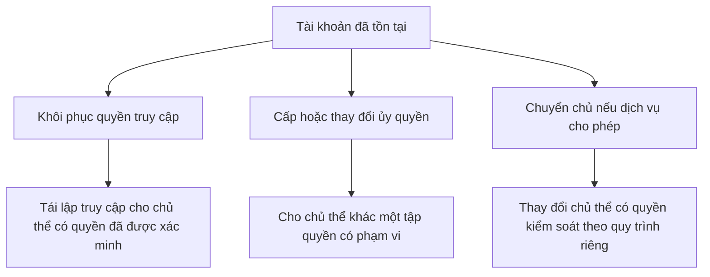

# Định nghĩa chủ tài khoản trong khôi phục tài khoản

## 1. Chủ tài khoản là ai?

Trong bài này, **chủ tài khoản — account owner — là chủ thể có quyền kiểm soát tài khoản được dịch vụ công nhận theo quan hệ đăng ký, quản lý hoặc chuyển giao hợp lệ và chính sách áp dụng cho loại tài khoản đó**. Quyền kiểm soát này có thể bao gồm thiết lập phương tiện xác thực, quản lý phương án khôi phục và quyết định việc sử dụng tài khoản trong phạm vi được cho phép.

Đây là định nghĩa vận hành phục vụ thiết kế bảo mật. Nó không tự xác lập quyền sở hữu pháp lý đối với dữ liệu, nội dung hoặc tài sản được truy cập qua tài khoản. Những quyền đó có thể thuộc các chủ thể khác nhau và cần quy tắc riêng.

Trong module `SECURITY_AUTHENTICATION_ACCOUNT_RECOVERY`, xác định đúng chủ tài khoản là nền tảng để thiết kế luồng phục hồi khi người dùng mất mật khẩu, MFA, passkey hoặc thiết bị xác thực. Trước khi quyết định gửi token, xác minh danh tính hay thu hồi session, hệ thống phải xác định mình đang cố khôi phục quyền kiểm soát cho ai và dựa trên căn cứ nào.

Hai điểm quan trọng trong định nghĩa:

- **Có quyền kiểm soát** khác với **đang kiểm soát được**. Người dùng có thể mất thiết bị mà vẫn là chủ tài khoản. Kẻ đánh cắp thiết bị có thể truy cập được nhưng không vì vậy mà trở thành chủ tài khoản.
- **Được dịch vụ công nhận** phải dựa trên quan hệ hợp lệ và chính sách đã xác định. Một trường email hoặc tên hiển thị vừa bị sửa trái phép không làm quyền kiểm soát hợp lệ tự chuyển sang người sửa.

Ví dụ, Mai đã đăng ký một tài khoản cá nhân và thiết lập phương án dự phòng. Sau khi mất điện thoại, Mai không còn dùng được MFA. Người giữ điện thoại có thể đang có một session còn hiệu lực. Sự khác nhau giữa hai người chính là vấn đề mà thuật ngữ “chủ tài khoản” cần diễn đạt: quyền được phục hồi không được xác định chỉ bằng ai đang có khả năng truy cập.

## 2. Tài khoản, danh tính và phương tiện xác thực là những đối tượng khác nhau

### 2.1. Tài khoản là hồ sơ trong một hệ thống

Một tài khoản thường có mã định danh nội bộ, trạng thái, thông tin hồ sơ, các phương tiện xác thực được liên kết và những quyền được cấp. Tài khoản là đối tượng mà hệ thống quản lý, không phải chính con người hoặc tổ chức ngoài đời.

Một người có thể có nhiều tài khoản. Một tổ chức có thể quản lý nhiều tài khoản của nhân viên. Một địa chỉ email có thể được dùng để liên hệ cho nhiều hồ sơ. Vì vậy, không nên giả định quan hệ một người, một email và một tài khoản luôn trùng nhau.

### 2.2. Danh tính là chủ thể được thể hiện trong một bối cảnh

Một tài khoản cá nhân có thể đại diện cho người dùng theo tên thật hoặc bí danh. Tài khoản nhân viên có thể biểu diễn quan hệ làm việc trong một tổ chức. Không phải tài khoản nào cũng đã được đối chiếu với giấy tờ định danh ngoài đời.

Xác định chủ tài khoản cần phù hợp với loại quan hệ mà dịch vụ thực sự thiết lập. Một dịch vụ chưa từng thu thập hoặc xác minh tên thật không thể tự suy ra rằng người đưa giấy tờ mang tên giống tên hiển thị là người đăng ký tài khoản.

### 2.3. Phương tiện xác thực là cách chứng minh trong một lần tương tác

Mật khẩu, mã dự phòng hoặc khóa mật mã liên quan đến passkey giúp hệ thống kiểm tra một yêu cầu theo chính sách. Chúng không phải bản thân chủ tài khoản. Phương tiện có thể bị mất, chia sẻ trái phép, đánh cắp, thay thế hoặc thu hồi.

NIST phân biệt *subscriber* là cá nhân đã đăng ký với dịch vụ danh tính, *subscriber account* là hồ sơ do dịch vụ đó thiết lập và *claimant* là chủ thể đang được kiểm tra bằng giao thức xác thực. Các thuật ngữ này giúp tách người đã đăng ký, hồ sơ của họ và bên đang đưa ra yêu cầu. [Nguồn: NIST SP 800-63-4, Glossary](https://pages.nist.gov/800-63-4/sp800-63/glossary/).

Trong bài này, “chủ tài khoản” được dùng rộng hơn trong ngữ cảnh sản phẩm, bao gồm cả việc cần xác định thẩm quyền quản lý tài khoản tổ chức. Không nên mặc định mọi tổ chức hoặc tài khoản kỹ thuật đều tương ứng trực tiếp với khái niệm subscriber là cá nhân trong NIST.

## 3. Phân biệt chủ tài khoản với các vai trò gần nghĩa

| Vai trò | Ý nghĩa trong luồng khôi phục | Không được tự suy ra |
| --- | --- | --- |
| Chủ tài khoản — account owner | Chủ thể có quyền kiểm soát hợp lệ theo mô hình của dịch vụ | Mọi yêu cầu tự nhận là chủ đều hợp lệ |
| Người yêu cầu khôi phục — recovery claimant | Bên đang đề nghị lấy lại hoặc tái lập quyền truy cập | Đã là chủ tài khoản được xác minh |
| Người đang kiểm soát phương tiện xác thực | Bên hiện có thể sử dụng mật khẩu, mã hoặc khóa tương ứng | Có thẩm quyền với mọi thay đổi tài khoản |
| Người đang giữ session | Bên đang dùng một phiên truy cập được hệ thống chấp nhận | Là người đã xác thực ban đầu hoặc được phép thay phương án khôi phục |
| Người được ủy quyền — delegate | Bên được thực hiện một số hành động trong phạm vi ủy quyền | Được chuyển quyền kiểm soát hoặc khôi phục thay chủ tài khoản |
| Quản trị viên tổ chức — tenant administrator | Bên có quyền quản trị trong phạm vi tổ chức được xác định | Có quyền đối với tài khoản ở tổ chức khác hoặc tài khoản cá nhân ngoài phạm vi |
| Người trả phí — billing contact hoặc payer | Bên thực hiện hoặc quản lý thanh toán | Đương nhiên có quyền thay mật khẩu, email hoặc MFA |
| Nhân viên hỗ trợ — support agent | Bên thực hiện quy trình xử lý theo quyền được cấp | Có quyền tự tạo căn cứ sở hữu hoặc bỏ qua điều kiện xác minh |
| Người phê duyệt khôi phục — recovery approver | Bên đưa ra quyết định trong quy trình được phân quyền | Trở thành chủ tài khoản sau khi phê duyệt |

Một người có thể đồng thời giữ nhiều vai trò, nhưng không nên gộp định nghĩa của các vai trò đó. Người trả phí có thể cũng là chủ tài khoản; căn cứ cho quyền khôi phục vẫn cần được xác định theo chính sách, thay vì chỉ dựa vào việc hai vai trò thường trùng nhau.

Tương tự, nhãn `Owner` trong giao diện một workspace có thể là tên một vai trò quản trị. Cần nêu rõ đó là chủ workspace, chủ dự án, người quản lý thuê bao hay chủ của một tài khoản đăng nhập. Cùng một từ trên giao diện có thể chỉ những phạm vi quyền khác nhau.

## 4. Ba câu hỏi phải tách biệt khi xử lý yêu cầu

### 4.1. Người yêu cầu đang nói về tài khoản nào?

Đây là bài toán **xác định đối tượng**. Email, tên đăng nhập hoặc mã khách hàng có thể giúp tìm một hồ sơ. Biết đúng định danh chỉ cho biết hồ sơ đích; nó chưa chứng minh người cung cấp định danh có quyền với hồ sơ đó.

Ví dụ, ai cũng có thể biết tên tài khoản công khai của một người nổi tiếng. Thông tin công khai giúp định tuyến yêu cầu, nhưng không tạo quyền khôi phục.

### 4.2. Có đủ bằng chứng liên kết người yêu cầu với tài khoản đó không?

Đây là bài toán **xác minh quan hệ**. Hệ thống cần kiểm tra bằng chứng có nguồn gốc và trạng thái phù hợp: phương tiện dự phòng được thiết lập trước, một phương tiện xác thực còn an toàn hoặc quy trình định danh lại có khả năng liên kết với hồ sơ sẵn có.

Điều cần chứng minh không chỉ là “người này là một người có thật”. Cần chứng minh người này có quan hệ hợp lệ với **đúng tài khoản đang yêu cầu khôi phục**. Giấy tờ xác định người A không tự chứng minh tài khoản bí danh B thuộc về A.

### 4.3. Quan hệ đã xác minh cho phép thực hiện hành động gì?

Đây là bài toán **thẩm quyền và phạm vi**. Ngay cả khi đã xác thực được người yêu cầu, hệ thống vẫn phải kiểm tra họ được thay mật khẩu, thay một yếu tố MFA, quản lý tài khoản của tổ chức hay chuyển quyền kiểm soát cho một người khác.

```text
Tìm đúng tài khoản
    → Xác minh quan hệ của người yêu cầu với tài khoản
    → Kiểm tra thẩm quyền đối với thay đổi được yêu cầu
    → Chỉ cấp khả năng thực hiện thay đổi đã được chấp thuận
```

Ví dụ, một nhân viên được ủy quyền xem hóa đơn có thể chứng minh danh tính của mình một cách chắc chắn. Điều đó không làm họ có quyền thay email khôi phục của tài khoản quản trị toàn tổ chức.

## 5. Quyền kiểm soát tức thời không đồng nghĩa quyền kiểm soát hợp lệ

### 5.1. Có mật khẩu hoặc token chưa giải quyết mọi câu hỏi

Kiểm tra một mật khẩu đúng là một bằng chứng xác thực theo cơ chế đã thiết kế. Tuy nhiên, mật khẩu có thể bị lộ. Một mã khôi phục cũng có thể bị đánh cắp. Hệ thống sử dụng các bằng chứng này trong một chính sách có phạm vi và giả định rõ ràng, chứ không thể suy luận rằng người giữ bí mật luôn là chủ tài khoản trong mọi hoàn cảnh.

Ví dụ, token đặt lại mật khẩu có thể cho phép thay mật khẩu theo chính sách của một tài khoản. Quyền đó không tự mở rộng thành quyền tắt MFA, chuyển chủ workspace hoặc khôi phục tài khoản khác dùng chung email liên hệ.

### 5.2. Kiểm soát email là một quan hệ riêng

Một người đang nhận được thư tại địa chỉ khôi phục chứng minh khả năng kiểm soát kênh nhận tại thời điểm kiểm tra. Mức kết luận về tài khoản phụ thuộc việc kênh đó đã được liên kết hợp lệ, còn đáng tin và đủ cho mục đích đang xét hay không.

Các trường hợp cần phân biệt:

- Email cá nhân của người đăng ký tài khoản.
- Hộp thư nhóm có nhiều người cùng truy cập.
- Địa chỉ công ty được cấp lại cho nhân viên mới.
- Hộp thư bị chiếm hoặc địa chỉ vừa được sửa trong một sự cố.
- Email mới do người yêu cầu cung cấp để nhận kết quả khôi phục.

Các trường hợp trên đều có thể cho kết quả “nhận được mã”, nhưng ý nghĩa về quyền kiểm soát tài khoản không giống nhau. Đặc biệt, email mới chưa có quan hệ tin cậy không được tự chứng minh quyền đổi địa chỉ khôi phục sang chính nó.

### 5.3. Mất phương tiện không xóa quan hệ hợp lệ

Nếu người dùng mất điện thoại, thứ bị mất có thể là khả năng sử dụng một phương tiện xác thực, không phải quyền kiểm soát được thừa nhận đối với tài khoản. Mục tiêu của khôi phục là tái lập khả năng truy cập cho đúng chủ thể dựa trên bằng chứng thay thế phù hợp.

Chiều ngược lại cũng quan trọng: kẻ tấn công đang giữ session không trở thành chủ tài khoản chỉ vì backend vẫn chấp nhận session đó. Khi phát hiện sự cố, cần có khả năng xem xét và chấm dứt quyền truy cập không hợp lệ.

## 6. Định nghĩa phải phù hợp với mô hình tài khoản

### 6.1. Tài khoản cá nhân theo tên thật

Chủ tài khoản thường là cá nhân có quan hệ đăng ký hợp lệ với dịch vụ. Nếu dịch vụ đã định danh người đó từ trước, quy trình định danh lại có thể sử dụng hồ sơ phù hợp để kiểm tra tính liên tục của quan hệ.

Tuy nhiên, trùng tên không đủ để kết luận. Hệ thống cần xác định bằng chứng nào đã được kiểm tra, liên kết với mã tài khoản nào và còn sử dụng được cho quyết định hiện tại hay không.

### 6.2. Tài khoản cá nhân dùng bí danh

Chủ tài khoản có thể chỉ được dịch vụ nhận biết qua một định danh và các bằng chứng kiểm soát đã thiết lập. Việc không có tên thật không làm tài khoản không có chủ; nó làm loại bằng chứng có thể dùng để khôi phục khác đi.

Nếu người dùng mất toàn bộ phương tiện và không có căn cứ thay thế đủ mạnh, dịch vụ có thể không xác minh được yêu cầu. Không nên tạo một kết luận chắc chắn bằng cách hỏi thông tin công khai hoặc thu thêm giấy tờ không có khả năng liên kết với tài khoản.

### 6.3. Tài khoản người dùng trong tổ chức

Cần phân biệt danh tính người dùng, tư cách thành viên và thẩm quyền quản trị của tổ chức. Tổ chức có thể có quyền cấp lại quyền truy cập tài khoản công việc theo chính sách quản trị, nhưng người thực hiện vẫn phải hành động bằng thẩm quyền được cấp và trong đúng phạm vi.

Khi nhân viên nghỉ việc, việc chuyển công việc, thu hồi quyền hoặc phân công người tiếp nhận là thay đổi quản trị. Nó không nên được mô tả như “khôi phục tài khoản cá nhân của người đã nghỉ” để bỏ qua quy trình phân quyền.

### 6.4. Workspace có nhiều người quản trị

Một workspace có thể có nhiều người giữ vai trò quản trị hoặc vai trò mang tên `Owner`. Nên để mỗi người sử dụng danh tính và phương tiện xác thực riêng, đồng thời thể hiện quan hệ quản trị với workspace bằng phân quyền.

Chia sẻ một mật khẩu rồi gọi mọi người biết mật khẩu là “đồng chủ tài khoản” khiến việc xác minh và thu hồi khó rõ ràng. Một người rời nhóm có thể vẫn giữ bí mật chung; lịch sử thao tác cũng khó gắn với từng cá nhân.

### 6.5. Tài khoản kỹ thuật hoặc service account

Một tài khoản kỹ thuật có thể được quản lý bởi một đội hoặc một chức năng của tổ chức. Người chịu trách nhiệm vận hành không nhất thiết là người được phép cấp lại mọi bí mật của tài khoản đó.

Với loại tài khoản này, cần định nghĩa đơn vị chịu trách nhiệm, người có thẩm quyền yêu cầu, người phê duyệt và quy trình thay bí mật. Không áp dụng máy móc một luồng “quên mật khẩu cá nhân” cho mọi danh tính máy.

| Mô hình | Cần diễn đạt rõ ai là chủ thể có thẩm quyền | Nhầm lẫn cần tránh |
| --- | --- | --- |
| Cá nhân | Cá nhân có quan hệ đăng ký hoặc chuyển giao hợp lệ nếu dịch vụ cho phép | Ai có giấy tờ trùng tên hiển thị cũng là chủ |
| Cá nhân dùng bí danh | Chủ thể được liên kết qua bằng chứng phù hợp với mô hình bí danh | Không có tên thật thì không có quan hệ sở hữu tài khoản |
| Tài khoản công việc | Người dùng và thẩm quyền quản trị của tổ chức được tách biệt | Người đang nhận email công việc luôn là người dùng trước đó |
| Workspace | Tổ chức hoặc chủ thể quản lý workspace cùng các vai trò được chỉ định | Vai trò `Owner` của workspace đồng nghĩa chủ mọi tài khoản thành viên |
| Tài khoản kỹ thuật | Đơn vị chịu trách nhiệm và các bên được phép thao tác | Người có khóa triển khai hiện tại có mọi quyền khôi phục |

## 7. Liên kết với định danh ổn định, không chỉ với thuộc tính hiển thị

### 7.1. Email và tên hiển thị không phải bản thân tài khoản

Trong một mô hình dữ liệu minh họa, nên phân biệt:

```text
account_id       : tài khoản đang được xử lý
owner_subject_id : chủ thể được ghi nhận có quyền kiểm soát
tenant_id        : phạm vi tổ chức nếu có
contact_address  : địa chỉ liên hệ có thể thay đổi
display_name     : thông tin hiển thị có thể thay đổi
```

Đây là mô hình khái niệm, không phải yêu cầu mọi hệ thống phải tạo đúng các cột này. Một sản phẩm đơn giản có thể có quan hệ một tài khoản với một chủ thể; sản phẩm khác có thể quản lý nhiều quan hệ đại diện, thành viên và quản trị.

Điều cần giữ là đổi địa chỉ liên hệ không được ngầm đổi chủ thể, và đổi tên hiển thị không được tạo một quan hệ mới. Lịch sử thay đổi hợp lệ cũng cần được phân biệt với dữ liệu hiện tại có thể đã bị sửa trong sự cố.

### 7.2. Trường hợp đăng nhập liên kết

Khi dùng OpenID Connect, định danh phía nhà cung cấp danh tính cần xét cả bên phát hành `iss` và chủ thể `sub`. Đặc tả OpenID Connect nêu cặp này là định danh ổn định mà ứng dụng có thể dựa vào; các thuộc tính như email, tên và số điện thoại không có cùng bảo đảm về tính ổn định hoặc duy nhất. [Nguồn: OpenID Connect Core 1.0, Claim Stability and Uniqueness](https://openid.net/specs/openid-connect-core-1_0.html#ClaimStability).

Ví dụ, hai nhà cung cấp có cùng giá trị `sub` chưa chắc nói về cùng một người. Một email được cấp lại cũng không chứng minh tài khoản mới ở nhà cung cấp danh tính là người đã liên kết với tài khoản ứng dụng trước đó.

Vì vậy, khôi phục tại ứng dụng và khôi phục tại nhà cung cấp danh tính có thể thuộc hai thẩm quyền khác nhau. Không nên tự gắn một danh tính liên kết mới vào tài khoản cũ chỉ vì hai bên cùng trả về một chuỗi email.

### 7.3. Quan hệ có phạm vi và thời điểm

Một người có thể quản trị tổ chức A và chỉ là thành viên ở tổ chức B. Quyền yêu cầu khôi phục phải gắn với đúng tổ chức và đúng loại thao tác.

Tương tự, người được ủy quyền tháng trước có thể đã bị thu hồi quyền hôm nay. Việc đã từng quản trị hoặc đã từng trả phí có thể là dữ kiện lịch sử, nhưng không tự chứng minh thẩm quyền hiện tại.

## 8. Dùng bằng chứng để xác minh quan hệ, không tạo vòng lặp tự chứng minh

### 8.1. Bằng chứng phải trả lời đúng điều cần xác minh

| Bằng chứng hoặc thông tin | Điều có thể hỗ trợ | Điều chưa được chứng minh chỉ bằng dữ kiện đó |
| --- | --- | --- |
| Mã dự phòng được thiết lập trước, còn hiệu lực | Kiểm soát một bí mật đã liên kết với tài khoản | Quyền chuyển tài khoản sang chủ thể khác hoặc quyền ngoài mục đích được duyệt |
| Phương tiện xác thực còn an toàn | Quan hệ kiểm soát theo mức xác thực thực sự đạt được | Mọi thay đổi đều được phép mà không cần kiểm tra phạm vi |
| Giấy tờ đã được xác minh và đối chiếu với hồ sơ phù hợp | Tính liên tục của danh tính trong mô hình đã định danh | Quyền đối với mọi tài khoản có cùng tên |
| Nhận thư ở hộp thư nhóm | Khả năng truy cập hộp thư nhóm tại thời điểm kiểm tra | Cá nhân cụ thể nào đang yêu cầu và họ có quyền thay MFA của ai |
| Hóa đơn hoặc thông tin thanh toán | Quan hệ thanh toán hoặc dữ kiện hỗ trợ xác minh theo chính sách | Quyền kiểm soát toàn bộ tài khoản |
| Tên, ngày sinh hoặc thông tin hồ sơ công khai | Tìm hồ sơ hoặc bổ sung ngữ cảnh | Quyền khôi phục khi không có bằng chứng phù hợp khác |
| Email mới được cung cấp trong yêu cầu | Địa chỉ người yêu cầu muốn nhận liên hệ | Quan hệ lịch sử với chủ tài khoản |

Tính đầy đủ của bằng chứng phụ thuộc loại tài khoản, mục đích và tác động của quyết định. Bảng này không xác định một bằng chứng đơn lẻ luôn đủ hoặc luôn bị cấm; nó chỉ rõ giới hạn của kết luận có thể rút ra.

### 8.2. Tránh dùng chính thay đổi đang tranh chấp làm căn cứ duy nhất

Giả sử đối thủ thay email khôi phục sang địa chỉ của mình rồi mở yêu cầu “lấy lại tài khoản”. Nếu hệ thống chỉ kiểm tra ai đang nhận được thư tại trường email mới nhất, nó có thể hợp thức hóa thay đổi trái phép bằng chính kết quả của thay đổi đó.

Cần xem xét nguồn gốc và thời điểm của quan hệ: địa chỉ được thiết lập khi nào, bằng quy trình nào, có dấu hiệu bị thay trong sự cố không và có căn cứ độc lập nào còn đáng tin. Cũng không được mặc định mọi địa chỉ cũ đều còn an toàn; địa chỉ cũ có thể đã bị bỏ vì bị chiếm hoặc mất quyền sử dụng.

### 8.3. Người yêu cầu vẫn là người yêu cầu cho đến khi có quyết định phù hợp

Trong biểu mẫu, nhật ký và công cụ hỗ trợ, nên gọi bên chưa được xác minh là “người yêu cầu khôi phục”. Cách gọi này giúp tránh một giả định nguy hiểm: hồ sơ mang tên “yêu cầu từ chủ tài khoản” nên người xử lý vô tình xem quyền sở hữu đã được chứng minh.

Khi đã đạt chính sách, kết luận cũng cần có phạm vi. “Đã xác minh đủ điều kiện thay yếu tố MFA của tài khoản X” chính xác hơn “đã xác minh chủ tài khoản” nếu quy trình chưa quyết định quyền chuyển chủ hoặc các thay đổi khác.

Nếu hai bên cùng đưa ra yêu cầu mâu thuẫn, không nên chọn bên liên hệ trước, trả phí nhiều hơn hoặc nói chuyện thuyết phục hơn. Hồ sơ cần được xử lý theo quy trình tranh chấp và bằng chứng thích hợp; việc cấp quyền vẫn phải tuân thủ điều kiện đã xác định.

## 9. Khôi phục, ủy quyền và chuyển chủ là ba việc khác nhau



**Khôi phục** nhằm tái lập khả năng truy cập hoặc phương tiện xác thực cho chủ thể có quyền với tài khoản. Nó có thể kéo theo thay mật khẩu, gắn passkey mới hoặc thu hồi session, nhưng không mặc nhiên thay chủ thể của quan hệ.

**Ủy quyền** cho phép chủ thể khác thực hiện một số hành động. Người được ủy quyền có thể được xem dữ liệu hoặc quản lý một dự án mà không được đổi phương án khôi phục của chủ tài khoản.

**Chuyển chủ** thay đổi quan hệ kiểm soát theo quy tắc của dịch vụ, nếu dịch vụ hỗ trợ. Quy trình này cần xác định bên có thẩm quyền chấp thuận, chủ thể nhận quyền và tác động tới các quyền liên quan. Không nên biến nút đổi email thành một cơ chế chuyển chủ ngầm.

Ví dụ, quản trị viên bổ sung người kế nhiệm cho một workspace là một thay đổi quản trị. Người dùng đổi email vì chuyển nhà cung cấp thư là thay đổi kênh liên hệ. Người dùng mất MFA và đăng ký lại thiết bị là khôi phục hoặc thay phương tiện xác thực theo chính sách. Ba sự kiện có thể dùng một số thành phần kỹ thuật giống nhau nhưng không có cùng ý nghĩa.

## 10. Hai tình huống giúp nhận diện đúng chủ thể

### 10.1. Tài khoản cá nhân dùng bí danh bị mất passkey

Minh dùng tên hiển thị `may-troi`, không đăng ký tên thật và mất thiết bị chứa passkey duy nhất có thể sử dụng. Minh gửi hỗ trợ ảnh giấy tờ và ảnh trang hồ sơ công khai.

Từ các dữ kiện đó, hệ thống có thể biết người gửi đang xuất trình một danh tính ngoài đời và biết trang hồ sơ đích. Chưa có căn cứ đủ để liên kết người trong giấy tờ với tài khoản `may-troi`.

Nếu Minh còn mã dự phòng được thiết lập trước hoặc một phương tiện khác được chính sách chấp nhận, các bằng chứng đó có thể hỗ trợ xác minh quan hệ. Nếu không còn căn cứ phù hợp, hỗ trợ không nên cấp quyền chỉ vì người gửi trình bày câu chuyện hợp lý.

Sự thiếu bằng chứng không khẳng định Minh là kẻ giả mạo. Nó có nghĩa dịch vụ chưa đủ cơ sở để đưa ra quyết định cấp quyền theo chính sách. Phân biệt này giúp giao tiếp với người dùng chính xác mà không hạ điều kiện bảo mật.

### 10.2. Email doanh nghiệp được cấp lại cho người mới

Tài khoản ứng dụng `U-582` được liên kết với một nhân viên cũ trong tổ chức `T-42`. Địa chỉ `ops@example.com` sau đó được cấp cho người mới. Người mới nhận được email khôi phục gửi đến địa chỉ đó.

Nhận được email chứng minh người mới kiểm soát hộp thư tại thời điểm kiểm tra. Nó chưa chứng minh người mới là chủ thể trước đây của `U-582` hoặc được phép tiếp nhận mọi quyền của người cũ.

Nếu tổ chức có thẩm quyền quản trị phù hợp, cần dùng quy trình quản lý thành viên, bàn giao hoặc khôi phục do quản trị viên được phép thực hiện. Quyết định phải chỉ rõ đang cấp quyền cho ai, đối với tài khoản hoặc workspace nào và trên căn cứ quản trị nào.

Nếu ứng dụng dùng đăng nhập liên kết, cần kiểm tra quan hệ danh tính đã liên kết thay vì chỉ so sánh email. Việc người mới có cùng địa chỉ liên hệ không được tự động nối họ với lịch sử và quyền của người cũ.

Trong cả hai ví dụ, câu hỏi quyết định là quan hệ hợp lệ giữa người yêu cầu và tài khoản. Tên thật, hộp thư và khả năng nhận mã chỉ là những dữ kiện có ý nghĩa trong một mô hình xác minh cụ thể.

## 11. Diễn đạt định nghĩa thành hợp đồng cho thiết kế và vận hành

Một định nghĩa hữu ích cần được các bên sản phẩm, bảo mật, backend và hỗ trợ hiểu giống nhau. Với mỗi loại tài khoản, tài liệu thiết kế nên xác định:

| Nội dung cần nêu rõ | Ví dụ cách diễn đạt |
| --- | --- |
| Đối tượng được khôi phục | Một tài khoản nội bộ cụ thể trong một phạm vi tổ chức xác định |
| Chủ thể có quan hệ hợp lệ | Cá nhân đã đăng ký, đơn vị chịu trách nhiệm hoặc chủ thể nhận quyền qua chuyển giao được phép |
| Người có thể nộp yêu cầu | Chính người dùng hoặc đại diện có thẩm quyền được kiểm tra riêng |
| Quan hệ cần xác minh | Quan hệ đăng ký, liên kết danh tính, vai trò quản trị hoặc ủy quyền có hiệu lực |
| Bằng chứng được chấp nhận | Loại bằng chứng, nguồn gốc, phạm vi và trạng thái còn hiệu lực |
| Hành động được cấp | Thay mật khẩu, thay yếu tố cụ thể hoặc thao tác quản trị được phê duyệt |
| Điều không tự suy ra | Nhận được mã không mặc nhiên cho phép xóa MFA hoặc chuyển chủ |
| Trường hợp không đủ căn cứ | Chuyển thẩm định phù hợp hoặc không cấp quyền; không tự kết luận bằng thông tin công khai |

Các tên trường trong một hồ sơ minh họa có thể giúp giữ rõ ý nghĩa:

```text
recovery_case_id          : hồ sơ của lần yêu cầu
target_account_id        : tài khoản đích
target_tenant_id         : phạm vi tổ chức nếu áp dụng
claimant_reference       : tham chiếu người yêu cầu, nếu đã xác lập được
claimed_relationship     : quan hệ mà người yêu cầu tự khai
verified_relationship   : quan hệ đã được kiểm tra theo chính sách
verification_decision   : kết quả kiểm tra với lý do và phạm vi
authorized_action       : thao tác được phép sau quyết định
```

Đây là cách diễn đạt khái niệm, không phải cấu trúc dữ liệu bắt buộc. Điểm quan trọng là không ghi đè điều tự khai thành điều đã xác minh, không dùng một cờ `isOwner=true` từ phía client làm căn cứ backend và không lưu toàn bộ bí mật xác minh vào hồ sơ chỉ để chứng minh đã xử lý.

Sau khi có quyết định đúng chủ thể, luồng vẫn cần token có phạm vi, chống lạm dụng và kiểm soát session phù hợp. Định nghĩa chủ tài khoản trả lời **quyền cần phục hồi thuộc về ai**; các biện pháp còn lại bảo đảm quyền đó được trao đúng cách và các đường truy cập trái phép được xử lý.

Khi dùng thuật ngữ này trong thiết kế, hãy luôn chỉ rõ loại tài khoản, chủ thể, quan hệ hợp lệ và phạm vi quyết định. Cách diễn đạt đó giúp tránh đồng nhất người đang có bí mật, người đang giữ hộp thư hoặc người có quyền hỗ trợ với người thực sự được phép lấy lại quyền kiểm soát tài khoản.
