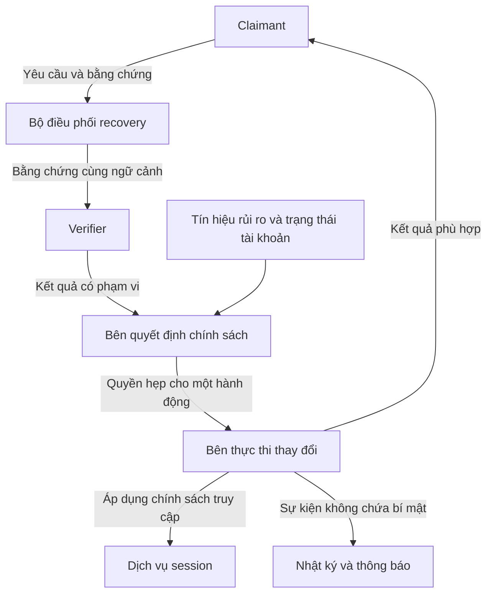

# Người yêu cầu và bên xác minh trong khôi phục tài khoản

Trong chương **Recovery Terminology**, hai thuật ngữ **claimant** và **verifier** giúp mô tả chính xác ai đang đưa ra yêu cầu, ai đang kiểm tra bằng chứng và quyết định nào đã thực sự được đưa ra. Sự phân biệt này đặc biệt quan trọng khi người dùng mất mật khẩu, MFA, passkey hoặc thiết bị xác thực: người đang yêu cầu lấy lại tài khoản có thể là chủ tài khoản, nhưng cũng có thể là kẻ đang tìm cách chiếm đoạt nó.

Bài học này dùng ngữ cảnh của dịch vụ khôi phục tài khoản: xác định bằng chứng còn lại, đánh giá rủi ro, xác minh, cấp quyền thay đổi phương thức xác thực và kiểm soát session sau thay đổi. Mục tiêu là dùng đúng tên vai trò để thiết kế giao diện, API và quy trình hỗ trợ mà không nhầm một lời khai với một quyền đã được chứng minh.

## 1. Hai vai trò cốt lõi

**Claimant**, trong ngữ cảnh bài học, là bên đang đưa ra một yêu cầu cần được xác minh và cung cấp bằng chứng để hệ thống xem xét. Có thể gọi là **người yêu cầu xác minh** hoặc **người yêu cầu khôi phục** khi đang nói riêng về recovery.

**Verifier** là bên kiểm tra bằng chứng theo một cơ chế và ngữ cảnh xác định, rồi tạo ra kết quả xác minh. Có thể gọi là **bên xác minh** hoặc **thành phần xác minh bằng chứng**.

Ví dụ:

> Một người nhập địa chỉ email của tài khoản, mở liên kết được gửi đến hộp thư và yêu cầu đặt mật khẩu mới.

Trong ví dụ này:

- Người gửi yêu cầu là claimant, kể cả trước khi họ đưa ra bằng chứng hợp lệ.
- Địa chỉ email họ nhập là thông tin định danh tài khoản đích, chưa phải bằng chứng sở hữu.
- Token trong liên kết là một loại bằng chứng mà hệ thống cần kiểm tra.
- Thành phần đối chiếu token với trạng thái phía máy chủ đóng vai trò verifier đối với bằng chứng đó.
- Quyết định có cho đặt mật khẩu mới hay không còn phụ thuộc chính sách cấp quyền, trạng thái tài khoản và phạm vi của bằng chứng.

Điều cần giữ rõ là: **claimant là tên một vai trò trong tương tác, không phải kết luận rằng người đó là chủ tài khoản hợp lệ**.

Tương tự, “verifier chấp nhận bằng chứng” chưa tự động có nghĩa “được gỡ mọi yếu tố xác thực và đăng nhập với đầy đủ quyền”. Kết quả cần được hiểu trong đúng phạm vi mà nó chứng minh.

## 2. Bản đồ các vai trò liên quan

Một luồng recovery có nhiều vai trò hơn hai đầu gửi và nhận token. Các tên dưới đây giúp tách trách nhiệm, không bắt buộc phải triển khai thành từng dịch vụ độc lập.

| Vai trò | Trách nhiệm trong luồng | Điều không được tự suy ra |
| --- | --- | --- |
| Claimant | Khởi tạo yêu cầu, cung cấp bằng chứng, thực hiện bước xác nhận được yêu cầu | Là chủ tài khoản chỉ vì biết email, mật khẩu cũ hoặc thông tin cá nhân. |
| Account holder, chủ tài khoản theo quan hệ của dịch vụ | Bên được phép kiểm soát tài khoản theo điều kiện của dịch vụ | Luôn là người đang thao tác trong phiên recovery hiện tại. |
| Subject hoặc tài khoản đích | Đối tượng mà bằng chứng và quyết định phải được gắn vào | Bất kỳ account ID nào claimant gửi ở bước cuối đều là đích được phép sửa. |
| Verifier | Kiểm tra bằng chứng, tính hợp lệ và ngữ cảnh liên quan; trả kết quả có phạm vi | Có quyền tự quyết định mọi thay đổi sau khi một bằng chứng hợp lệ. |
| Bộ điều phối recovery | Quản lý yêu cầu, trạng thái, các bước, hết hạn và việc chuyển kết quả giữa các thành phần | Trạng thái “đã mở màn hình tiếp theo” chứng minh xác minh đã thành công. |
| Bên quyết định chính sách | Đánh giá bằng chứng, rủi ro và hành động để cấp hoặc từ chối một quyền cụ thể | Mọi phương thức xác minh đều đủ cho mọi hành động. |
| Bên thực thi thay đổi | Kiểm tra quyền ở thời điểm thực thi và cập nhật credential, yếu tố hoặc thông tin liên quan | Chỉ cần giao diện đã bật nút là request có đủ quyền. |
| Dịch vụ session | Áp dụng chính sách giữ, thu hồi hoặc hạn chế quyền truy cập cũ và mới | Đổi mật khẩu ở nơi khác tự động chấm dứt mọi session. |
| Nhân viên hỗ trợ hoặc người kiểm tra hồ sơ | Thực hiện phần đánh giá được phân công, ghi nhận căn cứ và chuyển quyết định theo quyền hạn | Có thể bỏ qua chính sách vì người yêu cầu thuyết phục hoặc khẩn cấp. |
| Nhà cung cấp kênh hoặc bằng chứng bên ngoài | Chuyển phát email, SMS hoặc cung cấp một kết quả xác thực theo hợp đồng tích hợp | Tự chịu trách nhiệm quyết định quyền recovery trong ứng dụng. |

Trong một ứng dụng nhỏ, một backend có thể đảm nhiệm nhiều vai trò. Khi đó vẫn cần tách rõ các quyết định trong mã và kiểm tra quyền tại điểm thay đổi dữ liệu. Trong hệ thống phân tán, các vai trò có thể nằm ở nhiều dịch vụ; lúc này cần thêm ràng buộc về nguồn gửi, đích nhận, tính toàn vẹn và tuổi của kết quả xác minh.

### 2.1. Vai trò là chức năng, không chỉ là tên người hoặc tên máy chủ

Một nhân viên hỗ trợ có thể tiếp nhận yêu cầu nhưng không được quyền phê duyệt gỡ MFA. Một máy chủ có thể vừa kiểm tra token vừa thực thi đặt lại mật khẩu, nhưng hai bước đó vẫn có mục tiêu khác nhau.

Trong hệ thống định danh liên kết, một nhà cung cấp danh tính có thể xác minh việc đăng nhập, còn ứng dụng là bên sử dụng kết quả đó. Nếu ứng dụng dùng kết quả đăng nhập để xét recovery, ứng dụng vẫn phải kiểm tra kết quả có dành cho mình, còn hiệu lực và đủ cho hành động đang xét hay không. Tên gọi của thành phần không thay thế hợp đồng tin cậy giữa các bên.

## 3. Claimant đang khẳng định điều gì?

Câu “tôi muốn khôi phục tài khoản” có thể chứa nhiều khẳng định khác nhau:

1. “Tài khoản tôi đang nói tới là tài khoản có email này.”
2. “Tôi kiểm soát hộp thư đã gắn với tài khoản.”
3. “Tôi vẫn có một yếu tố xác thực đã đăng ký trước đây.”
4. “Tôi là bên được phép thay phương thức xác thực của tài khoản.”
5. “Thiết bị cũ đã mất và các session trên đó cần bị chặn.”

Mỗi khẳng định cần một cách xử lý khác nhau. Hệ thống có thể dùng email để tìm một ứng viên tài khoản nhưng phải xác minh quyền kiểm soát kênh bằng một bước riêng. Việc người dùng tự khai “đã mất điện thoại” là đầu vào cho lựa chọn nhánh và đánh giá rủi ro, chưa phải bằng chứng đủ để gỡ MFA.

### 3.1. Định danh, lời khai và bằng chứng

| Loại dữ liệu | Ví dụ | Cách hiểu phù hợp |
| --- | --- | --- |
| Định danh | Email, username, account ID | Giúp chỉ ra tài khoản đích; thường không phải bí mật. |
| Lời khai | “Tôi mất điện thoại hôm qua”, “tôi là chủ tài khoản” | Thông tin claimant đưa ra để hệ thống xem xét. |
| Bằng chứng | Token hợp lệ, mã dự phòng chưa dùng, đáp ứng một challenge bằng credential đã đăng ký | Được kiểm tra trong ngữ cảnh cụ thể; giá trị phụ thuộc cách cấp, bảo vệ và ràng buộc. |
| Tín hiệu rủi ro | Địa chỉ mạng, thay đổi thiết bị, lịch sử bất thường | Hỗ trợ quyết định, không mặc nhiên chứng minh quyền sở hữu. |
| Kết quả xác minh | Bản ghi do verifier tin cậy tạo ra sau kiểm tra | Kết luận có giới hạn về một bằng chứng và đối tượng cụ thể. |

Không biến dữ liệu công khai thành “bí mật” chỉ bằng cách đưa nó vào một câu hỏi bảo mật. Ngày sinh, tên trường hoặc thông tin có trên mạng xã hội có thể giúp nhận diện câu chuyện, nhưng không tạo ra bằng chứng mạnh rằng claimant được phép kiểm soát tài khoản.

### 3.2. Claimant có thể hợp lệ nhưng thiếu bằng chứng

Một người thực sự là chủ tài khoản vẫn có thể mất toàn bộ phương tiện mà hệ thống dùng để xác minh họ. Trong tình huống đó, sự thật ngoài đời và khả năng chứng minh qua hệ thống là hai vấn đề khác nhau.

Không nên tự đổi cách gọi từ claimant sang “đã xác thực” chỉ vì câu chuyện nghe hợp lý. Hệ thống cần một nhánh bằng chứng khác được chính sách cho phép, hoặc phải thừa nhận rằng chưa đủ căn cứ để cấp lại quyền.

### 3.3. Claimant cũng có thể là kẻ tấn công có bằng chứng thật

Kẻ tấn công có thể kiểm soát một hộp thư bị chiếm đoạt hoặc nắm được mã dự phòng bị lộ. Verifier có thể chấp nhận đúng một bằng chứng về mặt kỹ thuật, trong khi người cung cấp bằng chứng không phải chủ tài khoản được mong đợi.

Vì vậy, cần phân biệt “bằng chứng này hợp lệ” với “mọi giả định về nguồn bằng chứng đều đúng”. Token một lần chống dùng lại không giải quyết được việc token được gửi đến kênh đã bị chiếm đoạt.

## 4. Verifier kiểm tra gì và kết luận đến đâu?

Verifier cần biết không chỉ giá trị bằng chứng mà còn **ngữ cảnh phải kiểm tra**. Tùy loại bằng chứng, ngữ cảnh có thể bao gồm tài khoản đích, mục đích, yêu cầu recovery, thời hạn, challenge, bên nhận kết quả và trạng thái sử dụng.

Ví dụ với token đặt lại mật khẩu, các câu hỏi có thể là:

- Token có khớp với một bản ghi được hệ thống phát hành không?
- Nó có gắn với đúng tài khoản và yêu cầu recovery đang xử lý không?
- Mục đích của nó có phải đặt lại mật khẩu không?
- Nó còn hạn, chưa bị thu hồi và còn đủ điều kiện sử dụng không?
- Trạng thái bảo mật làm nền cho quyết định có thay đổi không?
- Việc sử dụng ở bước hoàn tất có được bảo vệ trước cạnh tranh và dùng lại không?

Tập kiểm tra thực tế tùy kiến trúc. Điều quan trọng là các điều kiện phải được thực thi ở phía đáng tin, không dựa vào một cờ như `verified=true` do trình duyệt tự gửi.

### 4.1. Phân biệt kiểm tra bằng chứng và xác minh danh tính ngoài đời

**Xác thực** thường kiểm tra việc claimant chứng minh quyền kiểm soát một authenticator hoặc credential đã gắn với tài khoản. **Kiểm chứng danh tính**, thường gọi là identity proofing, kiểm tra các khẳng định về một danh tính và sự liên hệ với người đưa ra yêu cầu theo một quy trình cụ thể.

Một token qua email chủ yếu cho thấy bên gửi lại token có quyền tiếp cận bí mật đó, trong các giả định của kênh và luồng chuyển phát. Nó không tự chứng minh danh tính pháp lý của người đó.

Ngược lại, nhìn thấy giấy tờ của một người chưa chắc chứng minh tài khoản giả danh hoặc tài khoản chưa từng liên kết danh tính ngoài đời thuộc về người ấy. Một quy trình hỗ trợ có kiểm tra giấy tờ vẫn cần chứng minh mối liên hệ giữa bằng chứng đó và tài khoản đích.

Trong bài học này, từ verifier được dùng cho chức năng kiểm tra bằng chứng. Khi mô tả hệ thống thực tế, nên ghi rõ đó là thành phần xác thực credential hay người kiểm tra hồ sơ danh tính, để tránh gộp hai công việc thành một kết luận mơ hồ “đã xác minh”.

### 4.2. Kết quả tốt hơn một biến boolean

Một kết quả chỉ có `success: true` không cho bên tiếp theo biết đã xác minh điều gì. Kết quả nội bộ nên có đủ ngữ cảnh cho quyết định, chẳng hạn:

```text
VerificationResult
    result_id
    recovery_request_id
    subject_account_id
    verifier_id
    evidence_type
    evidence_reference
    checked_purpose
    verified_at
    expires_at
    relevant_security_version
    outcome
```

Đây là cấu trúc minh họa, không phải định dạng chuẩn bắt buộc. `evidence_reference` là tham chiếu nội bộ để đối chiếu hoặc điều tra, không chứa raw token, OTP, mã dự phòng hay bí mật của claimant.

`checked_purpose` cho biết bằng chứng đã được kiểm tra trong ngữ cảnh nào; nó chưa tự trở thành quyền thực thi. Bên chính sách còn phải quyết định kết quả có đủ cho hành động cụ thể hay không.

Nếu kết quả được truyền qua nhiều dịch vụ, nó cần nguồn gốc có thể tin cậy và được bảo vệ khỏi sửa đổi, chuyển dùng sai đối tượng hoặc dùng lại ngoài phạm vi. Nếu claimant tự gửi một JSON mang tên `VerificationResult`, JSON đó chưa phải bằng chứng rằng verifier đã tạo ra kết quả ấy.

## 5. Tách xác minh, cấp quyền và thực thi

Có thể mô tả ba câu hỏi liên tiếp:

| Bước | Câu hỏi | Ví dụ kết luận |
| --- | --- | --- |
| Xác minh bằng chứng | Claimant đã chứng minh được điều gì, với tài khoản và mục đích nào? | Đã đáp ứng challenge bằng một credential đã đăng ký cho tài khoản A. |
| Cấp quyền | Bằng chứng đó, cùng ngữ cảnh và chính sách, có đủ cho hành động không? | Được cấp quyền đặt mật khẩu mới, chưa được gỡ MFA. |
| Thực thi | Quyền còn hiệu lực và các điều kiện hiện tại có cho phép commit không? | Đổi mật khẩu một lần, tiêu thụ quyền và cập nhật trạng thái liên quan. |



Sơ đồ thể hiện luồng trách nhiệm. Các thành phần có thể cùng một tiến trình. Claimant chỉ được xem dữ liệu mà giao diện cho phép; các mũi tên nội bộ không hàm ý rằng mọi kết quả nội bộ được trả nguyên vẹn về trình duyệt.

Một **recovery grant** là quyền có phạm vi hẹp được cấp sau quyết định chính sách. Nó có thể nằm hoàn toàn phía máy chủ hoặc được biểu diễn bằng một cơ chế bảo vệ phù hợp. Nó không mặc nhiên là session đăng nhập đầy đủ.

Việc tách ba bước giúp ngăn hai lỗi: verifier tự trao quyền rộng hơn điều bằng chứng chứng minh, và bên thực thi tin rằng thành phần trước đó đã kiểm tra mọi điều kiện còn có thể thay đổi.

## 6. Theo dõi vai trò trong một yêu cầu đặt lại mật khẩu

Giả sử tài khoản A có mật khẩu và TOTP. Dịch vụ chấp nhận liên kết qua email đã xác minh để đặt lại mật khẩu, nhưng không dùng liên kết đó để gỡ TOTP.

### Bước 1: Claimant chỉ ra tài khoản đích

Claimant nhập email vào màn hình quên mật khẩu. Bộ điều phối tiếp nhận yêu cầu, áp dụng kiểm soát lạm dụng và trả phản hồi công khai phù hợp với mục tiêu hạn chế suy đoán tài khoản.

Ở thời điểm này, chưa có kết quả xác minh quyền sở hữu. Không đổi mật khẩu, thu hồi session hay gỡ yếu tố chỉ vì yêu cầu đã được tạo. Nếu làm vậy, người biết email của nạn nhân có thể gây gián đoạn tài khoản.

### Bước 2: Hệ thống gửi bằng chứng qua kênh đã gắn với tài khoản

Thành phần phát hành tạo bí mật phù hợp với thiết kế và gửi hướng dẫn qua kênh đủ điều kiện theo chính sách. Nhà cung cấp email đảm nhiệm chuyển phát; ứng dụng vẫn chịu trách nhiệm ràng buộc token với tài khoản, mục đích và hạn sử dụng.

Claimant không được thay địa chỉ nhận thành một email mới rồi coi đó là cùng bằng chứng. Thay thông tin liên lạc là một hành động riêng cần được cấp quyền.

### Bước 3: Claimant gửi lại token cho hệ thống

Verifier kiểm tra token và ngữ cảnh. Một người mở được liên kết là bên đang đưa ra bằng chứng, chưa được tự động coi là đã vượt qua MFA.

Việc một phần mềm quét thư mở URL không nên tự làm hoàn tất thay đổi credential. Mở trang bằng `GET` và xác nhận một thay đổi bảo mật cần được phân biệt trong thiết kế.

### Bước 4: Chính sách cấp quyền có giới hạn

Nếu bằng chứng hợp lệ và các điều kiện khác thỏa mãn, hệ thống cấp grant cho hành động đặt lại mật khẩu của A. Grant không cho gỡ TOTP, đổi email hay đăng ký passkey tùy ý.

Nếu rủi ro hoặc mức tác động yêu cầu bằng chứng bổ sung, bộ điều phối yêu cầu bước tiếp theo. “Verifier chấp nhận token” không bắt buộc bên chính sách phải bỏ qua những yêu cầu đó.

### Bước 5: Bên thực thi commit thay đổi

Bên thực thi kiểm tra grant, đích, hành động, thời hạn và trạng thái hiện tại. Việc đổi mật khẩu và tiêu thụ quyền sử dụng một lần phải được phối hợp nguyên tử, để hai request đồng thời không tạo ra hai thay đổi thành công từ cùng quyền.

Một kiểm tra token hợp lệ ở bước trước không đủ để bảo đảm điều này nếu bước cuối không kiểm tra và cập nhật trạng thái nhất quán. Các điều kiện có thể thay đổi giữa lần xác minh và lần sử dụng.

### Bước 6: Dịch vụ xử lý quyền truy cập sau thay đổi

Hệ thống áp dụng chính sách session, gửi thông báo và ghi sự kiện không chứa bí mật. Claimant có thể được đưa về bước đăng nhập bình thường và vẫn phải đáp ứng TOTP. Quyết định cấp session đầy đủ cần căn cứ vào mức xác thực thực tế của toàn bộ luồng.

Nếu có session hoặc token cũ phải thu hồi, cần nêu rõ loại nào bị chặn và thời gian có hiệu lực tại các dịch vụ. Thông báo “đã đổi mật khẩu” không đồng nghĩa tất cả quyền truy cập cũ đã biến mất ngay lập tức.

## 7. Cùng hai vai trò, khác bằng chứng và kết luận

| Tình huống | Claimant cung cấp gì? | Verifier kiểm tra gì? | Chính sách cần quyết định riêng |
| --- | --- | --- | --- |
| Quên mật khẩu | Token từ kênh đủ điều kiện, hoặc bằng chứng khác được chấp nhận | Nguồn phát hành, ràng buộc tài khoản, mục đích, hạn và trạng thái của bằng chứng | Có được đặt lại mật khẩu không; cần giữ MFA và xử lý session thế nào. |
| Mất thiết bị TOTP | Credential còn dùng được, mã dự phòng hoặc bằng chứng bổ sung theo chính sách | Bằng chứng có thuộc tài khoản, còn hiệu lực và đã dùng hay chưa | Có đủ để thay hoặc gỡ yếu tố không; có cần xác minh thêm hoặc hạn chế tạm thời không. |
| Mất một thiết bị có passkey | Đáp ứng challenge bằng passkey khác hoặc phương án dự phòng | Bằng chứng theo giao thức, credential đã đăng ký và ngữ cảnh yêu cầu | Có cho đăng ký credential mới không; credential cũ nào có thể và cần bị thu hồi. |
| Mất mọi yếu tố đã đăng ký | Bằng chứng qua nhánh hỗ trợ nếu dịch vụ có chính sách phù hợp | Chất lượng bằng chứng và sự liên hệ với tài khoản, không chỉ câu chuyện | Có đủ căn cứ cấp quyền không; có thể phải từ chối khi không thể thiết lập liên hệ tin cậy. |
| Nghi tài khoản bị chiếm đoạt | Bằng chứng còn tin cậy và thông tin về sự cố | Tính hợp lệ của bằng chứng, nguồn gốc và các thay đổi liên quan | Phạm vi xử lý sự cố, quyền cũ phải chặn và giới hạn của quyền cấp lại. |

### 7.1. Ví dụ với passkey

Trong một lần xác thực bằng passkey, claimant sử dụng authenticator để đáp ứng challenge. Authenticator là thành phần tạo hoặc sử dụng bằng chứng mật mã; verifier phía dịch vụ kiểm tra bằng chứng theo giao thức và cấu hình tin cậy, chẳng hạn challenge, credential đã đăng ký và ràng buộc với dịch vụ.

Không xem một cờ `userVerified` tự khai trong JSON là kết quả xác minh. Những thuộc tính giao thức phải được kiểm tra từ dữ liệu và chữ ký phù hợp, qua triển khai đáng tin cậy.

Việc người dùng mở khóa authenticator bằng sinh trắc học hoặc mã PIN cũng không có nghĩa dịch vụ đã xác minh danh tính pháp lý của họ. Đó là phần của cơ chế xác thực theo mô hình của authenticator và giao thức, với ý nghĩa cụ thể mà dịch vụ cần hiểu đúng.

Nếu dùng cơ chế đồng bộ hoặc khôi phục passkey của nhà cung cấp, dịch vụ cần hiểu thêm các giả định liên quan. Không suy ra rằng mọi passkey trên mọi thiết bị có cùng khả năng sao lưu, nhận diện thiết bị hoặc thu hồi riêng lẻ.

### 7.2. Ví dụ với mã dự phòng

Claimant nhập một mã dự phòng đã được cấp trước. Verifier kiểm tra mã theo cơ chế lưu trữ và chính sách của hệ thống. Bên thực thi cần bảo đảm mã sử dụng một lần không tạo được nhiều kết quả thành công, kể cả qua các request cạnh tranh.

Một mã đúng chỉ là một phần của kết luận. Chính sách phải nói mã đó dùng để đăng nhập, thay MFA hay khôi phục quyền nào; có cần kết hợp bằng chứng khác hay không. Nếu mã dự phòng nằm cùng thiết bị vừa bị mất, nó có thể không tạo ra tính độc lập mà thiết kế mong đợi.

## 8. Con người tham gia xác minh và giới hạn thẩm quyền

Bộ phận hỗ trợ thường là nơi các vai trò dễ bị nhập làm một. Người tiếp nhận cuộc gọi có thể đồng thời nghe lời khai, kiểm tra hồ sơ và bị đề nghị đổi phương thức xác thực ngay lập tức.

Một thiết kế rõ trách nhiệm cần chỉ ra:

- Ai được tiếp nhận yêu cầu và xem thông tin tối thiểu cần thiết.
- Ai kiểm tra loại bằng chứng nào và phải ghi nhận kết luận gì.
- Ai được phê duyệt hành động có tác động lớn theo chính sách.
- Thành phần nào thực sự thực hiện thay đổi và kiểm tra quyền cuối cùng.
- Tình huống nào phải chuyển cấp hoặc kết luận chưa đủ bằng chứng.

Tách các trách nhiệm này không nhất thiết buộc mọi yêu cầu đều cần nhiều nhân viên. Nó giúp xác định giới hạn quyền và áp dụng phân tách phê duyệt ở những trường hợp mà rủi ro đòi hỏi.

### 8.1. Không biến nhân viên thành người nhận bí mật đăng nhập

Nhân viên hỗ trợ không nên yêu cầu claimant đọc mật khẩu, mã dự phòng hoặc mã xác thực đăng nhập để chứng minh mình. Claimant nên cung cấp bằng chứng nhạy cảm qua giao diện và điểm kiểm tra chính thức được thiết kế cho mục đích đó.

Nếu có quy trình xác nhận dành riêng cho một tương tác hỗ trợ, nó cần có mục đích, phạm vi, cách chuyển giao và quy tắc sử dụng rõ ràng. Không lấy một mã đăng nhập thông thường rồi đổi tên nó thành mã hỗ trợ.

Hướng dẫn người dùng cũng phải nhất quán với thiết kế. Không thể vừa cảnh báo “không đưa OTP cho ai” vừa xây quy trình hỗ trợ yêu cầu đọc chính OTP đăng nhập cho người gọi đến.

### 8.2. Bằng chứng thủ công vẫn cần gắn với tài khoản

Đối chiếu giấy tờ, lịch sử giao dịch hoặc thông tin tổ chức có thể có giá trị trong một chính sách cụ thể. Nhưng các dữ liệu này có thể bị đánh cắp, chia sẻ, giả mạo hoặc chỉ chứng minh một phần mối quan hệ.

Nhân viên cần ghi “đã kiểm tra điều gì, liên hệ nào được thiết lập, điều gì còn chưa chắc chắn”, thay vì chỉ đánh dấu “người dùng thật”. Chỉ thu thập dữ liệu cần cho quyết định, kiểm soát quyền truy cập và thời hạn lưu phù hợp. Ghi nhận căn cứ không đồng nghĩa sao chép toàn bộ hồ sơ nhạy cảm vào nhật ký ứng dụng.

## 9. Thiết kế giao diện giữa verifier và bên cấp quyền

Một lỗi phổ biến là cho phép trình duyệt quyết định các tham số mà máy chủ đáng lẽ phải ràng buộc từ trước. Ví dụ nguy hiểm:

```text
POST /recovery/complete
{
    accountId: "B",
    verified: true,
    action: "REMOVE_MFA"
}
```

Nếu máy chủ tin `verified: true`, claimant đã tự đóng vai verifier. Nếu máy chủ chỉ kiểm tra rằng trước đó có một token đúng nhưng không ràng buộc tài khoản và hành động, một kết quả của A có thể bị chuyển dùng cho B hoặc cho quyền rộng hơn.

Mô hình trách nhiệm phù hợp hơn có thể được diễn đạt bằng mã giả:

```text
submitEvidence(requestHandle, rawEvidence):
    request = loadServerSideRecoveryRequest(requestHandle)
    enforceAbuseControls(request)

    result = trustedVerifier.verify(
        evidence = rawEvidence,
        expectedAccount = request.accountId,
        expectedPurpose = request.purpose,
        expectedContext = request.verificationContext
    )

    decision = recoveryPolicy.evaluate(
        serverRequest = request,
        trustedVerificationResult = result,
        currentRisk = loadRiskContext(request)
    )

    if decision.allowsSpecificAction:
        return createRestrictedRecoveryGrant(decision)
    else:
        return nextStepOrPublicFailureAccordingToPolicy(decision)
```

Đây chỉ là mã giả minh họa phân công. Nó chưa triển khai đầy đủ giao dịch, lưu trữ, chống dùng lại, bảo vệ request hoặc phản hồi công khai.

Những điểm cần giữ khi hiện thực hóa:

1. `requestHandle` là tham chiếu đến trạng thái do máy chủ quản lý; bản thân một ID không tự chứng minh quyền. Nếu handle là bí mật mang quyền thì phải bảo vệ nó tương ứng.
2. Tài khoản, mục đích và ngữ cảnh kỳ vọng không lấy từ một lời khai tùy ý ở bước xác minh cuối.
3. Kết quả đến từ verifier được hệ thống tin cậy, không phải một bản sao do claimant tự tạo hoặc sửa.
4. Một kết quả chấp nhận chỉ dùng trong phạm vi và tuổi mà chính sách cho phép. Trạng thái đã bị thu hồi hoặc thay đổi cần được xét lại.
5. Bước tiêu thụ bằng chứng, cấp grant và bước sử dụng grant phải phối hợp để không tạo quyền lặp ngoài chính sách. Chỉ tiêu thụ nguyên tử grant ở bước cuối chưa đủ nếu một bằng chứng dùng một lần có thể sinh tùy ý nhiều grant.
6. Bên thực thi vẫn kiểm tra quyền và điều kiện hiện tại tại thời điểm commit, rồi xử lý trạng thái sử dụng một lần nhất quán.

### 9.1. Thông tin nội bộ và phản hồi cho claimant

Verifier có thể biết lý do cụ thể như “không tìm thấy tài khoản”, “bằng chứng sai”, “đã dùng” hoặc “không còn đủ điều kiện”. Những lý do này hữu ích cho điều tra và điều phối, nhưng không phải tất cả đều nên trả công khai ở mọi giai đoạn.

Bộ điều phối cần ánh xạ kết quả sang phản hồi phù hợp với quyền đã chứng minh và mục tiêu chống suy đoán tài khoản. Đồng thời, không ghi raw token, OTP, mã dự phòng hoặc credential vào log để tiện gỡ lỗi.

### 9.2. Session cũng là một quyền cần được cấp

Một grant đặt lại mật khẩu có thể chỉ cho phép thao tác trên màn hình recovery. Nếu hệ thống dùng cùng cookie hoặc cùng kiểu token với session đăng nhập thông thường, nó vẫn phải phân biệt rõ phạm vi quyền ở phía máy chủ.

Đặc biệt, một session đã tồn tại không luôn đủ mạnh để gỡ MFA: có thể cần xác thực lại hoặc bằng chứng khác theo chính sách. Việc claimant đang có giao diện tài khoản không tự trả lời được câu hỏi session đó còn đáng tin đến đâu.

## 10. Nhận diện các lỗi nhầm vai trò

| Sai lầm | Vai trò bị nhầm | Hậu quả có thể xảy ra | Cách sửa về mặt thiết kế |
| --- | --- | --- | --- |
| Gọi mọi người nhập email là chủ tài khoản đã xác minh | Claimant bị coi là account holder đã chứng minh quyền | Cấp quyền quá sớm hoặc làm lộ thông tin | Giữ trạng thái chưa xác minh cho đến khi có kết quả đủ phạm vi. |
| Tin cờ xác minh do trình duyệt gửi | Claimant bị trao quyền của verifier | Bỏ qua bước kiểm tra bằng chứng | Chỉ chấp nhận kết quả từ điểm kiểm tra đáng tin. |
| Token đặt lại mật khẩu cũng gỡ được MFA | Xác minh một bằng chứng bị coi là cấp mọi quyền | Hạ mức bảo vệ của tài khoản | Tách mục đích, grant và chính sách theo hành động. |
| Email đã gửi thành công nghĩa là đúng người đã nhận | Nhà cung cấp chuyển phát bị coi là người xác minh quyền sở hữu | Chấp nhận một bước chưa có bằng chứng hồi đáp | Kiểm tra bằng chứng claimant gửi lại cùng giả định về kênh. |
| Có giấy tờ thật nghĩa là sở hữu tài khoản | Kiểm chứng danh tính ngoài đời bị coi là liên kết tài khoản hoàn chỉnh | Cấp tài khoản cho người không đủ căn cứ | Kiểm tra mối liên hệ với tài khoản ban đầu theo chính sách. |
| Nhân viên được tự gỡ yếu tố khi cuộc gọi khẩn cấp | Người tiếp nhận bị trao toàn bộ quyền phê duyệt và thực thi | Social engineering vượt qua chính sách | Giới hạn thẩm quyền, ghi căn cứ, chuyển cấp theo mức tác động. |
| Kết quả xác minh cũ dùng được sau thay đổi bảo mật | Kết luận trong một ngữ cảnh bị coi là quyền vĩnh viễn | Dùng lại bằng chứng hoặc ghi đè thay đổi mới | Ràng buộc hạn, phiên bản và điều kiện vô hiệu hóa. |
| Đổi credential xong là đã thu hồi mọi session | Bên thay credential bị coi là đã hoàn thành trách nhiệm của mọi điểm kiểm tra truy cập | Kẻ tấn công tiếp tục dùng quyền cũ | Chỉ rõ chính sách session và cơ chế thực thi tại từng loại token. |

## 11. Dùng ngôn ngữ chính xác trong tài liệu và giao diện

Cách đặt tên ảnh hưởng đến những gì nhóm phát triển cho rằng đã được kiểm tra. Một trường trạng thái tên `user_verified` rất dễ bị dùng rộng hơn ý nghĩa ban đầu.

| Cách viết dễ gây nhầm | Cách viết rõ phạm vi hơn |
| --- | --- |
| “Người dùng đã được xác minh.” | “Token recovery cho tài khoản A đã vượt kiểm tra cho mục đích đặt lại mật khẩu.” |
| “Đã xác thực danh tính bằng email.” | “Đã xác minh việc cung cấp bí mật được gửi qua kênh email theo chính sách của nhánh này.” |
| “Hỗ trợ xác nhận là chủ tài khoản.” | “Nhân viên đã kiểm tra các bằng chứng được liệt kê và chuyển quyết định theo chính sách cho hành động X.” |
| “Recovery thành công nên đã đăng nhập.” | “Thay đổi X đã hoàn tất; việc cấp session tiếp theo theo chính sách xác thực riêng.” |
| “MFA bị mất nên tắt MFA.” | “Yêu cầu thay hoặc gỡ yếu tố cần được xác minh và cấp quyền theo nhánh mất yếu tố.” |

Trong giao diện dành cho người dùng, có thể dùng câu ngắn và tự nhiên hơn, như “Nhập mã khôi phục” hoặc “Tiếp tục để đặt mật khẩu mới”. Những chi tiết về verifier, grant hay phiên bản bảo mật thuộc tài liệu kỹ thuật và logic máy chủ; chỉ đưa ra giao diện khi chúng giúp người dùng hiểu hoặc chọn đúng bước.

## 12. Bài tập phân vai

Một người báo mất điện thoại chứa ứng dụng MFA và session email. Người đó vẫn biết mật khẩu, nhập email vào màn hình recovery rồi nhờ hỗ trợ đổi email nhận liên kết sang một địa chỉ mới. Nhân viên nhìn thấy bản chụp giấy tờ có cùng họ tên với hồ sơ.

Hãy trả lời:

1. Ai là claimant và tại thời điểm này đã chứng minh được điều gì?
2. Thành phần nào kiểm tra mật khẩu? Nhân viên đang kiểm tra loại bằng chứng nào?
3. Bằng chứng về họ tên có thiết lập được liên hệ đủ mạnh với tài khoản và quyền thay email không?
4. Hành động đổi email, gỡ MFA và cấp session cần những quyết định riêng nào?
5. Nếu không đủ bằng chứng, hệ thống có thể kết luận gì mà không tự cấp quyền vượt chính sách?

Một hướng phân tích phù hợp:

- Người yêu cầu vẫn là claimant. Việc biết email và kể đúng hoàn cảnh chưa xác nhận quyền sở hữu.
- Nếu mật khẩu được kiểm tra qua điểm đăng nhập chính thức, kết quả đó chứng minh một bằng chứng đã đăng ký theo chính sách, nhưng chưa tự đủ để gỡ MFA.
- Nhân viên đang xử lý một phần bằng chứng danh tính; cần đánh giá nguồn gốc, chất lượng và mối liên hệ với tài khoản. Trùng họ tên chưa tự hoàn thành liên hệ ấy.
- Đổi kênh nhận kết quả là thay đổi ranh giới tin cậy. Không gửi quyền recovery sang địa chỉ mới chỉ vì claimant đề nghị.
- Bên chính sách có thể yêu cầu một bằng chứng khác được chấp nhận hoặc kết luận chưa đủ căn cứ. Chưa thể khôi phục cũng là một kết quả hợp lệ khi không còn cơ sở tin cậy.

## 13. Checklist thuật ngữ khi rà soát thiết kế

Trước khi chốt một luồng recovery, hãy bảo đảm nhóm có thể trả lời rõ:

- Claimant đang đưa ra khẳng định nào, về tài khoản nào và cho hành động nào?
- Verifier nào kiểm tra từng bằng chứng, bằng ngữ cảnh do ai cung cấp?
- Kết quả kiểm tra chứng minh chính xác điều gì và không chứng minh điều gì?
- Ai quyết định bằng chứng đủ cho việc đặt lại mật khẩu, thay MFA hoặc đăng ký passkey?
- Ai thực thi thay đổi và kiểm tra lại điều kiện còn hiệu lực tại thời điểm commit?
- Một bằng chứng hoặc grant dùng một lần được tiêu thụ ở đâu để không tạo quyền lặp?
- Ai chịu trách nhiệm xử lý session, thông báo và nhật ký sau thay đổi?
- Người hỗ trợ hoặc nhà cung cấp bên ngoài có quyền gì, và giới hạn tin cậy nằm ở đâu?
- Khi claimant hợp lệ nhưng thiếu bằng chứng, hệ thống yêu cầu thêm gì hoặc từ chối theo điều kiện nào?

Dùng đúng vai trò giúp mỗi kết luận có chủ thể chịu trách nhiệm và phạm vi rõ ràng: claimant đưa ra yêu cầu, verifier kiểm tra bằng chứng, chính sách quyết định quyền, còn bên thực thi chỉ thay đổi tài khoản khi quyền đó vẫn hợp lệ.
