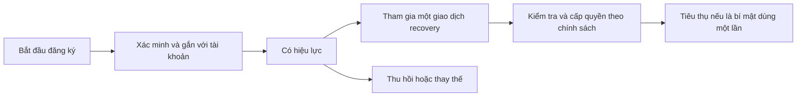

# Recovery factor meaning: yếu tố khôi phục là gì?

Khi người dùng mất mật khẩu, ứng dụng MFA, passkey hoặc thiết bị xác thực, hệ thống cần một căn cứ khác để quyết định có cho phép lấy lại quyền truy cập hay không. Căn cứ đó thường được gọi là **recovery factor — yếu tố khôi phục**.

Tuy nhiên, một địa chỉ email, một mã OTP và một thiết bị quen thuộc không có cùng ý nghĩa bảo mật. Muốn sử dụng đúng thuật ngữ này, cần xác định bằng chứng đang chứng minh điều gì, vì sao nó liên quan đến tài khoản và quyền nào có thể được cấp sau khi kiểm tra.

## 1. Định nghĩa theo vai trò trong luồng khôi phục

Trong bài học này, **yếu tố khôi phục** là một phương tiện hoặc thông tin mà hệ thống chấp nhận để kiểm chứng quyền khôi phục một tài khoản, theo một chính sách và phạm vi thao tác xác định.

Ví dụ, người dùng đã lưu một mã khôi phục do hệ thống cấp trước. Khi mất ứng dụng MFA, họ trình mã đó. Nếu mã hợp lệ và đáp ứng chính sách, máy chủ có thể cho phép đăng ký một yếu tố MFA thay thế.

Điểm cần chú ý là **vai trò được chính sách giao cho bằng chứng**, không chỉ hình thức của nó:

- Một passkey còn hợp lệ có thể phục vụ đăng nhập thông thường.
- Cũng passkey đó có thể được dùng để xác thực lại trước khi thay một yếu tố bị mất.
- Một liên kết email có thể chỉ cho phép đặt lại mật khẩu, trong khi hệ thống vẫn yêu cầu MFA để đăng nhập.
- Một mã khôi phục được cấp trước có thể cho phép xử lý tình huống mất MFA, nhưng không đương nhiên cho phép đổi chủ sở hữu tài khoản.

Thuật ngữ “recovery factor” không nên được hiểu là một nhãn bảo đảm rằng mọi cơ chế mang tên đó có cùng độ mạnh. Từng sản phẩm cần mô tả rõ nó chấp nhận loại bằng chứng nào và cho mục đích gì.

### 1.1. Một yếu tố có ý nghĩa khi có quan hệ tin cậy với tài khoản

Biết một địa chỉ email không chứng minh quyền sở hữu tài khoản. Kiểm soát một địa chỉ email mới vừa nhập cũng không tự tạo ra quan hệ với tài khoản cũ.

Một quan hệ tin cậy có thể xuất phát từ việc người dùng đăng ký và xác minh kênh khôi phục trước đó trong một ngữ cảnh được phép. Với một số hệ thống tổ chức, quan hệ này có thể dựa vào cơ chế quản trị được ủy quyền từ trước. Nếu cần thiết lập lại quan hệ qua một quy trình đặc biệt, quy trình đó phải có căn cứ kiểm chứng riêng.

Vì vậy, câu hỏi không chỉ là “người này có nhận được mã không?”, mà còn là “vì sao quyền kiểm soát nơi nhận mã được chấp nhận làm căn cứ cho tài khoản đang cần khôi phục?”.

### 1.2. Không phải mọi dữ liệu hỗ trợ recovery đều là yếu tố khôi phục

Địa chỉ IP gần nơi người dùng thường đăng nhập có thể làm giảm mức nghi ngờ. Lịch sử đơn hàng có thể hỗ trợ điều tra. Một nhân viên hỗ trợ có thể ghi nhận thông tin trình bày của người yêu cầu.

Những dữ liệu đó không tự trở thành yếu tố đủ để cấp quyền thay mật khẩu hoặc gỡ MFA. Cần phân biệt bằng chứng được chính sách chấp nhận với dữ liệu chỉ hỗ trợ đánh giá rủi ro.

## 2. Phân biệt factor, method, channel, token và signal

Các từ này thường xuất hiện trong cùng một luồng, nhưng chỉ những phần khác nhau của hệ thống.

| Thuật ngữ | Ý nghĩa trong recovery | Ví dụ |
| --- | --- | --- |
| Recovery factor — yếu tố khôi phục | Căn cứ được chấp nhận để kiểm chứng quyền thực hiện một thao tác khôi phục | Mã khôi phục đã cấp trước; quyền kiểm soát kênh đã đăng ký khi chính sách cho phép |
| Recovery method — phương thức khôi phục | Quy trình sử dụng một hoặc nhiều bằng chứng, cùng các điều kiện và bước xử lý | Nhập mã dự phòng, xác minh yếu tố còn lại rồi đăng ký lại MFA |
| Recovery channel — kênh khôi phục | Đường truyền hoặc điểm nhận thông điệp dùng trong quy trình | Email đã đăng ký, số điện thoại đã xác minh |
| Recovery token — token khôi phục | Giá trị bí mật hoặc vật mang quyền được phát hành cho một mục đích và thời hạn cụ thể | Bí mật trong liên kết đặt lại mật khẩu |
| Authenticator — phương tiện xác thực | Phương tiện dùng để tạo hoặc trình bằng chứng xác thực theo cơ chế của hệ thống | Khóa bảo mật chứa passkey; ứng dụng tạo mã MFA |
| Risk signal — tín hiệu rủi ro | Dữ liệu hỗ trợ đánh giá khả năng lạm dụng | Thiết bị lạ, nhịp thử mã bất thường, thay đổi kênh liên lạc gần đây |
| Recovery authorization — quyền khôi phục | Quyền được cấp sau khi các điều kiện được đáp ứng | Chỉ thay mật khẩu cho một tài khoản trong một giao dịch |

Ví dụ với email:

```text
Email đã đăng ký
    -> kênh nhận liên kết

Bí mật trong liên kết
    -> token cho một giao dịch

Kiểm tra token theo chính sách
    -> bằng chứng về việc sở hữu bí mật đã gửi qua kênh đó

Quyết định của máy chủ
    -> có cấp quyền đặt lại mật khẩu hay không
```

Không nên viết “email là token” hoặc “có token là đã chứng minh danh tính”. Token hợp lệ chỉ là một phần của lập luận dẫn đến quyết định cấp quyền.

Một mã khôi phục cấp trước có thể đồng thời là bí mật mà người dùng lưu giữ và bằng chứng được trình khi recovery. Việc các vai trò đôi khi nằm trong cùng một đối tượng không làm chúng trở thành cùng một khái niệm.

## 3. “Yếu tố” trong recovery không tự đồng nghĩa với một yếu tố MFA độc lập

Khi nói về xác thực nhiều yếu tố, người ta thường phân biệt bằng chứng dựa trên điều người dùng biết, vật người dùng có hoặc đặc điểm gắn với người dùng. Cách phân loại này có ích, nhưng không đủ để đánh giá mọi thiết kế recovery.

Một sản phẩm có thể gọi email là “recovery factor” dù việc truy cập hộp thư phụ thuộc vào một mật khẩu và chính luồng khôi phục của nhà cung cấp email. Mã dự phòng có thể được lưu trên giấy, trong trình quản lý mật khẩu hoặc ngay trong hộp thư đó. Rủi ro thay đổi theo cách lưu giữ và các quan hệ phụ thuộc.

Do đó:

- Hai thao tác kiểm tra không tự tạo thành hai yếu tố độc lập.
- Hai kênh có tên khác nhau chưa chắc bị tấn công theo hai con đường khác nhau.
- Việc sử dụng một yếu tố khôi phục không tự chứng minh rằng người dùng đã hoàn thành MFA theo chính sách đăng nhập thông thường.

Ví dụ, gửi hai mã liên tiếp đến cùng một hộp thư vẫn chủ yếu dựa vào quyền kiểm soát cùng kênh. Nếu hộp thư đã bị chiếm đoạt, kẻ tấn công có thể nhận cả hai mã.

Tương tự, một mã PIN dùng để mở ứng dụng lưu mã khôi phục không mặc nhiên là một yếu tố bổ sung mà máy chủ đã xác minh. Muốn kết luận có thêm bằng chứng, cần hiểu cơ chế kiểm tra, ràng buộc và mức tin cậy mà máy chủ thực sự nhận được.

## 4. Các loại bằng chứng có thể được dùng cho recovery

### 4.1. Mã khôi phục được cấp trước

Recovery code hoặc backup code thường là một bí mật được hệ thống cấp cho người dùng lưu giữ để sử dụng khi không còn phương tiện thông thường.

Giá trị của mã đến từ việc nó đã được tạo, gắn với tài khoản và bảo vệ như một bí mật. Người kiểm tra cần xác định mã có thuộc đúng tài khoản, còn hiệu lực, đã bị thu hồi hay đã sử dụng hay chưa.

Thiết kế thường dùng từng mã một lần. Một bộ mã có thể chứa nhiều phần tử; dùng một mã không có nghĩa là toàn bộ bộ mã đã hết hiệu lực, trừ khi chính sách quy định như vậy. Khi phát hành một bộ thay thế, cần quy định rõ các mã cũ còn được chấp nhận hay bị hủy.

Mã bị sao chép hoặc lộ ra vẫn có thể được sử dụng bởi người khác. Vì vậy, “mã đúng” là bằng chứng sở hữu bí mật, không phải bằng chứng rằng bí mật chưa từng bị đánh cắp.

### 4.2. Email hoặc số điện thoại đã đăng ký

Kênh đã đăng ký có thể hỗ trợ recovery khi hệ thống chấp nhận việc kiểm soát kênh đó làm một căn cứ phù hợp với thao tác yêu cầu.

Một mã hoặc liên kết gửi qua kênh giúp kiểm tra việc sở hữu bí mật đã gửi. Nó không bảo đảm người nhập mã chính là chủ tài khoản hợp pháp. Bí mật có thể bị chuyển tiếp, bị lừa cung cấp hoặc bị đọc khi kênh nhận đã bị xâm nhập.

Rủi ro cần xét gồm:

- Hộp thư hoặc tài khoản viễn thông bị chiếm đoạt.
- Số điện thoại đổi người sử dụng hoặc bị chuyển quyền trái phép.
- Kênh khôi phục đã cũ, không còn do người dùng kiểm soát.
- Kênh vừa được thay đổi trong một phiên không đủ tin cậy.
- Người dùng bị lừa cung cấp mã cho bên khác.

Email và số điện thoại không có cùng đặc tính, cũng không mặc nhiên phù hợp với mọi loại tài khoản. Chính sách phải xác định chúng được dùng riêng lẻ, kết hợp với bằng chứng khác hay chỉ làm kênh thông báo.

### 4.3. Một phương tiện xác thực còn lại

Người dùng mất điện thoại nhưng còn khóa bảo mật hoặc passkey khác có thể vẫn đăng nhập theo chính sách thông thường. Trong trường hợp đó, không cần mặc định rằng họ phải đi qua recovery.

Nếu phương tiện còn lại được dùng để cho phép thay thế yếu tố đã mất, nó tham gia vào quyết định khôi phục hoặc thay đổi thông tin xác thực. Hệ thống cần kiểm tra phạm vi quyền và độ mới của lần xác thực.

Passkey đồng bộ cũng cần được xét theo khả năng truy cập thực tế. Mất một thiết bị không nhất thiết làm mất mọi bản passkey; ngược lại, có tên tài khoản đồng bộ không có nghĩa người dùng vẫn truy cập được khóa cần thiết.

### 4.4. Thiết bị được tin cậy

Một thiết bị có khóa bí mật đã đăng ký và có thể trả lời thử thách được ràng buộc đúng có thể cung cấp bằng chứng mật mã về quyền kiểm soát khóa đó.

Điều này khác với việc máy chủ nhận ra trình duyệt qua dấu vết thiết bị, địa chỉ IP hoặc một nhãn “máy tính quen thuộc”. Các dấu vết đó có thể hỗ trợ đánh giá rủi ro nhưng không chứng minh quyền kiểm soát một khóa đã đăng ký.

Cookie của một phiên đang tồn tại cũng cần được đánh giá theo chính sách riêng. Việc mang theo cookie không tự chứng minh người đang thao tác là chủ tài khoản, đặc biệt khi recovery có thể thay đổi toàn bộ phương tiện đăng nhập.

### 4.5. Cơ chế tổ chức và kiểm tra danh tính bổ sung

Trong hệ thống doanh nghiệp, một quản trị viên được ủy quyền có thể tham gia quy trình khôi phục. Căn cứ ở đây là quyền quản trị đã được thiết lập và kiểm soát, không phải một yếu tố cá nhân mà người dùng đang sở hữu.

Cần gọi đúng tên cơ chế để tránh đánh đồng “người dùng đã cung cấp yếu tố” với “người có thẩm quyền đã chấp thuận”. Quy trình có thể cần xác thực của người phê duyệt, giới hạn phạm vi quản trị, phân tách trách nhiệm và nhật ký.

Giấy tờ danh tính hoặc dữ liệu hồ sơ có thể hỗ trợ kiểm tra bổ sung, nhưng vẫn phải xác lập mối liên hệ với tài khoản. Một bản chụp giấy tờ không tự trở thành bí mật sở hữu, và thông tin cá nhân dễ biết không nên được coi như mật khẩu thay thế.

## 5. Luôn viết rõ mệnh đề mà bằng chứng chứng minh

Một cách thực hành tốt là mô tả kết luận hẹp nhất có thể rút ra từ mỗi lần kiểm tra.

| Bằng chứng được kiểm tra | Mệnh đề có thể ghi nhận | Điều không tự suy ra |
| --- | --- | --- |
| Mã khôi phục hợp lệ, chưa dùng | Yêu cầu trình được một bí mật khôi phục đang được chấp nhận cho tài khoản | Người trình là chủ hợp pháp hoặc mã chưa bị sao chép |
| Token gửi đến email đã đăng ký | Yêu cầu sở hữu bí mật được gửi qua kênh đó, theo cơ chế kiểm tra đã chọn | Người yêu cầu có quyền gỡ mọi yếu tố khác |
| Chữ ký hợp lệ từ khóa đã đăng ký, trên thử thách đúng | Yêu cầu chứng minh quyền sử dụng khóa tương ứng trong giao thức đó | Mọi thay đổi tài khoản đều đã được phép |
| Cookie phiên hợp lệ | Yêu cầu mang theo một phiên được máy chủ nhận diện | Chủ thể vừa xác thực lại hoặc đủ quyền thay yếu tố |
| Thiết bị và vị trí quen thuộc | Một số tín hiệu phù hợp với lịch sử quan sát | Có bằng chứng sở hữu tài khoản đủ mạnh |

Phân biệt mệnh đề đã kiểm tra với quyền được cấp giúp tránh nhảy từ “mã đúng” sang “được toàn quyền”.

Có thể biểu diễn quyết định ở mức khái niệm như sau:

```text
Bằng chứng hợp lệ
    + ràng buộc đúng với tài khoản và mục đích
    + chính sách cho phép
    + trạng thái giao dịch còn phù hợp
    + các điều kiện bổ sung đã được đáp ứng
    -> quyền thực hiện một thao tác khôi phục xác định
```

Đây không phải công thức cộng điểm bảo đảm. Một bằng chứng rất mạnh vẫn có thể không hợp lệ cho mục đích đang yêu cầu, hoặc đã bị thu hồi trước thời điểm chốt thay đổi.

## 6. Hồ sơ yếu tố, thử thách và quyền khôi phục là ba đối tượng khác nhau

Tách ba đối tượng này giúp mô hình dữ liệu và API diễn đạt đúng ý nghĩa.

### 6.1. Hồ sơ yếu tố khôi phục

Hồ sơ lưu quan hệ lâu dài hoặc thông tin tham chiếu của yếu tố với tài khoản. Ví dụ dưới đây chỉ minh họa metadata phía máy chủ, không chứa bí mật và không phải một chuẩn dữ liệu bắt buộc:

```json
{
  "factorId": "rf-42",
  "accountId": "account-318",
  "kind": "PRE_ISSUED_RECOVERY_CODE",
  "state": "ACTIVE",
  "version": 3,
  "allowedPurposes": ["REPLACE_LOST_MFA"],
  "enrolledAt": "<thoi-diem-dang-ky>",
  "verifierReference": "<tham-chieu-du-lieu-kiem-chung>",
  "consumedAt": null
}
```

Dữ liệu kiểm chứng phải được bảo vệ theo loại yếu tố. Với bí mật ngẫu nhiên có entropy đủ cao, có thể dùng dạng kiểm chứng phù hợp thay vì giữ bản rõ. Với mã ngắn hoặc giá trị dễ đoán, cần xét thêm khả năng dò ngoại tuyến, giới hạn thử và cách bảo vệ nơi lưu trữ; chỉ nói “đã băm” chưa đủ để kết luận an toàn.

### 6.2. Thử thách hoặc bằng chứng trong một giao dịch

Một kênh email có thể còn được đăng ký trong thời gian dài, nhưng mỗi liên kết khôi phục phải có vòng đời riêng. Hệ thống cần biết token thuộc giao dịch nào, có mục đích gì, hết hạn khi nào và đã được dùng hay chưa.

```text
Yếu tố/kênh đã đăng ký: tồn tại theo vòng đời cấu hình tài khoản
Thử thách/token: tồn tại cho một lần kiểm tra cụ thể
Quyền recovery: tồn tại cho phạm vi thao tác đã được chấp thuận
```

Một token hết hạn không có nghĩa địa chỉ email đã bị xóa khỏi tài khoản. Ngược lại, việc email vẫn còn trong cấu hình không làm một token cũ được phép sử dụng lại.

### 6.3. Quyền sau khi kiểm tra

Sau khi kiểm tra thành công, máy chủ có thể cấp một ngữ cảnh chỉ cho phép thay thế yếu tố MFA của đúng tài khoản trong đúng giao dịch.

Quyền đó cần có thời hạn và điều kiện sử dụng. API đọc dữ liệu, đổi email hoặc chuyển tiền không nên chấp nhận nó chỉ vì nó là một token do máy chủ phát hành.

Máy chủ phải kiểm tra ngữ cảnh, tài khoản, mục đích và trạng thái. Không tin một trường do máy khách gửi lên như `recoveryVerified: true` mà không có căn cứ phía máy chủ.

## 7. Vòng đời của một yếu tố khôi phục

Độ tin cậy của yếu tố phụ thuộc cả quá trình đăng ký, sử dụng và thu hồi.



Sơ đồ mô tả các bước logic. Trạng thái cụ thể tùy loại yếu tố: email có thể tiếp tục dùng cho các giao dịch khác, trong khi một mã khôi phục dùng một lần phải chuyển sang trạng thái không còn được chấp nhận.

### 7.1. Đăng ký

Việc thêm yếu tố recovery là thay đổi bảo mật. Nếu kẻ tấn công có thể thêm email của mình chỉ bằng một phiên yếu, họ có thể quay lại chiếm tài khoản qua kênh vừa thêm.

Cần xác định ai có quyền đăng ký, có cần xác thực lại hay không và bằng cách nào yếu tố được gắn với tài khoản. Xác minh quyền truy cập email mới và cho phép dùng nó để khôi phục tài khoản là hai quyết định liên quan nhưng khác nhau.

Với mã dự phòng, quy trình cần truyền đạt cách lưu giữ và quyền mà mã mở ra. Không nên gửi hoặc lưu bí mật trong một nơi mà hệ thống không có ý định coi là một phần của mô hình tin cậy.

### 7.2. Duy trì

Người dùng có thể đổi số điện thoại, ngừng dùng email hoặc mất nơi lưu mã. Hệ thống cần cho phép xem và quản lý các yếu tố bằng một quy trình được bảo vệ.

Các thông tin hiển thị nên đủ để người dùng nhận ra kênh, đồng thời hạn chế lộ dữ liệu không cần thiết. Nhật ký và công cụ hỗ trợ không nên hiển thị bí mật khôi phục để tiện tra cứu.

### 7.3. Sử dụng

Khi có yêu cầu recovery, cần kiểm tra yếu tố có đúng tài khoản, đúng mục đích, còn hiệu lực và phù hợp với chính sách hiện tại hay không.

Nếu dùng thử thách, thử thách cần gắn với giao dịch. Với bí mật dùng một lần, phải ngăn hai yêu cầu đồng thời cùng tiêu thụ thành công. Một bước kiểm tra ở đầu luồng không loại bỏ nhu cầu kiểm tra trạng thái tại ranh giới cấp quyền hoặc chốt thay đổi.

### 7.4. Thu hồi và thay thế

Thu hồi yếu tố cần có tác dụng đối với những giao dịch đang dựa vào nó theo chính sách đã chọn. Nếu máy chủ đã hủy một mã nhưng vẫn cho phép một giao dịch chưa hoàn tất sử dụng kết quả cũ mà không kiểm soát, hiệu quả thu hồi có thể không như dự kiến.

Có thể dùng phiên bản của yếu tố hoặc cơ chế kiểm tra trạng thái để nhận biết thay đổi. Cách triển khai cụ thể phải bảo đảm rằng quyền còn tồn tại sau thu hồi là một quyết định có chủ đích.

Không nên cho phép loại bỏ yếu tố cuối cùng một cách vô tình rồi mới thông báo người dùng không còn đường recovery. Ngược lại, nếu yếu tố đã bị lộ, nhu cầu thu hồi có thể quan trọng hơn việc giữ một đường truy cập tiện lợi.

## 8. Đánh giá tính độc lập và phạm vi ảnh hưởng khi bị mất

Một yếu tố có ích cho recovery cần tồn tại trong những sự cố mà nó được thiết kế để xử lý.

Giả sử người dùng lưu mọi thứ trên một điện thoại:

```text
Điện thoại
├── Ứng dụng MFA
├── Phiên email
├── Ảnh chụp mã khôi phục
└── Quyền truy cập nơi đồng bộ passkey
```

Mất quyền truy cập điện thoại có thể làm nhiều đường cùng không khả dụng. Điện thoại bị xâm nhập cũng có thể làm lộ nhiều bằng chứng cùng lúc, tùy cách ứng dụng và dữ liệu được bảo vệ.

Hai vấn đề cần đánh giá riêng là:

- **Tính sẵn sàng:** yếu tố còn dùng được khi xảy ra sự cố nào?
- **Tính độc lập trước tấn công:** kẻ kiểm soát một tài sản có thể lấy thêm những bằng chứng nào?

Một bản mã khôi phục được giữ ở nơi khác có thể giúp khi mất điện thoại. Nhưng nếu bản đó được tải lên cùng hộp thư đang nhận liên kết recovery, nó vẫn có quan hệ phụ thuộc với hộp thư.

Không phải mọi sự phụ thuộc đều có thể loại bỏ. Mục tiêu là nhận biết và chấp nhận chúng có chủ đích, thay vì đếm số kênh rồi mặc định hệ thống đã có nhiều lớp độc lập.

## 9. Yếu tố hợp lệ phải đi cùng quyền giới hạn và kiểm soát session

Một recovery factor là đầu vào của quyết định, không phải giấy phép truy cập mọi chức năng.

| Mục đích được chấp thuận | Quyền có thể cấp | Điều cần quyết định riêng |
| --- | --- | --- |
| Đặt lại mật khẩu | Thay mật khẩu trong đúng giao dịch | Có yêu cầu MFA khi đăng nhập tiếp không; phiên cũ được xử lý thế nào |
| Thay yếu tố MFA bị mất | Đăng ký và xác nhận yếu tố thay thế | Có gỡ yếu tố cũ không; khi nào giao dịch kết thúc |
| Khôi phục khả năng dùng passkey | Cho phép đăng ký passkey theo chính sách | Passkey cũ nào bị thu hồi; bằng chứng nào cho phép việc đăng ký |
| Xử lý nghi ngờ bị chiếm đoạt | Thực hiện tập thao tác khôi phục được xác định | Phiên, refresh token, thiết bị tin cậy và các kênh vừa thay đổi có cần bị thu hồi không |

Không nên ghi nhận một phiên là “vừa xác thực bằng passkey” nếu bằng chứng thực tế chỉ là token email. Cũng không nên cho rằng thay mật khẩu tự động thu hồi mọi phiên; hệ thống cần cơ chế thực thi quyết định đó.

Chống lạm dụng cũng cần đi cùng kiểm tra yếu tố. Cần xét giới hạn gửi mã, giới hạn thử, chống dò tài khoản và khả năng quấy rối qua thông báo. Một yếu tố bí mật mạnh không ngăn được việc kẻ tấn công liên tục gửi yêu cầu làm phiền nạn nhân.

## 10. Ví dụ hoàn chỉnh: mất ứng dụng MFA nhưng còn mã khôi phục

Lan có tài khoản yêu cầu mật khẩu và MFA. Cô mất điện thoại chứa ứng dụng MFA nhưng vẫn còn một mã khôi phục được cấp trước.

### 10.1. Những đối tượng trong tình huống

| Đối tượng | Vai trò |
| --- | --- |
| Mật khẩu Lan còn nhớ | Một phần bằng chứng xác thực thông thường |
| Ứng dụng MFA trên điện thoại đã mất | Phương tiện thông thường không còn khả dụng |
| Mã khôi phục Lan lưu trước đó | Bí mật được chính sách chấp nhận để xử lý việc mất MFA |
| Giao dịch thay MFA | Nơi ràng buộc tài khoản, mục đích, trạng thái và kết quả kiểm tra |
| Quyền đăng ký MFA mới | Quyền giới hạn được cấp sau khi đủ điều kiện |
| Email thông báo | Kênh thông báo sự kiện; không mặc định là bằng chứng thứ hai |

### 10.2. Diễn tiến theo chính sách giả định

1. Lan bắt đầu yêu cầu thay yếu tố MFA bị mất. Máy chủ tạo giao dịch và áp dụng kiểm soát chống lạm dụng.
2. Lan cung cấp mật khẩu và mã khôi phục. Máy chủ kiểm tra mã thuộc tài khoản nào, còn hiệu lực không và có được dùng cho mục đích này không.
3. Khi đủ điều kiện, hệ thống chuyển mã sang trạng thái đã tiêu thụ và cấp một ngữ cảnh recovery giới hạn theo một cơ chế nhất quán. Nếu giao dịch bị bỏ dở, chính sách phải quy định cách tiếp tục hoặc bắt đầu lại; không âm thầm tái kích hoạt mã đã dùng.
4. Lan đăng ký phương tiện MFA mới. Máy chủ yêu cầu bằng chứng phù hợp để xác nhận việc đăng ký, thay vì chỉ chấp nhận một nhãn do máy khách gửi.
5. Máy chủ kiểm tra lại quyền của giao dịch, chốt thay đổi và xử lý yếu tố cũ theo chính sách.
6. Hệ thống kết thúc quyền recovery, xử lý các phiên liên quan và gửi thông báo qua kênh phù hợp đã đăng ký.

Trong ví dụ này, mã khôi phục có ý nghĩa vì nó đã được cấp trước, còn được chấp nhận và được dùng cho một thao tác xác định. Mã không cho phép Lan thay email hoặc nâng quyền quản trị ngoài phạm vi đó.

Email thông báo không làm quy trình có thêm một bằng chứng đã được kiểm tra. Nhận hoặc không nhận thông báo là sự kiện khác với việc máy chủ đã xác minh một yếu tố.

## 11. Những cách diễn đạt dễ gây hiểu sai

| Cách nói mơ hồ | Cách mô tả chính xác hơn |
| --- | --- |
| “Email là danh tính của người dùng.” | “Kênh email này đã được gắn với tài khoản và được chính sách cho phép dùng cho mục đích cụ thể.” |
| “Có hai mã nên có hai yếu tố.” | “Có hai lần kiểm tra; cần xét nguồn bằng chứng và sự phụ thuộc giữa chúng.” |
| “Mã recovery đã xác minh toàn bộ tài khoản.” | “Mã hợp lệ đã đáp ứng điều kiện cho thao tác recovery được chỉ định.” |
| “Thiết bị quen thuộc là yếu tố sở hữu.” | “Cần phân biệt dấu vết nhận diện thiết bị với bằng chứng sử dụng một khóa đã đăng ký.” |
| “Token đúng thì được đăng nhập.” | “Token cần đúng mục đích, tài khoản, trạng thái và phạm vi trước khi máy chủ quyết định cấp quyền.” |
| “Đổi mật khẩu xong là đã lấy lại hoàn toàn quyền kiểm soát.” | “Cần xử lý thêm phiên, yếu tố và kênh bị ảnh hưởng theo tình huống.” |

Khi đặc tả một yếu tố khôi phục, hãy viết được một câu đủ cụ thể: **“Hệ thống chấp nhận bằng chứng nào, gắn với tài khoản bằng cách nào, để cho phép thao tác gì, trong điều kiện và thời hạn nào?”**

Nếu câu trả lời chỉ là “gửi OTP cho người dùng”, thiết kế vẫn chưa làm rõ yếu tố khôi phục có ý nghĩa gì và vì sao nó đủ để bảo vệ tài khoản trong tình huống mất phương tiện xác thực.