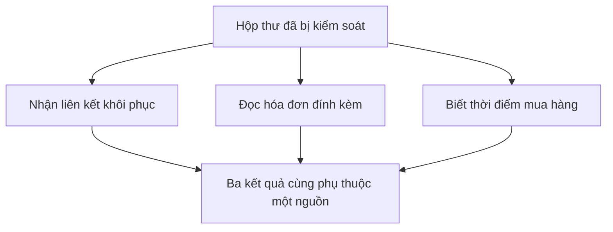

# Ý nghĩa của bằng chứng trong xác minh danh tính

Trong chương **Recovery Terminology** của module **SECURITY_AUTHENTICATION_ACCOUNT_RECOVERY**, thuật ngữ **proofing evidence** giúp làm rõ căn cứ mà dịch vụ dùng để đánh giá một yêu cầu về danh tính. Đây là nền tảng để thiết kế khôi phục khi người dùng mất mật khẩu, MFA, passkey hoặc thiết bị xác thực mà không trao quyền cho người chỉ biết thông tin về tài khoản.

Một tệp giấy tờ, một mã khôi phục và một tín hiệu thiết bị quen thuộc đều có thể xuất hiện trong hồ sơ khôi phục. Tuy nhiên, chúng không chứng minh cùng một điều, không có cùng nguồn tin cậy và không được dùng thay thế cho nhau một cách mặc định. Bài học này tập trung vào ý nghĩa, phạm vi và cách diễn đạt bằng chứng để tránh suy luận vượt quá những gì đã kiểm tra.

## 1. Mục tiêu học tập

Sau bài học, bạn có thể:

- Giải thích proofing evidence là gì và vì sao một dữ liệu được cung cấp chưa tự động trở thành căn cứ đáng tin.
- Phân biệt lời khai, bằng chứng danh tính, bằng chứng kiểm soát yếu tố xác thực, tín hiệu rủi ro và quyết định cho phép khôi phục.
- Đặt câu hỏi về nguồn gốc, tính xác thực, quan hệ với người yêu cầu, quan hệ với tài khoản và thời điểm của bằng chứng.
- Nhận ra bằng chứng trùng nguồn, bằng chứng không phù hợp với loại tài khoản và các kết luận vượt quá phạm vi.
- Mô tả kết quả xác minh đủ rõ để hệ thống, người hỗ trợ và người điều tra hiểu cùng một ý nghĩa.

## 2. Proofing evidence nghĩa là gì?

### 2.1. Bằng chứng là căn cứ cho một khẳng định cụ thể

**Proofing evidence** có thể hiểu là thông tin, tài liệu hoặc kết quả kiểm tra được dùng làm căn cứ trong quá trình xác minh danh tính được khai báo. Từ “evidence” nhấn mạnh rằng phải có một khẳng định cần được đánh giá và một cách kiểm tra phù hợp.

Ví dụ, khẳng định “tôi là người có danh tính ghi trong giấy tờ này” khác với “tôi đang kiểm soát hộp thư đã đăng ký cho tài khoản này”. Một loại bằng chứng có thể liên quan đến khẳng định thứ nhất, loại khác chỉ liên quan đến khẳng định thứ hai.

Một cách đọc hữu ích là:

> Bằng chứng này, sau những kiểm tra đã thực hiện, hỗ trợ khẳng định nào và còn để ngỏ điều gì?

Không nên diễn đạt chung chung rằng “người dùng đã được xác minh” nếu thực tế hệ thống mới chỉ xác nhận họ mở được liên kết email.

### 2.2. Phân biệt nghĩa hẹp và cách gọi rộng trong khôi phục

**Identity proofing** thường chỉ quy trình thiết lập độ tin cậy về danh tính được khai báo của một người thông qua thu thập và kiểm tra bằng chứng. Bằng chứng có thể gồm tài liệu danh tính hoặc thông tin được đối chiếu với nguồn phù hợp, tùy yêu cầu của dịch vụ.

Trong khôi phục tài khoản, đội sản phẩm đôi khi gọi mọi căn cứ là “proofing evidence”: mã dự phòng, email, phiên cũ, giấy tờ, dấu hiệu thiết bị. Cách gọi rộng này dễ khiến các loại căn cứ bị đánh đồng.

Trong bài học này, khi cần gọi chung, ta dùng **bằng chứng phục vụ khôi phục**. Khi nói riêng về căn cứ xác minh danh tính được khai báo, ta dùng **bằng chứng danh tính**. Bằng chứng kiểm soát tài khoản hoặc authenticator được gọi theo đúng điều mà nó chứng minh.

Việc phân biệt không chỉ để đặt tên đẹp. Nó ngăn lỗi cấp quyền thay MFA chỉ vì một kiểm tra truy cập email đã được gắn nhãn “identity verified”.

### 2.3. Không phải tài khoản nào cũng cần danh tính pháp lý

Một dịch vụ có thể quản lý tài khoản gắn với tên thật đã được xác minh; dịch vụ khác chỉ có biệt danh và thông tin liên lạc. Mục tiêu khôi phục của hai hệ thống khác nhau.

Nếu tài khoản ban đầu chưa bao giờ được ràng buộc đáng tin với một danh tính pháp lý, việc nhận được giấy tờ hợp lệ từ một người không tự chứng minh người đó sở hữu tài khoản. Hệ thống còn thiếu mối liên hệ giữa danh tính trên giấy tờ và tài khoản cần khôi phục.

Không nên biến mọi tình huống quên mật khẩu thành yêu cầu nộp giấy tờ. Loại bằng chứng cần thu thập phải xuất phát từ mô hình tài khoản, ràng buộc đã thiết lập và hành động khôi phục cần cho phép.

## 3. Những thuật ngữ dễ bị lẫn

| Thuật ngữ | Ý nghĩa trong bài học | Ví dụ | Không nên suy ra |
| --- | --- | --- | --- |
| Lời khai, claim | Khẳng định người yêu cầu đưa ra | “Tôi là chủ tài khoản A” | Lời khai đúng vì người đó nói chắc chắn |
| Thuộc tính, attribute | Dữ liệu mô tả đối tượng | Họ tên, ngày sinh, địa chỉ liên lạc | Biết thuộc tính đồng nghĩa là đối tượng đó |
| Bằng chứng danh tính, identity evidence | Căn cứ liên quan đến danh tính được khai báo | Tài liệu hoặc dữ liệu từ nguồn phù hợp đã được kiểm tra | Tự động có quan hệ với mọi tài khoản cùng tên |
| Bằng chứng kiểm soát, proof of control | Kết quả cho thấy đang kiểm soát một kênh, bí mật hoặc khóa | Trả lời đúng thử thách bằng khóa đã đăng ký | Đã chứng minh danh tính pháp lý hoặc loại trừ mọi khả năng xâm nhập |
| Tín hiệu rủi ro, risk signal | Dữ liệu bối cảnh hỗ trợ đánh giá bất thường | Mạng, thiết bị, nhịp độ yêu cầu | Tự tạo quyền khôi phục khi thiếu bằng chứng bắt buộc |
| Ràng buộc, binding | Mối liên hệ được thiết lập và kiểm chứng giữa các đối tượng | Khóa công khai đã gắn với tài khoản khi đăng ký | Hai đối tượng thuộc về nhau chỉ vì cùng xuất hiện trong yêu cầu |
| Quyết định cho phép, authorization decision | Kết luận hành động nào được thực hiện theo chính sách | Cho phép đặt lại mật khẩu trong một giao dịch cụ thể | Mọi hành động trên tài khoản đều được phép |

Một thông tin có thể giữ vai trò khác nhau tùy cách thu thập và kiểm tra. Email do người yêu cầu tự nhập là một lời khai hoặc thuộc tính. Việc hoàn thành thử thách gửi đến địa chỉ đã đăng ký tạo ra bằng chứng về quyền kiểm soát kênh đó tại thời điểm kiểm tra. Tên miền email quen thuộc có thể chỉ là một tín hiệu bối cảnh.

Đặc biệt, **định danh dùng để tìm tài khoản không nhất thiết là bằng chứng để khôi phục tài khoản**. Biết tên đăng nhập, mã khách hàng hoặc địa chỉ email thường chỉ giúp máy chủ xác định đối tượng cần xem xét.

## 4. Bốn câu hỏi khác nhau đằng sau từ “xác minh”

Từ “verification” thường được dùng cho nhiều hoạt động. Khi thiết kế hoặc viết nhật ký, cần ghi rõ đang kiểm tra điều gì.

### 4.1. Vật chứng hoặc dữ liệu có đáng tin không?

Đây là câu hỏi về nguồn gốc, tính toàn vẹn, tính xác thực và hiệu lực của tài liệu hay dữ liệu. Một bản ảnh rõ nét chưa chứng minh tài liệu thật. Đọc được trường dữ liệu cũng chưa chứng minh bên phát hành xác nhận dữ liệu đó.

Nếu hệ thống kiểm tra chữ ký số từ bên phát hành, kết quả phụ thuộc vào việc xác định đúng bên ký, chuỗi tin cậy, phạm vi chữ ký và trạng thái liên quan. Chỉ thấy có một trường `signature` trong dữ liệu không đủ để gọi nó là đã xác thực.

### 4.2. Bằng chứng có liên quan đến người đang yêu cầu không?

Một tài liệu thật vẫn có thể bị lấy cắp và gửi lên bởi người khác. Vì vậy, kiểm tra tài liệu và đánh giá mối liên hệ giữa người trình bằng chứng với đối tượng được mô tả là hai vấn đề khác nhau.

Trong một số quy trình, đối chiếu người trình với tài liệu có thể là một phần của đánh giá. Kết quả đó vẫn có giới hạn, phụ thuộc vào phương thức và điều kiện thu thập; không nên mô tả một thao tác đơn lẻ như bảo đảm tuyệt đối về danh tính.

### 4.3. Danh tính hoặc yếu tố đó có liên quan đến tài khoản đích không?

Đây là câu hỏi về ràng buộc. Dịch vụ đã thiết lập quan hệ này như thế nào và từ khi nào? Quan hệ đó có tồn tại trước yêu cầu khôi phục không? Có thể đã bị thay đổi trong một sự cố chiếm đoạt trước đó không?

Một tài liệu hợp lệ có tên trùng với tên hiển thị chưa đủ tạo ràng buộc đáng tin. Tên hiển thị có thể tự sửa, không duy nhất và không được kiểm chứng khi đăng ký.

Tương tự, email mới do người yêu cầu cung cấp chỉ chứng minh họ kiểm soát địa chỉ mới sau thử thách; nó không tự chứng minh quyền đối với tài khoản cũ.

### 4.4. Bằng chứng có đủ cho hành động đang xin phép không?

Bằng chứng có thể đúng nhưng vẫn không đủ cho một hành động nhất định. Một dịch vụ có thể chấp nhận căn cứ nào đó để bắt đầu liên hệ hỗ trợ, nhưng yêu cầu căn cứ khác để gỡ MFA cho tài khoản đặc quyền.

Do đó, cần tách kết quả “bằng chứng đã qua kiểm tra X” khỏi kết quả “cho phép thực hiện hành động Y”. Kết luận thứ hai còn phụ thuộc vào chính sách, mức tác động và trạng thái bảo mật hiện tại.

## 5. Đọc bằng chứng theo chuỗi ràng buộc

Có thể mô tả chuỗi suy luận như sau:

```text
Người yêu cầu
    -> trình bằng chứng hoặc hoàn thành thử thách
    -> kiểm tra thuộc tính cụ thể của bằng chứng
    -> xác định mối liên hệ với người yêu cầu
    -> xác định mối liên hệ với tài khoản đích
    -> đánh giá có đủ cho hành động được yêu cầu không
```

Không phải loại bằng chứng nào cũng đi qua cùng một kỹ thuật. Với tài liệu danh tính, cần xem nguồn và quan hệ giữa tài liệu với người trình. Với khóa xác thực đã đăng ký, thử thách mật mã hợp lệ có thể trực tiếp hỗ trợ việc người yêu cầu kiểm soát khóa gắn với tài khoản, trong phạm vi giao thức được kiểm tra.

### Ví dụ với passkey còn sử dụng được

Nếu người dùng mất một thiết bị nhưng vẫn còn passkey hợp lệ khác, hệ thống có thể kiểm tra một phản hồi xác thực mới, đúng thử thách và ngữ cảnh dịch vụ. Kết quả hỗ trợ khẳng định về việc sử dụng credential đã gắn với tài khoản. Cần xử lý các điều kiện của giao thức và chính sách, bao gồm yêu cầu xác minh người dùng nếu hành động đòi hỏi.

Kết quả này không tự cung cấp họ tên pháp lý. Nó cũng không có nghĩa mọi phương thức khôi phục khác đều có độ tin cậy tương đương passkey đó.

### Ví dụ với giấy tờ danh tính

Giả sử một dịch vụ đã kiểm chứng danh tính khi mở tài khoản và lưu được tham chiếu ràng buộc phù hợp. Một quy trình khôi phục có thể đánh giá tài liệu mới, quan hệ với người yêu cầu và sự tương ứng với danh tính đã ràng buộc.

Nếu bỏ điều kiện tài khoản từng được ràng buộc đáng tin, suy luận sẽ đứt đoạn: hệ thống có thể biết người trình là ai nhưng chưa biết người đó có quyền với tài khoản nào. Bước còn thiếu không được thay bằng việc tìm tài khoản có tên gần giống.

## 6. Các loại căn cứ thường gặp trong khôi phục

Bảng sau phân biệt điều có thể kết luận và giới hạn cần giữ. Việc một loại căn cứ xuất hiện trong bảng không có nghĩa nó đủ cho mọi tài khoản hoặc mọi hành động.

| Loại căn cứ | Khẳng định có thể hỗ trợ sau kiểm tra phù hợp | Giới hạn quan trọng |
| --- | --- | --- |
| Tài liệu danh tính từ nguồn phù hợp | Một số thuộc tính danh tính hoặc quan hệ với bên phát hành | Cần kiểm tra tính xác thực, người trình và quan hệ với tài khoản |
| Kết quả đối chiếu từ nguồn dữ liệu đáng tin | Thuộc tính được nguồn đó xác nhận trong phạm vi của nguồn | Phải biết nguồn có thẩm quyền về thuộc tính nào; dữ liệu khớp chưa chứng minh người yêu cầu là đối tượng đó |
| Phản hồi từ authenticator còn hoạt động | Quyền sử dụng credential đã đăng ký trong lần kiểm tra | Cần kiểm tra đúng giao thức, tài khoản, thử thách và điều kiện sử dụng |
| Mã khôi phục đã cấp trước | Khả năng xuất trình bí mật đã gắn với tài khoản | Mã có thể bị sao chép; cần kiểm tra hạn dùng, thu hồi và sử dụng một lần theo thiết kế |
| Thử thách gửi đến kênh đã đăng ký | Quyền kiểm soát kênh liên lạc tại thời điểm thử thách | Kênh có thể đã bị chiếm; không mặc định đủ để thay mọi yếu tố |
| Phiên đăng nhập đang tồn tại | Máy khách đang có credential phiên được hệ thống chấp nhận | Phiên có thể bị lấy cắp, đã cũ hoặc có mức bảo đảm không đủ cho thay đổi nhạy cảm |
| Thiết bị hoặc mạng quen thuộc | Sự tương đồng với bối cảnh từng quan sát | Có thể bị giả mạo, chia sẻ hoặc thay đổi hợp lệ; thường là tín hiệu hỗ trợ |
| Lịch sử giao dịch hoặc thông tin hồ sơ | Sự hiểu biết về dữ liệu liên quan tài khoản | Dữ liệu có thể công khai, rò rỉ hoặc nằm trong email mà đối thủ đã đọc |

### Biết một bí mật khác với biết một thông tin riêng tư

Một mã khôi phục được sinh ngẫu nhiên, cấp trước và ràng buộc đúng tài khoản có mục đích xác thực rõ ràng. Ngày sinh hoặc tên người thân có thể là dữ liệu riêng tư, nhưng tính riêng tư không tự biến chúng thành bí mật xác thực có chất lượng tương đương.

Tương tự, trả lời đúng câu hỏi về giao dịch cũ có thể chỉ cho thấy người yêu cầu đã đọc được email thông báo. Cần xem khả năng thu thập câu trả lời của đối thủ trước khi coi đó là bằng chứng độc lập.

### Phiên cũ không phải lúc nào cũng là bằng chứng mạnh nhất

Một phiên có thể được tạo ra từ cơ chế khôi phục yếu hoặc tồn tại trên thiết bị bị mất. Khi dùng phiên làm căn cứ, cần biết cách phiên được tạo, thời điểm xác thực, mức quyền và tình trạng thu hồi. Nhãn “đã đăng nhập” thiếu những thông tin này dễ gây suy luận vòng tròn.

## 7. Đánh giá chất lượng bằng chứng theo nhiều chiều

Không nên hỏi riêng “đây có phải bằng chứng mạnh không?”. Hãy hỏi bằng chứng mạnh ở chiều nào, cho khẳng định nào và dưới giả định nào.

### 7.1. Nguồn gốc và độ tin cậy của nguồn

Ai tạo hoặc phát hành thông tin? Máy chủ quan sát kết quả trực tiếp hay nhận một ảnh chụp do người yêu cầu gửi? Nguồn có được xác định đúng không? Nó có khả năng xác nhận thuộc tính đang được sử dụng không?

Ảnh chụp màn hình có dòng “đã xác minh” từ một ứng dụng không tương đương kết quả mà hệ thống nhận qua kênh tích hợp được xác thực. Tên thương hiệu hiển thị trên tài liệu cũng chưa chứng minh nguồn phát hành thực sự.

### 7.2. Tính xác thực và toàn vẹn

Bằng chứng có dấu hiệu bị tạo giả, sửa đổi hoặc ghép từ nhiều nguồn không? Nếu có chữ ký hoặc cơ chế bảo vệ toàn vẹn, hệ thống có thực sự kiểm tra chúng đúng cách không?

Tính toàn vẹn chỉ có ý nghĩa trong phạm vi được bảo vệ. Một chữ ký bảo vệ nội dung tài liệu không tự bảo vệ lời khai trong biểu mẫu bên ngoài tài liệu đó.

### 7.3. Mối liên hệ với người yêu cầu

Bằng chứng có thuộc về, được sử dụng bởi hoặc phản ánh đúng người đang yêu cầu không? Phương thức kiểm tra có phân biệt được người sở hữu hợp lệ với người đã lấy được bản sao hay bí mật không?

Một kiểm tra quyền kiểm soát có thể không phân biệt hoàn toàn hai trường hợp này. Vì vậy, kết luận nên đúng giới hạn: “đã hoàn thành thử thách bằng credential X”, thay vì “chắc chắn là chủ hợp pháp trong mọi hoàn cảnh”.

### 7.4. Ràng buộc với tài khoản

Liên hệ giữa bằng chứng và tài khoản được thiết lập trước sự cố hay do người yêu cầu vừa cung cấp? Ai có quyền sửa liên hệ đó? Nếu email đã bị thay trong một lần chiếm đoạt trước, sử dụng email hiện tại mà không xem xét bối cảnh có thể tiếp tục củng cố quyền của đối thủ.

Không thể giải quyết vấn đề này chỉ bằng so khớp chuỗi. Hai trường cùng chứa một tên hoặc địa chỉ không chứng minh quan hệ tin cậy đã được thiết lập.

### 7.5. Tính thời điểm, hiệu lực và khả năng dùng lại

Cần phân biệt:

- Thời điểm bằng chứng được phát hành hoặc ràng buộc.
- Thời điểm hệ thống thu thập bằng chứng.
- Thời điểm hoàn thành kiểm tra.
- Thời điểm đánh giá để cho phép hành động.

Một tài liệu còn hiệu lực không có nghĩa quyết định khôi phục dựa vào nó có thể dùng vô hạn. Một kiểm tra email thành công hôm qua cũng không chứng minh trạng thái kênh hoặc tài khoản chưa thay đổi hôm nay.

Với thử thách mật mã hoặc token, tính mới và khả năng chống phát lại đặc biệt quan trọng. Một phản hồi đúng với thử thách cũ không được tự động coi là bằng chứng cho yêu cầu mới.

### 7.6. Phạm vi và tính phù hợp với hành động

Bằng chứng phải liên quan đến quyền đang xin. Căn cứ đủ để gửi hướng dẫn đến một kênh có thể chưa đủ để thay toàn bộ MFA. Dịch vụ cần có quy tắc giải thích sự tương ứng giữa căn cứ và hành động, thay vì chỉ gán một nhãn “verified”.

### 7.7. Độc lập với các bằng chứng khác

Hai căn cứ trông khác nhau có thể cùng bị kiểm soát nếu một thành phần bị xâm nhập. Không nên cộng số lượng căn cứ mà bỏ qua phụ thuộc này.

Các chiều trên không nhất thiết được quy thành một điểm số duy nhất. Một bằng chứng có tính xác thực tốt nhưng không liên hệ được với tài khoản vẫn thiếu một điều kiện thiết yếu; điểm cao ở chiều khác không tự bù được chỗ thiếu đó.

## 8. Độc lập bằng chứng: đếm nguồn phụ thuộc, không chỉ đếm bước

Giả sử người yêu cầu hoàn thành liên kết email, cung cấp hóa đơn và trả lời câu hỏi về ngày mua hàng. Nếu hóa đơn và ngày mua đều nằm trong chính hộp thư đó, ba bước có thể cùng bị vượt qua bởi một đối thủ chỉ kiểm soát email.



Sơ đồ này không kết luận hóa đơn luôn vô ích. Nó cho thấy trong mô hình đe dọa cụ thể, hóa đơn không bổ sung tính độc lập so với email.

Những câu hỏi cần đặt ra gồm:

- Nếu đối thủ lấy được căn cứ thứ nhất, họ có dễ lấy luôn căn cứ thứ hai không?
- Hai yếu tố có nằm trên cùng thiết bị bị mất hoặc cùng một kho đồng bộ không?
- Một phiên được dùng làm bằng chứng có phải vừa được tạo từ chính luồng đang cần xác minh không?
- Dữ liệu hỗ trợ đối chiếu có được lấy từ nguồn độc lập với lời khai hay chỉ là bản sao của lời khai?

Không thể suy ra tính độc lập chỉ từ việc dùng hai giao diện khác nhau, hai thông báo khác nhau hoặc hai nhân viên xem cùng một bộ dữ liệu. Việc hai người xét duyệt có thể giảm rủi ro thao tác nội bộ, nhưng không biến một nguồn dữ liệu sai thành hai nguồn đúng.

## 9. Từ bằng chứng thô đến kết luận sử dụng được

Để tránh đánh đồng đầu vào và kết luận, nên mô tả quá trình theo các giai đoạn riêng:

| Giai đoạn | Kết quả cần mô tả | Điều chưa được phép mặc định |
| --- | --- | --- |
| Tiếp nhận | Đã nhận loại tài liệu, dữ liệu hoặc phản hồi nào | Dữ liệu đúng hoặc người gửi có quyền |
| Kiểm tra vật chứng | Những thuộc tính nào đã được kiểm tra và kết quả ra sao | Tài liệu thật đồng nghĩa người trình là chủ tài khoản |
| Kiểm tra mối liên hệ | Bằng chứng liên quan đến người yêu cầu và tài khoản bằng cách nào | Quan hệ chỉ dựa vào dữ liệu mới tự khai là đáng tin |
| Ghi nhận kết luận | Khẳng định nào được hỗ trợ, giới hạn và thời hạn nào áp dụng | Kết luận có thể tái sử dụng cho mọi mục đích |
| Đánh giá chính sách | Có đủ điều kiện cho hành động khôi phục cụ thể không | Một kiểm tra thành công tạo phiên đầy đủ quyền |

Các nhãn như “hợp lệ”, “đạt”, “thất bại” phải đi kèm đối tượng kiểm tra. “Tài liệu qua kiểm tra tính xác thực” khác “bằng chứng đủ để thay MFA”.

Một kết quả chưa đủ có thể xuất phát từ nhiều nguyên nhân:

- Không đọc được dữ liệu hoặc nguồn kiểm tra tạm thời không khả dụng.
- Không xác định được tính xác thực của bằng chứng.
- Bằng chứng có dấu hiệu mâu thuẫn với nguồn đối chiếu.
- Bằng chứng thật nhưng không liên hệ được với tài khoản.
- Kiểm tra đã quá hạn hoặc tài khoản đã có thay đổi bảo mật liên quan.
- Bằng chứng hỗ trợ một khẳng định, nhưng hành động yêu cầu cần căn cứ bổ sung.

Những trường hợp này cần cách xử lý khác nhau. Nguồn kiểm tra bị lỗi không đồng nghĩa người dùng gian lận; cũng không phải lý do để hệ thống tự bỏ qua điều kiện bắt buộc. Có thể cho thử lại, yêu cầu loại căn cứ khác hoặc chuyển xét duyệt theo chính sách đã định.

## 10. Mô tả hồ sơ bằng chứng mà không biến nó thành quyền truy cập

Một mô hình dữ liệu hữu ích cần ghi được bằng chứng đã kiểm tra, khẳng định được hỗ trợ và giới hạn sử dụng. Không nên chỉ lưu một cờ `identity_verified = true` rồi dùng cờ đó cho mọi thao tác sau này.

Ví dụ dưới đây hoàn toàn minh họa; tên trường và giá trị không đại diện cho một tiêu chuẩn hoặc cấu hình bắt buộc:

```json
{
  "evidence_ref": "ev_example_04",
  "recovery_transaction_ref": "rec_example_12",
  "account_ref": "acct_example_08",
  "kind": "PRE_ENROLLED_EMAIL_CONTROL",
  "binding_ref": "contact_binding_example_03",
  "checks_completed": [
    "CHALLENGE_MATCHED",
    "CHALLENGE_WITHIN_VALIDITY",
    "CHALLENGE_REDEEMED_ONCE"
  ],
  "supported_claims": [
    "CONTROL_OF_BOUND_MAILBOX_AT_CHECK_TIME"
  ],
  "dependency_group": "BOUND_MAILBOX",
  "checked_at": "SERVER_RECORDED_TIME",
  "usable_until": "POLICY_DERIVED_TIME",
  "account_security_version_at_check": 37
}
```

Các giá trị thời gian trong ví dụ là chỗ giữ chỗ; dữ liệu thực cần thời điểm cụ thể do máy chủ quản lý. `binding_ref` trỏ đến quan hệ kênh liên lạc đã được hệ thống thiết lập, không phải quan hệ do client tùy ý khai báo.

Hồ sơ này cho biết thử thách với hộp thư đã hoàn tất trong một giao dịch và một bối cảnh tài khoản. Nó không chứa mật khẩu, OTP hoặc token thô. `evidence_ref` là tham chiếu nội bộ đến hồ sơ, không phải credential mà người có nó được dùng để khôi phục.

Quyết định cho phép cần nằm ở lớp chính sách có phạm vi riêng, chẳng hạn:

```text
Hành động yêu cầu: REPLACE_ALL_AUTHENTICATORS
Căn cứ hiện có: quyền kiểm soát hộp thư đã ràng buộc
Kết quả: chưa đủ điều kiện theo chính sách của tài khoản này
Bước tiếp theo: cung cấp căn cứ bổ sung hoặc đi qua đường xét duyệt phù hợp
```

Cùng một hồ sơ có thể hỗ trợ một hành động khác nếu chính sách cho phép, nhưng hệ thống phải đánh giá rõ hành động đó. Không được thay nhãn `supported_claims` thành một quyền rộng hơn ở phía trình duyệt.

Khi tài khoản đã thay yếu tố, đổi kênh hoặc phát sinh sự cố liên quan, phiên bản bối cảnh và thời hạn giúp phát hiện kết luận cũ cần được xét lại. Không nhất thiết một thay đổi bất kỳ làm mọi bằng chứng mất giá trị; cần xác định thay đổi nào ảnh hưởng đến ràng buộc và quyết định đang dùng.

## 11. Bốn tình huống để nhận ra giới hạn bằng chứng

### 11.1. Người yêu cầu kiểm soát một email mới

Nam khai rằng email cũ không còn dùng được và đưa một địa chỉ mới. Hệ thống gửi mã đến email mới; Nam nhập đúng mã.

**Kết luận được hỗ trợ:** Nam hoặc bên đang thực hiện yêu cầu kiểm soát email mới trong lần kiểm tra đó.

**Khoảng trống:** chưa có căn cứ nối người yêu cầu với tài khoản đang khôi phục. Nếu dùng kết quả này để thay email cũ ngay, hệ thống đã tự tạo ràng buộc rồi dùng ràng buộc vừa tạo để chứng minh quyền thay đổi chính nó.

Đường xử lý cần dựa vào bằng chứng đã ràng buộc trước hoặc một quy trình xác minh thay thế được dịch vụ chấp thuận. Việc xác nhận email mới vẫn hữu ích cho liên lạc sau khi quyền thay đổi đã được thiết lập đúng cách.

### 11.2. Giấy tờ thật nhưng tài khoản dùng biệt danh

Một diễn đàn cho đăng ký bằng biệt danh. Người yêu cầu gửi tài liệu danh tính thật và nói mình sở hữu tài khoản `nguoi_dung_08`. Hồ sơ diễn đàn chưa từng được liên kết đáng tin với danh tính trên tài liệu.

**Kết luận có thể được hỗ trợ sau kiểm tra thích hợp:** một số khẳng định về danh tính của người trình.

**Khoảng trống:** quan hệ với tài khoản biệt danh. Tài liệu hợp lệ không làm xuất hiện lịch sử ràng buộc vốn chưa có. Hệ thống cần căn cứ phù hợp với mô hình tài khoản, thay vì coi mọi người có giấy tờ là đủ điều kiện lấy một tài khoản tự chọn.

### 11.3. Ba câu trả lời đúng nhưng cùng lấy từ hộp thư

Người yêu cầu mở được liên kết email, đưa đúng mã hóa đơn và biết ngày đăng ký. Nhân viên hỗ trợ ghi “ba bằng chứng độc lập”. Tuy nhiên, cả hóa đơn và thư chào mừng đều nằm trong hộp thư đó.

**Kết luận được hỗ trợ:** có nhiều kết quả khớp với dữ liệu liên quan, nhưng chúng có thể cùng xuất phát từ một quyền truy cập email.

**Khoảng trống:** tính độc lập trước giả định hộp thư đã bị chiếm. Ghi đúng quan hệ phụ thuộc giúp tránh nâng độ tin cậy bằng cách đếm bước.

### 11.4. Mã khôi phục hợp lệ nhưng phiên vẫn bị xâm nhập

Người dùng xuất trình một mã đã cấp trước, còn hiệu lực và được kiểm tra dùng một lần. Hệ thống cho phép thay yếu tố theo đúng chính sách. Tuy nhiên, một phiên của thiết bị bị mất vẫn đang hoạt động.

**Kết luận được hỗ trợ:** yêu cầu đã cung cấp bí mật khôi phục phù hợp với tài khoản trong lần sử dụng đó.

**Khoảng trống:** an toàn của trạng thái truy cập sau thay đổi. Bằng chứng đủ để xét duyệt không tự thu hồi phiên hoặc refresh token. Luồng khôi phục vẫn phải áp dụng chính sách phiên, thông báo và chống phát lại tương ứng.

## 12. Thu thập vừa đủ và bảo vệ bằng chứng

Bằng chứng danh tính có thể chứa dữ liệu nhạy cảm hơn nhiều so với dữ liệu mà ứng dụng thường cần. Thu thập thêm không tự làm quyết định tốt hơn nếu dữ liệu mới không giải quyết được khoảng trống về nguồn gốc hoặc ràng buộc.

Trước khi yêu cầu người dùng cung cấp một mục, cần trả lời:

- Nó hỗ trợ khẳng định cụ thể nào?
- Hệ thống có phương thức kiểm tra phù hợp không?
- Nó có giúp phân biệt chủ tài khoản với đối thủ trong mô hình đe dọa đang xét không?
- Có loại bằng chứng ít nhạy cảm hơn mà vẫn đáp ứng mục tiêu không?
- Ai cần được xem, lưu bao lâu và xóa theo quy trình nào?

Đối với hồ sơ cần lưu, nên tách dữ liệu gốc, kết quả kiểm tra và nhật ký quyết định. Bảo vệ dữ liệu theo mức nhạy cảm, giới hạn quyền truy cập và ghi nhận việc truy cập của nhân viên. Tham chiếu hồ sơ không nên trở thành đường tải tài liệu chỉ cần biết mã định danh.

Nhật ký thường chỉ cần mã tham chiếu, loại kiểm tra, kết quả, thời điểm, người hoặc dịch vụ thực hiện và lý do quyết định. Không đưa ảnh giấy tờ, mã khôi phục, OTP, cookie phiên hoặc đường dẫn chứa bí mật vào log vận hành hay cuộc trò chuyện hỗ trợ.

Một giá trị băm của tệp có thể giúp phát hiện tệp đã thay đổi so với bản được ghi nhận; nó không chứng minh tài liệu thật hoặc người tải lên là chủ tài khoản. Với dữ liệu có không gian giá trị nhỏ, băm cũng không tự bảo đảm bí mật trước việc dò đoán. Vì vậy, cần đánh giá đúng mục đích của từng cơ chế bảo vệ dữ liệu.

## 13. Dùng thuật ngữ rõ trong yêu cầu sản phẩm và nhật ký

Cách viết mơ hồ thường che khuất một điều kiện quan trọng. Hãy ghi điều đã được kiểm tra cùng phạm vi của kết luận.

| Cách viết mơ hồ | Cách diễn đạt rõ hơn |
| --- | --- |
| “Email verified, cho khôi phục” | “Đã hoàn thành thử thách với email ràng buộc trước yêu cầu; chính sách cần đánh giá riêng quyền đặt lại mật khẩu và quyền thay MFA” |
| “Đã xác minh giấy tờ” | “Tài liệu đã qua các kiểm tra được ghi nhận; mối liên hệ với người trình và tài khoản được đánh giá ở các bước tương ứng” |
| “Thiết bị đáng tin nên bỏ qua bước kiểm tra” | “Thiết bị có tín hiệu quen thuộc; các điều kiện bằng chứng bắt buộc cho hành động vẫn cần được đáp ứng” |
| “Hỗ trợ xác nhận đây là chủ tài khoản” | “Hồ sơ chứa các căn cứ, giới hạn, người xét duyệt và hành động được phép trong thời hạn cụ thể” |
| “Recovery verified” | “Giao dịch đã có các bằng chứng được chấp nhận cho hành động X theo chính sách Y; quyền hoàn tất có phạm vi và hạn dùng riêng” |

Nếu giao diện cần một nhãn ngắn như “đã xác minh”, hệ thống phía sau vẫn phải lưu rõ đối tượng, phương thức, thời điểm và giới hạn. Nhãn giao diện không thay thế điều kiện cho phép ở API.

Tương tự, phân loại lỗi nên đủ cụ thể cho vận hành nhưng không làm lộ thông tin tài khoản cho người chưa có quyền. Một lý do chi tiết trong hồ sơ nội bộ không nhất thiết phải được trả nguyên văn cho mọi người gọi endpoint công khai.

## 14. Áp dụng vào một yêu cầu thực tế

Giả sử Linh mất thiết bị TOTP, còn mật khẩu và truy cập email. Linh yêu cầu thay TOTP. Đội phát triển cần mô tả yêu cầu bằng chuỗi câu hỏi sau:

1. **Khẳng định cần đánh giá là gì?** Người đang yêu cầu có đủ căn cứ để thay yếu tố TOTP của tài khoản này không?
2. **Căn cứ hiện có là gì?** Mật khẩu đúng và thử thách email thành công, nếu đã được hệ thống kiểm tra; thông tin người dùng tự nói là còn truy cập chưa được tính là kết quả kiểm tra.
3. **Các căn cứ đó có ràng buộc trước với tài khoản không?** Cần lấy quan hệ từ dữ liệu máy chủ và xem các thay đổi bảo mật liên quan, không chỉ dựa vào trường client gửi.
4. **Chúng độc lập đến đâu?** Nếu mật khẩu và hộp thư có thể cùng bị lộ, chính sách phải đánh giá kịch bản đó; hai kết quả thành công không tự loại trừ chiếm đoạt.
5. **Còn phương thức nào được đăng ký để xử lý mất yếu tố?** Có thể có mã khôi phục hoặc authenticator khác; việc có hay không phải được kiểm tra trong ngữ cảnh được phép.
6. **Hành động nào được phép với căn cứ hiện có?** Quyền đặt lại mật khẩu, quyền thay TOTP và quyền đăng nhập đầy đủ cần được phân biệt. Nếu chưa đủ căn cứ, dùng đường bổ sung hoặc xét duyệt đã định nghĩa.
7. **Sau quyết định cần làm gì?** Giới hạn quyền khôi phục, kiểm tra lại hiệu lực ở bước hoàn tất, xử lý phiên liên quan và gửi thông báo theo chính sách.

Cách mô tả này giữ đúng vai trò của proofing evidence: nó cung cấp căn cứ cho suy luận, không tự thay thế quyết định chính sách hoặc những kiểm soát thực thi sau đó.

## 15. Những nguyên tắc cần nhớ

- Luôn gắn bằng chứng với một khẳng định cụ thể; tránh kết luận “đã xác minh mọi thứ”.
- Kiểm tra vật chứng, liên hệ với người yêu cầu và liên hệ với tài khoản là các câu hỏi khác nhau.
- Quyền kiểm soát một kênh hoặc credential có phạm vi riêng; không mặc định đồng nghĩa với danh tính pháp lý.
- Dữ liệu tự khai, dữ liệu công khai và tín hiệu rủi ro không tự trở thành bằng chứng sở hữu tài khoản.
- Số bước xác minh không phản ánh đúng độ tin cậy nếu chúng cùng phụ thuộc vào một nguồn có thể bị xâm nhập.
- Bằng chứng đúng vẫn có thể chưa đủ cho hành động đang xin phép hoặc đã hết giá trị trong bối cảnh mới.
- Hồ sơ bằng chứng cần giới hạn sử dụng, bảo vệ dữ liệu và khả năng giải thích quyết định.

Khi nói “bằng chứng đã được xác minh”, hãy nói rõ **đã kiểm tra điều gì, khẳng định nào được hỗ trợ, tài khoản nào được liên hệ và giới hạn nào còn áp dụng**. Đó là cách biến thuật ngữ proofing evidence thành căn cứ thiết kế có thể kiểm tra được trong một luồng khôi phục an toàn.
