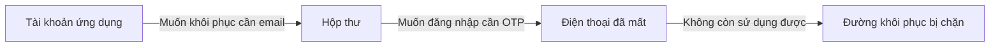

# Kênh khôi phục tài khoản: ý nghĩa và ranh giới tin cậy

## 1. Kênh khôi phục là gì?

**Recovery channel — kênh khôi phục — là đường liên lạc mà một quy trình khôi phục sử dụng để chuyển hướng dẫn, mã, liên kết, thông báo hoặc trao đổi cần thiết giữa dịch vụ và bên tham gia khôi phục.** Email đã đăng ký và số điện thoại nhận SMS là hai ví dụ quen thuộc. Một quy trình có thể sử dụng thêm thông báo trên thiết bị hoặc kênh hỗ trợ có người xử lý, tùy thiết kế của dịch vụ.

Kênh trả lời câu hỏi **“thông tin khôi phục đi qua đâu?”**. Nó chưa tự trả lời câu hỏi **“bằng chứng nào đủ để người yêu cầu được thay mật khẩu, MFA hoặc passkey?”**. Quyền được cấp còn phụ thuộc vào bằng chứng, trạng thái tài khoản, rủi ro và chính sách của thao tác.

Ví dụ, dịch vụ gửi một mã đến email đã đăng ký. Người yêu cầu nhập đúng mã cho thấy họ có khả năng lấy mã tại email đó trong điều kiện của quy trình. Kết quả này không tự chứng minh rằng họ đang sở hữu mọi yếu tố xác thực, rằng thiết bị không bị chiếm quyền hoặc rằng họ được phép gỡ toàn bộ MFA.

Bài học thuộc chương **Recovery Terminology**, trong phạm vi thiết kế khôi phục tài khoản an toàn khi mất mật khẩu, MFA, passkey hoặc thiết bị xác thực. Trọng tâm là dùng đúng thuật ngữ “kênh khôi phục” để xác định đường liên lạc, phụ thuộc và giới hạn tin cậy trước khi lựa chọn cách triển khai.

Sau bài học, bạn cần có khả năng:

- Phân biệt kênh khôi phục, địa chỉ nhận, phương thức khôi phục và bằng chứng xác thực.
- Giải thích điều mà việc kiểm soát email hoặc số điện thoại thực sự chứng minh.
- Đánh giá sự phụ thuộc giữa kênh khôi phục và phương thức người dùng vừa mất.
- Mô tả vòng đời của kênh, từ đăng ký đến thay thế hoặc vô hiệu hóa.
- Nhận ra các cách sử dụng kênh có thể tạo đường chiếm đoạt tài khoản.

## 2. Phân biệt kênh với những khái niệm liên quan

### 2.1. Kênh, địa chỉ nhận, thông điệp và token

Xét một luồng gửi liên kết đặt lại mật khẩu đến `learner@example.test`:

| Thành phần | Ví dụ | Vai trò |
| --- | --- | --- |
| Kênh liên lạc | Email | Đường truyền hoặc hệ thống dùng để chuyển thông điệp |
| Địa chỉ nhận | `learner@example.test` | Điểm đến cụ thể trong kênh |
| Thông điệp | Email hướng dẫn đặt lại mật khẩu | Nội dung được chuyển đến người nhận |
| Token khôi phục | Giá trị bí mật nằm trong liên kết | Giá trị mà máy chủ kiểm tra để cho phép một bước theo mục đích đã định |
| Yêu cầu khôi phục | Một bản ghi yêu cầu đặt lại mật khẩu | Ngữ cảnh nghiệp vụ: tài khoản đích, mục đích, thời hạn và trạng thái |
| Quyền được cấp | Đặt mật khẩu mới cho đúng tài khoản | Kết quả cho phép sau các kiểm tra cần thiết |

Địa chỉ ví dụ ở trên chỉ minh họa cấu trúc. Không cần có một hộp thư thật để hiểu mối quan hệ giữa các thành phần.

Thay đổi địa chỉ nhận có thể làm thay đổi người lấy được token, dù loại kênh vẫn là email. Vì vậy, “vẫn gửi bằng email” không có nghĩa mức tin cậy được giữ nguyên khi đích nhận vừa bị thay đổi.

### 2.2. Kênh khôi phục và phương thức khôi phục

**Phương thức khôi phục** là cách quy trình chứng minh đủ điều kiện và khôi phục khả năng truy cập. Một phương thức có thể dùng một hoặc nhiều kênh. Ngược lại, cùng một kênh có thể phục vụ nhiều phương thức với quyền khác nhau.

Ví dụ, email có thể được dùng để gửi hướng dẫn, gửi token đặt lại mật khẩu hoặc thông báo rằng MFA vừa bị thay đổi. Ba mục đích này không đồng nghĩa. Một email thông báo không phải quyết định phê duyệt; một token đặt lại mật khẩu không mặc nhiên có quyền thay MFA.

Một số sản phẩm dùng cụm “recovery channel” theo nghĩa rộng để chỉ cả đường khôi phục. Khi đọc tài liệu, cần xác định cách dùng cụ thể. Trong đặc tả kỹ thuật, nên tách rõ đường liên lạc, bằng chứng được chấp nhận và quyền mà bằng chứng đó cấp.

### 2.3. Kênh khôi phục và phương tiện xác thực

Mã dự phòng đã lưu từ trước và khóa bảo mật đã đăng ký có thể giúp người dùng lấy lại quyền truy cập, nhưng không nhất thiết là kênh chuyển thông điệp tại thời điểm khôi phục.

| Đối tượng | Cách hiểu phù hợp |
| --- | --- |
| Email nhận liên kết khôi phục | Kênh email với một địa chỉ nhận cụ thể |
| SMS gửi đến số đã đăng ký | Kênh SMS với một điểm đến theo số điện thoại |
| Mã dự phòng in ra giấy | Bằng chứng hoặc bí mật dự phòng; không phải một hộp thư đang nhận thông điệp |
| Passkey trên một thiết bị còn dùng được | Thông tin xác thực có thể cho phép đăng nhập theo chính sách |
| Khóa bảo mật dự phòng | Phương tiện xác thực đã đăng ký, có thể tránh phải mở luồng khôi phục riêng |
| Người liên hệ khôi phục | Một chủ thể tham gia quy trình; cần xác định họ trao đổi qua kênh nào và có quyền gì |
| Phiên đăng nhập đang hoạt động | Ngữ cảnh truy cập hiện có; không tự đồng nghĩa với một kênh khôi phục đủ tin cậy |

Sự phân biệt này giúp tránh câu mơ hồ như “có ba kênh: email, mật khẩu và passkey”. Câu đó đang trộn một đường liên lạc với các thông tin xác thực.

## 3. Kiểm soát một kênh chứng minh được điều gì?

### 3.1. Khả năng nhận mã là một kết luận có phạm vi

Một mã được gửi đúng đích, khó đoán theo cơ chế áp dụng và được người yêu cầu nhập hợp lệ có thể hỗ trợ kết luận rằng họ lấy được mã từ kênh đó. Kết luận còn phụ thuộc vào cách bảo vệ mã, khả năng chuyển tiếp, thời hạn và kiểm soát số lần thử.

Không nên tự mở rộng kết luận thành:

- Người yêu cầu chắc chắn là chủ tài khoản trong mọi hoàn cảnh.
- Email hoặc điện thoại chưa từng bị xâm nhập.
- Các thông tin xác thực khác đều an toàn.
- Người yêu cầu được phép thay bất kỳ thuộc tính bảo mật nào.

Nếu email đang bị chiếm quyền, kẻ tấn công cũng có thể nhận mã. Nếu SMS bị chuyển hướng hoặc số điện thoại đã được cấp lại, bên nhận mã có thể không còn là người đã đăng ký tài khoản ban đầu.

### 3.2. “Đã xác minh” không có nghĩa “được tin cho mọi mục đích”

Khi đăng ký một email mới, hệ thống có thể gửi mã để xác minh người nhập hiện có khả năng nhận thư tại đó. Đây là kiểm tra điểm đến mới, chưa phải bằng chứng cho phép thay điểm đến cũ của một tài khoản.

Cần tách hai câu hỏi:

1. Người yêu cầu có kiểm soát điểm đến mới không?
2. Người yêu cầu có quyền gắn điểm đến mới với tài khoản này không?

Nếu chỉ trả lời câu hỏi thứ nhất, hệ thống có thể cho phép một người tự thêm email của mình rồi dùng chính email đó để lấy tài khoản người khác. Quyền thay kênh phải được xác lập bằng quy trình phù hợp trước khi kênh mới được tin cho mục đích khôi phục.

### 3.3. Kênh nhận thông báo và kênh nhận bí mật có rủi ro khác nhau

Một địa chỉ có thể chỉ dùng để nhận cảnh báo bảo mật. Nó không nhất thiết được phép nhận token cấp quyền. Tương tự, quyền nhận bản sao thông báo trong tổ chức không nên bị diễn giải thành quyền khôi phục tài khoản cá nhân.

Gửi thông báo đến kênh cũ có thể giúp phát hiện thay đổi trái phép. Tuy nhiên, “đã gửi thành công” không chứng minh người dùng đã đọc, đồng ý hoặc có thể phản ứng. Nếu có liên kết báo cáo hoặc ngăn thay đổi, quyền của liên kết đó cũng cần được giới hạn để tránh bị lạm dụng gây khóa tài khoản.

## 4. Những loại kênh thường gặp

| Kênh hoặc đường trao đổi | Khả năng sử dụng | Phụ thuộc và giới hạn cần hiểu |
| --- | --- | --- |
| Email đã đăng ký | Gửi liên kết, mã, hướng dẫn và cảnh báo | Phụ thuộc bảo mật hộp thư, phiên email, chuyển tiếp thư và khả năng khôi phục tài khoản email |
| SMS tới số đã đăng ký | Gửi mã hoặc thông báo | Phụ thuộc quyền kiểm soát số, SIM, nhà mạng, thiết bị và khả năng số bị cấp lại |
| Cuộc gọi theo quy trình đã định | Chuyển hướng dẫn hoặc mã nếu sản phẩm hỗ trợ | Không thể coi số hiển thị của cuộc gọi là bằng chứng sở hữu; cần kiểm soát chuyển tiếp và lừa đảo |
| Thông báo trong ứng dụng hoặc trên thiết bị | Cảnh báo, yêu cầu phản hồi hoặc hỗ trợ một bước xác minh | Cần biết thiết bị và phiên có còn đáng tin; một nút chấp thuận đơn giản có thể bị lạm dụng |
| Kênh hỗ trợ có người xử lý | Thu thập thông tin và thực hiện xét duyệt theo thẩm quyền | Cuộc trao đổi không tự là bằng chứng; phải có quy tắc kiểm tra, giới hạn quyền và dấu vết quyết định |

Không có thứ tự mạnh yếu tuyệt đối chỉ dựa vào tên kênh. Một hộp thư được bảo vệ tốt khác với hộp thư dùng chung đã lộ mật khẩu. Một thông báo được ràng buộc với thiết bị và thao tác cụ thể khác với thông báo chỉ cần bấm “Đồng ý”. Cần đánh giá toàn bộ cơ chế thay vì gắn nhãn “an toàn” cho một loại kênh.

### 4.1. Email: nhận được thư chưa nói hết khả năng kiểm soát

Hộp thư có thể đang được mở trên thiết bị bị mất. Quy tắc chuyển tiếp có thể chuyển token đến người khác. Hộp thư dùng chung có nhiều người truy cập. Tên miền hoặc địa chỉ thuộc tổ chức có thể thay đổi quyền sử dụng khi nhân sự rời đi.

Nếu email là định danh đăng nhập đồng thời là kênh khôi phục, hệ thống cần phân biệt việc tìm tài khoản với việc gửi bí mật. Thay đổi địa chỉ cũng cần xử lý các yêu cầu đang chờ theo chính sách, tránh để một yêu cầu cũ vô tình có hiệu lực với một đích nhận mới không được cấp phép.

### 4.2. SMS: kiểm soát số khác với sở hữu thiết bị ban đầu

Người nhận SMS đang có khả năng nhận tin tại số đó trong điều kiện hiện tại. Số điện thoại có thể đã được chuyển sang SIM khác hoặc cấp lại. Việc người dùng từng xác minh số từ lâu không bảo đảm mối liên hệ với người nhận hôm nay còn nguyên vẹn.

Khi mất điện thoại, SMS có thể vừa là phương án khôi phục tiềm năng sau khi người dùng lấy lại số, vừa là kênh bị ảnh hưởng nếu người khác đang sử dụng thiết bị hoặc số đó. Cần hiểu tình huống thực tế trước khi chọn kênh.

### 4.3. Hỗ trợ thủ công: kênh trao đổi khác với căn cứ phê duyệt

Người yêu cầu có thể liên hệ qua điện thoại hoặc chat hỗ trợ. Điều đó chỉ tạo đường trao đổi. Nhân viên vẫn cần quy trình xác định bằng chứng nào được chấp nhận, trường hợp nào phải chuyển cấp và thao tác nào nằm trong thẩm quyền.

Việc biết tên, địa chỉ hoặc lịch sử giao dịch có thể hỗ trợ đánh giá nhưng không mặc nhiên là bí mật xác thực. Một câu chuyện khẩn cấp không biến cuộc gọi thành kênh đáng tin hơn và không tự cho phép bỏ MFA.

## 5. Tính độc lập của kênh: có hai đường chưa chắc có hai phương án dự phòng

### 5.1. Phụ thuộc chung

Kênh dự phòng chỉ có ích nếu còn khả dụng trong sự cố mà nó được dùng để xử lý. Email và ứng dụng OTP cùng chỉ truy cập được trên một điện thoại sẽ cùng bị ảnh hưởng khi điện thoại hỏng hoặc mất.

Một số phụ thuộc thường bị bỏ sót:

- Hộp thư dự phòng thực chất là bí danh của cùng hộp thư chính.
- Hai hộp thư được chuyển tiếp về cùng một nơi.
- Hộp thư muốn đăng nhập lại phải dùng chính ứng dụng OTP vừa mất.
- Email và passkey đồng bộ phụ thuộc cùng một tài khoản nhà cung cấp.
- Mọi phương án đều dựa vào một số điện thoại không còn sử dụng được.

**Tính độc lập cần được xét theo sự cố cụ thể.** Hai kênh có thể độc lập trước lỗi của một nhà cung cấp nhưng vẫn cùng bị ảnh hưởng khi một thiết bị bị đánh cắp và đang mở khóa.

### 5.2. Out-of-band nghĩa là gì?

**Out-of-band — ngoài băng — mô tả việc dùng một đường trao đổi tách khỏi đường chính trong ngữ cảnh đang xét.** Ví dụ, đăng nhập trên máy tính rồi nhận mã qua điện thoại có thể sử dụng hai đường trao đổi khác nhau.

Tuy nhiên, mở một tab khác không tự tạo ra tính độc lập. Cũng không thể kết luận chống chiếm đoạt chỉ vì giao diện gọi SMS hay email là “ngoài băng”. Cần xem thiết bị, tài khoản trung gian và cách người dùng chuyển bằng chứng giữa các đường.

### 5.3. Chuỗi phụ thuộc khôi phục

Một chuỗi phụ thuộc có thể làm đường khôi phục bị chặn: muốn lấy lại A cần B, nhưng B lại cần phương tiện C đã mất:



Sơ đồ cho thấy email vẫn được ghi trong hồ sơ nhưng không còn là đường khả dụng cho tình huống này. Có điểm đến trong cơ sở dữ liệu khác với có phương án khôi phục thực tế.

Với tài khoản dựa vào passkey, cần hỏi thêm liệu còn một passkey đã đăng ký trên thiết bị khác hay khả năng sử dụng bản đồng bộ không. Đây có thể là đường đăng nhập còn hiệu lực, giúp người dùng tránh phải hạ xuống một kênh khôi phục yếu hơn.

## 6. Vòng đời của một kênh khôi phục

### 6.1. Đăng ký và liên kết với tài khoản

Một điểm đến được nhập vào biểu mẫu chưa đủ trở thành kênh khôi phục đáng tin. Quy trình cần xác định người thực hiện có quyền gắn điểm đến với tài khoản và có khả năng kiểm soát điểm đến đó.

Trong đặc tả, nên mô tả tối thiểu:

- Loại kênh và mục đích được phép sử dụng.
- Tài khoản mà điểm đến được liên kết.
- Trạng thái kiểm tra quyền kiểm soát điểm đến.
- Điều kiện để kênh được kích hoạt cho khôi phục.
- Cách xử lý khi kênh bị thay thế, nghi bị xâm nhập hoặc không còn sử dụng.

Tài khoản có rủi ro cao có thể cần yêu cầu bổ sung hoặc một khoảng chờ trước khi tin kênh mới. Không có một khoảng chờ cố định phù hợp với mọi dịch vụ; cần xác định cùng khả năng hỗ trợ và tác động lên người dùng hợp lệ.

### 6.2. Trạng thái của kênh khác trạng thái của yêu cầu

| Đối tượng | Trạng thái minh họa | Câu hỏi được trả lời |
| --- | --- | --- |
| Kênh khôi phục | Chờ xác minh, đang hoạt động, bị hạn chế, đã ngừng sử dụng | Điểm đến này đang được phép phục vụ mục đích nào? |
| Yêu cầu khôi phục | Đã tạo, đang xác minh, được phép thực hiện, hoàn tất, hết hạn | Yêu cầu này đã đi tới bước nào? |
| Token khôi phục | Còn hiệu lực, đã dùng, hết hạn, bị vô hiệu hóa | Giá trị này còn có thể được chấp nhận cho thao tác đã định không? |

Tên trạng thái tùy hệ thống. Điều cần tránh là cho rằng kênh đang hoạt động thì mọi token gửi tới kênh đó đều còn hợp lệ, hoặc một yêu cầu hoàn tất thì địa chỉ nhận tự trở thành kênh cho mọi mục đích khác.

### 6.3. Thay đổi và ngừng sử dụng

Thay kênh có thể chuyển quyền nhận bí mật từ người này sang người khác. Vì vậy, đổi email hoặc số điện thoại khôi phục là thao tác bảo mật nhạy cảm, cần kiểm tra quyền thực hiện phù hợp.

Chính sách cần xác định điều gì xảy ra với kênh cũ, token đã gửi và yêu cầu đang chờ. Việc cho một yêu cầu chuyển đích nhận giữa chừng phải được kiểm soát rõ ràng, tránh để tham số do người yêu cầu gửi tự quyết định nơi nhận token.

Khi kênh bị nghi chiếm quyền, gửi thêm mã đến chính kênh đó không tạo ra bằng chứng độc lập. Có thể cần hạn chế sử dụng, chọn đường khác hoặc chuyển xét duyệt. Nếu không còn bằng chứng đủ tin cậy, hệ thống có thể không khôi phục được tài khoản.

## 7. Kênh trong một yêu cầu khôi phục cụ thể

### 7.1. Chọn điểm đến từ trạng thái được máy chủ tin cậy

Người chưa xác thực có thể nhập một định danh để bắt đầu yêu cầu. Điểm đến có khả năng cấp quyền cần được chọn từ dữ liệu và chính sách hợp lệ phía máy chủ, không chỉ từ một trường tùy ý như `send_to` do trình duyệt cung cấp.

Không an toàn nếu luồng cho phép nhập email tài khoản của nạn nhân và một số điện thoại mới, rồi gửi mã cấp quyền đến số mới mà chưa xác lập quyền thay đổi. Xác minh số mới chỉ chứng minh khả năng nhận mã ở số đó.

### 7.2. Ràng buộc tài khoản, yêu cầu và mục đích

Thông điệp có thể được truyền đúng kênh nhưng token vẫn bị dùng sai mục đích nếu máy chủ không kiểm tra phạm vi. Một quyền đặt lại mật khẩu không nên được dùng để gọi chức năng thay email hoặc gỡ MFA khi các mục đích đó chưa được cấp phép.

Mô tả khái niệm của một yêu cầu có thể là:

```text
account_id: A-EXAMPLE-52
request_id: R-EXAMPLE-31
purpose: RESET_PASSWORD
channel_ref: C-REGISTERED-EMAIL-2
granted_action: SET_NEW_PASSWORD
token_policy: EXPIRING_AND_SINGLE_USE
```

Ví dụ không phải cấu trúc triển khai bắt buộc. Điểm quan trọng là tài khoản đích, tham chiếu kênh và quyền được cấp được diễn đạt riêng; không dùng địa chỉ email như thể nó tự đại diện cho mọi quyết định bảo mật.

### 7.3. Nhận được mã chưa đồng nghĩa hoàn tất khôi phục

Việc gửi thành công, nhận thông báo phát thư hoặc mở liên kết chỉ là các sự kiện của quá trình. Thay đổi tài khoản phải chờ kiểm tra và điều kiện tương ứng ở máy chủ.

Token cần có thời hạn, giới hạn mục đích và cơ chế ngăn dùng lại phù hợp. Đặc tính dùng một lần phải được thực thi ngay cả khi hai yêu cầu được gửi đồng thời. Các giới hạn này bảo vệ quyền được truyền qua kênh; chúng không làm cho một hộp thư đã bị chiếm quyền trở nên đáng tin trở lại.

## 8. Chọn kênh không được làm yếu mục tiêu xác thực

Một dịch vụ có thể dùng MFA hoặc passkey để giảm nguy cơ kẻ biết mật khẩu chiếm tài khoản. Nếu mọi yếu tố đều có thể bị gỡ chỉ bằng một email dễ bị chiếm quyền, đường khôi phục có thể trở thành con đường truy cập yếu hơn cơ chế chính.

Quyết định cần dựa trên thao tác và tác động, thay vì câu “email luôn đủ” hoặc “SMS luôn bị cấm” cho mọi sản phẩm.

| Tình huống | Điều cần đánh giá |
| --- | --- |
| Quên mật khẩu, còn MFA | Quyền đặt mật khẩu mới và yêu cầu MFA sau đó được xử lý ra sao? |
| Mất OTP, còn mật khẩu | Kênh có cung cấp bằng chứng đủ để thay yếu tố hay cần đường dự phòng khác? |
| Mất thiết bị có passkey | Còn passkey hoặc phương tiện đã đăng ký khác không? Kênh dự phòng có cùng phụ thuộc thiết bị không? |
| Mất email khôi phục | Có đường độc lập đã được thiết lập không? Ai có thẩm quyền xét duyệt? |
| Nghi tài khoản đã bị chiếm đoạt | Email hoặc số hiện có có thể vừa bị kẻ tấn công thay đổi không? |
| Tài khoản có quyền quản trị | Việc kiểm soát kênh có đủ cho tác động lớn này hay phải bổ sung kiểm tra? |

Nếu sau khôi phục tạo một phiên hạn chế, phạm vi hạn chế phải được thực thi tại máy chủ. Đặt lại mật khẩu hoặc xác minh kênh không tự thu hồi mọi phiên cũ. Trường hợp mất thiết bị cần quyết định riêng về phiên, thông tin xác thực và thời gian áp dụng việc thu hồi.

Với đăng nhập liên kết, ứng dụng và nhà cung cấp danh tính có trách nhiệm khác nhau. Khôi phục email hoặc tài khoản tại nhà cung cấp không tự thu hồi mọi phiên cục bộ của ứng dụng. Cần mô tả rõ hệ thống nào kiểm soát kênh nào và thay đổi nào nằm trong phạm vi của nó.

## 9. Rò rỉ và lạm dụng qua kênh khôi phục

### 9.1. Dò tài khoản và lộ điểm đến

Một màn hình chưa xác thực không nên tiết lộ quá mức tài khoản có tồn tại hoặc kênh nào đã đăng ký. Việc hiển thị một phần email hoặc số điện thoại cũng có thể làm lộ thông tin và cần được đánh giá theo ngữ cảnh.

Thông báo chung như “Nếu thông tin phù hợp, hướng dẫn sẽ được gửi qua kênh đã thiết lập” giúp tránh xác nhận trực tiếp. Tuy nhiên, cần xét thêm sự khác nhau về thời gian phản hồi và hành vi để tránh biến chức năng thành công cụ dò tìm.

### 9.2. Gửi hàng loạt và gây mất khả dụng

Kẻ tấn công có thể tạo nhiều yêu cầu để làm ngập hộp thư, tiêu tốn SMS hoặc gây áp lực lên hỗ trợ. Cần giới hạn tần suất dựa trên nhiều chiều và có cách xử lý người dùng hợp lệ. Một giới hạn chỉ theo IP có thể bị vượt qua hoặc gây ảnh hưởng cho nhiều người dùng chung mạng.

Chính sách phát hành lại token cũng cần rõ. Nếu mọi lần yêu cầu mới đều vô hiệu hóa ngay mọi liên kết trước đó, một người chưa xác thực có thể liên tục làm hỏng đường khôi phục đang được người dùng thật sử dụng. Lựa chọn cách xử lý phải cân bằng chống dùng lại, chống lạm dụng và khả năng hoàn tất.

### 9.3. Bí mật bị lộ ngoài điểm nhận dự định

Token có thể bị lộ qua nhật ký URL, công cụ phân tích, chuyển tiếp thư hoặc ảnh chụp màn hình. Chỉ bảo vệ đường truyền chưa đủ nếu những thành phần sau đó sao chép bí mật sang nơi không cần biết.

Thiết kế cần hạn chế việc ghi hoặc phát tán token thô, giữ thông điệp rõ mục đích và tránh đưa thông tin cá nhân không cần thiết vào nội dung gửi. Nhật ký nên lưu sự kiện và tham chiếu phục vụ truy vết thay vì lưu giá trị có thể dùng để khôi phục.

## 10. Ví dụ: email có trong hồ sơ nhưng không còn là đường dự phòng thực tế

### 10.1. Bối cảnh

An đăng nhập ứng dụng bằng mật khẩu và TOTP. Điện thoại của An chứa ứng dụng TOTP và phiên email đang hoạt động. Hồ sơ tài khoản có một email khôi phục đã xác minh. An mất điện thoại; khi thử đăng nhập lại hộp thư trên máy tính, nhà cung cấp email yêu cầu OTP cũng nằm trên điện thoại đó.

### 10.2. Phân tích bằng các câu hỏi về kênh

1. **Kênh là gì?** Kênh liên lạc là email; địa chỉ trong hồ sơ là điểm đến. Việc điểm đến được lưu không chứng minh An còn truy cập được.
2. **Kênh phụ thuộc vào đâu?** Đường đăng nhập lại hộp thư phụ thuộc điện thoại đã mất. Với sự cố này, email không phải dự phòng độc lập.
3. **Nếu gửi mã, ai có thể nhận?** Có thể An không nhận được; nếu điện thoại đang mở khóa, người giữ máy có thể xem thư. Không nên tự coi việc phát thư thành công là xác minh An.
4. **Còn bằng chứng nào?** Nếu có mã dự phòng được lưu riêng hoặc một khóa đã đăng ký khác, hệ thống xét chúng theo chính sách tương ứng. Đây là bằng chứng hoặc phương tiện khác, không phải thay tên email thành một kênh mới.
5. **Được phép thay gì?** Quyền thay OTP cần được xác lập cụ thể. Sau khi đủ điều kiện, việc thay yếu tố, xử lý phiên trên máy mất và đăng ký kênh mới là các quyết định cần được mô tả rõ.

### 10.3. Nếu An nhập một email mới

Gửi mã tới email mới có thể xác minh An kiểm soát email đó. Nó chưa liên kết An với tài khoản đang cần khôi phục. Không nên cho phép chuỗi suy luận “nhận được mã ở email mới, nên được chuyển tài khoản sang email mới”.

Nếu còn đường xác minh khác đủ tin cậy, hệ thống có thể dùng đường đó để cấp quyền thay kênh. Nếu không có, có thể cần xét duyệt theo quy trình hoặc không thể khôi phục. Giới hạn này cần được giải thích rõ, thay vì tự giảm yêu cầu bảo mật khi người dùng mất nhiều phương thức cùng lúc.

## 11. Cách viết đặc tả rõ nghĩa về kênh khôi phục

Thay câu “khôi phục qua email” bằng một mô tả đủ đối tượng, quyền và điều kiện:

> Với yêu cầu đặt lại mật khẩu, dịch vụ gửi token có thời hạn và dùng một lần tới email đang được phép làm kênh khôi phục của tài khoản. Token chỉ cho phép đặt mật khẩu mới cho đúng yêu cầu. Yêu cầu MFA và chính sách phiên được xử lý theo quy định riêng của luồng. Email vừa nhập nhưng chưa được cấp quyền gắn với tài khoản không được dùng làm đích nhận token này.

Đây là ví dụ đặc tả, không phải chính sách bắt buộc cho mọi dịch vụ. Một mô tả có thể triển khai cần trả lời được:

| Nội dung | Câu hỏi cần làm rõ |
| --- | --- |
| Mục đích | Kênh gửi hướng dẫn, thông báo hay bí mật có khả năng cấp quyền? |
| Điểm đến | Được chọn từ trạng thái nào? Ai được phép thay đổi? |
| Liên kết tài khoản | Điểm đến đã được gắn và xác minh như thế nào? |
| Phụ thuộc | Kênh có tiếp tục dùng được khi mất thiết bị hoặc yếu tố đang xét không? |
| Phạm vi bằng chứng | Nhận mã chứng minh điều gì và còn thiếu điều gì? |
| Quyền sau xác minh | Được đặt mật khẩu, thay MFA, thêm passkey hay chỉ mở bước xét duyệt? |
| Vòng đời | Kênh đổi hoặc bị nghi chiếm quyền thì xử lý yêu cầu và token đang chờ ra sao? |
| Chống lạm dụng | Giới hạn gửi, nhập mã và tiết lộ điểm đến như thế nào? |
| Truy vết | Ghi sự kiện nào, tránh ghi bí mật bằng cách nào? |
| Giới hạn hỗ trợ | Nếu không còn kênh và bằng chứng phù hợp, quy trình kết thúc thế nào? |

## 12. Tự kiểm tra hiểu biết

### Tình huống 1: Email mới nhận được mã

Người chưa đăng nhập cung cấp tên tài khoản và một email mới. Hệ thống gửi mã tới email mới, người đó nhập đúng. Có đủ căn cứ để thay email khôi phục cũ không?

**Gợi ý trả lời:** Chưa đủ. Quy trình mới kiểm tra quyền kiểm soát điểm đến mới. Cần bằng chứng và quyết định cho phép thay điểm đến của đúng tài khoản.

### Tình huống 2: Hai email đều chuyển về cùng một hộp thư

Hồ sơ có hai địa chỉ nhận khác nhau nhưng thư đều chuyển tiếp về một hộp thư. Có thể gọi là hai phương án độc lập trước sự cố hộp thư bị chiếm quyền không?

**Gợi ý trả lời:** Không. Hai địa chỉ không loại bỏ phụ thuộc chung. Tính độc lập phải được xét theo đường truy cập và loại sự cố.

### Tình huống 3: Đã gửi cảnh báo thay MFA

Dịch vụ gửi cảnh báo đến email cũ ngay sau khi thay MFA. Việc đó có thay thế bước xác minh quyền thay MFA không?

**Gợi ý trả lời:** Không. Thông báo hỗ trợ phát hiện; nó không tự chứng minh chủ tài khoản đã phê duyệt. Quyền thay MFA phải có căn cứ phù hợp.

### Tình huống 4: Mất passkey nhưng còn khóa khác

Người dùng mất điện thoại có passkey nhưng còn khóa bảo mật đã đăng ký và đáp ứng chính sách đăng nhập. Có nhất thiết chuyển sang khôi phục qua SMS không?

**Gợi ý trả lời:** Không nhất thiết. Người dùng có thể còn đường xác thực bình thường. Cần phân biệt phương tiện xác thực còn dùng được với kênh chuyển thông điệp khôi phục.

### Tình huống 5: Token email đã dùng nhưng chưa hết hạn

Token đặt lại mật khẩu đã được sử dụng thành công. Người dùng mở lại liên kết khi thời hạn vẫn còn. Kênh email đang hoạt động có làm token tiếp tục hợp lệ không?

**Gợi ý trả lời:** Không. Trạng thái kênh và trạng thái token là hai đối tượng khác nhau. Token dùng một lần đã được tiêu thụ không được tiếp tục cấp quyền cho lần dùng lại.

## 13. Những điểm cần ghi nhớ

- Kênh khôi phục là đường trao đổi; địa chỉ nhận, token, bằng chứng và quyền được cấp cần được mô tả riêng.
- Nhận được mã chỉ hỗ trợ một kết luận có phạm vi về khả năng lấy mã tại kênh, không tự chứng minh toàn bộ quyền kiểm soát tài khoản.
- Xác minh điểm đến mới khác với chứng minh quyền thay kênh của tài khoản hiện có.
- Tính độc lập và khả dụng của kênh phải được xét theo thiết bị, tài khoản trung gian và sự cố cụ thể.
- Kênh nhận cảnh báo không mặc nhiên là kênh được phép nhận bí mật cấp quyền.
- Thay kênh là thay đổi bảo mật nhạy cảm; cần xử lý rõ token, yêu cầu đang chờ và tình huống nghi chiếm quyền.
- Quyết định dùng kênh phải gắn với mục đích khôi phục, giá trị tài sản và chính sách phiên sau đó.
