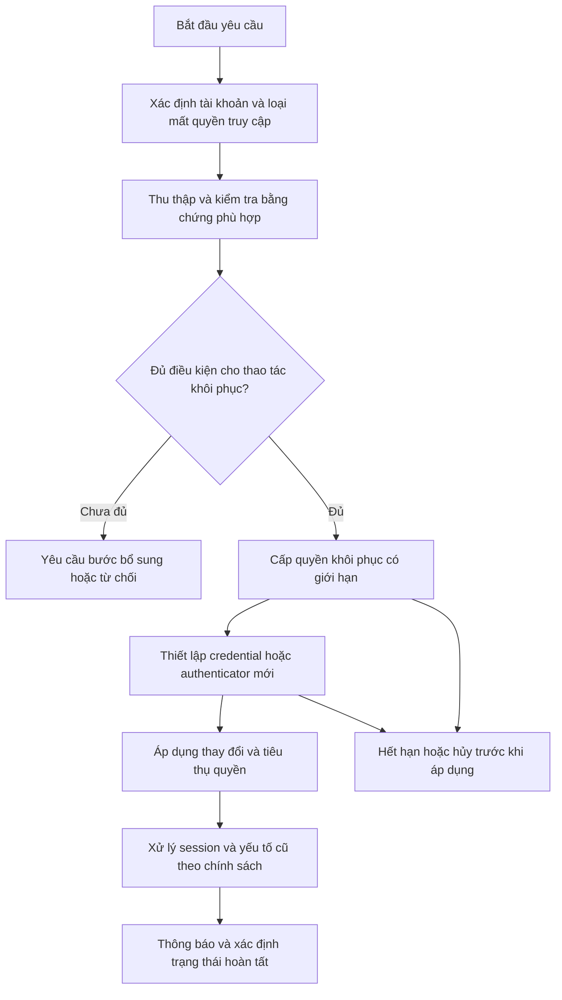

# Recovery ceremony meaning: Hiểu đúng nghi thức khôi phục tài khoản

Trong chương **Recovery Terminology**, thuật ngữ **recovery ceremony** giúp mô tả đầy đủ cách một người lấy lại khả năng truy cập tài khoản khi mất mật khẩu, MFA, passkey hoặc thiết bị xác thực. Từ *ceremony* ở đây không chỉ một nghi lễ mang tính hình thức. Nó nhấn mạnh rằng an toàn của việc khôi phục phụ thuộc vào cả hệ thống kỹ thuật lẫn hành động, cách hiểu và môi trường tương tác của con người.

Trong phạm vi `SECURITY_AUTHENTICATION_ACCOUNT_RECOVERY`, có thể gọi recovery ceremony là **nghi thức khôi phục tài khoản**: một chuỗi tương tác có chủ đích, trong đó các bên tiếp nhận yêu cầu, kiểm tra bằng chứng, quyết định phạm vi khôi phục, thiết lập lại phương tiện truy cập và đưa tài khoản về trạng thái bảo mật đã xác định.

Một API kiểm tra token có thể được viết đúng nhưng nghi thức tổng thể vẫn không an toàn. Chẳng hạn, giao diện có thể khiến người dùng đưa mã khôi phục cho kẻ giả mạo hỗ trợ, hoặc người dùng đổi được mật khẩu nhưng session của kẻ tấn công vẫn hoạt động. Khái niệm ceremony buộc người thiết kế nhìn tới những phần đó.

Sau bài học, bạn có thể:

- Giải thích recovery ceremony khác một giao thức, endpoint hay mã xác minh như thế nào.
- Xác định chủ thể, kênh liên lạc, bằng chứng và các điểm chuyển mức tin cậy trong một luồng khôi phục.
- Mô tả đường đi thành công cùng các nhánh hết hạn, hủy bỏ, mất bằng chứng và nghi ngờ lừa đảo.
- Nêu điều kiện hoàn tất thay vì chỉ ghi nhận rằng một bước kiểm tra mã đã thành công.
- Viết một bản mô tả ceremony đủ rõ để nhóm sản phẩm, kỹ thuật, bảo mật và hỗ trợ cùng thực hiện.

## 1. Vì sao cần thuật ngữ ceremony?

Giả sử Minh mất điện thoại chứa ứng dụng MFA. Minh mở trang hỗ trợ, nhập email, nhận hướng dẫn, dùng một recovery code đã lưu trước đó, đăng ký authenticator mới rồi đăng nhập lại.

Nếu chỉ nhìn vào đoạn mã máy chủ, ta có thể thấy các thao tác:

```text
lookup_account()
verify_recovery_code()
register_authenticator()
revoke_sessions()
```

Nhưng các câu hỏi quan trọng còn nằm ngoài bốn thao tác đó:

- Minh có đang ở đúng website của dịch vụ hay một trang giả mạo?
- Giao diện có giải thích mã được dùng để thay MFA, hay chỉ ghi chung chung là “xác minh”?
- Nhân viên hỗ trợ có yêu cầu Minh đọc mã qua điện thoại không?
- Mã đang được kiểm tra cho đúng tài khoản và đúng yêu cầu khôi phục nào?
- Authenticator mới được đăng ký trên thiết bị Minh đang kiểm soát hay thiết bị của người khác?
- Sau khi thay MFA, các session trước đó còn truy cập được không?
- Minh biết mình đã hoàn tất chưa, và nếu thấy thay đổi lạ thì cần làm gì?

**Ceremony là đơn vị mô tả bao trùm các tương tác đó.** Nó xem con người và giao diện là những thành phần có ảnh hưởng trực tiếp đến an toàn, thay vì giả định người dùng luôn hiểu đúng và thực hiện đúng mọi bước.

Một chuỗi bước có nhiều màn hình chưa chắc là ceremony tốt. Điều quan trọng là mỗi bước có mục đích rõ, thu được bằng chứng phù hợp, giữ được ràng buộc ngữ cảnh và dẫn tới trạng thái cuối có thể kiểm chứng.

## 2. Phân biệt ceremony với các khái niệm gần nhau

| Khái niệm | Phạm vi mô tả | Ví dụ trong khôi phục | Điều còn thiếu nếu chỉ nhìn khái niệm này |
|---|---|---|---|
| Giao thức, protocol | Trao đổi kỹ thuật giữa các thành phần theo quy tắc | Trình duyệt và máy chủ trao đổi challenge khi đăng ký passkey | Người dùng có hiểu mình đang đăng ký cho tài khoản nào không |
| Endpoint | Một điểm nhận và xử lý yêu cầu | API tiêu thụ token đặt lại mật khẩu | Cách token đến tay người dùng và quyền được cấp sau đó |
| Workflow | Trình tự công việc hoặc trạng thái nghiệp vụ | Mở hồ sơ, chờ xác minh, phê duyệt, đóng hồ sơ | Các giả định tin cậy và hành vi có thể bị lừa ở mỗi bước |
| Bằng chứng khôi phục | Dữ liệu làm cơ sở đánh giá yêu cầu | Recovery code, token qua kênh đã đăng ký | Bằng chứng đó có đủ cho thay đổi được yêu cầu không |
| Recovery ceremony | Toàn bộ tương tác của người, giao diện, kênh và hệ thống để khôi phục | Từ bắt đầu yêu cầu đến thay authenticator và xử lý truy cập sau đó | Cần được mô tả cụ thể, không thể chỉ đặt tên rồi coi là an toàn |

Các thuật ngữ có thể chồng lấn khi một nhóm dùng chúng trong thực tế. Điểm nhấn của ceremony là **ai nhìn thấy gì, tin điều gì và thực hiện hành động nào trong toàn bộ tương tác**. Một ceremony có thể bao gồm nhiều giao thức, nhiều endpoint và cả bước hỗ trợ thủ công.

Trong bài này, recovery ceremony là khái niệm thiết kế. Nó không mặc nhiên chỉ một giao thức chuẩn duy nhất, một số bước cố định hoặc một yêu cầu phải xác minh danh tính bằng giấy tờ.

### Không đồng nhất ceremony với một lần nhập OTP

OTP có thể là một bằng chứng trong ceremony. Kiểm tra OTP thành công chỉ hoàn tất một bước nếu chính sách chấp nhận loại bằng chứng đó. Nó chưa cho biết:

- OTP được cấp cho mục đích gì.
- Ai đang kiểm soát kênh nhận OTP.
- Sau khi nhập mã, người dùng được đổi mật khẩu hay được thay cả MFA.
- Credential mới có thuộc quyền kiểm soát của người dùng không.
- Token, mã dự phòng và session cũ đã được xử lý ra sao.

Vì vậy, thông báo “OTP hợp lệ” và kết luận “tài khoản đã được khôi phục an toàn” là hai kết quả khác nhau.

## 3. Các thành phần của một recovery ceremony

### Người yêu cầu và tài khoản đích

**Người yêu cầu** là bên đang tương tác với dịch vụ để khôi phục. Ban đầu, hệ thống chưa được giả định đây là chủ tài khoản hợp lệ.

**Tài khoản đích** là tài khoản cần sửa chữa đường truy cập. Định danh tài khoản phải được ràng buộc xuyên suốt các bước, kể cả khi có nhiều cửa sổ trình duyệt, nhiều hồ sơ hỗ trợ hoặc nhiều tenant.

Ví dụ, cùng một email có thể xuất hiện trong nhiều tổ chức. Giao diện hỗ trợ cần làm rõ ngữ cảnh tổ chức mà không tiết lộ quá mức thông tin cho người chưa được xác minh. Không được phê duyệt cho tài khoản của tổ chức A rồi áp dụng thay đổi sang tổ chức B.

### Hệ thống xác minh và hệ thống quản lý credential

Một thành phần có thể tiếp nhận và đánh giá bằng chứng; thành phần khác quản lý mật khẩu, MFA, passkey hoặc session. Nếu tách dịch vụ, kết quả xác minh cần được chuyển bằng dữ liệu được xác thực, có phạm vi và gắn với đúng hồ sơ.

Một cờ chung như `verified = true` thường không đủ diễn đạt. Cần biết đã kiểm tra bằng chứng nào, cho thao tác nào, trên tài khoản nào, còn hiệu lực tới khi nào và có bị dùng hoặc thu hồi chưa.

### Kênh liên lạc và môi trường tương tác

Ceremony có thể đi qua trang web, ứng dụng, email, tin nhắn hoặc cuộc gọi hỗ trợ. Mỗi kênh có nguy cơ riêng:

- Email có thể bị chiếm quyền hoặc tự động chuyển tiếp.
- Cuộc gọi có thể bị giả mạo danh tính hoặc gây áp lực lên nhân viên.
- Trình duyệt có thể đang mở trang giả mạo.
- Máy tính dùng chung có thể lưu lại dữ liệu và session.
- Thiết bị bị mất có thể vẫn đang giữ session hợp lệ.

Kênh là đường truyền hoặc phương tiện tương tác, không tự động là một yếu tố xác thực độc lập. Gửi hai mã tới cùng một hộp thư không tạo ra hai bằng chứng độc lập trước tình huống hộp thư bị chiếm quyền.

### Giao diện và thông điệp

Giao diện giúp người dùng hiểu hành động sắp thực hiện. Trong ceremony, câu chữ và thứ tự hiển thị có ý nghĩa bảo mật:

- “Bạn đang đăng ký thiết bị xác thực mới cho tài khoản của mình” rõ hơn “Tiếp tục xác minh”.
- “Mã này chỉ nhập trên trang khôi phục của dịch vụ” giúp làm rõ nơi sử dụng bí mật.
- Xác nhận thay authenticator cần giải thích ảnh hưởng tới thiết bị cũ và lần đăng nhập tiếp theo.

Thông điệp rõ ràng hỗ trợ người dùng, nhưng không thay thế kiểm tra phía máy chủ. Một cảnh báo chống lừa đảo không thể bù cho việc endpoint chấp nhận token sai mục đích.

### Nhân viên hỗ trợ và bên phê duyệt

Nếu có hỗ trợ thủ công, nhân viên trở thành một bên của ceremony. Phải mô tả họ được xem thông tin gì, được yêu cầu bằng chứng nào, được đề xuất thao tác nào và ai có quyền phê duyệt.

Không coi “đã nói chuyện với hỗ trợ” là bằng chứng tự đủ. Cần có tiêu chí quyết định và dấu vết audit. Đối với thay đổi có tác động lớn, có thể cần tách người xử lý với người phê duyệt theo chính sách của dịch vụ.

## 4. Điểm bắt đầu và điểm kết thúc phải được định nghĩa

Trước khi viết các bước, cần nói rõ ceremony đang xử lý sự cố nào:

| Tình huống | Điều người dùng mất | Điều có thể còn | Kết quả khôi phục cần mô tả |
|---|---|---|---|
| Quên mật khẩu | Bí mật đăng nhập | MFA, passkey hoặc kênh khôi phục | Đặt mật khẩu mới với phạm vi phù hợp |
| Mất thiết bị MFA | Khả năng dùng một authenticator | Mật khẩu, recovery code, authenticator khác | Thiết lập yếu tố thay thế và xử lý yếu tố bị mất |
| Mất thiết bị chứa passkey | Khả năng dùng passkey trên thiết bị đó | Passkey khác hoặc bản đồng bộ còn truy cập được | Dùng đường truy cập còn lại hoặc đăng ký passkey mới theo chính sách |
| Mất toàn bộ cách đăng nhập | Các yếu tố thường dùng | Bằng chứng dự phòng hoặc quy trình hỗ trợ | Đánh giá có đủ cơ sở để cấp lại đường truy cập hay không |

Không nên ép mọi tình huống vào một ceremony giống nhau. Người còn passkey hợp lệ có thể đăng nhập bằng passkey đó rồi quản lý authenticator, thay vì đi qua luồng mất toàn bộ yếu tố với bằng chứng yếu hơn.

Việc chuẩn bị recovery code và đăng ký kênh khôi phục thường diễn ra trước sự cố. Những việc đó có thể nằm ngoài ranh giới của một lần chạy ceremony, nhưng là **điều kiện đầu vào** quan trọng phải được ghi rõ. Không thể giả định người dùng có mã dự phòng nếu hệ thống chưa từng cấp mã hoặc người dùng không thể truy cập nơi lưu mã.

### Điều kiện kết thúc thành công

Một ceremony không nên dừng ở trạng thái “đã gửi email” hoặc “đã xác minh mã”. Tùy mục tiêu, điều kiện hoàn tất có thể bao gồm:

1. Đã chấp nhận bằng chứng phù hợp cho đúng tài khoản và thao tác.
2. Credential mới đã được thiết lập bằng luồng được phép và hệ thống có bằng chứng kỹ thuật phù hợp về việc đăng ký thành công.
3. Quyền khôi phục đã dùng không thể bị phát lại để thực hiện thêm thay đổi.
4. Credential, recovery code hoặc session cũ được xử lý theo phạm vi chính sách.
5. Trạng thái truy cập sau khôi phục được xác định rõ, gồm các điều kiện xác thực còn thiếu.
6. Sự kiện được ghi nhận và thông báo bảo mật được xử lý theo thiết kế.

Không phải mọi yếu tố trong danh sách đều cần chặn thao tác cuối cho tới khi hoàn thành đồng bộ. Chẳng hạn, gửi email thông báo có thể chạy qua hàng đợi bền vững sau khi thay đổi đã commit. Khi đó phải phân biệt “thay đổi đã áp dụng”, “đã yêu cầu gửi thông báo” và “thông báo đã được chuyển thành công”.

## 5. Một cấu trúc ceremony dễ mô tả

Cấu trúc dưới đây là mô hình tham khảo để phân tích, không phải chuỗi bước bắt buộc cho mọi dịch vụ.



### Giai đoạn 1: Khởi tạo và định hướng

Hệ thống cho người dùng chọn vấn đề gần với thực tế: quên mật khẩu, mất thiết bị MFA hoặc không còn cách đăng nhập nào. Việc phân loại giúp chọn đúng chính sách; không dựa hoàn toàn vào lời khai đó để kết luận an toàn.

Phản hồi ở giai đoạn chưa xác minh cần hạn chế dò tìm tài khoản. Ngoài nội dung hiển thị, cần xét khác biệt về mã trạng thái, thời gian xử lý và các hành vi phụ có thể làm lộ sự tồn tại của tài khoản.

### Giai đoạn 2: Kiểm tra bằng chứng

Hệ thống kiểm tra bằng chứng có sẵn và liên hệ của nó với tài khoản, mục đích và thời gian. Một mã được phát hành để đặt lại mật khẩu không nên tự dùng để thay MFA.

Bằng chứng có thể được đánh giá cùng tín hiệu rủi ro. Tuy nhiên, một thiết bị có địa chỉ IP quen thuộc không tự chứng minh người yêu cầu là chủ tài khoản; ngược lại, thay đổi mạng cũng không tự chứng minh họ là kẻ tấn công. Những tín hiệu đó cần được hiểu trong chính sách tổng thể.

### Giai đoạn 3: Cấp quyền giới hạn

Khi bằng chứng được chấp nhận, hệ thống cấp khả năng thực hiện đúng thao tác đã phê duyệt. Quyền đó cần ràng buộc với tài khoản đích, loại thao tác, thời hạn và trạng thái sử dụng.

Nếu có recovery session, đó là phiên phục vụ khôi phục với phạm vi riêng. Nó không mặc nhiên tương đương phiên đăng nhập bình thường hay chứng minh mọi yếu tố xác thực đã hoàn tất.

### Giai đoạn 4: Thiết lập lại và xác nhận

Người dùng đặt mật khẩu mới hoặc đăng ký authenticator mới. Ceremony phải làm rõ hành động này và xử lý các lỗi như thiết bị không hỗ trợ, challenge hết hạn hoặc người dùng đóng trình duyệt giữa chừng.

Với passkey, hệ thống sử dụng quy trình đăng ký phù hợp để xác minh dữ liệu đăng ký và ràng buộc challenge với đúng ngữ cảnh. Khôi phục không có nghĩa là tái tạo khóa riêng đã mất. Với một authenticator mới cần bước xác nhận hoạt động, bước đó phải được mô tả trước khi yếu tố cũ bị thay thế vĩnh viễn.

### Giai đoạn 5: Áp dụng thay đổi và xử lý hậu quả

Thay đổi credential cùng việc tiêu thụ quyền khôi phục cần được thực hiện nguyên tử hoặc bằng cơ chế tương đương, tránh hai request cùng dùng thành công một token.

Sau đó, hệ thống xử lý các yếu tố cũ và session theo chính sách. Nếu thành phần quản lý session nằm ở dịch vụ khác, ceremony phải tính đến độ trễ và lỗi phối hợp. Một lệnh gửi sự kiện thu hồi không đồng nghĩa mọi session đã mất hiệu lực ngay lập tức.

### Giai đoạn 6: Kết thúc có thông tin rõ ràng

Người dùng cần biết đã thay đổi gì, còn phải đăng nhập hoặc xác thực thêm điều gì, thiết bị cũ có còn được chấp nhận không và cách báo cáo nếu không nhận ra thay đổi.

Thông báo không nên chứa mật khẩu, recovery code hay token bí mật. Kênh thông báo cần được chọn theo chính sách; không coi thông báo gửi đi là bằng chứng rằng chủ tài khoản đã đọc và đồng ý.

## 6. Những điểm chuyển mức tin cậy trong ceremony

Một cách đọc ceremony là đánh dấu mỗi thời điểm hệ thống chuẩn bị tin thêm một điều gì đó.

| Sự kiện | Có thể kết luận | Chưa được tự kết luận |
|---|---|---|
| Người yêu cầu nhập email | Có một yêu cầu nhắm tới địa chỉ đó | Người yêu cầu là chủ tài khoản |
| Liên kết chứa token hợp lệ được sử dụng | Bên sử dụng có token tương ứng | Hộp thư an toàn hoặc MFA đã hoàn tất |
| Recovery code được kiểm tra thành công | Bên sử dụng có bí mật dự phòng được chấp nhận | Được sửa mọi thiết lập bảo mật |
| Hồ sơ hỗ trợ được phê duyệt | Quy trình đã cho phép một thao tác cụ thể | Mọi nhân viên được phép thực hiện mọi thay đổi |
| Authenticator mới đăng ký thành công | Đã có phương tiện xác thực mới theo quy trình | Credential cũ và session cũ đều đã bị thu hồi |
| Người dùng đăng nhập lại | Đã đạt điều kiện đăng nhập được áp dụng | Được thực hiện mọi hành động nhạy cảm mà không kiểm tra thêm |

Các giới hạn này giúp tránh một lỗi thường gặp: lấy thành công của bước trước làm lý do bỏ qua toàn bộ kiểm tra ở bước sau.

Ở mỗi điểm chuyển, nên hỏi:

```text
Bằng chứng mới là gì?
Bằng chứng này đến từ đâu?
Nó được gắn với tài khoản và hồ sơ nào?
Nó cho phép đúng thao tác gì?
Điều gì vẫn chưa được chứng minh?
```

Nếu câu trả lời chỉ là “người dùng đã xác minh”, mô tả vẫn quá mơ hồ để triển khai an toàn.

## 7. Ví dụ xuyên suốt: Mất thiết bị có passkey duy nhất

### Bối cảnh và chính sách giả định

Hà dùng một passkey gắn với thiết bị để đăng nhập ứng dụng quản lý công việc cá nhân. Thiết bị bị mất; Hà không còn passkey nào khác hoặc bản đồng bộ có thể sử dụng. Trước đó, dịch vụ đã cấp recovery code, Hà lưu một mã ở nơi còn truy cập được. Địa chỉ email đã đăng ký được dùng để gửi thông báo bảo mật.

Để minh họa, giả sử chính sách của ứng dụng cho phép dùng recovery code hợp lệ để cấp quyền đăng ký passkey thay thế cho loại tài khoản này. Đây là giả định của ví dụ, không phải kết luận rằng một recovery code luôn đủ cho mọi tài khoản. Tài khoản quản trị hoặc dữ liệu có tác động lớn có thể cần quy trình khác.

### Các tương tác chính

| Bước | Hà nhìn thấy hoặc thực hiện | Máy chủ thực hiện | Ranh giới cần giữ |
|---|---|---|---|
| 1 | Mở trang khôi phục từ địa chỉ dịch vụ đã biết | Tạo ngữ cảnh yêu cầu, áp dụng giới hạn tần suất | Không giả định người khởi tạo đã là Hà |
| 2 | Chọn mất passkey và cung cấp thông tin tra cứu | Xác định tài khoản theo cách hạn chế lộ thông tin | Không nhận email mới làm kênh đáng tin ngay lập tức |
| 3 | Nhập recovery code trực tiếp trên trang chính thức | Kiểm tra mã, tài khoản, trạng thái, chính sách và số lần thử | Không dùng mã cho tài khoản hoặc mục đích khác |
| 4 | Đọc thông báo sẽ đăng ký passkey thay thế | Đổi mã thành quyền khôi phục giới hạn qua thao tác dùng một lần | Không tạo phiên nghiệp vụ toàn quyền từ mã |
| 5 | Tạo passkey mới trên thiết bị mình kiểm soát | Phát và kiểm tra challenge đăng ký trong ngữ cảnh khôi phục | Không chấp nhận kết quả của hồ sơ khác |
| 6 | Xác nhận hoàn tất theo giao diện | Lưu credential mới, tiêu thụ quyền khôi phục và áp dụng chính sách với credential cũ | Không để quyền đăng ký bị phát lại |
| 7 | Nhận hướng dẫn đăng nhập lại và thông báo bảo mật | Xử lý session, ghi sự kiện, yêu cầu gửi thông báo | Không tuyên bố thu hồi toàn bộ nếu còn phần chưa có hiệu lực |

Ở bước 4, dịch vụ chọn tiêu thụ recovery code khi đổi thành quyền khôi phục. Nếu trình duyệt bị đóng sau đó, mã cũ không tự trở lại trạng thái chưa dùng. Ceremony phải có chính sách tiếp tục hồ sơ hoặc bắt đầu lại bằng bằng chứng khác, thay vì để nhóm hỗ trợ tự ứng biến.

Ở bước 6, quyền đăng ký passkey thay thế phải được tiêu thụ cùng thay đổi tương ứng. Nếu cần thay passkey cũ, hệ thống áp dụng việc thay thế theo một thiết kế tránh để tài khoản rơi vào trạng thái không có phương tiện truy cập hợp lệ do lỗi giữa chừng. Đồng thời không nên kéo dài quyền truy cập của thiết bị bị mất ngoài phạm vi chính sách đã chọn.

### Điều gì không thuộc kết quả của ví dụ?

Đăng ký passkey mới không tự cho Hà quyền của tài khoản khác, không đổi vai trò và không cho phép đổi email khôi phục mà bỏ qua chính sách riêng. Passkey của dịch vụ đã bị thu hồi cũng không có nghĩa khóa riêng trên thiết bị mất đã bị xóa khỏi thiết bị; nó chỉ không còn được dịch vụ chấp nhận theo trạng thái đã áp dụng.

Thông báo qua email trong ví dụ là một biện pháp phát hiện thay đổi ngoài ý muốn. Nó không biến email thành bằng chứng thứ hai đã được Hà chủ động xác minh trong ceremony này.

## 8. Ceremony phải mô tả cả thất bại và hủy bỏ

Chỉ vẽ đường đi thành công dễ làm mất các quyết định quan trọng nhất. Người dùng thật có thể hết mã, nhập sai tài khoản, mất kết nối hoặc nhận ra mình đang bị lừa.

### Hết hạn hoặc đóng trình duyệt

Quyền khôi phục phải hết hạn theo thời gian máy chủ. Mở lại trang cũ không được làm quyền đã hết hạn sống lại. Nếu hỗ trợ tiếp tục, hệ thống cần xác định cách ràng buộc phiên tiếp tục với đúng hồ sơ, thay vì tin một mã hồ sơ công khai.

Việc đóng tab không bảo đảm token đã bị thu hồi ở máy chủ. Nếu giao diện có chức năng hủy, thao tác đó cần cập nhật trạng thái phía máy chủ theo thiết kế.

### Bằng chứng không còn sử dụng được

Nếu người dùng không còn recovery code hoặc kênh đã đăng ký, ceremony cần chỉ rõ đường tiếp theo: dùng authenticator khác, chuyển sang quy trình hỗ trợ đủ điều kiện hoặc từ chối khôi phục khi chưa đủ cơ sở.

Không nên tự động thay yêu cầu bằng một câu hỏi cá nhân dễ đoán chỉ để người dùng luôn có thể đi tiếp. Khả năng tiếp cận của người dùng hợp lệ cần được chuẩn bị bằng các phương án dự phòng phù hợp từ trước.

### Yêu cầu đồng thời

Nếu có nhiều yêu cầu khôi phục cho cùng tài khoản, phải xác định quan hệ giữa chúng. Có thể vô hiệu hóa các quyền cũ sau một lần khôi phục thành công, hoặc áp dụng ràng buộc phiên bản bảo mật phù hợp. Gửi yêu cầu mới không nhất thiết nên hủy mọi yêu cầu hợp lệ ngay lập tức, vì kẻ tấn công có thể lợi dụng để gây gián đoạn.

Cần đặc biệt kiểm tra hai request cùng tiêu thụ một token, hai yêu cầu cùng thay authenticator, hoặc thay đổi kênh khôi phục xảy ra trong khi hồ sơ vẫn đang chờ xử lý.

### Người dùng báo “không phải tôi”

Một liên kết báo cáo trong thông báo bảo mật có thể mở quy trình xử lý sự cố. Tuy nhiên, bấm liên kết đó cũng không nên mặc nhiên cho phép người cầm thư lấy lại toàn bộ tài khoản hoặc thực hiện thay đổi phá hủy.

Nếu thay đổi đã được áp dụng, không mô tả việc hủy như thao tác quay ngược mọi thứ một cách đơn giản. Authenticator cũ có thể đã mất an toàn, session có thể đã bị sử dụng và dữ liệu có thể đã được đọc. Trạng thái sau áp dụng cần được xử lý như một tình huống bảo mật mới theo chính sách.

## 9. Góc nhìn kẻ tấn công trong một ceremony

Ceremony mở rộng phạm vi quan sát từ lỗi xử lý token sang những cách điều khiển con người và ngữ cảnh.

### Giả mạo hỗ trợ để lấy recovery code

Kẻ tấn công gọi cho người dùng, nói rằng tài khoản đang bị tấn công rồi yêu cầu đọc mã khôi phục để “chặn sự cố”. Mã hợp lệ về mặt kỹ thuật nhưng được nhập bởi kẻ tấn công.

Thiết kế cần tránh quy trình hợp lệ yêu cầu người dùng tiết lộ bí mật khôi phục cho nhân viên. Nếu có hỗ trợ, nhân viên nên hướng dẫn người dùng thực hiện trên bề mặt chính thức và tuân thủ ranh giới quyền. Không ghi mã khôi phục nguyên văn vào ticket hoặc log.

### Đánh tráo ý nghĩa hành động

Người dùng tưởng mình đang xác nhận thiết bị cũ, nhưng thực tế đang cho phép đăng ký thiết bị mới. Giao diện cần hiển thị mục đích và hệ quả của thao tác một cách cụ thể. Máy chủ vẫn phải ràng buộc bằng chứng với đúng mục đích đó.

### Trộn hồ sơ và trình duyệt

Kẻ tấn công tạo một yêu cầu cho tài khoản đích rồi dẫn người dùng vào bước tiếp tục không đúng ngữ cảnh. Một ceremony cần quản lý challenge, token, tài khoản đích và hồ sơ nhất quán; không chỉ dựa vào tham số URL có thể bị đổi hoặc định danh hồ sơ dễ đoán.

### Lạm dụng kênh thông báo và khởi tạo

Gửi hàng loạt yêu cầu có thể làm phiền người dùng, che lấp cảnh báo thật hoặc gây quá tải bộ phận hỗ trợ. Cần hạn chế tần suất và kiểm soát lạm dụng ở cả khâu phát hành lẫn kiểm tra bằng chứng. Giới hạn theo một địa chỉ IP duy nhất thường không mô tả hết nguồn lạm dụng và cũng có thể ảnh hưởng người dùng chung mạng.

Không đưa token bí mật vào telemetry, ảnh chụp hỗ trợ hoặc log truy cập không được bảo vệ. Khi dùng liên kết email, cần xét việc rò rỉ qua referrer, tài nguyên bên thứ ba và trình quét liên kết. Request `GET` mở trang không nên tự áp dụng thay đổi bảo mật; thao tác có thay đổi trạng thái cần được bảo vệ phù hợp, kể cả CSRF nếu dựa vào cookie.

## 10. Mẫu mô tả một recovery ceremony

Một bản mô tả không cần dài theo khuôn cố định, nhưng phải giúp các bên thống nhất những điều sau:

```text
Tên:
  Thay authenticator bị mất bằng bằng chứng dự phòng

Mục tiêu:
  Cấp lại một phương tiện đăng nhập cho đúng tài khoản.

Điều kiện đầu vào:
  Người yêu cầu không dùng được authenticator cũ.
  Có bằng chứng dự phòng đã được thiết lập trước và được chính sách chấp nhận.

Các bên:
  Người yêu cầu, giao diện chính thức, dịch vụ xác minh,
  dịch vụ credential, dịch vụ session và dịch vụ thông báo.

Bằng chứng:
  Nêu loại bằng chứng, cách kiểm tra, mục đích và giới hạn.

Quyền được cấp:
  Chỉ thay authenticator cho tài khoản và hồ sơ được xác định;
  có thời hạn, trạng thái sử dụng và cơ chế thu hồi.

Tương tác:
  Với mỗi bước, nêu người dùng thấy gì, nhập gì,
  máy chủ kiểm tra gì và trạng thái thay đổi thế nào.

Nhánh không thành công:
  Sai mã, hết hạn, không còn bằng chứng, hủy,
  lỗi đăng ký, xung đột và nghi ngờ lừa đảo.

Điều kiện hoàn tất:
  Yếu tố mới hợp lệ, quyền khôi phục đã được tiêu thụ,
  yếu tố cũ và session được xử lý theo chính sách,
  sự kiện và thông báo có trạng thái rõ ràng.

Giới hạn sau khôi phục:
  Nêu phiên nào được cấp và hành động nào cần xác thực thêm.
```

Một mô tả tốt tách dữ liệu quan sát được với kết luận chính sách. “Mã đã khớp” là kết quả kiểm tra; “được thay MFA cho tài khoản này” là quyết định cấp quyền. Hai điều cần được liên kết rõ nhưng không được coi là đồng nghĩa.

Audit nên ghi các sự kiện quan trọng cùng định danh hồ sơ, kết quả kiểm tra và thay đổi đã áp dụng, đồng thời tránh lưu bí mật hoặc thu thập dữ liệu nhạy cảm không cần thiết. Các mốc này còn giúp phân biệt lỗi người dùng không nhận được mã với lỗi xác minh hoặc lỗi áp dụng thay đổi.

## 11. Tự kiểm tra cách hiểu

### Tình huống 1: Token hợp lệ nhưng chưa có credential mới

Hệ thống đã kiểm tra liên kết email thành công. Người dùng đóng trình duyệt trước khi đặt mật khẩu mới. Có nên ghi “khôi phục hoàn tất” không?

**Gợi ý:** Chưa. Một bước bằng chứng đã thành công, nhưng mục tiêu thay phương tiện truy cập chưa đạt. Cần biết token còn hiệu lực hay đã được đổi thành quyền khác, và người dùng có đường tiếp tục nào.

### Tình huống 2: Đổi MFA xong nhưng session cũ còn hoạt động

Người dùng mất điện thoại, thay MFA thành công trên thiết bị mới. Điện thoại cũ vẫn đang giữ một session có quyền truy cập dữ liệu.

**Gợi ý:** Cần đối chiếu chính sách xử lý thiết bị mất và session. Việc thay authenticator không tự thu hồi mọi session. Không thể chỉ dựa vào thông báo “MFA đã đổi” để kết luận ceremony đã đạt mục tiêu bảo mật của tình huống mất thiết bị.

### Tình huống 3: Hai email được gọi là hai bước xác minh

Luồng yêu cầu người dùng bấm hai liên kết gửi tới cùng một hộp thư và gọi đó là xác minh bằng hai bằng chứng độc lập.

**Gợi ý:** Hai tương tác không tạo ra tính độc lập nếu cùng phụ thuộc vào quyền kiểm soát một hộp thư. Cần mô tả chính xác những gì chúng chứng minh, thay vì dùng số lượng màn hình để suy ra mức an toàn.

### Bài tập áp dụng

Hãy mô tả ceremony cho trường hợp người dùng mất điện thoại MFA nhưng còn một passkey đã đăng ký trên máy tính. Trong mô tả, trả lời:

1. Có thể dùng đường đăng nhập còn lại nào trước khi mở luồng mất toàn bộ yếu tố?
2. Passkey còn lại chứng minh điều gì và chính sách cho phép thao tác nào?
3. Người dùng được thông báo thế nào về việc thay yếu tố bị mất?
4. Credential cũ, session trên điện thoại và quyền thay MFA được xử lý ra sao?
5. Nếu đăng ký yếu tố mới thất bại giữa chừng, tài khoản còn đường truy cập nào?

Không có một chuỗi màn hình đúng cho mọi sản phẩm. Bài tập đạt mục tiêu khi nêu được các bên, bằng chứng, ràng buộc, quyết định và trạng thái cuối một cách nhất quán.

## 12. Ghi nhớ thuật ngữ

**Recovery ceremony** là toàn bộ tương tác nhằm khôi phục khả năng truy cập, bao gồm người yêu cầu, giao diện, kênh liên lạc, bằng chứng, quyết định chính sách và những thay đổi trạng thái của hệ thống.

Khi dùng thuật ngữ này trong thiết kế, hãy mô tả cụ thể **ai thực hiện điều gì, dựa trên bằng chứng nào và tài khoản kết thúc ở trạng thái nào**. Cách mô tả đó giúp phát hiện những khoảng trống mà một danh sách API hoặc thông báo “xác minh thành công” chưa thể hiện được.
