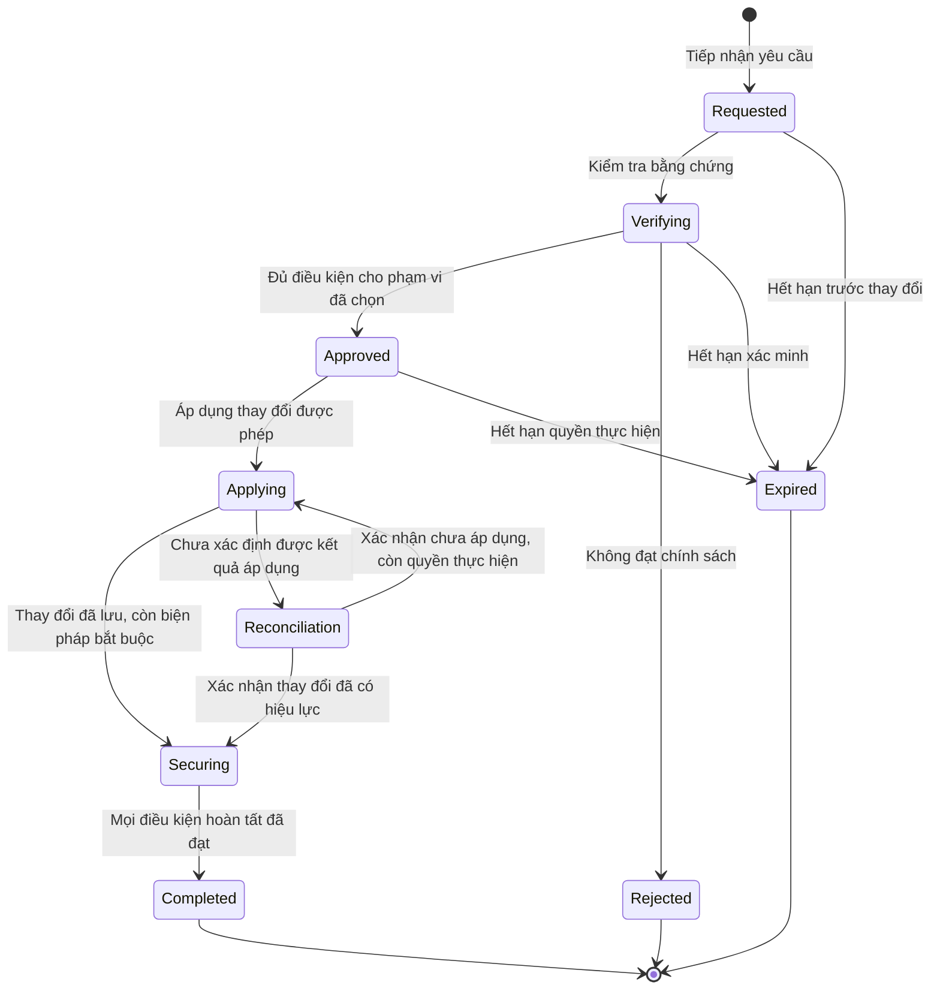

# Ý nghĩa của việc hoàn tất khôi phục tài khoản

## 1. Định nghĩa “hoàn tất khôi phục”

**Hoàn tất khôi phục — recovery completion — là mốc mà một yêu cầu khôi phục đã đáp ứng các điều kiện bắt buộc của chính sách cho đúng tài khoản, đúng người được phép và đúng phạm vi thay đổi, đồng thời kết quả đó đã được hệ thống xác lập bền vững.**

Trong bài này, thuật ngữ được dùng cho toàn bộ luồng phục hồi của sản phẩm: người dùng có đường xác thực phù hợp sau thay đổi; quyền truy cập cũ được xử lý theo kịch bản; quyền khôi phục tạm thời được kết thúc; các nghĩa vụ ghi nhận và thông báo được thực hiện theo hợp đồng đã định nghĩa.

Một sản phẩm khác có thể dùng từ “recovery” chỉ cho giai đoạn xác minh để cho phép gắn phương tiện xác thực mới. Vì vậy, tên trạng thái `COMPLETED` cần đi kèm mô tả chính xác ranh giới của nó. Không thể kết luận hai hệ thống có cùng bảo đảm chỉ vì cùng trả về trạng thái mang tên “hoàn tất”.

Trong module `SECURITY_AUTHENTICATION_ACCOUNT_RECOVERY`, phạm vi phục hồi bao gồm mất mật khẩu, MFA, passkey hoặc thiết bị xác thực. Việc định nghĩa mốc hoàn tất giúp kết nối xác minh danh tính, token dùng một lần, chống lạm dụng và kiểm soát session thành một kết quả có thể đánh giá được: chủ thể hợp lệ lấy lại khả năng kiểm soát tài khoản mà không để lại đường truy cập trái phép thuộc phạm vi phải xử lý.

Ví dụ, người dùng đặt được mật khẩu mới nhưng vẫn không thể vượt qua MFA đã mất. Nếu mục tiêu được duyệt chỉ là đặt lại mật khẩu, bước đó có thể đã hoàn thành. Nếu mục tiêu là lấy lại khả năng đăng nhập sau khi mất cả mật khẩu và MFA, toàn bộ yêu cầu chưa hoàn tất. Ý nghĩa của thành công luôn phụ thuộc phạm vi được xác định từ đầu.

## 2. Các mốc gần nghĩa nhưng không thể thay thế nhau

| Mốc | Điều thực sự đã xảy ra | Vì sao chưa đủ để gọi toàn bộ luồng hoàn tất? |
| --- | --- | --- |
| Yêu cầu đã tiếp nhận | Hệ thống đã nhận đề nghị khôi phục | Chưa biết người yêu cầu có quyền với tài khoản không |
| Hướng dẫn đã gửi | Một thông điệp đã được chuyển qua kênh liên hệ | Chưa chứng minh người nhận đáp ứng chính sách |
| Bằng chứng đã xác minh | Các bằng chứng được kiểm tra theo yêu cầu của một bước | Có thể còn bước thẩm định hoặc kiểm tra thẩm quyền |
| Yêu cầu đã phê duyệt | Cho phép một tập thay đổi cụ thể | Thay đổi có thể chưa được thực hiện |
| Phương tiện mới đã lưu | Một mật khẩu, yếu tố MFA hoặc passkey đã được thiết lập | Có thể còn xử lý phương tiện cũ, session hoặc quyền tạm thời |
| Các điều kiện hoàn tất đã đạt | Mọi nghĩa vụ bắt buộc trong phạm vi hồ sơ đã có kết quả phù hợp | Đây mới là căn cứ chuyển hồ sơ sang trạng thái hoàn tất đã định nghĩa |
| Đăng nhập mới thành công | Một lần xác thực sau khôi phục đã thành công | Không tự chứng minh các quyền truy cập cũ đã được thu hồi |
| Hồ sơ hỗ trợ đã đóng | Quy trình vận hành không còn mở hồ sơ đó | Có thể là đóng vì hết hạn, từ chối hoặc hủy yêu cầu |

Chữ “thành công” ở một bước không tự mang ý nghĩa thành công cho mọi bước sau. Một mã HTTP báo xử lý thành công cũng chỉ phản ánh hợp đồng của endpoint tương ứng; nó không tự chứng minh toàn bộ tài khoản đã được phục hồi an toàn.

NIST mô tả việc khôi phục khi mất khả năng sử dụng các phương tiện xác thực cần thiết ở mức bảo đảm mong muốn; sau giai đoạn đó, người dùng có thể gắn phương tiện xác thực mới. Cách phân chia này cho thấy tài liệu thiết kế cần nói rõ đang gọi giai đoạn xác minh hay cả luồng thiết lập lại là “recovery”. [Nguồn: NIST SP 800-63B-4, Account Recovery](https://pages.nist.gov/800-63-4/sp800-63b/events/#recovery).

## 3. Điều kiện trước và điều kiện sau của mốc hoàn tất

### 3.1. Điều kiện trước: được phép thực hiện thay đổi

Trước khi ghi nhận kết quả khôi phục, hệ thống cần xác định đúng tài khoản, kiểm tra bằng chứng và quyết định người yêu cầu được thực hiện thao tác nào. Quyết định phải còn hiệu lực tại lúc áp dụng thay đổi.

Nếu một yêu cầu đã được phê duyệt nhưng sau đó có dấu hiệu phương tiện dự phòng bị lộ, trạng thái phê duyệt cũ không được tự động bảo đảm mọi thay đổi tiếp theo. Tương tự, bằng chứng dành cho đặt lại mật khẩu không tự cấp quyền thay MFA hoặc đổi địa chỉ khôi phục.

### 3.2. Điều kiện sau: kết quả phải thực sự tồn tại

Một hợp đồng hoàn tất cho toàn bộ luồng có thể bao gồm các nhóm điều kiện sau. Hệ thống phải cụ thể hóa nhóm nào áp dụng cho từng loại yêu cầu và không được bỏ qua yêu cầu bắt buộc của chính sách hoặc tiêu chuẩn mà mình áp dụng.

| Nhóm điều kiện | Ý nghĩa cần được bảo đảm |
| --- | --- |
| Tính hợp lệ của quyết định | Đúng tài khoản, đúng phạm vi, đúng chủ thể được phép; bằng chứng và phê duyệt còn hiệu lực khi sử dụng |
| Trạng thái phương tiện xác thực | Thay đổi được duyệt đã lưu thành công, các bước xác nhận cần thiết đã đạt và có đường xác thực dự kiến phù hợp |
| Xử lý quyền truy cập cũ | Phương tiện, session, token hoặc quyền liên quan phải thu hồi đã được xử lý theo kịch bản |
| Kết thúc quyền tạm thời | Khả năng dùng lại quyền khôi phục của hồ sơ đã bị chặn; không còn quyền tạm thời vượt quá phạm vi cần thiết |
| Tính nhất quán của hồ sơ | Trạng thái và kết quả thay đổi được lưu bền vững; các yêu cầu gửi lại không tạo thêm kết quả ngoài ý muốn |
| Trách nhiệm vận hành | Có dấu vết quyết định, kết quả xử lý và việc thực hiện nghĩa vụ thông báo theo mốc đã định nghĩa |

Có thể diễn đạt quy tắc bằng một biểu thức khái niệm:

```text
Cho phép hoàn tất hồ sơ
    = quyết định còn hợp lệ
      AND thay đổi được duyệt đã có hiệu lực
      AND các biện pháp bảo vệ bắt buộc đã đạt
      AND quyền khôi phục tạm thời đã kết thúc đúng cách
      AND nghĩa vụ ghi nhận, thông báo bắt buộc đã đạt
```

Biểu thức này không quy định một cấu hình dùng chung cho mọi tài khoản. Nó thể hiện rằng một điều kiện bắt buộc chưa biết kết quả phải được coi là chưa đạt, thay vì được chuyển thành đạt chỉ vì các bước khác đã thành công.

### 3.3. Điều kiện áp dụng phải được xác định trước

Không nên đợi đến khi một phụ thuộc bị lỗi mới quyết định bước đó “không quan trọng”. Ví dụ, nếu thu hồi session trên thiết bị mất là điều kiện bắt buộc, lỗi dịch vụ thu hồi không được biến thành lý do hoàn tất hồ sơ mà giữ nguyên session.

Ngược lại, một tác vụ bổ sung như tổng hợp số liệu vận hành không nhất thiết phải chặn người dùng nếu nó không thuộc điều kiện an toàn của luồng. Cần phân biệt công việc bắt buộc trước khi hoàn tất với công việc theo dõi tiếp tục chạy sau đó.

## 4. Ý nghĩa hoàn tất thay đổi theo tình huống

### 4.1. Đặt lại mật khẩu

Với phạm vi chỉ đặt lại mật khẩu, kết quả cần bao gồm mật khẩu mới được xử lý và lưu đúng chính sách, quyền đặt lại của hồ sơ không thể tái sử dụng và cách xử lý session được thực hiện như hợp đồng yêu cầu. Các yêu cầu MFA vốn có vẫn áp dụng khi đăng nhập.

OWASP khuyến nghị sau khi đặt lại mật khẩu, người dùng đăng nhập qua cơ chế thông thường thay vì được tự động đăng nhập từ luồng đặt lại. Vì vậy, “đã đặt lại mật khẩu” và “đã có session sử dụng ứng dụng” là hai sự kiện khác nhau. [Nguồn: OWASP, User Resets Password](https://cheatsheetseries.owasp.org/cheatsheets/Forgot_Password_Cheat_Sheet.html#user-resets-password).

Nếu người dùng còn mất MFA, cần có phạm vi yêu cầu phù hợp để xử lý yếu tố đó. Không nên coi token đặt lại mật khẩu là giấy phép tự động xóa MFA để tạo cảm giác khôi phục đã hoàn tất.

### 4.2. Thay yếu tố MFA đã mất

Hoàn tất thay yếu tố MFA cần phân biệt “đã tạo dữ liệu đăng ký” với “đã hoàn thành xác nhận theo giao thức”. Chẳng hạn, hiển thị mã QR của ứng dụng tạo OTP chưa chứng minh người dùng đã thiết lập và sử dụng được yếu tố mới.

Luồng cần hoàn thành bước xác nhận cần thiết, xử lý yếu tố đã mất theo chính sách và duy trì yêu cầu xác thực phù hợp cho lần đăng nhập sau. Các phương án dự phòng liên quan cũng cần được quản lý theo vòng đời của chúng, không được để mã đã dùng tiếp tục cấp quyền.

### 4.3. Khôi phục để đăng ký passkey mới

Cho phép mở màn hình đăng ký passkey chỉ là cấp quyền bắt đầu bước thiết lập. Hoàn tất cần gắn với kết quả đăng ký được máy chủ kiểm tra hợp lệ, liên kết đúng tài khoản và đáp ứng các yêu cầu áp dụng cho phương tiện mới.

Việc xác nhận sử dụng phương tiện mới có thể là bước của chính sách hoặc được theo dõi như một lần đăng nhập sau đó. Cần nêu rõ ranh giới này. Không được đánh dấu thành công chỉ vì trình duyệt hiển thị thông báo đã tạo khóa trong khi backend chưa chấp nhận kết quả.

### 4.4. Khôi phục sau nghi ngờ chiếm đoạt

Phạm vi này rộng hơn thay một bí mật. Cần kiểm tra các đường truy cập mà đối thủ có thể giữ, như session hiện tại, phương tiện được thêm trái phép hoặc thông tin khôi phục bị sửa.

OWASP lưu ý đổi mật khẩu đơn thuần có thể chưa lấy lại quyền kiểm soát tài khoản bị xâm nhập; hướng dẫn yêu cầu xử lý session, các liên kết hoặc mã khôi phục còn tồn tại và những thay đổi trái phép liên quan. [Nguồn: OWASP, Account Recovery After Suspected Compromise](https://cheatsheetseries.owasp.org/cheatsheets/Forgot_Password_Cheat_Sheet.html#account-recovery-after-suspected-compromise).

Vì vậy, không nên dùng cùng một nhãn “đã hoàn tất khôi phục tài khoản bị chiếm đoạt” cho một luồng thực tế chỉ thay mật khẩu. Tên kết quả phải phản ánh phạm vi đã thực hiện và những nghĩa vụ còn lại.

## 5. Hoàn tất hồ sơ không đồng nghĩa mở toàn bộ quyền

### 5.1. Trạng thái hồ sơ và trạng thái truy cập cần tách biệt

Một hồ sơ có thể hoàn tất việc thay phương tiện xác thực trong khi người dùng chưa bắt đầu lần đăng nhập mới. Một tài khoản cũng có thể chịu giới hạn giao dịch sau khôi phục theo chính sách đã công bố.

Ví dụ, người dùng đã thay MFA và đăng nhập bằng phương tiện mới, nhưng chưa được đổi thông tin thanh toán cho đến khi đáp ứng điều kiện bổ sung. Nếu giới hạn đó là trạng thái truy cập dự kiến sau khôi phục, nó không nhất thiết làm hồ sơ mãi ở trạng thái chờ. Tuy nhiên, giao diện phải nói rõ điều gì đã hoàn tất và quyền nào còn bị giới hạn.

```text
recovery_case_status = COMPLETED
login_status         = NOT_STARTED
access_profile       = REAUTHENTICATION_REQUIRED
```

Đây là ví dụ khái niệm. Các giá trị không phải tên trường hoặc trạng thái bắt buộc. Điểm quan trọng là một biến `success=true` không đủ diễn đạt cả kết quả hồ sơ, trạng thái xác thực và quyền được sử dụng.

### 5.2. Không tự nâng mức bảo đảm xác thực

Việc một tổ hợp bằng chứng đủ cho phép gắn phương tiện mới không có nghĩa session đang giữ đã đạt mọi yêu cầu xác thực của tài khoản. Hệ thống phải kiểm tra mức xác thực thực tế và điều kiện của thao tác tiếp theo.

Ví dụ, xác minh qua kênh khôi phục không tự làm một session được xem là đã xác thực bằng passkey có đặc tính chống phishing. Phương tiện mới có đặc tính gì và người dùng đã thực hiện lần xác thực nào là những thông tin cần được xử lý riêng.

### 5.3. Phiên khôi phục phải kết thúc đúng vai trò

Phiên giới hạn dùng để đặt mật khẩu hoặc thiết lập yếu tố mới không nên tiếp tục có quyền thay cấu hình sau khi hồ sơ hoàn tất. Nếu cần mở phiên sử dụng ứng dụng, đó phải là kết quả của quy trình xác thực và cấp quyền phù hợp.

Token dùng một lần đã được tiêu thụ cũng không được tiếp tục cho phép một thay đổi bảo mật mới. Việc hệ thống vẫn cho phép xem kết quả cũ có kiểm soát là một khả năng khác với cho phép thực hiện lại thao tác khôi phục.

## 6. “Đã yêu cầu thu hồi” khác với “thu hồi đã có hiệu lực”

### 6.1. Cần xét nơi thực thi quyền truy cập

Trong hệ thống có nhiều dịch vụ, lưu một cờ thu hồi ở dịch vụ tài khoản chưa chắc làm mọi endpoint dừng chấp nhận quyền cũ. Định nghĩa hoàn tất phải xét nơi thực sự quyết định cho phép truy cập.

Ví dụ, nếu các API chỉ kiểm tra chữ ký và thời hạn của access token, thu hồi refresh token chỉ ngăn cấp token mới. Access token đã phát hành có thể tiếp tục dùng cho đến khi có cơ chế khác chặn nó hoặc đến khi hết hiệu lực.

Tương tự, gửi một sự kiện “hãy xóa session” vào hàng đợi mới chứng minh yêu cầu đã được ghi nhận. Nếu worker chưa xử lý, việc xóa session chưa được bảo đảm.

### 6.2. Hoàn tất cần gắn với bảo đảm đã chọn

Một thiết kế có thể sử dụng kiểm tra trạng thái tập trung, phiên bản bảo mật, cơ chế từ chối token đã thu hồi hoặc phương án khác phù hợp. Công nghệ cụ thể không quan trọng bằng việc chứng minh các đường truy cập thuộc phạm vi thu hồi đã bị chặn theo yêu cầu.

Nếu chính sách cho phép một khoảng chuyển tiếp, khoảng đó phải là một phần của mô hình rủi ro và thông điệp sản phẩm. Không nên nói “mọi thiết bị đã bị đăng xuất ngay” khi hệ thống chỉ bảo đảm token cũ hết hiệu lực sau một khoảng thời gian.

Khi việc chấm dứt quyền truy cập cũ là điều kiện bắt buộc trước hoàn tất, hồ sơ phải chờ đến lúc điều kiện ấy được bảo đảm. Có thể giữ giới hạn truy cập trong lúc chờ để không mở lại quyền quá sớm.

### 6.3. Không mặc định thu hồi mọi thứ trong mọi trường hợp

Phạm vi xử lý phụ thuộc loại yêu cầu. Tài khoản chỉ quên mật khẩu, tài khoản mất một khóa và tài khoản nghi bị chiếm đoạt có thể cần hành động khác nhau.

Điều cần tránh là bỏ sót đối tượng bắt buộc phải xử lý hoặc xóa cả phương án dự phòng hợp lệ mà không có lý do. Chính sách phải phân biệt phương tiện bị mất, bị lộ, được thêm trái phép và vẫn còn an toàn.

## 7. Mô hình trạng thái giúp diễn đạt kết quả chính xác



Đây là sơ đồ minh họa cho một hợp đồng hoàn tất toàn bộ luồng. Một hệ thống thực tế còn cần hủy yêu cầu, thẩm định bổ sung, xử lý xung đột và các lỗi phụ thuộc khác.

Các tên trạng thái mô tả những khác biệt quan trọng:

- `Approved`: được phép thực hiện, chưa chứng minh đã thực hiện.
- `Applying`: đang áp dụng thay đổi; chưa nên khẳng định kết quả cuối.
- `Reconciliation`: cần đối soát vì kết quả thao tác chưa rõ, chẳng hạn phản hồi bị mất sau khi đã ghi dữ liệu.
- `Securing`: thay đổi chính đã có hiệu lực nhưng còn điều kiện bảo mật bắt buộc.
- `Completed`: mọi điều kiện của hợp đồng hoàn tất đã đạt.

`Rejected`, `Expired` và `Cancelled` đều có thể là trạng thái kết thúc hồ sơ, nhưng không phải thành công. Nếu cần một khái niệm bao quát, có thể gọi chúng là các kết quả đã kết thúc xử lý và lưu riêng lý do kết thúc.

Nếu một phần thay đổi đã có hiệu lực, việc hết hạn token không tự làm hệ thống quay về trạng thái ban đầu. Hồ sơ cần theo dõi phần đã thay đổi và nghĩa vụ còn lại, thay vì ghi một dòng “hết hạn” rồi bỏ quên việc thu hồi quyền cũ.

## 8. Lỗi giữa chừng và việc gửi lại yêu cầu

### 8.1. Chưa thay đổi gì nhưng bước xác minh bị lỗi

Hệ thống có thể giữ hồ sơ ở trạng thái chưa đủ điều kiện, hướng dẫn thử lại hoặc chuyển xử lý phù hợp. Không được hạ yêu cầu bằng chứng chỉ để làm hồ sơ đi đến trạng thái hoàn tất.

Một yêu cầu khôi phục chưa xác thực cũng không nên tự làm phương tiện hợp lệ của chủ tài khoản ngừng hoạt động. Việc tách trạng thái hồ sơ khỏi trạng thái tài khoản giúp giảm nguy cơ dùng biểu mẫu khôi phục để gây gián đoạn truy cập.

### 8.2. Đã thay phương tiện nhưng chưa hoàn tất biện pháp bảo vệ

Nếu mật khẩu mới đã lưu nhưng thu hồi session bắt buộc thất bại, không nên khẳng định chưa có thay đổi gì. Kết quả chính xác là đã thay mật khẩu và đang chờ xử lý điều kiện còn lại.

Hệ thống cần ghi bền vững công việc còn lại, có cơ chế thực hiện lại và kiểm soát quyền trong lúc chờ. Không nên mở lại token đã dùng để người dùng tự thử toàn bộ quy trình từ đầu, vì điều đó có thể tạo thêm lần thay đổi không được kiểm soát.

### 8.3. Phản hồi bị mất sau khi backend đã hoàn tất

Người dùng có thể thấy lỗi mạng dù backend đã thực hiện thành công. Khi họ gửi lại yêu cầu, hệ thống cần nhận diện cùng một thao tác và trả về kết quả phù hợp, thay vì tạo thêm phương tiện xác thực hoặc thay mật khẩu lần nữa.

Đó là ý nghĩa của xử lý lặp an toàn trong ngữ cảnh này: cùng một yêu cầu đã được chấp thuận không tạo thêm tác động bảo mật chỉ vì được truyền lại. Tuy nhiên, quyền tra cứu kết quả cũng phải được bảo vệ; không thể dùng mã hồ sơ dễ đoán để tiết lộ thông tin tài khoản cho người ngoài.

### 8.4. Hai yêu cầu đồng thời

Hai tab hoặc hai thiết bị có thể cùng cố sử dụng một quyền khôi phục. Kiểm tra “chưa dùng” rồi cập nhật ở các bước tách rời có thể để cả hai cùng được chấp nhận.

Mốc hoàn tất cần được bảo vệ bằng cơ chế nhất quán phù hợp: chỉ có số lần thay đổi được chính sách cho phép, kết quả không mâu thuẫn và không còn khả năng dùng lại quyền đã tiêu thụ. Tên trạng thái trong cơ sở dữ liệu không tự bảo đảm các thuộc tính này.

## 9. Ví dụ: thay MFA sau khi mất điện thoại

Giả sử An còn mật khẩu và bằng chứng dự phòng phù hợp nhưng mất điện thoại dùng cho MFA. Chính sách cho phép thay yếu tố MFA sau khi đủ bằng chứng, yêu cầu xử lý các session liên quan đến thiết bị mất và yêu cầu gửi thông báo.

| Thời điểm | Diễn biến | Cách mô tả chính xác |
| --- | --- | --- |
| T1 | Hồ sơ được mở | Đã tiếp nhận yêu cầu |
| T2 | Bằng chứng đạt và thao tác thay MFA được phê duyệt | Đã cho phép thay yếu tố cụ thể |
| T3 | Yếu tố mới được thiết lập, bước xác nhận bắt buộc thành công | Đã thiết lập yếu tố mới; cần xét các điều kiện còn lại |
| T4 | Backend gửi yêu cầu thu hồi nhưng chưa bảo đảm API ngừng chấp nhận quyền cũ | Đang hoàn tất biện pháp bảo vệ, chưa đạt điều kiện hoàn tất |
| T5 | Quyền cũ thuộc phạm vi bắt buộc đã bị chặn, quyền khôi phục tạm thời kết thúc và nghĩa vụ thông báo đạt mốc yêu cầu | Có căn cứ chuyển hồ sơ sang hoàn tất |
| T6 | An đăng nhập bằng mật khẩu và MFA mới | Lần đăng nhập sau khôi phục thành công |

Tại T4, gọi hồ sơ là hoàn tất sẽ che mất một rủi ro thực tế: thiết bị bị mất có thể vẫn sử dụng quyền truy cập cũ. Tại T5, không cần giả vờ rằng người dùng đã thực hiện lần đăng nhập T6 nếu điều đó chưa xảy ra.

Nếu chính sách yêu cầu một lần xác thực bằng phương tiện mới trước khi hoàn tất, bước tương ứng phải nằm trước mốc hoàn tất của hồ sơ. Bảng trên chỉ áp dụng cho chính sách đã nêu, trong đó bước xác nhận thiết lập ở T3 đã đạt và lần đăng nhập sử dụng ứng dụng được theo dõi riêng.

Ví dụ cũng cho thấy thời gian khôi phục có nhiều ý nghĩa: thời gian xác minh kết thúc ở T2, thời gian thiết lập kết thúc ở T3, thời gian hoàn tất toàn bộ hồ sơ kết thúc ở T5 và thời gian người dùng quay lại sử dụng kết thúc ở T6. Báo cáo vận hành cần nêu đang đo mốc nào.

## 10. Thông báo, nhật ký và thông điệp cho người dùng

### 10.1. Phân biệt nghĩa vụ gửi với kết quả nhận

NIST yêu cầu sự kiện khôi phục dẫn tới thông báo cho người dùng hoặc người được chỉ định nhằm hỗ trợ phát hiện gian lận. Nghĩa vụ này cần được thể hiện trong quy trình, không được bỏ qua chỉ vì thay phương tiện xác thực đã thành công. [Nguồn: NIST SP 800-63B-4, Account Recovery Notification](https://pages.nist.gov/800-63-4/sp800-63b/events/#recovery).

Về vận hành, cần phân biệt thông báo đã được ghi vào hàng đợi, đã được dịch vụ gửi chấp nhận, đã có xác nhận giao nhận nếu kênh hỗ trợ, và đã được người dùng đọc. Các mốc này không đồng nghĩa.

Hợp đồng hoàn tất phải nói rõ nghĩa vụ gửi được coi là đạt ở đâu và theo dõi lỗi bằng cơ chế nào. Nếu một bước bắt buộc mới chỉ được xếp hàng, chưa thể ghi rằng bước đó đã được thực hiện. Khi thiết kế tách “hoàn tất phần thay đổi” khỏi nghĩa vụ gửi còn chờ, cần hiển thị và lưu hai trạng thái riêng thay vì khẳng định mọi nghĩa vụ đã hoàn thành.

Không nhận được phản đối cũng không chứng minh khôi phục hợp lệ. Người dùng có thể đang mất thiết bị, chưa nhận được thư hoặc không đọc kịp. Thông báo hỗ trợ phát hiện; nó không thay thế bằng chứng cấp quyền.

### 10.2. Ghi đủ căn cứ của kết quả

Một hồ sơ minh họa có thể ghi các thông tin sau:

```text
recovery_case_id          : định danh hồ sơ
target_account_id        : tài khoản đích
recovery_purpose         : mục đích và phạm vi được duyệt
policy_version           : chính sách dùng cho quyết định
verification_decision    : kết quả xác minh và phê duyệt
authenticator_change     : kết quả thay phương tiện
access_cleanup_status    : kết quả xử lý quyền truy cập cũ
temporary_grant_status   : trạng thái quyền khôi phục tạm thời
notification_status      : trạng thái thực hiện nghĩa vụ thông báo
completed_at             : thời điểm đạt hợp đồng hoàn tất
```

Các tên trường chỉ minh họa ý nghĩa cần phân biệt. Không nên đưa mật khẩu, token nguyên vẹn, OTP hoặc toàn bộ bằng chứng nhạy cảm vào nhật ký để chứng minh đã hoàn tất. Tham chiếu hồ sơ và kết quả kiểm tra có kiểm soát phù hợp hơn với mục đích truy vết.

### 10.3. Nói đúng kết quả mà hệ thống biết

| Kết quả thực tế | Thông điệp phù hợp |
| --- | --- |
| Chỉ nhận được yêu cầu | Đã tiếp nhận yêu cầu; hãy thực hiện bước xác minh tiếp theo |
| Đã thay mật khẩu và các nghĩa vụ của phạm vi này đã đạt, chưa đăng nhập | Mật khẩu đã được đặt lại; hãy đăng nhập bằng cơ chế thông thường |
| Đã thiết lập yếu tố mới, còn bước bảo vệ bắt buộc | Yếu tố mới đã được thiết lập; hệ thống đang hoàn tất các bước bảo vệ còn lại |
| Toàn bộ hồ sơ đạt điều kiện, người dùng chưa xác thực lại | Khôi phục đã hoàn tất trong phạm vi đã chọn; cần đăng nhập lại để sử dụng |
| Không đủ bằng chứng | Yêu cầu chưa đáp ứng điều kiện khôi phục; cung cấp hướng xử lý phù hợp |
| Hồ sơ hết hạn trước thay đổi | Yêu cầu đã hết hạn; bắt đầu lại theo hướng dẫn nếu vẫn cần |

Thông điệp công khai trước xác minh vẫn cần tránh tiết lộ tài khoản có tồn tại hay không. Chi tiết tiến độ của một tài khoản cụ thể chỉ nên được cung cấp trong ngữ cảnh có quyền xem phù hợp.

## 11. Hoàn tất khôi phục và kết thúc xử lý sự cố

Khôi phục quyền kiểm soát tài khoản không tự đảo ngược giao dịch trái phép, lấy lại dữ liệu đã bị sao chép hoặc làm thiết bị bị nhiễm trở nên an toàn. Các công việc đó có thể thuộc một quy trình xử lý sự cố rộng hơn.

Vì vậy, hệ thống có thể có hồ sơ khôi phục đã hoàn tất trong khi sự cố an ninh vẫn đang được điều tra. Cần ghi rõ phạm vi đã đạt để không làm người dùng hiểu rằng mọi hậu quả của sự cố đã được khắc phục.

Nếu sau thời điểm hoàn tất xuất hiện bằng chứng mới về một phương tiện bị lộ, hệ thống cần xử lý sự kiện mới và áp dụng biện pháp phù hợp. Không nên âm thầm sửa lịch sử để giả vờ rằng mốc hoàn tất trước đó chưa từng xảy ra. Nếu mốc cũ được đánh dấu sai, cần có bản ghi điều chỉnh và lý do để truy vết được quyết định.

Tương tự, đóng phiếu hỗ trợ là quyết định vận hành. Một phiếu được đóng vì người dùng không phản hồi không được tính thành khôi phục thành công. Báo cáo cần tách hoàn tất, từ chối, hết hạn, hủy và chờ xử lý phần còn lại.

## 12. Cách dùng thuật ngữ trong đặc tả và đánh giá

Một định nghĩa hoàn tất có thể được kiểm tra bằng các tiêu chí hành vi sau:

| Tình huống | Kết luận cần giữ |
| --- | --- |
| Xác minh đạt nhưng chưa áp dụng thay đổi | Đã được phép, chưa hoàn tất toàn bộ luồng |
| Thay phương tiện thành công nhưng biện pháp bảo vệ bắt buộc chưa đạt | Còn điều kiện chờ; không được mở quyền vượt phạm vi |
| Kết quả backend đã lưu nhưng client mất phản hồi | Đối soát và trả lại kết quả an toàn; không tạo thêm lần thay đổi |
| Có hai yêu cầu đồng thời dùng cùng quyền một lần | Không có hai tác động độc lập ngoài số lần được phép |
| Hồ sơ hoàn tất nhưng chưa có lần đăng nhập mới | Không được ghi rằng người dùng đã xác thực lại |
| Thông báo mới ở hàng đợi | Không được ghi rằng thông báo đã gửi hoặc đã nhận |
| Hồ sơ hết hạn hoặc bị từ chối | Kết thúc xử lý theo lý do tương ứng; không tính là thành công |
| Khôi phục xong nhưng còn điều tra thiệt hại | Phân biệt kết quả khôi phục với trạng thái xử lý sự cố |

Khi viết một yêu cầu như “đánh dấu recovery completed”, hãy kèm theo tài khoản đích, mục đích, các điều kiện bắt buộc, phạm vi quyền sau đó và bằng chứng mà backend dùng để xác nhận kết quả. Một trạng thái có ý nghĩa khi các bên hiểu thống nhất điều gì đã được bảo đảm tại thời điểm chuyển trạng thái.

Mốc hoàn tất tốt giúp người dùng biết bước tiếp theo, giúp đội hỗ trợ mô tả đúng kết quả và giúp hệ thống tránh cấp quyền quá sớm. Giá trị của mốc này nằm ở những điều kiện đã có hiệu lực, không nằm ở việc biểu mẫu đã chạy hết hoặc giao diện đã hiển thị màu xanh.
