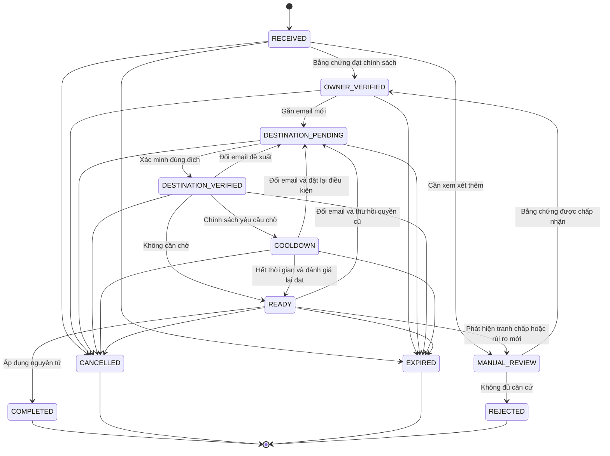

# Quy trình khôi phục khi quên email đăng ký hoặc mất quyền truy cập hộp thư

## 1. Mục tiêu và phạm vi

Trong chương **Email Address Recovery**, bài **Lost email address workflow** trình bày cách đưa người dùng trở lại đúng tài khoản khi họ không nhớ email đăng ký hoặc không còn sử dụng được hộp thư cũ. Bài thuộc module `SECURITY_AUTHENTICATION_ACCOUNT_RECOVERY`: thiết kế khôi phục an toàn khi mất mật khẩu, MFA, passkey hoặc thiết bị xác thực, thông qua đánh giá rủi ro, token dùng một lần, xác minh danh tính, chống lạm dụng và kiểm soát session.

Email có thể đồng thời là tên đăng nhập, địa chỉ nhận thông báo và kênh nhận liên kết đặt lại mật khẩu. Vì vậy, thay email có thể chuyển quyền nhận các bí mật khôi phục trong tương lai. Một chức năng tưởng như chỉ cập nhật thông tin liên hệ có thể trở thành đường chiếm đoạt tài khoản.

Sau bài này, người học cần giải thích được:

- Cách phân biệt tìm lại định danh đăng nhập với thay thế kênh email đã mất.
- Bằng chứng nào cho phép tiếp tục, bằng chứng nào chỉ giúp định tuyến hoặc đánh giá rủi ro.
- Cách tách xác minh chủ tài khoản, xác minh hộp thư mới và quyền áp dụng thay đổi.
- Cách ràng buộc token với giao dịch, xử lý cạnh tranh, vô hiệu hóa phiên và thông báo sau khôi phục.
- Khi nào phải chuyển sang xử lý thủ công hoặc kết thúc mà chưa thể khôi phục.

Các trạng thái, API, cấu trúc dữ liệu và mốc thời gian bên dưới là **một thiết kế minh họa**. Chúng cần được điều chỉnh theo loại tài khoản, tác động khi bị chiếm đoạt và kiến trúc thực tế; không phải tuyên bố rằng hệ thống đã đáp ứng một mức bảo đảm của NIST.

## 2. Phân loại đúng sự cố trước khi yêu cầu bằng chứng

### 2.1. Ba tình huống dễ bị gom chung

| Tình huống | Người dùng còn gì? | Kết quả cần đạt |
| --- | --- | --- |
| Quên địa chỉ email đã đăng ký | Có thể còn passkey, tên người dùng, phiên đăng nhập hoặc kênh dự phòng | Xác định đúng tài khoản và giúp đăng nhập lại; có thể chưa cần đổi email |
| Nhớ email nhưng mất quyền truy cập hộp thư | Có thể còn mật khẩu, MFA hoặc mã khôi phục | Thay địa chỉ email sau khi đủ bằng chứng sở hữu tài khoản |
| Nghi hộp thư hoặc tài khoản đã bị chiếm đoạt | Những kênh trước đây tin cậy có thể đang do kẻ khác kiểm soát | Xử lý sự cố, loại quyền truy cập trái phép rồi khôi phục kênh liên hệ an toàn |

Ví dụ, Lan không nhớ đã dùng địa chỉ cá nhân hay địa chỉ công ty để đăng ký, nhưng vẫn có passkey trên điện thoại. Hệ thống nên cho Lan đăng nhập bằng credential đã liên kết và kiểm tra email trong phần cài đặt. Không cần bắt Lan chứng minh lại bằng giấy tờ chỉ vì quên một định danh.

Ngược lại, Minh nhớ chính xác địa chỉ công ty nhưng đã nghỉ việc. Gửi mã về địa chỉ đó không giải quyết được sự cố. Minh cần dùng phương thức đã đăng ký khác hoặc một quy trình khôi phục có bảo đảm phù hợp để gắn email mới.

### 2.2. Tách định danh ổn định khỏi email

Một mô hình đơn giản:

```text
account_id:       định danh nội bộ ổn định
login_email:      thuộc tính đăng nhập có thể thay đổi
notification:     tập kênh thông báo đã được thiết lập
authenticators:   mật khẩu, passkey, TOTP, khóa bảo mật...
recovery_methods: mã dự phòng, kênh hoặc liên hệ khôi phục...
```

Quyền sở hữu dữ liệu học tập, thanh toán và lịch sử hoạt động gắn với `account_id`, không gắn trực tiếp với chuỗi email hiện tại. Thay email không được tạo tài khoản khác, chuyển dữ liệu nhầm người hoặc hợp nhất tài khoản tự động.

Với đăng nhập liên kết, dùng ánh xạ định danh của nhà cung cấp đã xác thực, chẳng hạn cặp issuer và subject trong OIDC. Không tự nối tài khoản chỉ vì một email người dùng nhập trùng với email trong hồ sơ khác. Việc nhận được địa chỉ email từ một luồng chưa xác minh cũng không phải bằng chứng của quan hệ liên kết.

## 3. Các bất biến bảo mật của quy trình

Thiết kế minh họa giữ các điều kiện sau xuyên suốt mọi nhánh:

1. **Biết thông tin tài khoản chưa đủ để kiểm soát tài khoản.** Tên, email cũ và mã đơn hàng có thể giúp tìm hồ sơ nhưng không tự tạo quyền khôi phục.
2. **Kiểm soát hộp thư mới chưa chứng minh sở hữu tài khoản cũ.** Người yêu cầu nào cũng có thể sở hữu một địa chỉ mới.
3. **Thay email không tự đặt lại mật khẩu hoặc gỡ MFA.** Mỗi thay đổi nhạy cảm cần quyền hạn riêng; giao dịch kết hợp phải được chính sách cho phép rõ ràng.
4. **Phiên hiện có không tự đủ để thay kênh khôi phục.** Phiên có thể bị đánh cắp hoặc đang mở trên máy dùng chung.
5. **Trạng thái giao dịch và bằng chứng được quyết định ở máy chủ.** Client không được tự khai `owner_verified=true` hoặc đổi `account_id` ở bước cuối.
6. **Mỗi quyền xác nhận chỉ phục vụ đúng một mục đích và đích đến.** Token xác minh email không trở thành token đăng nhập, token gỡ MFA hoặc token đổi sang email khác.
7. **Một giao dịch chỉ được áp dụng thành công một lần.** Gửi lặp hoặc hai request đồng thời không được tạo hai kết quả khác nhau.
8. **Không đủ bằng chứng thì chưa khôi phục.** Thời gian chờ và sự đồng ý của nhân viên không tự thay thế được bằng chứng còn thiếu.

Các bất biến này là tiêu chí thiết kế của bài. Khi thêm một đường tắt cho hỗ trợ khách hàng hoặc một tính năng mới, cần kiểm tra đường đó có còn giữ được chúng hay không.

## 4. Mô hình đe dọa

Tài sản cần bảo vệ gồm quyền đăng nhập, email nhận khôi phục, MFA, phiên truy cập, dữ liệu riêng tư và tính sẵn sàng của tài khoản.

| Hành vi của đối tượng tấn công | Điểm yếu có thể bị khai thác | Quyết định trong thiết kế minh họa |
| --- | --- | --- |
| Thử nhiều tên, số điện thoại hoặc email | Phản hồi tiết lộ tài khoản tồn tại | Phản hồi công khai trung tính; hạn chế tra cứu và tiết lộ thông tin |
| Có mật khẩu bị rò rỉ nhưng thiếu MFA | Nhánh “mất email” bỏ qua yếu tố còn thiếu | Áp dụng chính sách khôi phục tương ứng với mức bảo đảm của tài khoản |
| Đánh cắp cookie đăng nhập | Đổi email chỉ cần phiên đang mở | Yêu cầu xác thực lại bằng phương thức phù hợp đã liên kết |
| Thuyết phục nhân viên bằng dữ liệu công khai | Hỗ trợ được ghi đè email tùy ý | Quy trình bằng chứng, phê duyệt và quyền thao tác có giới hạn |
| Đổi email đích sau khi đã xác minh | Bằng chứng không gắn với giá trị mới | Ràng buộc bằng chứng với đích đến và phiên bản giao dịch |
| Dùng lại liên kết hoặc gửi song song | Kiểm tra rồi cập nhật ở hai bước rời nhau | Tiêu thụ token và chuyển trạng thái nguyên tử |
| Vẫn giữ phiên sau khi nạn nhân khôi phục | Chỉ đổi email, bỏ sót các phiên cũ | Vô hiệu hóa quyền truy cập theo chính sách và phiên bản bảo mật |
| Kiểm soát lại email cũ sau khi thay đổi | Liên kết “hoàn tác” khôi phục trực tiếp quyền cũ | Tiếp nhận báo cáo, điều tra và xác minh lại trước khi thay đổi tiếp |

Một người đã kiểm soát hộp thư cũ có thể vừa đọc thông báo vừa phản đối yêu cầu hợp lệ. Vì vậy, thông báo tới địa chỉ cũ là tín hiệu phát hiện, không phải quyền phủ quyết tuyệt đối trong mọi tình huống.

## 5. Đánh giá bằng chứng còn lại

### 5.1. Bằng chứng phải tồn tại trước yêu cầu khôi phục

Giá trị của một phương thức đến từ quan hệ đã được thiết lập với tài khoản. Số điện thoại, email dự phòng hoặc passkey vừa được thêm trong chính yêu cầu chưa xác minh không thể chứng minh quan hệ đó.

| Phương thức còn sử dụng được | Có thể đóng góp gì? | Giới hạn cần xử lý |
| --- | --- | --- |
| Passkey hoặc khóa bảo mật đã đăng ký | Chứng minh kiểm soát credential liên kết với tài khoản | Xác minh assertion đầy đủ; yêu cầu user verification khi chính sách cần; xem xét khả năng thiết bị bị mất |
| Mật khẩu và TOTP đã đăng ký | Xác thực lại bằng các yếu tố hiện hữu | Không để TOTP bị thay bằng địa chỉ mới vừa nhập; kiểm tra dấu hiệu bị lộ |
| Mã khôi phục đã cấp | Bằng chứng theo phạm vi được cấp cho mã | Dùng một lần; tổ hợp bằng chứng vẫn phải đáp ứng chính sách của tài khoản |
| Kênh dự phòng đã xác minh từ trước | Nhận thử thách theo chính sách khôi phục | Xét SIM swap, chuyển chủ, thời điểm thay đổi và phụ thuộc với hộp thư bị mất |
| Phiên đăng nhập còn hiệu lực | Tìm tài khoản và cung cấp ngữ cảnh | Cần xác thực lại cho thay đổi nhạy cảm; không mặc định an toàn vì phiên lâu năm |
| Thiết bị quen, IP hoặc lịch sử hoạt động | Tín hiệu đánh giá rủi ro | Có thể thay đổi hoặc giả mạo; không thay bằng chứng kiểm soát credential |
| Giấy tờ định danh | Có thể phục vụ đối chiếu trong quy trình phù hợp | Cần quan hệ có thể kiểm chứng với tài khoản đã có; ảnh giấy tờ đơn lẻ chưa đủ |

Khi dùng passkey làm MFA, cần kiểm tra user verification theo chính sách và xác minh cờ tương ứng ở máy chủ. Việc người dùng chỉ chạm để thể hiện sự hiện diện không tự tạo thành yếu tố thứ hai. Việc thay yếu tố xác thực cũng cần được coi là thao tác rủi ro cao, có xác thực lại và thông báo. Tham chiếu [OWASP Multifactor Authentication](https://cheatsheetseries.owasp.org/cheatsheets/Multifactor_Authentication_Cheat_Sheet.html).

### 5.2. Không cộng các tín hiệu yếu thành một bằng chứng mạnh

Tên đầy đủ, ngày sinh và ảnh đại diện có thể cùng được lấy từ một hồ sơ công khai. Ba thông tin này không tạo ra ba nguồn bằng chứng độc lập.

Tương tự, email dự phòng tự động chuyển tiếp vào hộp thư bị chiếm đoạt không độc lập với hộp thư đó. Hai passkey đồng bộ qua cùng một tài khoản nền tảng có thể cùng chịu ảnh hưởng khi tài khoản nền tảng gặp sự cố. Không vì chúng có hai nhãn khác nhau mà mặc định độc lập về rủi ro.

Ví dụ quyết định chính sách của một dịch vụ học tập:

- Người dùng còn passkey hợp lệ và không có tín hiệu bất thường: cho đi nhánh tự phục vụ sau xác thực lại phù hợp.
- Người dùng còn mật khẩu nhưng thiếu MFA vốn bắt buộc: chuyển sang quy trình khôi phục yếu tố; không đổi email bằng mật khẩu đơn lẻ.
- Người dùng có mã khôi phục: kiểm tra mã và các điều kiện bổ sung được quy định cho loại tài khoản đó.
- Người dùng không còn phương thức đã thiết lập: chuyển sang xử lý thủ công nếu dịch vụ có cơ sở xác minh; nếu không, thông báo chưa thể khôi phục.

NIST SP 800-63B-4 phân biệt các phương thức như mã khôi phục đã lưu, mã được gửi khi khôi phục, liên hệ khôi phục và xác minh danh tính lại. Việc chọn tổ hợp phụ thuộc yêu cầu bảo đảm; một bảng quyết định tự xây dựng không tự chứng minh tuân thủ NIST. Tài khoản chưa từng được xác minh danh tính không thể mặc nhiên dùng “xác minh lại giấy tờ” làm căn cứ. Xem [NIST — Account Recovery](https://pages.nist.gov/800-63-4/sp800-63b.html#account-recovery).

## 6. Nhánh A: quên địa chỉ email đã đăng ký

Mục tiêu đầu tiên là tìm cách đăng nhập bằng phương thức sẵn có. Không nên lập tức thu thập email mới hoặc giấy tờ.

### 6.1. Đi từ phương thức người dùng còn kiểm soát

Thứ tự gợi ý cho giao diện:

1. Cho phép dùng passkey nếu hệ thống hỗ trợ đăng nhập không cần nhập email. Máy chủ xác minh credential rồi ánh xạ về `account_id` đã liên kết.
2. Cho phép dùng tên người dùng hoặc mã định danh đăng nhập khác nếu sản phẩm vốn hỗ trợ.
3. Hướng dẫn người dùng kiểm tra trình quản lý mật khẩu hoặc thiết bị của chính họ; không yêu cầu tải kho mật khẩu lên dịch vụ.
4. Nếu có kênh khôi phục đã thiết lập, thử thách kênh đó trước khi tiết lộ thông tin tài khoản tương ứng.
5. Nếu vẫn không xác định được tài khoản bằng cách an toàn, mở hồ sơ hỗ trợ với thông tin tối thiểu cần để đối chiếu.

Không tạo một chức năng tìm tài khoản bằng tên hiển thị công khai rồi trả danh sách email. Trường hợp một số điện thoại liên quan nhiều hồ sơ cũng không được biến thành danh bạ tài khoản công khai.

### 6.2. Kiểm soát việc tiết lộ gợi ý

Ví dụ gợi ý `l***@example.com` vẫn có thể làm lộ quan hệ giữa người dùng và dịch vụ, tên tổ chức hoặc tên miền cá nhân. Chỉ che một phần email chưa loại bỏ rủi ro riêng tư.

Trong thiết kế này, điểm vào chưa xác thực chỉ trả lời:

> Nếu thông tin phù hợp với phương thức đã được thiết lập, hệ thống sẽ hướng dẫn bước tiếp theo qua kênh tương ứng.

Chỉ sau khi người dùng vượt qua mức xác minh phù hợp mới hiển thị gợi ý cần thiết. Email đầy đủ có thể được xem trong phần cài đặt sau đăng nhập và theo chính sách truy cập thông tin nhạy cảm.

Không gửi danh tính tài khoản tới một email liên hệ bất kỳ chỉ vì người yêu cầu vừa chứng minh đọc được hộp thư đó. Chứng minh kiểm soát một hộp thư chưa liên kết vẫn chưa nối được hộp thư với tài khoản cần tìm.

## 7. Nhánh B: mất quyền truy cập hộp thư cũ

Luồng dưới đây giả định email cần được thay thế và tài khoản có thể được xác định bằng một cách an toàn. Hệ thống vẫn phải xác minh quyền sở hữu trước khi cho phép chuyển quyền nhận khôi phục.

### Bước 1 — Tiếp nhận yêu cầu, chưa thay đổi tài khoản

Giao diện hỏi người dùng còn dùng được phương thức nào: passkey, thiết bị xác thực, mã dự phòng hoặc kênh khôi phục đã thiết lập. Không hỏi tất cả dữ liệu nhạy cảm ngay ở màn hình đầu.

Điểm vào công khai có thể trả `202 Accepted` với nội dung trung tính. Một mã biên nhận ngẫu nhiên chỉ giúp theo dõi tiếp nhận, không cấp quyền xem email hiện tại, chọn tài khoản hoặc xác nhận thay đổi. Nhánh có tài khoản và nhánh không có tài khoản cần tránh khác biệt quan sát được về nội dung, mã phản hồi và thời gian xử lý.

Tránh gửi email chờ đồng bộ trong đường phản hồi công khai. Hàng đợi có thể giúp giảm khác biệt thời gian, nhưng vẫn cần đánh giá toàn bộ hành vi quan sát được; thêm độ trễ ngẫu nhiên không tự giải quyết mọi kênh rò rỉ. Các nguyên tắc phản hồi thống nhất và hạn chế yêu cầu tự động được trình bày trong [OWASP Forgot Password](https://cheatsheetseries.owasp.org/cheatsheets/Forgot_Password_Cheat_Sheet.html).

### Bước 2 — Xác minh chủ tài khoản theo chính sách

Máy chủ chọn bộ kiểm tra từ những phương thức đã liên kết, xác thực bằng chứng và đánh giá rủi ro. Client chỉ cung cấp dữ liệu thử thách, không quyết định phương thức nào được bỏ qua.

Với WebAuthn, dùng thư viện xác minh phù hợp thay vì tự kiểm tra vài trường JSON. Kết quả phải thuộc credential đã liên kết với đúng tài khoản; thử thách phải đúng giao dịch, còn hiệu lực và đáp ứng các điều kiện origin, RP ID, chữ ký và user verification theo chính sách.

Nếu người dùng phải khôi phục cả MFA, giao dịch cần quyền riêng cho việc đó. Không để nhãn “mất email” trở thành quyền tổng quát thay mọi yếu tố.

### Bước 3 — Tạo quyền khôi phục có phạm vi hẹp

Sau khi đủ bằng chứng, cấp một `recovery_grant` ngắn hạn, được máy chủ quản lý, chỉ có quyền đề xuất và hoàn tất thay email cho đúng `account_id`. Khi người dùng chọn email mới, grant và bằng chứng tiếp theo phải gắn với đúng đích đó.

Grant không được sử dụng để đọc dữ liệu học tập riêng tư, xuất hóa đơn, tạo API key, tắt MFA hoặc đổi mật khẩu ngoài phạm vi được duyệt. Không đổi cookie của hồ sơ hỗ trợ chưa xác minh thành cookie đăng nhập thông thường.

### Bước 4 — Thu thập và xác minh email mới

Kiểm tra định dạng bằng công cụ phù hợp, áp dụng chính sách so sánh email thống nhất với đăng ký và đăng nhập. Lưu email mới ở trạng thái chờ, rồi gửi một thử thách chỉ dùng để xác minh hộp thư đó.

Thử thách liên kết với bộ giá trị:

```text
purpose = VERIFY_RECOVERY_DESTINATION
request_id + account_id + pending_email_key + destination_version
```

Nếu người dùng sửa email mới, tăng `destination_version`, hủy bằng chứng và token của đích trước, sau đó xác minh lại. Không giữ cờ `email_verified=true` khi chuỗi đích đã thay đổi.

### Bước 5 — Thông báo và xử lý thời gian chờ nếu có

Gửi thông báo qua các kênh đã thiết lập còn phù hợp với mô hình rủi ro. Địa chỉ cũ có thể nhận cảnh báo khi thay email, nhưng nếu người dùng đã mất hộp thư thì không bắt họ xác nhận tại chính hộp thư đó để đi tiếp.

OWASP mô tả quy trình thay email thông thường với xác thực lại, email mới ở trạng thái chờ và thông báo hoặc xác nhận qua các địa chỉ liên quan. Khi hộp thư cũ đã mất, cần một nhánh khôi phục riêng có căn cứ thay thế; không chỉ xóa bước xác nhận cũ rồi giữ nguyên mức tin cậy. Tham chiếu [OWASP — Changing a User's Registered Email Address](https://cheatsheetseries.owasp.org/cheatsheets/Authentication_Cheat_Sheet.html#changing-a-users-registered-email-address).

Với tài khoản tác động cao hoặc có dấu hiệu bất thường, thiết kế có thể yêu cầu khoảng chờ hoặc phê duyệt bổ sung. Trong thời gian này, email cũ vẫn là dữ liệu hiện tại; email mới chưa được dùng để nhận đặt lại mật khẩu.

### Bước 6 — Đánh giá lại và áp dụng nguyên tử

Trước khi áp dụng, kiểm tra lại hạn giao dịch, bằng chứng, thời điểm được phép hoàn tất, phiên bản bảo mật và tín hiệu tranh chấp. Nếu điều kiện bảo mật đã thay đổi, không dùng quyết định cũ một cách máy móc.

Chỉ khi mọi điều kiện cùng đúng mới đổi email, tiêu thụ quyền xác nhận, vô hiệu hóa các quyền cũ liên quan và ghi sự kiện. Các tác động dữ liệu bắt buộc phải nằm trong một đơn vị giao dịch phù hợp; gửi thư ra ngoài được xử lý qua cơ chế bảo đảm giao nhận riêng.

### Bước 7 — Đăng nhập lại và củng cố tài khoản

Giao dịch thay email kết thúc mà không tự cấp một phiên đầy đủ từ token xác minh hộp thư. Người dùng quay về luồng đăng nhập phù hợp với trạng thái credential sau khôi phục.

Nếu họ đồng thời mất mật khẩu hoặc MFA, chỉ thực hiện các bước khôi phục đó khi đã được chính sách cho phép riêng. Sau khi vào lại tài khoản, hướng dẫn kiểm tra phương thức đăng nhập, thiết lập phương thức dự phòng và nhận bộ mã khôi phục thay thế nếu cần.

## 8. Sơ đồ trạng thái và các điều kiện chuyển tiếp



Sơ đồ mô tả các chuyển tiếp chính. Mọi trạng thái chưa kết thúc, kể cả `MANUAL_REVIEW`, đều có giới hạn tồn tại và có thể bị hủy theo chính sách. Việc kiểm tra hạn được thực hiện tại mỗi thao tác, không phụ thuộc việc tác vụ nền đã đổi nhãn thành `EXPIRED` hay chưa.

Các trạng thái trên chỉ nằm phía máy chủ. API công khai không được trả chi tiết rằng một mã biên nhận tương ứng tài khoản có MFA hoặc địa chỉ nào. Endpoint chi tiết chỉ phục vụ chủ thể có grant thích hợp hoặc nhân viên được phân quyền.

Một trạng thái `READY` cũng chưa đủ tự nó cho phép đổi email. Điều kiện cuối cùng là toàn bộ bằng chứng và ràng buộc còn đúng tại thời điểm commit. Thay đổi quan trọng ở tài khoản có thể khiến giao dịch phải xác minh lại hoặc bị hủy.

## 9. Mô hình dữ liệu và ràng buộc

### 9.1. Giao dịch khôi phục

```text
EmailRecoveryRequest
  id                         định danh ngẫu nhiên của giao dịch
  tenant_id                  phạm vi tổ chức nếu có
  account_id                 chỉ gắn sau khi xác định đúng tài khoản
  state                      trạng thái máy chủ
  request_version            phiên bản chống ghi đè đồng thời
  account_security_epoch     ảnh chụp phiên bản bảo mật của tài khoản
  owner_evidence_ref         tham chiếu bằng chứng đã kiểm tra
  owner_verified_at          thời điểm xác minh
  pending_email_original     email mới để hiển thị và giao nhận
  pending_email_key          giá trị so sánh theo chính sách
  destination_version        phiên bản của đích đến
  destination_verified_at    thời điểm xác minh đúng phiên bản đích
  allowed_after              thời điểm sớm nhất được commit
  expires_at                 hạn cuối của giao dịch
  policy_version             chính sách đã áp dụng
  approved_scope             chỉ thay email hoặc quyền riêng đã duyệt
  completed_at / cancelled_at thời điểm kết thúc
```

`owner_evidence_ref` tham chiếu kết quả kiểm tra được bảo vệ, không chứa mật khẩu, TOTP thô hay bản chụp giấy tờ trong log ứng dụng. Nếu lưu tài liệu chứng minh là cần thiết, dùng kho riêng có phân quyền, mã hóa và thời hạn lưu phù hợp.

`request_version` điều phối cập nhật một yêu cầu. `account_security_epoch` phản ánh thay đổi bảo mật của cả tài khoản. Chúng giải quyết hai bài toán khác nhau, không nên dùng một cờ `verified` chung cho cả hai.

### 9.2. Token thử thách

```text
RecoveryChallenge
  id
  request_id
  account_id
  purpose
  destination_version
  destination_key
  token_digest
  created_at / expires_at
  consumed_at / revoked_at
  failed_attempts
```

Tất cả trường ràng buộc quan trọng nằm trong bản ghi máy chủ. Một token ngẫu nhiên không chứa dữ liệu vẫn có thể được ràng buộc chặt nhờ việc tra cứu đúng bản ghi và kiểm tra đủ điều kiện.

Nếu chọn token tự chứa có chữ ký, hệ thống vẫn cần cơ chế theo dõi dùng một lần, thu hồi và trạng thái giao dịch. Chữ ký hợp lệ không tự chứng minh token chưa bị dùng hoặc email đích chưa thay đổi.

### 9.3. Quy tắc email nhất quán

Email cần cách biểu diễn phục vụ hiển thị và cách so sánh được tài liệu hóa. Phần domain thường được chuẩn hóa chữ thường; không tự xóa dấu chấm hoặc phần `+tag` cho mọi nhà cung cấp. Cần chính sách rõ ràng cho local-part, Unicode và tên miền quốc tế, áp dụng giống nhau tại đăng ký, đăng nhập và khôi phục. Tham chiếu [OWASP Email Validation and Verification](https://cheatsheetseries.owasp.org/cheatsheets/Email_Validation_and_Verification_Cheat_Sheet.html).

Trong mô hình minh họa, cơ sở dữ liệu có ràng buộc duy nhất trên `(tenant_id, email_key)` cho email đăng nhập đang có hiệu lực. Nếu sản phẩm cho phép nhiều tài khoản dùng một email, cần một mô hình chọn tài khoản rõ ràng khác; không áp dụng ràng buộc này một cách tùy tiện.

Khi email mới đã thuộc tài khoản khác, quy trình không hợp nhất dữ liệu và không chiếm email từ tài khoản đó. Thông báo cho người đã được xác minh rằng không thể dùng địa chỉ này, đồng thời tránh tiết lộ danh tính của tài khoản còn lại.

## 10. Token dùng một lần: sinh, gửi và tiêu thụ

### 10.1. Ví dụ Java sinh token ngẫu nhiên

Ví dụ dùng Java 21, tạo 32 byte ngẫu nhiên rồi mã hóa Base64 URL-safe. Hàm băm lưu trong cơ sở dữ liệu dùng cho token có entropy cao do máy chủ sinh; không phải ví dụ băm mật khẩu hoặc mã PIN ngắn.

```java
import java.nio.charset.StandardCharsets;
import java.security.MessageDigest;
import java.security.NoSuchAlgorithmException;
import java.security.SecureRandom;
import java.util.Base64;

public final class RecoveryTokens {
    private static final SecureRandom RANDOM = new SecureRandom();
    private static final Base64.Encoder URL_ENCODER =
            Base64.getUrlEncoder().withoutPadding();

    private RecoveryTokens() {
    }

    public static String newToken() {
        byte[] value = new byte[32];
        RANDOM.nextBytes(value);
        return URL_ENCODER.encodeToString(value);
    }

    public static byte[] digest(String rawToken) {
        try {
            return MessageDigest.getInstance("SHA-256")
                    .digest(rawToken.getBytes(StandardCharsets.UTF_8));
        } catch (NoSuchAlgorithmException ex) {
            throw new IllegalStateException("SHA-256 unavailable", ex);
        }
    }
}
```

Cách dùng ở mức ý tưởng:

```text
rawToken := RecoveryTokens.newToken()
digest   := RecoveryTokens.digest(rawToken)
store(digest, requestId, purpose, destinationVersion, expiresAt)
deliverThroughProtectedChannel(rawToken)
```

`SecureRandom` cung cấp bộ sinh số ngẫu nhiên mạnh về mật mã theo tài liệu [Java SE 21 — SecureRandom](https://docs.oracle.com/en/java/javase/21/docs/api/java.base/java/security/SecureRandom.html). Không thay bằng `Random`, timestamp hoặc số thứ tự. Không tự seed bằng dữ liệu dễ đoán.

Chuỗi gốc chỉ cần tồn tại ở những thành phần giao nhận và xác minh bắt buộc. Tránh in token qua `toString()`, log request, telemetry, thông báo lỗi hoặc lịch sử hỗ trợ. Nếu hàng đợi gửi thư cần chứa token gốc để retry, payload đó là bí mật: mã hóa, giới hạn quyền đọc và xóa theo vòng đời giao nhận. Chỉ lưu digest ở bảng challenge không bảo vệ được một bản token thô đang bị sao chép ở nơi khác.

### 10.2. Không đánh đồng token dài với OTP ngắn

Token 32 byte ngẫu nhiên có không gian tìm kiếm khác hẳn mã sáu chữ số. Băm nhanh một mã sáu chữ số không ngăn được việc thử hết không gian mã nếu dữ liệu lưu bị lộ.

Nếu chọn mã nhập tay ngắn, cần thiết kế riêng cho giới hạn lần thử, thời hạn, tái phát hành, bảo vệ bản lưu và giới hạn trên toàn tài khoản. Không cho phép tạo giao dịch mới để đặt lại ngân sách đoán vô hạn. Các thông số phải phù hợp yêu cầu bảo đảm, thay vì sao chép nguyên cách lưu token dài.

### 10.3. Một token có một mục đích

Ví dụ cùng một giao dịch có thể có các quyền riêng:

| Mục đích | Điều được phép | Điều không được phép |
| --- | --- | --- |
| `VERIFY_RECOVERY_DESTINATION` | Ghi nhận đã kiểm soát đúng hộp thư mới | Đăng nhập, gỡ MFA hoặc đổi ngay email |
| `COMMIT_EMAIL_RECOVERY` | Áp dụng thay đổi đã đủ điều kiện, cùng grant và giao dịch | Đổi sang địa chỉ khác hoặc bỏ qua thời gian chờ |
| `REPORT_SUSPICIOUS_RECOVERY` | Báo cáo yêu cầu đáng ngờ, kích hoạt quy trình xem xét | Tự khôi phục email cũ hoặc chiếm quyền quản trị |

Có thể dùng cookie grant thay cho token commit riêng, nhưng phạm vi và các điều kiện kiểm tra vẫn phải tương đương. Không tái sử dụng một token cho tất cả các dòng của bảng.

### 10.4. Liên kết email không được thay đổi tài khoản bằng GET

Bộ quét an toàn của dịch vụ email có thể mở liên kết trước người dùng. Trong thiết kế này, `GET` chỉ hiển thị màn hình, chưa đánh dấu bằng chứng hoàn tất và chưa áp dụng thay đổi. Thao tác xác nhận dùng `POST`, có bảo vệ phù hợp, kiểm tra grant và ràng buộc giao dịch; trình quét không được gây commit chỉ bằng việc tải trang.

Trang nhận token dùng HTTPS, `Cache-Control: no-store`, `Referrer-Policy: no-referrer` và tránh tài nguyên bên thứ ba. Cấu hình proxy, access log và công cụ phân tích không ghi query hoặc body chứa token. Tạo URL từ origin cấu hình tin cậy, không từ `Host` tùy ý; các đích chuyển hướng sau xác nhận cần được giới hạn.

Luồng dùng cookie phải bảo vệ các request thay đổi trạng thái khỏi CSRF, dùng cơ chế framework phù hợp và kiểm tra nguồn gửi theo kiến trúc. `SameSite` là một lớp bổ sung, cần xét hành vi khi người dùng mở email từ ngoài site. Xem [OWASP CSRF Prevention](https://cheatsheetseries.owasp.org/cheatsheets/Cross-Site_Request_Forgery_Prevention_Cheat_Sheet.html).

Nếu liên kết được mở ở thiết bị khác không có grant, yêu cầu tiếp tục bằng phương thức đã xác minh hoặc cơ chế chuyển giao được thiết kế riêng. Không gỡ ràng buộc với chủ tài khoản chỉ để thao tác đa thiết bị thuận tiện hơn.

## 11. API và quyền truy cập minh họa

| Endpoint | Chủ thể được dùng | Ý nghĩa |
| --- | --- | --- |
| `POST /recovery/email/requests` | Chưa đăng nhập, có chống lạm dụng | Tiếp nhận yêu cầu; phản hồi trung tính |
| `POST /recovery/email/requests/{id}/owner-proof` | Context thử thách thích hợp | Xác minh bằng chứng; cấp hoặc cập nhật grant hạn chế |
| `PUT /recovery/email/requests/{id}/destination` | Grant khôi phục phù hợp | Gắn email chờ; tăng phiên bản khi thay đích |
| `POST /recovery/email/requests/{id}/destination-confirmation` | Grant và token đúng mục đích | Ghi nhận kiểm soát hộp thư mới, tiêu thụ token nguyên tử |
| `POST /recovery/email/requests/{id}/commit` | Grant còn hiệu lực, quyền commit và đủ điều kiện | Áp dụng thay email bằng giao dịch nguyên tử |
| `POST /recovery/email/requests/{id}/cancel` | Chủ thể có quyền hủy | Kết thúc yêu cầu, thu hồi quyền liên quan |
| `POST /recovery/email/reports` | Token báo cáo hoặc kênh tiếp nhận thích hợp | Tiếp nhận nghi vấn, không tự hoàn tác |

Đường dẫn có ID không tạo ra quyền truy cập. Với mỗi request, máy chủ kiểm tra quan hệ giữa grant, tài khoản, tenant và giao dịch; không dựa vào việc ID khó đoán để thay kiểm tra phân quyền.

Endpoint `commit` trong thiết kế này không nhận email đích mới từ body. Nó chỉ dùng email đang chờ đã xác minh trong bản ghi giao dịch, nhờ đó giảm nguy cơ đổi đích vào giây cuối.

Các lỗi nội bộ nên đủ rõ cho vận hành, ví dụ `STALE_SECURITY_EPOCH`, `DESTINATION_CHANGED`, `TOKEN_ALREADY_CONSUMED`. Phản hồi cho client được chọn theo mức xác minh của người gọi; không công khai mọi mã chi tiết ở điểm vào chưa xác thực.

## 12. Áp dụng nguyên tử và chống hai yêu cầu cùng thắng

### 12.1. Vấn đề kiểm tra rồi mới cập nhật

Cách làm sau có cửa sổ cạnh tranh:

```text
if token chưa dùng:
    cập nhật email
    đánh dấu token đã dùng
```

Hai request có thể cùng đọc được “chưa dùng”. Nếu việc đổi email, tiêu thụ quyền và vô hiệu hóa phiên không được phối hợp, kết quả có thể phụ thuộc thứ tự ghi cuối cùng.

### 12.2. Giao dịch commit ở mức giả mã

Đây là giả mã về các bất biến, không phải một service có thể sao chép chạy ngay:

```text
commitEmailRecovery(callerGrant, requestId):
    validateRequestProtection()
    identity := verifyGrant(callerGrant)

    begin transaction
        # Mọi luồng sửa bảo mật dùng cùng thứ tự khóa.
        account := lockAccount(identity.accountId)
        request := lockRecoveryRequest(requestId)
        now := trustedClock()

        require request.accountId == account.id
        require request.tenantId == identity.tenantId
        require identity.requestId == request.id
        require identity.scope allows COMMIT_EMAIL_RECOVERY
        require grantStillActiveInServerState(identity, now)
        require request.state == READY
        require now < request.expiresAt
        require now >= request.allowedAfter
        require ownerEvidenceStillSatisfiesPolicy(request, account, now)
        require destinationProofMatchesCurrentVersion(request)
        require account.securityEpoch == request.accountSecurityEpoch
        require policyAndRiskStillAllowCommit(account, request, now)
        require noUnresolvedDispute(request)
        require consumeCommitPermissionExactlyOnce(identity, request)

        # UNIQUE(tenant_id, email_key) được DB kiểm tra khi ghi.
        update account.loginEmail from request.pendingEmail
        increment account.securityEpoch
        mark request COMPLETED
        invalidateOutstandingRecoveryGrantsAndChallenges(account.id)
        invalidateSupersededEmailResetLinks(account.id)
        writeAuditEventWithoutSecrets(account.id, request.id)
        appendOutboxEvents(account.id, request.id, account.securityEpoch)
    commit transaction

    return completionReceiptWithoutLoginSession()
```

Nếu có token commit riêng, thao tác `consumeCommitPermissionExactlyOnce` kiểm tra digest, mục đích, hạn và trạng thái thu hồi, rồi cập nhật có điều kiện trong cùng transaction. Với grant có quyền commit, đánh dấu quyền đó đã tiêu thụ bằng cơ chế tương đương. Xác nhận email mới ở bước trước cũng cần tiêu thụ challenge và ghi bằng chứng trong cùng transaction của bước đó.

Lỗi ràng buộc duy nhất hoặc lỗi bất kỳ trước commit phải rollback toàn bộ. Không đổi email thành công một phần rồi để token vẫn dùng được. Nếu dùng optimistic locking thay khóa, cần kiểm tra số dòng cập nhật và giải quyết xung đột cho tất cả thay đổi liên quan; chỉ thêm một trường `version` chưa đủ.

### 12.3. Hai yêu cầu khác nhau của cùng tài khoản

Giả sử yêu cầu R1 và R2 cùng chụp `security_epoch=17`, nhưng đề xuất hai email khác nhau. Khi R1 thành công, epoch thành 18. R2 không còn đủ điều kiện vì ảnh chụp bảo mật đã cũ, dù token của R2 chưa hết hạn.

Hệ thống có thể giới hạn một yêu cầu đã được chủ tài khoản xác minh đang hoạt động. Tuy nhiên, **yêu cầu chưa xác minh không được hủy yêu cầu đã xác minh** chỉ vì nó mới hơn. Nếu không, người ngoài có thể liên tục gửi yêu cầu để cản người dùng khôi phục.

### 12.4. Retry và idempotency

Mạng có thể đứt sau khi DB commit nhưng trước khi client nhận phản hồi. Request lặp từ cùng chủ thể có thể nhận lại biên nhận của kết quả đã ghi, thay vì chạy lại thay đổi.

Idempotency key phải gắn với chủ thể, giao dịch và nội dung thao tác. Dùng lại một key với nội dung khác bị từ chối. Trả biên nhận cũ không làm token sống lại và không bỏ qua kiểm tra phân quyền khi đọc kết quả.

Email thông báo gửi qua outbox có thể được giao nhiều lần. Consumer cần khóa chống trùng theo sự kiện và loại thông báo. Thư xác minh gửi lặp vẫn chứa cùng một quyền có thể bị thu hồi hoặc đã tiêu thụ; nhận nhiều bản thư không được tạo thêm quyền xác nhận.

## 13. Thời hạn, thời gian chờ và tranh chấp

### 13.1. Mỗi thời hạn phục vụ một mục tiêu

Một cấu hình minh họa có thể dùng:

| Thành phần | Ví dụ | Ý nghĩa |
| --- | --- | --- |
| Thử thách xác minh hộp thư mới | 15 phút | Hạn chế cửa sổ sử dụng liên kết bị lộ |
| Quyền xác thực lại cho thao tác cuối | 5 phút | Yêu cầu bằng chứng đủ mới khi commit |
| Khoảng chờ ở nhánh rủi ro cao | 24 giờ | Tạo cơ hội phát hiện và xử lý yêu cầu bất thường |
| Thời gian tồn tại giao dịch có khoảng chờ | 48 giờ | Giới hạn vòng đời, bao gồm cả thời gian chờ |

Đây là các số để minh họa quan hệ thời gian, không phải mức bắt buộc chung. Nếu thời gian chờ dài hơn quyền xác thực lại, người dùng cần xác thực lại sau khi hết chờ. Không âm thầm kéo dài token ngắn hạn cho khớp khoảng chờ.

`allowed_after` phải nhỏ hơn `expires_at`; mọi phép kiểm tra dùng đồng hồ máy chủ tin cậy. Tác vụ nền chỉ hỗ trợ dọn dẹp, không thay việc kiểm tra hạn trực tiếp tại endpoint.

### 13.2. Im lặng không phải là xác nhận

Không có phản hồi từ email cũ sau 24 giờ có thể do hộp thư đã bị xóa, thư bị chặn hoặc kẻ tấn công đã đọc và xóa thư. Khoảng chờ không biến một yêu cầu thiếu bằng chứng thành yêu cầu hợp lệ.

Phản đối cũng cần được đánh giá theo độ tin cậy của kênh. Một lượt bấm từ email cũ có thể tạo hồ sơ nghi vấn hoặc giữ thay đổi ở trạng thái xem xét theo chính sách, nhưng không được tự động chuyển toàn bộ quyền về địa chỉ cũ. Cần kiểm soát việc lạm dụng báo cáo để gây từ chối dịch vụ.

Nếu muốn cung cấp quyền hủy bằng bearer token trong thông báo, cần chấp nhận và xử lý rủi ro người đang giữ hộp thư có thể hủy. Trong mô hình của bài, liên kết báo cáo chỉ mở quy trình xem xét; thao tác hủy có hiệu lực được kiểm soát riêng.

## 14. Session, credential và thông báo sau khôi phục

### 14.1. Đổi email không tự xóa quyền truy cập đang tồn tại

Nếu kẻ tấn công còn refresh token hoặc cookie phiên, họ có thể tiếp tục truy cập sau khi email đã được đổi. Thiết kế minh họa cho **khôi phục do mất kênh email** tăng `security_epoch` và làm các phiên cũ không còn đủ điều kiện sử dụng. Đây là quyết định của luồng khôi phục này; chính sách cho đổi email thông thường có thể được đánh giá riêng.

Khi dùng phiên phía máy chủ, kiểm tra phiên bản bảo mật và trạng thái thu hồi. Khi dùng access token JWT, việc xóa refresh token không làm JWT đã phát hành tự biến mất. Cần cơ chế thực thi tại nơi chấp nhận token, chẳng hạn kiểm tra epoch, introspection hoặc danh sách thu hồi phù hợp; nếu có cửa sổ hiệu lực còn lại thì phải xác định rõ.

Trong hệ thống phân tán, sự kiện thu hồi bất đồng bộ có thể đến chậm. Những API nhạy cảm cần có cổng kiểm tra đáng tin cậy để không tiếp tục cho phép thao tác bằng epoch cũ. Nếu dùng cache, thiết kế rõ thời gian trễ, cách invalidation và hành vi khi không kiểm tra được trạng thái.

Sau khi người dùng đăng nhập lại, tạo phiên mới; không nâng cấp cookie grant khôi phục thành phiên đầy đủ. OWASP nêu việc tái sinh session ID khi mức đặc quyền thay đổi và hủy session ID cũ trong [Session Management Cheat Sheet](https://cheatsheetseries.owasp.org/cheatsheets/Session_Management_Cheat_Sheet.html).

### 14.2. Xử lý yếu tố bị mất hoặc bị nghi xâm phạm

Mất hộp thư không tự có nghĩa mọi passkey đều bị lộ. Giữ các credential chưa có căn cứ bị xâm phạm theo chính sách, và đình chỉ hoặc thu hồi những credential được xác định đã mất an toàn.

Nếu sự cố bao gồm mất thiết bị, cần rà soát credential và phiên trên thiết bị đó. Nếu cần đăng ký yếu tố mới, dùng phạm vi khôi phục đã được duyệt cho việc gắn yếu tố; không cho email mới vừa xác minh trở thành quyền tắt toàn bộ MFA.

Kiểm tra các phương thức dự phòng đã bị thêm hoặc sửa gần thời điểm sự cố. Một email phụ mới xuất hiện có thể là dấu vết của kẻ tấn công, không phải bằng chứng độc lập để khôi phục.

### 14.3. Thông báo theo từng giai đoạn

Thiết kế có thể phát các thông báo khác nhau khi tiếp nhận hợp lệ, bắt đầu chờ, hoàn tất và phát hiện tranh chấp. Nội dung gồm thời điểm, loại thay đổi, hướng dẫn báo cáo và đường dẫn truy cập an toàn. Không đưa token, mật khẩu hoặc giấy tờ vào bản thông báo vận hành.

Giảm thông tin nhạy cảm trong thư gửi tới hộp thư đã khai báo mất. Không gửi đầy đủ email mới nếu người nhận ở địa chỉ cũ không cần biết. Chính sách thông báo phải xét trạng thái kênh và các yêu cầu bảo đảm áp dụng, không chỉ gửi tới một địa chỉ duy nhất vì thuận tiện.

Gửi thư thành công không chứng minh người dùng đã đọc. Gửi lỗi cũng không được tự bỏ các bước xác minh hoặc tự rollback về một email có thể đã bị chiếm đoạt. Ghi nhận giao nhận, retry có giới hạn và chuyển vận hành xử lý khi cần.

## 15. Chống lạm dụng và hỗ trợ thủ công

### 15.1. Giới hạn theo nhiều chiều

Một hạn mức chỉ theo IP có thể gây khó cho người dùng chung mạng và dễ bị né bằng nhiều IP. Một hạn mức chỉ theo tài khoản có thể bị dùng để cản riêng nạn nhân.

Thiết kế nên phân bổ ngân sách cho các loại hoạt động khác nhau:

- Tiếp nhận và tìm hồ sơ: giới hạn theo nguồn, tín hiệu thiết bị, định danh được cung cấp và tổng lưu lượng dịch vụ.
- Thử bằng chứng: giới hạn theo tài khoản hoặc giao dịch được máy chủ xác định và loại thử thách.
- Gửi thư: giới hạn riêng theo tài khoản, địa chỉ nhận và khoảng thời gian; gộp hoặc bỏ yêu cầu trùng hợp lý.
- Xử lý thủ công: giới hạn tạo hồ sơ, liên kết các lần gửi liên quan và kiểm soát hành vi gây áp lực lên nhân viên.

Không khóa tài khoản hoặc thu hồi phiên chỉ vì một người chưa xác minh gửi yêu cầu mất email. Tác động mạnh cần căn cứ phù hợp để tránh biến chức năng khôi phục thành công cụ gây gián đoạn.

CAPTCHA có thể hỗ trợ chống tự động, nhưng vượt CAPTCHA chưa chứng minh quyền sở hữu tài khoản. Các phương thức dự phòng cần dùng chung quyết định bảo mật để tránh người dùng hoặc đối tượng tấn công đi vòng qua endpoint ít được bảo vệ hơn.

### 15.2. Quy trình hỗ trợ có thể kiểm toán

Nhân viên hỗ trợ làm việc trên hồ sơ có trạng thái, loại bằng chứng được phép và phạm vi thao tác rõ ràng. Trong thiết kế này, họ không sửa trực tiếp cột email trong DB qua một nút bỏ qua mọi kiểm tra.

Một hồ sơ thủ công cần ghi nhận:

1. Tài khoản mục tiêu được xác định bằng cách nào.
2. Bằng chứng có quan hệ gì với tài khoản và được xác minh qua nguồn nào.
3. Những rủi ro còn lại, chẳng hạn email cũ có thể đang do người khác kiểm soát.
4. Chính sách và phạm vi quyền sẽ được cấp nếu chấp nhận.
5. Người xử lý, người phê duyệt bổ sung nếu chính sách yêu cầu, cùng lý do quyết định.

Với tài khoản quản trị tổ chức hoặc tài khoản có giá trị cao, có thể yêu cầu hai người phê duyệt độc lập và một quy trình quản trị tổ chức đã thiết lập từ trước. Việc người yêu cầu cung cấp tên một quản lý không tự thiết lập một quan hệ khôi phục đáng tin cậy.

Không yêu cầu người dùng gửi mật khẩu, private key, seed TOTP hoặc toàn bộ bộ mã dự phòng qua email hỗ trợ. Nếu một mã được dùng làm bằng chứng, việc tiếp nhận và tiêu thụ phải diễn ra trong giao diện chuyên biệt có kiểm soát.

### 15.3. Khi không đủ căn cứ

Một tài khoản chỉ dùng bí danh, không có phương thức dự phòng và không còn credential có thể không có cách liên kết chắc chắn người yêu cầu với chủ tài khoản. Tài liệu người đó vừa nộp chứng minh họ là một người cụ thể, nhưng chưa chắc chứng minh người đó sở hữu bí danh.

Kết quả phù hợp là thông báo chưa thể khôi phục theo bằng chứng hiện có, cung cấp cách bổ sung được chấp nhận nếu có, và giữ dữ liệu của tài khoản cũ an toàn. Tạo tài khoản mới theo chính sách sản phẩm không đồng nghĩa được chuyển dữ liệu hoặc quyền từ tài khoản chưa chứng minh sở hữu.

## 16. Ví dụ xuyên suốt

### 16.1. Còn passkey, mất hộp thư công ty

Lan đăng ký bằng `lan@company.example`, đã có passkey trên thiết bị cá nhân. Sau khi nghỉ việc, Lan không nhận được thư ở địa chỉ công ty nữa.

1. Lan chọn “Không còn truy cập email” và xác thực lại bằng passkey đã liên kết.
2. Máy chủ xác định đúng tài khoản, kiểm tra bằng chứng và cấp grant chỉ thay email.
3. Lan nhập `lan.personal@example.net`; hệ thống lưu đích chờ và gửi thử thách xác minh.
4. Lan xác nhận trên giao diện phù hợp, có grant; token được tiêu thụ và bằng chứng gắn đúng phiên bản email.
5. Máy chủ đánh giá lại điều kiện; nếu chính sách yêu cầu chờ thì chưa đổi địa chỉ ngay.
6. Khi commit hợp lệ, email mới được áp dụng, epoch tăng, quyền khôi phục cũ bị thu hồi và sự kiện thông báo được ghi vào outbox.
7. Lan đăng nhập lại bằng passkey, kiểm tra phương thức dự phòng và các phiên truy cập.

Thư gửi tới địa chỉ công ty là cảnh báo theo chính sách, không phải yêu cầu Lan phải quay lại mở một hộp thư đã bị thu hồi. Lan cũng không cần đổi mật khẩu nếu không mất mật khẩu và không có căn cứ bắt buộc phải đổi.

### 16.2. Có mật khẩu nhưng mất cả email và TOTP

Huy có mật khẩu đúng, nhưng không còn hộp thư cũ và điện thoại chứa TOTP. Tài khoản của Huy yêu cầu MFA.

Mật khẩu đúng chỉ đáp ứng một phần yêu cầu. Hệ thống hướng Huy tới mã khôi phục hoặc phương thức khác đã thiết lập. Nếu không có, hồ sơ chỉ được tiếp tục qua quy trình thủ công đáp ứng chính sách; không cấp email mới rồi dùng email mới để vượt phần MFA còn thiếu.

Nếu bằng chứng đủ cho một quy trình kết hợp, máy chủ ghi rõ các phạm vi được duyệt, thí dụ thay email và cho phép đăng ký lại một yếu tố. Mỗi thay đổi vẫn có điều kiện, audit và thông báo tương ứng.

### 16.3. Hộp thư cũ đã bị người khác kiểm soát

Mai báo rằng địa chỉ cũ bị chiếm đoạt. Một yêu cầu thay email đang chờ, và từ hộp thư cũ xuất hiện báo cáo phản đối.

Hệ thống đưa tranh chấp vào xem xét, kiểm tra bằng chứng độc lập đã thiết lập trước sự cố và hạn chế hành động nhạy cảm theo chính sách. Nó không suy luận rằng người bấm từ email cũ chắc chắn là chủ tài khoản, cũng không tự tin rằng người đang yêu cầu thay email chắc chắn đúng.

Sau khi giải quyết, hệ thống áp dụng hoặc từ chối yêu cầu dựa trên bằng chứng. Nếu khôi phục thành công, cần rà soát các thay đổi gần đây và quyền truy cập còn tồn tại, tránh để người giữ hộp thư cũ dùng một liên kết chưa bị thu hồi để trở lại.

## 17. Những tình huống triển khai phải xử lý rõ

| Tình huống | Hành vi cần có trong thiết kế minh họa |
| --- | --- |
| Người chưa xác minh thử một tài khoản không tồn tại | Không lộ khác biệt về hồ sơ hoặc phương thức bảo mật |
| Chỉ có token xác minh email mới | Không được commit, đăng nhập hoặc gỡ MFA |
| Email đích thay đổi sau xác minh | Bằng chứng đích cũ và quyền commit liên quan hết hiệu lực |
| Token được gửi lại hoặc hai lần xác nhận chạy đồng thời | Chỉ một lần chuyển trạng thái có hiệu lực |
| Hai yêu cầu khác nhau cùng commit cho một tài khoản | Yêu cầu thắng làm yêu cầu dựa trên epoch cũ không còn hợp lệ |
| Máy khách mất phản hồi sau commit | Retry được kiểm soát, không áp dụng thay đổi lần hai |
| Email mới đụng ràng buộc duy nhất lúc ghi | Toàn bộ transaction rollback, không hợp nhất tài khoản |
| Bộ quét thư mở liên kết | GET không tiêu thụ quyền hoặc thay email |
| Thời gian chờ đã hết nhưng giao dịch cũng đã hết hạn | Không commit; cần quy trình tiếp tục hoặc yêu cầu mới phù hợp |
| Phiên cũ gọi API sau khôi phục | Bị từ chối theo cơ chế thu hồi hoặc epoch đã công bố |
| Yêu cầu chưa xác minh được tạo liên tục | Không hủy giao dịch hợp lệ, không khóa tài khoản nạn nhân |
| Email thông báo bị gửi lỗi | Retry và ghi nhận; không bỏ xác minh hoặc tự hoàn tác |
| Nhân viên xin ngoại lệ vì người yêu cầu nói đang rất gấp | Áp dụng quy trình ngoại lệ được kiểm soát nếu có; không tự giảm chuẩn bằng chứng |

Về vận hành, theo dõi số lượng tiếp nhận, tỷ lệ vượt từng bước, yêu cầu bị từ chối, gửi thư lỗi, xung đột commit và báo cáo chiếm đoạt sau khôi phục. Đặt mục tiêu theo cả khả năng người dùng lấy lại tài khoản lẫn số sự cố gian lận; tăng tỷ lệ hoàn tất bằng cách giảm bằng chứng có thể làm chỉ số đẹp hơn nhưng tăng rủi ro.

Audit nên chứa định danh nội bộ, request ID, loại bằng chứng, phiên bản chính sách, chuyển trạng thái và người thực hiện. Log vận hành tránh email đầy đủ khi không cần; không ghi bí mật hoặc tài liệu chứng minh. Phân quyền và thời hạn lưu cho audit cũng là một phần của thiết kế.

## 18. Nguyên tắc cần ghi nhớ

Quy trình mất email bắt đầu bằng việc xác định người dùng đang thiếu **định danh đăng nhập**, **quyền truy cập hộp thư** hay **quyền kiểm soát tài khoản**. Ba vấn đề có thể xuất hiện cùng lúc, nhưng không được dùng một giải pháp đơn giản để bỏ qua các điều kiện bảo mật còn thiếu.

Đường đi an toàn giữ ba kết quả tách biệt: bằng chứng về chủ tài khoản, bằng chứng kiểm soát email mới và quyền thực hiện thay đổi cụ thể. Chỉ khi cả ba còn hiệu lực và cùng gắn với một giao dịch, hệ thống mới áp dụng thay email, thu hồi quyền cũ liên quan và hướng người dùng trở lại luồng đăng nhập được bảo vệ.

Khi không có bằng chứng đủ tin cậy, trạng thái “chưa thể khôi phục” bảo vệ chủ tài khoản tốt hơn một đường tắt có thể cấp quyền cho nhầm người.
