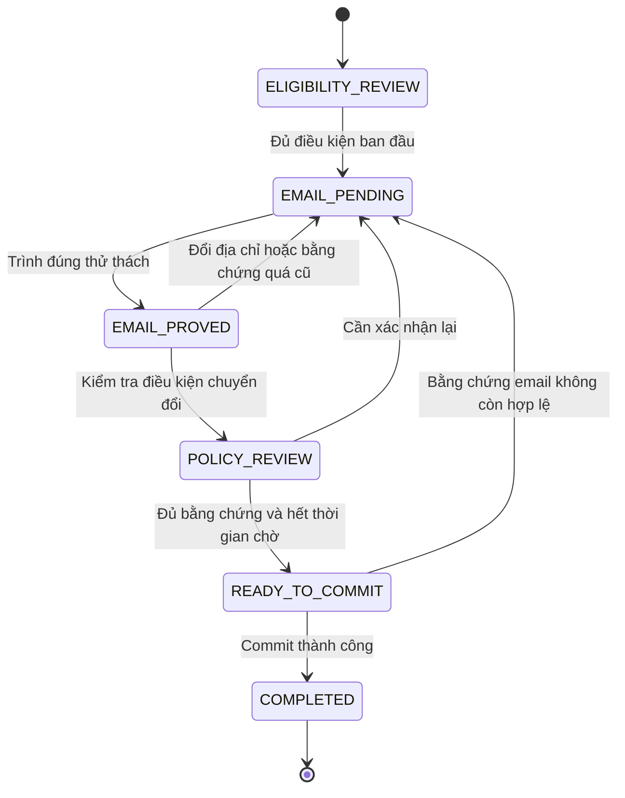
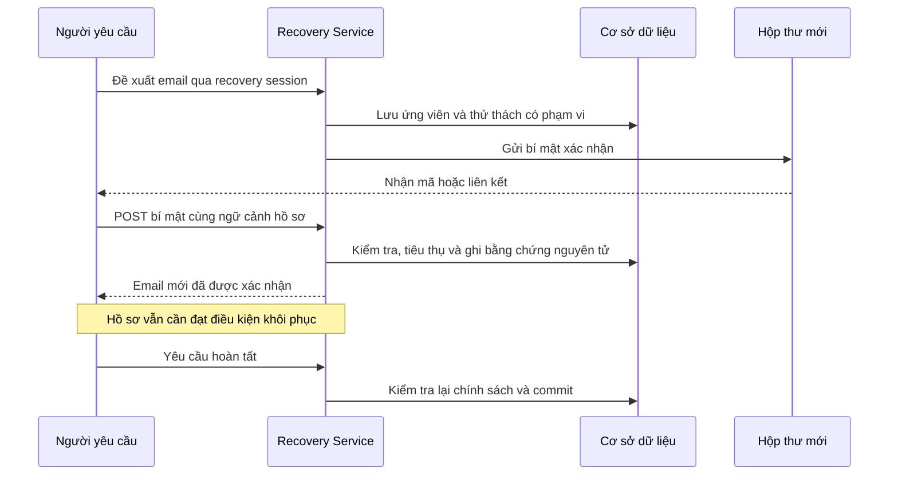

# New email address proof — Chứng minh quyền kiểm soát địa chỉ email mới

## 1. Mục tiêu và phạm vi

Trong chương **Email Address Recovery** của module **SECURITY_AUTHENTICATION_ACCOUNT_RECOVERY**, việc xác nhận địa chỉ email mới là một bước bảo vệ đường khôi phục tài khoản. Người dùng có thể mất mật khẩu, MFA, passkey, thiết bị xác thực hoặc quyền truy cập hộp thư cũ; hệ thống cần xác định địa chỉ thay thế có thực sự nhận được thử thách mà không trao tài khoản cho bất kỳ ai cung cấp được một hộp thư.

Bài học tập trung vào **new email address proof**: thu thập bằng chứng rằng bên đang thực hiện một giao dịch có thể nhận và trình lại bí mật gửi tới địa chỉ email mới. Bằng chứng này phải gắn với đúng tài khoản, đúng hồ sơ khôi phục và đúng phiên bản của địa chỉ được đề xuất.

Sau bài học, người đọc có thể:

- Phân biệt xác thực định dạng email, khả năng gửi thư, quyền kiểm soát hộp thư và quyền khôi phục tài khoản.
- Thiết kế vòng đời thử thách email có giới hạn thời gian, chống dùng lại và chống tráo địa chỉ.
- Xử lý gửi lại, đổi địa chỉ, quét liên kết và xác nhận đồng thời.
- Kết hợp bằng chứng email với đánh giá rủi ro, xác minh người yêu cầu và kiểm soát session.

Các trạng thái, cấu trúc dữ liệu, endpoint và ngưỡng thời gian dưới đây là **thiết kế minh họa** cho bài học. Khi triển khai, cần lựa chọn theo mô hình đe dọa và mức bảo đảm của sản phẩm; chúng không phải cấu hình bắt buộc của mọi hệ thống.

## 2. Bằng chứng email mới thực sự chứng minh điều gì?

Giả sử người dùng đề xuất `new.contact@example.net`. Hệ thống gửi một bí mật chỉ đến địa chỉ đó và nhận lại bí mật hợp lệ. Kết luận có thể rút ra là bên trình bí mật có khả năng tiếp cận đường nhận thư tại thời điểm thử thách.

Kết luận này có giới hạn: người nhận có thể dùng hộp thư chia sẻ, nhận thư chuyển tiếp, bị lộ mã qua phishing hoặc đang sử dụng một hộp thư đã bị chiếm quyền. Hệ thống không quan sát trực tiếp ai là người đọc thư.

| Kiểm tra | Điều kiểm tra hỗ trợ kết luận | Điều chưa được chứng minh |
| --- | --- | --- |
| Kiểm tra cú pháp | Địa chỉ phù hợp định dạng mà sản phẩm hỗ trợ | Hộp thư tồn tại hoặc thuộc về người yêu cầu |
| Kiểm tra thông tin định tuyến thư | Có thông tin phục vụ việc gửi thư | Người yêu cầu nhận được thư |
| Nhà cung cấp báo đã giao thư | Hạ tầng phía nhận đã chấp nhận thư theo ngữ nghĩa của nhà cung cấp | Đúng người dùng đã đọc và đồng ý |
| Trình lại token gửi đến email mới | Có quyền tiếp cận bí mật của thử thách | Người trình là chủ tài khoản cũ |
| Xác minh người yêu cầu khôi phục | Có bằng chứng liên hệ người yêu cầu với tài khoản theo chính sách | Email mới đã được kiểm tra |
| Phê duyệt chuyển email | Các điều kiện thay đổi đã được đáp ứng | Mọi session hoặc authenticator cũ đã an toàn |

NIST SP 800-63B-4 phân biệt mã xác nhận địa chỉ với hoạt động xác thực: email không được sử dụng như một out-of-band authenticator theo tiêu chuẩn này, trong khi mã xác nhận địa chỉ và mã khôi phục thuộc các quy trình riêng. Vì vậy, xác nhận email mới không tự tạo ra một yếu tố MFA hoặc mức bảo đảm đăng nhập cao hơn. [NIST SP 800-63B-4, mục 3.1.3 và 4.2](https://pages.nist.gov/800-63-4/sp800-63b.html)

Trong hệ thống nên diễn đạt kết quả cụ thể:

```text
email_proof = {
    purpose: NEW_EMAIL_PROOF,
    recovery_case_id: rc_7,
    account_id: acc_42,
    candidate_revision: 3,
    destination: new.contact@example.net,
    verified_at: <server timestamp>
}
```

Không nên chỉ lưu một cờ `verified = true` trên hồ sơ khôi phục rồi áp dụng cờ đó cho bất kỳ email nào xuất hiện sau này.

## 3. Tách bằng chứng hộp thư khỏi quyền lấy lại tài khoản

### 3.1. Sai lầm tạo ra vòng tin cậy

Một luồng nguy hiểm có thể diễn ra như sau:

1. Kẻ tấn công nhập tên đăng nhập của nạn nhân.
2. Kẻ tấn công khai báo không còn truy cập email cũ.
3. Hệ thống gửi mã đến email mới do kẻ tấn công tự chọn.
4. Kẻ tấn công nhập đúng mã.
5. Hệ thống chuyển email và cho đặt lại mật khẩu.

Mọi bước gửi và kiểm tra mã có thể hoạt động chính xác, nhưng hệ thống vẫn bị chiếm đoạt tài khoản. Bí mật được gửi đến một địa chỉ do chính người yêu cầu đưa ra; trình lại bí mật đó không chứng minh mối liên hệ với tài khoản nạn nhân.

### 3.2. Hai điều kiện độc lập

Một quyết định chuyển địa chỉ cần ít nhất hai nhóm bằng chứng:

```text
Có quyền thực hiện thay đổi trên tài khoản
    AND
Đã chứng minh quyền kiểm soát đúng email mới
```

Quyền thực hiện thay đổi có thể đến từ một phiên được xác thực lại bằng authenticator còn tin cậy, recovery code được thiết lập trước đó, hoặc một quy trình xác minh khôi phục được sản phẩm chấp nhận. Loại bằng chứng và cách kết hợp phải đáp ứng mức bảo đảm của tài khoản.

Nếu mất toàn bộ phương tiện xác thực, người yêu cầu đi qua nhánh khôi phục riêng. Không dùng kiến thức về tên, ngày sinh hoặc thông tin công khai làm điều kiện thay thế một cách mặc định. Nếu không có đủ bằng chứng độc lập, hồ sơ có thể bị từ chối hoặc chuyển sang quy trình hỗ trợ có kiểm soát.

Bài học chọn trình tự: hồ sơ phải đạt mức đủ điều kiện ban đầu trước khi được gửi thử thách email mới. Một thiết kế khác có thể xác nhận email trước để phục vụ liên lạc, nhưng vẫn phải ngăn email đó trở thành căn cứ duy nhất để phê duyệt khôi phục.

### 3.3. Email cũ có vai trò khác nhau

Trong thay đổi email thông thường, email cũ có thể còn là kênh xác nhận hoặc cảnh báo. Trong khôi phục vì mất hộp thư, bắt buộc nhập mã từ email cũ sẽ khiến người dùng hợp lệ không thể tiếp tục.

Vì vậy, chính sách cần ghi rõ:

- Bằng chứng nào thay thế được điều kiện từ email cũ.
- Kênh cũ nào còn phù hợp để gửi cảnh báo.
- Khi nào phải chờ hoặc cần người có thẩm quyền xem xét.
- Hành động nào bị cấm cho đến khi hồ sơ hoàn tất.

Không tự động khôi phục địa chỉ cũ khi có tranh chấp: địa chỉ đó có thể đã bị chiếm quyền hoặc đã được nhà cung cấp cấp lại cho người khác.

## 4. Các bất biến cần giữ trong thiết kế

Một bất biến là điều phải đúng ở mọi nhánh thực thi, kể cả khi có lỗi hoặc nhiều request cùng lúc.

1. **Địa chỉ đang chờ được tách khỏi địa chỉ đang có hiệu lực.** Tạo thử thách không thay đổi email dùng để đăng nhập, nhận reset mật khẩu hoặc nhận mã khôi phục.
2. **Thử thách có phạm vi chính xác.** Nó thuộc một tenant nếu có, một tài khoản, một hồ sơ khôi phục, một mục đích và một phiên bản địa chỉ.
3. **Đổi địa chỉ làm mất hiệu lực bằng chứng trước đó.** Mã gửi đến A không thể xác nhận B, kể cả khi cùng hồ sơ.
4. **Mỗi bí mật chỉ được chấp nhận một lần.** Hai request đồng thời không được tạo hai lần tiêu thụ thành công.
5. **Hết hạn được kiểm tra khi xử lý.** Không phụ thuộc vào việc tác vụ dọn dữ liệu đã chạy hay chưa.
6. **Quyền của recovery session có giới hạn.** Session tiếp tục hồ sơ không mặc nhiên được đọc dữ liệu tài khoản hoặc sửa MFA.
7. **Xác nhận email không hoàn tất khôi phục.** Bước commit có kiểm tra chính sách và phiên bản tài khoản riêng.
8. **Kết quả xác nhận không có hiệu lực vô hạn.** Khi commit, bằng chứng phải còn nằm trong cửa sổ sử dụng được chính sách cho phép.

Các bất biến này cần thể hiện trong dữ liệu và điều kiện cập nhật phía server. Chỉ vô hiệu hóa nút trên giao diện sẽ không bảo vệ được các API tương ứng.

## 5. Tiếp nhận địa chỉ mới và chính sách so sánh

OWASP khuyến nghị có chính sách chuẩn hóa nhất quán, lưu giá trị hiển thị cùng giá trị so sánh, chuẩn hóa phần domain và thận trọng với biến đổi phụ thuộc nhà cung cấp. Local-part có các đặc tính tương thích riêng, nên việc chuyển đổi phải được xác định rõ trong kiến trúc danh tính. [OWASP Email Validation and Verification](https://cheatsheetseries.owasp.org/cheatsheets/Email_Validation_and_Verification_Cheat_Sheet.html)

Trong thiết kế minh họa, server thực hiện:

1. Kiểm tra kiểu dữ liệu, độ dài và định dạng bằng thư viện phù hợp.
2. Loại bỏ hoặc từ chối ký tự điều khiển, CR/LF và dữ liệu có thể gây chèn header thư.
3. Xác định rõ có hỗ trợ địa chỉ quốc tế hóa hay không; cách xử lý domain IDN phải nhất quán.
4. Lưu địa chỉ phục vụ gửi thư và khóa so sánh theo cùng một chính sách áp dụng ở đăng ký, đăng nhập và khôi phục.
5. Hiển thị địa chỉ đã tiếp nhận để người dùng kiểm tra trước khi gửi.

Ví dụ:

```text
Đầu vào:        Linh.Recovery@Example.NET
Địa chỉ gửi:    Linh.Recovery@example.net
Khóa so sánh:   được tạo theo chính sách local-part đã công bố
```

Không tự xóa dấu chấm hay bỏ phần `+tag` của mọi nhà cung cấp. Hai chuỗi nhìn tương tự hoặc được một nhà cung cấp xử lý tương đương không có nghĩa chúng phải đại diện cho cùng tài khoản trong toàn hệ thống.

Nếu sản phẩm yêu cầu email là duy nhất, phải xác định phạm vi duy nhất: toàn hệ thống hay trong từng tenant. Kiểm tra lúc nhập giúp trải nghiệm tốt hơn; ràng buộc duy nhất trong cơ sở dữ liệu tại thời điểm commit mới quyết định được tranh chấp đồng thời.

Không tự hợp nhất hai tài khoản chỉ vì người yêu cầu nhận được thư ở một email trùng với tài khoản khác. Hợp nhất danh tính là một hành động riêng với điều kiện riêng.

Cũng không nên giữ chỗ email vô thời hạn ngay khi một request ẩn danh được tạo. Nếu có cơ chế giữ chỗ, nó cần hạn ngắn, hạn mức và điều kiện thu hồi để tránh chiếm giữ địa chỉ hàng loạt.

## 6. Mô hình dữ liệu và trạng thái

### 6.1. Tách hồ sơ, địa chỉ ứng viên và thử thách

Có thể tổ chức thành ba đối tượng:

| Đối tượng | Dữ liệu chính | Mục đích |
| --- | --- | --- |
| `RecoveryCase` | ID, account ID, tenant ID, trạng thái, thời hạn, bằng chứng quyền khôi phục, phiên bản tài khoản | Quản lý toàn bộ giao dịch khôi phục |
| `EmailCandidate` | Case ID, revision, địa chỉ đích, khóa so sánh, thời điểm xác nhận, hạn sử dụng bằng chứng | Lưu một đề xuất email cụ thể |
| `EmailChallenge` | ID, case ID, candidate revision, mục đích, digest bí mật, generation, hạn, trạng thái tiêu thụ | Theo dõi một lần phát hành bí mật |

Những trường thường cần cho `EmailChallenge`:

```text
challenge_id
tenant_id
account_id
recovery_case_id
candidate_revision
purpose = NEW_EMAIL_PROOF
generation
secret_digest
issued_at
expires_at
consumed_at
revoked_at
failed_attempts
```

Địa chỉ email là dữ liệu cá nhân. Phân quyền đọc, mã hóa khi lưu theo mô hình đe dọa và thời hạn giữ dữ liệu phải áp dụng cả cho địa chỉ đang chờ. ID khó đoán giúp giảm khả năng dò, nhưng không thay thế kiểm tra quyền truy cập hồ sơ.

### 6.2. Hai vòng đời khác nhau

Trạng thái của hồ sơ có thể là:



Từ mọi trạng thái chưa hoàn tất, hồ sơ còn có thể chuyển sang `CANCELED`, `EXPIRED` hoặc `REJECTED` theo sự kiện tương ứng. Sơ đồ chỉ thể hiện đường đi chính để dễ đọc.

Thử thách có vòng đời riêng:

```text
ACTIVE -> CONSUMED
ACTIVE -> REVOKED
ACTIVE -> hết hạn về mặt hiệu lực khi server_now >= expires_at
```

Một trường trạng thái `EXPIRED` có thể được cập nhật khi dọn dữ liệu, nhưng tính hợp lệ luôn được tính từ thời gian hiện tại. Thử thách mới sau thao tác gửi lại là một bản ghi hoặc generation mới.

## 7. Luồng xác nhận đề xuất

### Bước 1: Thiết lập ngữ cảnh khôi phục

Server tạo hoặc tiếp tục `RecoveryCase` sau bước kiểm tra phù hợp. Recovery session là một capability giới hạn, chỉ cho phép các thao tác được cấp trên hồ sơ đó.

Một chuỗi `case_id` được gửi trong request không phải là bằng chứng quyền truy cập. Server phải kiểm tra session hoặc continuation credential tương ứng và thời hạn của nó.

### Bước 2: Tiếp nhận email ứng viên

Người dùng nhập địa chỉ mới. Server kiểm tra chính sách, tạo `candidate_revision`, lưu ở trạng thái đang chờ và ghi rõ email đang có hiệu lực vẫn giữ nguyên.

Nếu thay đổi ứng viên, server đồng thời thu hồi thử thách cũ và xóa hiệu lực bằng chứng của revision trước.

### Bước 3: Phát hành thử thách

Server tạo bí mật ngẫu nhiên, lưu digest cùng phạm vi ràng buộc và gửi thư đến địa chỉ lấy từ bản ghi ứng viên. Không nhận lại địa chỉ người nhận từ một job hoặc một request không được kiểm chứng.

### Bước 4: Người dùng trình bằng chứng

Người dùng nhập mã hoặc mở trang xác nhận rồi chủ động gửi xác nhận. Server kiểm tra cả bí mật lẫn quyền tiếp tục hồ sơ.

Nếu người dùng mở thư ở thiết bị khác, có thể yêu cầu nhập mã vào màn hình khôi phục ban đầu. Nếu hỗ trợ chuyển thiết bị, cần một cơ chế tiếp tục riêng có thời hạn và phạm vi giới hạn; biết `case_id` hoặc nhận được email mới không được tự cấp quyền khôi phục trên thiết bị đó.

### Bước 5: Tiêu thụ thử thách và ghi nhận bằng chứng

Trong một transaction, server tiêu thụ thử thách và ghi nhận bằng chứng cho đúng revision. Thất bại ở một bước làm rollback toàn bộ việc tiêu thụ và ghi nhận.

### Bước 6: Đánh giá điều kiện chuyển đổi

Hệ thống xét quyền khôi phục, thời gian chờ nếu có, cảnh báo tranh chấp, tình trạng tài khoản và tuổi của bằng chứng email. Có thể yêu cầu xác nhận lại nếu thời gian xét duyệt kéo dài.

### Bước 7: Commit và kiểm soát quyền truy cập

Chỉ khi đủ điều kiện, hệ thống cập nhật email có hiệu lực, áp dụng thay đổi session và vô hiệu hóa các quyền khôi phục không còn phù hợp. Việc đăng ký lại MFA hoặc passkey tiếp tục theo chính sách riêng.



## 8. Thiết kế bí mật dùng một lần

### 8.1. Token ngẫu nhiên đủ dài

OWASP đưa ra các thuộc tính nền tảng cho token khôi phục: sinh bằng bộ tạo ngẫu nhiên mật mã, đủ khó đoán, lưu an toàn, có hạn sử dụng và chỉ dùng một lần. Đây cũng là cơ sở phù hợp khi thiết kế thử thách chứng minh email mới. [OWASP Forgot Password Cheat Sheet](https://cheatsheetseries.owasp.org/cheatsheets/Forgot_Password_Cheat_Sheet.html)

Ví dụ Java dưới đây chỉ minh họa việc tạo **token có entropy cao** và digest, không phải toàn bộ service:

```java
import java.nio.charset.StandardCharsets;
import java.security.MessageDigest;
import java.security.NoSuchAlgorithmException;
import java.security.SecureRandom;
import java.util.Base64;

public final class EmailProofSecrets {
    private static final SecureRandom RANDOM = new SecureRandom();

    public record IssuedSecret(String rawToken, byte[] digest) {}

    public static IssuedSecret issue() {
        byte[] randomBytes = new byte[32];
        RANDOM.nextBytes(randomBytes);

        String rawToken = Base64.getUrlEncoder()
                .withoutPadding()
                .encodeToString(randomBytes);

        return new IssuedSecret(rawToken, digest(rawToken));
    }

    public static byte[] digest(String rawToken) {
        try {
            return MessageDigest.getInstance("SHA-256")
                    .digest(rawToken.getBytes(StandardCharsets.US_ASCII));
        } catch (NoSuchAlgorithmException e) {
            throw new IllegalStateException("SHA-256 unavailable", e);
        }
    }

    private EmailProofSecrets() {}
}
```

Ba mươi hai byte ngẫu nhiên tạo không gian bí mật 256 bit; biểu diễn Base64URL không padding của lượng byte này dài 43 ký tự. Server kiểm tra độ dài và bảng ký tự trước khi xử lý, tránh chấp nhận dữ liệu tùy ý quá lớn.

Trong thiết kế này:

- Chỉ digest được lưu ở bảng thử thách.
- Token thô được dùng để tạo thư, không xuất hiện trong response tạo thử thách hoặc log.
- Server tra bản ghi bằng ID thử thách và ngữ cảnh hồ sơ, rồi so sánh digest bằng cơ chế so sánh bí mật phù hợp, ví dụ `MessageDigest.isEqual`.
- Mục đích, địa chỉ và revision được lấy từ dữ liệu server đã lưu, không lấy từ các trường do client gửi để quyết định ý nghĩa token.

SHA-256 ở ví dụ phù hợp với bí mật ngẫu nhiên có entropy cao. Nó không phải hướng dẫn lưu mật khẩu hoặc mã ngắn.

### 8.2. Nếu dùng mã nhập tay

Mã số ngắn thuận tiện khi mở thư trên điện thoại nhưng thực hiện khôi phục trên máy tính. Nó cần kiểm soát chặt hơn vì không gian tìm kiếm nhỏ hơn nhiều.

Với mã sáu chữ số ngẫu nhiên đều, có `10^6` khả năng. Nếu chỉ có năm lần đoán độc lập, xác suất đoán đúng xấp xỉ:

```text
5 / 1.000.000 = 0,000005 = 0,0005%
```

Con số này chỉ mô tả một thử thách với số lượt đoán bị giới hạn thực sự. Kẻ tấn công có thể tăng cơ hội qua nhiều hồ sơ, nhiều lần phát hành và nhiều tài khoản. Không được coi phép tính trên là chứng minh hệ thống đã an toàn.

Để giảm rủi ro dò ngoại tuyến khi lộ cơ sở dữ liệu, có thể lưu mã ngắn bằng HMAC với khóa được quản lý ngoài cơ sở dữ liệu:

```text
code_digest = HMAC-SHA-256(
    server_key,
    encode(purpose, challenge_id, recovery_case_id,
           candidate_revision, destination_key, generation, code)
)
```

`encode` phải có định dạng không nhập nhằng, chẳng hạn các trường có độ dài rõ ràng. Lưu phiên bản khóa để phục vụ xoay khóa; không đưa khóa vào bản ghi thử thách.

HMAC không thay thế giới hạn thử trực tuyến. Cần hạn mức đồng thời theo challenge, hồ sơ, tài khoản, địa chỉ đích và nguồn truy cập. Thao tác gửi lại không được đặt lại toàn bộ ngân sách đoán của hồ sơ.

### 8.3. Mục đích token phải tách biệt

Token xác nhận email mới không được dùng tại endpoint đặt mật khẩu, đăng ký passkey, xóa MFA hoặc đăng nhập.

Nếu dùng JWT, chữ ký chỉ chứng minh tính toàn vẹn của token. Chữ ký không tự bảo đảm dùng một lần, không tự thu hồi được khi đổi địa chỉ và không loại bỏ nhu cầu lưu trạng thái giao dịch. Với luồng cần thu hồi và tiêu thụ nguyên tử, token opaque cùng trạng thái phía server thường dễ thể hiện các bất biến hơn.

## 9. Xác minh nguyên tử và xử lý cạnh tranh

Kiểm tra token thành công trong bộ nhớ rồi cập nhật dữ liệu ở những transaction khác nhau có thể tạo lỗ hổng dùng lại.

Ví dụ có lỗi:

```text
if token_is_valid:
    set_email_proved()
    mark_token_consumed()
```

Hai request có thể cùng đọc `consumed_at = null` và cùng được coi là lần dùng đầu tiên.

### 9.1. Quy trình minh họa với khóa hàng

Pseudocode dưới đây mô tả các bước liên quan trong **một transaction cơ sở dữ liệu**:

```text
verifyNewEmail(recoverySession, challengeId, presentedSecret):

    Xác thực recoverySession, kiểm tra CSRF nếu dùng cookie
    Kiểm tra kích thước/định dạng request và hạn mức nguồn truy cập

    BEGIN

    Khóa RecoveryCase thuộc session bằng SELECT ... FOR UPDATE
    Khóa EmailCandidate hiện tại
    Khóa EmailChallenge theo challengeId thuộc đúng hồ sơ

    Lấy thời gian hiện tại từ nguồn thời gian có thẩm quyền

    Kiểm tra:
        tenant/account/case phù hợp với ngữ cảnh server
        hồ sơ đang chờ email và chưa hết hạn
        quyền tiếp tục hồ sơ chưa bị thu hồi
        purpose == NEW_EMAIL_PROOF
        candidate_revision == revision hiện tại
        challenge còn là generation có hiệu lực
        consumed_at và revoked_at đều rỗng
        now < expires_at
        ngân sách thử của challenge và hồ sơ còn cho phép

    Nếu bí mật không khớp:
        tăng bộ đếm thất bại liên quan một cách nguyên tử
        thu hồi challenge nếu đạt ngưỡng
        ghi sự kiện thất bại không chứa bí mật
        COMMIT nhánh thất bại
        trả lỗi phù hợp

    Nếu bí mật khớp:
        đánh dấu consumed_at
        ghi proof cho đúng revision và hạn dùng proof
        chuyển hồ sơ sang EMAIL_PROVED
        thu hồi các challenge còn lại cho ứng viên này
        ghi sự kiện thành công/outbox
        COMMIT

    Trả kết quả xác nhận, không cấp access token đăng nhập
```

Điểm dễ sai là ném exception khiến transaction rollback luôn bộ đếm thất bại. Nếu dùng exception để điều khiển luồng, cần bảo đảm nhánh lưu số lần thử được commit theo thiết kế. Cũng cần kiểm soát ngân sách nhiều chiều để đổi challenge không làm mất lịch sử lạm dụng.

Mọi thao tác đổi ứng viên, gửi lại, hủy hồ sơ và tiêu thụ thử thách cần thống nhất thứ tự khóa, chẳng hạn hồ sơ trước rồi đến ứng viên và thử thách. Điều này vừa bảo vệ tính nhất quán vừa giảm deadlock.

Có thể dùng optimistic locking hoặc cập nhật có điều kiện thay khóa bi quan, nhưng khi đó phải kiểm tra số hàng bị ảnh hưởng. Thao tác cập nhật tiêu thụ với kết quả bằng không không được tiếp tục ghi proof.

### 9.2. Cạnh tranh giữa xác nhận và thay email

Giả sử token `T1` được gửi cho revision 1, rồi người dùng đổi sang revision 2.

- Nếu thao tác đổi địa chỉ commit trước, `T1` phải bị từ chối.
- Nếu xác nhận revision 1 commit trước, thao tác đổi địa chỉ tiếp theo phải xóa hiệu lực proof của revision 1.
- Trong cả hai thứ tự, không được tồn tại proof cho revision 2 được tạo bởi `T1`.

Khóa chung trên hồ sơ hoặc kiểm tra phiên bản có điều kiện làm cho hai thao tác có thứ tự xác định.

### 9.3. Retry sau khi mất response

Server có thể commit thành công nhưng response bị mất. Nếu client gửi lại, không được tiêu thụ token lần nữa.

Có thể trả trạng thái hiện tại của proof cho recovery session đang có quyền, hoặc dùng idempotency key gắn với cùng session và nội dung thao tác. Việc trả lại kết quả đã lưu chỉ là đọc kết quả của lần xử lý trước, không phải chấp nhận lại bí mật để cấp quyền mới.

## 10. Thời hạn, gửi lại và đổi địa chỉ

### 10.1. Các thời hạn phục vụ mục đích khác nhau

| Thời hạn | Vai trò |
| --- | --- |
| Hạn challenge | Giới hạn thời gian trình bí mật |
| Hạn recovery session | Giới hạn thời gian thao tác của ngữ cảnh tiếp tục |
| Hạn toàn bộ hồ sơ | Giới hạn thời gian tồn tại giao dịch khôi phục |
| Hạn sử dụng proof | Ngăn một xác nhận quá cũ được dùng để commit |
| Thời gian chờ trước commit | Tạo cửa sổ phát hiện và xử lý rủi ro khi chính sách yêu cầu |

Ví dụ sản phẩm có thể chọn token có hiệu lực 15 phút, khoảng cách gửi lại tối thiểu 60 giây và một hạn cứng cho toàn hồ sơ. Đây là giá trị minh họa; cần kiểm tra độ trễ gửi thư, nhu cầu tiếp cận và rủi ro thực tế.

Không đánh đồng thời gian chờ với thời gian sống token. Token có thể đã được tiêu thụ rồi trong khi hồ sơ còn chờ xét duyệt. Nếu proof quá cũ trước khi được phép commit, tạo thử thách mới để làm mới bằng chứng, thay vì kéo dài token cũ vô hạn.

### 10.2. Gửi lại theo generation

Bài học chọn chính sách **chỉ generation mới nhất có hiệu lực**:

1. Kiểm tra cooldown và hạn mức gửi.
2. Khóa hồ sơ và xác nhận ứng viên chưa đổi.
3. Thu hồi challenge cũ.
4. Tăng generation và tạo bí mật mới.
5. Gửi thư mới với thông báo rằng mã trước đó không còn dùng được.

Nhà cung cấp thư có thể giao các thư không đúng thứ tự. Giao diện phải giải thích điều này và hướng dẫn dùng yêu cầu gửi gần nhất.

Gửi lại không kéo dài hạn cứng của hồ sơ. Nếu cần mở hồ sơ mới, đó phải là một quyết định qua kiểm tra điều kiện, không phải tác dụng phụ của nút gửi lại.

### 10.3. Đổi địa chỉ không phải gửi lại

Đổi từ `a@example.net` sang `b@example.net` phải tạo revision mới, thu hồi mọi challenge liên quan đến A và xóa proof trước đó. Nếu hồ sơ đã bước vào giai đoạn đóng băng thay đổi, có thể phải hủy hoặc quay lại bước đánh giá theo chính sách.

Không cho client sửa trực tiếp trường địa chỉ trong request xác nhận. Endpoint xác nhận chỉ dùng địa chỉ ứng viên đã được server lưu và ràng buộc.

### 10.4. Lỗi gửi thư và transaction

Không giữ transaction cơ sở dữ liệu trong lúc gọi nhà cung cấp thư. Một lựa chọn là lưu challenge và công việc gửi bằng transactional outbox.

Nếu outbox chứa token thô hoặc nội dung thư chứa token, payload đó là bí mật: cần mã hóa, phân quyền, hạn giữ ngắn và loại bỏ khỏi log, dead-letter queue không kiểm soát và màn hình quản trị. Việc bảng challenge chỉ lưu digest không có nghĩa toàn hệ thống đã không còn bản token thô.

Worker gửi thư cần kiểm tra challenge chưa bị thu hồi và còn đủ thời gian sử dụng. Retry cùng job nên gửi cùng challenge; tránh vô tình tạo generation mới mỗi lần retry. Token hết hạn không được tự kéo dài chỉ vì hàng đợi bị chậm.

## 11. Liên kết xác nhận, mã nhập tay và trình quét email

### 11.1. GET không làm thay đổi trạng thái xác nhận

Hạ tầng bảo vệ email có thể tự mở liên kết trước người dùng. Do đó:

```text
GET /recovery/new-email/confirm
    -> hiển thị trang hoặc hướng dẫn
    -> không tiêu thụ challenge
    -> không chuyển email có hiệu lực

POST /recovery/new-email/proofs
    -> xử lý bằng chứng sau thao tác chủ động
    -> yêu cầu ngữ cảnh khôi phục phù hợp
```

Trang xác nhận không nên tự gửi POST ngay khi tải xong. Chỉ dùng POST cũng chưa đủ nếu trang tự thực hiện thao tác hoặc nếu mất kiểm soát session; phải giữ yêu cầu người dùng chủ động và quyền trên hồ sơ.

Nếu người dùng không có recovery session trên thiết bị đọc thư, trang có thể hướng dẫn nhập mã tại màn hình khôi phục đang mở. Không tạo session có quyền thay đổi tài khoản chỉ từ một lượt mở link.

### 11.2. Hạn chế rò rỉ token

OWASP lưu ý sử dụng HTTPS, tạo URL từ domain tin cậy thay vì tin trực tiếp Host header, và hạn chế rò rỉ qua referrer khi dùng token trong URL. [OWASP Forgot Password Cheat Sheet, URL Tokens](https://cheatsheetseries.owasp.org/cheatsheets/Forgot_Password_Cheat_Sheet.html#url-tokens)

Áp dụng cho thiết kế này:

- Dùng origin đã cấu hình, ví dụ `https://accounts.example.com`; đường dẫn quay về nằm trong allowlist hoặc cố định.
- Không gắn analytics, quảng cáo, chat widget hoặc tracking pixel lên trang có bí mật.
- Tắt theo dõi click đối với thư có link chứa token nếu nhà cung cấp hỗ trợ.
- Cấu hình `Referrer-Policy: no-referrer` và `Cache-Control: no-store` cho phản hồi nhạy cảm.
- Che token ở reverse proxy, APM, error reporting và log request body.
- Sau khi tiếp nhận token vào một ngữ cảnh giới hạn, chuyển tới URL sạch hoặc thay URL hiển thị khi phù hợp.

Token trong query string có thể lọt vào access log và lịch sử trình duyệt. Token trong URL fragment không tự được gửi tới server trong HTTP request, nhưng JavaScript, extension và xử lý phía mail client vẫn có thể đọc nó. Fragment không thay thế các biện pháp bảo vệ trang.

Nếu cung cấp cả mã và link, không vô tình tạo hai bí mật độc lập với hai ngân sách thử và hai lần sử dụng. Chúng phải cùng trỏ tới một thử thách tiêu thụ duy nhất hoặc có chính sách thu hồi chéo rõ ràng.

## 12. API và trải nghiệm người dùng

### 12.1. Hợp đồng API minh họa

Các endpoint dưới đây đều nằm trong phạm vi một recovery session hợp lệ:

| Endpoint | Hành vi chính | Điều cần kiểm soát |
| --- | --- | --- |
| `PUT /recovery/cases/current/new-email` | Tiếp nhận hoặc thay ứng viên | Kiểm tra quyền, tăng revision, xóa proof cũ |
| `POST /recovery/cases/current/new-email/challenges` | Phát hành hoặc gửi lại thử thách | Cooldown, hạn mức, generation |
| `POST /recovery/cases/current/new-email/proofs` | Trình mã hoặc token | CSRF, thời hạn, tiêu thụ nguyên tử |
| `GET /recovery/cases/current/status` | Đọc tiến độ được phép hiển thị | Không lộ dữ liệu tài khoản ngoài quyền session |
| `POST /recovery/cases/current/commit` | Hoàn tất khi đủ điều kiện | Chính sách, phiên bản, duy nhất email, session |

Request chứng minh có thể là:

```json
{
  "challengeId": "ch_opaque_random",
  "secret": "<token-or-code-received-by-email>"
}
```

Request không cần `accountId`, `verified`, `purpose` hoặc `newEmail` do client tự khai để quyết định đối tượng xác nhận. Nếu truyền ID định tuyến, server vẫn phải xác định quyền và phạm vi từ dữ liệu tin cậy.

Response thành công nên thể hiện đúng mức tiến triển:

```json
{
  "emailProofStatus": "VERIFIED",
  "recoveryStatus": "POLICY_REVIEW",
  "nextAction": "WAIT_FOR_REVIEW"
}
```

Không trả access token đăng nhập chỉ vì endpoint proof thành công.

### 12.2. Thông báo rõ và không làm lộ tài khoản

Trước khi có quyền xem hồ sơ, phản hồi công khai cần tránh làm lộ tài khoản có tồn tại hay email đích đang thuộc tài khoản nào. Trong ngữ cảnh khôi phục đã được xác minh thích hợp, có thể cung cấp hướng dẫn cụ thể hơn mà vẫn giữ giới hạn dữ liệu.

Ví dụ thông báo:

- Khi gửi: “Nếu yêu cầu đáp ứng điều kiện, hệ thống sẽ gửi hướng dẫn đến địa chỉ bạn vừa cung cấp.”
- Khi sai hoặc hết hiệu lực: “Mã không hợp lệ hoặc không còn hiệu lực. Kiểm tra yêu cầu gửi gần nhất.”
- Khi proof thành công: “Địa chỉ email mới đã được xác nhận. Yêu cầu khôi phục vẫn đang được xử lý.”
- Khi hết hạn phiên: “Phiên khôi phục đã hết hạn. Hãy tiếp tục bằng quy trình khôi phục được hỗ trợ.”

Không cung cấp cho người ngoài một endpoint kiểm tra token để tra ra account ID, email đầy đủ hoặc trạng thái đặc quyền của tài khoản. Cũng không để người dùng suy ra dữ liệu qua khác biệt rõ rệt về thời gian trả lời hoặc nội dung lỗi.

### 12.3. Nội dung email nên giới hạn

Ví dụ thư với mã nhập tay:

```text
Tiêu đề: Xác nhận địa chỉ email cho yêu cầu khôi phục

Bạn đang xác nhận địa chỉ này cho một yêu cầu khôi phục tài khoản.

Mã xác nhận: <mã được sinh ngẫu nhiên>
Mã có hiệu lực 15 phút kể từ khi phát hành.

Nhập mã tại màn hình khôi phục bạn đang sử dụng.
Nhân viên hỗ trợ không yêu cầu bạn đọc hoặc gửi mã cho họ.

Việc xác nhận địa chỉ này chưa hoàn tất quá trình khôi phục.
Nếu bạn không thực hiện yêu cầu, hãy bỏ qua thư này.
```

Hạn ghi trong thư phải tương ứng với hạn thật phía server. Không đưa mã thật vào tiêu đề hoặc gửi kèm dữ liệu cá nhân của tài khoản cũ đến một địa chỉ chưa được tin cậy.

Có thể hiển thị mã tham chiếu giao dịch không nhạy cảm để người dùng phân biệt nhiều yêu cầu. Không dùng mã tham chiếu đó làm bí mật khôi phục.

## 13. Chống lạm dụng và giới hạn của bằng chứng

| Rủi ro | Biện pháp trong thiết kế | Giới hạn cần nhớ |
| --- | --- | --- |
| Dò mã ngắn | Giới hạn thử theo nhiều chiều, thu hồi khi đạt ngưỡng | Chỉ giới hạn theo IP có thể bị vượt qua |
| Spam hoặc email bombing | Cooldown, hạn mức đích nhận, hạn mức tài khoản, kiểm soát chi phí | Người gửi có thể đổi nguồn và tạo nhiều hồ sơ |
| Chiếm giữ email ứng viên | Hạn giữ chỗ ngắn và yêu cầu quyền phù hợp | Giữ chỗ ẩn danh vô hạn gây từ chối dịch vụ |
| CSRF thay ứng viên | Kiểm tra CSRF và Origin phù hợp khi dùng cookie | POST và SameSite riêng lẻ không bao phủ mọi mô hình |
| Đánh cắp token từ log | Che dữ liệu nhạy cảm ở mọi tầng | Bảng challenge sạch vẫn có thể còn token trong queue |
| Social engineering | Thư nêu rõ mục đích, không yêu cầu chia sẻ mã | Người dùng vẫn có thể bị dụ chuyển tiếp bí mật |
| Tráo tenant hoặc hồ sơ | Ràng buộc server-side và kiểm tra quyền mỗi request | ID ngẫu nhiên không phải authorization |
| Hộp thư chia sẻ hoặc bị chiếm | Kết hợp bằng chứng độc lập và đánh giá rủi ro | Nhận được thư không chứng minh cá nhân duy nhất |

Không khóa đăng nhập của nạn nhân chỉ vì có nhiều request khôi phục ẩn danh. Ưu tiên hạn chế luồng khôi phục hoặc nguồn gây lạm dụng, đồng thời duy trì đường hỗ trợ phù hợp cho người dùng hợp lệ.

IP, vị trí, thiết bị mới và lịch sử thay đổi là các tín hiệu đánh giá rủi ro. Không dùng IP làm danh tính, cũng không bắt buộc mọi bước phải giữ nguyên IP vì người dùng có thể chuyển mạng hoặc dùng trình duyệt khác.

Hộp thư tạm thời, domain mới hoặc địa chỉ dùng chung có thể cần chính sách riêng. Danh sách chặn không chứng minh địa chỉ còn lại là an toàn và không thay thế thử thách.

SPF, DKIM và DMARC hỗ trợ chống giả mạo thư gửi từ domain của dịch vụ khi được cấu hình và kiểm tra phù hợp. Chúng không chứng minh người trình mã là chủ tài khoản cần khôi phục.

## 14. Từ email đã xác nhận đến chuyển đổi có kiểm soát

Ở thời điểm commit, server cần đánh giá điều kiện hiện tại thay vì tin vào quyết định cũ:

```text
can_commit =
    recovery_authorization_is_still_valid
    AND case_is_open_and_not_expired
    AND proof_matches_current_candidate_revision
    AND proof_is_recent_enough
    AND risk_policy_allows_commit
    AND required_wait_has_elapsed
    AND no_active_dispute_or_hold
    AND account_security_version_is_compatible
    AND email_uniqueness_constraint_can_be_satisfied
```

Nếu tài khoản bị khóa bảo mật hoặc chủ tài khoản thay đổi thông tin trong lúc hồ sơ đang chờ, `security_version` có thể thay đổi. Hồ sơ cũ cần được đánh giá lại hoặc vô hiệu hóa theo chính sách. Không để một phê duyệt cũ ghi đè trạng thái bảo mật mới.

Commit cần cập nhật email và trạng thái hồ sơ trong một transaction. Khi có hệ thống session hoặc dịch vụ bên ngoài, dùng cơ chế phối hợp có retry và kiểm soát quyền tương ứng, chẳng hạn tăng `session_epoch` được kiểm tra khi cấp hoặc sử dụng session, rồi phát sự kiện thu hồi qua outbox.

Nếu access token được xác minh hoàn toàn ngoại tuyến và không kiểm tra epoch hoặc revocation, thay email không thể tự làm mọi token cũ mất hiệu lực ngay. Kiến trúc phải xác định độ trễ thu hồi chấp nhận được và cách hạn chế hành động nhạy cảm trong khoảng đó.

Tại mốc hoàn tất khôi phục, chính sách cần xử lý:

- Recovery session và continuation credential của hồ sơ đã hoàn tất.
- Các request khôi phục cạnh tranh và liên kết khôi phục còn tồn tại.
- Session và refresh token cũ, đặc biệt khi nghi bị chiếm đoạt.
- Quyền reset mật khẩu qua email cũ sau khi chuyển đổi.
- Việc đăng ký lại MFA, passkey và recovery code nếu có bằng chứng chúng bị lộ hoặc đã mất.

Xác nhận email không tự cho phép xóa mọi authenticator. Việc thay authenticator phải là một phần được cấp quyền rõ ràng trong quy trình khôi phục.

Gửi cảnh báo đến các kênh thông báo phù hợp đã thiết lập từ trước, bao gồm email cũ khi còn phù hợp, và thông báo kết quả đến email mới sau commit. Cảnh báo cần có đường báo cáo hoạt động bất thường. Nếu có chức năng hủy hoặc tranh chấp, nó cần capability riêng và chính sách riêng; không tái sử dụng token `NEW_EMAIL_PROOF`.

## 15. Nhật ký và khả năng vận hành

Các sự kiện có thể ghi:

```text
NEW_EMAIL_CANDIDATE_SET
NEW_EMAIL_CHALLENGE_ISSUED
NEW_EMAIL_DELIVERY_FAILED
NEW_EMAIL_PROOF_REJECTED
NEW_EMAIL_PROVED
NEW_EMAIL_CHALLENGE_REVOKED
EMAIL_RECOVERY_COMMITTED
EMAIL_RECOVERY_CANCELED
```

Mỗi sự kiện có thể chứa correlation ID, case ID, candidate revision, generation, thời điểm server, phiên bản chính sách và mã lý do nội bộ. Chỉ những người có quyền mới được xem mối liên hệ với tài khoản.

Không ghi token thô, mã, cookie, recovery credential hoặc toàn bộ URL nhạy cảm. Địa chỉ email đầy đủ cần được che hoặc bảo vệ theo nhu cầu điều tra cụ thể. Nếu cần liên kết thống kê theo địa chỉ, keyed HMAC thường phù hợp hơn hash không khóa của email dễ đoán; kết quả vẫn là dữ liệu có thể liên kết và cần kiểm soát truy cập.

Các số liệu vận hành hữu ích gồm tỷ lệ thư lỗi, độ trễ giao thư, tỷ lệ hết hạn trước khi xác nhận, tỷ lệ gửi lại, số lần bị hạn chế và số hồ sơ bị tranh chấp. Phân tách lỗi nhà cung cấp thư khỏi lỗi trình mã để tránh hiểu sai rằng mọi thất bại đều do người dùng.

Nếu dịch vụ thư gặp sự cố, không bỏ qua bước proof. Hiển thị trạng thái phù hợp và cung cấp đường tiếp tục được hỗ trợ; không âm thầm nâng một địa chỉ chưa xác nhận thành địa chỉ đáng tin cậy.

## 16. Ví dụ xuyên suốt và các tình huống cần kiểm chứng

Linh mất quyền truy cập email cũ nhưng còn một passkey đã đăng ký. Chính sách sản phẩm chấp nhận xác minh bằng passkey đó để tiếp tục thay kênh khôi phục.

1. Linh hoàn thành bước xác minh, nhận recovery session chỉ có quyền trên hồ sơ `rc_7`.
2. Linh nhập nhầm `linh.recover@example.net`. Server tạo revision 1 và challenge `ch_1`.
3. Linh sửa thành `linh.recovery@example.net`. Server tạo revision 2, thu hồi `ch_1`.
4. Một người ở địa chỉ nhập nhầm nhận được mã của `ch_1`. Mã này không còn hiệu lực và cũng không tự tạo quyền trên hồ sơ.
5. Linh nhập mã của revision 2 vào màn hình khôi phục. Server tiêu thụ challenge và ghi proof cho revision 2.
6. Chính sách kiểm tra điều kiện commit. Email đang có hiệu lực chỉ thay đổi sau khi bước này thành công.
7. Hệ thống áp dụng chính sách session, thu hồi quyền khôi phục đã dùng và gửi thông báo.

Nếu Linh đồng thời mất passkey và mọi bằng chứng đã thiết lập, việc nhận được thư ở địa chỉ mới chỉ hoàn thành một phần của hồ sơ. Hệ thống vẫn phải giải quyết câu hỏi ai có quyền lấy lại tài khoản.

Các tình huống sau giúp kiểm chứng các bất biến khi triển khai:

| Tình huống | Kết quả mong đợi |
| --- | --- |
| Chỉ có email mới, không có bằng chứng quyền khôi phục | Không chuyển email hoặc cấp quyền tài khoản |
| Trình mã đúng cho ứng viên hiện tại trong hồ sơ hợp lệ | Tiêu thụ một lần, ghi proof đúng revision |
| Trình mã đã dùng | Không tạo lần tiêu thụ hoặc quyền mới |
| Hai request trình cùng mã đồng thời | Chỉ một lần tiêu thụ; request còn lại đọc trạng thái hoặc bị từ chối theo hợp đồng |
| Trình mã của revision trước sau khi sửa địa chỉ | Bị từ chối |
| Dùng token email tại endpoint reset mật khẩu | Bị từ chối do sai mục đích và phạm vi |
| Dùng challenge của tenant hoặc hồ sơ khác | Bị từ chối dù bí mật đúng |
| Trình mã tại hoặc sau thời điểm hết hạn | Bị từ chối kể cả bản ghi chưa được dọn |
| Gửi lại để tránh giới hạn đoán | Ngân sách hồ sơ và hạn mức liên quan vẫn còn hiệu lực |
| Trình quét tự mở liên kết | Không xác nhận và không tiêu thụ challenge qua GET |
| Session khôi phục hết hạn nhưng token email còn hạn | Không tự cấp quyền tiếp tục; yêu cầu khôi phục ngữ cảnh theo chính sách |
| Email bị tài khoản khác chiếm trong lúc chờ commit | Ràng buộc duy nhất ngăn ghi đè hoặc hợp nhất |
| Phê duyệt kéo dài quá hạn sử dụng proof | Yêu cầu xác nhận lại trước commit |
| Transaction proof lỗi sau khi định tiêu thụ | Rollback cả tiêu thụ lẫn proof, không tạo trạng thái thành công một phần |
| Response thành công bị mất | Retry không sinh thêm quyền hoặc tác dụng phụ |
| Hệ thống thư ngừng hoạt động | Giữ ứng viên chưa được xác nhận, không bỏ qua kiểm soát |

Điều kiện đạt của bước **new email address proof** là có bằng chứng còn hợp lệ cho đúng địa chỉ ứng viên trong đúng hồ sơ, với thử thách đã được tiêu thụ có kiểm soát. Quyền chuyển email và quyền truy cập tài khoản tiếp tục phụ thuộc vào toàn bộ chính sách khôi phục.
