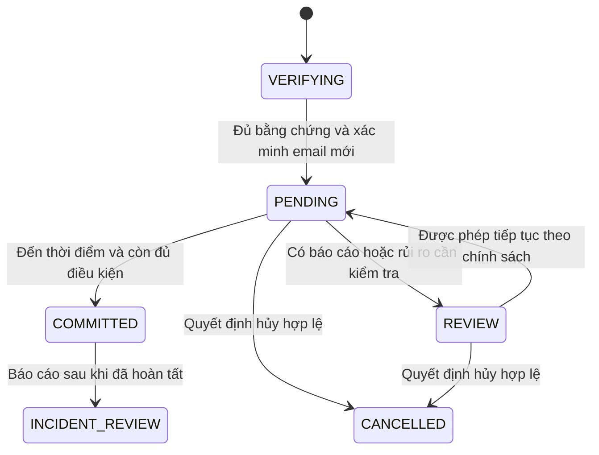

# Thông báo tới địa chỉ email cũ khi khôi phục email tài khoản

## 1. Email cũ là kênh cảnh báo, không mặc nhiên là người phê duyệt

Trong chương **Email Address Recovery**, một thay đổi địa chỉ email có thể làm thay đổi nơi nhận liên kết đặt lại mật khẩu, cảnh báo bảo mật và các bằng chứng khôi phục khác. **Old email address notification** là thông báo gửi tới địa chỉ email trước thay đổi để chủ tài khoản có cơ hội nhận biết và phản ứng khi thay đổi không do mình thực hiện.

Trong phạm vi `SECURITY_AUTHENTICATION_ACCOUNT_RECOVERY`, người dùng có thể mất mật khẩu, MFA, passkey hoặc thiết bị xác thực, đồng thời không còn truy cập được email cũ. Vì vậy, cần phân biệt ba việc:

- **Xác minh quyền sở hữu tài khoản:** quyết định ai được phép yêu cầu khôi phục hoặc thay email.
- **Xác minh email mới:** xác định người yêu cầu có thể hoàn tất thử thách tại địa chỉ mới.
- **Cảnh báo email cũ:** thông báo một sự kiện bảo mật tới kênh trước đó theo chính sách.

Ba việc có thể nằm trong cùng một quy trình, nhưng không có cùng ý nghĩa. Kiểm soát email mới không tự chứng minh quyền sở hữu tài khoản cũ. Gửi cảnh báo tới email cũ cũng không chứng minh chủ tài khoản đã đọc hoặc đồng ý.

Ví dụ, Hạnh mất quyền truy cập hộp thư cũ và hoàn tất một quy trình khôi phục bằng các bằng chứng được hệ thống chấp nhận. Cảnh báo tới hộp thư cũ vẫn có thể hữu ích nếu Hạnh lấy lại được hộp thư hoặc còn một thiết bị đọc thư. Nhưng nếu bắt buộc bấm phê duyệt trong chính hộp thư đã mất mà không có đường xác minh khác, quy trình khôi phục sẽ không giải quyết được tình huống ban đầu.

Ngược lại, nếu hộp thư cũ đã bị kẻ tấn công kiểm soát, trao cho bất kỳ người đọc thư nào quyền tự động khôi phục email cũ có thể làm người dùng không bao giờ lấy lại được tài khoản.

## 2. Thông báo sự kiện nào và vào thời điểm nào?

### 2.1. Không gửi cảnh báo thay đổi cho mọi yêu cầu công khai

Một người ngoài chỉ cần biết định danh có thể gửi yêu cầu khôi phục. Nếu mỗi lần gửi đều tạo thư cảnh báo chi tiết, hệ thống có thể trở thành công cụ quấy rối hoặc tiết lộ thông tin.

Thông báo tới email cũ nên gắn với một mốc đã được chính sách xác định, chẳng hạn một yêu cầu thay email đã vượt qua bước xác minh ban đầu và được ghi nhận thành giao dịch bảo mật. Yêu cầu công khai chưa có bằng chứng có thể được xử lý bằng phản hồi trung tính và cơ chế chống lạm dụng, không mặc nhiên phát cùng loại cảnh báo như một thay đổi đã được cho phép.

### 2.2. Phân biệt đang chờ với đã hoàn tất

| Sự kiện | Nội dung cần nói đúng | Điều không được suy ra |
|---|---|---|
| Yêu cầu khôi phục đã được tiếp nhận theo chính sách | Có một yêu cầu đang được xử lý | Email mới đã có quyền khôi phục |
| Thay đổi đang chờ hiệu lực | Trạng thái chờ, thời điểm dự kiến nếu có, cách báo bất thường | Việc gửi thư đồng nghĩa chủ tài khoản đã chấp thuận |
| Thay đổi đã hoàn tất | Email khôi phục đã được cập nhật tại thời điểm cụ thể | Mật khẩu, MFA, passkey và mọi phiên đều đã được xử lý cùng lúc |
| Yêu cầu đã bị hủy | Giao dịch cụ thể đã bị hủy thật sự | Tài khoản chắc chắn không có sự cố khác |
| Yêu cầu đang được rà soát | Có một bước kiểm tra hoặc tạm giữ đang áp dụng | Thay đổi đã bị đảo ngược hoặc email cũ đã được khôi phục |

Không dùng một mẫu “Email đã được thay đổi” cho cả trạng thái chờ và hoàn tất. Một thông điệp sai trạng thái có thể khiến chủ tài khoản bỏ qua cửa sổ phản ứng, hoặc tin rằng email mới chưa hoạt động trong khi thực tế đã có quyền khôi phục.

### 2.3. Thông báo và thời gian chờ là hai cơ chế khác nhau

Một khoảng chờ có thể giúp phát hiện thay đổi đáng ngờ, nhưng chỉ đợi thời gian trôi qua không chứng minh danh tính. Việc người nhận không phản hồi cũng không phải một bằng chứng đồng ý.

Nếu sản phẩm có thời điểm dự kiến có hiệu lực, thời điểm đó cần được lưu bền vững và dùng nhất quán trong thông điệp lẫn quyết định cuối. Không bắt đầu lại hoặc rút ngắn cửa sổ chỉ vì worker thử gửi lại thư.

Nếu chính sách hứa cung cấp một khoảng cảnh báo có thể phản ứng, cần định nghĩa cách xử lý khi thư chưa gửi được. Nhà cung cấp chấp nhận thư không bảo đảm người dùng đã đọc. Có thể cần gia hạn, thêm bằng chứng hoặc chuyển tuyến; không nên hứa một bảo đảm mà hạ tầng chuyển phát không chứng minh được.

## 3. Người nhận là email trước thay đổi, không phải email hiện tại khi gửi

### 3.1. Lấy địa chỉ cũ từ trạng thái có thẩm quyền

Email cũ phải được xác định từ hồ sơ kênh liên hệ và giao dịch thay đổi phía máy chủ. Không cho người yêu cầu nhập một trường `oldEmail` bất kỳ rồi dùng nó làm đích gửi cảnh báo chứa thông tin tài khoản.

Không mặc định mọi email từng xuất hiện trong hồ sơ đều phù hợp nhận cảnh báo. Cần biết địa chỉ đó đã được xác minh hoặc được phép dùng cho loại thông báo này, còn nằm trong phạm vi chính sách hay có dấu hiệu bị cấp lại cho người khác không.

Nếu không có đích cũ đủ điều kiện, hệ thống cần ghi nhận lý do và dùng các kênh cảnh báo độc lập còn được phép nếu có. Không tự gửi tới một địa chỉ lịch sử không rõ nguồn chỉ để đánh dấu đã cảnh báo.

### 3.2. Giữ ảnh chụp người nhận cho đúng sự kiện

Giả sử thay đổi từ email A sang B đã commit, rồi công việc cảnh báo mới chạy. Nếu worker đọc `account.currentEmail`, nó sẽ gửi cảnh báo tới B thay vì A. Cảnh báo mất mục đích ban đầu vì chính kênh mới nhận được thông báo đáng lẽ phải tới kênh trước đó.

Một sự kiện cần tham chiếu hoặc giữ ảnh chụp được bảo vệ của địa chỉ cũ tại thời điểm giao dịch:

```text
email_change_event:
  event_id
  transition_id
  account_id
  event_type
  old_channel_id
  old_channel_version_at_event
  protected_old_recipient_snapshot
  occurred_at
  effective_at nếu có
  notification_policy_version
```

Ảnh chụp có thể là dữ liệu được mã hóa hoặc một tham chiếu tới bản lịch sử bất biến được bảo vệ. Không đưa địa chỉ rõ vào mọi log hoặc lưu vô hạn chỉ vì nó nằm trong outbox.

### 3.3. Địa chỉ đã bị gỡ khỏi vai trò khôi phục vẫn có thể nhận cảnh báo cụ thể

Đây là điểm khác với một thông điệp khôi phục chỉ được gửi tới kênh hiện hành. Sau khi đổi email, việc kênh cũ không còn được phép nhận quyền reset mật khẩu là trạng thái mong muốn. Nếu worker hủy mọi cảnh báo chỉ vì kênh đó không còn là email hiện tại, thông báo hoàn tất sẽ luôn bị bỏ qua.

Quyền gửi ở đây đến từ **mục đích cảnh báo của sự kiện đã được cấp phép**, với phạm vi và thời hạn cụ thể. Nó không khôi phục vai trò xác thực của email cũ và không cho phép tiếp tục gửi mọi thông tin tài khoản về địa chỉ đó.

Nếu đã có bằng chứng địa chỉ thuộc người khác hoặc có lệnh cấm tiết lộ phù hợp, chính sách có thể chặn cảnh báo và ghi nhận lý do. Cần tách điều này khỏi một phép kiểm tra máy móc rằng địa chỉ không còn là email hiện hành.

## 4. Nội dung cần đủ để phản ứng nhưng không tiết lộ quá mức

Email cũ có thể đang bị chiếm hoặc là hộp thư dùng chung. Thông báo không nên cung cấp thêm dữ liệu giúp người đọc chiếm tài khoản hoặc tìm người đang khôi phục.

| Thành phần | Nội dung phù hợp | Nội dung cần tránh |
|---|---|---|
| Tiêu đề | Cho biết có yêu cầu hoặc thay đổi bảo mật | Email mới đầy đủ, token hoặc định danh nhạy cảm |
| Trạng thái | Đang chờ, đã hoàn tất, đã hủy hoặc đang rà soát | Cách diễn đạt nhập nhằng giữa các trạng thái |
| Thời điểm | Thời gian sự kiện và múi giờ rõ | Thời gian được tạo lại theo từng lần gửi |
| Thông tin thay đổi | Loại kênh vừa được thay | Mật khẩu, mã dự phòng, kết quả xác minh danh tính chi tiết |
| Email mới | Chỉ hiển thị khi có nhu cầu và được chính sách cho phép, có thể che bớt | Mặc định tiết lộ đầy đủ địa chỉ có thể là kênh an toàn mới của nạn nhân |
| Phản ứng | Mở ứng dụng hoặc miền chính thức để kiểm tra và báo sự cố | Yêu cầu trả lời thư bằng mật khẩu, mã MFA hoặc giấy tờ |
| Liên kết nếu có | Phạm vi rõ, miền tin cậy và thời hạn thật | Liên kết đảo ngược toàn bộ tài khoản chỉ bằng việc nhấp |

Che bớt email mới không tự làm nó vô hại: phần miền hoặc vài ký tự còn lại vẫn có thể nhận diện người dùng. Mẫu trong bài mặc định không cần hiển thị địa chỉ mới.

Không đưa token, email mới hoặc mã hồ sơ khôi phục nhạy cảm lên tiêu đề và phần xem trước trên màn hình khóa. Tên sản phẩm trong người gửi cũng có thể tiết lộ quan hệ sử dụng dịch vụ; cần đánh giá theo mức nhạy cảm của sản phẩm.

Thông tin về thiết bị hoặc vị trí chỉ nên có khi thực sự hỗ trợ nhận biết và được phép xử lý. Không khẳng định một địa điểm ước lượng là vị trí chính xác của người thực hiện.

## 5. Mẫu thông báo khi thay đổi đang chờ

Mẫu dưới đây giả định chính sách có trạng thái chờ và email mới chưa được kích hoạt làm kênh khôi phục. Không áp dụng nguyên văn nếu luồng thực tế đã chuyển kênh ngay.

```text
Tiêu đề: Yêu cầu cập nhật email tài khoản

Xin chào,

Chúng tôi đã ghi nhận một yêu cầu cập nhật email dùng cho tài khoản
tại {{product_name}} vào {{requested_at_with_timezone}}.

Yêu cầu hiện đang chờ hoàn tất. Nếu các điều kiện bảo mật tiếp tục
được đáp ứng, thay đổi dự kiến có hiệu lực vào {{effective_at_with_timezone}}.
Email mới chưa được kích hoạt làm kênh khôi phục trong giai đoạn này.

Nếu đây là yêu cầu của bạn, không cần trả lời thư này để phê duyệt.
Hãy tiếp tục theo hướng dẫn trong ứng dụng hoặc trang khôi phục chính thức.

Nếu bạn không thực hiện yêu cầu, hãy tự mở ứng dụng {{product_name}}
hoặc truy cập {{official_security_url}} để kiểm tra và báo sự cố.

Không gửi mật khẩu, mã xác thực hoặc mã dự phòng khi trả lời thư.
{{product_name}}
```

Các biến là placeholder minh họa. `official_security_url` phải lấy từ cấu hình miền chính thức, chẳng hạn `https://accounts.example.com/security`, không ghép từ `Host`, `returnUrl` hoặc dữ liệu tự do trong request.

Nếu không có thời điểm hiệu lực đã được quyết định, bỏ câu về giờ dự kiến và nói đúng rằng yêu cầu đang được xử lý. Không dựng một thời gian ước lượng như thể đó là cam kết bảo mật.

Nếu chính sách yêu cầu người dùng thực hiện thêm bước, nội dung phải mô tả bước đó đúng phạm vi. Không dùng từ “không cần làm gì” cho một giao dịch vẫn đang chờ bằng chứng từ chính người yêu cầu.

## 6. Mẫu thông báo hoàn tất và các trạng thái khác

### 6.1. Khi email khôi phục đã thay đổi

Mẫu dưới đây giả định giao dịch đã hoàn tất việc gỡ email cũ khỏi vai trò khôi phục:

```text
Tiêu đề: Email khôi phục tài khoản đã được cập nhật

Xin chào,

Email dùng để khôi phục tài khoản tại {{product_name}} đã được cập nhật
vào {{completed_at_with_timezone}}.

Địa chỉ nhận thông báo này không còn được dùng để nhận quyền đặt lại
mật khẩu của tài khoản liên quan sau thay đổi đó.

Nếu bạn đã thực hiện việc cập nhật, bạn có thể giữ thông báo để đối chiếu.

Nếu bạn không thực hiện, hãy tự mở ứng dụng {{product_name}}
hoặc truy cập {{official_security_url}} để báo sự cố và xem hướng dẫn.

Thông báo này không yêu cầu bạn gửi mật khẩu, mã xác thực hoặc mã dự phòng.
{{product_name}}
```

Không nói email cũ đã mất quyền khôi phục nếu các endpoint reset vẫn chấp nhận token hoặc địa chỉ cũ. Nội dung thông báo phải phản ánh hiệu lực thực tế ở phía máy chủ.

Nếu luồng đồng thời xử lý mật khẩu hoặc phiên, chỉ nêu những tác động thực sự đã hoàn tất và phù hợp để tiết lộ. Không dùng một mẫu chung để hứa rằng mọi phiên đã bị đăng xuất hoặc mọi yếu tố đều an toàn.

### 6.2. Khi yêu cầu bị hủy hoặc đang được rà soát

Thông báo hủy cần gắn với đúng giao dịch và chỉ được gửi sau khi trạng thái hủy đã được ghi. Có thể nói:

> Yêu cầu cập nhật email được ghi nhận lúc {{requested_at}} đã bị hủy. Việc hủy này chỉ áp dụng cho yêu cầu đó. Nếu bạn nhận thấy hoạt động bất thường, hãy mở ứng dụng hoặc trang chính thức để kiểm tra.

Nếu mới nhận báo cáo nghi ngờ và đang rà soát, dùng trạng thái “đang được kiểm tra”, không nói “đã khôi phục email cũ”. Người dùng cần biết tác động thực, không chỉ biết rằng hệ thống đã tạo một ticket.

## 7. Liên kết báo sự cố không phải liên kết lấy lại toàn bộ tài khoản

### 7.1. Giới hạn quyền của người đọc email cũ

Một liên kết có nhãn “Không phải tôi” có thể giúp người dùng phản ứng nhanh. Nhưng hộp thư cũ chính là đối tượng có thể bị mất hoặc bị chiếm. Không nên để việc sở hữu liên kết đó tự động:

- Khôi phục địa chỉ cũ làm kênh nhận token đặt lại mật khẩu.
- Hủy MFA hoặc passkey mới một cách vô điều kiện.
- Cấp phiên đăng nhập đầy đủ.
- Thay mật khẩu hoặc đích nhận quyền khôi phục.
- Đóng vĩnh viễn mọi khả năng tiếp tục khôi phục của chủ tài khoản.

Một cách thiết kế là liên kết chỉ cho phép gửi báo cáo về giao dịch cụ thể. Chính sách có thể áp dụng một biện pháp tạm thời có giới hạn hoặc chuyển tới rà soát, nhưng quyền khôi phục đầy đủ cần bằng chứng riêng phù hợp.

Nếu một sản phẩm muốn cho phép hủy thay đổi qua email cũ, đó là một quyền bảo mật bổ sung cần được phân tích riêng. Đặc biệt không nên coi email cũ đã bị xác định là không đáng tin cậy như nguồn có quyền phủ quyết tuyệt đối.

### 7.2. Ràng buộc token với đúng sự kiện

Một mô hình tối thiểu có thể gồm:

```text
email_change_report_grant:
  grant_id
  token_verifier
  purpose = REPORT_EMAIL_CHANGE
  account_id
  transition_id
  notification_event_id
  expires_at
  consumed_at
```

Token cần khó đoán, có hạn dùng, dùng một lần theo phạm vi đã định nghĩa và được kiểm tra phía máy chủ. Không cho người gửi thay `transition_id` để báo hoặc tác động lên một giao dịch khác.

Không chấp nhận token này tại endpoint reset mật khẩu hoặc khôi phục MFA. Mã yêu cầu hiển thị để hỗ trợ đối chiếu cũng không tự trở thành bằng chứng cấp quyền.

### 7.3. Không thay đổi trạng thái chỉ bằng yêu cầu GET

Trình quét thư có thể truy cập liên kết trước người dùng. `GET` nên mở trang giải thích, không tự hủy thay đổi, đảo ngược email hoặc tạo một hành động nhạy cảm cuối cùng.

Nếu người dùng chủ động gửi báo cáo, máy chủ kiểm tra lại grant và trạng thái giao dịch, đồng thời áp dụng bảo vệ phù hợp với cơ chế phiên và chống giả mạo yêu cầu. Nút bấm không chứng minh danh tính mạnh hơn việc kiểm soát liên kết; nó chỉ giúp tách hành động chủ động khỏi một số truy cập tự động.

Với giao dịch đã commit, báo cáo phải đi vào xử lý sự cố tương ứng. Không tự chạy lại một lệnh “đổi về email cũ” mà không đánh giá trạng thái hiện hành.

## 8. Khi email cũ không truy cập được hoặc đã bị chiếm

### 8.1. Không truy cập được

Đây có thể là lý do chính khiến người dùng cần khôi phục. Thông báo vẫn có thể được gửi theo chính sách, nhưng việc không nhận được phản hồi không được coi là người dùng đã từ chối hoặc đồng ý.

Nếu quy trình yêu cầu phê duyệt từ email cũ cho một trường hợp thay đổi thông thường, cần phân biệt nó với luồng khôi phục khi mất email. Luồng mất email phải có điều kiện xác minh thay thế tương xứng, không chỉ bỏ bước phê duyệt mà giữ nguyên mức tin cậy.

### 8.2. Email cũ bị chiếm

Thông báo có thể được đọc bởi đối thủ. Vì thế cần hạn chế dữ liệu về email mới, phương thức còn an toàn và các bước xác minh danh tính.

Nếu sau xác minh hợp lệ, hệ thống đánh dấu kênh cũ bị xâm phạm, việc tạm ngừng quyền khôi phục của kênh đó phải được xử lý bằng chính sách riêng. Không tiếp tục coi nó là nguồn đủ tin cậy để cấp token mật khẩu trong lúc chờ đổi email chỉ vì vẫn cần gửi một cảnh báo tối thiểu tới đó.

Tương tự, người kiểm soát email cũ không nên có thể báo “Không phải tôi” lặp lại để duy trì một lệnh chặn vô hạn. Cần giới hạn báo cáo, xử lý trùng, thời hạn của biện pháp tạm thời và một đường xác minh độc lập cho chủ tài khoản.

### 8.3. Địa chỉ cũ đã thuộc người khác

Địa chỉ hoặc miền có thể đổi chủ. Một sự kiện cảnh báo lịch sử không tạo quyền gửi thông tin tới địa chỉ đó mãi mãi. Cần giới hạn tuổi sự kiện, thời gian giữ snapshot, số lần thử chuyển phát và xử lý những bằng chứng cho thấy việc gửi không còn phù hợp.

Nếu chính sách chặn tiết lộ trong tình huống này, ghi trạng thái như `SUPPRESSED_BY_POLICY` kèm mã lý do nội bộ. Không giả vờ rằng người dùng đã được cảnh báo thành công.

## 9. Trạng thái thay email và thời điểm có hiệu lực

Một mô hình minh họa có các trạng thái:



Đây là mô hình tham khảo. Không phải mọi luồng đều cần thời gian chờ, và báo cáo không nhất thiết luôn dẫn tới trạng thái `REVIEW`; chính sách phải xác định điều kiện và tác động cụ thể.

### 9.1. Chuyển email không chỉ là cập nhật một chuỗi

Khi hoàn tất, có thể cần thực hiện trong một ranh giới nhất quán:

1. Kiểm tra lại bằng chứng, email mới, trạng thái tài khoản và giao dịch đang chờ.
2. Kiểm tra thời điểm hiệu lực và các biện pháp tạm giữ còn áp dụng.
3. Chuyển vai trò khôi phục từ kênh cũ sang kênh mới.
4. Tăng phiên bản kênh hoặc trạng thái khôi phục để vô hiệu hóa bằng chứng cũ theo chính sách.
5. Xử lý phiên, refresh token và quyền hành động nhạy cảm theo mức rủi ro.
6. Ghi sự kiện hoàn tất cùng công việc cảnh báo tới đích cũ đã được ràng buộc.

Việc gửi thư ra ngoài diễn ra sau commit qua cơ chế chuyển phát. Không gửi một thông báo khẳng định đã hoàn tất trước khi giao dịch có thể rollback.

### 9.2. Báo cáo và hoàn tất có thể chạy đồng thời

Nếu một báo cáo đủ điều kiện tạo tạm giữ commit trước, luồng hoàn tất phải nhìn thấy trạng thái đó. Nếu việc thay email đã commit trước, báo cáo đi theo nhánh xử lý sự cố sau hoàn tất.

Cần khóa hoặc kiểm tra phiên bản trên trạng thái bảo mật và giao dịch theo cơ chế dùng chung. Chỉ kiểm tra báo cáo ở giao diện trước khi gọi API không ngăn được cuộc đua.

### 9.3. Hai lần thay email liên tiếp

Với chuỗi A sang B rồi B sang C, cảnh báo của giao dịch thứ nhất hướng tới A, cảnh báo của giao dịch thứ hai hướng tới B. Không lấy C làm người nhận của mọi công việc chỉ vì C là email hiện tại lúc worker chạy.

Mỗi thông điệp phải cho biết đúng thời điểm và trạng thái của giao dịch liên quan. Không để một token báo sự cố của lần đầu tác động tùy ý lên lần thứ hai.

## 10. Outbox và worker phải giữ đúng ngữ nghĩa cảnh báo

### 10.1. Ghi sự kiện cùng thay đổi trạng thái

Ví dụ mã giả cho bước hoàn tất:

```text
commitRecoveredEmail(transitionId):
    transaction:
        transition = lockEmailRecoveryTransition(transitionId)
        account = lockAccountUsingSharedLockOrder(transition.accountId)

        requireCurrentOwnershipProofAndNewEmailVerification(transition)
        requireEligibleStateAndExpectedVersions(account, transition)
        requireNoApplicableHoldAndScheduleSatisfied(transition)

        oldRecipient = resolveAuthorizedHistoricalAlertRecipient(transition)
        activateNewRecoveryChannelAndRevokeOldRecoveryAuthority(account, transition)
        incrementRecoveryStateVersion(account)
        applyRequiredProofAndSessionRevocations(account, transition)
        markTransitionCommitted(transition)

        insertCompletionEventWithProtectedOldRecipient(oldRecipient, transition)
        insertNotificationOutboxOnce(transition.id, EMAIL_CHANGE_COMPLETED)
```

Các luồng liên quan phải dùng một thứ tự khóa thống nhất; tên hàm trong ví dụ không tự bảo đảm điều đó. Bằng chứng, trạng thái và phiên bản phải được kiểm tra trên nguồn có thẩm quyền trước khi ghi.

Nếu không có người nhận cũ được phép, kết quả này cần được biểu diễn rõ theo chính sách. Không bịa một địa chỉ hoặc chuyển sang đích mới để giữ số lượng thông báo thành công.

### 10.2. Worker không định tuyến lại theo email hiện tại

```text
deliverOldEmailNotification(job):
    event = loadImmutableNotificationEvent(job.eventId)
    transition = loadCurrentTransitionState(event.transitionId)

    requireEventHasAuthorizedNotificationPurpose(event)
    enforceEventAgeAndDeliveryAttemptLimits(event, job)

    if currentDisclosurePolicyForbidsHistoricalRecipient(event):
        recordSuppressedByPolicyWithoutSecrets(job)
        return

    if event is PENDING_NOTICE and transition is no longer pending:
        suppressOrReplaceStaleNoticeUsingDefinedPolicy(event, transition)
        return

    recipient = decryptOrResolveProtectedRecipientSnapshot(event)
    model = buildMinimalModelForActualEventState(event, transition)
    message = renderEscapedTrustedTemplate(model)

    result = sendThroughApprovedProvider(recipient, message, event.eventId)
    recordProviderOutcomeWithoutMessageBody(job, result)
```

Không thêm một điều kiện chung “recipient phải bằng email khôi phục hiện tại”, vì nó làm mất chính thông báo tới email cũ sau hoàn tất. Ngược lại, không bỏ qua mọi chính sách tiết lộ chỉ vì có snapshot; mục đích, tuổi sự kiện và điều kiện đặc biệt vẫn cần được kiểm tra.

Nếu thông báo đang chờ bị xử lý trễ sau khi giao dịch đã hoàn tất, cần hủy mẫu lỗi thời hoặc thay bằng một thông điệp mô tả đúng trạng thái theo chính sách. Không gửi muộn một thư khẳng định “vẫn có thể ngăn trước giờ hiệu lực” khi giờ đó đã qua.

### 10.3. Ranh giới với nhà cung cấp thư

Giao dịch cơ sở dữ liệu không bao phủ việc người nhận đọc email. Nếu nhà cung cấp đã nhận thư nhưng phản hồi bị mất, thử lại có thể tạo bản sao. Dùng định danh sự kiện, trạng thái công việc và cơ chế khử trùng lặp của nhà cung cấp nếu có, nhưng không hứa gửi đúng một lần nếu hạ tầng không bảo đảm.

Mỗi lần gửi lại vẫn phải dùng thời điểm sự kiện và đích cũ đã được cấp phép. Không tạo một lần thay email mới, gia hạn quyền báo sự cố vô hạn hoặc bắt đầu lại thời gian chờ chỉ vì retry.

## 11. Chuyển phát thất bại và khả năng quan sát

### 11.1. Tách các mức kết quả

| Trạng thái vận hành | Có thể kết luận | Chưa thể kết luận |
|---|---|---|
| `QUEUED` | Công việc đã được ghi | Nhà cung cấp đã nhận hoặc người dùng đã biết |
| `PROVIDER_ACCEPTED` | Nhà cung cấp đã chấp nhận theo phản hồi tích hợp | Thư tới đúng người, được đọc hoặc được chấp thuận |
| `BOUNCED` | Có báo cáo chuyển phát thất bại tương ứng | Người yêu cầu khôi phục là giả mạo |
| `RETRY_EXHAUSTED` | Đã hết số lần thử theo chính sách | Có thể bỏ mọi bước bảo vệ còn lại |
| `SUPPRESSED_BY_POLICY` | Không gửi vì một quyết định được ghi nhận | Chủ tài khoản đã được cảnh báo qua kênh này |

Không dùng một cờ `userNotified = true` cho tất cả các trạng thái trên. Tên chỉ số và audit cần phản ánh điều hệ thống thực sự quan sát được.

### 11.2. Thư thất bại không tự quyết định quyền khôi phục

Một bounce không chứng minh tài khoản bị chiếm, và một lần gửi thành công không chứng minh chủ tài khoản đồng ý. Kết quả chuyển phát là đầu vào vận hành, không phải bằng chứng danh tính độc lập.

Nếu thông báo thất bại, có thể thử lại có giới hạn, dùng kênh cảnh báo khác đã được phép hoặc chuyển sang xử lý thủ công theo rủi ro. Không tự đổi địa chỉ nhận bằng dữ liệu mới do người yêu cầu cung cấp.

Không biến việc hộp thư cũ không còn truy cập được thành điều kiện bắt buộc phải đọc thư đó mới khôi phục được, trừ khi đang thực hiện một luồng có yêu cầu phê duyệt riêng và có đường thay thế phù hợp. Trong các trường hợp cần bảo đảm bổ sung, hãy yêu cầu bằng chứng tương xứng thay vì coi chuyển phát là xác minh.

### 11.3. Đo độ trễ phù hợp với cửa sổ phản ứng

Các chỉ số có ích gồm thời gian từ sự kiện tới lần gửi đầu, tỷ lệ chấp nhận của nhà cung cấp, bounce, retry, thông báo bị lỗi thời, quyết định chặn gửi theo chính sách và báo cáo sự cố nhận được.

Nếu có cửa sổ chờ, cần biết thông báo có bị dồn tới sau cửa sổ không. Không chỉ đo tổng tỷ lệ gửi thành công rồi bỏ qua việc thông điệp đến quá muộn để giúp người dùng phản ứng.

Không gắn địa chỉ email, token hoặc mã tài khoản nhạy cảm vào nhãn chỉ số. Callback của nhà cung cấp phải được xác minh theo cơ chế tích hợp trước khi thay trạng thái nội bộ.

## 12. Bảo vệ nội dung, liên kết và dữ liệu lịch sử

### 12.1. Dựng thư từ dữ liệu tin cậy

Tên sản phẩm, miền chính thức, người gửi và template lấy từ cấu hình được quản lý. Các giá trị hiển thị phải được escape theo ngữ cảnh, không chèn HTML tùy ý từ người yêu cầu.

Không nối chuỗi header với dữ liệu có thể chứa xuống dòng. Nếu có bản HTML và văn bản thuần, hai bản phải thống nhất trạng thái, thời gian và ý nghĩa hành động.

Không đưa mật khẩu, mã MFA, mã dự phòng hoặc chi tiết tài liệu xác minh danh tính vào thông báo. Người nhận cảnh báo không cần những bí mật đó để biết đã có một yêu cầu đổi email.

### 12.2. Liên kết có quyền là dữ liệu nhạy cảm

Nếu thông điệp có token báo sự cố, cần loại token khỏi log ứng dụng, proxy, dữ liệu phân tích và báo lỗi có thể ghi URL. Trang đích nên hạn chế cache và referrer phù hợp, tránh nội dung bên thứ ba làm lộ liên kết.

Không dùng pixel theo dõi hoặc một lần mở thư làm bằng chứng chấp thuận. Các công cụ thư có thể tự tải nội dung, trong khi một người dùng thực sự có thể đọc mà không tải ảnh.

Nếu chỉ lưu verifier một chiều của token, hệ thống không thể khôi phục token rõ để dựng lại cùng liên kết. Muốn retry chính xác payload ban đầu cần cơ chế giữ nội dung được bảo vệ, có thời hạn và quyền truy cập chặt chẽ. Hoặc phải có chính sách cấp quyền mới, với cách xử lý quyền cũ rõ ràng.

### 12.3. Không biến snapshot email cũ thành kho liên hệ vĩnh viễn

Snapshot, payload chuyển phát và token có thể nằm trong outbox, hàng đợi, bộ đệm hoặc bản sao lưu. Cần xác định thời hạn giữ và cơ chế dọn phù hợp với mục đích cảnh báo.

Audit có thể giữ tham chiếu hoặc dữ liệu đã giảm chi tiết để giải thích quyết định sau này, không nhất thiết giữ địa chỉ đầy đủ và body thư vô hạn. Quyền đọc lịch sử email vẫn cần được kiểm soát vì nó liên kết các giai đoạn danh tính của người dùng.

Cấu hình cảnh báo bảo mật cũng cần được phân biệt với thông điệp tiếp thị. Không để một thao tác tùy ý trên đường công khai âm thầm tắt mọi cảnh báo bảo vệ tài khoản; thay đổi cài đặt quan trọng phải có điều kiện phù hợp.

## 13. Tình huống xuyên suốt: hộp thư cũ bị chiếm

Minh mất quyền kiểm soát email A và muốn chuyển khôi phục sang email B. Minh còn một phương thức xác thực được hệ thống chấp nhận cùng bằng chứng bổ sung theo chính sách. Đối thủ có thể đọc email A.

1. Hệ thống xác minh quyền của Minh và kiểm tra email B. Chỉ nhận được thư tại B chưa đủ; quyền đối với tài khoản phải đến từ quy trình xác minh đã hoàn tất.
2. Một giao dịch khôi phục được tạo, ràng buộc với trạng thái bảo mật hiện hành. Nếu cần thời gian chờ, giờ hiệu lực được lưu rõ. Theo đánh giá sự cố, quyền khôi phục của A có thể được tạm ngừng độc lập với việc vẫn gửi cảnh báo tối thiểu.
3. Thông báo đang chờ được gửi tới A theo chính sách, không nêu đầy đủ B hoặc phương thức còn an toàn của Minh. Nội dung không yêu cầu A phê duyệt để hoàn tất đường khôi phục đã được xác minh.
4. Đối thủ bấm liên kết báo sự cố. Liên kết chỉ gắn với giao dịch này, không cấp phiên và không tự chuyển tài khoản về A. Báo cáo được đánh giá theo mức bằng chứng, với tác động tạm thời nếu chính sách cho phép và có giới hạn.
5. Sau khi đủ điều kiện hiện hành, giao dịch chuyển kênh sang B, thu hồi quyền khôi phục qua A, xử lý bằng chứng và phiên liên quan theo chính sách, rồi ghi sự kiện hoàn tất cùng đích cảnh báo lịch sử A.
6. Worker gửi thông báo hoàn tất tới A, không gửi nhầm tới B chỉ vì B là email hiện tại. Thông báo không làm A có lại quyền nhận token mật khẩu.
7. Nếu báo cáo đến sau commit, hệ thống mở xử lý sự cố theo trạng thái hiện tại. Nó không chạy một thao tác đảo ngược mù quáng chỉ vì token báo cáo còn hạn.

Trong tình huống này, cảnh báo giúp phát hiện sự cố nhưng không được trở thành quyền điều khiển tài khoản cho người đang giữ hộp thư bị chiếm. Nếu Minh cũng mất mật khẩu, MFA hoặc passkey, từng quyền khôi phục còn thiếu phải được xử lý theo bằng chứng và phạm vi tương ứng.

## 14. Các tình huống kiểm chứng và hồ sơ quyết định

### 14.1. Tiêu chí hành vi

| Tình huống | Kết quả mong đợi |
|---|---|
| Người ngoài chỉ gửi yêu cầu công khai | Không tự tạo thay đổi hoặc thư cảnh báo chi tiết như một giao dịch đã được cho phép |
| Thay đổi đang chờ | Thông điệp không khẳng định email mới đã có hiệu lực |
| Thay đổi đã commit | Thông báo hoàn tất chỉ được tạo từ trạng thái đã ghi thành công |
| Worker chạy sau khi email hiện tại đã đổi | Vẫn dùng đúng đích cũ của sự kiện, không định tuyến theo email hiện tại |
| Email cũ không còn quyền khôi phục | Không vì điều này mà tự hủy mọi cảnh báo hoàn tất có mục đích hợp lệ |
| Có bằng chứng email cũ đã thuộc người khác | Áp dụng chính sách chặn tiết lộ và ghi nhận lý do, không gửi vô điều kiện |
| Thông báo đang chờ tới sau khi giao dịch đã hoàn tất | Không gửi một hướng dẫn phản ứng lỗi thời như thể thay đổi vẫn chưa xảy ra |
| Chủ tài khoản không đọc được email cũ | Không coi sự im lặng là đồng ý hoặc từ chối; dùng quy trình xác minh phù hợp |
| Hộp thư cũ bị chiếm | Không lộ đầy đủ kênh an toàn mới hoặc trao quyền đảo ngược vô điều kiện |
| Trình quét truy cập liên kết báo sự cố | Không tự đảo email, cấp phiên hoặc thực hiện hành động nhạy cảm cuối cùng |
| Token báo cáo được dùng để reset mật khẩu | Bị từ chối vì sai mục đích |
| Báo cáo và commit chạy đồng thời | Quyết định phản ánh thứ tự có thẩm quyền, không dựa vào trạng thái cũ ở giao diện |
| Báo cáo tới sau commit | Chuyển sang xử lý sự cố, không tự khôi phục email cũ |
| Chuỗi thay A sang B rồi B sang C | Mỗi sự kiện giữ đúng người nhận và giao dịch liên quan |
| Nhà cung cấp thư chấp nhận thông điệp | Chỉ ghi nhận điều đó, không coi là bằng chứng chủ tài khoản đã đọc |
| Gửi thất bại hoặc retry | Không khôi phục quyền của email cũ, đổi đích tùy ý hoặc bắt đầu lại thời gian chờ |
| Một token reset cũ gắn với email đã bị thu hồi | Không tiếp tục được chấp nhận chỉ vì chưa hết hạn thời gian |
| Hàng đợi hoặc log bị xem ngoài mục đích | Không có token rõ, mật khẩu hoặc body nhạy cảm bị sao chép không cần thiết |

Đây là các tiêu chí để người triển khai kiểm chứng thiết kế, không phải kết quả thử nghiệm của một hệ thống cụ thể.

### 14.2. Ghi nhận quyết định đúng mức

Một bản ghi có thể gồm định danh sự kiện và giao dịch, chủ thể nội bộ, loại thông báo, phiên bản kênh cũ tại sự kiện, phiên bản chính sách, template, thời gian, kết quả chuyển phát hoặc chặn gửi và mã lý do. Không cần ghi mật khẩu, token rõ, nội dung xác minh danh tính hoặc toàn bộ thư.

Hồ sơ cần giúp giải thích được vì sao địa chỉ cũ được phép nhận cảnh báo cho sự kiện này, cảnh báo nói trạng thái nào, quyền của liên kết là gì và hệ thống xử lý việc gửi thất bại ra sao. Một cảnh báo hữu ích phải tới đúng kênh trong phạm vi cho phép, mô tả đúng tác động và tạo đường phản ứng phù hợp, đồng thời không trao lại quyền khôi phục chỉ vì người đọc còn kiểm soát email cũ.
