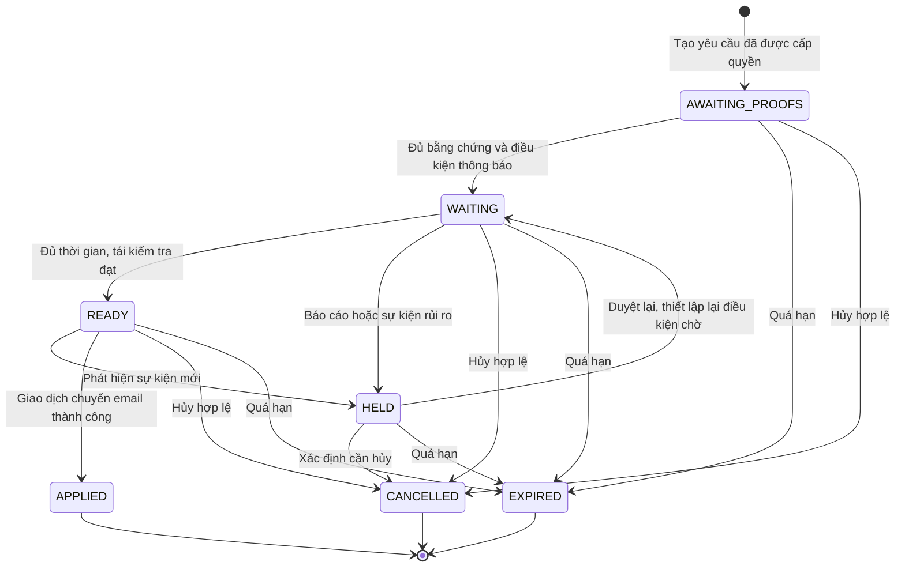

# Email address change delay — Thời gian chờ trước khi đổi địa chỉ email

## 1. Vì sao đổi email cần một khoảng chờ?

Trong chương **Email Address Recovery** của module `SECURITY_AUTHENTICATION_ACCOUNT_RECOVERY`, địa chỉ email có thể là tên đăng nhập, nơi nhận thông báo bảo mật hoặc kênh đặt lại mật khẩu. Chuyển email sang một hộp thư khác vì thế có thể chuyển cả quyền khôi phục tài khoản.

**Email address change delay** là khoảng thời gian hệ thống giữ một thay đổi email ở trạng thái chờ trước khi cho địa chỉ mới nhận những quyền đã xác định. Khoảng này tạo cơ hội phát hiện, phản đối và xử lý một thay đổi trái phép trước khi quyền khôi phục bị chuyển đi.

Ví dụ, kẻ tấn công lấy được session trên máy tính dùng chung rồi đề nghị đổi email sang hộp thư của họ. Nếu hệ thống ghi email mới vào tài khoản ngay khi họ xác minh hộp thư đó, họ có thể dùng luồng quên mật khẩu để củng cố quyền kiểm soát. Xác minh hộp thư mới chỉ chứng minh người gọi nhận được thư ở địa chỉ đó; nó chưa chứng minh quyền thay email của tài khoản nạn nhân.

Khoảng chờ chỉ có ý nghĩa khi đi cùng bằng chứng cấp quyền phù hợp, thông báo đến kênh đáng tin cậy và cơ chế ngăn hoàn tất khi có dấu hiệu sự cố. Người không đủ bằng chứng không trở thành chủ tài khoản chỉ nhờ đợi đủ lâu.

OWASP đề xuất lưu email mới như thay đổi đang chờ, xác minh người yêu cầu và gửi thông tin phù hợp đến email hiện tại lẫn email đề xuất. Quy trình khuyến nghị khác nhau tùy việc tài khoản có MFA hay chỉ dựa vào mật khẩu. Bài học mở rộng thành một thiết kế có khoảng chờ rõ ràng; các mốc giờ bên dưới là giả định của sản phẩm. [OWASP — Changing A User's Registered Email Address](https://cheatsheetseries.owasp.org/cheatsheets/Authentication_Cheat_Sheet.html#changing-a-users-registered-email-address).

## 2. Xác định quyền nào thực sự đang được chuyển

Trước khi chọn số giờ chờ, phải xác định email được dùng vào việc gì. Không nên dùng một trường `email` rồi để mọi dịch vụ suy ra cùng một mức tin cậy.

| Vai trò của địa chỉ | Tác động khi đổi | Điều cần kiểm soát |
| --- | --- | --- |
| Liên hệ thông thường | Thay nơi nhận thông báo nghiệp vụ | Quyền sửa hồ sơ và xác minh địa chỉ theo chính sách |
| Định danh đăng nhập | Thay chuỗi dùng để tìm tài khoản | Tính duy nhất, cache và ánh xạ tài khoản |
| Kênh khôi phục mật khẩu | Chuyển nơi nhận bí mật khôi phục | Cấp quyền mạnh hơn, trạng thái chờ và thu hồi quyền cũ |
| Địa chỉ cảnh báo bảo mật | Thay nơi phát hiện hoạt động lạ | Giữ đường thông báo độc lập trong quá trình chuyển |
| Thuộc tính từ hệ thống định danh ngoài | Có thể do IdP hoặc hệ thống tổ chức quản lý | Xác định nguồn dữ liệu có thẩm quyền và cơ chế đồng bộ |

Bài học xét trường hợp email chính có quyền nhận hướng dẫn khôi phục. Nếu sản phẩm chỉ thay email nhận bản tin, cần chính sách tương ứng thay vì tự động áp dụng toàn bộ luồng bảo vệ tài khoản.

Một mô hình tối thiểu tách:

- `activeEmail`: email đang có hiệu lực với các vai trò cụ thể.
- `pendingEmailChange`: yêu cầu chuyển đến một email mới, có vòng đời riêng.
- `notificationChannels`: các kênh cảnh báo đã được thiết lập trước đó.
- `accountId`: định danh nội bộ ổn định, không thay đổi khi đổi email.

Không gộp hoặc liên kết hai tài khoản chỉ vì email mới trùng một thuộc tính nhận được từ hệ thống ngoài. Đổi địa chỉ cũng không tự cấp quyền thay MFA, đăng ký passkey, phát hành recovery code hay bỏ qua bước xác minh thiết bị.

### Hai tình huống cần hai đường cấp quyền

**Người dùng còn phương thức xác thực hợp lệ:** yêu cầu đổi email từ tài khoản đã xác thực, thực hiện xác thực lại theo chính sách rồi bước vào quy trình chuyển địa chỉ.

**Người dùng mất email cũ và cả phương thức xác thực cần thiết:** phải qua luồng account recovery với bằng chứng được chấp nhận. Email mới là đích đề xuất, không được dùng làm bằng chứng duy nhất để khôi phục chính tài khoản đó.

Với tài khoản còn phụ thuộc vào mật khẩu và email cũ, sản phẩm có thể yêu cầu xác nhận qua email hiện tại. Nếu người dùng đã mất quyền truy cập email ấy, không được coi “đã chờ 24 giờ” là cách thay thế xác nhận; cần nhánh recovery riêng.

## 3. Mô hình đe dọa của khoảng chờ

| Tình huống | Vì sao chỉ thêm timer chưa đủ? | Kiểm soát cần kết hợp |
| --- | --- | --- |
| Session bị đánh cắp | Người tấn công có thể giữ session và đợi | Xác thực lại, bằng chứng gắn với đúng yêu cầu và đánh giá rủi ro |
| Email mới thuộc người tấn công | Họ tự xác minh hộp thư mới được | Bằng chứng độc lập về quyền quản lý tài khoản |
| Email cũ đã bị chiếm | Thông báo có thể bị xóa hoặc thao túng | Kênh độc lập, nhánh xử lý compromise và recovery |
| Thư cảnh báo bị chậm hoặc không đến | Chủ tài khoản không có cơ hội phản ứng thực tế | Theo dõi giao nhận, xử lý lỗi và kênh thay thế |
| Yêu cầu bị sửa khi đang chờ | Bằng chứng cho địa chỉ A bị dùng để chuyển sang B | Ràng buộc địa chỉ, phiên bản yêu cầu và chứng cứ |
| Worker cũ chạy lại | Job có thể hoàn tất một yêu cầu đã hủy | Kiểm tra trạng thái hiện tại trong giao dịch |
| Tấn công gửi lại liên tục | Người thật bị spam hoặc bị kéo dài thời gian chờ | Quota, idempotency và quy tắc thay thế có cấp quyền |
| Nhân viên hỗ trợ bị lừa | Đường hỗ trợ có thể bỏ qua toàn bộ bảo vệ | Quy trình ngoại lệ, bằng chứng và dấu vết kiểm toán |

Khoảng chờ tạo một cửa sổ phản ứng; nó không bảo đảm người dùng sẽ đọc cảnh báo. Với nguy cơ chiếm đoạt cao, hành động phù hợp có thể là giữ yêu cầu để điều tra hoặc từ chối, thay vì chỉ tăng timer.

Không dùng việc “không có ai phản đối” làm bằng chứng tích cực rằng thay đổi là hợp lệ. Chủ tài khoản có thể đang mất thiết bị, mất hộp thư hoặc không truy cập dịch vụ.

## 4. Chọn chính sách và điểm bắt đầu thời gian chờ

### 4.1. Thời lượng dựa trên rủi ro và khả năng phản ứng

Một chính sách giả định có thể phân loại như sau:

| Ngữ cảnh | Điều kiện cấp quyền | Cách áp dụng khoảng chờ minh họa |
| --- | --- | --- |
| Còn authenticator đã gắn, vừa xác thực lại, không có dấu hiệu bất thường | Bằng chứng đáp ứng chính sách đổi email | Chờ 24 giờ sau khi đủ các điều kiện bắt đầu |
| Vừa qua recovery hoặc dùng thiết bị mới với tín hiệu đáng ngờ | Bằng chứng recovery hoặc xác minh bổ sung phù hợp | Chờ 48 giờ và yêu cầu xác nhận cuối bằng phương thức được chấp nhận |
| Không đủ bằng chứng quản lý tài khoản | Chưa được cấp quyền thay đổi | Không bắt đầu timer để tự cấp quyền về sau |
| Có báo cáo bị chiếm đoạt hoặc mâu thuẫn danh tính | Cần xử lý sự cố | Giữ yêu cầu; không tự hoàn tất theo đồng hồ cũ |

Các con số này phục vụ ví dụ, không phải yêu cầu thời lượng chung của OWASP hoặc NIST. Đội sản phẩm phải cân nhắc mức nhạy cảm của tài khoản, khả năng đọc thông báo, độ trễ hỗ trợ và tác động khi trì hoãn một người dùng hợp lệ.

Tín hiệu như IP, vị trí hay cookie thiết bị giúp đánh giá rủi ro nhưng không thay cho bằng chứng xác thực. “Thiết bị quen thuộc” không đủ để bỏ qua yêu cầu chứng minh quyền thay email.

### 4.2. Không tính từ lần bấm đầu tiên

Thiết kế minh họa chỉ bắt đầu khoảng chờ sau khi:

1. Yêu cầu đã được cấp quyền bằng chứng cứ phù hợp.
2. Email mới đã được xác minh cho chính yêu cầu đó.
3. Các chấp thuận bổ sung của nhánh đang dùng đã hoàn tất, nếu có.
4. Hệ thống đã ghi nhận việc phát hành cảnh báo theo chính sách đến các kênh đã thiết lập.

Có thể biểu diễn:

```text
eligibleAt = max(
    authorizedAt,
    newAddressVerifiedAt,
    requiredApprovalsCompletedAt,
    notificationPolicySatisfiedAt
)

notBefore = eligibleAt + delayForThisRequest
```

Các thời điểm chỉ có giá trị sau khi điều kiện tương ứng thực sự hoàn tất. Không thay một giá trị còn thiếu bằng thời gian hiện tại rồi cho yêu cầu đủ điều kiện.

`notificationPolicySatisfiedAt` phải có định nghĩa rõ. Trong ví dụ, nó là thời điểm nhà cung cấp chấp nhận ít nhất một cảnh báo qua kênh đã thiết lập mà chính sách đánh giá là có thể sử dụng. Việc chỉ tạo bản ghi outbox chưa đáp ứng điều kiện đó. Nhà cung cấp chấp nhận cũng chưa chứng minh người dùng đã đọc thư; nếu có bounce hoặc sự cố giao nhận nghiêm trọng được phát hiện sau đó, yêu cầu phải được đánh giá lại.

Nếu không còn kênh cảnh báo đáng tin cậy, hệ thống giữ yêu cầu để xử lý qua nhánh recovery hoặc hỗ trợ đã quy định. Không tự đặt thời điểm thông báo thành công để timer vẫn chạy.

### 4.3. Tách thời gian chờ khỏi thời hạn token

Bốn khoảng thời gian thường bị nhầm là:

| Khoảng thời gian | Ý nghĩa |
| --- | --- |
| TTL của token xác minh email mới | Khoảng mà một bí mật xác minh được chấp nhận |
| Thời gian chờ trước khi chuyển | Khoảng phản ứng trước lúc quyền email mới có thể có hiệu lực |
| Hạn sống của toàn yêu cầu | Thời điểm yêu cầu không còn được phép tiếp tục |
| Độ mới của xác thực lại | Khoảng mà bằng chứng xác thực đáp ứng bước đang thực hiện |

Token xác minh có thể hết hạn sau 15 phút, trong khi yêu cầu chờ 24 giờ. Khi người dùng đã xác minh đúng hạn, hệ thống lưu sự kiện xác minh; không cần giữ token sống suốt 24 giờ. Tuy nhiên, nếu yêu cầu chờ quá lâu, chính sách có thể đòi xác minh lại khả năng truy cập email trước khi chuyển.

Đặt `expiresAt` của yêu cầu đủ sau `notBefore` để còn cửa sổ hoàn tất. Hệ thống phải phát hiện cấu hình khiến yêu cầu hết hạn trước khi đủ điều kiện thực hiện.

Gửi lại một thư xác minh không được ngầm rút ngắn `notBefore`. Một request không được cấp quyền cũng không được đẩy mốc của người dùng ra xa vô hạn.

## 5. Trạng thái trong suốt quá trình chuyển

Một state machine rõ ràng giúp tách “đã đề xuất”, “đã xác minh” và “đã có quyền khôi phục”.



`READY` có nghĩa đủ điều kiện để thử hoàn tất, không phải đã cập nhật email. Hệ thống vẫn kiểm tra trạng thái tại thời điểm giao dịch.

Một yêu cầu ở `HELD` không được trở lại luồng chỉ vì hết thời gian giữ. Việc tiếp tục cần quyết định có thẩm quyền, cập nhật chứng cứ và mốc chờ theo chính sách. Nếu email đích đổi, nên hủy yêu cầu cũ và tạo yêu cầu mới; không giữ nguyên bằng chứng của địa chỉ trước.

Hệ thống có thể không lưu `READY` thành trạng thái riêng mà tính nó từ thời gian và điều kiện hiện tại. Dù chọn cách nào, một job đến hạn không được tự coi dữ liệu lúc tạo job là dữ liệu còn đúng lúc chạy.

## 6. Email mới được phép làm gì trong lúc chờ?

Nguyên tắc của thiết kế minh họa là: **email đang chờ chưa trở thành kênh khôi phục có hiệu lực**. Gắn nhãn “đã xác minh” cho hộp thư không được làm mọi dịch vụ coi đó là email chính.

| Chức năng | Trong thời gian chờ | Sau khi chuyển thành công |
| --- | --- | --- |
| Nhận thư xác minh địa chỉ mới | Có, trong phạm vi yêu cầu | Không dùng lại token đã tiêu thụ |
| Nhận token đặt lại mật khẩu | Không chuyển đến email mới | Được phép nếu đây là vai trò đã phê duyệt |
| Dùng email mới làm tên đăng nhập | Chưa kích hoạt trong thiết kế này | Theo ánh xạ đăng nhập đã cập nhật |
| Xem dữ liệu tài khoản bằng liên kết xác minh | Không được cấp quyền chung | Vẫn cần cơ chế xác thực phù hợp |
| Thay MFA, passkey hoặc recovery code | Không phát sinh từ việc xác minh email | Mỗi thao tác tiếp tục cần cấp quyền riêng |
| Nhận thông tin tiến độ yêu cầu | Có thể nhận nội dung tối thiểu | Nhận kết quả theo chính sách thông báo |

Trong luồng đổi email thông thường, email cũ có thể tiếp tục vai trò hiện có đến lúc chuyển. Nhưng nếu có căn cứ rằng hộp thư cũ đã bị chiếm, không được giữ nguyên quyền khôi phục qua kênh đó chỉ để “chờ cho hết 24 giờ”. Cần vô hiệu hoặc hạn chế đường bị nghi xâm phạm theo quy trình sự cố và dùng bằng chứng độc lập cho việc khôi phục.

Điều đó không có nghĩa bất kỳ người gọi công khai nào cũng được khóa kênh email cũ bằng cách báo mất quyền truy cập. Biện pháp ảnh hưởng đến tài khoản cần đánh giá tính xác thực, mức rủi ro và phạm vi tác động của báo cáo.

### Không mở đường vòng qua dịch vụ khác

Một API có thể kiểm tra `pendingEmail` đúng, trong khi dịch vụ quên mật khẩu lại tìm tất cả địa chỉ có `verified=true`. Khi đó khoảng chờ bị vô hiệu dù giao diện vẫn hiện đếm ngược.

Mọi nơi sử dụng email cho quyền bảo mật cần phân biệt vai trò và hiệu lực: đăng nhập, gửi token recovery, liên kết danh tính, xuất dữ liệu và hỗ trợ khách hàng. Điều kiện cấp quyền phải dựa trên trạng thái có thẩm quyền, không dựa vào nội dung hiển thị trên trang hồ sơ.

Không lấy email mới từ request để làm đích gửi bí mật của một luồng khác. Đích gửi phải được phân giải từ cấu hình kênh hiện đang có hiệu lực của tài khoản.

## 7. Thông báo, phản đối và hủy yêu cầu

### 7.1. Thông báo phải đến một kênh có ý nghĩa bảo vệ

Cảnh báo bắt đầu nên nêu loại thay đổi, thời điểm dự kiến sớm nhất có hiệu lực, cách xem tiến độ từ ứng dụng chính thức và cách báo “tôi không yêu cầu việc này”. Dùng địa chỉ được che một phần nếu người nhận không cần biết email đích đầy đủ.

Các kênh cảnh báo cần được chọn từ dữ liệu đáng tin cậy đã thiết lập trước yêu cầu. Chỉ gửi cảnh báo đến chính email mới sẽ không tạo cơ hội phản đối cho chủ tài khoản nếu email đó thuộc người tấn công.

NIST SP 800-63B-4 nhấn mạnh thông báo độc lập cho các sự kiện như account recovery, cùng hướng dẫn báo cáo khi người dùng phủ nhận sự kiện. Đây là cơ sở cho việc thiết kế đường cảnh báo; quy tắc áp dụng cụ thể vẫn phụ thuộc loại sự kiện và phạm vi hệ thống triển khai. [NIST — Account Notifications](https://pages.nist.gov/800-63-4/sp800-63b/events/#account-notifications).

Thông báo “đã tiếp nhận yêu cầu” và thông báo “email đã được chuyển” là hai sự kiện khác nhau. Không gửi thông báo hoàn tất trước khi giao dịch chuyển thành công. Gửi nhắc trước thời điểm chuyển có thể hữu ích, nhưng cũng phải có quota để tránh biến tính năng bảo vệ thành công cụ quấy rối.

Nếu địa chỉ cũ không còn dùng được, người dùng cần một nhánh phục hồi bằng phương thức đã đăng ký hoặc quy trình hỗ trợ có bằng chứng. Không bỏ điều kiện cấp quyền vì thư cũ bị bounce.

### 7.2. Tách quyền báo cáo khỏi quyền lấy lại tài khoản

Một liên kết báo hoạt động lạ có thể cấp quyền rất hẹp: phản đối đúng yêu cầu hoặc đưa yêu cầu đó vào trạng thái giữ. Nó không được đăng nhập người nhận, đổi lại email tùy ý, đặt mật khẩu mới hoặc gỡ MFA.

Nếu cho phép bearer token hủy một yêu cầu, cần ràng buộc token với:

- Tài khoản và mã yêu cầu cụ thể.
- Hành động duy nhất như `REPORT_EMAIL_CHANGE` hoặc `CANCEL_EMAIL_CHANGE`.
- Phiên bản yêu cầu, thời hạn và trạng thái chưa sử dụng.
- Điều kiện trạng thái cho phép xử lý trước khi chuyển thành công.

Một người giữ hộp thư cũ đã bị chiếm có thể dùng quyền phản đối để cản trở chủ thật. Vì vậy, báo cáo cần được phân biệt với kết luận ai là chủ tài khoản. Trường hợp tranh chấp cần nhánh xác minh độc lập, tránh để một đường phản đối tự động kéo dài bế tắc vô hạn.

Không thực hiện thay đổi trạng thái ngay trên `GET` của liên kết email. Bộ quét thư hoặc chức năng xem trước có thể truy cập URL mà người dùng chưa bấm. Liên kết nên mở trang xác nhận; thao tác có tác động được thực hiện bằng `POST`, có kiểm tra token và biện pháp CSRF phù hợp với ngữ cảnh.

### 7.3. Hủy trước khi chuyển khác với hoàn nguyên sau khi chuyển

Trước `APPLIED`, hủy hợp lệ làm yêu cầu kết thúc và vô hiệu các token liên quan. Nó không cần cập nhật email chính vì email chính chưa được chuyển.

Sau `APPLIED`, liên kết hủy cũ không được âm thầm khôi phục địa chỉ trước đó. Người giữ email cũ có thể không còn quyền hợp lệ, hoặc địa chỉ cũ đã được cấp lại cho người khác. Cần một luồng xử lý sự cố hoặc thay đổi mới với cấp quyền thích hợp.

Khi thao tác hủy và thao tác chuyển đến cùng lúc, giao dịch phải tuần tự hóa quyết định trên cùng trạng thái. Nếu hủy đã được ghi nhận trước, job chuyển phải dừng. Nếu chuyển đã commit trước, hệ thống trả kết quả phù hợp và dẫn đến quy trình xử lý sau chuyển, không giả vờ đã hủy thành công.

## 8. Token, xác thực lại và kiểm soát session

### 8.1. Bằng chứng phải gắn với đúng thay đổi

Một bằng chứng xác thực lại cần được kiểm tra phía máy chủ, thuộc đúng tài khoản và đáp ứng hành động đổi email. Không tin các trường client tự gửi như `mfaPassed=true`, `verifiedAt` hoặc `delayHours=0`.

Challenge có thể gắn với `changeId` và phiên bản địa chỉ đích. Nếu người dùng sửa địa chỉ sau khi xác thực, bằng chứng cũ không được dùng cho thay đổi mới. Với passkey, hệ thống cần kiểm tra ceremony và mức xác minh người dùng đáp ứng chính sách; việc có một credential đã đăng ký không đồng nghĩa mọi lần gọi đều đáp ứng mọi yêu cầu xác thực.

Không buộc người dùng mất mật khẩu phải nhập mật khẩu bằng mọi giá nếu sản phẩm có một phương thức đã gắn khác đáp ứng yêu cầu. Ngược lại, nếu không còn phương thức đủ mức tin cậy, chuyển sang recovery thay vì giảm chuẩn vì đang có session.

### 8.2. Mỗi token chỉ có một mục đích

Token xác minh hộp thư mới nên là bí mật ngẫu nhiên đủ mạnh từ bộ sinh số ngẫu nhiên mật mã, có thời hạn và chỉ dùng một lần. Máy chủ có thể lưu giá trị băm của token entropy cao để kiểm tra, cùng metadata ràng buộc mục đích, yêu cầu và đích xác minh. PIN ngắn cần thêm giới hạn thử và cách lưu phù hợp với nguy cơ đoán ngoại tuyến.

Việc tiêu thụ token và ghi nhận xác minh phải nguyên tử. Hai request đồng thời không được biến một token thành hai quyền độc lập. Token xác minh email mới không được dùng tại endpoint báo cáo, đặt lại mật khẩu hoặc xác nhận cuối.

URL xác minh sử dụng HTTPS và origin từ cấu hình tin cậy. Tránh ghi token vào log, analytics hoặc gửi qua referrer; trang xử lý nên có chính sách referrer hạn chế và không tải tài nguyên bên thứ ba không cần thiết. Sau khi kiểm tra, có thể chuyển sang URL sạch theo cơ chế phù hợp, không giữ bí mật trong lịch sử điều hướng lâu hơn cần thiết.

### 8.3. Session tồn tại lâu không chứng minh ý định hiện tại

Tại lúc tạo yêu cầu, kiểm tra session còn hợp lệ và yêu cầu xác thực lại theo chính sách. Nếu khoảng chờ dài hơn cửa sổ chấp nhận bằng chứng, sản phẩm phải chọn rõ một trong hai mô hình:

**Tự hoàn tất khi đủ điều kiện:** hệ thống đã chấp nhận bằng chứng cấp quyền có phạm vi cho chính yêu cầu này và lưu các điều kiện tiếp tục hiệu lực. Job đến hạn vẫn kiểm tra thu hồi, thay đổi trạng thái và rủi ro mới.

**Yêu cầu người dùng xác nhận cuối:** đến hạn chỉ chuyển sang `READY`; người dùng cần cung cấp bằng chứng còn mới, phù hợp với nhánh đổi email hoặc recovery, trước khi giao dịch chuyển được thực hiện.

Trong mô hình thứ hai, không bắt buộc email cũ nếu nhánh recovery đã xác định nó không còn dùng được; sử dụng phương thức hoàn tất đã được phê duyệt trong nhánh đó. Không dùng một liên kết gửi đến email mới làm bằng chứng duy nhất thay thế quyền quản lý tài khoản.

Nếu phát hiện chiếm đoạt trong lúc chờ, việc thu hồi session và giữ yêu cầu là quyết định xử lý sự cố. Một yêu cầu công khai chưa xác minh không được tự gây đăng xuất hàng loạt cho tài khoản nạn nhân.

Sau khi chuyển, cần xác định session nào tiếp tục hợp lệ, refresh token nào bị thu hồi và thao tác nào cần xác thực lại. Đổi email có tác động khôi phục thường cần vô hiệu các bí mật gắn với email cũ, đồng thời tránh tạo một phiên đầy đủ chỉ nhờ token xác minh email mới.

## 9. Dữ liệu và điều kiện bất biến

Một bản ghi yêu cầu có thể gồm:

```text
EmailChangeRequest
  id, accountId, status, requestVersion
  sourceEmailVersion
  targetEmail, targetCanonicalKey
  authorizationEvidenceId, authorizationPolicyVersion
  newAddressVerifiedAt, requiredApprovalsCompletedAt
  notificationPolicySatisfiedAt
  eligibleAt, notBefore, expiresAt
  securityEpochAtAuthorization
  holdReason, appliedAt, cancelledAt
```

Đây là mô hình khái niệm, không phải schema bắt buộc. Dữ liệu chứng cứ chi tiết nên được bảo vệ và tham chiếu theo nhu cầu, không sao chép bí mật xác thực vào bản ghi yêu cầu.

Các điều kiện bất biến quan trọng:

1. Mỗi tài khoản chỉ có số yêu cầu đang hoạt động mà chính sách cho phép; trong ví dụ là một.
2. Email mới không nhận quyền khôi phục trước khi giao dịch `APPLIED` commit.
3. Địa chỉ đích và phiên bản đã xác minh trùng với địa chỉ đích được chuyển.
4. Chưa đến `notBefore`, đã qua `expiresAt`, bị giữ hoặc bị hủy thì không được chuyển.
5. Bằng chứng cấp quyền chưa bị thu hồi và không bị sự kiện an ninh làm mất hiệu lực.
6. Email nguồn của tài khoản vẫn có phiên bản phù hợp với yêu cầu; không áp dụng yêu cầu cũ lên một cấu hình đã đổi.
7. Tính duy nhất của email, nếu sản phẩm yêu cầu, được kiểm tra bằng ràng buộc có thẩm quyền tại lúc ghi.
8. Retry không tạo thêm lần chuyển hoặc thông báo hoàn tất mới cho cùng một kết quả.

`securityEpoch` là phiên bản an ninh do máy chủ quản lý. Sự kiện như thu hồi chứng cứ sau compromise có thể tăng phiên bản này để yêu cầu cũ phải dừng. Các đường thay đổi an ninh liên quan phải phối hợp cùng cơ chế kiểm soát đồng thời; một số nguyên được thêm vào schema nhưng không được cập nhật nhất quán sẽ không bảo vệ được luồng.

Không nhất thiết mọi lần đăng nhập đều làm mất hiệu lực yêu cầu. Chính sách cần nêu loại sự kiện nào ảnh hưởng đến bằng chứng, tránh hủy mọi yêu cầu hợp lệ vì một thay đổi không liên quan.

### Email duy nhất và việc giữ chỗ

Nếu sản phẩm yêu cầu email chính duy nhất, kiểm tra “địa chỉ còn trống” khi tạo yêu cầu không đủ: tài khoản khác có thể dùng địa chỉ trong thời gian chờ. Cần kiểm tra lại và thực thi bằng ràng buộc dữ liệu hoặc dịch vụ danh tính có thẩm quyền lúc commit.

Giữ chỗ email mới là một lựa chọn, nhưng phải có thời hạn, quota và cấp quyền; nếu ai cũng có thể giữ chỗ vô hạn, người tấn công có thể ngăn người khác đăng ký hoặc đổi email.

Khi đích không còn dùng được, yêu cầu phải có kết quả rõ ràng hoặc được chuyển sang xử lý phù hợp. Không ghi đè tài khoản đang giữ email, không gộp tài khoản tự động và không đợi worker lỗi lặp vô hạn.

Chuẩn hóa địa chỉ phải nhất quán với quy tắc nhận diện của sản phẩm. Không tự bỏ dấu chấm hoặc hậu tố `+...` của mọi nhà cung cấp rồi coi các địa chỉ đó là cùng một người.

## 10. Hoàn tất thay đổi bằng giao dịch có kiểm tra lại

Không dùng timer trong bộ nhớ của một tiến trình làm nguồn quyết định duy nhất. Dữ liệu chờ cần bền vững; worker có thể quét các yêu cầu đến hạn và thử xử lý lại sau khi khởi động lại.

Mã giả sau mô tả phần chuyển email. Nó giả định account và yêu cầu có thể được kiểm soát nhất quán trong một giao dịch, cùng cơ chế khóa thống nhất với các đường hủy và cập nhật trạng thái an ninh.

```text
tryApplyEmailChange(changeId, optionalCompletionProof):
    begin transaction

    account, change = lockAccountThenChangeInConsistentOrder(changeId)
    now = authoritativeCurrentTimeAfterLocks()

    if change.status == APPLIED:
        return ALREADY_APPLIED

    if change.status in {CANCELLED, EXPIRED, HELD}:
        return NOT_APPLICABLE

    if now >= change.expiresAt:
        change.markExpired()
        invalidateUnusedChangeTokens(change.id)
        appendOutboxEventOnce(change.id, "EXPIRED")
        commit
        return EXPIRED

    if change.status not in {WAITING, READY}:
        return NOT_READY

    if now < change.notBefore:
        return TOO_EARLY

    if not evidenceAndNotificationConditionsStillHold(account, change):
        change.markHeld("REVALIDATION_REQUIRED")
        appendOutboxEventOnce(change.id, "HELD")
        commit
        return HELD

    if account.emailVersion != change.sourceEmailVersion:
        change.markHeld("SOURCE_CHANGED")
        commit
        return HELD

    if account.securityEpoch != change.securityEpochAtAuthorization:
        change.markHeld("SECURITY_CONTEXT_CHANGED")
        commit
        return HELD

    if policyRequiresFinalProof(change):
        validateAndConsumeProofForThisChange(
            optionalCompletionProof, account, change, now
        )

    assertUniqueTargetOrRollbackToHeldWorkflow(change.targetCanonicalKey)

    account.activateApprovedEmailRoles(change.targetEmail)
    account.incrementEmailVersion()
    persistRevocationsAndSessionDecision(account, change)
    invalidateUnusedChangeTokens(change.id)

    change.markApplied(now)
    appendOutboxEventOnce(change.id, "APPLIED")

    commit
    return APPLIED
```

Các nhánh chỉ trả kết quả mà không thay đổi phải kết thúc giao dịch và giải phóng khóa theo cơ chế quản lý giao dịch của chương trình. Hàm cấp phát địa chỉ phải dựa trên ràng buộc dữ liệu thực tế; nếu xung đột, rollback giao dịch rồi ghi kết quả giữ yêu cầu theo một đường xử lý kiểm soát riêng. Không tiếp tục ghi một giao dịch đã thất bại vì vi phạm ràng buộc.

`evidenceAndNotificationConditionsStillHold` bao gồm việc kiểm tra bằng chứng đúng mục đích, đúng đích, đúng phiên bản và chưa bị thu hồi; các chấp thuận bắt buộc còn hợp lệ; không có sự cố thông báo hoặc báo cáo cần giữ. Chính sách đang áp dụng cũng cần được đánh giá: lưu phiên bản cũ phục vụ kiểm toán không có nghĩa được tiếp tục một quy trình đã bị xác định là không an toàn.

Nếu cần xác nhận cuối mà người dùng chưa cung cấp bằng chứng, worker không tự bỏ điều kiện đó. Có thể ghi trạng thái `READY`, phát hành lời nhắc có giới hạn và chờ người dùng hoàn tất. Bằng chứng một lần phải được tiêu thụ nhất quán với giao dịch; không đốt bằng chứng rồi mất toàn bộ thay đổi do lỗi ghi dữ liệu.

### Thời gian phải được kiểm tra phía máy chủ

Dùng timestamp UTC và nguồn thời gian máy chủ có thẩm quyền. Giờ địa phương trên giao diện phục vụ người dùng đọc; đổi múi giờ hoặc chỉnh đồng hồ trên trình duyệt không làm thay đổi `notBefore`.

Worker chạy sớm phải trả về chưa đủ điều kiện. Worker chạy muộn không làm yêu cầu tự có thêm hạn sống. Sau khi chờ khóa lâu, lấy thời điểm kiểm tra phù hợp thay vì dùng một timestamp cũ không còn phản ánh thời gian xử lý.

Job nên chứa mã yêu cầu và thông tin định tuyến tối thiểu, rồi đọc trạng thái hiện tại lúc chạy. Không truyền email đích cùng một cờ `approved=true` từ lúc tạo job và dùng nguyên chúng vài ngày sau.

### Outbox và idempotency

Ghi cập nhật email, quyết định thu hồi cần thiết và sự kiện hoàn tất trong cùng giao dịch khi kiến trúc cho phép. Gửi thông báo bên ngoài sau commit qua outbox; không giữ khóa cơ sở dữ liệu trong lúc chờ nhà cung cấp email.

Worker có thể nhận cùng sự kiện nhiều lần. Dùng ID sự kiện ổn định và xử lý idempotent để không lặp tác động. Nếu nhà cung cấp gửi thư không hỗ trợ idempotency, không được tuyên bố toàn luồng bên ngoài chắc chắn đúng một lần; cần retry hữu hạn và theo dõi kết quả chưa xác định.

Trong hệ phân tán, cập nhật cơ sở dữ liệu tài khoản không tự thu hồi tức thì mọi token hoặc cache ở mọi vùng. Các thao tác nhạy cảm cần kiểm tra phiên bản quyền hoặc nguồn trạng thái có thẩm quyền theo thiết kế. Nếu phải đợi hệ thống phụ cập nhật, cần biểu diễn trạng thái chuyển tiếp và giới hạn tác động trong khoảng đó, thay vì thông báo mọi quyền đã đồng bộ khi chưa có căn cứ.

## 11. Ví dụ theo dòng thời gian

Giả sử chính sách của một ứng dụng là chờ 24 giờ sau khi đủ điều kiện bắt đầu và yêu cầu xác thực lại ở bước hoàn tất.

| Thời điểm | Sự kiện | Kết quả |
| --- | --- | --- |
| 08:00 ngày 1 | Người dùng xác thực lại bằng phương thức đã gắn và tạo yêu cầu | Email mới được lưu riêng; email chính chưa đổi |
| 08:04 ngày 1 | Người dùng hoàn thành xác minh email mới | Ghi nhận sự kiện xác minh cho đúng yêu cầu |
| 08:05 ngày 1 | Điều kiện phát hành cảnh báo được đáp ứng | Bắt đầu chờ; `notBefore = 08:05 ngày 2` |
| 10:00 ngày 1 | Người dùng gửi lại request giống hệt do mất phản hồi | Trả cùng yêu cầu theo idempotency; không tự dời timer |
| 08:04 ngày 2 | Worker chạy kiểm tra | Chưa đủ thời gian, không chuyển |
| 08:06 ngày 2 | Worker đọc lại trạng thái, không có sự cố mới | Có thể đưa sang `READY`; email mới vẫn chưa có quyền recovery |
| 08:10 ngày 2 | Người dùng cung cấp bằng chứng xác thực lại hợp lệ | Giao dịch tái kiểm tra và chuyển email |
| Sau commit | Outbox phát thông báo hoàn tất | Thông báo dựa trên kết quả đã ghi nhận |

Nếu một phản đối hợp lệ đã đưa yêu cầu vào `HELD` lúc 07:59 ngày 2, worker 08:06 phải dừng. Việc mốc 24 giờ đã đi qua không vượt qua trạng thái giữ.

Nếu người dùng sửa đích sang địa chỉ khác lúc 07:59 ngày 2, không thể dùng gần trọn 24 giờ của địa chỉ trước. Yêu cầu mới phải được cấp quyền, xác minh và tính thời gian theo chính sách cho chính địa chỉ mới.

Nếu xác thực lại ở ngày 1 chỉ có độ mới chấp nhận cho bước tạo yêu cầu, nó không tự trở thành bằng chứng còn mới vào 08:10 ngày 2. Cần bằng chứng hoàn tất riêng như chính sách đã chọn.

### Khi người dùng mất email cũ

Giả sử người dùng vẫn còn passkey đã đăng ký và phương thức đó đáp ứng yêu cầu cấp quyền. Họ có thể được dẫn qua một nhánh không bắt buộc nhận thư ở email cũ, với kênh cảnh báo và điều kiện chuyển phù hợp.

Nếu họ mất luôn passkey, MFA và session có giá trị xác thực, việc nhập email mới rồi đợi 48 giờ vẫn chưa đủ. Họ cần hoàn thành recovery dựa trên chứng cứ độc lập được hệ thống chấp nhận trước khi việc chuyển email được phép diễn ra.

## 12. Chống lạm dụng và kiểm soát ngoại lệ

### Không để tạo yêu cầu thành công cụ quấy rối

Áp dụng giới hạn ở các công đoạn có tác động khác nhau: số request, số yêu cầu đang hoạt động, số thư xác minh, số cảnh báo và số lần thử token. Giới hạn theo tài khoản, đích gửi, nguồn và tổng năng lực theo nhu cầu; chỉ giới hạn IP sẽ không đủ với lưu lượng phân tán.

Các request lặp cùng nội dung có thể trả về cùng mã yêu cầu, nếu người gọi đã được cấp quyền xem yêu cầu đó. Không cho request chưa xác minh thay thế yêu cầu hợp lệ, kéo dài `notBefore`, hủy yêu cầu hoặc giữ chỗ địa chỉ của người khác.

Gửi lại token xác minh không được xóa bộ đếm thử sai để cho phép đoán bí mật không giới hạn. Đồng thời tránh vô hiệu hướng dẫn còn hạn chỉ vì có thêm request chưa được cấp quyền.

Endpoint công khai không nên tiết lộ địa chỉ đề xuất thuộc tài khoản nào, tài khoản có tồn tại hay không hoặc có đang trong một luồng recovery nhạy cảm. Trạng thái chi tiết phục vụ người dùng đã được xác thực và có quyền đối với tài khoản tương ứng.

### Không mở nút bỏ qua thời gian chờ từ phía client

Các tham số như `skipDelay`, `trustedDevice` hoặc `supportApproved` không được client tự quyết định. Thời lượng và ngoại lệ phải do chính sách phía máy chủ xác định từ bằng chứng đã kiểm tra.

Nếu hỗ trợ được phép rút ngắn hoặc bỏ thời gian chờ, đó là một thao tác an ninh riêng, cần điều kiện áp dụng, lý do, chứng cứ, quyền nhân viên và dấu vết kiểm toán. Với tài khoản nhạy cảm, có thể yêu cầu người duyệt thứ hai theo chính sách tổ chức.

Không để nhân viên chỉ dựa vào email mới, thông tin công khai hoặc cảm giác câu chuyện có vẻ thuyết phục. Việc bỏ timer không giải quyết thiếu bằng chứng danh tính. Đường hỗ trợ phải giữ ranh giới giữa xác minh người yêu cầu và xác minh khả năng nhận thư.

### Giới hạn tác động khi có sự cố

Có thể giữ riêng thay đổi email trong khi các chức năng ít rủi ro vẫn hoạt động, nếu đánh giá an ninh cho phép. Khi có căn cứ chiếm đoạt, biện pháp bảo vệ session, authenticator hoặc giao dịch nhạy cảm cần do quy trình sự cố quyết định.

Không tự động xóa passkey, gỡ MFA hoặc đổi mật khẩu chỉ vì có một yêu cầu đổi email đang chờ. Những tác động đó có thể làm mất bằng chứng độc lập mà chủ thật còn dùng để bảo vệ tài khoản.

## 13. Hiển thị cho người dùng và quan sát vận hành

Giao diện nên phân biệt rõ:

- Email hiện đang có hiệu lực.
- Email mới đang chờ, được che phù hợp.
- Bước còn thiếu: xác minh, chờ đến hạn, xác nhận cuối hay liên hệ hỗ trợ.
- Thời điểm sớm nhất có thể hoàn tất, kèm múi giờ hiển thị.
- Cách hủy hoặc báo yêu cầu không do mình tạo.

Ví dụ lời nhắc:

> Email mới đã được xác minh. Email hiện tại vẫn chưa thay đổi. Bạn có thể hoàn tất từ 08:05 ngày mai sau khi xác thực lại. Nếu không tạo yêu cầu này, hãy mở mục Bảo mật để báo cáo.

Không hiển thị “đã đổi email” khi mới có token xác minh thành công. Khi đến hạn nhưng chưa hoàn tất, giao diện cần nói rõ hành động còn lại; tránh đếm về 0 rồi khiến người dùng tin địa chỉ đã có hiệu lực.

Nếu không thể tiết lộ chi tiết kiểm soát rủi ro, vẫn nên có trạng thái và hướng xử lý hữu ích, chẳng hạn “Yêu cầu cần được kiểm tra thêm”. Không hứa một thời điểm chắc chắn hoàn tất nếu hệ thống còn giữ quyền chặn khi có sự cố.

### Sự kiện và metric

Các sự kiện nội bộ có thể gồm `EMAIL_CHANGE_REQUESTED`, `NEW_ADDRESS_VERIFIED`, `DELAY_STARTED`, `CHANGE_HELD`, `CHANGE_CANCELLED`, `CHANGE_READY`, `CHANGE_APPLIED` và `CHANGE_EXPIRED`.

Mỗi sự kiện cần ID yêu cầu, thời gian, tác nhân và lý do phù hợp. Log không chứa token, OTP hoặc bí mật xác thực; email đầy đủ chỉ xuất hiện ở nơi thực sự cần và được bảo vệ. Tránh dùng địa chỉ hoặc ID riêng của từng người làm nhãn metric có số giá trị không giới hạn.

Các chỉ số có ý nghĩa gồm thời gian ở từng trạng thái, số yêu cầu quá hạn, độ trễ worker, tỷ lệ cảnh báo lỗi, tỷ lệ hủy và tỷ lệ hoàn tất hợp lệ. Cần phân biệt `READY` với `APPLIED`; một timer chạy đúng không chứng minh quyền email được chuyển đúng.

Cảnh báo vận hành nên phát hiện yêu cầu được chuyển trước hạn, chuyển sau khi đã hủy, thiếu chứng cứ, backlog quá lớn hoặc số ngoại lệ hỗ trợ tăng bất thường. Việc truy cập lịch sử thay đổi email cũng cần quyền phù hợp vì nó có thể tiết lộ thông tin nhận diện.

## 14. Tình huống kiểm thử cho hệ thống triển khai

Bảng này mô tả tiêu chí cần kiểm tra khi hiện thực, không phải kết quả kiểm thử đã chạy trên một ứng dụng.

| Tình huống | Kết quả cần bảo đảm |
| --- | --- |
| Chỉ có session nhưng thiếu bằng chứng đổi email | Không bắt đầu một yêu cầu có thể tự chuyển quyền sau khi đợi |
| Người gọi xác minh hộp thư mới do mình sở hữu | Chỉ ghi nhận khả năng truy cập hộp thư, chưa cấp quyền tài khoản |
| Gọi reset password bằng email đang chờ | Không gửi bí mật recovery đến địa chỉ chưa có hiệu lực |
| Mở token từ yêu cầu khác hoặc địa chỉ khác | Không xác minh nhầm yêu cầu hiện tại |
| Dùng lại token đã tiêu thụ | Không tạo thêm tác động |
| Request đến ngay trước `notBefore` | Không chuyển dù bộ đếm phía trình duyệt hiển thị hết giờ |
| Worker chạy sau `expiresAt` | Không tự gia hạn hoặc chuyển yêu cầu hết hạn |
| Job chạy lại sau khi người dùng hủy | Đọc trạng thái mới và dừng |
| Hủy và chuyển xảy ra đồng thời | Chỉ có kết quả phù hợp với thứ tự commit có thẩm quyền |
| Email nguồn hoặc chứng cứ an ninh thay đổi lúc chờ | Không áp dụng mù yêu cầu dựa trên trạng thái cũ |
| Hai worker cùng hoàn tất một yêu cầu | Một lần chuyển hợp lệ; retry nhận lại kết quả đã có |
| Hai tài khoản cùng nhận một email duy nhất | Ràng buộc dữ liệu ngăn cấp cùng đích trái chính sách |
| Nhà cung cấp chưa chấp nhận cảnh báo | Không giả định điều kiện thông báo đã đạt |
| Có bounce nghiêm trọng sau khi timer bắt đầu | Đánh giá lại theo chính sách, không bỏ qua tín hiệu mới |
| Email cũ bị chiếm hoặc không còn truy cập được | Dùng nhánh phù hợp, không coi im lặng là chấp thuận |
| Bộ quét thư mở URL phản đối | Không hủy hoặc chuyển trạng thái chỉ bằng `GET` |
| Sửa email mới trong lúc chờ | Bằng chứng và thời gian cũ không chuyển sang địa chỉ khác |
| Gửi request lặp hoặc request chưa cấp quyền | Không đặt lại timer, spam vô hạn hay thay thế yêu cầu hợp lệ |
| Token xác minh hết hạn sau khi đã dùng đúng hạn | Sự kiện xác minh được xử lý theo chính sách, không cần giữ token sống suốt khoảng chờ |
| Cần xác thực lại cuối nhưng chưa có bằng chứng | Đến hạn chỉ cho phép chuẩn bị hoàn tất, chưa chuyển email |
| Ứng dụng có endpoint quản trị hoặc API cũ | Không có đường cập nhật email chính bỏ qua cấp quyền và trạng thái chờ |
| Đổi email đã thành công nhưng cache còn cũ | Các quyết định bảo mật không mở lại quyền đã bị thu hồi qua dữ liệu lỗi thời |
| Link hủy cũ được mở sau `APPLIED` | Không tự hoàn nguyên email; dẫn tới quy trình xử lý sau chuyển |

Các quyết định cần được ghi rõ trước khi triển khai là: quyền nào được chuyển, chứng cứ nào đủ để tạo yêu cầu, khi nào timer bắt đầu, thời điểm nào cần xác thực lại, ai được hủy hoặc giữ yêu cầu, và điều gì làm chứng cứ mất hiệu lực.

Một thiết kế có khoảng chờ hữu ích phải tạo cơ hội phản ứng thực tế và giữ các điều kiện cấp quyền xuyên suốt vòng đời. Khi đủ thời gian, hệ thống chỉ được hoàn tất đúng thay đổi đã được cấp quyền, cho đúng email đã xác minh, trong trạng thái an ninh còn được chấp nhận.
