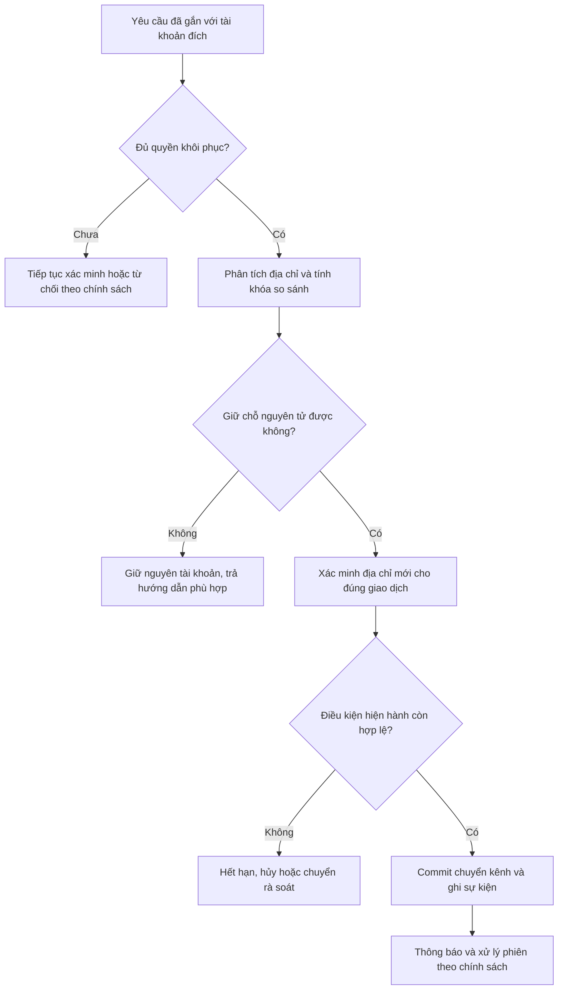

# Xử lý xung đột địa chỉ email trong luồng khôi phục tài khoản

## 1. Vì sao email trùng là một quyết định bảo mật?

Trong chương **Email Address Recovery**, **Email address collision handling** là cách hệ thống xử lý một địa chỉ email được đề xuất nhưng đang gắn với tài khoản, yêu cầu hoặc ràng buộc định danh khác. Xung đột có thể xuất hiện ngay khi nhập địa chỉ, sau bước xác minh hộp thư hoặc đúng lúc hệ thống hoàn tất thay đổi.

Trong phạm vi `SECURITY_AUTHENTICATION_ACCOUNT_RECOVERY`, người dùng có thể mất mật khẩu, MFA, passkey hoặc thiết bị xác thực. Việc thay email lúc này thường thay đổi nơi nhận quyền khôi phục tiếp theo. Một cách xử lý trùng sai có thể chuyển quyền đặt lại mật khẩu sang nhầm tài khoản, liên kết hai người khác nhau hoặc tạo đường dò tìm tài khoản.

Ví dụ, Lan đang khôi phục tài khoản A và đề xuất `lan.new@example.com`. Hệ thống phát hiện địa chỉ này đã là email khôi phục của tài khoản B. Dù Lan đọc được thư xác minh gửi đến địa chỉ đó, hệ thống chưa thể kết luận A và B có cùng chủ sở hữu. Địa chỉ có thể là hộp thư dùng chung, đã được cấp lại hoặc từng bị một người khác nhập nhầm.

Một thiết kế phù hợp phải trả lời đồng thời ba câu hỏi:

- Người yêu cầu có đủ quyền khôi phục **tài khoản A** không?
- Người đó có quyền sử dụng **địa chỉ mới** cho mục đích đang xét không?
- Việc gắn địa chỉ đó vào A có vi phạm ràng buộc định danh hoặc tác động đến **tài khoản B** không?

Bài học dùng một thiết kế tham khảo có giữ chỗ địa chỉ và giao dịch hoàn tất nguyên tử. Tên trạng thái, mô hình dữ liệu và mã giả trong bài là lựa chọn minh họa; cần điều chỉnh theo chính sách định danh của sản phẩm.

## 2. Tách định danh tài khoản khỏi địa chỉ email

### 2.1. Email là một thuộc tính có thể thay đổi

Tài khoản cần một định danh nội bộ ổn định, chẳng hạn `account_id`. Quyền sở hữu dữ liệu, phiên và phương thức xác thực gắn với định danh này. Email là kênh liên hệ, tên đăng nhập hoặc phương thức khôi phục theo cấu hình, không phải lý do tự động chuyển mọi dữ liệu sang một bản ghi khác.

Nếu một request khôi phục đã được ràng buộc với A, bước xác minh email mới không được thực hiện lại `findAccountByEmail(newEmail)` rồi chuyển sang xử lý B. Đây là lỗi đổi chủ thể giữa quy trình: bằng chứng ban đầu thuộc A nhưng hành động cuối lại tác động B.

Mọi bước sau khi xác định chủ thể phải giữ ràng buộc với `account_id`, phạm vi định danh và giao dịch khôi phục cụ thể. Người dùng đổi email đích không đồng nghĩa được đổi tài khoản đích.

### 2.2. Bằng chứng hộp thư có phạm vi hẹp

Việc hoàn tất thử thách gửi tới địa chỉ mới chỉ chứng minh một mức kiểm soát hộp thư tại thời điểm xác minh. Nó không tự chứng minh:

- Người yêu cầu là chủ lịch sử của tài khoản đang khôi phục.
- Người yêu cầu kiểm soát mọi tài khoản từng dùng địa chỉ đó.
- Hộp thư chỉ có một người đọc hoặc sẽ không bị đổi chủ.
- Mật khẩu, MFA hoặc passkey của tài khoản khác được phép gỡ bỏ.

Nếu người dùng mất toàn bộ yếu tố xác thực đã đăng ký, hệ thống cần một đường xác minh thay thế được chính sách chấp nhận. Gửi được thư tới một email mới không được dùng để bù cho mọi bằng chứng tài khoản còn thiếu.

## 3. Nhận diện các loại xung đột

Không nên quy mọi trường hợp về một lỗi duy nhất trong logic nội bộ, dù thông điệp đối ngoại có thể cần trung tính.

| Trường hợp | Ý nghĩa trong xử lý | Hướng xử lý tham khảo |
|---|---|---|
| Địa chỉ đang hoạt động trên tài khoản khác | Có một ràng buộc định danh hiện hành | Không chuyển chủ, không ghi đè; đề nghị địa chỉ khác hoặc quy trình riêng |
| Địa chỉ đang được một yêu cầu khác giữ chỗ | Có cạnh tranh tạm thời | Kiểm tra chủ yêu cầu, hạn giữ chỗ và chính sách thử lại |
| Địa chỉ tương đương với email hiện hành của chính tài khoản | Có thể không có thay đổi thực | Không tạo chuyển kênh giả; phân biệt với việc xác minh lại kênh |
| Cùng tài khoản gửi lại cùng yêu cầu | Có thể là retry | Trả kết quả idempotent nếu cùng ngữ nghĩa và cùng quyền |
| Cùng tài khoản đề xuất hai địa chỉ khác nhau | Hai giao dịch cạnh tranh về trạng thái tài khoản | Quyết định yêu cầu nào được tiếp tục, vô hiệu hóa yêu cầu cũ phù hợp |
| Hai chuỗi khác nhau nhưng cùng khóa so sánh | Xung đột sau chuẩn hóa | Áp dụng chính sách so sánh chung, không bỏ qua vì chuỗi hiển thị khác |
| Địa chỉ chỉ còn trong lịch sử hoặc tài khoản đã xóa mềm | Có thể còn ràng buộc giữ lại | Kiểm tra chính sách tái sử dụng, không coi là rảnh chỉ vì không hiện trên màn hình |
| Hai tài khoản cũ đã có cùng khóa | Dữ liệu đang mâu thuẫn | Chặn quyết định mơ hồ và chuyển sang xử lý dữ liệu có kiểm soát |

Một xung đột định danh không tự cho thấy người yêu cầu đang tấn công. Người dùng có thể vô tình tạo hai tài khoản qua những cách đăng nhập khác nhau. Tuy vậy, nguyên nhân có vẻ hợp lý không tạo quyền hợp nhất hoặc chuyển giao tài khoản.

## 4. Xác định phạm vi duy nhất trước khi kiểm tra trùng

### 4.1. Duy nhất theo phạm vi nào?

Một email có thể cần duy nhất toàn hệ thống, theo một miền định danh, theo tenant hoặc theo loại vai trò. Hệ thống phải chọn rõ mô hình trước khi thiết kế truy vấn và ràng buộc lưu trữ.

| Mô hình sản phẩm | Ví dụ khóa ràng buộc | Điều cần bảo đảm ở các luồng khác |
|---|---|---|
| Một email định danh một tài khoản trên toàn dịch vụ | `(global_realm, identity_namespace, email_key)` | Đăng ký, đăng nhập và khôi phục dùng cùng phạm vi |
| Các tenant có danh tính độc lập | `(tenant_id, identity_namespace, email_key)` | Tenant được xác định từ ngữ cảnh tin cậy, không tùy ý đổi trong request |
| Nhiều tài khoản được dùng chung email liên hệ | Không có tính duy nhất cho riêng vai trò liên hệ | Không suy ra tài khoản cần khôi phục chỉ từ email đó |
| Email dùng đồng thời để đăng nhập và khôi phục | Một không gian định danh dùng chung hoặc quy tắc phối hợp rõ | Không để cùng địa chỉ trỏ tới hai chủ thể qua hai endpoint |

Nếu giao diện đăng nhập chỉ có một ô email và không có cách xác định tenant, một ràng buộc chỉ duy nhất trong từng tenant có thể làm định tuyến mơ hồ. Ngược lại, nếu sản phẩm cho phép một người tham gia nhiều tenant bằng cùng hộp thư, cấm trùng toàn cục có thể trái với mô hình mong muốn.

### 4.2. Không tách vai trò để vô tình tạo đường vòng

Ví dụ, đăng ký kiểm tra trùng trong bảng `login_emails`, còn khôi phục chỉ kiểm tra trong `recovery_emails`. Địa chỉ E có thể là email đăng nhập của B nhưng được gắn làm email khôi phục cho A. Nếu endpoint reset nhận E mà không phân biệt vai trò, tài khoản đích trở nên không xác định.

Nếu sản phẩm chủ đích cho phép cấu hình này, mọi endpoint phải chọn tài khoản bằng ngữ cảnh và bằng chứng bổ sung đã được xác minh. Nếu sản phẩm yêu cầu một email chỉ xác định một tài khoản, đăng ký và khôi phục phải tranh chấp trên cùng ràng buộc, thay vì mỗi bảng tự bảo đảm một phần.

Trong các phần triển khai tiếp theo, bài giả định **mỗi khóa email trong một phạm vi và không gian định danh chỉ có một chủ sử dụng đang hoạt động hoặc một lượt giữ chỗ hợp lệ**. Đây là giả định thiết kế, không phải quy tắc bắt buộc cho mọi sản phẩm.

## 5. Chuẩn hóa để so sánh, không suy đoán danh tính

### 5.1. Phân biệt dữ liệu gửi thư và khóa phát hiện trùng

Nên phân biệt địa chỉ được chấp nhận để giao tiếp, khóa so sánh theo chính sách và phiên bản chính sách chuẩn hóa. Khóa so sánh không nhất thiết là địa chỉ được đưa vào trường người nhận thư.

OWASP khuyến nghị dùng chính sách chuẩn hóa nhất quán giữa các luồng định danh, giữ giá trị gốc và giá trị so sánh, đồng thời tránh áp dụng biến đổi riêng của nhà cung cấp khi không kiểm soát được ngữ nghĩa. [OWASP — Email canonicalization](https://cheatsheetseries.owasp.org/cheatsheets/Email_Validation_and_Verification_Cheat_Sheet.html#email-canonicalization).

Theo SMTP, phần domain không phân biệt hoa thường, còn local-part có thể phân biệt hoa thường và thuộc ngữ nghĩa của hệ thống thư đích. Vì thế, viết thường toàn bộ địa chỉ không phải một phép biến đổi luôn bảo toàn ý nghĩa hộp thư. [RFC 5321 — General syntax principles](https://www.rfc-editor.org/rfc/rfc5321#section-2.4).

### 5.2. Minh họa một chính sách so sánh bảo thủ

Giả sử sản phẩm hỗ trợ một tập định dạng email đã công bố, chuẩn hóa domain và giữ nguyên local-part. Khi đó:

| Hai giá trị | Quyết định trong chính sách minh họa |
|---|---|
| `mai@EXAMPLE.COM` và `mai@example.com` | Cùng khóa |
| `Mai@example.com` và `mai@example.com` | Chưa tự gộp local-part thành một khóa |
| `mai+work@example.com` và `mai@example.com` | Không tự loại hậu tố `+work` |
| `m.ai@example.com` và `mai@example.com` | Không tự bỏ dấu chấm |
| Hai địa chỉ nhìn giống nhau nhưng khác ký tự Unicode | Không tự xem là cùng chủ thể chỉ dựa trên hình thức |

Bảng này mô tả lựa chọn so sánh của ví dụ, không khẳng định các cặp khác khóa luôn đi tới những hộp thư khác nhau. Nhiều địa chỉ có thể chuyển tiếp tới cùng một nơi, và một hộp thư có thể có nhiều người đọc. Do đó, số lượng email khác nhau không được coi là số lượng bằng chứng danh tính độc lập.

Nếu kiến trúc chọn so sánh local-part không phân biệt hoa thường, cần áp dụng quyết định đó từ đầu và xử lý dữ liệu cũ theo cùng quy tắc. Không chờ đến khi khôi phục mới thay chính sách để ưu tiên một người đang yêu cầu.

### 5.3. Không dùng chuẩn hóa để sửa tùy ý dữ liệu đầu vào

Quy tắc bỏ khoảng trắng ngoài cùng, xử lý tên miền quốc tế và hỗ trợ ký tự trong local-part phải được quy định rõ. Chuỗi không hỗ trợ cần được từ chối có giải thích phù hợp, thay vì xóa ký tự bên trong rồi vô tình tạo một địa chỉ khác.

Thư viện phân tích địa chỉ, cơ sở dữ liệu và dịch vụ định danh phải thống nhất về phép so sánh. Nếu ứng dụng phân biệt hai khóa nhưng collation của cột lại coi chúng bằng nhau, quyết định trong bộ nhớ có thể khác quyết định khi ghi.

Khi đổi thuật toán chuẩn hóa, cần tính trước những khóa mới bị đụng nhau, quyết định cách xử lý và chuyển đổi có kiểm soát. Chỉ thêm `normalization_version` vào khóa duy nhất sẽ cho phép cùng một địa chỉ tồn tại dưới hai phiên bản, nên không tự giải quyết được vấn đề.

## 6. Thông báo xung đột mà không tạo công cụ dò tài khoản

### 6.1. Phân biệt quyền với A và quyền biết thông tin của B

Ngay cả khi đã xác minh quyền khôi phục A, người yêu cầu vẫn có thể nhập hàng loạt email để tìm tài khoản B. Được phép quản lý A không đồng nghĩa được biết địa chỉ nào đang được người khác sử dụng.

Ở điểm vào công khai, OWASP khuyến nghị thông điệp và thời gian phản hồi nhất quán giữa tài khoản tồn tại và không tồn tại, cùng cơ chế hạn chế gửi yêu cầu tự động. Đây là cơ sở để thiết kế phản hồi trung tính trong luồng khôi phục. [OWASP — Forgot password request](https://cheatsheetseries.owasp.org/cheatsheets/Forgot_Password_Cheat_Sheet.html#forgot-password-request).

Ví dụ phản hồi khi tiếp nhận:

> Nếu yêu cầu đáp ứng điều kiện, chúng tôi sẽ hướng dẫn bước tiếp theo qua kênh phù hợp. Việc tiếp nhận chưa xác nhận thay đổi email.

Trong một phiên khôi phục đã được cấp quyền phù hợp, khi địa chỉ không thể sử dụng:

> Hiện không thể dùng địa chỉ này cho yêu cầu. Bạn có thể chọn một địa chỉ khác hoặc tiếp tục qua kênh hỗ trợ chính thức.

Không hiển thị tên, tenant, số điện thoại, cách đăng nhập hoặc trạng thái bảo mật của tài khoản đang xung đột. Một gợi ý như “Email này thuộc tài khoản đăng nhập bằng Google” vẫn tiết lộ thông tin về B.

### 6.2. Nội dung trung tính chưa đủ

Nếu các trường hợp có body giống nhau nhưng status code, URL chuyển hướng, mã lỗi công khai, độ dài payload hoặc thời gian phản hồi khác rõ rệt theo việc địa chỉ đã tồn tại, endpoint vẫn có thể tiết lộ kết quả dò tìm.

Có thể tách xử lý nặng sang công việc bất đồng bộ và dùng một kết quả tiếp nhận chung. Tuy nhiên, `202 Accepted` chỉ có nghĩa đã tiếp nhận xử lý, không có nghĩa địa chỉ rảnh, thư đã gửi hoặc thay đổi chắc chắn sẽ hoàn tất.

Không biến thông báo “hãy chọn email khác” thành cam kết rằng địa chỉ đầu tiên đang thuộc người khác. Nó cũng có thể không đáp ứng chính sách, đang bị giữ chỗ hoặc không hỗ trợ được tại thời điểm đó. Các lý do chi tiết nên phục vụ vận hành nội bộ trong phạm vi quyền phù hợp.

## 7. Luồng xử lý tham khảo từ yêu cầu đến hoàn tất

### 7.1. Tách các cổng quyết định

Một luồng có thể tổ chức như sau:

1. Xác định tài khoản đích bằng giao dịch khôi phục, không bằng email mới.
2. Kiểm tra bằng chứng cho phép người yêu cầu thay đổi kênh khôi phục của tài khoản đó.
3. Kiểm tra định dạng, phạm vi và khóa so sánh của địa chỉ đề xuất.
4. Chiếm giữ chỗ có giới hạn qua nguồn dữ liệu có thẩm quyền.
5. Xác minh quyền kiểm soát địa chỉ mới bằng thử thách gắn với giao dịch.
6. Thực hiện các kiểm tra rủi ro, thời gian chờ hoặc rà soát nếu chính sách yêu cầu.
7. Kiểm tra lại quyền, giữ chỗ và phiên bản trạng thái khi commit.
8. Kích hoạt kênh mới, thu hồi quyền cũ theo chính sách và ghi sự kiện trong cùng ranh giới nhất quán.

OWASP mô tả thay email như một hành động cần xác minh lại quyền, lưu thay đổi ở trạng thái chờ, thông báo email hiện tại và xác nhận địa chỉ mới. Trong tình huống mất email hoặc mất yếu tố xác thực, phần bằng chứng thay thế phải được thiết kế riêng thay vì bỏ qua yêu cầu về quyền đối với tài khoản. [OWASP — Changing a user's registered email address](https://cheatsheetseries.owasp.org/cheatsheets/Authentication_Cheat_Sheet.html#changing-a-users-registered-email-address).

### 7.2. Sơ đồ quyết định



Xung đột không tạo nhánh chuyển sang tài khoản khác, gỡ MFA hoặc bỏ bước xác minh. Nếu không thể tiếp tục, hệ thống phải giữ một trạng thái giải thích được thay vì cập nhật dở dang email hiện hành.

## 8. Giữ chỗ địa chỉ có thời hạn

### 8.1. Giữ chỗ là quyền tạm thời, không phải quyền sở hữu hộp thư

Giữ chỗ giúp hai giao dịch không đồng thời tiến tới kích hoạt cùng một địa chỉ. Nó chưa cho phép đăng nhập, nhận token reset hoặc đọc dữ liệu tài khoản.

Trong thiết kế minh họa, một lượt giữ chỗ được gắn với:

```text
scope_id + namespace + email_key
account_id
transition_id
reservation_id
lease_expires_at
generation
```

Chỉ tạo lượt giữ chỗ sau khi yêu cầu đạt ngưỡng bằng chứng và chống lạm dụng phù hợp. Nếu ai cũng có thể giữ hàng nghìn địa chỉ từ form công khai, cơ chế chống trùng sẽ trở thành công cụ chặn người khác khôi phục.

### 8.2. Hết hạn không đồng nghĩa tự động được cấp lại

Khi lượt giữ chỗ hết hạn, một giao dịch khác chỉ được nhận địa chỉ sau thao tác có thẩm quyền kiểm tra trạng thái và thay chủ giữ chỗ nguyên tử. Công việc dọn dẹp chạy chậm không được làm địa chỉ bị chặn vô hạn; đồng thời không được có hai luồng cùng xem một lượt hết hạn là của mình.

Khi cấp lại, cần một định danh hoặc thế hệ mới. Token, retry và công việc dọn dẹp của lượt cũ không được tác động lên lượt mới, kể cả khi cùng địa chỉ hoặc cùng tài khoản.

Không tự gia hạn giữ chỗ vô hạn mỗi lần tải trang, gửi lại email hoặc retry do mạng. Chính sách cần giới hạn tổng thời gian, số địa chỉ một tài khoản được giữ và điều kiện gia hạn sau khi đã xác minh hộp thư.

### 8.3. Giữ chỗ và thời gian chờ phải khớp nhau

Nếu thời gian chờ của giao dịch dài hơn thời hạn giữ chỗ, hệ thống phải có cách gia hạn được cấp quyền hoặc yêu cầu giữ chỗ và xác minh lại khi cần. Không để giao diện hứa sẽ đổi email vào ngày mai trong khi quyền sử dụng địa chỉ có thể hết sau vài phút.

Có thể chọn xác minh hộp thư trước rồi mới giữ chỗ. Lựa chọn này giảm chiếm chỗ bởi người chưa đọc được thư, nhưng cho phép người dùng xác minh xong mới biết không thể hoàn tất. Dù chọn thứ tự nào, kiểm tra nguyên tử lúc kích hoạt vẫn là bắt buộc trong mô hình yêu cầu duy nhất.

## 9. Mô hình dữ liệu để địa chỉ hoạt động và giữ chỗ cùng tranh chấp

### 9.1. Một nơi phân xử quyền sử dụng khóa

Chỉ tạo unique constraint cho email đang hoạt động chưa ngăn được hai lượt giữ chỗ. Chỉ tạo unique constraint trong bảng giữ chỗ lại không ngăn một luồng đăng ký chiếm email ngoài bảng đó.

Một lựa chọn là bảng `email_identity_slot` làm nguồn phân xử chung. Mỗi khóa trong bảng có một trạng thái:

- `ACTIVE`: địa chỉ đang có hiệu lực trong không gian định danh.
- `RESERVED`: một giao dịch đang giữ chỗ có thời hạn.
- `QUARANTINED`: địa chỉ tạm chưa được tái sử dụng theo một quyết định có lý do và thời hạn thích hợp.

Hồ sơ giao dịch và lịch sử thông báo được lưu riêng, không tạo thêm một quyền hoạt động chỉ vì còn bản ghi lịch sử. Mọi luồng tạo hoặc đổi email phải cập nhật cùng bảng phân xử hoặc dùng một cơ chế nhất quán tương đương.

### 9.2. Ràng buộc duy nhất là lớp bảo vệ cuối

Trong PostgreSQL, unique constraint có thể áp dụng cho một nhóm cột. Các cột khóa cần được thiết kế tránh giá trị null làm lọt trường hợp trùng theo ngữ nghĩa mong muốn. [PostgreSQL 18 — Unique constraints](https://www.postgresql.org/docs/18/ddl-constraints.html#DDL-CONSTRAINTS-UNIQUE-CONSTRAINTS).

Ví dụ DDL rút gọn cho phần phân xử khóa:

```sql
CREATE TABLE email_identity_slot (
    scope_id          text NOT NULL,
    namespace         text NOT NULL,
    email_key         text COLLATE "C" NOT NULL,
    state             text NOT NULL,
    owner_account_id  uuid NOT NULL,
    transition_id     uuid,
    reservation_id    uuid,
    lease_expires_at  timestamptz,
    generation        bigint NOT NULL,
    CONSTRAINT uq_email_identity_slot
        UNIQUE (scope_id, namespace, email_key)
);
```

Đoạn SQL minh họa ràng buộc khóa, chưa phải schema triển khai hoàn chỉnh. Cần bổ sung kiểm tra trạng thái, quan hệ khóa ngoại, điều kiện trường bắt buộc theo trạng thái và kiểm soát quyền ghi. Chẳng hạn `RESERVED` cần giao dịch, lượt giữ chỗ và hạn dùng; `ACTIVE` không được bị thu hồi bởi worker dọn lượt giữ chỗ.

Collation và kiểu dữ liệu của toàn bộ khóa phải phù hợp chính sách so sánh. Ví dụ chọn so sánh xác định cho `email_key`; không dùng cấu hình collation vô tình gộp thêm những chuỗi mà thuật toán của ứng dụng đang coi là khác.

### 9.3. Không dùng đọc trước rồi ghi làm bảo đảm duy nhất

Mẫu sau có cuộc đua:

```text
if not emailRepository.exists(key):
    account.email = proposedEmail
    save(account)
```

Hai request có thể cùng đọc được kết quả chưa tồn tại. Ràng buộc lưu trữ hoặc thao tác so sánh và ghi nguyên tử phải quyết định request nào thắng. Kết quả kiểm tra trên cache hoặc replica chỉ có thể hỗ trợ trải nghiệm, không cấp quyền hoàn tất.

Khi hệ thống có nhiều shard hoặc vùng, tính duy nhất cục bộ trên mỗi shard không tạo tính duy nhất toàn cục. Cần một nơi phân xử cho phạm vi đã hứa hoặc một giao thức có bảo đảm tương ứng; nếu chưa xác định được kết quả do phân vùng mạng, giữ giao dịch chờ thay vì cho cả hai bên thắng.

## 10. Mã giả: giữ chỗ và hoàn tất an toàn

### 10.1. Giữ chỗ sau khi đã có quyền phù hợp

```text
reserveEmail(authorizedRecoveryContext, proposedEmail, idempotencyKey):
    accountId = authorizedRecoveryContext.boundAccountId
    scope = resolveTrustedIdentityScope(authorizedRecoveryContext)
    candidate = parseAndCompareUsingCurrentPolicy(proposedEmail, scope)

    transaction:
        account = lockAccount(accountId)
        requireCurrentRecoveryAuthority(authorizedRecoveryContext, account)
        enforceAttemptAndReservationBudgets(account, candidate)

        request = loadOrCreateBoundRequest(
            accountId, scope, candidate, idempotencyKey
        )
        rejectIfSameIdempotencyKeyHasDifferentMeaning(request)
        returnRecordedOutcomeIfThisIsAnAuthorizedRetry(request)

        result = claimSlotAtomicallyOrInspectConflict(
            candidate.key, accountId, request.transitionId
        )

        if result is ACTIVE_FOR_SAME_ACCOUNT:
            recordNoChannelChangeOrRouteToReverification(request)
        else if result is NOT_AVAILABLE:
            recordAttemptOutcomeWithoutModifyingExistingOwner(request)
        else:
            bindReservationAndGeneration(request, result)
            createBoundVerificationChallenge(request, candidate)
            enqueueVerificationMessageOnce(request)
```

`claimSlotAtomicallyOrInspectConflict` là phần quan trọng cần hiện thực bằng cơ chế của kho dữ liệu. Không thay nó bằng một lần đọc không khóa rồi ghi đè chủ sở hữu. Khi không có hàng để khóa, ràng buộc duy nhất vẫn phải phân xử việc insert cạnh tranh.

Trong PostgreSQL, nếu một lệnh gây lỗi ràng buộc trong transaction, việc tiếp tục đọc và ghi phải tuân theo cơ chế xử lý lỗi của transaction, chẳng hạn rollback hoặc savepoint phù hợp. Không viết code giả định rằng bắt exception trong ứng dụng là đủ để transaction tự trở lại bình thường.

Trường hợp `ACTIVE_FOR_SAME_ACCOUNT` cũng cần kiểm tra đúng vai trò và trạng thái kênh. Email đã có hiệu lực để liên hệ không có nghĩa đã đủ điều kiện làm kênh khôi phục. Việc xác minh lại kênh có thể là một quy trình riêng, không nên tạo ra thông báo đã đổi từ A sang A.

### 10.2. Ghi nhận xác minh email chưa phải commit

```text
confirmNewEmail(verificationToken, confirmationContext):
    transaction:
        challenge = loadChallengeByVerifier(verificationToken)
        lockBoundAccountAndTransitionInSharedOrder(challenge)
        requireCorrectPurposeExpiryAndUnusedChallenge(challenge)
        requireExpectedTransitionCandidateAndReservation(challenge)
        requireAcceptableConfirmationContext(confirmationContext, challenge)
        recordMailboxProofAndConsumeChallengeAtomically(challenge)
```

Sau bước này, giao dịch có bằng chứng hộp thư theo chính sách nhưng có thể vẫn chờ đánh giá rủi ro, thời điểm có hiệu lực hoặc xác minh tài khoản. Không lập tức đặt `account.recoveryEmail` chỉ vì người dùng đã mở liên kết.

### 10.3. Kiểm tra lần cuối trong giao dịch chuyển kênh

```text
commitRecoveredEmail(transitionId, authorizedRecoveryContext):
    transaction:
        account, transition, slots = lockUsingSharedGlobalOrder(transitionId)

        requireContextBoundToAccount(authorizedRecoveryContext, account)
        requireCurrentRecoveryAuthority(authorizedRecoveryContext, account)
        requireExpectedAccountSecurityVersion(account, transition)
        requireVerifiedExactCandidateAndPolicyVersion(transition)
        requireCurrentReservationOwnerGenerationAndExpiry(slots, transition)
        requireRiskAndScheduleConditionsSatisfied(transition)

        oldChannel = snapshotCurrentRecoveryChannel(account)
        activateReservedEmailSlotForSameAccount(slots, transition)
        replaceRecoveryChannelAndRevokeOldAuthority(account, transition)
        releaseOrQuarantineOldSlotOnlyIfNoRemainingRoleRequiresIt(oldChannel)
        revokeSupersededRecoveryGrantsAndAdvanceSecurityVersion(account)
        applyRequiredSessionPolicy(account, transition)
        markTransitionCommitted(transition)
        appendAuditAndNotificationOutboxOnce(oldChannel, transition)
```

Toàn bộ cập nhật có hiệu lực phải cùng thành công hoặc cùng không có hiệu lực trong ranh giới nhất quán đã chọn. Không gỡ email cũ ở một transaction, rồi mới thử gắn email mới trong transaction khác mà không có giao thức bù trừ và trạng thái được thiết kế rõ.

Nếu chính sách cho rằng email cũ đã bị chiếm và phải tạm ngừng quyền khôi phục ngay, việc đó là quyết định ứng phó sự cố riêng. Nó không được xảy ra vô tình chỉ vì gặp lỗi trùng khi cập nhật địa chỉ mới.

## 11. Ràng buộc token, idempotency và các yêu cầu cũ

### 11.1. Token không chỉ gắn với chuỗi email

Một challenge xác minh địa chỉ mới có thể chứa hoặc tham chiếu tới:

```text
purpose = VERIFY_RECOVERY_EMAIL
account_id
transition_id
scope_id + namespace
candidate_key + normalization_policy_version
reservation_id + generation
expected_account_security_version
token_verifier
expires_at
consumed_at
```

Token cần ngẫu nhiên đủ mạnh, có thời hạn, được lưu và kiểm tra phù hợp, dùng một lần theo mục đích. Đây là những thuộc tính cơ bản của token khôi phục được OWASP khuyến nghị. [OWASP — Forgot password guidance](https://cheatsheetseries.owasp.org/cheatsheets/Forgot_Password_Cheat_Sheet.html#introduction).

Khi đổi từ địa chỉ B sang C, bằng chứng đã xác minh B không được dùng để kích hoạt C. Khi lượt giữ chỗ cho B hết hạn và được cấp lại, token của lượt cũ cũng không được phép hoàn tất lượt mới.

Một JWT còn chữ ký hợp lệ và chưa hết hạn vẫn có thể tham chiếu giao dịch đã hủy, phiên bản bảo mật cũ hoặc lượt giữ chỗ đã đổi chủ. Hệ thống cần kiểm tra trạng thái có thẩm quyền tương ứng, không chỉ kiểm tra chữ ký và thời gian.

### 11.2. Retry không có nghĩa tạo một quyền mới

Khóa idempotency cần ràng buộc với tài khoản, thao tác và nội dung yêu cầu. Cùng khóa nhưng khác địa chỉ hoặc khác tài khoản phải bị từ chối phù hợp, thay vì âm thầm sửa giao dịch đã tạo.

Nếu commit đã thành công nhưng phản hồi tới trình duyệt bị mất, retry có thể trả kết quả đã ghi. Nó không được tạo thêm một chuyển kênh, phát hành lại token còn quyền hoặc kéo dài thời gian giữ chỗ.

Một token đã dùng không được thực hiện lại thay đổi. Nếu giao diện cần hiển thị kết quả cũ cho người được phép, hãy phân biệt việc đọc kết quả giao dịch với việc chấp nhận lại token như một quyền hành động.

### 11.3. Liên kết mở thư và hành động xác nhận

Trang mở bằng `GET` nên trình bày yêu cầu và bước xác nhận, không tự hoàn tất thay email hay hủy giao dịch. Việc người dùng chủ động xác nhận cần được kiểm tra phía máy chủ và bảo vệ phù hợp với phiên đang dùng.

Không để người đọc một thư xác minh nhầm tài khoản bị tự động đưa vào phiên đầy đủ của tài khoản đang khôi phục. Trang xác nhận nên mô tả đủ ngữ cảnh an toàn để nhận biết yêu cầu, đồng thời không tiết lộ thông tin không cần thiết về tài khoản khác.

## 12. Những cuộc đua phải có kết quả xác định

| Cuộc đua | Kết quả thiết kế cần bảo đảm |
|---|---|
| A và B cùng giữ chỗ một khóa đang rảnh | Tối đa một lượt được cấp quyền; bên còn lại nhận kết quả không khả dụng |
| Đăng ký mới cạnh tranh với khôi phục | Cùng đi qua nơi phân xử, không tạo hai chủ hoạt động |
| Xác nhận đến đúng lúc giữ chỗ hết hạn | Quyết định dựa trên thời gian và trạng thái có thẩm quyền khi ghi |
| Worker cấp lại giữ chỗ chạy cùng token cũ | Token cũ không hợp lệ với thế hệ mới |
| Công việc dọn dẹp cũ chạy sau khi đã cấp lại | Chỉ được xóa hoặc chuyển trạng thái nếu khớp đúng lượt và thế hệ cũ |
| Một tài khoản có hai giao dịch đổi email | Phiên bản trạng thái hoặc chính sách chỉ định giao dịch hợp lệ; không áp dụng cả hai từ cùng ảnh chụp cũ |
| Hủy yêu cầu cạnh tranh với commit | Thứ tự commit quyết định nhánh; không vừa báo hủy thành công vừa kích hoạt email |
| Xung đột xuất hiện sau kiểm tra giao diện | Không vượt qua kiểm tra cuối chỉ vì trước đó giao diện báo có thể dùng |
| Người dùng báo sự cố sau commit | Đi vào xử lý sự cố hiện hành, không đảo email mù quáng |

Ví dụ với thế hệ giữ chỗ:

```text
09:00  T1 giữ địa chỉ E, reservation=R1, generation=41.
09:10  R1 hết hạn theo nguồn thời gian có thẩm quyền.
09:11  T2 nhận lượt R2, generation=42 qua thao tác nguyên tử.
09:12  Token cũ của T1 được gửi tới máy chủ.
       Từ chối: reservation/generation không còn khớp.
09:13  Worker dọn R1 chạy muộn.
       Không xóa R2 vì điều kiện nhận diện lượt cũ không khớp.
```

Nếu chỉ kiểm tra địa chỉ và hạn token, T1 có thể làm sống lại một yêu cầu đã mất quyền giữ chỗ. Nếu worker chỉ xóa theo email, nó có thể phá lượt hợp lệ của T2. Định danh lượt và thế hệ ngăn việc nhầm một tài nguyên được tái sử dụng với chính lần sử dụng trước.

Các luồng khóa tài khoản, giao dịch và slot cần tuân theo một thứ tự chung. Khi có deadlock hoặc lỗi tuần tự hóa, retry có giới hạn phải tải lại trạng thái và bằng chứng hiện hành, không gửi lại quyết định dựa trên dữ liệu cũ.

## 13. Các trường hợp không được tự động chuyển hoặc gộp tài khoản

### 13.1. Địa chỉ đang gắn với tài khoản chưa xác minh

Một người ngoài có thể đăng ký bằng địa chỉ của nạn nhân mà chưa xác minh, tạo tiền đề cho xung đột hoặc chiếm trước định danh. Nhưng cũng không an toàn nếu cứ thấy chưa xác minh là tự xóa bản ghi và chuyển mọi liên kết sang người yêu cầu mới.

Sản phẩm có thể cho đăng ký chưa xác minh giữ chỗ có hạn, tách tài khoản chưa kích hoạt khỏi không gian định danh có hiệu lực và đặt điều kiện thu hồi rõ ràng. Việc thu hồi cần vô hiệu hóa token, phiên hoặc quyền tạm đã cấp cho lần đăng ký cũ theo thiết kế.

Nếu bản ghi đó đã có dữ liệu hoặc được liên kết với một phương thức đăng nhập khác, không tự nhập dữ liệu vào tài khoản đang khôi phục. “Chưa xác minh email” không có nghĩa mọi thuộc tính của bản ghi đều vô chủ.

### 13.2. Tài khoản cũ, xóa mềm hoặc hộp thư đổi chủ

Không đăng nhập lâu ngày không chứng minh tài khoản đã bị bỏ. Xóa mềm cũng có thể vẫn giữ quyền phục hồi dữ liệu hoặc ràng buộc chưa được giải phóng.

Kiểm soát hộp thư ở hiện tại không tự chứng minh quyền với dữ liệu lịch sử của một tài khoản dùng hộp thư trước đó. Khi có tranh chấp hoặc dấu hiệu cấp lại địa chỉ, cần bằng chứng tài khoản độc lập và quy trình được quy định cho trường hợp đó.

Nếu chính sách cho phép tái sử dụng địa chỉ sau khi giải phóng, tài khoản mới vẫn phải có `account_id` và liên kết dữ liệu riêng. Không khôi phục phiên, lịch sử giao dịch hoặc phương thức xác thực của chủ trước chỉ vì email giống nhau.

### 13.3. Đăng nhập liên kết có cùng email

OpenID Connect xác định cặp `iss` và `sub` là định danh ổn định được bảo đảm cho chủ thể trong ngữ cảnh giao thức; claim email có thể thay đổi hoặc được tái sử dụng. Vì vậy, claim email không thay thế định danh liên kết này. [OpenID Connect Core — Claim stability and uniqueness](https://openid.net/specs/openid-connect-core-1_0.html#ClaimStability).

Nếu tài khoản B đăng nhập qua một nhà cung cấp có cùng email với địa chỉ Lan muốn dùng cho A, không tự liên kết A với danh tính bên ngoài của B. Việc `email_verified` được chấp nhận cũng không tự cấp quyền nhập hai tài khoản nội bộ thành một.

### 13.4. Người dùng khẳng định cả hai tài khoản đều của mình

Có thể hướng dẫn người dùng quản lý hoặc khôi phục từng tài khoản qua đường chính thức. Nếu sản phẩm hỗ trợ hợp nhất, đó là một quy trình riêng cần xác minh quyền với cả hai bên, giải quyết quyền tổ chức, dữ liệu, thanh toán và khả năng xử lý sai sót.

Không tự chuyển sang luồng reset tài khoản B chỉ vì quá trình khôi phục A gặp địa chỉ của B. Cũng không yêu cầu người dùng xóa B ngay để nhường email trong lúc bằng chứng sở hữu B chưa rõ.

## 14. Tác động lên session, token khôi phục và thông báo

### 14.1. Gặp xung đột không tự thay đổi quyền hiện hành

Một yêu cầu thất bại vì email không khả dụng không nên làm mất passkey, vô hiệu hóa MFA hoặc cấp lại phiên. Những tác động đó cần quyền và lý do bảo mật riêng, không phải hệ quả của việc bắt exception trùng khóa.

Khi chuyển email thật sự hoàn tất, cần xử lý những token hoặc grant cũ gắn với kênh trước đó. Chẳng hạn, một token reset gửi trước thay đổi có thể vẫn còn hạn nhưng không nên tiếp tục được chấp nhận nếu chính sách đã thu hồi quyền của kênh cũ.

Việc thu hồi phiên, làm mới bằng chứng xác thực và hạn chế hành động nhạy cảm phải theo chính sách khôi phục và mức rủi ro. Không giả định đổi chuỗi email trong cơ sở dữ liệu tự thu hồi các refresh token hoặc cookie đã cấp.

### 14.2. Phiên phải tiếp tục trỏ đúng tài khoản

Phiên của A vẫn gắn với A. Thay email không được khiến một thành phần tra cứu lại bằng email và đổi principal sang B. Tương tự, việc hiển thị email trong token không được biến claim đó thành khóa sở hữu tài nguyên.

Khi hệ thống dùng email trong bộ nhớ đệm hoặc sự kiện để định tuyến, cần thiết kế vô hiệu hóa và kiểm tra phiên bản. Không để một cache cũ làm địa chỉ mới vừa trỏ về A ở dịch vụ khôi phục vừa trỏ về B ở dịch vụ đăng nhập.

### 14.3. Gửi đúng sự kiện, đúng người nhận

Thông báo hoàn tất chỉ được tạo sau khi thay đổi đã commit. Công việc gửi thư nên dùng sự kiện có định danh và ảnh chụp người nhận được bảo vệ, tránh đọc `currentEmail` lúc gửi rồi cảnh báo nhầm kênh.

Không gửi cho tài khoản B một thư tiết lộ Lan đang khôi phục A chỉ vì có người nhập địa chỉ của B. Nếu hệ thống có cảnh báo lạm dụng, cần điều kiện và giới hạn riêng để không tạo công cụ quấy rối hoặc lộ quan hệ giữa tài khoản.

Thư xác minh địa chỉ mới phải mô tả rằng đây là xác nhận cho một yêu cầu cụ thể, không phải quyền truy cập mọi tài khoản dùng địa chỉ đó. Cảnh báo email cũ và xác minh email mới có mục đích khác nhau, không dùng chung token cấp quyền.

## 15. Chống chiếm chỗ, lạm dụng và đường vòng hỗ trợ

### 15.1. Đo giới hạn theo nhiều chiều

Một chính sách chống lạm dụng có thể xét số lần thử trên tài khoản, phiên khôi phục, thiết bị, địa chỉ đích và nguồn mạng, kết hợp giới hạn toàn dịch vụ. Chỉ giới hạn theo IP dễ bị vượt qua bằng nhiều nguồn; chỉ giới hạn theo email có thể khiến người ngoài làm cạn ngân sách của nạn nhân.

Cần tách ngân sách gửi thư, ngân sách giữ chỗ và ngân sách thử bằng chứng. Hết ngân sách gửi thư không nên âm thầm xóa một lượt xác minh hợp lệ; gửi lại thư cũng không tự kéo dài mọi hạn dùng.

Các giá trị thời hạn và số lần thử phải được chọn theo rủi ro và khả năng vận hành. Không có một số phút hoặc số lần thử phổ quát đủ an toàn cho mọi hệ thống.

### 15.2. Không để ngoại lệ hỗ trợ bỏ qua ràng buộc

Nhân viên hỗ trợ không nên xử lý trùng bằng cách sửa trực tiếp email của B, thêm hậu tố giả vào địa chỉ hoặc bỏ unique constraint tạm thời. Những cách này thay đổi ý nghĩa định danh và có thể để lại token hoặc phiên đang trỏ sai.

Quy trình ngoại lệ cần có chủ thể được xác minh, quyền thao tác giới hạn, lý do, dấu vết phê duyệt theo mức rủi ro và cách xử lý dữ liệu liên quan. Tranh chấp không đủ bằng chứng có thể phải kết thúc bằng việc dùng kênh khác hoặc không hoàn tất, thay vì chọn ngẫu nhiên một bên thắng.

Nếu phát hiện hai tài khoản đã cùng có một khóa do lỗi dữ liệu cũ, không dùng `findFirst()` để chọn tài khoản cần khôi phục. Cần ngăn định tuyến mơ hồ và giải quyết từng chủ thể bằng quy trình có kiểm soát.

## 16. Quan sát và lưu vết mà không tiết lộ thêm danh tính

Các mã lý do nội bộ có thể phân biệt `ACTIVE_CONFLICT`, `RESERVATION_CONFLICT`, `SAME_ACCOUNT_NO_CHANGE`, `STALE_GENERATION`, `POLICY_BLOCKED` hoặc `LEGACY_DUPLICATE`. Không đưa nguyên mã nội bộ ra API công khai nếu nó tiết lộ trạng thái của tài khoản khác.

Bản ghi phục vụ điều tra có thể gồm mã yêu cầu, tài khoản đích nội bộ, phạm vi, phiên bản chính sách, loại xung đột, định danh lượt giữ chỗ, thời điểm và kết quả chuyển trạng thái. Quyền xem thông tin về tài khoản đang giữ địa chỉ cần hạn chế riêng.

Không ghi token rõ, mật khẩu, mã MFA, mã dự phòng hoặc tài liệu xác minh vào log. Địa chỉ email đầy đủ, body thư và dữ liệu đối chiếu danh tính cũng không nên bị sao chép vào mọi hệ thống phân tích chỉ để đếm xung đột.

Chỉ số hữu ích gồm tỷ lệ yêu cầu không khả dụng, số lần giữ chỗ hết hạn, độ trễ xác minh, retry sau commit và số trường hợp dữ liệu cũ bị trùng. Không dùng email hoặc mã tài khoản làm nhãn metric có độ phân mảnh cao.

Một tỷ lệ xung đột tăng có thể đến từ lỗi chuẩn hóa, thay đổi chính sách, luồng đăng ký mới hoặc tấn công chiếm chỗ. Chỉ số cần hỗ trợ tìm nguyên nhân, không tự thay thế quyết định danh tính.

## 17. Tình huống xuyên suốt

Lan mất hộp thư cũ và điện thoại dùng MFA. Một quy trình khôi phục được phê duyệt cho phép Lan chứng minh quyền với tài khoản A bằng các bằng chứng độc lập còn đáp ứng chính sách.

1. Lan đề xuất `lan.new@example.com`. Máy chủ vẫn giữ `account_id=A` từ giao dịch khôi phục, không xác định lại tài khoản bằng địa chỉ mới.
2. Nguồn phân xử cho biết khóa của địa chỉ đang hoạt động trên B. Hệ thống không sửa B, không cấp token của B và không tiết lộ cách đăng nhập của B. A nhận hướng dẫn chọn địa chỉ khác hoặc đi qua kênh chính thức.
3. Lan nói B cũng là tài khoản của mình. Hệ thống giải thích đường quản lý từng tài khoản hoặc hợp nhất nếu sản phẩm hỗ trợ, nhưng không cho lời khẳng định đó thay thế bằng chứng của B.
4. Lan chọn một địa chỉ khác E. Sau các kiểm tra chống lạm dụng, giao dịch T1 giữ chỗ E bằng lượt R1. Một người dùng khác đang đăng ký cùng E đi qua chính nơi phân xử nên không thể đồng thời nhận quyền hoạt động.
5. Thư xác minh của T1 đến muộn. R1 hết hạn và được thu hồi theo chính sách. Một lượt giữ chỗ khác R2 được cấp cho yêu cầu đủ điều kiện; token cũ của T1 bị từ chối vì không khớp lượt hiện hành.
6. Lan tạo một yêu cầu hợp lệ cho địa chỉ F và hoàn tất xác minh trong hạn. Máy chủ kiểm tra lại bằng chứng tài khoản, phiên bản bảo mật, rủi ro và giữ chỗ trước commit.
7. Trong cùng ranh giới nhất quán, F trở thành kênh khôi phục của A, quyền qua kênh cũ được xử lý theo chính sách và sự kiện hoàn tất được ghi. Những quyền của B vẫn thuộc B.
8. Phản hồi tới trình duyệt bị mất. Retry của Lan trả kết quả giao dịch đã hoàn tất, không đổi email thêm lần nữa và không tái phát hành quyền khôi phục.

Việc đổi email không tự giải quyết phần MFA đã mất. Nếu quy trình còn cần đăng ký lại một yếu tố hoặc kiểm soát phiên sau khôi phục, các bước đó phải được thực hiện theo quyền và điều kiện tương ứng của A.

## 18. Tiêu chí hành vi để người triển khai kiểm chứng

| Tình huống | Hành vi mong đợi |
|---|---|
| Địa chỉ đề xuất đang hoạt động trên B | A không nhận quyền của B; B không bị ghi đè |
| Người yêu cầu đọc được thư tại địa chỉ đang trùng | Chỉ ghi nhận bằng chứng hộp thư theo phạm vi, không tự gộp tài khoản |
| Khác hoa thường ở domain | Dùng cùng khóa theo chính sách domain |
| Khác dấu chấm, hậu tố hoặc local-part | Xử lý theo chính sách đã công bố, không tự áp dụng quy tắc nhà cung cấp |
| Cache báo địa chỉ rảnh nhưng kho chính có chủ | Kho có thẩm quyền từ chối hoặc giữ chờ; không hoàn tất từ cache |
| Hai yêu cầu tranh một địa chỉ | Không có hai chủ hoạt động trong phạm vi yêu cầu duy nhất |
| Một luồng đăng ký và một luồng khôi phục cạnh tranh | Không bỏ qua nhau do dùng hai bảng ràng buộc riêng |
| Token của yêu cầu đã đổi email đích | Không xác minh hoặc kích hoạt địa chỉ mới bằng token cũ |
| Giữ chỗ được cấp lại | Token và công việc dọn lượt cũ không tác động lượt mới |
| Hai yêu cầu đổi email của cùng A | Quyết định theo trạng thái và phiên bản hiện hành, không theo thứ tự giao diện |
| Retry cùng khóa nhưng khác nội dung | Không âm thầm sửa yêu cầu trước |
| Commit thành công nhưng mất phản hồi | Retry không tạo thêm tác động hoặc kéo dài quyền |
| Xung đột trên tài khoản chưa xác minh | Không tự nhập dữ liệu hoặc giữ định danh vô hạn ngoài chính sách |
| Tài khoản xóa mềm vẫn có ràng buộc | Không coi địa chỉ là rảnh nếu chưa giải phóng hợp lệ |
| Email OIDC trùng với tài khoản khác | Không tự liên kết chỉ từ claim email |
| Email được phép dùng chung cho liên hệ | Không suy ra duy nhất tài khoản cần reset từ địa chỉ đó |
| Request công khai thử nhiều email | Không trả dữ liệu tài khoản khác hoặc tạo thư quấy rối không giới hạn |
| Phát hiện dữ liệu cũ có hai chủ cùng khóa | Không chọn bản ghi đầu tiên để tiếp tục khôi phục |
| Chuyển email thất bại do trùng | Không vô tình mất MFA, passkey hoặc email hiện hành |
| Chuyển email đã hoàn tất | Token, phiên, cache và thông báo phản ánh chính sách hiệu lực thực tế |

Đây là tiêu chí thiết kế và kiểm chứng cho một hệ thống triển khai sau này, không phải kết quả thử nghiệm của sản phẩm cụ thể.

Một hồ sơ quyết định cho luồng này cần ghi rõ phạm vi duy nhất, quy tắc so sánh, nguồn phân xử, điều kiện giữ và giải phóng địa chỉ, bằng chứng cho phép thay email, quyền của token và cách phản hồi khi có xung đột. Người triển khai phải giải thích được vì sao một địa chỉ được gắn vào đúng tài khoản mà không chuyển nhầm quyền, tiết lộ tài khoản khác hoặc cho yêu cầu cũ sống lại sau khi đã mất hiệu lực.
