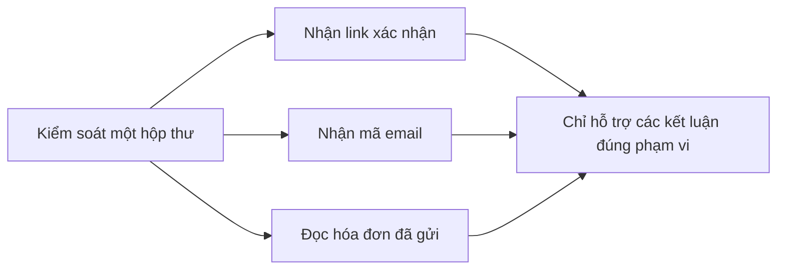
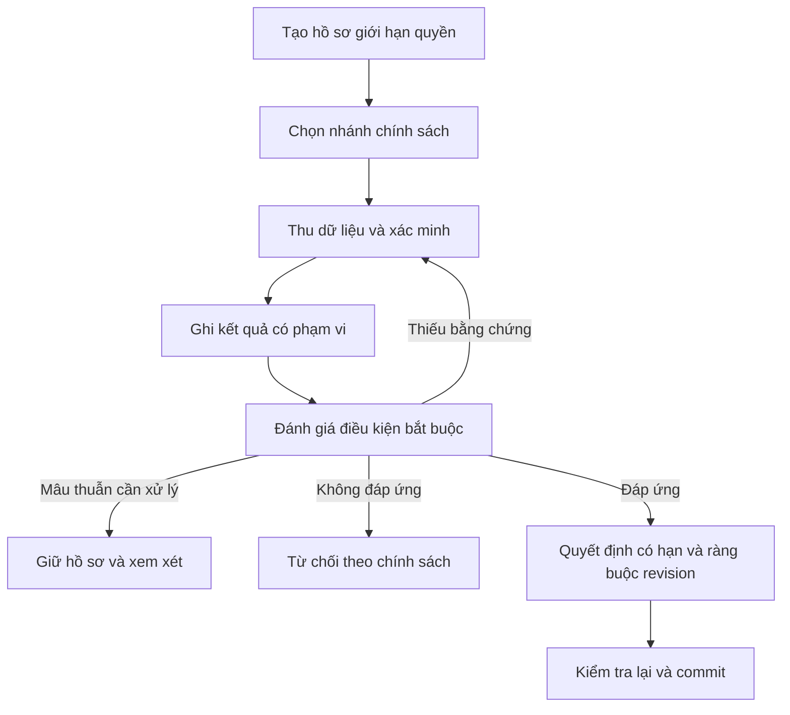

# Email address recovery evidence — Bằng chứng cho khôi phục địa chỉ email

## 1. Mục tiêu và phạm vi

Trong chương **Email Address Recovery** của module **SECURITY_AUTHENTICATION_ACCOUNT_RECOVERY**, khôi phục địa chỉ email là thay đổi một thành phần có thể quyết định khả năng lấy lại tài khoản. Nếu email được dùng để đặt lại mật khẩu, nhận mã khôi phục hoặc thông báo bảo mật, chuyển email sai người có thể mở đường chiếm đoạt tài khoản dù cơ chế đăng nhập chính vẫn có MFA hoặc passkey.

Người dùng có thể mất hộp thư, mật khẩu, thiết bị xác thực hoặc nhiều phương tiện cùng lúc. Hệ thống cần thu thập bằng chứng phù hợp với từng trường hợp, xác định bằng chứng đó hỗ trợ kết luận nào và chỉ cấp quyền trong phạm vi đã được chứng minh.

Bài học tập trung vào **email address recovery evidence**: tập hợp bằng chứng và kết quả kiểm tra làm căn cứ cho quyết định khôi phục hoặc chuyển email. Mục tiêu là thiết kế một hồ sơ có thể giải thích, kiểm toán và kiểm tra lại trước khi thay đổi quyền truy cập.

Sau bài học, người đọc có thể:

- Phân biệt nhận diện tài khoản, chứng minh quyền với tài khoản, kiểm soát email mới và chấp thuận giao dịch.
- Đánh giá nguồn gốc, sự ràng buộc, độ mới và mức phụ thuộc của bằng chứng.
- Thiết kế cách thu thập, lưu kết quả xác minh và ra quyết định.
- Xử lý bằng chứng thiếu, mâu thuẫn, bị thu hồi hoặc xuất hiện sau một thay đổi đáng ngờ.
- Kết nối quyết định khôi phục với token dùng một lần, chống lạm dụng và kiểm soát session.

Các mô hình dữ liệu, nhánh chính sách và trạng thái dưới đây là thiết kế minh họa. Chúng không tự xác lập một mức AAL hay IAL và không thay thế việc đối chiếu tiêu chuẩn khi sản phẩm có yêu cầu tuân thủ cụ thể.

## 2. Chia yêu cầu khôi phục thành các kết luận cần chứng minh

Câu hỏi “đây có phải chủ tài khoản không?” quá rộng để dùng trực tiếp trong một API. Hãy tách thành những kết luận có phạm vi rõ ràng.

| Mã | Kết luận cần thiết | Ví dụ bằng chứng phù hợp | Giới hạn |
| --- | --- | --- | --- |
| C1 | Hồ sơ đang nhắm đúng tài khoản | Account ID ổn định được server xác định từ quy trình tra cứu | Biết email hoặc tên đăng nhập chưa chứng minh quyền |
| C2 | Người yêu cầu có quyền thực hiện hành động trên tài khoản | Xác minh authenticator đã gắn từ trước, phương thức khôi phục đã thiết lập hoặc quy trình tái xác minh được chấp nhận | Không phải mọi authenticator đơn lẻ đều đáp ứng chính sách |
| C3 | Địa chỉ email mới nhận được thử thách | Trình lại bí mật gửi đến đúng email ứng viên | Không chứng minh quyền với tài khoản cũ |
| C4 | Người có quyền chấp thuận đúng giao dịch | Xác nhận trong ngữ cảnh giao dịch có ràng buộc và nội dung thay đổi rõ ràng | Chỉ xác thực chung có thể chưa đủ để thể hiện ý định đổi email |
| C5 | Điều kiện an toàn hiện tại cho phép hoàn tất | Không có lệnh giữ hợp lệ, bằng chứng còn hiệu lực, chính sách rủi ro cho phép | Không có cảnh báo không đồng nghĩa không có tấn công |

Ví dụ, một mã OTP gửi đến địa chỉ mới chứng minh C3. Nếu dùng chính mã đó để kết luận C2, hệ thống đã cho người yêu cầu tự tạo ra căn cứ lấy tài khoản.

Tương tự, hóa đơn có tên và email giúp xác định C1 hoặc bổ sung bối cảnh. Nó không tự chứng minh C2: hóa đơn có thể nằm trong hộp thư đã bị chiếm hoặc được chia sẻ cho người khác.

Có thể diễn đạt điều kiện hoàn tất ở mức khái niệm:

```text
Có quyền thực hiện thay đổi trên đúng tài khoản
    AND
Đã xác nhận đúng email ứng viên
    AND
Đã chấp thuận đúng giao dịch theo chính sách
    AND
Các điều kiện an toàn vẫn còn đáp ứng tại thời điểm commit
```

Một bằng chứng có thể hỗ trợ nhiều kết luận nếu phạm vi kiểm tra cho phép. Điều đó không có nghĩa nó trở thành nhiều phương thức độc lập.

## 3. Xác định đúng loại tình huống trước khi chọn bằng chứng

### 3.1. Còn đủ phương tiện xác thực

Nếu người dùng còn có thể xác thực ở mức sản phẩm yêu cầu, thay email nên đi qua quy trình thay đổi thông tin bảo mật: xác thực lại khi cần, xác nhận email mới và kiểm tra chính sách.

Không giảm yêu cầu chỉ vì màn hình được đặt tên là “khôi phục email”. Một session đang hoạt động cũng chưa chắc đủ, vì session có thể đã bị đánh cắp hoặc được tạo trước sự cố.

### 3.2. Mất một phần phương tiện

Người dùng có thể mất email nhưng còn passkey, mất điện thoại nhưng còn recovery code, hoặc còn một authenticator chưa đủ để đáp ứng toàn bộ yêu cầu. Hệ thống phải xác định tổ hợp được chính sách chấp nhận thay vì mặc định “còn một thứ là đủ”.

NIST SP 800-63B-4 mô tả các nhóm phương thức khôi phục như recovery code lưu trước, mã được cấp qua kênh khôi phục, recovery contact và lặp lại quy trình chứng minh danh tính. Yêu cầu kết hợp phụ thuộc tình trạng identity proofing và mức bảo đảm của tài khoản. Không nên tự suy ra một tổ hợp đạt AAL cụ thể chỉ từ số lượng bằng chứng. [NIST SP 800-63B-4, mục 4.2](https://pages.nist.gov/800-63-4/sp800-63b.html#account-recovery)

### 3.3. Mất tất cả phương tiện đã thiết lập

Đây là trường hợp cần đặc biệt thận trọng. Người yêu cầu có thể cung cấp một email mới, thông tin cá nhân và câu chuyện hợp lý nhưng vẫn chưa có bằng chứng đủ để nối họ với tài khoản.

Tái xác minh danh tính chỉ có ý nghĩa nếu danh tính được kiểm tra có thể đối chiếu với liên kết đáng tin cậy đã tồn tại trên tài khoản. Với tài khoản chưa từng identity-proofed, NIST không coi reproofing là một phương án khôi phục có sẵn cho tài khoản đó. Không thể lấy một hồ sơ tự khai rồi dùng giấy tờ trùng tên để tạo ngược liên kết đáng tin cậy. [NIST SP 800-63B-4, mục 4.2.2](https://pages.nist.gov/800-63-4/sp800-63b.html)

Trong sản phẩm có tài khoản biệt danh, có thể không tồn tại danh tính đời thực để đối chiếu. Cần có phương thức khôi phục phù hợp được thiết lập trước hoặc chấp nhận rằng một số yêu cầu không thể được phê duyệt an toàn.

### 3.4. Nghi ngờ tài khoản đã bị chiếm

Nếu đối tượng tấn công đã đăng nhập được, họ có thể thêm email phụ, đổi số điện thoại hoặc tạo phương thức khôi phục mới rồi dùng các thay đổi đó làm “bằng chứng”.

OWASP khuyến nghị trong khôi phục sau nghi ngờ chiếm đoạt cần dùng bằng chứng độc lập đã thiết lập trước, không chỉ dựa vào thông tin khôi phục mới thay đổi. Tài khoản cũng cần được rà soát các phương thức và session còn tồn tại. [OWASP Forgot Password Cheat Sheet, Account Recovery After Suspected Compromise](https://cheatsheetseries.owasp.org/cheatsheets/Forgot_Password_Cheat_Sheet.html#account-recovery-after-suspected-compromise)

“Đã thiết lập từ trước” là một thuộc tính có ích, không phải bảo đảm tuyệt đối. Bí mật cũ vẫn có thể bị lộ; cần xem lịch sử sử dụng, dấu hiệu xâm nhập và trạng thái thu hồi.

## 4. Danh mục bằng chứng và giới hạn sử dụng

### 4.1. Authenticator đã gắn với tài khoản

Một passkey hoặc khóa bảo mật đã đăng ký từ trước có thể cung cấp bằng chứng mật mã về việc kiểm soát khóa tương ứng. Bằng chứng cần đến từ một lượt xác minh mới phía server, không phải ảnh chụp danh sách passkey hay lời khai “tôi có khóa”.

Với WebAuthn, verifier phải kiểm tra assertion theo đặc tả, bao gồm challenge, origin, RP ID, chữ ký và các cờ phù hợp với yêu cầu. Nếu cần user verification, server phải kiểm tra kết quả tương ứng. Không coi một credential ID hoặc cờ thành công do frontend gửi là kết quả xác minh. [W3C WebAuthn Level 2, Verifying an Authentication Assertion](https://www.w3.org/TR/webauthn-2/#sctn-verifying-assertion)

Phạm vi giao dịch nên được ràng buộc bằng trạng thái phía server:

```text
challenge_id -> account_id
             -> recovery_case_id
             -> operation = RECOVER_EMAIL
             -> candidate_revision
             -> expires_at
```

Nếu dùng một lượt xác thực chung thay cho xác nhận trực tiếp giao dịch, phải có bước chấp thuận riêng trong session đã được bảo vệ. WebAuthn không tự bảo đảm người dùng đã đọc và đồng ý với một địa chỉ email chỉ vì assertion hợp lệ.

### 4.2. Recovery code đã được phát hành trước

Recovery code đã lưu trước có giá trị vì nó được gắn với tài khoản trước khi người yêu cầu chọn email thay thế. Hệ thống cần kiểm tra đúng tài khoản, trạng thái chưa dùng và các hạn chế theo chính sách.

Khi trình mã thành công:

1. Tiêu thụ mã một cách nguyên tử.
2. Ghi một kết quả xác minh thuộc đúng hồ sơ.
3. Ngăn cùng mã tạo kết quả xác minh cho hồ sơ khác.
4. Giữ nguyên khả năng sử dụng kết quả đã ghi trong hồ sơ hiện tại đến khi hết hạn hoặc bị thu hồi.

Điểm cuối rất quan trọng: **mã thô đã dùng** và **kết quả xác minh được ghi nhận** là hai đối tượng khác nhau. Không yêu cầu người dùng trình lại mã đã bị tiêu thụ tại thời điểm commit.

Một recovery code hợp lệ có thể vẫn không đủ nếu tài khoản yêu cầu một tổ hợp mạnh hơn. Khả năng đoán mã, nguy cơ phishing và nơi người dùng lưu mã cũng ảnh hưởng đánh giá.

### 4.3. Kênh khôi phục hoặc recovery contact đã thiết lập

Mã gửi đến một địa chỉ khôi phục được thiết lập trước có thể chứng minh quyền tiếp cận kênh đó. Cần kiểm tra lịch sử thiết lập và thay đổi, không chỉ trường `verified = true` hiện tại.

Một recovery contact phải là quan hệ được thiết lập qua quy trình tin cậy trước đó. Người đang yêu cầu không được tự thêm “người bảo lãnh” rồi dùng người đó để phê duyệt chính hồ sơ đang mở.

Cần phân biệt:

- Người liên hệ xác nhận theo quy trình khôi phục đã đăng ký.
- Một đồng nghiệp gửi thư nói rằng họ biết người yêu cầu.
- Một quản trị viên có quyền hành động trong tenant theo chính sách tổ chức.

Ba trường hợp này có mô hình quyền khác nhau và không thể được thay thế cho nhau bằng một ghi chú hỗ trợ.

### 4.4. Mật khẩu còn nhớ

Kiểm tra mật khẩu đúng là một dữ kiện, nhưng không đủ để bỏ qua các yếu tố khác trên tài khoản vốn yêu cầu MFA. Mật khẩu có thể đã bị lộ, tái sử dụng hoặc vừa bị kẻ tấn công thay đổi.

Không bao giờ yêu cầu người dùng đọc mật khẩu cho nhân viên hỗ trợ. Nếu chính sách cho phép dùng mật khẩu trong một tổ hợp, việc kiểm tra diễn ra qua giao diện xác thực an toàn và chỉ trả kết quả giới hạn cho quy trình khôi phục.

### 4.5. Quyền kiểm soát email mới

Thử thách email mới hỗ trợ C3 và chỉ áp dụng cho địa chỉ đã được kiểm tra. Cần lưu revision hoặc khóa định danh ứng viên để không dùng proof của A cho B.

Ví dụ:

```text
proof.new_email = {
    case_id: rc_17,
    candidate_revision: 4,
    destination_ref: emc_4,
    verified_at: <server time>,
    valid_until: <policy-defined time>
}
```

Không suy luận rằng người yêu cầu có quyền với tài khoản cũ vì email mới có tên giống tên hồ sơ, cùng domain doanh nghiệp hoặc đã nhận được thư.

### 4.6. Tái xác minh danh tính

Khi sản phẩm đã có liên kết danh tính đáng tin cậy từ trước, một quy trình được chấp nhận có thể kiểm tra lại người yêu cầu và đối chiếu với liên kết đó.

Cần tách ba việc:

- Kiểm tra bằng chứng danh tính có hợp lệ theo quy trình.
- Kiểm tra người trình có mối liên hệ phù hợp với bằng chứng.
- Đối chiếu danh tính đã xác minh với đúng tài khoản.

Ảnh giấy tờ, ảnh selfie, cuộc gọi video hoặc điểm số từ một nhà cung cấp không tự hoàn thành cả ba việc. Phải biết nhà cung cấp thực sự đã kiểm tra điều gì, kết quả còn hiệu lực không và tài khoản được đối chiếu bằng thuộc tính đáng tin cậy nào.

Không tự xây quy trình nhận diện bằng việc yêu cầu gửi giấy tờ qua email thông thường. Nếu có nhu cầu này, cần một luồng riêng với kiểm soát dữ liệu và quyền truy cập phù hợp.

### 4.7. Dữ liệu hỗ trợ và tín hiệu rủi ro

Những dữ kiện sau có thể hỗ trợ tra cứu hoặc đánh giá rủi ro nhưng thường không phải bằng chứng đủ về quyền khôi phục:

| Dữ kiện | Có thể hỗ trợ | Lý do không tự đủ |
| --- | --- | --- |
| Tên, ngày sinh, địa chỉ | Đối chiếu hồ sơ theo chính sách | Có thể công khai, bị lộ hoặc tự khai |
| Hóa đơn, mã đơn hàng | Xác định quan hệ giao dịch cần điều tra | Có thể bị chia sẻ, chuyển tiếp hoặc lấy từ hộp thư bị chiếm |
| Ảnh màn hình đăng nhập cũ | Bối cảnh hỗ trợ | Dễ chỉnh sửa và không có freshness đáng tin cậy |
| IP hoặc vị trí quen thuộc | Đánh giá bất thường | IP dùng chung, VPN, chuyển mạng và thiết bị bị chiếm |
| Cookie thiết bị được nhớ | Liên tục sử dụng theo thiết kế | Có thể bị đánh cắp; cần xác định cookie thực sự chứng minh gì |
| User-Agent hoặc fingerprint | Tín hiệu xác suất | Có thể giả mạo và không đại diện cho một cá nhân |
| Thư gửi từ email cũ | Bối cảnh hoặc kiểm tra kênh nếu có thử thách | Header hiển thị, thư chuyển tiếp và ảnh chụp không thay thế thử thách |
| Không có ai phản đối trong thời gian chờ | Đã qua cửa sổ thông báo theo chính sách | Chủ tài khoản có thể không nhận được cảnh báo |

Những dữ kiện này không nên trở thành một danh sách câu hỏi mà kẻ tấn công có thể nghiên cứu trước để trả lời đúng.

## 5. Đánh giá chất lượng của từng bằng chứng

Một kết quả “PASS” chỉ hữu ích khi biết nó đã pass phép kiểm tra nào. Có thể đánh giá theo tám chiều sau.

### 5.1. Nguồn gốc

Ai tạo dữ liệu và ai kiểm tra?

- Lời khai người dùng là dữ liệu chưa được xác minh.
- Ảnh chụp một kết quả không tương đương kết quả do verifier trả trực tiếp.
- Callback từ nhà cung cấp phải được xác thực và gắn với request server đã tạo.
- Nhân viên hỗ trợ ghi “đã xem” không có nghĩa phép kiểm tra chuyên môn đã được thực hiện.

Chữ ký hợp lệ của nhà cung cấp chứng minh nguồn và tính toàn vẹn trong phạm vi giao thức. Nó không tự chứng minh quy trình xác minh của nhà cung cấp đủ mạnh cho hành động cần thực hiện.

### 5.2. Ràng buộc với tài khoản

Kết quả phải nối đến đúng `account_id` và `tenant_id` nếu hệ thống có nhiều tenant. Không dùng email như một khóa danh tính bất biến vì chính email đang được thay đổi.

Một tên hiển thị trùng nhau hoặc một giấy tờ khớp với thông tin tự khai chưa tạo được liên kết đáng tin cậy. Bản ghi dùng để đối chiếu cũng cần có nguồn gốc và lịch sử bảo vệ.

### 5.3. Ràng buộc với hồ sơ và giao dịch

Một kết quả xác minh phải có phạm vi sử dụng:

```text
Ai:          account_id, tenant_id
Hồ sơ nào:   recovery_case_id
Làm gì:      RECOVER_EMAIL
Đích nào:    candidate_revision, destination_ref khi áp dụng
Khi nào:     thời điểm xác minh và hạn sử dụng
```

Không chuyển một kết quả xác minh của hồ sơ A sang B chỉ bằng cách đổi case ID trong request. Không dùng một callback đăng ký tài khoản mới để phê duyệt khôi phục tài khoản cũ.

### 5.4. Thời điểm thiết lập và thời điểm trình bằng chứng

Cần phân biệt:

- `established_at`: authenticator hoặc kênh khôi phục được gắn vào tài khoản khi nào.
- `verified_at`: lần kiểm tra hiện tại thành công khi nào.
- `valid_until`: kết quả được dùng đến khi nào theo chính sách.
- `revoked_at`: nguồn hoặc kết quả bị thu hồi khi nào.

Một passkey gắn từ hai năm trước vẫn có thể tạo assertion mới. Một screenshot từ hôm nay không tạo được kết quả xác minh mới cho sự kiện được chụp.

Thời điểm bắt đầu sự cố do người yêu cầu khai báo cũng chỉ là một dữ kiện. Không dùng lời khai đó để tự động hợp thức hóa mọi thay đổi xảy ra trước mốc mà họ chọn.

### 5.5. Khả năng chống giả mạo và replay

Kết quả cần đến từ một phép kiểm tra có challenge, nonce hoặc cơ chế tương ứng khi giao thức yêu cầu. Bí mật dùng một lần phải được tiêu thụ có kiểm soát; cùng callback hoặc cùng proof không được tạo quyền cho nhiều giao dịch.

Không coi một token có chữ ký là luôn dùng một lần. Chữ ký và chống dùng lại là hai thuộc tính khác nhau.

### 5.6. Tính độc lập

Hai bằng chứng có thực sự làm tăng khả năng chống tấn công hay cùng phụ thuộc một nguồn đã bị chiếm? Phần tiếp theo trình bày chi tiết.

### 5.7. Tình trạng xâm nhập và thu hồi

Một bằng chứng từng hợp lệ có thể không còn được chấp nhận nếu authenticator đã bị báo mất, recovery contact bị thay đổi, nhà cung cấp phát cảnh báo hoặc tài khoản đang bị giữ để xử lý tranh chấp.

Cần có đường truyền trạng thái thu hồi đến nơi ra quyết định. Nếu dữ liệu chỉ nằm trong cache cũ, quyết định có thể tiếp tục tin một bằng chứng đã mất hiệu lực.

### 5.8. Mức tương xứng và dữ liệu cá nhân

Chọn phép kiểm tra phù hợp với hành động, tránh thu thập nhiều tài liệu nhạy cảm nhưng không có khả năng đối chiếu. Thu thêm dữ liệu không làm tăng bảo đảm nếu dữ liệu đó không giải quyết được kết luận còn thiếu.

## 6. Tính độc lập: không đếm số lượng một cách máy móc

### 6.1. Cùng nguồn không thành nhiều phương thức

Giả sử người yêu cầu có:

- Một link xác nhận email mới.
- Một mã gửi đến cùng email mới.
- Một hóa đơn họ tải từ email đó.

Ba mục này không phải ba bằng chứng độc lập về quyền với tài khoản cũ. Chúng có thể đều xuất phát từ khả năng truy cập một hộp thư.



Tương tự, một mật khẩu và một recovery code cùng được lưu trong hộp thư bị chiếm có thể chịu chung một đường xâm nhập. Server không phải lúc nào cũng biết người dùng lưu bí mật ở đâu; không được mặc định độc lập khi điều đó chưa được xác lập.

### 6.2. Ghi nhận quan hệ phụ thuộc

Có thể lưu các quan hệ:

```text
evidence E1 phụ thuộc authenticator K1
evidence E2 phụ thuộc recovery_channel M1
evidence E3 được trích từ cùng verification_session V1
evidence E4 là bản trình lại của cùng challenge CH1
```

Nhiều bản trình lại của CH1 là một sự kiện, không phải nhiều lần kiểm chứng độc lập. Hai kết quả cùng verification session có thể hỗ trợ các thuộc tính khác nhau nhưng vẫn cần nhìn nhận nguồn phụ thuộc chung.

Việc phân nhóm nguồn là một mô hình phục vụ chính sách, không phải sự thật tuyệt đối. Nếu quan hệ phụ thuộc chưa rõ, ghi `UNKNOWN` và áp dụng cách xử lý thận trọng tương ứng; không để một trường `sourceGroup` do frontend tự khai quyết định tính độc lập.

### 6.3. Không dùng cộng điểm để vượt điều kiện bắt buộc

Một thiết kế sai có thể đặt:

```text
Tên đúng:             +10
Ngày sinh đúng:        +10
Đúng IP từng dùng:    +20
Có ảnh hóa đơn:        +30
Email mới xác nhận:    +30
Tổng >= 80: cho chuyển email
```

Điểm số trên không thể hiện bằng chứng về quyền với tài khoản. Nhiều dữ liệu yếu, công khai hoặc cùng nguồn đã được cộng thành một quyền mạnh.

Nếu dùng risk score, chỉ dùng nó trong vai trò được xác định: chọn nhánh xem xét, điều chỉnh kiểm soát hoặc phát hiện bất thường. Các điều kiện tối thiểu về quyền khôi phục, phạm vi giao dịch và proof email mới vẫn là cổng bắt buộc.

## 7. Thiết kế hồ sơ bằng chứng phía server

### 7.1. Tách dữ liệu nộp vào khỏi kết quả đã xác minh

Một thiết kế hữu ích có ba lớp:

| Lớp | Nội dung | Ai được tạo hoặc thay đổi |
| --- | --- | --- |
| Submission | Dữ liệu người yêu cầu trình, tài liệu hoặc phản hồi challenge | Kênh tiếp nhận có kiểm soát |
| Verification result | Kết quả kiểm tra, nguồn, phạm vi, thời điểm, mã lý do | Verifier hoặc dịch vụ server được tin cậy |
| Recovery decision | Kết luận chính sách dựa trên snapshot bằng chứng | Bộ máy chính sách hoặc reviewer được phân quyền |

Client không được ghi trực tiếp `verified = true`, `trust = HIGH` hoặc tự tạo danh sách kết luận đã được chứng minh.

Nhân viên tiếp nhận có thể bổ sung ghi chú, nhưng chỉ người hoặc hệ thống có thẩm quyền mới được phát hành kết quả kiểm tra tương ứng. Thao tác sửa kết quả cần để lại lịch sử; không ghi đè im lặng.

### 7.2. Bản ghi kết quả minh họa

```json
{
  "evidenceId": "ev_opaque_random",
  "tenantId": "tenant_4",
  "accountId": "acc_82",
  "caseId": "rc_17",
  "claim": "CONTROL_OF_NEW_EMAIL",
  "method": "EMAIL_CHALLENGE",
  "sourceRef": "challenge_91",
  "candidateRevision": 4,
  "verifiedBy": "email-proof-verifier",
  "verifierVersion": "v3",
  "verifiedAt": "2026-11-23T03:10:00Z",
  "validUntil": "2026-11-23T03:25:00Z",
  "status": "VERIFIED",
  "dependencyRefs": ["email-candidate-4"],
  "accountSecurityVersion": 27,
  "reasonCode": "CHALLENGE_CONSUMED",
  "rawArtifactRef": null
}
```

Các mốc thời gian chỉ minh họa cách lưu; thời hạn thực tế phải do chính sách chọn. Kết quả minh họa chỉ chứng minh quyền kiểm soát email ứng viên revision 4, không chứng minh quyền khôi phục tài khoản.

Một bản ghi authenticator có thể không phụ thuộc địa chỉ ứng viên, trong khi bản ghi chấp thuận giao dịch phải ràng buộc revision. Khi đổi địa chỉ, cần vô hiệu hóa proof đích và quyết định cũ; không nhất thiết vứt bỏ mọi bằng chứng danh tính vẫn còn đúng phạm vi và hiệu lực.

### 7.3. Hạn chế lưu vật liệu nhạy cảm

Ưu tiên lưu kết quả và tham chiếu thay vì sao chép tài liệu vào mọi bảng:

- Token, OTP và recovery code thô không đi vào evidence ledger hoặc log.
- Bản ghi xác minh có thể tham chiếu ID sự kiện tiêu thụ mã.
- Tài liệu định danh, nếu thật sự cần, nằm trong kho riêng được mã hóa và phân quyền.
- Nội dung người dùng tải lên được xử lý qua kênh có giới hạn loại tệp, kích thước và khả năng hiển thị an toàn.
- Màn hình reviewer chỉ hiện dữ liệu cần thiết cho vai trò.

Hash của một tài liệu giúp đối chiếu toàn vẹn nếu được bảo vệ phù hợp, nhưng không chứng minh tài liệu đúng hoặc người nộp là chủ tài khoản. Hash lưu cùng bản ghi trong một nơi mà kẻ tấn công sửa được cả hai cũng không tự tạo nhật ký chống sửa đổi.

## 8. Quy trình thu thập và xác minh

### Bước 1: Tạo hồ sơ giới hạn quyền

Người yêu cầu nhập thông tin tra cứu. Server xác định đối tượng theo quy trình chống dò tài khoản và tạo hồ sơ có thời hạn.

Recovery session chỉ được phép tiếp tục những thao tác phù hợp với mức đã xác minh. Nó không tự có quyền xem dữ liệu riêng tư hoặc đổi thông tin bảo mật.

### Bước 2: Chọn nhánh chính sách

Từ trạng thái tài khoản phía server, xác định phương thức nào đã được thiết lập và nhánh nào có thể dùng. Không để client chọn nhánh “tài khoản không có MFA” bằng một trường request.

Giao diện công khai không nên liệt kê đầy đủ mọi số điện thoại, email phụ hoặc tên recovery contact của tài khoản trước khi người yêu cầu có quyền xem.

### Bước 3: Thu bằng chứng qua verifier chuyên trách

Mỗi phương thức có verifier tương ứng. Verifier kiểm tra giao thức và phát hành kết quả có phạm vi, không chỉ trả một boolean chung cho mọi tài khoản.

Nếu gọi nhà cung cấp ngoài, server tạo verification session trước và lưu liên kết với hồ sơ. Callback phải xác thực nguồn, chống phát lại và kiểm tra đúng session. Không nhận một `verificationId` bất kỳ từ frontend rồi coi đó là kết quả của hồ sơ hiện tại.

### Bước 4: Ghi nhận nguyên tử

Với bí mật dùng một lần, tiêu thụ bí mật và ghi kết quả xác minh trong cùng transaction hoặc một cơ chế có bảo đảm tương đương.

Nếu hai hồ sơ cùng trình một recovery code, chỉ một hồ sơ được ghi nhận kết quả hợp lệ từ mã đó. Retry của cùng thao tác có thể trả kết quả đã lưu nhưng không tạo thêm một lần sử dụng.

### Bước 5: Kiểm tra email ứng viên

Xác nhận email mới bằng thử thách có hạn, ràng buộc đúng địa chỉ và revision. Thao tác mở một link bằng GET không nên tự hoàn tất thay đổi; trình quét email có thể truy cập link trước người dùng.

Khi đổi địa chỉ, thu hồi challenge và proof đích trước đó. Bằng chứng C2 còn hiệu lực chỉ giúp giảm việc lặp lại không cần thiết, không cho phép bỏ qua kiểm tra C3 cho địa chỉ mới.

### Bước 6: Đánh giá bằng chứng và mâu thuẫn

Bộ máy chính sách đánh giá toàn bộ tập bằng chứng hiện có, không chỉ kết quả của request cuối. Dữ liệu thiếu, hết hạn hoặc không kiểm tra được phải được phân biệt với dữ liệu đã kiểm tra và không đạt.

### Bước 7: Phát hành quyết định giới hạn

Quyết định cần ghi rõ cho phép hành động nào, trên tài khoản nào, với email revision nào, dựa trên chính sách nào và đến khi nào.



## 9. Chính sách quyết định theo cổng điều kiện

### 9.1. Kết quả ba trạng thái cho từng điều kiện

Không ép mọi kết quả vào đúng/sai khi chưa đủ dữ liệu:

| Kết quả | Ý nghĩa | Cách xử lý điển hình |
| --- | --- | --- |
| `PASS` | Phép kiểm tra đã thực hiện và đáp ứng điều kiện | Có thể dùng trong đúng phạm vi |
| `FAIL` | Phép kiểm tra đã thực hiện và không đạt | Từ chối nhánh hoặc xử lý theo mã lý do |
| `UNKNOWN` | Chưa có dữ liệu hoặc chưa kiểm tra được | Thu thêm, chờ dịch vụ hoặc chuyển xem xét |

Ví dụ nhà cung cấp identity verification bị lỗi không tạo ra bằng chứng hợp lệ và cũng không chứng minh người yêu cầu gian lận. Tuy nhiên, nếu đó là điều kiện bắt buộc, chưa thể cho commit.

### 9.2. Những cổng tối thiểu của thiết kế minh họa

1. **Phạm vi:** mọi kết quả dùng để quyết định thuộc đúng tenant, tài khoản và hồ sơ.
2. **Quyền thực hiện:** có tổ hợp bằng chứng thuộc một nhánh đã được phê duyệt cho loại tài khoản.
3. **Nguồn và phụ thuộc:** kết quả do verifier tin cậy tạo và đáp ứng điều kiện độc lập của nhánh.
4. **Đích nhận:** email ứng viên hiện tại đã được xác nhận.
5. **Ý định:** việc chấp thuận ràng buộc đúng thay đổi theo chính sách.
6. **Hiệu lực hiện tại:** bằng chứng chưa hết hạn, chưa bị thu hồi và không bị thay thế.
7. **Tình trạng hồ sơ:** không có lệnh giữ hợp lệ, tranh chấp chưa giải quyết hoặc thay đổi bảo mật làm quyết định cũ mất hiệu lực.
8. **Điều kiện commit:** hết thời gian chờ nếu có, email không vi phạm ràng buộc duy nhất và các kiểm soát session đã sẵn sàng.

Không có cổng nào được thay thế bằng câu “nhân viên thấy câu chuyện hợp lý”.

### 9.3. Bảng quyết định minh họa

| Bằng chứng hiện có | Quyết định hợp lý |
| --- | --- |
| Chỉ xác nhận được email mới | Chưa đủ quyền khôi phục; yêu cầu bằng chứng C2 theo nhánh được hỗ trợ |
| Có kết quả authenticator đáp ứng nhánh thay đổi, nhưng chưa xác nhận email mới | Chờ proof email ứng viên |
| Có một recovery code đúng nhưng nhánh yêu cầu tổ hợp bổ sung | Tiếp tục thu phần còn thiếu; không tự hạ yêu cầu |
| Đủ tổ hợp theo chính sách, proof email đúng revision, không có hold | Có thể phát hành quyết định có hạn |
| Đủ bằng chứng nhưng xuất hiện tín hiệu xâm nhập có căn cứ | Giữ hoặc chuyển xem xét theo mức độ; chưa commit |
| Chỉ có tên, hóa đơn, IP và ảnh chụp | Hỗ trợ điều tra, chưa đủ bằng chứng quyền |
| Không có phương thức được hỗ trợ và không có liên kết danh tính để tái xác minh | Không tự cấp quyền; hướng dẫn đường hỗ trợ hoặc kết thúc theo chính sách |

Các hàng này mô tả cách suy nghĩ về điều kiện, không quy định rằng một loại bằng chứng luôn đủ cho mọi tài khoản.

### 9.4. Pseudocode đánh giá

```text
evaluateEmailRecovery(caseId, trustedServerContext):

    snapshot = loadCaseAccountEvidenceAndPolicy(caseId)

    requireCallerMayEvaluate(trustedServerContext, snapshot)
    requireScopeMatches(snapshot)

    if snapshot.caseClosedOrExpired:
        return REJECT("CASE_NOT_ACTIVE")

    if snapshot.hasAuthoritativeHold:
        return HOLD("SECURITY_HOLD")

    evidence = selectVerifiedResults(snapshot)
    evidence = excludeExpiredRevokedOrSuperseded(evidence)
    evidence = verifyCurrentBindings(evidence, snapshot)

    branch = selectApprovedBranch(snapshot.account, snapshot.policy)

    authority = branch.evaluateAccountAuthority(evidence)
    dependencies = branch.evaluateDependencies(evidence)
    destination = evaluateCurrentEmailCandidate(evidence, snapshot)
    consent = evaluateTransactionConsent(evidence, snapshot)

    if anyRequiredConditionIsFail:
        return REJECT_OR_REVIEW(reasonCodes)

    if anyRequiredConditionIsUnknown:
        return NEED_MORE_EVIDENCE_OR_WAIT(reasonCodes)

    if not branch.riskConditionsSatisfied(snapshot.risk):
        return HOLD_OR_REVIEW("RISK_POLICY")

    return createBoundDecision(
        allowedAction = RECOVER_EMAIL,
        caseId = snapshot.caseId,
        accountId = snapshot.accountId,
        candidateRevision = snapshot.candidateRevision,
        evidenceRefs = exactResultsUsed,
        evidenceRevision = snapshot.evidenceRevision,
        expectedSecurityVersion = snapshot.accountSecurityVersion,
        policyVersion = snapshot.policyVersion,
        expiresAt = boundedDecisionExpiry
    )
```

Các hàm kiểm tra là trách nhiệm phía server. Không biến pseudocode này thành một API nhận toàn bộ `snapshot`, `risk` hoặc `evidence` do client tự khai.

## 10. Bằng chứng thiếu, mâu thuẫn và thời gian chờ

### 10.1. Thiếu bằng chứng

Thiếu bằng chứng có nghĩa hồ sơ chưa đủ điều kiện, không đồng nghĩa người dùng gian lận.

Ví dụ thông báo:

> Chúng tôi chưa có đủ bằng chứng để thực hiện thay đổi này. Bạn có thể tiếp tục bằng phương thức khôi phục đã được thiết lập hoặc quy trình hỗ trợ được cung cấp.

Không tiết lộ công khai rằng tài khoản đang có một loại khóa cụ thể, tên reviewer, ngưỡng phát hiện gian lận hoặc toàn bộ danh sách kênh khôi phục.

### 10.2. Bằng chứng mâu thuẫn

Một số mâu thuẫn cần được phân loại:

- Chủ tài khoản đã xác thực gửi báo cáo rằng họ không yêu cầu đổi email.
- Recovery code đúng nhưng thuộc tập đã được thay thế.
- Kết quả nhà cung cấp nói đã xác minh nhưng callback trỏ đến verification session khác.
- Email mới vừa được xác nhận nhưng revision đã thay đổi.
- Nguồn chứng minh quyền vừa được thêm qua một session đang bị điều tra.

Không “lấy đa số” để giải quyết những trường hợp này. Một lệnh giữ có căn cứ có thể chặn commit dù nhiều dữ kiện hỗ trợ khác còn đúng.

Cũng không cho phép bất kỳ báo cáo ẩn danh nào tự khóa vĩnh viễn tài khoản. Quyền phát hành hold, thời hạn hold và quy trình xử lý tranh chấp phải được xác định riêng để chống lạm dụng.

### 10.3. Thời gian chờ chỉ là kiểm soát bổ sung

Chờ 24 giờ hay 72 giờ không biến hồ sơ thiếu quyền thành hồ sơ đủ quyền. Khoảng chờ chỉ tạo thời gian cảnh báo, xem xét hoặc giảm một số kiểu tấn công theo thiết kế.

Nếu không có ai phản đối, hệ thống chỉ biết chưa nhận được phản đối. Người dùng có thể mất email cũ, cảnh báo bị lọc hoặc kẻ tấn công đã kiểm soát kênh đó.

Khi khoảng chờ dài hơn hạn sử dụng proof, cần xác nhận lại phần bằng chứng đã quá cũ trước khi commit. Không tự kéo dài mọi kết quả chỉ vì hồ sơ đang nằm trong hàng đợi.

## 11. Vai trò hỗ trợ và kiểm tra thủ công

OWASP lưu ý việc thay yếu tố xác thực cần được bảo vệ như một hành động rủi ro cao và không nên chỉ tin một session đang hoạt động. Với luồng có nhân viên hỗ trợ, quy trình cũng phải ngăn việc biến hỗ trợ thành một đường vượt qua các kiểm soát này. [OWASP Multifactor Authentication Cheat Sheet, Changing MFA Factors](https://cheatsheetseries.owasp.org/cheatsheets/Multifactor_Authentication_Cheat_Sheet.html#changing-mfa-factors)

Trong thiết kế minh họa, reviewer làm việc trên hồ sơ bằng chứng có cấu trúc:

- Thấy rõ kết luận nào đã được kiểm tra và kết luận nào còn thiếu.
- Có mã lý do cho mỗi quyết định, không chỉ một ghi chú “đã xác minh”.
- Không được yêu cầu người dùng đọc mật khẩu, OTP, recovery code hoặc private key.
- Không được tự thêm phương thức khôi phục rồi dùng phương thức đó phê duyệt hồ sơ.
- Không thay account ID, email ứng viên hoặc kết quả verifier bằng cách chỉnh trực tiếp cơ sở dữ liệu.
- Không tự phê duyệt vượt phạm vi quyền của vai trò.

Đối với tài khoản đặc quyền hoặc trường hợp ngoại lệ, sản phẩm có thể yêu cầu hai người duyệt độc lập, giới hạn quyền tác nghiệp và lưu dấu vết riêng. Hai người đọc cùng một tập dữ liệu giả không tạo hai bằng chứng về danh tính; kiểm soát hai người chủ yếu giảm rủi ro lạm quyền và bỏ qua quy trình.

Nếu có ngoại lệ, ngoại lệ cần được thiết kế như một nhánh chính sách có thẩm quyền, điều kiện và audit rõ ràng. Một nút “force approve” không có giới hạn sẽ trở thành đường khôi phục thực tế yếu nhất.

Nhận dạng giọng nói bằng cảm giác, câu chuyện khẩn cấp hoặc sức ép từ người tự xưng quản lý không thay thế kiểm tra. Khi xác minh quản trị viên tổ chức, dùng kênh quản trị đã thiết lập và kiểm tra đúng tenant, vai trò, trạng thái còn hiệu lực và quyền thực hiện hành động.

## 12. Bảo vệ dữ liệu, chống lạm dụng và nhật ký

### 12.1. Tối thiểu hóa dữ liệu

Trước khi yêu cầu một tài liệu, cần trả lời:

1. Tài liệu hỗ trợ kết luận nào?
2. Có nguồn đáng tin cậy để đối chiếu không?
3. Có phương thức ít dữ liệu hơn nhưng đáp ứng mục tiêu không?
4. Ai được xem, lưu ở đâu và đến khi nào?

Không dùng yêu cầu thu thập giấy tờ như một cách trì hoãn khi sản phẩm không có khả năng kiểm tra chúng. Cũng không sao chép mọi ảnh, bản ghi cuộc gọi hoặc tài liệu vào ticket và log phục vụ debugging.

### 12.2. Phân quyền và khả năng truy vết

Cần tách quyền đọc tài liệu gốc, quyền xem kết quả, quyền đưa quyết định và quyền commit. Việc truy cập tài liệu nhạy cảm nên được ghi nhận.

Sự kiện minh họa:

```text
RECOVERY_EVIDENCE_SUBMITTED
RECOVERY_EVIDENCE_VERIFIED
RECOVERY_EVIDENCE_REJECTED
RECOVERY_EVIDENCE_REVOKED
RECOVERY_HOLD_PLACED
RECOVERY_DECISION_CREATED
RECOVERY_DECISION_INVALIDATED
EMAIL_RECOVERY_COMMITTED
```

Mỗi sự kiện có thể chứa case ID, evidence ID, loại kết luận, verifier hoặc reviewer, phiên bản chính sách và reason code. Không ghi giá trị OTP, token thô, cookie, mật khẩu hoặc nội dung giấy tờ vào các trường đó.

Thời hạn giữ tài liệu gốc và thời hạn giữ bằng chứng quyết định có thể khác nhau. Khi xóa tài liệu gốc theo chính sách, phải thể hiện trạng thái đó trong tham chiếu thay vì để reviewer tưởng vẫn có thể kiểm tra lại tài liệu.

### 12.3. Hạn chế thao tác lạm dụng

Áp dụng hạn mức cho tạo hồ sơ, phát hành challenge, trình mã, tải tài liệu và yêu cầu xem xét. Hạn mức cần nhiều chiều để giảm việc đổi IP hoặc tạo nhiều hồ sơ nhằm vượt kiểm soát.

Đối với mã sai, phải lưu bộ đếm thất bại ngay cả khi request không được chấp nhận. Tránh rollback luôn bộ đếm khi ném exception. Gửi lại challenge không được đặt lại toàn bộ ngân sách đoán của tài khoản hoặc hồ sơ.

Không khóa đăng nhập bình thường của nạn nhân chỉ vì có nhiều request khôi phục ẩn danh. Việc hạn chế nguồn lạm dụng và việc giữ một tài khoản vì có dấu hiệu xâm nhập có căn cứ là hai quyết định khác nhau.

## 13. Kiểm tra lại trước commit và kiểm soát session

### 13.1. Quyết định phê duyệt cũng có thể hết hiệu lực

Giữa thời điểm phê duyệt và commit có thể xảy ra:

- Người dùng đổi email ứng viên.
- Authenticator dùng làm bằng chứng bị thu hồi.
- Recovery contact bị xác định không còn tin cậy.
- Tài khoản được khóa bảo mật qua một quy trình có thẩm quyền.
- Một hồ sơ cạnh tranh hoàn tất trước.
- Chính sách được cập nhật theo cách làm quyết định cũ không còn được phép.
- Proof email hoặc chấp thuận giao dịch hết hạn.

Vì vậy, commit không chỉ kiểm tra một cờ `approved = true`.

Có thể dùng version trên tài khoản, evidence set và địa chỉ ứng viên. Khi phiên bản thay đổi, phải đánh giá tác động hoặc làm mới quyết định; không tự chép phiên bản hiện tại vào phê duyệt cũ để bỏ qua xung đột.

### 13.2. Transaction minh họa

```text
BEGIN

Khóa tài khoản, hồ sơ và quyết định theo thứ tự thống nhất

Kiểm tra:
    hồ sơ và quyết định chưa dùng, chưa hết hạn
    allowed_action == RECOVER_EMAIL
    tenant/account/case phù hợp
    candidate_revision vẫn đúng
    account_security_version phù hợp
    evidence_revision chưa thay đổi ngoài phạm vi được phép
    các kết quả nguồn vẫn có hiệu lực
    không có hold hợp lệ
    email đáp ứng ràng buộc duy nhất
    các điều kiện chờ và rủi ro vẫn đáp ứng

Cập nhật email đang có hiệu lực
Tăng phiên bản bảo mật và phiên bản session theo thiết kế
Đánh dấu quyết định đã dùng và hồ sơ hoàn tất
Thu hồi capability khôi phục liên quan
Ghi sự kiện và công việc thông báo/thu hồi qua outbox

COMMIT
```

Nếu dùng dịch vụ ngoài để kiểm tra trạng thái bằng chứng, không giữ khóa cơ sở dữ liệu vô hạn trong lúc gọi mạng. Cần giao thức hoặc snapshot có thời hạn, cơ chế thu hồi và kiểm tra phiên bản phù hợp. Khi chưa thể xác định tình trạng hiện tại của một nguồn bắt buộc, không tự coi việc kiểm tra lỗi là thành công.

### 13.3. Email mới không tự tạo session đăng nhập

Recovery session chỉ có quyền thực hiện phần việc được cấp. Một proof email thành công hoặc một quyết định đang chờ commit không được tự nâng thành session toàn quyền.

Sau hoàn tất, áp dụng chính sách với session cũ, refresh token, request khôi phục cạnh tranh và liên kết reset còn tồn tại. Nếu nghi bị chiếm đoạt, chỉ đổi email mà để session của đối tượng tấn công tiếp tục hoạt động sẽ không khôi phục quyền kiểm soát thực tế.

Nếu access token được xác minh ngoại tuyến, việc đổi một trường trong cơ sở dữ liệu không tự làm token mất hiệu lực ngay. Cần biết cơ chế kiểm tra session version, revocation hoặc độ trễ hết hạn mà hệ thống thực sự hỗ trợ.

Quyền chuyển email cũng không mặc nhiên bao gồm quyền xóa MFA, đăng ký passkey mới hoặc thay recovery contact. Nếu hồ sơ cần các hành động đó, mỗi hành động phải nằm trong phạm vi được phê duyệt và có điều kiện tương ứng.

## 14. Ví dụ xuyên suốt

### 14.1. Còn bằng chứng đã thiết lập từ trước

Minh mất quyền truy cập email cũ. Tài khoản có phương thức xác thực và kênh khôi phục được thiết lập trước sự cố.

| Thời điểm | Sự kiện | Ý nghĩa với bằng chứng |
| --- | --- | --- |
| Trước sự cố | Phương thức K1 được đăng ký bằng quy trình hợp lệ | Có liên kết lịch sử đáng tin cậy, vẫn cần kiểm tra hiện tại |
| Mở hồ sơ | Server tạo `rc_17`, ghi phiên bản bảo mật 27 | Xác định phạm vi giao dịch |
| Thu bằng chứng | Minh hoàn thành tổ hợp được nhánh chính sách yêu cầu | Tạo kết quả C2 có hạn cho hồ sơ |
| Chọn đích | Minh đề xuất email ứng viên revision 4 | Chưa thay email có hiệu lực |
| Xác nhận đích | Trình đúng thử thách của revision 4 | Tạo C3, không tạo lại C2 |
| Chấp thuận | Minh đồng ý đúng thay đổi theo luồng được bảo vệ | Ghi nhận C4 |
| Quyết định | Các cổng bắt buộc đáp ứng | Tạo quyết định ràng buộc evidence refs và revision |
| Commit | Kiểm tra lại thành công | Chuyển email, áp dụng session policy và thông báo |

Nếu Minh sửa email thành revision 5 sau bước quyết định, proof revision 4 và quyết định cũ không còn được dùng cho địa chỉ mới. Các kết quả xác minh quyền độc lập với đích có thể được giữ nếu còn phù hợp; hệ thống vẫn phải xác nhận email mới và đánh giá lại quyết định.

### 14.2. Bằng chứng bị tạo sau khi session bị chiếm

Một session bị đánh cắp thêm email phụ E2. Sau đó người giữ session tuyên bố mất email chính và trình mã nhận ở E2.

Mã đúng chứng minh kiểm soát E2 hiện tại. Nó chưa giải quyết được việc E2 có được thiết lập bởi người có quyền hay bởi kẻ chiếm session.

Hồ sơ cần đánh giá lịch sử thêm E2, nguồn xác thực của thao tác thêm, dấu hiệu xâm nhập và bằng chứng độc lập khác. Không được coi nhãn “verified” của E2 là đủ để bỏ qua lịch sử này.

### 14.3. Có nhiều dữ liệu nhưng không có liên kết đủ mạnh

Một người cung cấp tên, ngày sinh, ảnh hóa đơn, địa chỉ cũ và email mới đã xác nhận. Tài khoản là biệt danh và chưa từng có liên kết danh tính đời thực đáng tin cậy.

Các dữ liệu đó có thể giúp điều tra, nhưng không tự tạo một đường tái xác minh. Nếu không có phương thức khôi phục được hỗ trợ đáp ứng chính sách, hồ sơ chưa thể được phê duyệt. Không giải quyết thiếu bằng chứng bằng cách yêu cầu thêm nhiều câu hỏi công khai.

### 14.4. Chủ tài khoản hợp lệ vẫn cần nhánh hỗ trợ phù hợp

Người dùng có thể thay thiết bị, đi nước ngoài, dùng mạng mới hoặc không có giấy tờ mà một quy trình tùy chọn yêu cầu. Những thay đổi này không tự chứng minh họ gian lận.

Thiết kế tốt cung cấp các nhánh đã được phê duyệt, hướng dẫn rõ ràng và khả năng xem xét có giới hạn. Mục tiêu là tạo đường khôi phục khả thi trong phạm vi mức bảo đảm, không biến mọi tín hiệu lạ thành lệnh từ chối tuyệt đối.

## 15. Các tình huống cần kiểm chứng khi triển khai

| Tình huống | Kết quả mong đợi |
| --- | --- |
| Client gửi `verified = true` cùng email mới | Không tạo kết quả xác minh phía server |
| Có proof email mới nhưng không có C2 | Không cấp quyền thay email tài khoản |
| Hai mã được gửi đến cùng một hộp thư | Không tự tính thành hai phương thức độc lập |
| Callback hợp lệ nhưng thuộc verification session khác | Không gắn vào hồ sơ hiện tại |
| Callback bị phát lại | Không tạo thêm bằng chứng hoặc quyền mới |
| Cùng recovery code được trình ở hai hồ sơ đồng thời | Chỉ một hồ sơ có kết quả hợp lệ từ mã đó |
| Mã đã tiêu thụ, kết quả của chính hồ sơ còn hiệu lực | Có thể dùng kết quả theo chính sách, không yêu cầu dùng lại mã |
| Kết quả hết hạn trong khi chờ reviewer | Không commit dựa trên kết quả quá hạn |
| Đổi địa chỉ ứng viên sau khi xác nhận | Proof đích và quyết định cũ mất hiệu lực |
| Có identity result nhưng không nối được với tài khoản | Không tự coi C2 đã đạt |
| Nguồn bằng chứng vừa bị thu hồi | Quyết định phụ thuộc được đánh giá lại hoặc vô hiệu hóa |
| Reviewer cố phê duyệt ngoài phạm vi vai trò | Bị chặn và có sự kiện kiểm toán |
| Nhiều dữ kiện yếu cộng thành risk score cao | Không vượt được cổng bằng chứng quyền bắt buộc |
| Dịch vụ xác minh ngoài không truy cập được | Giữ trạng thái chưa đủ hoặc chờ, không tự PASS |
| Báo cáo ẩn danh gây tranh chấp | Không tự khóa vĩnh viễn; kiểm tra thẩm quyền và điều kiện hold |
| Phiên bản bảo mật thay đổi trước commit | Phát hiện xung đột và đánh giá lại |
| Commit thành công nhưng response bị mất | Retry trả kết quả đã lưu, không chuyển đổi lần hai |
| Kiểm tra log và ticket | Không có mã thô, cookie hoặc tài liệu nhạy cảm ngoài nơi được phép |
| Khôi phục email đã xong nhưng session cũ còn tồn tại | Chính sách thu hồi thực tế phải được thực thi, không chỉ ghi nhận trên giao diện |

Một hồ sơ bằng chứng đạt yêu cầu phải trả lời được: **kết luận nào đã được chứng minh, bằng phương thức nào, từ nguồn nào, cho tài khoản và giao dịch nào, còn hiệu lực đến khi nào, và điều gì sẽ làm kết quả đó mất giá trị**. Quyết định khôi phục chỉ được dùng trong phạm vi các câu trả lời đó và phải được kiểm tra lại trước khi thay đổi quyền truy cập.
