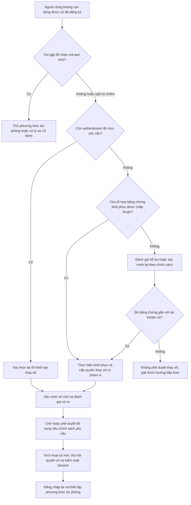
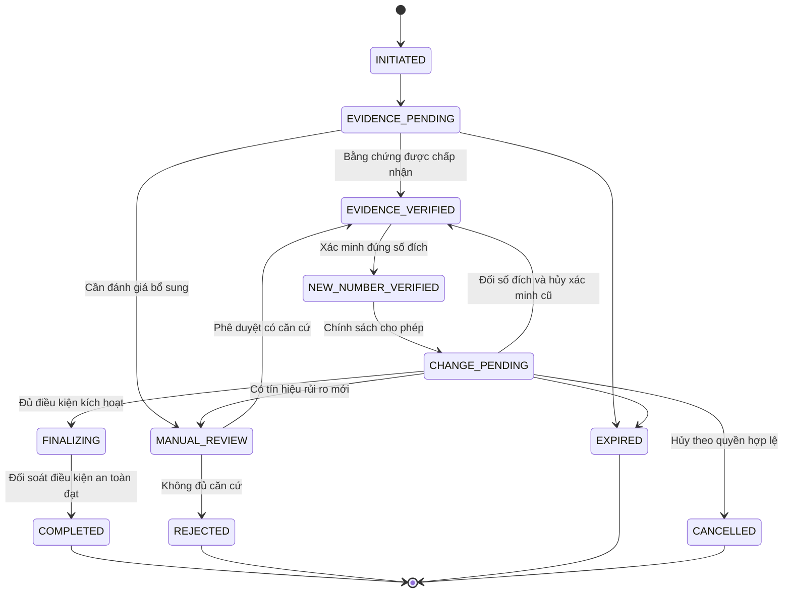

# Lost phone number workflow — Luồng khôi phục khi mất quyền sử dụng số điện thoại

## 1. Bài toán cần giải quyết

Một người dùng không còn nhận được SMS ở số điện thoại đã đăng ký. Họ vẫn biết mật khẩu và cung cấp một số mới có thể nhận OTP. Hệ thống có nên cho thay số ngay không?

Nếu chỉ kiểm tra mật khẩu và OTP gửi tới số mới, hệ thống có thể trao tài khoản cho người đã đánh cắp mật khẩu: số mới do chính người yêu cầu chọn, nên nhận được mã tại đó không chứng minh họ là chủ tài khoản cũ. Luồng khôi phục phải giải quyết riêng **quyền thay đổi tài khoản**, **quyền kiểm soát số mới** và **việc chấm dứt quyền của số cũ**.

Bài học thuộc chương **Phone Number Recovery** của module `SECURITY_AUTHENTICATION_ACCOUNT_RECOVERY`. Trong phạm vi thiết kế khôi phục an toàn khi người dùng mất mật khẩu, MFA, passkey hoặc thiết bị xác thực, bài này tập trung vào trường hợp mất quyền sử dụng số điện thoại và các ảnh hưởng tới đăng nhập, khôi phục tài khoản, thông báo và session.

Sau bài học, người học có thể:

- Phân biệt mất số điện thoại với mất thiết bị, mất SIM hoặc tạm thời không nhận được mã.
- Chọn nhánh khôi phục dựa trên bằng chứng còn lại và mức rủi ro của tài khoản.
- Thiết kế quá trình thay số có xác minh độc lập, trạng thái rõ ràng và khả năng xử lý yêu cầu đồng thời.
- Thu hồi quyền của số cũ, quản lý session và ngăn luồng hỗ trợ trở thành đường bỏ qua MFA.
- Xác định điều kiện hoàn tất và các tình huống cần kiểm thử.

Luồng tham chiếu, tên trạng thái và cấu trúc dữ liệu trong bài là thiết kế minh họa. Cần điều chỉnh chúng theo kiến trúc, phương thức xác thực và yêu cầu bảo đảm của sản phẩm.

## 2. Xác định người dùng đã mất điều gì

### 2.1. Không đồng nhất số điện thoại và thiết bị

| Tình huống | Thứ có thể đã mất | Hướng xử lý ban đầu |
| --- | --- | --- |
| Điện thoại hết pin, không có sóng hoặc SMS chậm | Khả năng sử dụng tạm thời | Cho thử phương thức dự phòng; tránh tự chuyển thành đổi số |
| Mất SIM nhưng vẫn có thể xin cấp lại cùng số | SIM hoặc quyền truy cập tạm thời | Tách việc xử lý với nhà mạng khỏi quyết định xác thực của ứng dụng |
| Số hết hạn và bị cấp cho người khác | Quyền kiểm soát số cũ | Không tiếp tục dựa vào số đó để chứng minh quyền tài khoản |
| Người dùng đổi số vĩnh viễn | Kênh liên lạc hoặc yếu tố SMS | Chọn luồng thay số theo mức xác thực còn lại |
| Bị chuyển SIM hoặc chuyển mạng trái phép | Quyền nhận SMS có thể thuộc kẻ khác | Xem là tình huống nghi bị chiếm quyền và đánh giá containment |
| Mất cả điện thoại có TOTP và passkey | Nhiều authenticator và có thể cả session | Kiểm kê từng credential; thay số không tự khôi phục các credential này |

Ứng dụng không tự giành lại số điện thoại từ nhà mạng. Người dùng có thể làm việc với nhà mạng qua quy trình riêng, nhưng lời khai “đã lấy lại SIM” hoặc ảnh chụp yêu cầu cấp SIM không tự cấp quyền đổi yếu tố xác thực của ứng dụng.

TOTP thông thường dựa vào bí mật đã đăng ký trong ứng dụng, không dựa vào số điện thoại. Passkey dựa vào credential mật mã; mất số không tự có nghĩa mọi passkey đều mất. Cần kiểm tra khóa bảo mật, thiết bị khác hoặc khả năng truy cập credential đồng bộ còn lại, đồng thời xét sự phụ thuộc của tài khoản đồng bộ vào số đã mất.

### 2.2. Kiểm kê vai trò của số điện thoại

| Vai trò | Nguy cơ nếu số cũ vẫn được tin cậy | Điều phải cập nhật khi thay số |
| --- | --- | --- |
| Bí danh đăng nhập | Người giữ số có thể khởi tạo luồng liên quan tới tài khoản | Liên kết bí danh theo đúng chính sách |
| Yếu tố SMS hoặc gọi thoại | Người khác nhận được mã xác thực | Binding của authenticator, challenge và trạng thái cho phép sử dụng |
| Địa chỉ nhận mã khôi phục | Có thể tạo đường đặt lại mật khẩu hoặc MFA | Kênh khôi phục và các quyền khôi phục đang chờ |
| Kênh thông báo bảo mật | Thông tin tài khoản tiếp tục tới người khác | Danh sách kênh được phép nhận từng loại thông báo |
| Thông tin hồ sơ hoặc liên hệ nghiệp vụ | Có thể rò thông tin hoặc liên hệ nhầm | Cập nhật trong phạm vi được người dùng cho phép và sản phẩm quy định |

Một cột `phone_number` trong hồ sơ có thể đang được nhiều hệ thống sử dụng với ý nghĩa khác nhau. Chỉ sửa cột hiển thị trên trang cá nhân có thể để nguyên yếu tố SMS trong identity provider. Ngược lại, thay yếu tố xác thực không đồng nghĩa được phép đổi số nhận thông báo thanh toán của mọi tổ chức liên quan.

Tài khoản cần một ID nội bộ ổn định. Số điện thoại là thuộc tính hoặc liên kết có thể thay đổi, không phải bằng chứng sở hữu vĩnh viễn hay khóa chính bất biến của con người.

## 3. Những nguyên tắc an toàn của luồng

### 3.1. Ba kết quả xác minh độc lập

```text
Được phép thay đổi tài khoản
    + Kiểm soát số điện thoại đích
    + Đáp ứng chính sách rủi ro và vòng đời authenticator
    = Có thể kích hoạt thay đổi trong phạm vi được duyệt
```

Kết quả đầu tiên phải dựa vào bằng chứng đã gắn với tài khoản hoặc một quy trình khôi phục được chấp thuận. Không dùng OTP ở số mới làm bằng chứng cho chính quyền thêm số đó. Đây là lỗi lập luận vòng tròn thường gặp.

Nếu số điện thoại dùng cho xác thực qua mạng điện thoại công cộng, thay số là một hành động gắn authenticator mới. NIST cũng lưu ý các tín hiệu như đổi SIM và chuyển số khi sử dụng kênh này. Xem [NIST SP 800-63B-4, Authentication Using the Public Switched Telephone Network](https://pages.nist.gov/800-63-4/sp800-63b.html#pstn).

### 3.2. Các bất biến nên duy trì

- Chỉ biết username, mật khẩu hoặc thông tin hồ sơ không mặc nhiên đủ để thay yếu tố thứ hai của tài khoản yêu cầu MFA.
- Một session còn hiệu lực có thể giúp khởi tạo hồ sơ, nhưng quyền thay số cần căn cứ xác thực phù hợp và đủ mới.
- Số mới chưa kích hoạt không được dùng để chứng minh quyền sở hữu tài khoản trong chính hồ sơ đang xét.
- Token, OTP và phê duyệt phải gắn với đúng tài khoản, tenant, mục đích và số đích hoặc phiên bản số đích.
- Thay số đích làm mất hiệu lực xác minh và phê duyệt cũ liên quan tới số đích trước đó.
- Không biến một yêu cầu ẩn danh chưa xác minh thành lệnh khóa tài khoản hoặc xóa authenticator.
- Không yêu cầu người đã mất số phải nhận OTP ở chính số đó như điều kiện duy nhất để khôi phục.
- Hủy yêu cầu không tự khôi phục niềm tin đối với một số đã được xác định là mất hoặc bị chiếm.
- Không mở session đăng nhập đầy đủ chỉ vì người dùng đã hoàn thành một bước khôi phục có phạm vi hẹp.

OWASP khuyến nghị xác thực lại khi thay yếu tố MFA, không chỉ dựa vào session đang mở, đồng thời xét rủi ro và thông báo độc lập. Các nguyên tắc này áp dụng trực tiếp cho quyết định thay số trong bài. Xem [OWASP Multifactor Authentication Cheat Sheet — Changing MFA Factors](https://cheatsheetseries.owasp.org/cheatsheets/Multifactor_Authentication_Cheat_Sheet.html#changing-mfa-factors).

## 4. Phân nhánh theo bằng chứng còn lại

### 4.1. Cây quyết định tham chiếu



Nhánh hỗ trợ là một quy trình xác minh có tiêu chí, không phải nút bỏ qua điều kiện bảo mật. Nếu không có bằng chứng đủ để nối người yêu cầu với tài khoản cũ, hệ thống có thể không khôi phục được an toàn. Thiết kế phải chấp nhận kết quả này thay vì chuyển quyền dựa vào câu chuyện thuyết phục nhất.

### 4.2. Ma trận lựa chọn phương thức

| Người dùng còn gì? | Giá trị bằng chứng | Hướng xử lý trong thiết kế tham chiếu |
| --- | --- | --- |
| Authenticator khác đáp ứng mức yêu cầu | Có thể chứng minh quyền bằng phương thức đã đăng ký | Xác thực lại cho hành động thay số và chuyển sang xác minh số mới |
| Mật khẩu và saved recovery code hợp lệ | Có thể là tổ hợp được chính sách chấp nhận | Kiểm tra đúng loại code, phạm vi, trạng thái dùng một lần và mức bảo đảm |
| Chỉ mật khẩu | Chứng minh yếu tố kiến thức nếu đúng | Không tự cho bỏ yếu tố SMS của tài khoản MFA; yêu cầu nhánh khôi phục khác |
| Kênh email đã thiết lập từ trước | Có thể nhận bằng chứng khôi phục theo chính sách | Xét tổ hợp bằng chứng và sự phụ thuộc vào số cũ; không tự coi mọi email OTP là đủ |
| Session đang mở nhưng không xác thực lại được | Cho biết quyền phiên hiện tại | Cho khởi tạo hoặc xem hướng dẫn trong phạm vi được phép; chưa tự cấp quyền thay số |
| Chỉ số mới và OTP gửi tới số mới | Chứng minh khả năng nhận mã ở kênh đích | Không chứng minh quyền thay đổi tài khoản cũ |
| Chỉ giấy tờ và thông tin hồ sơ | Có thể hỗ trợ một quy trình đã thiết kế | Cần căn cứ nối với hồ sơ gốc; không tự động phê duyệt chỉ từ ảnh giấy tờ |

Khi áp dụng NIST, chọn phương thức theo mức bảo đảm xác thực và mức xác minh danh tính đã thiết lập; các yêu cầu không giống nhau cho mọi tài khoản. Ví dụ, ở AAL2, tài liệu nêu các tổ hợp recovery code hoặc code kết hợp authenticator còn lại, và khả năng xác minh lại khi có căn cứ danh tính ban đầu. Xem [NIST SP 800-63B-4 — Recovery Requirements by IAL/AAL](https://pages.nist.gov/800-63-4/sp800-63b.html#recovery-requirements-by-ialaal).

Không suy ra “hai lần nhận mã” là hai bằng chứng độc lập. Nếu hộp thư, tài khoản đồng bộ passkey và ứng dụng hỗ trợ đều có thể khôi phục chỉ bằng số đã mất, chúng có chung điểm hỏng. Quy trình cần xem sự phụ thuộc này khi chọn bằng chứng.

## 5. Workflow chi tiết từ tiếp nhận tới hoàn tất

### Bước 1 — Tiếp nhận yêu cầu mà chưa thay đổi quyền

Cho người dùng chọn lý do như mất số vĩnh viễn, mất thiết bị hoặc nghi số bị chiếm. Chỉ thu thập thông tin cần thiết để chọn nhánh; lời khai là ngữ cảnh đánh giá, chưa phải bằng chứng xác thực.

Nếu bắt đầu từ màn hình chưa đăng nhập, dùng phản hồi hạn chế dò tài khoản. Không trả danh sách tài khoản, số cũ đầy đủ, trạng thái MFA hoặc các kênh dự phòng chỉ vì người gọi nhập một số điện thoại hay email.

Server tạo `recovery_id` khó đoán để liên kết hồ sơ, đặt thời hạn, áp dụng hạn mức và ghi nhận phiên bản chính sách. ID hồ sơ không phải quyền truy cập: biết ID không được xem dữ liệu hoặc tiếp tục hồ sơ của người khác.

Trong giai đoạn này, chưa sửa số hồ sơ, chưa gỡ MFA và chưa thu hồi session chỉ vì có người gửi yêu cầu. Các tín hiệu nghi bị chiếm có thể chuyển sang quy trình xử lý sự cố riêng với tiêu chí xác minh báo cáo phù hợp.

### Bước 2 — Chứng minh quyền đối với tài khoản bằng kênh còn tin cậy

Ưu tiên authenticator khác đã đăng ký và có khả năng đáp ứng yêu cầu của hành động, ví dụ khóa bảo mật, passkey phù hợp hoặc mật khẩu kết hợp TOTP dự phòng còn kiểm soát được. Server kiểm tra kết quả xác thực, không tin nhãn `mfa_verified=true` do client gửi.

Nếu dùng recovery code, xác minh đúng mã đã được phát trước đó hoặc đúng luồng phát mã khôi phục được chấp thuận. Tiêu thụ mã dùng một lần theo cơ chế nguyên tử; một mã không được dùng song song cho hai hồ sơ. Việc phát bộ mã thay thế phải theo chính sách, không để bộ cũ tiếp tục tạo quyền ngoài dự kiến.

Nếu cần hỗ trợ xác minh lại, nhân viên sử dụng hồ sơ và phương pháp đã được phê duyệt. Không dùng ngày sinh, số điện thoại cũ, lịch sử công khai hoặc câu hỏi bảo mật dễ đoán như lý do duy nhất để gỡ MFA. Không yêu cầu gửi bí mật, OTP hoặc bản sao giấy tờ qua kênh chat tùy tiện.

Đối với tài khoản chưa từng có căn cứ danh tính thật, một giấy tờ thật có thể chứng minh danh tính của người cầm giấy tờ nhưng chưa nối được họ với tài khoản bí danh. Không tự tạo ra mối nối này trong lúc xử lý yêu cầu.

### Bước 3 — Cấp quyền thao tác khôi phục có phạm vi hẹp

Sau khi chấp nhận bằng chứng, cấp quyền tạm chỉ để thực hiện hành động được duyệt, ví dụ `phone_binding:replace` cho một tài khoản và một hồ sơ. Quyền này không cấp đọc dữ liệu cá nhân rộng, chuyển tiền, tạo API key, gỡ mọi MFA hoặc đổi email.

Quyền tạm có thời hạn, có thể thu hồi và được kiểm tra tại server. Nếu dùng cookie, thiết kế bảo vệ cookie và CSRF cho các thao tác thay đổi trạng thái. Nếu dùng bearer token, bảo vệ khỏi URL, referrer, log và lưu trữ phía client không phù hợp.

Hồ sơ có thể tồn tại lâu hơn quyền thao tác. Khi quyền hết hạn, người dùng cần tiếp tục qua cơ chế xác minh hoặc tiếp nối an toàn đã quy định. Không cấp quyền mới chỉ từ `recovery_id`, số mới hoặc ticket hỗ trợ. Nếu không còn cách chứng minh phù hợp, chuyển đánh giá bổ sung thay vì kéo dài token vô hạn.

### Bước 4 — Xác minh số mới mà chưa kích hoạt quyền đăng nhập

Cho nhập số đích sau khi đã có quyền khởi tạo thay đổi phù hợp. Chuẩn hóa theo định dạng và phạm vi đánh số mà sản phẩm hỗ trợ; kiểm tra khả năng nhận mã theo chính sách, nhưng không xem kết quả kiểm tra cú pháp là bằng chứng người dùng kiểm soát số.

Gửi mã xác nhận tới số mới. Challenge phải gắn với tài khoản, tenant, `recovery_id`, số đích đã chuẩn hóa, mục đích xác nhận số mới và phiên bản đích. Mã gửi cho hồ sơ A không được dùng ở hồ sơ B, dù hai màn hình cùng hiện một số.

Mã có thời hạn ngắn phù hợp, giới hạn lần thử và được chấp nhận thành công một lần. Gửi lại mã không được đặt lại vô hạn ngân sách đoán hoặc ngân sách SMS. Nhà cung cấp báo “đã gửi” chưa chứng minh người dùng nhận mã; chỉ server xác minh đúng challenge mới đánh dấu quyền kiểm soát kênh đích tại thời điểm đó.

Nếu số đã liên kết với tài khoản khác, áp dụng chính sách xung đột. Một sản phẩm có thể cho chia sẻ số, sản phẩm khác yêu cầu duy nhất. Trong cả hai trường hợp, không tự gộp tài khoản, chuyển chủ tài khoản kia hoặc xóa liên kết của người khác vì người yêu cầu nhận được OTP ở số hiện tại.

### Bước 5 — Đánh giá rủi ro và chọn cách kích hoạt

Kết hợp các tín hiệu có sẵn và được phép xử lý: thay đổi số hoặc email gần đây, phiên đăng nhập bất thường, số lần khôi phục, dấu hiệu tự động hóa, loại tài khoản, quyền quản trị và tín hiệu viễn thông khi có nguồn hợp lệ. Không có dữ liệu về SIM swap không có nghĩa số không bị chiếm.

Kết quả có thể là cho phép tiếp tục, yêu cầu bằng chứng bổ sung, đưa vào chờ, chuyển hỗ trợ hoặc từ chối. Ghi mã lý do và phiên bản chính sách để có thể giải thích quyết định.

Khoảng chờ, nếu có, tạo cơ hội phát hiện thay đổi trái phép; nó không biến bằng chứng yếu thành mạnh. Không đặt một thời lượng duy nhất làm “chuẩn an toàn” cho mọi ứng dụng. Trong thời gian chờ, số mới chưa trở thành phương thức đăng nhập hoặc khôi phục đã kích hoạt.

Nếu đã có căn cứ đủ tin cậy rằng số cũ bị mất hoặc bị chiếm, xử lý đình chỉ hoặc thu hồi quyền của nó theo chính sách xử lý compromise, không để số đó tiếp tục nhận quyền chỉ để chờ kích hoạt số mới. Quyết định này có thể khác về mức bằng chứng so với phê duyệt thêm số mới; cần quy định riêng để cân bằng containment và nguy cơ gây khóa nhầm.

### Bước 6 — Thông báo và cho phép phản hồi an toàn

Gửi thông báo qua kênh độc lập đã thiết lập và còn phù hợp, chẳng hạn email hoặc thiết bị tin cậy khác. Nội dung nêu loại thay đổi, thời điểm, trạng thái đang chờ hay đã hoàn tất và cách báo cáo nếu không nhận ra yêu cầu.

Không dùng số mới làm kênh thông báo độc lập duy nhất cho việc thêm chính nó. Khi số cũ được báo mất hoặc có nguy cơ thuộc người khác, tránh gửi bí mật hoặc thông tin tài khoản nhạy cảm tới đó. Nếu chính sách cần một thông báo tối thiểu tới kênh cũ, phải đánh giá riêng nội dung và quyền của liên kết đi kèm.

Thông báo “không phải tôi” có thể mở một báo cáo hoặc quy trình tạm giữ theo chính sách. Nó không được trở thành liên kết đăng nhập, nút khôi phục số cũ vô điều kiện hoặc lệnh khóa vĩnh viễn tài khoản từ một lần GET. Xem cả trường hợp trình quét email tự mở liên kết.

### Bước 7 — Kiểm tra lại và thực hiện chuyển đổi

Ngay trước khi kích hoạt, kiểm tra lại quyền thao tác, trạng thái hồ sơ, số đích, tính mới của bằng chứng, yêu cầu phê duyệt, thời điểm được phép kích hoạt và phiên bản bảo mật của tài khoản. Nếu email, authenticator hoặc dữ liệu liên quan thay đổi trong lúc chờ, cần đánh giá lại thay vì dùng phê duyệt cũ một cách máy móc.

Nếu thời gian chờ kéo dài hơn thời gian tin cậy của kết quả xác minh số mới, xác nhận lại theo chính sách trước khi kích hoạt. Không để một lần nhận OTP từ nhiều ngày trước tự chứng minh người yêu cầu vẫn kiểm soát số.

Trong phạm vi đã duyệt, chuyển số mới sang trạng thái hoạt động; loại bỏ quyền xác thực và khôi phục của số cũ; vô hiệu hóa challenge và quyền tạm bị thay thế. Cập nhật cả bí danh đăng nhập và kênh liên quan nếu chúng thuộc cùng thay đổi được phép.

Không đánh dấu hoàn tất nếu identity provider vẫn tin số cũ trong khi ứng dụng chỉ vừa sửa hồ sơ. Với nhiều dịch vụ, duy trì trạng thái trung gian và cơ chế hạn chế truy cập cho tới khi các điều kiện an toàn bắt buộc đã có hiệu lực.

### Bước 8 — Kiểm soát session và củng cố khả năng khôi phục

Áp dụng chính sách session theo kết quả đánh giá. Nếu nghi tài khoản hoặc thiết bị bị chiếm, session và refresh token cũ có thể duy trì quyền của kẻ tấn công dù số đã đổi. Luồng tham chiếu có nhánh khôi phục tài khoản sẽ thu hồi các phiên hiện có khi hoàn tất và yêu cầu đăng nhập lại bằng phương thức được phép.

Đổi số do người dùng đã xác thực đủ mức bằng authenticator khác có thể có chính sách session khác, nhưng vẫn phải đánh giá rủi ro và xoay hoặc thu hồi các quyền bị ảnh hưởng. Không đánh đồng mọi trường hợp thay số với một mức xử lý duy nhất.

Người dùng xác nhận lại các phương thức bảo mật, thêm phương án dự phòng phù hợp và lưu recovery code an toàn theo chính sách. Không tự động đăng ký một passkey mới hoặc xóa TOTP chỉ vì thay số thành công; mỗi authenticator có vòng đời và căn cứ riêng.

## 6. Mô hình trạng thái để tránh bỏ qua bước

### 6.1. Các trạng thái tham chiếu

| Trạng thái | Ý nghĩa | Điều chưa được phép |
| --- | --- | --- |
| `INITIATED` | Đã tiếp nhận hồ sơ | Thay binding hoặc gỡ yếu tố cũ chỉ từ lời khai |
| `EVIDENCE_PENDING` | Đang chờ bằng chứng về tài khoản | Dùng số mới làm bằng chứng sở hữu tài khoản cũ |
| `EVIDENCE_VERIFIED` | Bằng chứng đạt chính sách cho phạm vi được duyệt | Tự mở rộng sang mọi thay đổi bảo mật |
| `NEW_NUMBER_VERIFIED` | Đã xác nhận kênh đích của phiên bản hiện tại | Dùng số mới để đăng nhập trước kích hoạt |
| `CHANGE_PENDING` | Đã có quyết định, chờ điều kiện kích hoạt | Bỏ qua thời gian chờ hoặc phê duyệt bằng tham số client |
| `FINALIZING` | Đang thực hiện và đối soát thay đổi bắt buộc | Thông báo hoàn tất khi quyền cũ còn hiệu lực ngoài dự kiến |
| `COMPLETED` | Các điều kiện hoàn tất đã được đáp ứng | Dùng lại quyền thay số đã tiêu thụ |
| `MANUAL_REVIEW` | Cần đánh giá bổ sung có kiểm soát | Nhân viên sửa trực tiếp DB để vượt điều kiện |
| `CANCELLED`, `EXPIRED`, `REJECTED` | Hồ sơ kết thúc mà không kích hoạt theo yêu cầu | Tiếp tục dùng token hoặc phê duyệt của hồ sơ đã kết thúc |



Sơ đồ không liệt kê mọi cạnh hết hạn và hủy. Trong triển khai, định nghĩa rõ các cạnh đó cho từng trạng thái. Khi đổi số đích từ một trạng thái đã xác minh, tăng `target_revision`, hủy các challenge và phê duyệt gắn với đích cũ, rồi xác minh lại. Nếu bằng chứng tài khoản cũng hết tin cậy, quay lại bước phù hợp thay vì giữ `EVIDENCE_VERIFIED`.

Trạng thái hồ sơ và trạng thái authenticator cũ là hai dữ liệu khác nhau. Hồ sơ `CANCELLED` không có nghĩa authenticator cũ đã được khôi phục. Nếu quá trình đình chỉ số cũ đã được thực hiện hợp lệ, giữ quyết định đó cho tới khi có căn cứ khác để thay đổi.

### 6.2. Ví dụ dữ liệu hồ sơ tối thiểu

```json
{
  "recovery_id": "rec_example_01",
  "tenant_ref": "tenant_example",
  "account_ref": "acct_opaque_example",
  "purpose": "replace_lost_phone_binding",
  "state": "CHANGE_PENDING",
  "case_version": 8,
  "target_revision": 2,
  "expected_auth_revision": 17,
  "old_binding_ref": "binding_old_example",
  "new_phone_ref": "phone_candidate_example",
  "evidence_bundle_ref": "evidence_example",
  "new_number_verified_at": "2026-11-23T08:05:00Z",
  "not_before": "2026-11-24T08:05:00Z",
  "expires_at": "2026-11-26T08:05:00Z",
  "policy_version": "phone-recovery-example-3"
}
```

Các thời điểm chỉ minh họa cách biểu diễn; chúng không quy định thời gian chờ, thời hạn OTP hoặc thời gian hiệu lực bằng chứng cho mọi ứng dụng. `new_phone_ref` tham chiếu bản ghi số đích được bảo vệ; hồ sơ không cần sao chép số rõ vào mọi sự kiện hoặc hàng đợi.

`evidence_bundle_ref` trỏ tới kết quả xác minh có phạm vi, thời điểm và điều kiện sử dụng; nó không phải cờ `verified` tồn tại vĩnh viễn. `expected_auth_revision` giúp phát hiện thay đổi bảo mật ngoài dự kiến. Các thay đổi do chính hồ sơ thực hiện hợp lệ, như đình chỉ binding cũ, cần cập nhật phiên bản kỳ vọng nhất quán.

## 7. Token, OTP và thao tác nguyên tử

### 7.1. Tách mục đích của từng bí mật

| Thành phần | Chức năng | Ràng buộc quan trọng |
| --- | --- | --- |
| Recovery code đã thiết lập | Góp phần chứng minh quyền khôi phục tài khoản | Đúng tài khoản, chính sách tổ hợp, chống đoán và dùng lại |
| Quyền thao tác tạm | Cho phép tiếp tục hồ sơ thay số | Đúng purpose, tenant, account, case, thời hạn và phạm vi |
| OTP tới số mới | Xác nhận kênh đích | Đúng số và phiên bản đích, thời hạn, giới hạn thử, dùng một lần |
| Phê duyệt hỗ trợ | Cho phép một bước theo chính sách | Actor, căn cứ, phạm vi và khả năng thu hồi; không thay thế bằng bearer token tùy ý |
| Token đăng nhập | Quyền truy cập sau xác thực | Do luồng đăng nhập hoặc chính sách cấp phiên riêng quyết định |

Sinh bí mật bằng nguồn ngẫu nhiên phù hợp. Không lưu token dùng để cấp quyền ở dạng rõ nếu server chỉ cần kiểm tra bằng digest. Với OTP ngắn, hash thường không ngăn được dò toàn bộ không gian mã khi dữ liệu bị lộ; cần phương án lưu phù hợp, chẳng hạn kiểm tra bằng HMAC với khóa được bảo vệ tách khỏi kho challenge, cùng giới hạn đoán trực tuyến.

Không ghi OTP, recovery code, bearer token hoặc cookie phiên vào log. Khi gửi lại mã, xác định rõ challenge nào còn hiệu lực; không để nhiều mã tồn tại vô hạn hoặc reset ngân sách đoán sau mỗi lần gửi lại.

### 7.2. Pseudocode kích hoạt thay đổi

Ví dụ sau giả định binding, hồ sơ và trạng thái thu hồi tại nguồn có thẩm quyền nằm trong cùng một ranh giới giao dịch. Các hàm là mô tả nghiệp vụ, không phải API có thể sao chép để chạy ngay.

```text
finalizePhoneReplacement(grant, recoveryId, idempotencyKey):
    requireProtectedRequestAndCsrfWhenApplicable()

    begin transaction
        recovery = lockRecovery(recoveryId)
        account = lockAccount(recovery.accountRef)

        authorizeGrantForExactCaseAndAccount(grant, recovery, account)
        assertAuthorizedTenantScope(grant, recovery.tenantRef)

        if completedResultExistsForAuthorizedOperation(idempotencyKey):
            return savedResultWithoutSecrets()

        assert recovery.state == CHANGE_PENDING
        assert recovery.expectedAuthRevision == account.authRevision
        assert serverNow() >= recovery.notBefore
        assert serverNow() < recovery.expiresAt
        assertEvidenceStillSufficient(recovery, account)
        assertTargetVerificationStillValid(recovery.targetRevision)
        assertCurrentRiskDecisionAllowsChange(recovery, account)
        assertTargetBindingPolicySatisfied(recovery, account)

        activateExactApprovedPhoneBinding(recovery)
        revokeOldPhoneRolesInApprovedScope(recovery)
        invalidateSupersededChallengesAndRecoveryGrants(recovery)
        applyRequiredSessionRevocationAtAuthority(account)
        advanceAuthRevisionAndCaseVersion(account, recovery)
        markFinalizingAndSaveIdempotentResult(recovery, idempotencyKey)
        appendOutboxEventsWithoutSecrets(recovery)
    commit

    reconcileRequiredDownstreamEffects(recoveryId)
    markCompletedOnlyWhenRequiredSafetyConditionsHold(recoveryId)
```

Kiểm tra quyền trước khi trả kết quả idempotent để người đoán key không đọc được kết quả của hồ sơ khác. Cùng key chỉ đại diện cùng một thao tác đã được ràng buộc; nếu payload thay đổi, hệ thống phải xử lý xung đột thay vì âm thầm dùng kết quả cũ.

Khóa bản ghi hoặc kiểm soát phiên bản phù hợp bảo vệ trước hai yêu cầu đồng thời. Chỉ kiểm tra ở frontend rồi cập nhật sau không đủ: người dùng có thể đổi số đích, gửi song song hoặc gọi thẳng endpoint cuối.

Nếu việc sửa số diễn ra tại identity provider bên ngoài, một annotation giao dịch trong ứng dụng không làm API của nhà cung cấp trở thành một phần của giao dịch DB. Cần bộ điều phối, idempotency, trạng thái trung gian và đối soát. Khi phải bù trừ, không tự khôi phục binding cũ đã xác định bị chiếm; có thể giữ tài khoản trong trạng thái hạn chế và chuyển xử lý.

## 8. Quản lý số cũ và session trong hệ thống phân tán

### 8.1. Số cũ không được còn đường quay lại tài khoản

Sau khi chuyển đổi có hiệu lực, kiểm tra số cũ trong tất cả vai trò thuộc phạm vi: đăng nhập, nhận SMS MFA, nhận mã reset mật khẩu, nhận mã recovery, tra cứu bí danh và nhận dữ liệu thông báo. Một số đã xóa khỏi giao diện nhưng còn trong luồng reset mật khẩu vẫn là đường chiếm tài khoản.

Các challenge đã phát tới số cũ không nên tiếp tục tạo quyền sau khi binding tương ứng bị thu hồi. Kiểm tra trạng thái binding hoặc phiên bản bảo mật khi xác minh challenge, thay vì chỉ kiểm tra mã đúng và chưa hết hạn.

Cache và bản sao dữ liệu cần chiến lược vô hiệu hóa. Nếu một dịch vụ chưa nhận sự kiện thay đổi, nó không được tiếp tục cho yếu tố cũ cấp quyền ngoài chính sách. Có thể cần kiểm tra nguồn có thẩm quyền cho thao tác nhạy cảm hoặc tạm hạn chế trong giai đoạn đối soát.

### 8.2. Thu hồi phiên phải có hiệu lực thực tế

Có thể dùng phiên bản bảo mật hoặc `security_epoch` để đánh dấu quyền cũ không còn được chấp nhận. Tuy nhiên, cơ chế chỉ có tác dụng khi điểm kiểm tra quyền đọc và thực thi phiên bản đó. JWT đã phát mà chỉ được kiểm chữ ký ngoại tuyến có thể còn dùng được tới lúc hết hạn nếu không có cơ chế thu hồi bổ sung.

Xem riêng session trình duyệt, refresh token, remembered-device token, session thiết bị di động và phiên ở identity provider. API key hoặc credential dịch vụ cần chính sách riêng; đổi số điện thoại không mặc nhiên thu hồi mọi loại credential.

Với nhánh nghi bị chiếm, ưu tiên ngăn quyền của tác nhân cũ tiếp tục được sử dụng. Sau đó, người dùng đăng nhập lại qua luồng phù hợp và được yêu cầu xác nhận những thay đổi bảo mật quan trọng. Không coi việc đóng tab hoặc xóa cookie trên trình duyệt hiện tại là thu hồi session phía server.

## 9. Kiểm soát lạm dụng và bảo vệ nhánh hỗ trợ

### 9.1. Chống dò tài khoản và gây ngập SMS

Áp dụng hạn mức kết hợp theo nguồn, hồ sơ, tài khoản khi đã được phân giải, số đích và tổng chi phí gửi. IP không phải danh tính; một IP có thể là mạng dùng chung, còn một tác nhân có thể dùng nhiều IP.

Không để tạo hồ sơ mới hoặc đổi số đích làm mới mọi hạn mức. Theo dõi các hành vi như một tài khoản thử nhiều số mới, nhiều tài khoản cùng nhắm một số hoặc một nguồn tạo nhiều yêu cầu thay số. CAPTCHA hoặc thử thách chống bot chỉ hỗ trợ chống tự động hóa, không thay thế bằng chứng chủ tài khoản.

Phản hồi ngoài cần hạn chế lộ việc một số đã gắn với ai hoặc đã bật MFA hay chưa. Chi tiết như “số này thuộc tài khoản quản trị X” chỉ nên có trong công cụ được cấp quyền theo nhiệm vụ, không trả về màn hình công khai.

### 9.2. Tránh bị thao túng qua nhân viên hỗ trợ

- Dùng hồ sơ có ID, trạng thái, căn cứ và phiên bản chính sách thay vì quyết định rời rạc trong chat.
- Nhân viên không xin người dùng đọc OTP đăng nhập hoặc gửi recovery code vào ticket để “kiểm tra giúp”.
- Không thêm số mới làm kênh tin cậy rồi dùng chính số đó để phê duyệt yêu cầu đang xử lý.
- Không để áp lực khẩn cấp, chức danh quản trị hoặc thông tin công khai thay thế điều kiện xác minh.
- Với tài khoản rủi ro cao, áp dụng kiểm soát phê duyệt phù hợp, có thể gồm người kiểm tra thứ hai và phân tách quyền.
- Lưu kết quả đánh giá và tham chiếu bằng chứng theo chính sách dữ liệu; tránh sao chép giấy tờ vào log hoặc nhiều hệ thống ticket.

Nếu tổ chức dùng SSO và identity provider quản lý yếu tố điện thoại, đội hỗ trợ ứng dụng phải chuyển hoặc điều phối tại đúng nguồn có thẩm quyền. Sửa bảng người dùng cục bộ không thể coi là đã reset yếu tố tại identity provider.

### 9.3. Hủy và phản đối yêu cầu

Cho người dùng có căn cứ phù hợp hủy yêu cầu hoặc báo thay đổi trái phép. Một thông báo từ kênh chưa xác thực có thể là tín hiệu cần xem xét, nhưng không tự trở thành quyền sửa binding, đọc hồ sơ hoặc gây khóa vĩnh viễn.

Nếu một yêu cầu hợp lệ bị hủy sau khi số cũ đã bị đình chỉ, hệ thống cần hướng dẫn cách giữ hoặc khôi phục quyền qua phương thức còn an toàn. Không âm thầm đưa số cũ về trạng thái tin cậy vì “thao tác đổi số đã rollback”.

## 10. Trải nghiệm người dùng và thông báo

Người dùng cần hiểu hệ thống đang xác minh tài khoản hay đang xác minh số mới. Gộp cả hai thành một màn hình “nhập OTP để lấy lại tài khoản” khiến họ dễ hiểu sai quyền của mã và dễ bị lừa đọc mã cho người khác.

| Giai đoạn | Nội dung nên thể hiện | Điều cần tránh |
| --- | --- | --- |
| Chọn nhánh | Có thể dùng phương thức khác đã thiết lập nếu không còn nhận SMS | Bắt buộc nhận mã ở số đã mất trong mọi trường hợp |
| Xác minh tài khoản | Nêu loại bằng chứng được chấp nhận và phạm vi thao tác | Hứa khôi phục chỉ từ một số mới |
| Xác minh số đích | Mã đang xác nhận số mới cho yêu cầu cụ thể | Thông báo rằng nhập mã này đã hoàn tất mọi bước |
| Chờ kích hoạt | Thời điểm hoặc điều kiện còn thiếu, cách tiếp tục và liên hệ | Giả vờ số mới đã hoạt động khi chưa kích hoạt |
| Hoàn tất | Số mới trong phạm vi đã đổi, số cũ đã bị loại quyền nào, bước đăng nhập tiếp theo | Hiển thị bí mật hoặc gửi toàn bộ thông tin tới số cũ |
| Không đủ bằng chứng | Giải thích kết quả ở mức phù hợp và các lựa chọn còn lại | Tiết lộ đáp án xác minh, dữ liệu nội bộ hoặc hứa chắc support sẽ bỏ qua |

Ví dụ thông báo sau khi số đích đã được xác minh nhưng còn chờ:

> Số điện thoại mới đã được xác nhận cho yêu cầu này. Thay đổi chưa có hiệu lực. Bạn có thể xem điều kiện còn lại và hướng dẫn tiếp tục trong hồ sơ khôi phục.

Ví dụ thông báo bảo mật qua kênh độc lập:

> Có yêu cầu thay số điện thoại dùng cho bảo mật trên tài khoản của bạn. Nếu bạn không thực hiện, hãy mở ứng dụng hoặc trang hỗ trợ chính thức để báo cáo. Không cung cấp mã xác minh cho người liên hệ với bạn.

Mẫu nội dung cần được điều chỉnh cho đúng trạng thái thực tế. Email được nhà cung cấp nhận để gửi chưa chứng minh người dùng đã được thông báo thành công; hệ thống cần theo dõi lỗi gửi và có cách xử lý theo chính sách.

## 11. Bằng chứng vận hành cần giữ

Ghi nhận các mốc đủ để dựng lại quyết định và hành động, chẳng hạn:

| Sự kiện minh họa | Mục đích |
| --- | --- |
| `phone_recovery.initiated` | Liên kết yêu cầu với hồ sơ, phạm vi và thời điểm |
| `phone_recovery.evidence_accepted` | Nêu loại bằng chứng, kết quả chính sách và căn cứ trong kho hạn chế |
| `phone_recovery.target_verified` | Ghi nhận số đích dạng tham chiếu và phiên bản đã xác minh |
| `phone_recovery.decision_recorded` | Giải thích cho phép, chờ, từ chối hoặc chuyển hỗ trợ |
| `phone_recovery.old_binding_suspended` | Ghi nhận quyết định containment riêng nếu có |
| `phone_recovery.activation_started` | Cho biết hệ thống đã bắt đầu chuyển đổi |
| `phone_recovery.completed` | Xác nhận các điều kiện hoàn tất đã có hiệu lực |
| `phone_recovery.cancelled` / `expired` | Giải thích kết thúc không kích hoạt |
| `security.sessions_revoked` | Ghi phạm vi thu hồi đã áp dụng theo chính sách |

Trường chung có thể gồm event ID, thời điểm, tenant, account reference hạn chế, recovery ID, actor, trạng thái trước/sau, phiên bản hồ sơ và chính sách. Tách rõ người yêu cầu chưa xác thực với chủ tài khoản đã được xác minh. Không đưa số rõ, OTP hoặc token vào mọi dòng log.

Đối soát sự kiện với trạng thái nghiệp vụ; log “đã hoàn tất” phát trước commit không chứng minh thay đổi đã xảy ra. Outbox trong cùng giao dịch có thể giúp lưu sự kiện bền vững trước khi chuyển sang kho tập trung; consumer cần xử lý phát lại và sự kiện đến muộn.

Theo dõi tỷ lệ hồ sơ dừng ở mỗi bước, lỗi xác minh số mới, lượng SMS, hồ sơ `FINALIZING` quá lâu và tỷ lệ phục hồi bị phản đối. Chỉ số hoàn tất cần mẫu số rõ; số OTP gửi đi không phải số tài khoản đã khôi phục.

## 12. Hai ví dụ xuyên suốt

### 12.1. Mất số nhưng còn phương thức xác thực độc lập

Lan không còn dùng được số cũ nhưng vẫn có mật khẩu và khóa bảo mật đã đăng ký. Số cũ đang dùng để nhận SMS dự phòng và mã khôi phục.

1. Lan mở luồng “Không còn sử dụng số này” và xác thực lại bằng tổ hợp được hệ thống chấp nhận.
2. Server ghi nhận quyền thay số cho đúng tài khoản, rồi cho nhập số mới.
3. Lan nhận và nhập mã xác nhận số mới. Số mới chưa tự trở thành yếu tố hoạt động ở bước này.
4. Hệ thống đánh giá rủi ro và thực hiện chính sách kích hoạt đã định. Nếu không cần khoảng chờ, vẫn đi qua các điều kiện chuyển trạng thái ở server.
5. Khi thay đổi có hiệu lực, hệ thống thu hồi binding SMS và kênh recovery cũ trong phạm vi, vô hiệu hóa challenge liên quan và áp dụng chính sách session.
6. Lan kiểm tra phương thức dự phòng và nhận thông báo qua kênh độc lập đã thiết lập.

Trong tình huống này, không cần gỡ khóa bảo mật hay đặt lại mật khẩu chỉ để thay số. Nếu chính sách coi đây là thay binding sau xác thực đủ mức, áp dụng nhánh tương ứng thay vì giả định mọi thay số đều là mất toàn bộ quyền tài khoản.

### 12.2. Mất số và không còn yếu tố thứ hai

Minh có mật khẩu nhưng mất điện thoại chứa SIM và ứng dụng TOTP. Minh cũng không còn saved recovery code. Địa chỉ email được cung cấp trong ticket là địa chỉ mới chưa từng gắn với tài khoản.

Nhân viên không thể dùng email mới và OTP tới số mới làm hai bằng chứng đủ để xóa MFA cũ: cả hai kênh đều do người yêu cầu vừa đưa vào. Họ kiểm tra xem tài khoản có phương án khôi phục đã thiết lập, recovery contact hoặc căn cứ xác minh danh tính ban đầu nào phù hợp không.

Nếu có đường khôi phục hợp lệ, Minh thực hiện đường đó rồi mới được cấp quyền thay số và thiết lập lại các authenticator bị mất theo phạm vi. Nếu không đủ bằng chứng, yêu cầu không được phê duyệt. Việc Minh biết mật khẩu, tên hiển thị và số cũ chưa loại trừ khả năng thông tin đó đã bị lộ.

Nếu thiết bị bị trộm và session còn mở, thay số thành công vẫn chưa xử lý hết nguy cơ. Quy trình còn phải đánh giá credential trên thiết bị, quyền phiên và các thay đổi bảo mật trái phép trước khi coi việc khôi phục tài khoản đã hoàn tất.

## 13. Ma trận kiểm thử workflow

| Tình huống | Kết quả cần đạt |
| --- | --- |
| Chỉ có mật khẩu và OTP tới số mới | Không tự bỏ MFA cũ nếu chính sách yêu cầu bằng chứng bổ sung |
| Còn authenticator hợp lệ đủ mức | Có đường thay số mà không bắt buộc nhận OTP số đã mất |
| Hai yêu cầu dùng cùng recovery code | Mã được tiêu thụ nguyên tử, không cấp hai quyền ngoài dự kiến |
| Dùng challenge của tài khoản hoặc tenant khác | Bị từ chối dù OTP trùng hoặc số đích giống nhau |
| Đổi số đích sau khi đã nhập OTP | Xác minh và phê duyệt gắn với đích cũ mất hiệu lực |
| Gửi lại mã liên tục hoặc tạo hồ sơ mới | Không đặt lại vô hạn ngân sách đoán và ngân sách gửi |
| Gọi trực tiếp endpoint kích hoạt | Server kiểm tra đủ trạng thái, quyền và chính sách |
| Yêu cầu kích hoạt trước `not_before` | Không được kích hoạt chỉ bằng đổi thời gian hoặc tham số client |
| Bằng chứng hoặc xác minh số đích quá cũ | Yêu cầu bước làm mới phù hợp, không kéo dài token vô hạn |
| Authenticator hoặc email đổi trong lúc chờ | Phát hiện phiên bản bảo mật thay đổi và đánh giá lại |
| Số mới đã liên kết với tài khoản khác | Xử lý xung đột đúng chính sách, không tự gộp hoặc chuyển chủ |
| Số cũ đã bị đình chỉ rồi hồ sơ bị hủy | Không tự khôi phục binding cũ đã mất tin cậy |
| Identity provider cập nhật lỗi hoặc sự kiện chậm | Giữ trạng thái trung gian, đối soát và hạn chế phù hợp |
| Access token cũ chưa hết hạn sau thu hồi | Điểm kiểm tra quyền thực thi được chính sách thu hồi đã công bố |
| Chỉ sửa hồ sơ nhưng binding SMS cũ còn | Không đánh dấu `COMPLETED` khi điều kiện bắt buộc chưa đạt |
| Scanner mở liên kết thông báo | Không tự thay số, hủy bảo mật hoặc tạo session từ GET |
| Nhân viên hỗ trợ không đủ quyền | Không thể phê duyệt, đọc bằng chứng hoặc sửa binding ngoài nhiệm vụ |
| Token hay OTP xuất hiện trong log và ticket | Được ngăn hoặc xử lý theo quy trình rò rỉ; không coi log có bí mật là bình thường |

Kiểm thử trên tài khoản, số đích và kênh nhận mã được kiểm soát. Đối chiếu cả kết quả API, trạng thái trong nguồn có thẩm quyền, quyền truy cập bằng số cũ và hiệu lực session; thông báo giao diện đơn lẻ chưa đủ chứng minh workflow an toàn.

## 14. Những lỗi thiết kế thường gặp

| Lỗi | Vì sao nguy hiểm | Cách sửa hướng thiết kế |
| --- | --- | --- |
| “Nhận OTP số mới là chính chủ” | Người tấn công có thể tự cung cấp số họ kiểm soát | Xác minh quyền tài khoản trước khi cấp quyền thay số |
| “Có session thì cho đổi MFA” | Session có thể bị đánh cắp hoặc có mức xác thực chưa đủ | Xác thực lại và kiểm tra phạm vi, độ mới của bằng chứng |
| Bắt OTP số cũ cho mọi trường hợp | Tạo ngõ cụt khi số đã mất, hoặc đưa quyền cho người giữ số mới được cấp lại | Cung cấp nhánh dự phòng và khôi phục độc lập |
| Chỉ đặt khoảng chờ | Kẻ tấn công vẫn có thể thắng sau khi chờ đủ | Kết hợp bằng chứng phù hợp, thông báo và kiểm tra lại |
| Hủy yêu cầu thì tự bật lại số cũ | Khôi phục quyền cho kênh đã bị chiếm hoặc cấp lại | Tách vòng đời hồ sơ và trạng thái tin cậy của binding |
| Sửa số ở ứng dụng nhưng bỏ sót identity provider | Yếu tố cũ vẫn cấp quyền ở nơi khác | Chuyển đổi tại nguồn có thẩm quyền và đối soát liên dịch vụ |
| Reset toàn bộ MFA khi chỉ cần thay số | Mở rộng tác động và xóa yếu tố còn an toàn | Chỉ đổi credential và quyền trong phạm vi đã duyệt |
| Nhân viên sửa DB cho nhanh | Bỏ qua điều kiện, phiên bản và bằng chứng | Thao tác qua workflow được cấp quyền, có audit và kiểm soát phê duyệt |

## 15. Điều kiện hoàn tất cần kiểm chứng

Một lần thay số trong workflow tham chiếu chỉ được coi là hoàn tất khi:

1. Quyền thực hiện thay đổi đã được xác minh theo chính sách của tài khoản và đúng phạm vi.
2. Số mới đúng với đích đã được duyệt, có kết quả xác minh còn đáp ứng yêu cầu khi kích hoạt.
3. Các quyền xác thực, khôi phục và bí danh của số cũ trong phạm vi đã bị thu hồi hoặc cập nhật đúng.
4. Token, challenge và phê duyệt bị thay thế không còn tạo được quyền ngoài dự kiến.
5. Các điều kiện session và tác động bắt buộc tại nguồn có thẩm quyền đã có hiệu lực; lỗi đồng bộ còn lại không bị che bằng thông báo thành công.
6. Người dùng được thông báo qua kênh phù hợp, có hướng báo cáo thay đổi trái phép và biết cách đăng nhập tiếp theo.
7. Bằng chứng quyết định và chuyển trạng thái được lưu đủ để điều tra mà không làm lộ bí mật.

Kết quả an toàn là quyền tài khoản tiếp tục dựa trên bằng chứng đáng tin cậy, số mới được gắn đúng mục đích và số đã mất không còn là đường quay lại tài khoản.
