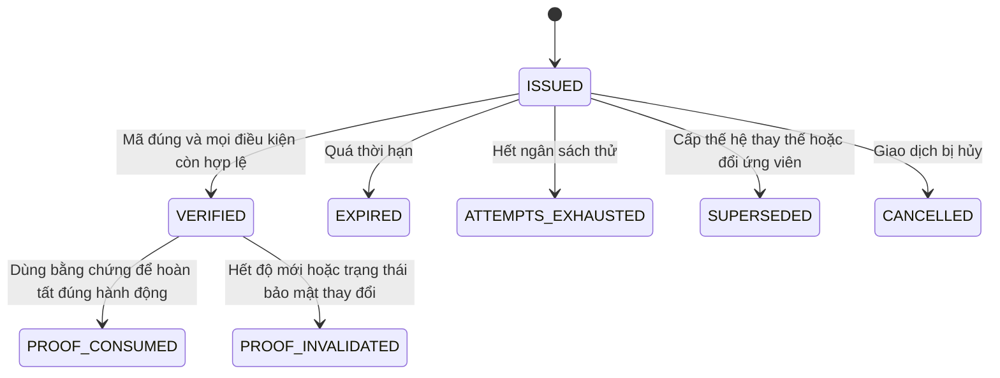

# Chứng minh quyền kiểm soát số điện thoại mới khi khôi phục tài khoản

## 1. Số mới nhận được mã chưa đủ để lấy lại tài khoản

Trong chương **Phone Number Recovery**, **New phone number proof** là bằng chứng cho thấy người yêu cầu có thể hoàn tất thử thách được gửi đến số điện thoại mới trong một ngữ cảnh cụ thể. Bằng chứng này giúp tránh gắn nhầm số, nhưng chỉ là một phần của quyết định khôi phục.

Trong phạm vi `SECURITY_AUTHENTICATION_ACCOUNT_RECOVERY`, người dùng có thể mất mật khẩu, MFA, passkey hoặc thiết bị xác thực, đồng thời không còn sử dụng được số cũ. Luồng thay số cần xác minh quyền đối với tài khoản, kiểm tra số mới, chống lạm dụng và xử lý những quyền khôi phục hoặc phiên liên quan.

Giả sử Mai đang khôi phục tài khoản A. Một người yêu cầu đề xuất số mới N và nhập đúng mã SMS gửi tới N. Nếu hệ thống chỉ dựa vào bước này để cấp lại tài khoản A, bất kỳ người nào có một số điện thoại riêng đều có thể chọn nó làm đích nhận mã rồi nhận quyền của A.

Vì vậy, cần tách hai kết luận:

- **Quyền khôi phục tài khoản:** người yêu cầu đã cung cấp bằng chứng được chấp nhận cho tài khoản A và hành động đang xét.
- **Quyền kiểm soát số mới:** người yêu cầu đã hoàn tất một thử thách cho đúng số N, đúng giao dịch, trong thời hạn cho phép.

Chỉ khi cả hai kết luận cùng hợp lệ, cùng các điều kiện rủi ro và trạng thái hiện hành, hệ thống mới xem xét kích hoạt số mới. Nhập đúng OTP không tự hoàn tất mọi bước khôi phục mật khẩu, MFA hoặc passkey.

Các trạng thái, cấu trúc dữ liệu và mã giả trong bài là thiết kế tham khảo. Thời hạn và giới hạn số lần thử ở ví dụ cần được chọn lại theo rủi ro của sản phẩm.

## 2. Bằng chứng về số điện thoại thực sự nói lên điều gì?

### 2.1. Phân biệt các mức quan sát

| Quan sát | Có thể kết luận | Chưa thể kết luận |
|---|---|---|
| Chuỗi số hợp lệ theo quy tắc định dạng | Dữ liệu có dạng được hệ thống hỗ trợ | Số đang hoạt động hoặc thuộc người yêu cầu |
| Tra cứu cho biết loại đường dây hoặc nhà mạng | Có thêm thông tin về khả năng chuyển phát theo nguồn tra cứu | Người yêu cầu kiểm soát số hoặc là chủ tài khoản |
| Nhà cung cấp chấp nhận gửi SMS | Một yêu cầu chuyển phát đã được tiếp nhận | Mã đến đúng người hoặc đã được nhập đúng |
| Có báo cáo chuyển phát thành công | Hạ tầng báo một kết quả chuyển phát | Người nhận được xác minh danh tính hoặc đồng ý đổi số |
| Mã đúng cho một challenge còn hiệu lực | Có bằng chứng truy cập kênh nhận mã theo ngữ cảnh đó | Chủ thể có quyền khôi phục tài khoản hoặc sở hữu số lâu dài |
| Đã kích hoạt số mới bằng giao dịch hợp lệ | Số đã có những vai trò được máy chủ cấp rõ | Mọi phương thức và phiên khác đã được xử lý an toàn |

Không gom các mức này thành một cờ `phoneVerified = true` được đặt ngay sau khi API gửi SMS trả về thành công.

### 2.2. Không đồng nhất số, SIM, thiết bị và con người

Một số có thể được nhận trên nhiều thiết bị, chuyển tiếp tới nơi khác, dùng chung trong gia đình hoặc được cấp lại sau một thời gian. Người đọc được SMS cũng có thể đang giữ SIM bị chiếm hoặc một phiên đồng bộ tin nhắn.

Vì vậy, nhập đúng mã không tự chứng minh người yêu cầu có mặt trước một thiết bị vật lý cụ thể, là người đứng tên thuê bao hoặc là người đã tạo tài khoản từ trước. Nếu sản phẩm cần một trong những kết luận đó, phải có bằng chứng và chính sách tương ứng.

### 2.3. Xác minh số liên hệ và gắn phương thức xác thực có phạm vi khác nhau

Số điện thoại có thể chỉ dùng để liên hệ, nhận cảnh báo, khôi phục mật khẩu hoặc nhận mã xác thực khi đăng nhập. Những vai trò này cần được mô hình hóa riêng.

Kết quả xác minh số liên hệ không nên tự kích hoạt SMS MFA, trở thành đích reset mật khẩu hoặc được dùng để gỡ một passkey. Mỗi vai trò có điều kiện cấp quyền, thông báo và thu hồi riêng.

NIST SP 800-63B-4 xếp việc xác thực ngoài băng qua PSTN vào nhóm bị hạn chế; khi số được dùng cho xác thực, đặt hoặc đổi số đã đăng ký được xem là gắn một authenticator mới. NIST khuyến nghị xem xét các tín hiệu rủi ro như đổi SIM, đổi thiết bị hoặc chuyển mạng giữ số. [NIST — Authentication using the PSTN](https://pages.nist.gov/800-63-4/sp800-63b.html#pstn).

Điều này không có nghĩa chỉ cần một OTP là đã đạt mọi yêu cầu của một mức bảo đảm xác thực. Việc đánh giá cả luồng phải xét quyền khôi phục, cách gắn phương thức và các yếu tố còn lại.

## 3. Các rủi ro cần đưa vào thiết kế

| Rủi ro | Cách luồng có thể bị lợi dụng | Điểm kiểm soát chính |
|---|---|---|
| Người ngoài chọn số của chính họ cho tài khoản nạn nhân | Đúng OTP nhưng sai chủ tài khoản | Bằng chứng tài khoản độc lập trước khi cấp quyền đổi số |
| Chiếm phiên trình duyệt | Dùng phiên còn sống để thay kênh khôi phục | Xác minh lại quyền phù hợp, không chỉ kiểm tra có cookie |
| SIM swap hoặc chuyển mạng trái phép | Mã được chuyển tới người đang chiếm số | Kiểm tra rủi ro và bằng chứng độc lập với số đang tranh chấp |
| Lừa người dùng đọc mã | Mã của giao dịch tấn công được nạn nhân cung cấp | Ngữ cảnh rõ, ràng buộc giao dịch, ưu tiên phương thức mạnh hơn khi cần |
| Thử nhiều mã | Đoán OTP ngắn trong thời gian hiệu lực | Giới hạn thử nguyên tử ở nhiều phạm vi |
| Gửi lại để có thêm lượt đoán | Mỗi mã mới làm bộ đếm quay về đầu | Ngân sách tổng không được tái tạo theo resend |
| Đổi số đích sau khi đã xác minh | Dùng bằng chứng của N để kích hoạt M | Bằng chứng gắn với số chuẩn hóa và phiên bản ứng viên |
| Gửi hàng loạt SMS hoặc cuộc gọi | Quấy rối và làm phát sinh chi phí | Ngân sách gửi, giới hạn đích và kiểm soát chi phí |
| Callback hoặc phản hồi phía khách giả mạo | Tự khai rằng challenge đã được duyệt | Kiểm tra kết quả qua nguồn có thẩm quyền phía máy chủ |
| Số được cấp lại | Người giữ số hiện tại nhận quyền của chủ cũ | Không dùng số làm bằng chứng lịch sử duy nhất |

Một tín hiệu rủi ro thấp không phải bằng chứng danh tính. Không phát hiện SIM swap cũng không chứng minh SIM chưa bị chiếm, vì độ phủ và độ trễ của dữ liệu có thể khác nhau.

## 4. Xác định quyền thay số trước khi xem xét kích hoạt

### 4.1. Trường hợp còn phương thức đã đăng ký

Nếu người dùng còn một phương thức phù hợp đã gắn với tài khoản, có thể dùng nó để xác minh lại quyền thay đổi. Mức chứng minh phải tương xứng với tác động của việc đổi kênh.

OWASP khuyến nghị bảo vệ việc thay yếu tố MFA bằng xác minh lại với yếu tố hiện có, kiểm tra rủi ro và thông báo qua kênh độc lập; phiên đang hoạt động có thể đã bị chiếm nên không đủ làm cơ sở duy nhất. [OWASP — Changing MFA factors](https://cheatsheetseries.owasp.org/cheatsheets/Multifactor_Authentication_Cheat_Sheet.html#changing-mfa-factors).

Trong thiết kế minh họa, một ngữ cảnh được cấp quyền thay số có thể được ràng buộc với:

```text
account_id
recovery_transaction_id
allowed_action = REPLACE_RECOVERY_PHONE
authority_evidence_reference
authority_expires_at
expected_account_security_version
```

Định danh tài khoản đến từ ngữ cảnh đã xác minh, không được lấy lại từ số mới mà người dùng vừa nhập.

### 4.2. Trường hợp mất số cũ và mất thêm phương thức

Nếu người dùng không còn truy cập số cũ, bắt buộc luôn nhập mã tại số đó sẽ làm đường khôi phục bị bế tắc. Tuy nhiên, bỏ yêu cầu mã cũ không có nghĩa chuyển quyền quyết định sang số mới chưa được gắn với tài khoản.

Hệ thống cần đường thay thế đã được quy định, chẳng hạn phối hợp mã khôi phục đã cấp, một phương thức độc lập còn an toàn hoặc quy trình xác minh danh tính phù hợp với tài khoản. Một thuộc tính công khai như ngày sinh hoặc số điện thoại mới không tự thay thế được những bằng chứng đó.

Nếu chưa đủ bằng chứng, có thể tiếp tục xác minh, chuyển rà soát hoặc từ chối hoàn tất. Nhân viên hỗ trợ cũng không được chỉ nhìn thấy người yêu cầu nhận được SMS mới rồi đánh dấu toàn bộ tài khoản đã được khôi phục.

### 4.3. Không tạo vòng lặp bằng chứng

Một vòng lặp nguy hiểm là:

```text
Nhập số mới -> nhận OTP -> đánh dấu là chủ tài khoản
-> dùng chính trạng thái vừa tạo để cấp quyền thay số.
```

Thiết kế đúng cần một nguồn quyền đối với tài khoản không được sinh ra chỉ từ việc kiểm soát số mới. Bằng chứng tài khoản và bằng chứng số mới có thể được thu thập theo những thứ tự khác nhau, nhưng không được dùng kết quả của bước này làm lý do giả tạo cho chính điều kiện còn thiếu của bước kia.

## 5. Chuẩn hóa và xác định khả năng nhận mã

### 5.1. Số đích phải có ngữ cảnh quốc gia rõ ràng

Giao diện nên yêu cầu hoặc xác nhận mã quốc gia khi cần, cho người dùng đối chiếu số đích trước khi gửi. Không âm thầm chọn quốc gia từ IP rồi coi đó là ngữ cảnh chắc chắn của số điện thoại.

Có thể lưu dạng chuẩn quốc tế như E.164 cho việc định tuyến và so sánh, đồng thời giữ dữ liệu hiển thị cần thiết theo chính sách. Không áp dụng quy tắc chung như xóa mọi số 0 đầu hoặc luôn đổi `00` thành `+` mà không xét kế hoạch đánh số.

Tài liệu libphonenumber phân biệt kiểm tra định dạng với việc xác định một số đang được cấp cho ai và có thể liên lạc được. Kết quả hợp lệ từ thư viện không thay thế bước xác minh nhận mã. [Google libphonenumber — What does valid mean?](https://github.com/google/libphonenumber/blob/master/FAQ.md#what_is_valid).

Một thư viện phân tích số có thể chấp nhận đầu vào linh hoạt hơn chính sách của ứng dụng. Vì vậy, hệ thống cần quy định loại đầu vào được chấp nhận và hiển thị rõ kết quả phân tích, tránh tự sửa một chuỗi thành số khác mà người dùng không nhận ra.

### 5.2. Khả năng nhận SMS hoặc cuộc gọi cần được đánh giá riêng

Một số có dạng hợp lệ có thể không nhận được SMS theo kênh được hỗ trợ. Loại đường dây, quốc gia, định tuyến và khả năng của nhà cung cấp là thông tin hỗ trợ quyết định gửi, không phải bằng chứng quyền kiểm soát số.

Không mặc định số di động, số cố định hoặc số qua dịch vụ Internet luôn an toàn hay luôn không hợp lệ. Sản phẩm cần chính sách dựa trên mục đích và rủi ro; trường hợp bị hạn chế phải có hướng dẫn thay thế phù hợp nếu sản phẩm hỗ trợ.

### 5.3. Trùng số với tài khoản khác không được làm đổi chủ thể

Nếu mô hình định danh yêu cầu số duy nhất, cần kiểm tra và phân xử xung đột ở kho dữ liệu có thẩm quyền. Nhận đúng OTP không cho phép giành một số đang có ràng buộc hợp lệ với tài khoản khác hoặc nhập dữ liệu của hai tài khoản.

Nếu sản phẩm cho phép dùng chung số liên hệ, endpoint khôi phục không được suy ra duy nhất tài khoản cần xử lý chỉ từ số đó. Bằng chứng phải tiếp tục trỏ về tài khoản và giao dịch đã được xác định.

Không tiết lộ tên, phương thức đăng nhập hoặc trạng thái bảo mật của tài khoản khác khi thông báo số chưa thể sử dụng.

## 6. Challenge phải gắn với đúng số và đúng giao dịch

### 6.1. Mô hình dữ liệu tham khảo

```text
new_phone_challenge:
  challenge_id
  account_id
  recovery_transaction_id
  purpose = PROVE_NEW_RECOVERY_PHONE
  identity_scope
  protected_normalized_phone
  candidate_version
  delivery_channel
  generation
  expected_account_security_version
  verifier_or_provider_reference
  verifier_key_version nếu tự quản lý verifier
  issued_at
  expires_at
  attempts_used
  state
  verified_at
```

Số chuẩn hóa là dữ liệu nhạy cảm cần được bảo vệ phù hợp. `challenge_id` nên khó đoán nhưng không tự là bằng chứng cấp quyền khôi phục. API vẫn phải kiểm tra người gọi có được phép tiếp tục giao dịch liên quan hay không.

`candidate_version` thay đổi khi ứng viên số điện thoại thay đổi. `generation` phân biệt các lần cấp challenge hoặc phát hành mã thay thế theo chính sách. Hai trường giúp ngăn một mã đúng ở trạng thái cũ được dùng cho trạng thái mới.

### 6.2. Không nhận số đích tùy ý ở bước kiểm tra mã

Một request kiểm tra có thể mang `challenge_id` và mã người dùng nhập. Máy chủ lấy số đích, tài khoản, mục đích và nhà cung cấp từ bản ghi challenge đã được ràng buộc.

Không cho trình duyệt gửi bộ ba `accountId`, `phone`, `verified=true` rồi tin rằng đó là bằng chứng. Cũng không gọi một API kiểm tra chung cho số do phía khách mới gửi và dùng kết quả để cập nhật tài khoản khác với tài khoản đã tạo challenge.

Nếu người dùng sửa số, phải tạo hoặc cập nhật ứng viên theo giao dịch hợp lệ, vô hiệu hóa bằng chứng cũ tương ứng và thực hiện thử thách cho số mới. Thay cách viết nhưng giữ nguyên số chuẩn hóa có thể là chỉnh hiển thị; điều này phải được xác định bằng cùng chính sách chuẩn hóa phía máy chủ.

### 6.3. Không dùng lẫn mục đích

Mã xác minh số mới không được chấp nhận ở endpoint đăng nhập, reset mật khẩu, xác nhận thanh toán hoặc gỡ MFA. Những thao tác đó có chính sách quyền và ngữ cảnh riêng.

Tương tự, mã từ một luồng đăng ký mới hoặc tài khoản khác không được dùng để chứng minh số cho giao dịch khôi phục hiện tại chỉ vì chuỗi số trùng nhau.

## 7. Vòng đời challenge và vòng đời chuyển phát

### 7.1. Tách trạng thái bảo mật khỏi trạng thái SMS

Một challenge có thể được mô hình hóa như sau:



Đây là mô hình tham khảo cho thiết kế tự quản lý challenge. Một dịch vụ xác minh bên ngoài có thể có trạng thái khác; ứng dụng vẫn cần ánh xạ về quyền nội bộ rõ ràng.

Trạng thái chuyển phát được lưu riêng, chẳng hạn `QUEUED`, `PROVIDER_ACCEPTED`, `DELIVERED_REPORTED` hoặc `FAILED`. Không có chuyển tiếp từ `DELIVERED_REPORTED` sang `VERIFIED` chỉ vì callback cho biết SMS đã đến.

### 7.2. Thời hạn được kiểm tra tại quyết định có thẩm quyền

`expires_at` được xác định khi cấp challenge theo chính sách, không được bắt đầu lại khi worker thử gửi hoặc người dùng tải lại trang. Thời gian trên trình duyệt chỉ hỗ trợ trải nghiệm; máy chủ phải kiểm tra thời hạn tại lúc ghi nhận thành công.

Nếu mã đến sau khi hết hạn, hệ thống từ chối dù người dùng vừa nhận được tin. Không cho callback đến muộn kéo dài quyền sử dụng của mã.

Khi còn thời gian chờ trước khi kích hoạt số mới, bằng chứng đã xác minh cũng cần giới hạn độ mới. Nếu thời gian chờ dài hơn mức chấp nhận của bằng chứng, cần xác minh lại hoặc áp dụng chính sách tương ứng, thay vì giữ một cờ xác minh có hiệu lực vô thời hạn.

### 7.3. Đã xác minh chưa có nghĩa đã kích hoạt

Sau khi nhập đúng mã, có thể tạo một bản ghi bằng chứng nội bộ:

```text
new_phone_proof:
  proof_id
  challenge_id
  account_id
  recovery_transaction_id
  candidate_version
  verified_phone_reference
  verified_at
  valid_until
  allowed_use = ACTIVATE_THIS_PHONE_FOR_THIS_TRANSACTION
  consumed_at
```

Bằng chứng nên được giữ ở máy chủ hoặc có cơ chế kiểm tra trạng thái tương ứng. Một cờ do ứng dụng di động tự khai hoặc một token còn chữ ký hợp lệ không thay thế được việc kiểm tra giao dịch đã bị hủy, ứng viên đã đổi hay phiên bản bảo mật đã tăng.

## 8. Thiết kế OTP khó bị đoán và không bị dùng lại

### 8.1. Chọn mã và giới hạn cùng nhau

Mã phải được sinh bằng nguồn ngẫu nhiên phù hợp cho bảo mật, giữ đủ số 0 đầu và tránh quy luật dựa vào thời gian, số điện thoại hoặc mã tài khoản. Không dùng mã cố định cho người dùng thật để tiện hỗ trợ.

Ví dụ minh họa chọn mã sáu chữ số, thời hạn năm phút và tối đa năm lần thử sai trong một cửa sổ được kiểm soát. Đây là một cấu hình để giải thích cơ chế, không phải cấu hình đủ an toàn cho mọi sản phẩm.

Với mã phân bố đều trong một triệu giá trị và tối đa năm phỏng đoán khác nhau, xác suất đoán trúng của một đợt xấp xỉ:

```text
P ≈ 5 / 1 000 000 = 0,000005 = 0,0005%
```

Con số nhỏ cho một đợt vẫn có thể tạo rủi ro khi nhân với rất nhiều tài khoản, thiết bị hoặc lượt cấp mã. Tăng độ dài không thay thế giới hạn thử; giảm thời hạn cũng không ngăn được một lượng lớn phỏng đoán song song.

### 8.2. Hạn thử phải có hiệu lực khi có cạnh tranh

Hai request kiểm tra đồng thời không được cùng đọc `attempts_used=4` rồi đều được thử như lần thứ năm. Việc giữ ngân sách thử, tăng bộ đếm và quyết định thành công cần thao tác nguyên tử hoặc cơ chế tương đương.

Ngoài giới hạn trên từng challenge, cần ngân sách ở phạm vi giao dịch, tài khoản hoặc ngữ cảnh khôi phục và các chiều chống lạm dụng khác. Gửi lại mã, thay số đích hoặc tạo `challenge_id` mới không được tự làm mất mọi lịch sử thử sai.

NIST yêu cầu trong luồng xác thực ngoài băng rằng việc sinh bí mật mới không được đặt lại bộ đếm thất bại. Khi thiết kế chứng minh số mới, giữ nguyên nguyên tắc quản lý ngân sách tổng giúp tránh đường vòng qua thao tác resend. [NIST — Out-of-band verifiers](https://pages.nist.gov/800-63-4/sp800-63b.html#out-of-band-verifiers).

Một lỗi triển khai thường gặp là tăng bộ đếm trong transaction rồi ném exception khiến toàn bộ thay đổi rollback. Khi đó mỗi lần nhập sai đều không để lại dấu vết đếm. Kết quả từ chối phải được trả sau khi trạng thái thất bại cần thiết đã được lưu bền vững, hoặc ngân sách được quản lý nguyên tử ở một cơ chế phù hợp khác.

### 8.3. Không lưu hoặc ghi log OTP rõ lâu dài

OTP ngắn có không gian giá trị nhỏ; chỉ băm thông thường không khiến nó khó dò ngoại tuyến như một bí mật dài. OWASP nêu rõ giới hạn này và khuyến nghị coi OTP là bí mật cần hạn chế phơi lộ. [OWASP — Hashing OTPs](https://cheatsheetseries.owasp.org/cheatsheets/Multifactor_Authentication_Cheat_Sheet.html#hashing-otps).

Với thiết kế tự quản lý, một lựa chọn là lưu verifier dạng HMAC với khóa bí mật được quản lý riêng khỏi kho challenge. Dữ liệu đầu vào có thể ràng buộc mã với mục đích và giao dịch:

```text
verifier = HMAC(
    protected_key,
    encodeUnambiguously(
        purpose, account_id, recovery_transaction_id,
        challenge_id, candidate_version, generation, otp
    )
)
```

`encodeUnambiguously` cần một cách mã hóa có cấu trúc, tránh nối chuỗi làm hai bộ giá trị khác nhau có cùng biểu diễn. So sánh verifier bằng thao tác phù hợp với dữ liệu bí mật; quản lý phiên bản khóa để challenge còn hạn được xử lý nhất quán khi luân chuyển khóa.

Cách này giảm khả năng dò mã chỉ từ bản sao cơ sở dữ liệu khi khóa vẫn được bảo vệ. Nó không thay thế giới hạn thử trực tuyến và không bảo vệ được hệ thống khi cả ứng dụng lẫn khóa đều đã bị chiếm.

### 8.4. Gửi lại phải có ngữ nghĩa cụ thể

Trong thiết kế minh họa, resend được cấp quyền sẽ phát hành một thế hệ mới và vô hiệu hóa mã cũ. Giao diện cần nói rõ chỉ dùng mã mới nhất; mã tới chậm không được làm sống lại thế hệ cũ.

Một dịch vụ xác minh được quản lý có thể dùng lại mã trong cùng phiên xác minh theo chính sách của nó. Khi tích hợp, ứng dụng phải hiểu đúng hành vi này thay vì tự giả định mỗi lần gọi gửi là một mã mới. Dù mã có đổi hay không, ngân sách thử tổng, quyền tài khoản và hạn giao dịch không được tự đặt lại.

## 9. Mã giả cho ba bước cấp mã, kiểm tra và kích hoạt

### 9.1. Cấp challenge cho số mới

```text
issueNewPhoneChallenge(recoveryContext, proposedPhone, idempotencyKey):
    accountId = recoveryContext.boundAccountId
    candidate = parsePhoneUsingExplicitRegionAndPolicy(proposedPhone)

    transaction:
        account, recovery = lockAccountAndRecoveryInSharedOrder(accountId)
        requireCurrentAuthorityToReplacePhone(recoveryContext, account, recovery)
        enforceCandidateAndNumberConflictPolicy(candidate, recovery)
        enforceAtomicSendAndCandidateBudgets(account, recovery, candidate)

        request = loadOrCreateBoundIdempotentRequest(
            accountId, recovery.id, candidate, idempotencyKey
        )
        rejectSameKeyWithDifferentMeaning(request)
        returnRecordedNonSecretOutcomeIfAuthorizedRetry(request)

        advanceCandidateOrChallengeGenerationAsRequired(recovery, candidate)
        invalidateSupersededChallengesAndProofs(recovery)
        otp = generateSecureRandomDecimalCode()
        challenge = createBoundChallengeWithVerifierAndFixedExpiry(
            account, recovery, candidate, otp
        )
        enqueueProtectedDeliveryPayloadOnce(challenge, candidate, otp)

    return challengeIdAndNonSecretNextStep
```

OTP không được trả về trong response API. Các hàm kiểm tra ngân sách phải có hiệu lực qua retry và request song song, không chỉ là biến đếm trong một tiến trình.

Mã giả chọn kiểm tra quyền đối với tài khoản trước khi gửi nhằm hạn chế lạm dụng. Nếu sản phẩm cho phép thu thập bằng chứng số trước, nó vẫn phải giới hạn chuyển phát và không cấp quyền thay tài khoản chỉ từ bước đó.

### 9.2. Kiểm tra mã trong thiết kế tự quản lý

```text
verifyNewPhoneCode(recoveryContext, challengeId, submittedCode):
    transaction:
        account, recovery, challenge = lockBoundRecordsInSharedOrder(challengeId)
        requireContextBoundToAccountAndRecovery(recoveryContext, account, recovery)
        requireCurrentAuthorityAndExpectedSecurityVersion(account, recovery)
        requirePurposeStateCandidateAndGenerationMatch(challenge, recovery)
        requireNotExpiredAtAuthoritativeDecisionTime(challenge)
        reserveAtomicAttemptBudget(account, recovery, challenge)

        if not verifierMatches(challenge, submittedCode):
            persistFailedAttemptAndPossibleChallengeExhaustion(challenge)
            outcome = REJECTED
        else:
            markChallengeVerifiedAndInvalidateOtp(challenge)
            proof = createOneBoundPhoneProof(challenge, recovery)
            outcome = PHONE_PROVED_FOR_THIS_TRANSACTION

    return outcomeWithoutOtpOrFullAccountSession
```

`REJECTED` trong ví dụ là kết quả được trả sau khi transaction lưu bộ đếm, không phải exception làm rollback chính bộ đếm đó. Bảo vệ chống request giả mạo và quyền truy cập vẫn cần phù hợp với cơ chế phiên hoặc bearer credential đang dùng.

Nếu hai request mang cùng mã đúng tới đồng thời, chỉ một lần được chuyển từ trạng thái chưa dùng sang đã xác minh. Request còn lại có thể nhận thông báo phù hợp về kết quả đã ghi nếu được cấp quyền, nhưng không tạo thêm proof hay phiên.

### 9.3. Kích hoạt chỉ khi các bằng chứng cùng còn hợp lệ

```text
activateNewRecoveryPhone(recoveryContext, recoveryId):
    transaction:
        account, recovery, proof, slots = lockUsingSharedGlobalOrder(recoveryId)
        requireCurrentAuthorityToReplacePhone(recoveryContext, account, recovery)
        requireProofForExactAccountTransactionCandidateAndPurpose(proof, recovery)
        requireUnusedFreshProofAndExpectedSecurityVersion(proof, account)
        requireNumberAllocationRiskAndScheduleConditions(recovery, slots)

        oldChannel = snapshotOldPhoneChannel(account)
        activateOnlyAuthorizedNewPhoneRoles(account, recovery)
        revokeSupersededPhoneRecoveryAuthority(account, oldChannel)
        invalidateOldChallengesAndOtherPendingPhoneChanges(account)
        consumeProofAndAdvanceAccountSecurityVersion(proof, account)
        applyRequiredSessionAndRecoveryGrantPolicy(account, recovery)
        markRecoveryPhoneChangeCommitted(recovery)
        appendAuditAndNotificationOutboxOnce(oldChannel, recovery)
```

Các cập nhật hiệu lực phải có một ranh giới nhất quán được thiết kế rõ. Không gỡ số cũ trước rồi mới phát hiện số mới đã trùng, proof hết hạn hoặc transaction không thể hoàn tất.

Nếu số cũ bị đánh dấu xâm phạm và cần ngừng quyền ngay, đó là quyết định ứng phó riêng có bằng chứng và chính sách. Nó không nên là tác dụng phụ ngẫu nhiên của một lần xác minh số mới thất bại.

## 10. Ranh giới với dịch vụ SMS hoặc dịch vụ xác minh

### 10.1. Tự quản lý OTP và thuê dịch vụ xác minh là hai cách triển khai

| Cách triển khai | Hệ thống cần chịu trách nhiệm rõ |
|---|---|
| Tự sinh OTP, dùng nhà cung cấp để gửi | Sinh và lưu verifier, hạn dùng, số lần thử, dùng một lần, chuyển phát và proof nội bộ |
| Dùng dịch vụ xác minh quản lý OTP | Ràng buộc phiên xác minh của nhà cung cấp với tài khoản và ứng viên, kiểm tra kết quả phía máy chủ, hạn proof nội bộ và quyền kích hoạt |

Thuê dịch vụ xác minh không chuyển giao trách nhiệm quyết định ai được khôi phục tài khoản. Nhà cung cấp có thể biết mã đã đúng cho một số nhưng không biết bằng chứng nào cho phép thay số của tài khoản nội bộ.

Ví dụ, API Verification Check của Twilio trả trạng thái xác minh như `pending`, `approved` hoặc `expired`. Đây là kết quả xác minh trong dịch vụ đó, cần được ứng dụng kiểm tra và gắn với giao dịch nội bộ chính xác. [Twilio — Verification Check](https://www.twilio.com/docs/verify/api/verification-check).

### 10.2. Không nhận thành công do phía khách tự khai

Máy chủ phải dùng tham chiếu dịch vụ, tài khoản nhà cung cấp, đích nhận và ngữ cảnh đã lưu khi tạo challenge để kiểm tra kết quả. Không cho client gửi một mã giao dịch đã được duyệt ở nơi khác rồi dùng nó cho số hoặc tài khoản hiện tại.

Callback chỉ được dùng sau khi kiểm tra tính xác thực theo giao thức nhà cung cấp, xử lý trùng và gắn đúng sự kiện. Một callback chuyển phát không phải callback xác minh mã.

Nếu kết quả bên ngoài đã thành công nhưng việc ghi proof nội bộ bị lỗi hoặc phản hồi bị mất, cần cơ chế đối soát và retry theo ngữ nghĩa được hỗ trợ. Không mặc định lỗi tra cứu sau đó là thành công, cũng không tự cấp quyền chỉ vì trước đó từng gửi mã.

### 10.3. Payload gửi mã cũng là bí mật

Nếu outbox hoặc hàng đợi giữ nội dung SMS để gửi sau commit, payload có thể chứa OTP rõ. Cần mã hóa hoặc bảo vệ tương ứng, giới hạn quyền truy cập và thời gian giữ; không đưa body đó vào log vận hành thông thường.

Chỉ lưu verifier một chiều thì không thể dựng lại OTP rõ để gửi lại cùng payload. Hệ thống phải chọn cơ chế giữ payload ngắn hạn được bảo vệ hoặc phát hành challenge mới theo chính sách, thay vì lưu bí mật rõ lâu dài cho tiện retry.

Worker cần kiểm tra challenge còn được phép gửi trước mỗi lần thử. Một lần gửi đang đi qua nhà cung cấp có thể đến sau khi đã bị thay thế; máy chủ vẫn phải từ chối mã cũ. Retry chuyển phát không tự thay hạn mã hoặc tăng thế hệ.

## 11. Chống đoán mã, gửi tin hàng loạt và phát sinh chi phí

### 11.1. Tách các ngân sách

Nên phân biệt tối thiểu:

- Số lần cấp hoặc gửi lại challenge.
- Số lần gửi SMS và cuộc gọi thực tế.
- Số lần thử mã trên challenge và trên ngữ cảnh khôi phục.
- Số ứng viên số điện thoại được thay trong một cửa sổ.
- Tổng chi phí hoặc lượng chuyển phát theo phạm vi vận hành.

Một người dùng có thể gửi lại vì mạng chậm nhưng chưa nhập sai mã. Ngược lại, một đối thủ có thể thử rất nhiều mã mà không gửi thêm SMS. Dùng một bộ đếm chung không thể diễn đạt đúng cả hai vấn đề.

OWASP API Security nêu chi phí của API bên thứ ba như SMS và cuộc gọi là một dạng tài nguyên có thể bị lạm dụng nếu thiếu giới hạn phù hợp. [OWASP API4 — Unrestricted resource consumption](https://owasp.org/API-Security/editions/2023/en/0xa4-unrestricted-resource-consumption/).

### 11.2. Giới hạn theo nhiều chiều và có đường xử lý cho người dùng thật

Có thể kết hợp tài khoản đích, giao dịch, số nhận chuẩn hóa, thiết bị, nguồn mạng, vùng đích và giới hạn toàn dịch vụ. Chỉ giới hạn theo IP không ngăn được nguồn phân tán; chỉ giới hạn theo số có thể bị dùng để làm cạn ngân sách của người khác.

Áp dụng thời gian chờ gửi lại và tăng khoảng chờ phù hợp với hành vi. Nút resend ở giao diện chỉ là một lớp trải nghiệm; máy chủ phải thực thi giới hạn. Tài liệu Twilio cũng khuyến nghị dùng khoảng đệm retry để giảm tin lặp, giới hạn API và chi phí không cần thiết. [Twilio — Smart retry logic](https://www.twilio.com/docs/verify/developer-best-practices#use-smart-retry-logic-for-delivering-otps).

Không cho một request công khai tùy ý khóa vĩnh viễn tài khoản nạn nhân vì “hết số lần thử số mới”. Biện pháp hạn chế cần có phạm vi, thời gian và đường xác minh độc lập để chủ tài khoản tiếp tục theo chính sách.

### 11.3. Fallback không tạo ngân sách vô hạn

Chuyển từ SMS sang cuộc gọi phải có điều kiện rõ và cùng chịu ngân sách gửi, thử mã và chi phí tương ứng. Không tự gọi liên tục vì SMS chưa có báo cáo chuyển phát.

Đổi nhà cung cấp, kênh gửi hoặc vùng mạng không được làm mất bộ đếm của giao dịch. Nếu mỗi nhà cung cấp tự cho phép thêm năm lần thử và ứng dụng không có giới hạn tổng, việc kết hợp nhiều dịch vụ có thể làm yếu chính sách ban đầu.

## 12. Rủi ro SIM swap, chuyển mạng và bằng chứng phụ

### 12.1. Dùng tín hiệu để quyết định cần kiểm tra gì thêm

Một số sản phẩm có thể nhận được thông tin về thay SIM gần đây, chuyển mạng, loại đường dây hoặc độ ổn định của số. Khi được phép thu thập và sử dụng, các dữ liệu này có thể là đầu vào rủi ro.

| Tình huống | Hướng quyết định tham khảo |
|---|---|
| Có bằng chứng tài khoản mạnh, số mới nhận mã, không có tín hiệu đáng ngờ | Tiếp tục nếu mọi điều kiện khác còn đúng |
| Vừa đổi SIM hoặc chuyển mạng, đồng thời thay nhiều phương thức | Yêu cầu bằng chứng độc lập, trì hoãn có giới hạn hoặc rà soát |
| Không tra cứu được dữ liệu nhà mạng | Xử lý như thiếu tín hiệu, không tự diễn giải là rủi ro bằng không |
| Số mới không nhận được mã qua kênh được phép | Không đánh dấu đã chứng minh; đề nghị đường khác được chính sách hỗ trợ |
| Người dùng có số mới hợp lệ nhưng tài khoản chưa được xác minh | Chỉ giữ kết quả trong phạm vi được phép, không kích hoạt thay số |

Các hướng này là lựa chọn thiết kế, không phải yêu cầu rằng mọi thay SIM hợp lệ đều phải bị từ chối. Tín hiệu rủi ro cần có nguồn, độ mới và cách xử lý khi sai hoặc thiếu.

### 12.2. Hai mã trên cùng số không tạo hai bằng chứng độc lập

SMS và cuộc gọi tới cùng số có thể cùng chịu rủi ro chuyển tiếp hoặc chiếm số. Nhận cả hai mã không tự chứng minh hai yếu tố độc lập.

Tương tự, việc ứng dụng điện thoại đọc được SMS tự động không biến mã đó thành bằng chứng khóa mật mã của thiết bị. Nếu cần xác minh một thiết bị đã đăng ký hoặc một passkey, hãy dùng cơ chế kiểm tra của phương thức đó.

### 12.3. Thời gian chờ không thay cho danh tính

Khoảng chờ trước khi số mới có quyền khôi phục có thể tạo cơ hội phát hiện thay đổi đáng ngờ. Nó không biến một yêu cầu thiếu bằng chứng thành hợp lệ chỉ vì không có ai phản đối.

Điều kiện hết thời gian chờ, độ mới của proof và quyền thay số phải được kiểm tra lại khi commit. Nếu có tín hiệu mới cho thấy tài khoản bị chiếm, quyết định phải phản ánh trạng thái hiện tại.

## 13. Kích hoạt số mới và xử lý quyền cũ

### 13.1. Chỉ cấp đúng vai trò đã được cho phép

Một kết quả có thể là số mới được phép nhận cảnh báo, nhưng chưa được nhận token reset hoặc mã đăng nhập. Giao diện và dữ liệu phải diễn đạt đúng các vai trò này.

Nếu luồng đồng thời thay SMS MFA, cần một hành động gắn phương thức phù hợp; không tự đánh dấu một số liên hệ đã xác minh thành yếu tố thay thế cho mọi MFA. Việc mất passkey hoặc mã dự phòng vẫn phải được xử lý theo phạm vi riêng.

### 13.2. Thu hồi quyền khôi phục cũ có hiệu lực thật

Sau khi số cũ bị gỡ khỏi vai trò khôi phục, những grant, OTP hoặc challenge đã phát hành cho vai trò đó phải được vô hiệu hóa theo chính sách. Một mã chưa hết thời gian không nên tiếp tục có quyền chỉ vì validator không kiểm tra phiên bản kênh.

Phiên đăng nhập và refresh token cần xử lý theo mức rủi ro của lần khôi phục. Đổi số trong hồ sơ không tự thu hồi chúng. Khi giao dịch có dấu hiệu chiếm đoạt, cần kiểm soát những phiên và phương thức đối thủ có thể còn giữ.

### 13.3. Thông báo qua kênh phù hợp

Thông báo hoàn tất phải được tạo từ sự kiện đã commit, nói đúng số mới có những quyền nào và hướng dẫn báo sự cố. Nên dùng kênh độc lập còn được phép theo chính sách, không chỉ gửi thông báo cho chính số mới vừa được thêm.

Số cũ có thể đã mất hoặc thuộc người khác. Không gửi về đó đầy đủ số mới, chi tiết bằng chứng danh tính hoặc bí mật khôi phục. Việc cảnh báo một thay đổi không khôi phục quyền xác thực của số cũ.

Nếu request nhập OTP thất bại, không được thông báo rằng tài khoản đã đổi số, đăng xuất mọi phiên hoặc gỡ MFA thành công. Tác động bảo mật phải xuất phát từ quyết định có thẩm quyền, không từ màn hình hoặc callback gửi tin.

## 14. Nội dung SMS và trải nghiệm xác minh

### 14.1. Mô tả đúng việc người dùng đang xác nhận

Ví dụ nội dung minh họa:

```text
{{product_name}}: Ma {{otp}} de xac minh so dien thoai moi cho yeu cau
khoi phuc ban dang thuc hien. Het han luc {{expires_at_with_timezone}}.
Khong chia se ma cho bat ky ai. Neu khong yeu cau, hay bo qua tin nhan
va mo ung dung chinh thuc de kiem tra.
```

Template cần được điều chỉnh theo ngôn ngữ, độ dài và khả năng gửi tin thực tế. Không lấy tên sản phẩm hoặc đường dẫn hành động từ dữ liệu tùy ý của người yêu cầu. Không gửi mật khẩu, mã dự phòng hoặc nội dung hồ sơ định danh cùng mã.

Nội dung cần tránh nói “mã đăng nhập” nếu mục đích là chứng minh số mới. Không yêu cầu người dùng đọc mã cho nhân viên hỗ trợ. Cảnh báo không chia sẻ hỗ trợ nhận biết lừa đảo nhưng không tự ngăn được một cuộc chuyển tiếp mã đang diễn ra.

### 14.2. Cho đối chiếu số và sửa lỗi có kiểm soát

Trước khi gửi, cho người dùng đã được phép xem đủ số họ vừa cung cấp để phát hiện nhập nhầm, với cách hiển thị phù hợp môi trường sử dụng. Sau đó có thể che bớt khi hiển thị trạng thái, nhưng không để che quá mức khiến người dùng không biết mã đang được gửi đi đâu.

Nếu người dùng sửa số, giao diện phải trở lại trạng thái chưa xác minh cho ứng viên mới. Một dấu tích xanh của số trước không được giữ lại sau khi sửa giá trị.

Khi mã sai, hết hạn hoặc đã bị thay thế, hướng dẫn bước tiếp theo mà không tiết lộ thông tin của tài khoản khác. Trang công khai không nên xác nhận số vừa nhập đang tồn tại trong hệ thống chỉ bằng khác biệt thông báo hoặc mã trạng thái.

### 14.3. Không xin quyền truy cập vượt nhu cầu

Luồng có thể hỗ trợ nhập hoặc tự điền mã qua khả năng được nền tảng cho phép. Không cần mặc định xin quyền đọc toàn bộ tin nhắn, danh bạ hoặc lịch sử cuộc gọi để chứng minh người dùng nhận được một mã cụ thể.

Phần mềm phân tích hành vi, ghi lại phiên thao tác và báo lỗi cũng phải loại bỏ trường OTP, token khôi phục và số đầy đủ khi không cần thiết. Giấu mã trên giao diện không giúp ích nếu SDK phân tích vẫn thu thập giá trị đó.

## 15. Quan sát vận hành và lưu vết

Một bản ghi an toàn có thể gồm định danh challenge, giao dịch, tài khoản nội bộ, mục đích, phiên bản ứng viên, thế hệ, thời gian, số lần thử và kết quả. Quyền xem số đầy đủ hoặc bằng chứng danh tính cần được hạn chế riêng.

Không ghi OTP rõ, verifier có thể bị lạm dụng, token phiên hoặc body SMS vào log thông thường. Cũng không dùng số điện thoại hay tài khoản làm nhãn metric có độ phân mảnh cao.

Các chỉ số nên phân biệt được:

- Độ trễ từ cấp challenge đến lần gửi đầu.
- Tỷ lệ nhà cung cấp chấp nhận và các kết quả chuyển phát được báo.
- Tỷ lệ nhập đúng, mã hết hạn, hết ngân sách và mã đã bị thay thế.
- Số lần fallback, retry, đổi ứng viên và các quyết định rủi ro.
- Chi phí chuyển phát, dấu hiệu gửi hàng loạt và thời gian xử lý ngoại lệ.

Tỷ lệ chuyển phát tốt nhưng tỷ lệ xác minh thấp có thể là mã đến muộn, người dùng nhập nhầm số hoặc lỗi giao diện. Tỷ lệ xác minh tốt cũng không tự chứng minh tài khoản được khôi phục đúng người. Cần quan sát riêng quyết định cấp quyền và các sự cố sau thay đổi.

Dữ liệu challenge, proof, payload chuyển phát và thông tin nhà mạng cần thời hạn giữ theo mục đích. Không lưu một lịch sử số điện thoại và OTP rõ vô hạn chỉ để hỗ trợ điều tra sau này.

## 16. Tình huống xuyên suốt: mất số cũ và thiết bị MFA

Mai mất điện thoại cũ, không còn nhận được SMS tại số P và cũng không dùng được ứng dụng xác thực trên máy đó. Mai còn những bằng chứng độc lập được chính sách khôi phục tài khoản A chấp nhận.

1. Hệ thống xác minh quyền của Mai đối với A và tạo ngữ cảnh khôi phục giới hạn cho hành động thay số. Số mới N chưa có quyền gì tại bước này.
2. Mai nhập N với ngữ cảnh quốc gia rõ. Máy chủ chuẩn hóa, kiểm tra khả năng gửi và xử lý xung đột theo mô hình định danh, không tra lại tài khoản đích bằng N.
3. Challenge C1 được tạo cho A, giao dịch T, N và phiên bản ứng viên V1. OTP được gửi qua payload được bảo vệ, có hạn dùng cố định và ngân sách thử.
4. SMS đầu đến chậm. Mai yêu cầu gửi lại khi được phép; theo chính sách của ví dụ, C2 thay thế C1. Tổng số lần thử của T không quay về đầu.
5. Mai nhập mã của C1 vừa đến. Máy chủ từ chối vì thế hệ đã bị thay thế, không kéo dài hạn C1 và không làm C1 trở thành hợp lệ trở lại.
6. Mai nhập đúng mã C2. Hệ thống ghi proof cho N trong T, nhưng chưa cấp phiên đầy đủ hoặc đánh dấu SMS MFA đã được thay.
7. Một tín hiệu mới cho thấy cần rà soát rủi ro. Giao dịch tạm chờ theo chính sách; nếu proof mất độ mới trước khi được phép tiếp tục, Mai phải chứng minh N lại.
8. Khi mọi bằng chứng hiện hành cùng đáp ứng điều kiện, giao dịch kích hoạt đúng vai trò khôi phục của N, thu hồi quyền qua P theo chính sách, xử lý grant và phiên, rồi ghi thông báo hoàn tất.
9. Việc đăng ký lại phương thức MFA bị mất được thực hiện theo quyền và điều kiện riêng. Một OTP tại N không được dùng để tuyên bố passkey hay mọi phương thức khác đã được khôi phục.

Nếu một đối thủ chỉ kiểm soát N nhưng không có bằng chứng tài khoản của Mai, luồng phải dừng trước khi kích hoạt. Nếu đối thủ giữ một mã cũ đúng, ràng buộc challenge và trạng thái hiện hành vẫn phải làm mã đó mất quyền.

## 17. Tiêu chí hành vi để người triển khai kiểm chứng

| Tình huống | Hành vi mong đợi |
|---|---|
| Chỉ có số mới và mã đúng | Không tự có quyền khôi phục tài khoản |
| Chỉ có phiên trình duyệt đang hoạt động | Không mặc nhiên đủ quyền thay phương thức nhạy cảm |
| Người dùng mất số cũ | Có đường xử lý theo bằng chứng thay thế, không buộc xác minh bằng chính số đã mất trong mọi trường hợp |
| Thư viện báo số hợp lệ | Không đánh dấu đã chứng minh nhận mã |
| Nhà cung cấp báo đã gửi hoặc đã chuyển phát | Không chuyển challenge sang đã xác minh |
| Mã đúng nhưng khác tài khoản, giao dịch hoặc mục đích | Bị từ chối |
| Số đích thay sau khi đã nhận mã | Bằng chứng cũ không kích hoạt số mới |
| Hai request kiểm tra chạy song song | Không vượt ngân sách hoặc tạo hai proof từ một challenge |
| Nhập sai rồi transaction kết thúc | Bộ đếm thất bại cần thiết vẫn được lưu |
| Resend hoặc đổi nhà cung cấp | Không tạo thêm ngân sách thử tổng ngoài chính sách |
| Mã cũ đến sau mã mới | Không làm thế hệ cũ sống lại |
| Mã đến sau thời hạn | Bị từ chối dù chuyển phát vừa hoàn tất |
| Proof có chữ ký hợp lệ nhưng giao dịch đã hủy | Không được dùng để kích hoạt |
| Nhà cung cấp kiểm tra mã thành công cho phiên khác | Không được chuyển thành proof của giao dịch hiện tại |
| Callback giả hoặc phát lại | Không tạo quyền hay lặp tác động |
| Chuyển SMS sang gọi cùng số | Không tự được xem là hai bằng chứng độc lập |
| Không có dữ liệu SIM swap | Không diễn giải là xác nhận an toàn tuyệt đối |
| Proof hết độ mới trong khi chờ | Áp dụng xác minh lại hoặc chính sách phù hợp trước commit |
| Số trùng với tài khoản khác | Không ghi đè, tự hợp nhất hoặc lộ thông tin tài khoản đó |
| Kích hoạt bị lỗi | Không để số cũ bị gỡ ngoài quyết định bảo mật đã được cấp quyền |
| Thay số đã hoàn tất | Quyền kênh, token cũ, phiên và thông báo phản ánh đúng hiệu lực thực tế |
| Log, hàng đợi hoặc công cụ phân tích được xem | Không phơi lộ OTP và dữ liệu định danh ngoài phạm vi cần thiết |

Các dòng trên là tiêu chí thiết kế và kiểm chứng cho hệ thống triển khai, không phải kết quả thử nghiệm của một sản phẩm cụ thể.

Hồ sơ quyết định cần ghi rõ số mới được dùng cho vai trò nào, bằng chứng tài khoản đến từ đâu, challenge gắn với dữ liệu gì, thời hạn và ngân sách được quản lý ra sao, ai phân xử khi có cạnh tranh và điều kiện nào làm proof mất hiệu lực. Một luồng đầy đủ phải giải thích được vì sao đúng người có quyền thay đúng số cho đúng tài khoản, đồng thời không biến việc nhận SMS thành quyền chiếm đoạt tài khoản.
