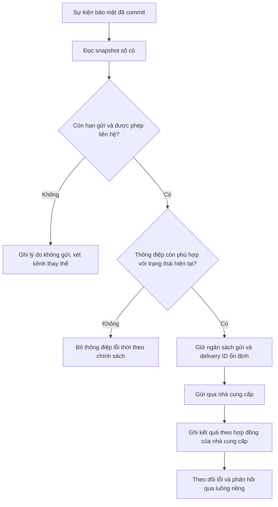

# Old phone number notification — Thông báo tới số điện thoại cũ

## 1. Vai trò của cảnh báo trong khôi phục tài khoản

Trong chương **Phone Number Recovery** của module `SECURITY_AUTHENTICATION_ACCOUNT_RECOVERY`, thay số điện thoại có thể chuyển nơi nhận mã đăng nhập, mã khôi phục hoặc thông báo bảo mật. Nếu kẻ tấn công thực hiện được thay đổi một cách âm thầm, họ có thể củng cố quyền kiểm soát trước khi chủ tài khoản phát hiện.

**Old phone number notification** là cảnh báo về một sự kiện liên quan đến việc thay thế hoặc gỡ số điện thoại, được gửi đến số đã được thiết lập hợp lệ trước thay đổi. Mục đích là giúp phát hiện và phản ứng với hành vi bất thường. Việc gửi cảnh báo không tự chứng minh người yêu cầu có quyền đổi số.

Ví dụ, Lan đăng ký số A làm kênh bảo mật. Một yêu cầu đề xuất chuyển sang số B xuất hiện sau khi session của Lan bị đánh cắp. Cảnh báo tới A có thể giúp Lan phát hiện yêu cầu trước khi B được kích hoạt. Nhưng nếu A đã bị SIM swap hoặc cấp lại cho người khác, người nhận cảnh báo có thể không còn là Lan.

Bởi vậy, một thiết kế an toàn phải trả lời đồng thời ba câu hỏi: số nào thực sự là số cũ của tài khoản, người đang giữ số đó được phép biết hoặc làm gì, và hệ thống xử lý thế nào khi cảnh báo không tới được chủ thật.

OWASP coi thay thế yếu tố MFA là thao tác rủi ro cao, khuyến nghị xác thực lại bằng yếu tố đã đăng ký và thông báo qua kênh ngoài giao dịch như email hoặc push. Cảnh báo tới số cũ là một thành phần của thiết kế phát hiện, cần kết hợp với bằng chứng cấp quyền và các kênh độc lập phù hợp. [OWASP — Changing MFA Factors](https://cheatsheetseries.owasp.org/cheatsheets/Multifactor_Authentication_Cheat_Sheet.html#changing-mfa-factors).

## 2. Phân biệt cảnh báo, xác minh và quyền phê duyệt

Ba loại thông điệp sau có thể cùng dùng SMS nhưng phục vụ các mục đích khác nhau:

| Loại thông điệp | Chứng minh hoặc hỗ trợ điều gì? | Không được suy ra điều gì? |
| --- | --- | --- |
| Cảnh báo tới số cũ | Có một sự kiện bảo mật cần người dùng kiểm tra | Người nhận hiện tại chắc chắn là chủ tài khoản |
| Mã xác minh số mới | Người trình mã có khả năng nhận thông điệp tại số mới trong lần kiểm tra đó | Họ có quyền quản lý tài khoản đang bị thay đổi |
| Thử thách xác thực qua số đã gắn | Một bằng chứng sở hữu theo cơ chế và mức tin cậy được chính sách chấp nhận | Mọi rủi ro SIM swap hoặc thu hồi quyền đều đã được loại bỏ |

Không dùng cùng một token cho cả ba mục đích. Nếu sản phẩm yêu cầu phê duyệt qua số cũ, đó phải là một bước cấp quyền riêng với điều kiện, giới hạn thử và xử lý trường hợp mất số. Một tin nhắn mang tên “cảnh báo” không được âm thầm trở thành bằng chứng phê duyệt chỉ vì có phản hồi.

NIST SP 800-63B-4 yêu cầu thông báo độc lập cho những sự kiện như account recovery và gắn authenticator, đồng thời cung cấp hướng dẫn khi người dùng phủ nhận sự kiện. Điều này hỗ trợ thiết kế phát hiện gian lận; nó không biến việc giao thông báo thành xác thực người nhận. [NIST — Account Notifications](https://pages.nist.gov/800-63-4/sp800-63b/events/#account-notifications).

### Phải xác định vai trò của số đang thay

Một tài khoản có thể có số giao hàng, số liên hệ, số nhận SMS MFA và số khôi phục khác nhau. Cảnh báo cho thay đổi số giao hàng không tự áp dụng cho việc thay authenticator; ngược lại, đổi trường liên hệ không được làm số nhận OTP thay đổi theo nếu chưa được cấp quyền.

Sự kiện cần nêu rõ phạm vi, chẳng hạn `REPLACE_SMS_AUTHENTICATOR` hoặc `CHANGE_RECOVERY_PHONE`. Những dịch vụ dùng số điện thoại phải phân biệt vai trò thay vì cùng đọc một trường `phoneNumber` rồi tự suy ra quyền.

Thay số cũng không tự gỡ MFA khác, xóa passkey, phát hành recovery code mới hoặc tạo một session đăng nhập. Các tác động đó cần chính sách và bằng chứng tương ứng.

## 3. “Số cũ” phải đến từ dữ liệu có thẩm quyền

### 3.1. Không để client chọn người nhận cảnh báo

Trước khi thay đổi có hiệu lực, máy chủ lấy bản ghi kênh đã đăng ký từ tài khoản và lưu tham chiếu hoặc snapshot người nhận cho sự kiện. Không nhận một trường `oldPhoneNumber` tùy ý từ client để quyết định gửi SMS bảo mật.

Một yêu cầu có thể có dạng:

```json
{
  "proposedPhoneNumber": "<so-moi-theo-dinh-dang-duoc-ho-tro>",
  "reauthenticationProof": "<bang-chung-duoc-may-chu-kiem-tra>"
}
```

Máy chủ tự xác định tài khoản từ ngữ cảnh đã cấp quyền, tự phân giải kênh cũ và tự kiểm tra bằng chứng. Những trường như `oldPhoneVerified=true`, `skipOldNotification=true` hoặc `recoveryApproved=true` không có giá trị chỉ vì client gửi chúng.

Chỉ biết số A từng xuất hiện trong đơn hàng hoặc danh bạ của tài khoản không đủ để coi A là kênh cảnh báo bảo mật đã được thiết lập.

### 3.2. Chụp đúng mốc trước thay đổi

Giả sử hệ thống cập nhật `account.phone` từ A sang B rồi worker mới đọc `account.phone` để gửi cảnh báo “tới số cũ”. Thông báo sẽ tới B, có thể chính là số của kẻ tấn công.

Cần gắn sự kiện với bản ghi người nhận tại thời điểm trước thay đổi:

```text
PhoneBinding
  bindingId, accountId, role
  normalizedNumber, bindingVersion
  establishedAt, lastVerifiedAt
  status

PhoneChangeEvent
  eventId, changeId, accountId, eventType
  oldBindingId, oldBindingVersion
  oldRecipientSnapshotRef
  occurredAt, dispatchDeadline
```

Đây là mô hình khái niệm. Nếu chỉ lưu `oldBindingId`, bản ghi được tham chiếu phải giữ được đích cũ trong thời gian xử lý; không được sửa số bên trong cùng bản ghi rồi làm mọi sự kiện lịch sử trỏ sang B.

Snapshot có thể chứa dữ liệu liên hệ được mã hóa hoặc tham chiếu đến kho được bảo vệ. Không đưa số dạng rõ vào tên job, URL theo dõi hoặc khóa log.

### 3.3. Snapshot không có nghĩa được gửi mãi mãi

Số điện thoại là đích có thể đổi người sử dụng. Một sự kiện cảnh báo cần hạn gửi và chính sách về việc đích còn phù hợp để nhận thông tin hay không.

Worker dùng snapshot để tránh gửi nhầm sang số mới, nhưng vẫn kiểm tra trạng thái thu hồi, báo cáo số cấp lại và các hạn chế gửi hiện tại. Nếu snapshot không còn được phép sử dụng, ghi nhận lý do không gửi và chọn kênh khác đã thiết lập; không tự thay người nhận bằng dữ liệu mới.

Sau khi đổi số, một cảnh báo hoàn tất có thể được gửi trong cửa sổ chuyển tiếp ngắn đến A theo chính sách. Quyền nhận cảnh báo chuyển tiếp này không giữ A làm kênh đăng nhập hoặc nhận mã recovery lâu dài.

Nếu A và B được chuẩn hóa thành cùng một đích theo quy tắc hợp lệ của hệ thống, cần nhận diện đây là yêu cầu không thay đổi thực chất. Không tạo vô hạn cảnh báo chỉ vì khác dấu cách hoặc cách nhập mã quốc gia.

## 4. Khi số cũ không còn đáng tin cậy

### 4.1. SIM swap, chuyển mạng và thiết bị bị mất

Người tấn công có thể chiếm khả năng nhận SMS tại A mà không thay giá trị số trong cơ sở dữ liệu. Khi đó cảnh báo vẫn được giao “đúng số” nhưng tới sai người.

NIST lưu ý cần cân nhắc các chỉ dấu như thay SIM, thay thiết bị và chuyển số trước khi dùng PSTN để chuyển bí mật xác thực ngoài băng. Các chỉ dấu này liên quan đến độ tin cậy của kênh; cảnh báo gửi qua chính số bị chiếm không tạo thêm một bằng chứng độc lập. [NIST SP 800-63B-4 — Authentication Using the PSTN](https://pages.nist.gov/800-63-4/sp800-63b.html).

Đối với luồng cảnh báo, có thể bổ sung email bảo mật hoặc push tới thiết bị đã gắn từ trước. Một push đến chính thiết bị vừa được đăng ký trong yêu cầu đang xét chưa có cùng giá trị phát hiện cho chủ cũ.

Nếu có căn cứ rằng A đã bị chiếm, không gửi mã có quyền đặt lại mật khẩu hoặc đăng nhập đến A chỉ để duy trì quy trình quen thuộc. Xử lý quyền xác thực của A theo quy trình sự cố; một cảnh báo tối thiểu, nếu chính sách vẫn cho phép gửi, không được mang theo quyền khôi phục tài khoản.

### 4.2. Số đã bị nhà mạng cấp lại

Một số được xác minh từ nhiều năm trước không bảo đảm người giữ hiện tại là người đăng ký ban đầu. Cảnh báo có thể tiết lộ rằng một cá nhân hoặc một tài khoản từng dùng dịch vụ.

Hệ thống cần lưu trạng thái phù hợp như `ACTIVE`, `SUSPECTED_COMPROMISED`, `RETIRED` hoặc `REASSIGNMENT_REPORTED`, cùng thời điểm và căn cứ cập nhật. Đây là mô hình của bài học, không phải danh sách trạng thái bắt buộc từ một chuẩn.

Nếu đã có căn cứ đáng tin rằng số được cấp lại, không tiếp tục gửi cảnh báo tiết lộ tài khoản hoặc token phản đối đến đó. Khi cần liên hệ chủ tài khoản, dùng kênh độc lập đã thiết lập hoặc nhánh hỗ trợ phù hợp.

Báo cáo “tôi không còn dùng số này” và “số này không thuộc về tôi” đều cần đánh giá nguồn và tác động. Một báo cáo công khai không được tự trao quyền đổi số hoặc chiếm tài khoản; đồng thời hệ thống cần có cách tiếp nhận báo cáo để giảm gửi nhầm người.

### 4.3. Mất số cũ không đồng nghĩa mất mọi khả năng recovery

Nếu người dùng không còn nhận SMS tại A nhưng còn passkey hoặc phương thức đã gắn khác đáp ứng chính sách, có thể dùng phương thức đó cho bước cấp quyền thay số. Cảnh báo tới A không được trở thành điều kiện bắt buộc duy nhất khiến người thật bế tắc.

Nếu họ mất cả các bằng chứng xác thực cần thiết, cần luồng account recovery có chứng cứ phù hợp. Không chấp nhận “tôi không nhận được SMS cũ” rồi chỉ xác minh B để chuyển tài khoản sang B.

Kênh thay thế phải được chọn từ quan hệ đã thiết lập hoặc quy trình xác minh được phê duyệt. Không lấy một email mới do người gọi khai báo rồi gọi đó là thông báo độc lập.

## 5. Gửi cảnh báo ở thời điểm nào?

Không phải mọi lần nhập số mới đều cần một SMS tới số cũ. Một người gọi công khai có thể thử vô hạn đầu vào; nếu mỗi lần thử đều tạo cảnh báo, tính năng bảo vệ trở thành công cụ quấy rối.

Chính sách minh họa phân biệt các sự kiện:

| Mốc | Có thể gửi thông tin gì tới số cũ? | Điều kiện quan trọng |
| --- | --- | --- |
| Yêu cầu công khai chưa xác minh | Thường không phát cảnh báo cá nhân cho từng lần gọi | Không để người ngoài tạo spam hoặc khóa tài khoản |
| Yêu cầu đã vượt bước cấp quyền tiếp nhận | Cảnh báo đang có đề nghị thay số | Nội dung chưa được nói rằng thay đổi đã hoàn tất |
| Yêu cầu vào thời gian chờ hoặc bị giữ | Cập nhật cần thiết, có giới hạn tần suất | Chỉ gửi khi có ích cho việc phản ứng |
| Thay số đã commit thành công | Cảnh báo số bảo mật đã thay đổi | Phân giải người nhận từ dữ liệu cũ, không từ số chính hiện tại |
| Yêu cầu được hủy hoặc kết thúc | Thông báo kết quả nếu chính sách cần | Không khôi phục quyền xác thực cho số cũ chỉ vì đã gửi thông báo |

Các mốc này là lựa chọn thiết kế, không phải yêu cầu rằng mọi hệ thống phải gửi đủ năm loại SMS. Có thể dùng email hoặc push cho một số mốc để giảm nhiễu và giữ khả năng liên hệ đáng tin cậy.

### Gửi trước để có cơ hội phản ứng

Cảnh báo bắt đầu có ích khi còn khả năng giữ hoặc hủy yêu cầu trước lúc B có quyền xác thực. Nếu sản phẩm có thời gian chờ, cần nêu rõ khi nào khoảng chờ bắt đầu và sự cố gửi cảnh báo ảnh hưởng thế nào đến việc hoàn tất.

Tạo một bản ghi outbox không có nghĩa chủ tài khoản đã được cảnh báo. Nếu chính sách đòi phát hành cảnh báo trước khi chuyển, cần định nghĩa mức chứng cứ chấp nhận, ví dụ nhà cung cấp đã chấp nhận thông báo qua một kênh độc lập phù hợp. Mức đó vẫn không chứng minh người dùng đã đọc.

Không để lỗi gửi tới A làm mọi yêu cầu hợp lệ mắc kẹt vô hạn. Chính sách cần có đường chuyển sang kênh thay thế hoặc quy trình xử lý ngoại lệ đã cấp quyền. Không tự bỏ điều kiện cấp quyền vì “SMS lỗi quá nhiều”.

### Gửi sau để phát hiện thay đổi đã xảy ra

Cảnh báo hoàn tất chỉ được phát hành từ sự kiện đã commit. Nếu giao dịch cập nhật số rollback, hệ thống không được gửi SMS khẳng định số đã đổi.

Khi một yêu cầu bị hủy rất nhanh nhưng cảnh báo bắt đầu còn nằm trong queue, worker phải xét tính phù hợp của thông điệp cũ. Có thể bỏ cảnh báo khởi tạo đã lỗi thời và gửi kết quả phù hợp theo chính sách. Không sửa nội dung thành một kết luận khác nhưng giữ nguyên loại sự kiện và dấu vết ban đầu.

Một cảnh báo hoàn tất tới A không có nghĩa A còn được nhận OTP. Quyền thông báo chuyển tiếp và quyền xác thực cần được tách ở dữ liệu và các endpoint sử dụng số.

## 6. Viết nội dung hữu ích nhưng hạn chế tiết lộ

SMS có thể xuất hiện trên màn hình khóa, thiết bị dùng chung hoặc máy của người mới được cấp số. Nội dung nên đủ để người dùng hiểu việc cần làm, đồng thời tránh đưa dữ liệu tài khoản không cần thiết vào thông điệp.

Một mẫu cảnh báo bắt đầu:

> Có yêu cầu thay số điện thoại bảo mật trong ứng dụng lúc 14:20, giờ Việt Nam. Nếu bạn không yêu cầu, hãy tự mở ứng dụng, vào Bảo mật để kiểm tra.

Một mẫu cảnh báo hoàn tất:

> Số điện thoại bảo mật đã được thay đổi lúc 09:15, giờ Việt Nam. Nếu không phải bạn thực hiện, hãy dùng mục Trợ giúp bảo mật trong ứng dụng chính thức.

Đây là nội dung minh họa, không phải cam kết rằng mọi nhà cung cấp hoặc quốc gia hỗ trợ cùng một cách gửi. Tên dịch vụ, ngôn ngữ và định dạng cần phù hợp với sản phẩm và kênh được triển khai.

| Nên cân nhắc đưa vào | Nên tránh nếu không thật sự cần |
| --- | --- |
| Loại sự kiện và trạng thái chính xác | Mật khẩu, OTP, recovery code hoặc liên kết đăng nhập |
| Thời điểm kèm múi giờ rõ ràng | Email đầy đủ, username hoặc danh sách tài khoản |
| Hướng dẫn tự mở ứng dụng hoặc tên miền chính thức | Số mới đầy đủ, dữ liệu giao dịch hoặc hồ sơ cá nhân |
| Cách báo không nhận ra sự kiện | Vị trí chính xác, IP đầy đủ hoặc dữ liệu thiết bị chi tiết |
| Nhắc rằng hỗ trợ không cần người dùng cung cấp mã bí mật | Yêu cầu gọi lại một số điện thoại tùy ý từ request |

Ngay tên dịch vụ cũng có thể tiết lộ mối liên hệ với một tổ chức nhạy cảm. Che số hoặc bỏ username không làm SMS trở thành vô danh. Khi kênh cũ đã được xác định không phù hợp, lựa chọn đúng có thể là không gửi dữ liệu sự kiện qua kênh đó.

Có thể hiển thị một phần số mới sau khi người dùng mở ứng dụng và xác thực phù hợp. Không cần nhét toàn bộ chi tiết vào SMS để người nhận ra quyết định ngay trên màn hình khóa.

### Tránh hình thành thói quen bấm liên kết và đọc mã cho hỗ trợ

Thiết kế ưu tiên hướng dẫn người dùng tự mở ứng dụng chính thức. Nếu SMS có URL, origin phải đến từ cấu hình tin cậy, dùng HTTPS và không cho client chèn đích chuyển hướng.

Không dùng tên miền rút gọn không rõ nguồn trong một thông điệp đòi phản ứng khẩn cấp. Tránh lời nhắn kiểu “gửi lại OTP để ngăn mất tài khoản”, vì nó khuyến khích đúng hành vi mà kẻ lừa đảo thường khai thác.

Nhân viên hỗ trợ không cần người dùng đọc mật khẩu, OTP hay recovery code qua điện thoại để xác nhận đã nhận cảnh báo. Mã sự kiện phục vụ tra cứu, nếu có, không được đồng thời là bí mật cấp quyền truy cập tài khoản.

## 7. Người nhận cảnh báo được phép làm gì?

### 7.1. Quyền phản đối phải hẹp hơn quyền recovery

Ứng dụng có thể cung cấp mục “Tôi không yêu cầu thay đổi này”. Khi người dùng còn phương thức xác thực hợp lệ, họ đăng nhập hoặc xác thực lại để xem và xử lý yêu cầu đúng tài khoản.

Nếu cần liên kết báo cáo không đòi đăng nhập, token chỉ nên có một mục đích hẹp, ví dụ `REPORT_PHONE_CHANGE`, ràng buộc với `changeId`, phiên bản, hạn dùng và trạng thái chưa sử dụng. Nó không được cấp một session, gỡ MFA, đặt lại mật khẩu, thay số mới hoặc xem toàn bộ hồ sơ.

Báo cáo có thể đưa yêu cầu vào `HELD` để kiểm tra. Đó là phản ứng bảo vệ trước một dấu hiệu; chưa phải kết luận người giữ A là chủ hợp lệ. Nếu cho phép token trực tiếp hủy yêu cầu, phải chấp nhận và kiểm soát nguy cơ người giữ số cấp lại gây từ chối dịch vụ.

Không dùng số gọi đến, tên người gửi SMS hoặc một tin nhắn trả lời “KHONG” đơn lẻ làm bằng chứng mạnh để thay đổi tài khoản. Cơ chế hai chiều cần được đánh giá theo giao thức thực tế; một chuỗi trả lời không tự mang được ngữ cảnh và quyền của đúng yêu cầu.

### 7.2. Tránh tác động từ việc mở URL tự động

Một URL có token báo cáo nên mở trang xác nhận. Thay đổi trạng thái được thực hiện bằng thao tác có chủ ý như `POST`, kiểm tra token và chống CSRF phù hợp. Không hủy yêu cầu chỉ vì một bộ quét liên kết đã thực hiện `GET`.

Token bearer cần đủ entropy từ nguồn ngẫu nhiên mật mã, có thời hạn, dùng một lần và được bảo vệ khi lưu. Không để token lọt vào log, analytics, referrer hoặc hệ thống theo dõi liên kết không cần thiết.

Nếu việc báo cáo thành công, trang chỉ cần xác nhận đã ghi nhận phản đối và hướng dẫn tiếp theo. Không trả username, email, số mới đầy đủ hoặc dữ liệu riêng chỉ vì người gọi có token báo cáo.

### 7.3. Phản đối đến sau khi đổi số đã hoàn tất

Trước khi chuyển số, hệ thống có thể hủy hoặc giữ yêu cầu theo điều kiện đã định. Sau khi chuyển đã commit, cần một luồng xử lý sự cố riêng.

Không cho liên kết cũ tự phục hồi A làm authenticator. Người giữ A có thể là người tấn công, chủ thuê bao mới hoặc người không còn được phép quản lý tài khoản.

Nếu người dùng báo chiếm đoạt sau khi đổi số, hệ thống cần đánh giá các session, authenticator và giao dịch liên quan. Thu hồi session hoặc hạn chế thao tác nhạy cảm phải dựa trên chính sách xử lý sự cố, không chỉ dựa vào việc một URL công khai được mở.

Việc giữ yêu cầu và việc xác minh chủ tài khoản nên có dấu vết riêng. Nếu người giữ A phản đối một yêu cầu hợp lệ của chủ thật, nhánh kiểm tra độc lập cần có cách giải quyết; không để mỗi lần phản đối đẩy người thật vào vòng chờ không có lối ra.

## 8. Gửi bền vững mà không gửi nhầm hoặc gửi lặp

### 8.1. Ghi sự kiện cùng giao dịch nghiệp vụ

Một cách triển khai là dùng transactional outbox: ghi yêu cầu hoặc kết quả thay số cùng sự kiện cần thông báo trong một giao dịch dữ liệu, rồi worker gửi sau commit.

Mã giả dưới đây minh họa phần tiếp nhận một yêu cầu đã có bằng chứng phù hợp; nó không phải thư viện có thể chạy ngay:

```text
createPhoneChange(accountId, proposedNumber, proof, idempotencyKey):
    validateInputAndVerifyProofMaterial()

    begin transaction
    account = lockAccount(accountId)
    recheckProofScopeAndSecurityVersion(account, proof)

    existing = findRequestForIdempotencyKey(account.id, idempotencyKey)
    if existing exists:
        requireSameRequestPayload(existing, proposedNumber)
        return existing

    oldBinding = loadCurrentBindingForRole(account, requestedRole)
    requireAuthorizedPhoneChange(account, oldBinding, proof)
    requireRequestAndNotificationBudgets()

    change = createPendingChange(account, proposedNumber, oldBinding.version)
    consumeProofConsistentlyWithRequest(proof, change)

    if oldBinding exists:
        recipientSnapshot = captureOldRecipient(oldBinding)
        createOutboxEventOnce(
            change.id,
            "PHONE_CHANGE_REQUESTED",
            recipientSnapshot,
            dispatchDeadline
        )

    commit
    return change
```

Nếu chưa có số cũ hợp lệ cho vai trò đó, không được tự bịa người nhận; chính sách chọn kênh đã thiết lập khác hoặc ghi nhận không có đích cũ phù hợp. Các nhánh trả về cần kết thúc giao dịch và giải phóng khóa theo cơ chế quản lý giao dịch của chương trình.

Khi thay số hoàn tất, giao dịch cần đọc và kiểm tra lại trạng thái yêu cầu, phiên bản kênh nguồn, bằng chứng còn hiệu lực và các phản đối đã ghi nhận. Ghi sự kiện `PHONE_CHANGE_APPLIED` cùng lần cập nhật thành công; sự kiện dùng tham chiếu số cũ đã bảo vệ, không truy vấn số hiện tại để suy ra người nhận.

### 8.2. Worker đọc sự kiện, rồi kiểm tra chính sách hiện tại



Trước khi gửi, worker cần bảo đảm sự kiện thuộc đúng tài khoản, vai trò và phiên bản người nhận, chưa quá hạn và chưa bị quyết định an ninh mới làm không phù hợp. Không thay A bằng B chỉ vì việc dùng A bị lỗi.

Việc kiểm tra và giữ lượt gửi cần nhất quán với cơ chế xử lý trùng. Nếu hai worker cùng xử lý, không được cùng tạo hai delivery mới cho một cảnh báo chỉ vì đều thấy trạng thái chưa gửi.

Một khóa chống trùng có thể dựa trên `eventId + recipientBindingVersion + notificationType`. Nó không chỉ là `phoneNumber`: cùng số có thể có những sự kiện bảo mật khác nhau cần thông báo riêng.

### 8.3. Timeout và retry có giới hạn

Nếu nhà cung cấp hỗ trợ idempotency, các lần thử lại cùng một delivery dùng cùng ID theo hợp đồng của họ. Timeout có thể xảy ra sau khi yêu cầu đã được chấp nhận; tạo delivery mới một cách mù quáng có thể gửi trùng.

Nếu nhà cung cấp không hỗ trợ idempotency, trạng thái “chưa biết đã gửi hay chưa” cần được biểu diễn và xử lý theo chính sách retry hữu hạn. Không tuyên bố toàn bộ tác động bên ngoài chắc chắn đúng một lần chỉ nhờ giao dịch cơ sở dữ liệu.

Đặt hạn gửi, số lần thử và backoff phù hợp. Cảnh báo bắt đầu bị kẹt nhiều ngày không nên tiếp tục được gửi như thể sự kiện vừa xảy ra, nhất là khi A đã bị gỡ hoặc có báo cáo cấp lại.

Một delivery bị hạn chế hoặc bị bỏ qua cần có lý do vận hành. Không đánh dấu `DELIVERED` chỉ để đóng queue và không coi việc không gửi được là chấp thuận của người dùng.

## 9. Trạng thái giao nhận không phải trạng thái cấp quyền

Cần định nghĩa trạng thái theo giao thức của từng nhà cung cấp. Một mô hình nội bộ có thể phân biệt:

| Trạng thái nội bộ | Ý nghĩa trong hệ thống | Không được suy ra |
| --- | --- | --- |
| `QUEUED` | Công việc đã được lưu để gửi | Nhà cung cấp đã nhận |
| `RESERVED` | Đã giữ ngân sách và quyền xử lý delivery | SMS đã ra khỏi hệ thống |
| `PROVIDER_ACCEPTED` | Nhà cung cấp chấp nhận yêu cầu theo hợp đồng | Người dùng đã nhận hoặc đọc |
| `DELIVERY_REPORTED` | Có báo cáo giao nhận từ hạ tầng gửi | Người nhận là chủ tài khoản hoặc đã đồng ý |
| `FAILED` | Có căn cứ thất bại ở một công đoạn | Có thể bỏ mọi điều kiện bảo vệ tài khoản |
| `UNCERTAIN` | Chưa xác định được tác động bên ngoài | Chắc chắn chưa gửi, nên cứ tạo thông báo mới |
| `SUPPRESSED` | Không gửi theo chính sách, có lý do | Cảnh báo đã hoàn thành thành công |

Một báo cáo giao SMS có thể chỉ phản ánh mốc giao nhận mà nhà cung cấp và nhà mạng hỗ trợ. Không đặt tên metric là `owner_notified` hoặc `user_approved` nếu dữ liệu thực tế chỉ là `provider_accepted`.

Đặc biệt, callback giao nhận không được tự chuyển yêu cầu thay số sang `APPROVED` hay `APPLIED`. Giao thông báo và cấp quyền thay authenticator là hai quyết định khác nhau.

### Kiểm tra callback và dữ liệu đến muộn

Webhook từ nhà cung cấp cần được xác thực bằng cơ chế mà họ hỗ trợ, kiểm tra đúng tài khoản gửi và ánh xạ tới delivery đã tồn tại. Trường `deliveryId` do một request bất kỳ gửi tới không đủ để cập nhật trạng thái.

Xử lý trùng callback bằng ID sự kiện hoặc cơ chế tương ứng. Callback có thể tới lệch thứ tự; logic cập nhật cần tuân theo hợp đồng trạng thái của nhà cung cấp, không đơn giản lấy sự kiện đến sau cùng làm sự thật mới nhất.

Một callback tới muộn sau khi yêu cầu đã hủy có thể cập nhật kết quả giao của delivery, nhưng không mở lại yêu cầu. Dữ liệu giao nhận phục vụ quan sát và đánh giá chính sách, không ghi đè vòng đời thay số.

Nếu không có callback, dùng timeout và trạng thái chưa xác định theo thiết kế. Không suy ra chủ tài khoản đã im lặng chấp thuận vì hệ thống không nhận được báo lỗi.

## 10. Chống spam, quấy rối và dò tài khoản

### 10.1. Giới hạn cả request lẫn số SMS thực tế

Một request có thể tạo cảnh báo bắt đầu, lời nhắc và thông báo kết thúc. Nếu chỉ đếm request, số SMS thực tế có thể cao hơn dự kiến nhiều lần.

Cần xác định đơn vị riêng cho:

- Request nhận vào và số yêu cầu thay số đang hoạt động.
- Sự kiện bảo mật được phép tạo cảnh báo.
- SMS thực tế theo đích nhận, tài khoản, tenant và tổng dịch vụ.
- Số lần thử gửi, số callback được xử lý và lần thử token báo cáo.

Một số dùng chung giữa nhiều tài khoản cần ngân sách theo đích nhận để tránh nhân lượng SMS theo số tài khoản. Nhưng gộp đích nhận không đồng nghĩa gộp quyền tài khoản hoặc tiết lộ danh sách tài khoản cho người giữ số.

Các ngưỡng phải dựa trên lưu lượng, rủi ro và khả năng chặn nhầm của hệ thống. Bài học không đặt một quota SMS cố định là mức an toàn cho mọi sản phẩm.

Giới hạn ở API không thay được giới hạn tại tầng gửi. Worker retry, yêu cầu từ API quản trị hoặc một luồng hỗ trợ cũ cũng có thể tạo SMS; chúng cần đi qua chính sách gửi phù hợp.

### 10.2. Đừng để quota che khuất một sự kiện nghiêm trọng

Một người tấn công có thể cố làm cạn ngân sách thông báo trước khi thực hiện thay đổi thật. Vì vậy, khi cảnh báo bị hạn chế, hệ thống cần ghi nhận và đánh giá việc còn kênh độc lập nào khác có thể dùng.

Có thể ưu tiên sự kiện mới có mức nghiêm trọng cao hơn, gộp cập nhật trùng hoặc dùng đường thông báo thay thế đã thiết lập. Quy tắc ưu tiên phải do máy chủ quyết định; client không được tự gắn `critical=true` để gửi vô hạn.

Không bỏ mọi quota chỉ vì thông báo mang tên “bảo mật”. Thay vào đó, giới hạn tác động và định nghĩa rõ trường hợp phải giữ yêu cầu thay số khi không phát hành được cảnh báo theo chính sách.

Khi số cũ không còn là đích được phép, không tự động chuyển mọi SMS sang số mới rồi tuyên bố đã có cảnh báo độc lập. Một đích thay thế phải được đánh giá theo quan hệ và mức tin cậy của nó.

### 10.3. Không trả trạng thái riêng tư cho người ngoài

Endpoint công khai không nên trả “số này đang là số MFA của ba tài khoản” hoặc “đã gửi cảnh báo tới số cũ kết thúc bằng 1234” trước khi có quyền xem thông tin đó.

Ngay cả trạng thái `notificationSuppressed`, lý do số cũ bị thu hồi hoặc báo cáo cấp lại cũng có thể làm lộ dữ liệu tài khoản. Reason code chi tiết phục vụ hệ thống nội bộ; người dùng đã xác thực nhận thông tin cần thiết để tiếp tục theo quyền của họ.

Một API theo dõi delivery không được mở công khai chỉ vì biết `changeId`. ID khó đoán hỗ trợ giảm dò, nhưng không thay thế kiểm tra quyền truy cập.

## 11. Hai ví dụ áp dụng

### 11.1. Người dùng hợp lệ thay số, cảnh báo giúp phát hiện sai sót

Giả sử Lan còn passkey đã gắn và dùng nó để xác thực lại. Số A đang là kênh recovery; Lan đề xuất B.

| Thời điểm | Sự kiện | Cách xử lý cảnh báo |
| --- | --- | --- |
| 14:20 | Yêu cầu hợp lệ được lưu | Chụp người nhận A từ bản ghi trước thay đổi và tạo sự kiện bắt đầu |
| 14:21 | Nhà cung cấp chấp nhận cảnh báo tới A | Ghi đúng trạng thái giao, chưa coi Lan đã đọc |
| 14:22 | Lan nhập mã xác minh gửi tới B | Ghi nhận khả năng nhận tại B, chưa chuyển quyền chỉ vì bước này |
| 14:25 | Lan nhận ra mình nhập nhầm B | Tự mở ứng dụng và hủy yêu cầu bằng quyền hợp lệ |
| 14:26 | Job cũ thử hoàn tất | Đọc trạng thái đã hủy và dừng |
| Sau đó | Tạo yêu cầu mới tới C | Cấp quyền, xác minh và phát sự kiện mới theo chính sách |

Nếu có thời gian chờ, nó được áp dụng theo chính sách thay số riêng. Nhận được SMS tới A không tự làm hết thời gian chờ; không bấm gì cũng không phải chấp thuận.

Nếu yêu cầu thực sự hoàn tất, SMS kết thúc gửi tới A dựa trên snapshot còn được phép dùng. B có thể nhận thông báo về việc được kích hoạt, nhưng đó là thông điệp ở vai trò khác; không thay thế cảnh báo tới kênh đã thiết lập trước yêu cầu.

### 11.2. Số cũ đã được cấp lại cho người khác

Minh hiện giữ số A, trong khi tài khoản của Lan vẫn còn một liên kết lịch sử tới A. Minh nhận SMS báo có đề nghị thay số nhưng không hề sở hữu tài khoản của Lan.

Thiết kế có vấn đề là gửi SMS kèm username, email đầy đủ và liên kết “lấy lại tài khoản ngay”. Minh có thể đọc dữ liệu riêng hoặc dùng đường phản hồi để chiếm tài khoản.

Thiết kế hạn chế tác động hơn là thông điệp tối thiểu, không mang bí mật đăng nhập hoặc quyền recovery. Nếu có token phản đối, quyền chỉ gắn với sự kiện và có phạm vi hẹp; hệ thống không kết luận Minh là chủ tài khoản từ việc token được trình.

Khi có báo cáo số đã cấp lại, hệ thống cần đánh giá và cập nhật quan hệ nhận cảnh báo theo quy trình. Không yêu cầu Minh đăng nhập tài khoản của Lan mới có thể báo gửi nhầm; nhưng báo cáo gửi nhầm cũng không được trở thành quyền đổi cấu hình tài khoản không qua xác minh.

Lan dùng kênh độc lập hoặc quy trình recovery để chứng minh quyền quản lý tài khoản. Việc giải quyết tranh chấp giữa liên kết cũ và chủ số hiện tại cần tách khỏi quyết định ai được kiểm soát tài khoản.

Ví dụ này thể hiện một giới hạn quan trọng: tính đúng của số điện thoại trong cơ sở dữ liệu và tính đúng của chủ thể đang cầm điện thoại là hai thuộc tính khác nhau.

## 12. Quan sát và kiểm thử khi triển khai

### 12.1. Ghi sự kiện đủ để giải thích quyết định

Các sự kiện nên cho phép trả lời: cảnh báo thuộc yêu cầu nào, dùng phiên bản kênh cũ nào, được phép gửi theo chính sách nào, gửi lúc nào và kết quả được biết ở mức nào.

Reason code nội bộ có thể gồm `OLD_CHANNEL_UNAVAILABLE`, `REASSIGNMENT_REPORTED`, `DISPATCH_DEADLINE_EXCEEDED`, `RECIPIENT_BUDGET_EXHAUSTED`, `STALE_EVENT_SUPPRESSED` và `PROVIDER_OUTCOME_UNKNOWN`.

Log không chứa OTP, token phản đối, recovery code hoặc nội dung SMS đầy đủ nếu không cần thiết. Dữ liệu số điện thoại và lịch sử kênh cần được giới hạn quyền đọc, thời gian lưu và phạm vi sử dụng.

Các metric hữu ích gồm:

- Số sự kiện đủ điều kiện thông báo và số delivery thực sự tạo.
- Độ trễ từ sự kiện nghiệp vụ đến lần phát hành đầu.
- Tỷ lệ nhà cung cấp chấp nhận, báo lỗi và kết quả chưa xác định.
- Số cảnh báo bị bỏ qua theo từng lý do.
- Số phản đối hợp lệ, thời gian xử lý và kết quả của yêu cầu thay số.
- Số người dùng cần nhánh hỗ trợ vì mất số cũ hoặc thiếu kênh độc lập.

Không dùng số điện thoại, token hoặc ID riêng của từng người làm nhãn metric có số giá trị không giới hạn. Dùng ID nội bộ có quyền truy cập phù hợp cho việc điều tra cụ thể.

Tỷ lệ gửi SMS cao chưa chứng minh cơ chế phát hiện hiệu quả. Cần quan sát độ trễ, khả năng người thật phản ứng và số trường hợp thông báo đi tới kênh đã mất tin cậy. Những dữ liệu này phải được thu thập theo phạm vi thực sự cần thiết.

### 12.2. Bảng tình huống kiểm thử

Bảng sau là tiêu chí cho hệ thống hiện thực, không phải kết quả kiểm thử đã chạy trên một sản phẩm.

| Tình huống | Kết quả cần bảo đảm |
| --- | --- |
| Client gửi `oldPhoneNumber` khác số đã gắn | Không điều khiển được người nhận cảnh báo |
| Cập nhật số chính từ A sang B trước khi worker chạy | Cảnh báo cũ vẫn phân giải A từ snapshot, không gửi nhầm B |
| Bản ghi kênh bị sửa tại chỗ | Sự kiện lịch sử không trỏ sang địa chỉ mới ngoài ý muốn |
| Chỉ có request công khai chưa cấp quyền | Không tạo spam cá nhân hoặc tác động khóa tài khoản |
| Chỉ xác minh được B | Không đủ để cấp quyền thay số của tài khoản |
| A được báo đã cấp lại | Xử lý theo chính sách đích nhận; không gửi bí mật hoặc dữ liệu riêng tới đích không còn phù hợp |
| A bị SIM swap | Không coi SMS tới A là một bằng chứng độc lập để cứu tài khoản |
| Không còn nhận SMS tại A nhưng còn authenticator hợp lệ khác | Có nhánh cấp quyền phù hợp, không buộc kẹt ở số cũ |
| SMS lỗi hoặc bị nhà cung cấp từ chối | Ghi trạng thái chính xác, dùng nhánh thay thế hoặc giữ yêu cầu theo chính sách |
| Có báo cáo giao thành công | Không chuyển yêu cầu sang chấp thuận hoặc hoàn tất chỉ vì báo cáo đó |
| Callback bị giả mạo hoặc gửi sai tài khoản nhà cung cấp | Không cập nhật delivery hoặc vòng đời thay số |
| Callback trùng, tới muộn hoặc lệch thứ tự | Không nhân tác động hoặc mở lại yêu cầu đã kết thúc |
| Hai worker xử lý cùng một cảnh báo | Không tạo delivery độc lập ngoài chính sách chống trùng |
| Timeout sau khi nhà cung cấp có thể đã nhận | Không gửi mới vô hạn hoặc tự hoàn lại mọi quota |
| Queue chậm vượt hạn gửi | Không tiếp tục phát thông điệp lỗi thời như sự kiện vừa xảy ra |
| Cảnh báo khởi tạo còn chờ nhưng yêu cầu đã hủy | Xử lý tính phù hợp của thông điệp, không khẳng định sai trạng thái |
| Bộ quét mở URL phản đối | Không thay đổi trạng thái chỉ bằng `GET` |
| Token báo cáo của yêu cầu X dùng cho yêu cầu Y | Bị từ chối vì sai phạm vi hoặc phiên bản |
| Người giữ A trình token báo cáo | Không nhận session, hồ sơ, quyền gỡ MFA hay đặt lại mật khẩu |
| Phản đối đến cùng lúc với thao tác hoàn tất | Quyết định nhất quán theo trạng thái và giao dịch có thẩm quyền |
| Token hủy cũ được dùng sau khi B đã có hiệu lực | Không tự khôi phục A làm authenticator |
| Một số cũ dùng chung nhiều tài khoản | Có giới hạn theo đích, không tiết lộ danh sách tài khoản |
| Ngân sách SMS bị làm cạn | Có lý do và nhánh xử lý cảnh báo, không coi việc thiếu cảnh báo là phê duyệt |
| API quản trị hoặc hỗ trợ thực hiện thay số | Vẫn ghi sự kiện và thực thi chính sách thông báo phù hợp |

Trước khi triển khai, cần ghi rõ cách chọn số cũ, phạm vi dữ liệu được gửi, thời hạn cảnh báo, quyền phản đối và điều kiện dùng kênh thay thế. Chính sách cũng cần giải thích mối liên hệ giữa thông báo, thời gian chờ, bằng chứng cấp quyền và xử lý session.

Cảnh báo tới số cũ phục vụ phát hiện và phản ứng với một thay đổi có thể nguy hiểm. Giá trị bảo vệ đến từ việc chọn đúng kênh còn phù hợp, thông báo đúng sự kiện và giữ quyền của người nhận trong phạm vi cần thiết, đồng thời duy trì một đường khôi phục an toàn khi số cũ không còn thuộc về chủ tài khoản.
