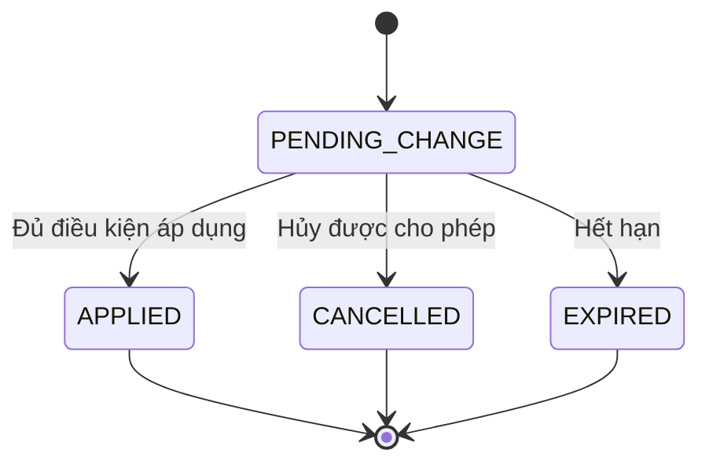
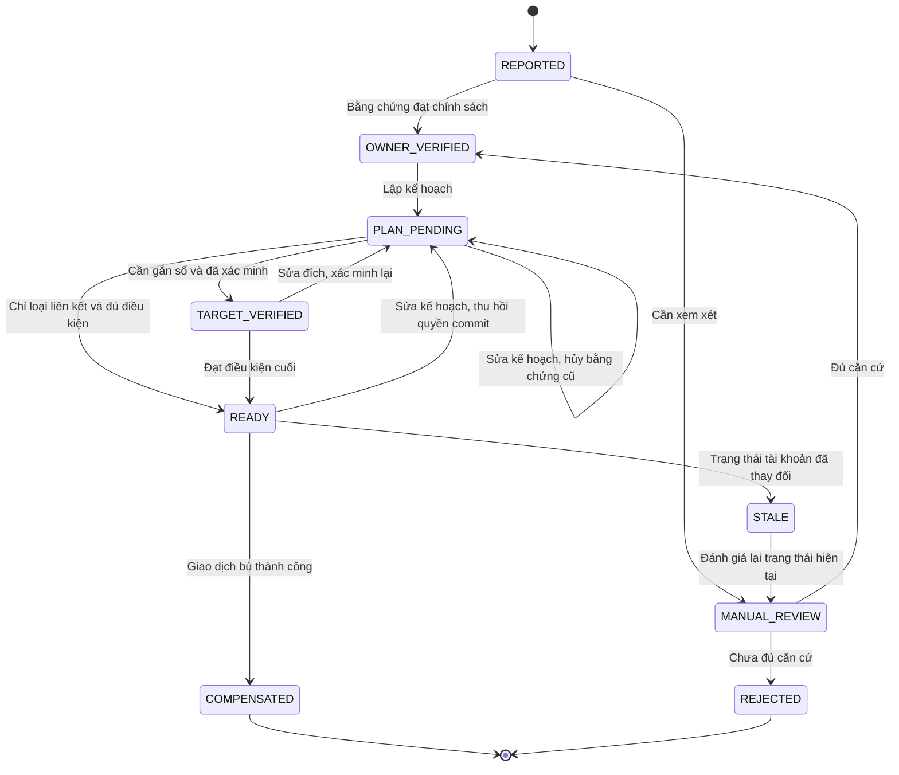

# Hoàn tác thay đổi số điện thoại trong luồng khôi phục tài khoản

## 1. Mục tiêu và phạm vi

Bài **Phone number change reversal**, thuộc chương **Phone Number Recovery**, giải thích cách xử lý khi người dùng muốn thu hồi một thay đổi số điện thoại, đặc biệt khi thay đổi đó có thể do kẻ tấn công thực hiện. Đây là một phần của module `SECURITY_AUTHENTICATION_ACCOUNT_RECOVERY`: thiết kế khôi phục an toàn khi mất mật khẩu, MFA, passkey hoặc thiết bị xác thực, thông qua đánh giá rủi ro, token dùng một lần, xác minh danh tính, chống lạm dụng và kiểm soát session.

Số điện thoại thường là tên đăng nhập, kênh nhận OTP, kênh khôi phục và địa chỉ nhận cảnh báo. Chuyển từ số A sang số B có thể chuyển quyền nhận mã xác thực cho người khác. Nếu hoàn tác bằng cách chép lại A vào cơ sở dữ liệu, hệ thống có thể trao quyền cho người hiện đang giữ A, dù họ không còn là chủ tài khoản.

Mục tiêu của bài là thiết kế một quá trình **đưa tài khoản về trạng thái an toàn có thể kiểm chứng**. Kết quả có thể là khôi phục số cũ sau xác minh, vô hiệu hóa số bị thêm trái phép rồi dùng phương thức khác, hoặc chuyển hồ sơ sang khôi phục có hỗ trợ. Không phải trường hợp nào cũng nên trở về đúng chuỗi số trước đó.

Sau bài này, người học cần giải thích được:

- Sự khác nhau giữa hủy yêu cầu đang chờ, đình chỉ một phương thức và hoàn tác thay đổi đã có hiệu lực.
- Vì sao nhận được thông báo hoặc OTP ở số cũ chưa tự đủ để lấy lại tài khoản.
- Cách gắn yêu cầu hoàn tác với đúng sự kiện thay đổi, tài khoản và phiên bản bảo mật.
- Cách vô hiệu hóa phiên, OTP và quyền khôi phục đã phát sinh trong thời gian bị chiếm đoạt.
- Cách xử lý gửi lặp, thay đổi đồng thời, tranh chấp và bằng chứng không đủ.

Các tên trạng thái, API, thời hạn và mô hình dữ liệu dưới đây là **thiết kế minh họa**. Chúng cần được điều chỉnh theo tác động của tài khoản và kiến trúc triển khai, không phải một tuyên bố đáp ứng sẵn các mức bảo đảm của NIST.

## 2. Hiểu đúng “hoàn tác”

### 2.1. Bốn hành động có mục đích khác nhau

| Hành động | Khi nào áp dụng? | Kết quả |
| --- | --- | --- |
| Hủy yêu cầu đổi số | Yêu cầu chưa được áp dụng | Kết thúc yêu cầu chờ, thu hồi thử thách của yêu cầu đó |
| Đình chỉ sử dụng một số | Có căn cứ nghi số hoặc quan hệ liên kết không an toàn | Tạm ngừng nhận xác thực hoặc khôi phục qua số đó theo phạm vi được duyệt |
| Hoàn tác thay đổi đã áp dụng | Đã chuyển từ số A sang B và cần xử lý hậu quả | Tạo một giao dịch bảo mật mới để loại liên kết sai và thiết lập trạng thái an toàn |
| Khôi phục toàn bộ tài khoản | Chủ tài khoản mất cả các phương thức cần để chứng minh quyền sở hữu | Thực hiện quy trình bằng chứng tương ứng, có thể bao gồm nhiều thay đổi riêng |

Hủy một yêu cầu chờ không được bật lại credential đã bị đình chỉ vì một sự cố khác. Hoàn tác số điện thoại cũng không tự hoàn tác mật khẩu, email, passkey hoặc API key đã bị thay đổi.

### 2.2. Hoàn tác sau commit là giao dịch bù

Giả sử sự kiện E1 đã chuyển số A sang B. Người dùng phát hiện E1 không phải do mình thực hiện. Lúc này, transaction của E1 đã kết thúc; thư đã được gửi và một số phiên có thể đã được tạo.

Không thể dùng `ROLLBACK` của cơ sở dữ liệu để xóa những tác động đã xảy ra ngoài transaction đó. Hệ thống cần một **giao dịch bù** mới, ví dụ E2, tham chiếu E1 và thực hiện các thay đổi được chính sách cho phép. E1 vẫn được giữ trong lịch sử để điều tra.

```text
E1: A -> B, đã áp dụng lúc t1
E2: xử lý E1, đã áp dụng lúc t2
    - loại hoặc đình chỉ liên kết B bị xác định trái phép
    - gắn lại A nếu A vẫn phù hợp và đã được xác minh
    - hoặc giữ tài khoản không dùng số điện thoại trong khi khôi phục
    - vô hiệu hóa các quyền truy cập liên quan theo quyết định sự cố
```

Nếu một thông báo đến muộn và lúc đó tài khoản đã chuyển hợp lệ từ B sang C, hoàn tác E1 không được tự ghi đè C thành A. Ý định xử lý một sự kiện phải được đánh giá trên trạng thái hiện tại.

### 2.3. Số cũ không đồng nghĩa với số an toàn

Số A có thể đã bị mất SIM, bị chiếm bằng SIM swap, chuyển sang thuê bao khác hoặc được chủ tài khoản chủ động bỏ vì không an toàn. Việc A xuất hiện trong lịch sử chỉ chứng minh nó từng được liên kết với tài khoản.

Nghiên cứu của Kevin Lee và Arvind Narayanan về tái cấp số tại hai nhà mạng Hoa Kỳ cho thấy số được cấp lại có thể vẫn nhận thông tin và mã liên quan đến chủ trước. Kết quả này minh họa rủi ro vòng đời số; không nên suy rộng các tỷ lệ của nghiên cứu thành số liệu hiện tại cho Việt Nam. Xem [Security and Privacy Risks of Number Recycling](https://recyclednumbers.cs.princeton.edu/assets/recycled-numbers-latest.pdf?pubDate=20250713).

Một hệ thống an toàn cần phân biệt **người đang nhận được SMS ở A** với **chủ của tài khoản từng sử dụng A**.

## 3. Phạm vi rủi ro và các bất biến

### 3.1. Tài sản cần bảo vệ

Ngoài giá trị `phone_number`, cần xem xét:

- Quyền dùng SMS hoặc cuộc gọi làm yếu tố đăng nhập.
- Quyền nhận mã đặt lại mật khẩu hoặc mã khôi phục.
- Phiên và refresh token được tạo sau thay đổi số.
- Phương thức dự phòng, passkey và email được thêm trong cùng khoảng thời gian.
- Quyền truy cập dữ liệu, thao tác thanh toán và quyền quản trị tổ chức.
- Khả năng người dùng hợp lệ tiếp tục truy cập bằng phương thức an toàn khác.

NIST SP 800-63B-4 coi xác thực qua mạng điện thoại công cộng là phương thức bị hạn chế và coi thiết lập hoặc thay số xác thực đã đăng ký là gắn một authenticator mới. Các tín hiệu như đổi SIM, đổi thiết bị và chuyển mạng cần được xét trước khi dùng kênh này. Điều đó không có nghĩa mọi thay đổi SIM đều là gian lận. Xem [NIST — Authentication Using the Public Switched Telephone Network](https://pages.nist.gov/800-63-4/sp800-63b.html).

### 3.2. Các điều kiện thiết kế phải giữ

1. **Báo cáo, bảo vệ tạm thời và hoàn tác có quyền hạn riêng.** Một token báo cáo không tự trở thành token đăng nhập hoặc đổi số.
2. **Hoàn tác phải gắn với một sự kiện cụ thể.** Không nhận một lệnh chung như “đặt tài khoản về số trong URL”.
3. **Đích khôi phục phải được xác định và xác minh độc lập với việc xác nhận sự cố.** Chứng minh E1 đáng ngờ chưa chứng minh A vẫn an toàn.
4. **Không dùng riêng phương thức đang bị tranh chấp để quyết định chủ tài khoản.** B có thể do kẻ tấn công giữ; A cũng có thể đã chuyển chủ.
5. **Quyết định được thực thi ở máy chủ trên trạng thái mới nhất.** Client không tự khai đã xác minh, được bỏ MFA hoặc đủ điều kiện hoàn tác.
6. **Mọi quyền hoàn tác có mục đích, hạn và điều kiện dùng một lần.** Hết hạn liên kết tự phục vụ không có nghĩa hết quyền báo cáo sự cố qua kênh khác.
7. **Thay đổi số và xử lý quyền truy cập phải được phối hợp.** Đổi số về A nhưng để phiên của kẻ tấn công hoạt động chưa khôi phục quyền kiểm soát.
8. **Hoàn tác không xóa lịch sử và không tự phục hồi bí mật cũ.** Token, phiên và OTP đã bị thu hồi không được sống lại.

### 3.3. Những đường tấn công cần tính đến

| Kịch bản | Nguy cơ nếu hoàn tác quá đơn giản | Cách xử lý trong thiết kế minh họa |
| --- | --- | --- |
| Kẻ tấn công có cookie rồi đổi A sang B | Giữ phiên ngay cả sau khi số trở lại A | Xác thực lại và thu hồi quyền truy cập theo quyết định sự cố |
| Người mới được cấp số A nhận thông báo | Dùng liên kết hoàn tác để lấy tài khoản chủ trước | Token chỉ cho báo cáo; khôi phục cần bằng chứng tài khoản phù hợp |
| A vừa bị SIM swap | Gửi OTP về A lại trao quyền cho người chiếm SIM | Dùng phương thức đã thiết lập khác, xét tín hiệu viễn thông nếu có |
| Thư cảnh báo E1 được mở sau thay đổi hợp lệ E3 | Đưa tài khoản về một cấu hình bảo mật đã cũ | Kiểm tra phiên bản và quan hệ sự kiện trước commit |
| Kẻ tấn công sửa email, thêm passkey rồi mới đổi số | Hoàn tác số bỏ sót các đường quay lại | Rà soát các thay đổi và phiên liên quan trong hồ sơ sự cố |
| Người ngoài gửi báo cáo liên tục | Biến quy trình thành công cụ khóa tài khoản | Giới hạn báo cáo, đánh giá độ tin cậy và giới hạn tác động của hold |
| Hai yêu cầu hoàn tác chạy song song | Tiêu thụ cùng quyền nhiều lần hoặc ghi đè | Chuyển trạng thái và tiêu thụ quyền nguyên tử |

## 4. Phân loại yêu cầu trước khi chọn luồng

### 4.1. Người dùng đổi nhầm số của chính mình

Người dùng vẫn đăng nhập được bằng passkey hoặc bộ yếu tố đã có, vừa đổi sang một số sai và muốn quay lại. Đây có thể là yêu cầu sửa thông tin hợp lệ, nhưng vẫn cần xác thực lại cho thao tác nhạy cảm và xác minh đích.

Nếu A vẫn thuộc quyền kiểm soát và không có dấu hiệu bất thường, có thể dùng nhánh tự phục vụ theo chính sách. Nếu người dùng muốn chuyển sang một số D khác, đó là đích mới; không tái sử dụng bằng chứng đã cấp cho A.

### 4.2. Người dùng phủ nhận thay đổi

Một cảnh báo cho biết số đã bị đổi từ A sang B mà người dùng không nhận ra. Tiếp nhận này cần mở hồ sơ nghi vấn, đánh giá nguy cơ đang diễn ra và có thể đình chỉ phương thức bị nghi xâm phạm khi đã có căn cứ thích hợp.

Không bắt người dùng xác nhận qua B để phản đối việc B bị thêm trái phép. Cũng không tự tin rằng người giữ A chắc chắn là nạn nhân. Cần bằng chứng còn tin cậy đã được thiết lập với tài khoản.

### 4.3. Số cũ không còn dùng được

Nếu A bị mất, bị chiếm đoạt hoặc đã chuyển chủ, mục tiêu phù hợp có thể là loại B trái phép rồi gắn D sau xác minh. Nếu sản phẩm không bắt buộc dùng số, có thể tạm dựa trên passkey hoặc phương thức an toàn khác theo chính sách.

Không yêu cầu khôi phục A chỉ để có thể “hoàn tác đúng nghĩa”. Khôi phục tài khoản và khôi phục quyền sử dụng số tại nhà mạng là hai công việc khác nhau.

### 4.4. Chủ tài khoản và người yêu cầu đang tranh chấp

Cả người giữ A lẫn người giữ B có thể trình bày một câu chuyện hợp lý. Một người có thể giữ SIM, người kia giữ cookie; những dữ kiện đó chưa tự giải quyết quyền sở hữu tài khoản.

Hệ thống cần bảo vệ các thao tác nhạy cảm, lưu bằng chứng và chuyển xử lý có kiểm soát khi nhánh tự động không đủ căn cứ. Việc nhân viên thấy người yêu cầu đang rất gấp không làm tăng mức bảo đảm của bằng chứng.

## 5. Chọn bằng chứng và phân tách quyền hạn

### 5.1. Ưu tiên quan hệ đã được thiết lập trước sự cố

| Bằng chứng hoặc tín hiệu | Có thể giúp gì? | Giới hạn |
| --- | --- | --- |
| Passkey hoặc khóa bảo mật đã liên kết trước sự kiện đáng ngờ | Chứng minh kiểm soát credential của tài khoản | Vẫn cần xác minh đầy đủ và xét credential có bị mất hoặc bị thêm trái phép không |
| Mật khẩu cùng yếu tố độc lập còn an toàn | Xác thực lại theo chính sách | Mật khẩu đơn lẻ không tự thay phần MFA đã mất |
| Mã khôi phục đã cấp | Tham gia quy trình khôi phục theo phạm vi được duyệt | Tiêu thụ một lần; tổ hợp bằng chứng phụ thuộc loại tài khoản |
| Kênh dự phòng đã xác minh trước đó | Nhận thử thách khôi phục theo chính sách | Kiểm tra kênh có vừa đổi hoặc phụ thuộc vào SIM đang tranh chấp không |
| Token cảnh báo về sự kiện E1 | Chứng minh người gọi đang giữ một khả năng báo cáo cụ thể | Có thể bị chuyển tiếp, bị lộ hoặc tới người nhận mới; chưa tự đủ để đổi số |
| OTP gửi tới A | Chứng minh nhận mã ở A tại thời điểm đó | Chưa chứng minh quan hệ lịch sử của người nhận với tài khoản |
| Phiên đang mở, IP hoặc thiết bị quen | Cung cấp context và tín hiệu rủi ro | Có thể bị đánh cắp, thay đổi hoặc giả mạo |
| Thông tin cá nhân, ảnh giấy tờ, hóa đơn | Có thể hỗ trợ đối chiếu trong quy trình phù hợp | Phải chứng minh mối liên hệ với tài khoản; không tự là quyền khôi phục |

OWASP khuyến nghị xác thực lại bằng yếu tố đã liên kết khi thay MFA, không dựa riêng vào session hiện tại, đồng thời coi thay yếu tố là hành động rủi ro cao cần thông báo. Đây cũng là lý do thao tác “hoàn tác” không được trở thành đường bỏ qua những yêu cầu của thao tác đổi số. Tham chiếu [OWASP Multifactor Authentication](https://cheatsheetseries.owasp.org/cheatsheets/Multifactor_Authentication_Cheat_Sheet.html).

Không cộng các dữ kiện cùng nguồn thành nhiều bằng chứng độc lập. Ví dụ, OTP tới A và cuộc gọi tới A đều có thể do cùng một SIM nhận; chúng không trở thành hai yếu tố độc lập chỉ vì dùng hai hình thức giao nhận.

### 5.2. Ma trận quyền hạn minh họa

| Quyền | Chủ thể có thể được cấp | Phạm vi |
| --- | --- | --- |
| `REPORT_PHONE_CHANGE` | Người giữ token báo cáo hợp lệ hoặc người gửi hồ sơ | Ghi nhận sự kiện bị phủ nhận; không thay số |
| `CANCEL_PENDING_CHANGE` | Chủ thể được chính sách cho phép với yêu cầu đang chờ | Hủy đúng yêu cầu, thu hồi thử thách của yêu cầu đó |
| `REQUEST_PROTECTIVE_HOLD` | Người có bằng chứng được chính sách chấp nhận | Yêu cầu biện pháp hạn chế được đánh giá riêng |
| `AUTHORIZE_PHONE_REVERSAL` | Chủ tài khoản đã xác minh hoặc quy trình hỗ trợ được phê duyệt | Cho phép lập kế hoạch hoàn tác E1 với phạm vi cụ thể |
| `VERIFY_REBIND_TARGET` | Grant phù hợp cùng thử thách đúng đích | Xác minh việc nhận mã tại A hoặc đích thay thế |
| `COMMIT_PHONE_REVERSAL` | Grant còn hiệu lực và kế hoạch đã đủ điều kiện | Áp dụng đúng kế hoạch trên đúng phiên bản tài khoản |

Các quyền này có thể được biểu diễn bằng session hạn chế hoặc bản ghi grant phía máy chủ. Chúng không bắt buộc phải là sáu token riêng, nhưng không được gộp thành một quyền quản trị chung.

Một người có quyền báo cáo chưa chắc có quyền giữ tài khoản ở trạng thái đóng băng vô hạn. Một người được xác minh chủ tài khoản cũng không được dùng grant của E1 để hoàn tác mọi sự kiện khác.

## 6. Luồng xử lý từ cảnh báo đến quyết định hoàn tác

### Bước 1 — Ghi nhận đúng sự kiện bị phủ nhận

Thông báo nên dẫn người dùng tới trang chính thức, mô tả rằng một thay đổi số đã xảy ra và cho phép báo cáo nếu họ không nhận ra. Một lượt `GET` chỉ hiển thị trang; không đổi số, không khóa tài khoản và không tiêu thụ quyền hoàn tác.

Máy chủ tra sự kiện qua tham chiếu có kiểm soát. Không dùng bộ tham số do client tự ghép như `accountId`, `oldPhone`, `newPhone` để xác định trạng thái cần phục hồi. Nếu không có token, người dùng vẫn có thể báo cáo qua một điểm vào có chống lạm dụng và phản hồi trung tính.

Phản hồi công khai không tiết lộ tài khoản tồn tại, số hiện tại, email liên hệ hoặc loại MFA. Thông tin chi tiết chỉ được hiển thị theo mức xác minh và quyền của người gọi. Các nguyên tắc phản hồi thống nhất và tránh rò rỉ qua lỗi hoặc thời gian được trình bày trong [OWASP Authentication](https://cheatsheetseries.owasp.org/cheatsheets/Authentication_Cheat_Sheet.html).

### Bước 2 — Đánh giá biện pháp bảo vệ trước mắt

Hệ thống cần xử lý hai câu hỏi riêng:

1. Có đủ căn cứ để hạn chế một phương thức hoặc quyền truy cập đang có nguy cơ không?
2. Có đủ căn cứ để trao quyền thay đổi cấu hình tài khoản cho người yêu cầu không?

Câu hỏi thứ hai có thể cần bằng chứng cao hơn. Vì vậy, một hồ sơ chưa đủ để gắn A vẫn có thể đủ để đình chỉ B bị xác định đáng ngờ, theo chính sách và phạm vi thích hợp.

Không chờ hết quy trình hoàn tác mới xử lý credential đã xác định bị xâm phạm. Đồng thời, không để bất kỳ báo cáo ẩn danh nào tự khóa toàn bộ tài khoản. Quyết định hold cần xét bằng chứng, tác động, phương thức an toàn còn lại và nguy cơ bị lạm dụng.

Nếu hold thay đổi `security_epoch`, các quyền cũ phụ thuộc epoch đó hết hiệu lực. Quyền tiếp tục phải được cấp lại sau khi kiểm tra trạng thái mới; không chỉ sửa con số trong grant cũ cho khớp.

### Bước 3 — Xác minh chủ tài khoản

Chọn bằng chứng từ những phương thức còn đáng tin cậy đã liên kết trước sự kiện hoặc từ quy trình khôi phục phù hợp. Nếu passkey được sử dụng, cần xác minh assertion đầy đủ bằng thư viện phù hợp, với credential đúng tài khoản và user verification khi chính sách yêu cầu.

Không bắt buộc người dùng dùng số B đang bị tố là trái phép. Không nhận việc trả lời đúng tên, ngày sinh hoặc bốn số cuối của A làm bằng chứng độc lập đủ mạnh. Nếu chỉ còn thông tin như vậy, hồ sơ phải chuyển sang xử lý có hỗ trợ hoặc kết thúc với kết quả chưa đủ căn cứ.

Việc dùng một mã khôi phục hoặc một kênh dự phòng phải theo tổ hợp bằng chứng của loại tài khoản. Bài này không giả định rằng một mã duy nhất đủ cho mọi mức bảo đảm.

### Bước 4 — Xác định trạng thái an toàn cần đạt

Máy chủ lập một kế hoạch có phạm vi cụ thể, ví dụ:

| Kế hoạch | Điều kiện chính | Kết quả |
| --- | --- | --- |
| `REBIND_PREVIOUS_NUMBER` | Đủ bằng chứng tài khoản; A vẫn phù hợp và được xác minh | Thu hồi liên kết sai của B, tạo liên kết mới tới A |
| `REMOVE_UNAUTHORIZED_BINDING` | Đủ căn cứ loại B; A không còn an toàn hoặc chưa xác minh được | Thu hồi B; tiếp tục bằng phương thức còn an toàn hoặc hồ sơ khôi phục |
| `BIND_VERIFIED_REPLACEMENT` | Chính sách cho phép kế hoạch kết hợp; đích D được xác minh riêng | Thu hồi B và gắn D trong phạm vi đã duyệt |
| `REVIEW_REQUIRED` | Sự kiện đã bị thay thế, có tranh chấp hoặc bằng chứng thiếu | Không ghi đè cấu hình hiện tại; chuyển xem xét |

Kế hoạch chỉ loại B không có nghĩa toàn bộ tài khoản đã phục hồi. Nếu chủ tài khoản chưa có phương thức đăng nhập đạt yêu cầu, hồ sơ khôi phục tổng thể vẫn còn mở.

### Bước 5 — Xác minh đích được gắn lại

Với A hoặc D, gửi thử thách tới đúng số đã chuẩn hóa trong kế hoạch. Bằng chứng nhận mã phải gắn với `case_id`, `plan_version`, số đích và mục đích xác minh đích. Đổi bất kỳ dữ liệu quan trọng nào của kế hoạch làm bằng chứng liên quan mất hiệu lực.

Một OTP đúng chứng minh khả năng nhận mã tại thời điểm kiểm tra; quyết định gắn số còn cần bằng chứng tài khoản và đánh giá rủi ro. Nếu số cũ đã bị SIM swap, không thể khắc phục chỉ bằng gửi thêm OTP đến cùng số đó.

Đối với tình huống nghi SIM swap, người dùng cũng cần làm việc với nhà mạng qua kênh chính thức để lấy lại quyền kiểm soát số và kiểm tra các tài khoản liên quan. Tham chiếu [FTC — SIM Swap Scams: How to Protect Yourself](https://consumer.ftc.gov/consumer-alerts/2019/10/sim-swap-scams-how-protect-yourself). Hệ thống ứng dụng không coi việc mở hồ sơ với nhà mạng là bằng chứng tự động đủ để hoàn tác.

### Bước 6 — Xác nhận kế hoạch cụ thể

Người đã được xác minh cần thấy rõ hành động sắp thực hiện: loại số nào, gắn lại số nào nếu có, các phiên sẽ bị xử lý ra sao và việc nào còn cần làm tiếp. Hiển thị số theo chính sách riêng tư, đủ để tránh người dùng xác nhận nhầm đích.

Quyền commit được ràng buộc với nội dung và phiên bản kế hoạch. Sau khi cấp quyền, không cho client thay số đích trong request cuối hoặc bật cờ bỏ qua bước xác minh.

OWASP Transaction Authorization nhấn mạnh việc để người dùng nhận biết dữ liệu quan trọng của thao tác, thực thi quyền ở máy chủ và bảo vệ dữ liệu giao dịch khỏi sửa đổi. Những nguyên tắc này áp dụng trực tiếp khi người dùng cho phép một kế hoạch hoàn tác. Xem [OWASP Transaction Authorization](https://cheatsheetseries.owasp.org/cheatsheets/Transaction_Authorization_Cheat_Sheet.html).

### Bước 7 — Áp dụng và dọn quyền truy cập

Kiểm tra lại trạng thái mới nhất ngay khi commit. Nếu cấu hình đã thay đổi, bằng chứng hết hạn hoặc xuất hiện tranh chấp, không tự động dùng quyết định cũ.

Sau khi áp dụng, thu hồi quyền hoàn tác và các quyền liên quan theo quyết định sự cố, ghi lịch sử bù, gửi thông báo và hướng người dùng đăng nhập lại bằng phương thức an toàn. Không cấp phiên đầy đủ chỉ vì họ đã bấm liên kết cảnh báo hoặc xác nhận OTP đích.

## 7. Mô hình trạng thái

Cần phân biệt trạng thái của **yêu cầu đổi số ban đầu**, **hồ sơ hoàn tác** và **authenticator**. Không dùng chung một trường `status` cho ba đối tượng.

### 7.1. Yêu cầu chưa áp dụng



Hủy và áp dụng phải cạnh tranh trên cùng trạng thái dùng chung. Nếu áp dụng đã thắng, endpoint hủy không được báo “đã hủy” trong khi B thực tế đang hoạt động. Nó phải phản ánh rằng yêu cầu đã có hiệu lực và hướng sang nhánh xử lý sau thay đổi theo quyền của người gọi.

### 7.2. Hồ sơ hoàn tác sau khi áp dụng



Mọi trạng thái chưa kết thúc đều có thể hết hạn hoặc bị hủy theo chính sách; các nhánh này được lược khỏi sơ đồ để dễ đọc. Việc hết hạn hồ sơ không tự kích hoạt lại một số đã bị đình chỉ vì có căn cứ xâm phạm.

Biện pháp hold là thuộc tính hoặc quy trình riêng gắn với hồ sơ. Nó có thể được áp dụng sớm và được xem xét lại; không nên coi hold là bằng chứng chủ tài khoản đã được xác minh.

### 7.3. Trạng thái của liên kết số

Ví dụ dùng `ACTIVE`, `SUSPENDED`, `REVOKED`. Một liên kết đã `REVOKED` không được bật lại bằng cách xóa `revoked_at`. Nếu cần dùng lại A, tạo một lần gắn mới có thời điểm, bằng chứng và phiên bản mới.

Một liên kết tạm đình chỉ cũng chỉ được tái kích hoạt theo quyết định được cho phép sau xác minh. Hết thời gian chờ không tự chứng minh phương thức đã an toàn trở lại.

## 8. Dữ liệu cần lưu để hoàn tác có căn cứ

### 8.1. Sự kiện thay đổi bất biến

```text
PhoneChangeEvent
  event_id
  tenant_id / account_id
  previous_binding_id
  new_binding_id
  applied_phone_binding_version
  security_epoch_at_application
  initiated_at / applied_at
  authorization_evidence_ref
  actor_ref / session_ref
  cause_case_id                 nếu sự kiện thuộc hồ sơ sự cố
```

Dùng `account_id` ổn định, không dùng số điện thoại làm khóa chính của tài khoản. `previous_binding_id` tham chiếu quan hệ cũ, không phải lời khẳng định rằng số cũ vẫn thuộc cùng một người.

Audit bất biến lưu các tham chiếu và dữ liệu tối thiểu cần thiết. Số đầy đủ, nếu cần giữ cho mục đích khôi phục hoặc điều tra, nằm trong kho được bảo vệ với thời hạn lưu phù hợp; không rải vào log ứng dụng. Không lưu OTP, token thô hoặc mật khẩu trong sự kiện.

### 8.2. Hồ sơ và kế hoạch hoàn tác

```text
PhoneReversalCase
  case_id
  tenant_id / account_id
  original_event_id
  state / case_version
  owner_evidence_ref / owner_verified_at
  approved_scope
  plan_type / plan_version
  target_phone_key               rỗng nếu chỉ loại liên kết
  target_proof_ref               rỗng khi không cần gắn số
  expected_phone_binding_id
  expected_phone_binding_version
  expected_security_epoch
  policy_version / risk_decision_ref
  eligible_after / expires_at
  compensation_event_id
```

`phone_binding_version` tăng khi quan hệ gắn số thay đổi. `security_epoch` tăng khi có thay đổi bảo mật cần làm cũ quyền truy cập hoặc bằng chứng, bao gồm đình chỉ phương thức trong thiết kế này. Hai giá trị bảo vệ những phạm vi khác nhau.

Kế hoạch chụp trạng thái **sau các biện pháp bảo vệ đã được cho phép**. Nếu một hold làm thay đổi epoch, phải đánh giá lại rồi mới cấp kế hoạch và quyền phù hợp. Không cho client tự chọn epoch mới để vượt kiểm tra.

### 8.3. Quyền xác nhận và lịch sử bù

```text
ReversalGrant
  grant_id / case_id / account_id / tenant_id
  purpose / approved_scope
  original_event_id / plan_version
  expected_security_epoch
  token_digest
  issued_at / expires_at / consumed_at / revoked_at

PhoneCompensationEvent
  event_id
  reverses_event_id
  case_id
  removed_binding_id
  resulting_binding_id           có thể rỗng
  resulting_phone_binding_version
  resulting_security_epoch
  outcome                       REBOUND hoặc REMOVED_ONLY
  applied_at / actor_ref / evidence_ref
```

Một ràng buộc duy nhất trên `reverses_event_id` trong tập sự kiện bù thành công có thể ngăn cùng E1 bị hoàn tác trực tiếp nhiều lần. Nếu hoàn tất bằng `REMOVED_ONLY`, việc gắn số sau đó là một thao tác mới được cho phép, không chạy lại quyền hoàn tác E1.

Không xóa E1 sau khi thêm sự kiện bù. Lịch sử cần thể hiện cả thay đổi đáng ngờ và cách hệ thống đã xử lý nó.

## 9. Ngăn hoàn tác cũ ghi đè thay đổi mới

### 9.1. Ví dụ về thứ tự sự kiện

```text
09:00  E1: A -> B, phone_binding_version = 31
09:05  Cảnh báo E1 được gửi
09:10  E2: B -> C, phone_binding_version = 32, thay đổi hợp lệ
09:20  Một người mở cảnh báo E1 và yêu cầu hoàn tác về A
```

Một token E1 còn hạn không có nghĩa người gọi được ghi đè E2. Tại thời điểm 09:20, E1 đã không còn là thay đổi đang quyết định liên kết hiện tại.

Thiết kế minh họa từ chối áp dụng tự động kế hoạch E1 khi phiên bản hoặc quan hệ liên kết không còn khớp. Báo cáo về E1 vẫn được lưu vì có thể phục vụ điều tra, nhưng việc quyết định trạng thái tiếp theo phải dựa trên E2 và tình trạng bảo mật hiện tại.

### 9.2. Các ràng buộc cần kiểm tra cùng nhau

Trước commit, máy chủ cần kiểm tra ít nhất:

- Tài khoản và tenant của grant, hồ sơ và sự kiện khớp nhau.
- Hồ sơ vẫn có quyền xử lý `original_event_id` được chỉ định.
- Liên kết đang có hiệu lực hoặc đang đình chỉ chính là liên kết kế hoạch dự kiến xử lý.
- Phiên bản gắn số và epoch hiện tại khớp ảnh chụp đã được phê duyệt.
- Không có một thay đổi liên quan mới hơn khiến kế hoạch không còn phù hợp.
- Bằng chứng chủ tài khoản, bằng chứng đích nếu cần, phạm vi và hạn vẫn đạt chính sách.
- Quyền commit chưa dùng, chưa thu hồi và khớp `plan_version`.

Chỉ kiểm tra số hiện tại có bằng B là chưa đủ. Tài khoản có thể đi từ B sang C rồi quay lại B qua một sự kiện khác. Chuỗi số giống nhau không có nghĩa phiên bản và bằng chứng giống nhau.

### 9.3. Mọi đường sửa số phải tham gia cùng cơ chế

Endpoint đổi số thông thường, worker khôi phục, công cụ hỗ trợ và tác vụ quản trị cần dùng cùng quy tắc phiên bản và kiểm soát quyền. Nếu hỗ trợ được ghi thẳng vào cột số mà không tăng phiên bản hoặc epoch, kế hoạch cũ có thể vẫn được chấp nhận.

Khi một sự kiện mới làm kế hoạch cũ hết phù hợp, phải lập lại kế hoạch và lấy quyền mới theo chính sách. Không triển khai “tự retry” bằng cách đọc phiên bản mới rồi tiếp tục dùng quyền cũ.

## 10. Áp dụng giao dịch bù nguyên tử

### 10.1. Giả mã commit

Đây là giả mã về ràng buộc, không phải một service có thể sao chép chạy ngay:

```text
commitPhoneReversal(grantToken, caseId):
    validateRequestProtection()
    grantRef := lookupGrantByDigest(grantToken)
    require grantRef exists

    begin transaction
        # Cùng thứ tự khóa với các luồng sửa bảo mật khác.
        account := lockAccount(grantRef.accountId)
        reversalCase := lockCase(caseId)
        grant := lockGrant(grantRef.id)
        event := readOriginalEvent(reversalCase.originalEventId)
        now := trustedClock()

        require sameTenantAndAccount(account, reversalCase, grant, event)
        require grant.purpose == COMMIT_PHONE_REVERSAL
        require grant.caseId == reversalCase.id
        require grant.originalEventId == event.id
        require grant.planVersion == reversalCase.planVersion
        require grant active and unused and not expired at now
        require reversalCase.state == READY
        require reversalCase.eligibleAfter <= now < reversalCase.expiresAt
        require account.securityEpoch == reversalCase.expectedSecurityEpoch
        require grant.expectedSecurityEpoch == account.securityEpoch
        require account.phoneBindingVersion == reversalCase.expectedPhoneVersion
        require currentBindingMatchesPlan(account, reversalCase)
        require originalEventStillEligibleForThisPlan(event, reversalCase)
        require ownerEvidenceStillSatisfiesPolicy(reversalCase, now)
        require targetEvidenceValidIfPlanNeedsBinding(reversalCase, now)
        require policyAndRiskStillAllowPlan(reversalCase, account)
        require noSuccessfulCompensationExists(event.id)
        require consumeGrantExactlyOnce(grant)

        revokeUnauthorizedBindingSpecifiedByPlan(reversalCase)
        if reversalCase.plan requires binding:
            createFreshVerifiedBindingForPlanTarget(reversalCase)
        else:
            clearAffectedPhoneAuthenticationAndRecoveryBinding(account)

        increment account.phoneBindingVersion
        increment account.securityEpoch
        invalidateAffectedSessionsAndRecoveryCapabilities(account, reversalCase)
        appendCompensationEvent(event.id, reversalCase, account)
        mark reversalCase COMPENSATED with exact outcome
        appendOutboxEventsWithoutUnprotectedSecrets(account, reversalCase)
    commit transaction

    return receiptWithoutFullLoginSession()
```

Không giữ khóa DB trong lúc gọi nhà mạng hoặc gửi SMS. Các bằng chứng từ dịch vụ ngoài được thu thập trước, có thời điểm và chính sách về độ mới; khi commit kiểm tra lại tính phù hợp của chúng.

Ràng buộc duy nhất của số đích được kiểm tra trong cùng đơn vị ghi, nếu mô hình sản phẩm yêu cầu số là duy nhất. Xung đột không cho phép chiếm số từ tài khoản khác hoặc hợp nhất dữ liệu tự động.

### 10.2. Tiêu thụ quyền bằng cập nhật có điều kiện

Ví dụ SQL dưới đây chỉ minh họa phần tiêu thụ quyền. Các phép kiểm tra phân quyền, trạng thái và nội dung kế hoạch vẫn cần được thực hiện trong cùng transaction phù hợp:

```sql
UPDATE reversal_grant
SET consumed_at = :now
WHERE grant_id = :grant_id
  AND purpose = 'COMMIT_PHONE_REVERSAL'
  AND case_id = :case_id
  AND plan_version = :plan_version
  AND expected_security_epoch = :expected_epoch
  AND consumed_at IS NULL
  AND revoked_at IS NULL
  AND expires_at > :now;
```

Phải kiểm tra số dòng cập nhật bằng một. Nếu transaction đổi liên kết số thất bại, tiêu thụ quyền trong transaction đó cũng rollback. Tuy nhiên, kết quả từ chối vì bằng chứng không còn phù hợp không được biến thành lý do tiếp tục thử vô hạn; hạn mức và quyết định thu hồi được quản lý riêng.

### 10.3. Hủy và áp dụng chạy đồng thời

Với yêu cầu đổi số đang chờ, `cancel` và `apply` cùng cần chuyển khỏi `PENDING_CHANGE`. Chỉ một bên được thắng bằng khóa hoặc cập nhật có điều kiện.

Với yêu cầu đã áp dụng, hai hồ sơ hoàn tác cùng trỏ E1 phải được điều phối bởi phiên bản tài khoản và ràng buộc sự kiện bù. Hồ sơ thua nhận kết quả trạng thái đã thay đổi hoặc đã xử lý; không được tiếp tục ghi lên kết quả của hồ sơ thắng.

### 10.4. Retry sau khi mất phản hồi

Nếu DB đã commit nhưng phản hồi bị mất, request lặp có thể nhận lại biên nhận đã ghi khi người gọi còn có quyền xem biên nhận. Không cấp lại quyền commit hoặc chạy tác động lần hai.

Idempotency key cần gắn với chủ thể, hồ sơ, `plan_version` và loại thao tác. Cùng key nhưng nội dung khác bị từ chối. Việc cấp lại quyền xem biên nhận sau khi grant đã tiêu thụ phải có cơ chế riêng phù hợp; không mặc định grant đã dùng vẫn có mọi quyền trước đó.

## 11. Token cảnh báo, quyền commit và OTP

### 11.1. Liên kết “Không phải tôi” nên cấp quyền gì?

Trong thiết kế minh họa, liên kết cảnh báo chứa token có mục đích `REPORT_PHONE_CHANGE`, gắn với sự kiện E1 và kênh nhận thông báo. Token cho phép gửi báo cáo qua thao tác xác nhận, không tự đổi số hoặc tạo phiên đăng nhập.

Máy chủ có thể dùng token này làm một tín hiệu để đánh giá hold, nhưng quyết định hold được kiểm soát riêng. Cách này giảm nguy cơ một liên kết bị chuyển tiếp hoặc một người mới nhận số cũ có thể trực tiếp lấy tài khoản.

Một sản phẩm có thể chọn cho bearer token quyền hủy một yêu cầu chưa áp dụng hoặc đình chỉ tạm một phương thức. Khi đó phải xác định rõ phạm vi, giới hạn tác động, cách khôi phục khi báo nhầm và nguy cơ gây từ chối dịch vụ. Không gọi một token có quyền mạnh như vậy là “chỉ thông báo”.

### 11.2. Token ngẫu nhiên dài và trạng thái phía máy chủ

Ví dụ Java 21 sau chỉ minh họa sinh token và dấu vân tay để lưu, chưa bao gồm kiểm tra grant hay transaction:

```java
import java.nio.charset.StandardCharsets;
import java.security.MessageDigest;
import java.security.NoSuchAlgorithmException;
import java.security.SecureRandom;
import java.util.Base64;

public final class ReversalTokenFactory {
    private static final SecureRandom RANDOM = new SecureRandom();

    private ReversalTokenFactory() {
    }

    public static String issueOpaqueToken() {
        byte[] value = new byte[32];
        RANDOM.nextBytes(value);
        return Base64.getUrlEncoder().withoutPadding().encodeToString(value);
    }

    public static byte[] fingerprint(String rawToken) {
        try {
            return MessageDigest.getInstance("SHA-256")
                    .digest(rawToken.getBytes(StandardCharsets.UTF_8));
        } catch (NoSuchAlgorithmException ex) {
            throw new IllegalStateException("SHA-256 unavailable", ex);
        }
    }
}
```

`SecureRandom` là bộ sinh ngẫu nhiên mạnh về mật mã theo [tài liệu Java SE 21](https://docs.oracle.com/en/java/javase/21/docs/api/java.base/java/security/SecureRandom.html). Không dùng timestamp hoặc `Random` để tạo bí mật. Không tự seed bằng dữ liệu dễ đoán.

Bản ghi phía máy chủ lưu fingerprint cùng tài khoản, tenant, hồ sơ, mục đích, sự kiện, phiên bản kế hoạch và hạn. Tìm thấy fingerprint chỉ là bước tra cứu; vẫn phải kiểm tra toàn bộ ràng buộc trước khi cấp quyền.

Cách dùng SHA-256 trên token ngẫu nhiên dài này không phải hướng dẫn lưu mật khẩu hoặc OTP ngắn. Không in token vào `toString()`, access log, thông báo lỗi, telemetry hoặc hồ sơ hỗ trợ. Nếu pipeline giao nhận cần giữ token thô để retry, payload đó vẫn là bí mật, cần bảo vệ quyền truy cập, mã hóa và vòng đời lưu trữ.

Token tự chứa có chữ ký cũng cần cơ chế dùng một lần, thu hồi và kiểm tra phiên bản. Chữ ký hợp lệ chưa chứng minh sự kiện vẫn có thể hoàn tác.

### 11.3. OTP xác minh đích không phải quyền hoàn tác

Thử thách OTP tới A hoặc D cần có:

```text
purpose = VERIFY_REVERSAL_TARGET
account_id + case_id + plan_version + target_phone_key + challenge_id
expires_at + failed_attempts + consumed_at + revoked_at
```

OTP ngắn có không gian đoán nhỏ. Trong một mô hình minh họa dùng sáu chữ số ngẫu nhiên phân bố đều, một lượt đoán có xác suất đúng là 1/1.000.000. Cho phép thử nhiều lần, tạo nhiều hồ sơ hoặc gửi lại mã không kiểm soát sẽ làm tăng khả năng đoán.

Cần hạn mức dùng chung thích hợp ở cấp tài khoản, hồ sơ, đích và nguồn gửi. Gửi lại mã không đặt lại ngân sách đoán thất bại của tài khoản. Chỉ challenge hiện hành còn hiệu lực được xét; challenge bị thay thế phải bị thu hồi. Tiêu thụ challenge và ghi bằng chứng đích trong cùng transaction phù hợp.

Nếu lưu verifier dạng HMAC với khóa giữ ngoài DB, có thể ràng buộc dữ liệu như sau:

```text
verifier = HMAC(server_key,
    encode(account_id, case_id, plan_version,
           target_phone_key, challenge_id, otp))
```

`encode` phải không nhập nhằng, chẳng hạn dùng các trường có độ dài được mã hóa rõ ràng. Khóa và quyền tính HMAC phải được bảo vệ; HMAC không làm OTP dài hơn và không thay thế giới hạn thử trực tuyến. Nếu cả verifier lẫn khóa hoặc dịch vụ tính verifier bị lộ, không gian mã ngắn vẫn là một giới hạn. Tài liệu [Java SE 21 — Mac](https://docs.oracle.com/en/java/javase/21/docs/api/java.base/javax/crypto/Mac.html) mô tả cơ chế MAC có khóa.

Không rollback số lần thử sai chỉ vì hàm xác minh trả lỗi. Hệ thống cần ghi nhận lần thử thất bại bằng cơ chế không bị việc từ chối request xóa mất. Đồng thời, tránh để một người ngoài tùy ý tiêu hết ngân sách của chủ tài khoản mà không có kiểm soát chống lạm dụng.

### 11.4. Giao diện và kênh vận chuyển

Mọi endpoint dùng HTTPS. Trang chứa token tránh tài nguyên bên thứ ba, dùng chính sách cache và referrer phù hợp để giảm rò rỉ. URL được tạo từ origin tin cậy, không ghép từ `Host` tùy ý; đích chuyển hướng sau xử lý nằm trong phạm vi cho phép.

Các request làm thay đổi trạng thái dùng `POST` hoặc phương thức phù hợp và có bảo vệ CSRF khi dựa trên cookie. `SameSite` là một lớp hỗ trợ, không tự thay mọi kiểm tra. Xem [OWASP CSRF Prevention](https://cheatsheetseries.owasp.org/cheatsheets/Cross-Site_Request_Forgery_Prevention_Cheat_Sheet.html).

Bộ quét email có thể mở liên kết trước người dùng; một trang được tải không được gây hoàn tác, khóa tài khoản hoặc tiêu thụ quyền commit. Nếu người dùng mở cảnh báo trên thiết bị khác, cần quy trình xác minh tiếp phù hợp, không bỏ ràng buộc chỉ để thao tác dễ hơn.

## 12. Thu hồi session và các đường quay lại của kẻ tấn công

### 12.1. Đổi số trở lại chưa đủ

Trong mô hình dùng `security_epoch` toàn tài khoản ở trên, sau commit các session cũ phải không còn được chấp nhận theo cơ chế kiểm tra epoch. Người dùng hợp lệ cũng đăng nhập lại bằng phương thức được cho phép. Không chỉ xóa cookie trên trình duyệt đang thực hiện hoàn tác.

Nếu phát access token JWT, việc xóa refresh token chưa làm access token đã phát hành tự mất hiệu lực. Cần thực thi thu hồi tại nơi chấp nhận token, chẳng hạn kiểm tra trạng thái hoặc epoch, introspection hay cơ chế thu hồi phù hợp. Xác định rõ độ trễ nếu có, đặc biệt với API nhạy cảm.

Không dựa riêng vào sự kiện bất đồng bộ để khẳng định quyền cũ đã bị chặn ngay trên mọi dịch vụ. Cache và các dịch vụ phụ cần có mô hình nhất quán, thời gian hiệu lực và hành vi khi không kiểm tra được trạng thái.

OWASP yêu cầu tái sinh session ID khi thay đổi mức đặc quyền và hủy ID cũ theo các điều kiện liên quan. Đây là cơ sở để không nâng cookie báo cáo hoặc grant khôi phục thành session đầy đủ. Tham chiếu [OWASP Session Management](https://cheatsheetseries.owasp.org/cheatsheets/Session_Management_Cheat_Sheet.html).

### 12.2. Rà soát những quyền đã phát sinh trong khoảng sự cố

Kẻ tấn công có thể đã thực hiện nhiều việc trước khi E1 bị phát hiện:

| Đối tượng cần xem xét | Cách xử lý có thể cần |
| --- | --- |
| OTP và challenge còn hiệu lực gửi tới B | Thu hồi và kiểm tra phiên bản ngay khi xác minh |
| Liên kết đặt lại mật khẩu hoặc grant khôi phục dựa trên B | Thu hồi để không dùng lại sau hoàn tác |
| Session hoặc refresh token | Vô hiệu hóa theo phạm vi sự cố và mô hình epoch |
| Passkey, TOTP hoặc thiết bị tin cậy mới được thêm | Xem xét nguồn gốc và thu hồi những mục xác định trái phép |
| Email hoặc phương thức dự phòng vừa sửa | Đối chiếu bằng chứng; không coi là kênh độc lập mặc định |
| API key, quyền ứng dụng và ủy quyền dài hạn | Kiểm tra cơ chế thu hồi riêng, vì có thể không dùng session thông thường |

Không chỉ lọc các phiên tạo sau `applied_at` của E1: một cookie bị lấy cắp trước đó vẫn có thể là nguyên nhân của sự cố. Thời điểm là một tín hiệu điều tra, chưa đủ làm quy tắc duy nhất.

### 12.3. Không phục hồi bí mật đã thu hồi

Hoàn tác số không tạo lại session cũ, không hồi sinh bộ mã khôi phục đã tiêu thụ và không bật lại seed TOTP đã bị xác định lộ. Nếu cần thay yếu tố, tạo credential mới theo quy trình được duyệt.

Không tự đình chỉ mọi passkey chỉ vì số điện thoại đổi trái phép, nhưng cần xử lý kịp thời những authenticator được xác định đã xâm phạm. NIST yêu cầu xử lý các authenticator bị xâm phạm và có hướng dẫn riêng cho đình chỉ, tái kích hoạt và vô hiệu hóa; xem [NIST — Loss, Theft, Damage, and Compromise](https://pages.nist.gov/800-63-4/sp800-63b.html).

Một liên kết mới tới cùng A là một quan hệ mới có bằng chứng mới. Cờ “A từng được xác minh” trong lịch sử không thay cho việc xem xét điều kiện hiện tại.

## 13. Thời hạn, thông báo và tác động bên ngoài

### 13.1. Phân biệt các loại thời hạn

Một cấu hình minh họa có thể có:

| Thành phần | Ví dụ | Điều cần hiểu |
| --- | --- | --- |
| Token báo cáo từ cảnh báo | 72 giờ | Hết hạn token không đóng kênh tiếp nhận báo cáo khác |
| Cửa sổ hoàn tác tự phục vụ tính từ sự kiện | 24 giờ | Quá cửa sổ thì chuyển xem xét; không mặc định bỏ qua sự cố |
| OTP xác minh số đích | 5 phút | Chỉ chứng minh nhận mã trong khoảng ngắn |
| Quyền commit kế hoạch đã duyệt | 5 phút | Hết hạn thì phải cấp lại sau đánh giá thích hợp |
| Thời gian tồn tại hồ sơ | Theo chính sách vận hành riêng | Không được dùng thay thời hạn token hoặc bằng chứng |

Các con số trên là ví dụ, không phải yêu cầu chung. Khoảng chờ hoặc thời gian xem xét kéo dài có thể làm bằng chứng trước đó không còn đủ mới; cần xác minh lại trước commit.

Không dùng thời gian chờ như biện pháp thay bằng chứng. Không có phản hồi từ A không chứng minh E1 hợp lệ. Một phản đối tới từ A cũng chưa tự chứng minh A thuộc chủ tài khoản.

Đối với phương thức đã xác định bị xâm phạm, lịch xử lý bảo vệ cần độc lập với thời gian xem xét gắn số mới. Hết hạn hold phải dẫn tới quyết định an toàn có kiểm soát, không tự bật lại B chỉ vì không có ai xử lý hồ sơ đúng hạn.

### 13.2. Chọn kênh nhận thông báo

Khi áp dụng E1, cần lưu tham chiếu các kênh đã thiết lập tại thời điểm thích hợp để việc thay cấu hình không xóa mất khả năng cảnh báo. Thông báo không chỉ gửi tới B vừa được thêm. Các kênh hiện tại và lịch sử được lựa chọn theo chính sách, độ tin cậy và yêu cầu bảo đảm áp dụng.

Một cảnh báo hữu ích có thời điểm, mô tả thay đổi, phần nhận diện đủ để người dùng hiểu và cách phản đối qua kênh chính thức. Không gửi đầy đủ số đích mới, dữ liệu tài khoản hoặc token quyền mạnh tới A nếu A đã bị khai báo mất hoặc có thể được cấp lại.

Thông báo hoàn tất cũng phải nói rõ kết quả: đã gắn lại A, đã gắn D hay mới chỉ loại liên kết trái phép. Không dùng câu “tài khoản đã an toàn” khi vẫn còn các bước rà soát và khôi phục chưa hoàn thành.

### 13.3. Gửi thư hoặc SMS không nằm trong transaction DB

Dùng transactional outbox hoặc cơ chế tương đương để ghi sự kiện cần giao nhận cùng với thay đổi dữ liệu. Consumer có retry có giới hạn và xử lý gửi trùng. Nếu payload chứa bí mật, nó cần lớp bảo vệ riêng, không chỉ đổi tên trường để tránh bị nhận ra.

Khi thông báo gửi lỗi sau commit, không tự bù ngược lần nữa về B. Trạng thái giao nhận không phải bằng chứng B an toàn. Ghi lỗi, thử lại và chuyển vận hành xử lý theo mức độ ảnh hưởng.

Webhook báo đã giao SMS chỉ phản ánh một trạng thái giao nhận từ nhà cung cấp, không chứng minh chủ tài khoản đã đọc hoặc xác nhận hành động. Xác minh tính xác thực webhook và chống xử lý lặp, nhưng không dùng webhook để tự commit hoàn tác.

## 14. Chống lạm dụng và xử lý thủ công

### 14.1. Ngăn vòng lặp đổi số rồi hoàn tác

Một người đang giữ credential bị lộ có thể đổi sang B ngay sau khi A được gắn lại. Vì vậy, hoàn tác cần phối hợp thu hồi phiên, yêu cầu xác thực lại và rà soát nguồn gốc credential. Chỉ sửa số sẽ tạo một cuộc đua mà nạn nhân liên tục phải phản đối.

Hạn chế việc gửi báo cáo, cấp token, thử OTP, gửi SMS và tạo hồ sơ theo nhiều chiều: tài khoản, sự kiện, đích nhận, nguồn yêu cầu và tổng lưu lượng. Ngân sách gửi SMS cần tách khỏi ngân sách đoán mã để chống cả SMS pumping và thử mã.

Tạo hồ sơ mới không xóa hạn mức hoặc tranh chấp đang mở. Báo cáo trùng được gộp hoặc liên kết, nhưng vẫn giữ đủ dấu vết để phát hiện một chiến dịch lạm dụng.

Một token báo cáo đã bị dùng không được tiếp tục gia hạn hold vô hạn bằng cách gửi lại. Mức độ ảnh hưởng của hold, điều kiện gia hạn và lối thoát cho chủ tài khoản hợp lệ phải được xác định rõ.

### 14.2. Phân quyền cho nhân viên hỗ trợ

Nhân viên xử lý theo trạng thái hồ sơ và loại bằng chứng được cho phép. Họ không nhận một quyền “đặt lại số cũ” bỏ qua sự kiện, phiên bản và xác minh đích.

Hồ sơ nên ghi nhận:

1. Sự kiện bị phủ nhận và các sự kiện liên quan sau đó.
2. Bằng chứng đã kiểm tra, nguồn kiểm tra và mối liên hệ với tài khoản.
3. Căn cứ chọn hoặc từ chối khôi phục A.
4. Phương thức cần đình chỉ, thu hồi hoặc giữ lại.
5. Kế hoạch được phê duyệt, người thực hiện và người phê duyệt bổ sung nếu chính sách yêu cầu.
6. Những việc còn phải làm sau khi giao dịch bù thành công.

Với tài khoản tác động cao, có thể cần hai người phê duyệt độc lập. Đây là kiểm soát nội bộ bổ sung; hai chữ ký nhân viên không tự bù được bằng chứng quyền sở hữu còn thiếu.

Không yêu cầu người dùng gửi mật khẩu, private key, seed TOTP hoặc toàn bộ mã dự phòng qua cuộc gọi và email hỗ trợ. Thử thách có bí mật cần được xử lý trong giao diện chuyên biệt có kiểm soát.

### 14.3. Đụng số của một tài khoản khác

A có thể đã được gắn hợp lệ với tài khoản khác sau khi chuyển chủ. Không xóa liên kết ở tài khoản đó chỉ vì hồ sơ cũ của người yêu cầu từng có A.

Việc giải quyết quyền sử dụng số và việc chứng minh sở hữu tài khoản là hai quyết định riêng. Nếu sản phẩm yêu cầu một số chỉ gắn một tài khoản, cần quy trình xử lý xung đột và một lối khôi phục khác cho người dùng. Không hợp nhất tài khoản hoặc chuyển dữ liệu dựa trên việc nhận OTP tại số đang tranh chấp.

## 15. Ví dụ xuyên suốt

### 15.1. Phát hiện đổi số trái phép, vẫn còn passkey

Lan có số A và một passkey đã thiết lập từ trước. Một người lấy được phiên của Lan rồi đổi số sang B.

1. Lan nhận cảnh báo ở một kênh đã thiết lập và gửi báo cáo về E1.
2. Máy chủ ghi hồ sơ, đánh giá nguy cơ và áp dụng biện pháp bảo vệ phù hợp. Báo cáo chưa tự gắn lại A.
3. Lan xác thực lại bằng passkey còn đáng tin cậy; hệ thống xác định quyền sở hữu theo chính sách.
4. Lan xác nhận vẫn kiểm soát A và hoàn tất thử thách đích gắn với kế hoạch.
5. Máy chủ cấp quyền commit cho đúng E1, kế hoạch và trạng thái hiện tại.
6. Giao dịch bù thu hồi B, tạo liên kết mới tới A, tăng phiên bản và epoch, thu hồi quyền truy cập liên quan rồi ghi thông báo.
7. Lan đăng nhập lại, rà soát các phương thức mới được thêm và hoàn thành các bước xử lý sự cố còn lại.

Nếu A không còn an toàn ở bước 4, hệ thống không cố gắn lại A. Nó chuyển sang kế hoạch khác được duyệt hoặc tiếp tục khôi phục.

### 15.2. Người mới được cấp A nhận cảnh báo

Minh được nhà mạng cấp số A vốn từng thuộc người khác. Một thông báo thay số của tài khoản cũ được gửi tới A.

Minh có thể giữ token báo cáo và nhận được OTP tại A, nhưng hai dữ kiện này cùng dựa trên việc đang giữ A. Chúng không chứng minh Minh là chủ tài khoản trước đây.

Thiết kế không cho Minh dùng liên kết để trở thành chủ tài khoản. Báo cáo được tiếp nhận, thông tin tiết lộ bị giới hạn và quyết định thay cấu hình cần bằng chứng độc lập phù hợp.

### 15.3. Cảnh báo cũ đến sau một lần sửa hợp lệ

Mai từng bị đổi từ A sang B trong E1. Sau đó Mai đã khôi phục bằng quy trình hợp lệ và chuyển tới C trong E2. Một liên kết E1 cũ được mở lại.

Dù token E1 còn hạn, phiên bản không khớp nên không được áp dụng tự động. Hệ thống không đưa Mai từ C về A. Hồ sơ cũ có thể được nối vào lịch sử điều tra; một thay đổi mới cần quyền mới trên trạng thái hiện tại.

### 15.4. Không còn số cũ và không đủ bằng chứng khác

Huy phủ nhận E1 nhưng chỉ biết A, ngày sinh và tên hiển thị. A đã không dùng được, các credential còn lại cũng mất.

Hệ thống mở kênh hỗ trợ phù hợp và có thể áp dụng biện pháp bảo vệ nếu đạt điều kiện riêng, nhưng chưa trao cho Huy quyền gắn một số mới. Nếu không có cơ sở liên kết bằng chứng với tài khoản, kết quả là chưa thể khôi phục. Độ khẩn cấp không được thay cho căn cứ quyền sở hữu.

## 16. Những tình huống triển khai phải xử lý rõ

| Tình huống | Hành vi cần có trong thiết kế minh họa |
| --- | --- |
| Bộ quét mở liên kết cảnh báo | GET không thay số, không khóa tài khoản, không tiêu thụ quyền commit |
| Chỉ có token báo cáo | Không cấp quyền đăng nhập hoặc hoàn tác |
| Có OTP đúng ở A nhưng thiếu bằng chứng tài khoản | Chưa được gắn A vào tài khoản cũ |
| A đã bị khai báo mất hoặc nghi SIM swap | Không mặc định an toàn vì từng được xác minh |
| Yêu cầu đổi số vẫn đang chờ | Hủy có điều kiện, không tạo giao dịch bù giả cho thay đổi chưa áp dụng |
| Hủy và áp dụng chạy đồng thời | Chỉ một chuyển tiếp thắng; phản hồi dựa trên kết quả thật |
| Có sự kiện thay số mới hơn E1 | Kế hoạch E1 cũ không ghi đè trạng thái mới |
| Số hiện tại lại bằng B sau nhiều lần đổi | Kiểm tra phiên bản và binding ID, không chỉ so chuỗi số |
| Đích hoặc phạm vi kế hoạch bị sửa | Thu hồi quyền và bằng chứng liên quan; xác minh lại |
| Hai lần commit cùng chạy | Một kết quả bù có hiệu lực; không tiêu thụ quyền nhiều lần |
| DB đã commit nhưng client mất phản hồi | Retry trả biên nhận có kiểm soát, không áp dụng lại |
| Session hoặc JWT cũ gọi API | Bị xử lý đúng cơ chế thu hồi và độ trễ đã thiết kế |
| Thư hoặc SMS hoàn tất gửi lỗi | Retry và ghi nhận; không tự gắn lại số bị loại |
| Hold hết hạn nhưng B vẫn bị xác định xâm phạm | Không tự kích hoạt B; chuyển quyết định tiếp theo có kiểm soát |
| Chỉ loại B, chưa có phương thức đăng nhập đạt yêu cầu | Ghi rõ mới hoàn tất phạm vi bù; khôi phục tổng thể vẫn chưa kết thúc |

Vận hành cần theo dõi thời gian từ báo cáo tới biện pháp bảo vệ, thời gian xác minh, số hồ sơ phải xem xét, xung đột phiên bản, gửi thông báo lỗi, hold bị áp dụng nhầm và sự cố chiếm đoạt sau hoàn tác. Không tối ưu riêng tốc độ hoặc tỷ lệ hoàn tất bằng cách giảm yêu cầu bằng chứng.

Audit ghi tham chiếu tài khoản, sự kiện gốc, kế hoạch, loại bằng chứng, quyết định chính sách, chuyển trạng thái và người thực hiện. Tránh ghi token, OTP, mật khẩu hoặc số đầy đủ vào log khi không cần. Phân quyền đọc audit và thời hạn lưu cũng cần được thiết kế.

Một lần hoàn tác đạt mục tiêu khi thay đổi trái phép đã được xử lý đúng phạm vi, số được gắn lại có căn cứ hiện tại, các quyền truy cập liên quan không còn dùng được và người dùng biết những bước cần làm tiếp. Khôi phục đúng một giá trị cũ trong cơ sở dữ liệu chưa đủ để đạt các điều kiện đó.
