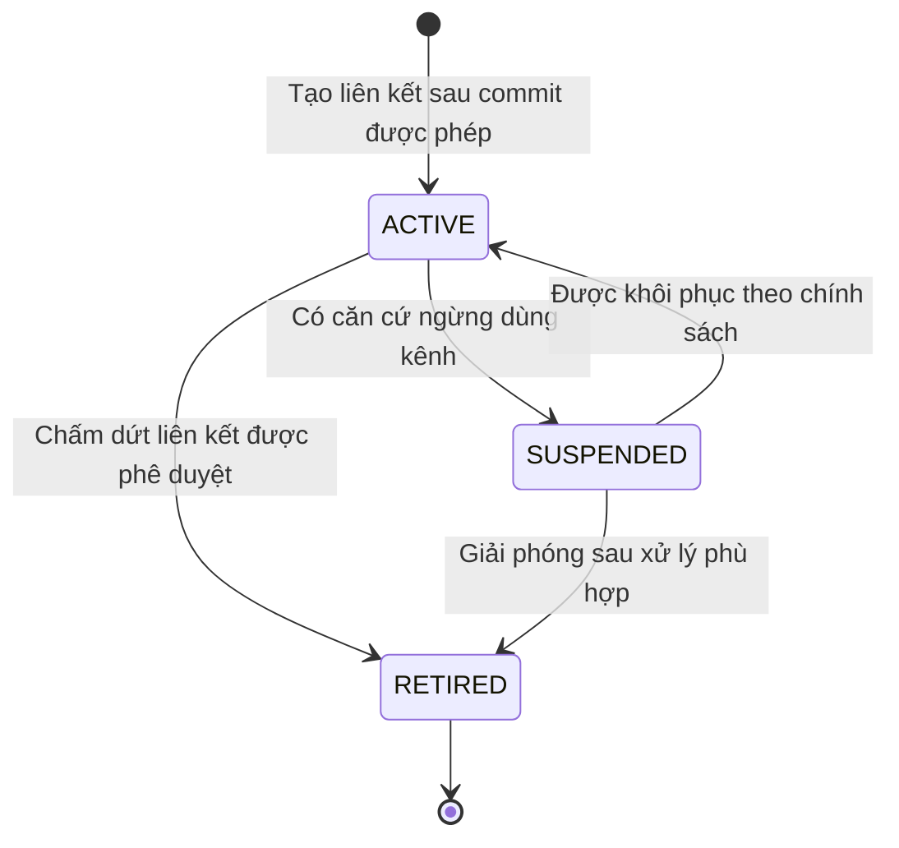
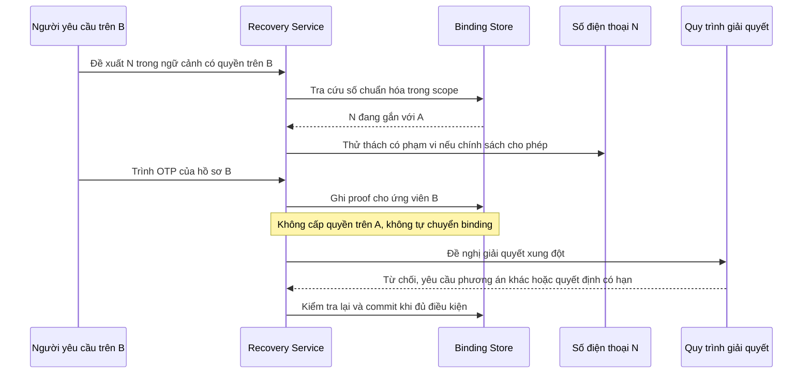

# Phone number collision handling — Xử lý xung đột số điện thoại khi khôi phục tài khoản

## 1. Mục tiêu và phạm vi

Trong chương **Phone Number Recovery** của module **SECURITY_AUTHENTICATION_ACCOUNT_RECOVERY**, một số điện thoại có thể vừa là thông tin liên hệ, vừa là tên đăng nhập, kênh nhận mã MFA hoặc kênh khôi phục tài khoản. Vì vậy, thông báo “số điện thoại đã được sử dụng” không chỉ là một lỗi dữ liệu. Xử lý sai xung đột có thể chuyển quyền đặt lại mật khẩu hoặc quyền đăng nhập sang người không có quyền với tài khoản.

Người dùng có thể mất mật khẩu, MFA, passkey, thiết bị xác thực hoặc SIM. Trong các tình huống đó, hệ thống cần kết hợp xác minh quyền với tài khoản, xác nhận số mới, đánh giá rủi ro, token dùng một lần và kiểm soát session.

Bài học tập trung vào **phone number collision handling**: xử lý trường hợp một số điện thoại được chuẩn hóa trùng với một ràng buộc hoặc một yêu cầu khác trong cùng phạm vi chính sách. Mục tiêu là bảo vệ tài khoản hiện có và vẫn có đường xử lý cho người đang sử dụng số một cách hợp lệ.

Sau bài học, người đọc có thể:

- Phân biệt xung đột biểu diễn, số dùng chung, số được cấp lại và tranh chấp quyền sử dụng trong hệ thống.
- Xác định phạm vi duy nhất phù hợp với vai trò của số điện thoại.
- Thiết kế luồng phát hiện, giữ để xem xét và giải quyết xung đột mà không làm lộ tài khoản khác.
- Ngăn hai yêu cầu đồng thời cùng chiếm một ràng buộc độc quyền.
- Tách việc thu hồi một kênh điện thoại khỏi việc cấp quyền trên tài khoản.

Các trạng thái, cấu trúc dữ liệu và endpoint dưới đây là thiết kế minh họa. Chúng không tự xác lập mức AAL hoặc một chính sách duy nhất cho mọi sản phẩm.

## 2. Vì sao số điện thoại có thể xung đột?

Một số điện thoại không phải định danh bất biến của một cá nhân. Mối liên hệ giữa số, thuê bao, thiết bị và tài khoản có thể thay đổi theo thời gian.

| Loại xung đột | Ví dụ | Cách nhìn đúng |
| --- | --- | --- |
| Khác biểu diễn, cùng số | Dạng trong nước và dạng quốc tế chuẩn hóa về cùng giá trị | Xử lý chuẩn hóa và tính idempotent |
| Cùng tài khoản, nhiều yêu cầu | Người dùng bấm gửi lại hoặc mở hai tab | Tranh chấp phiên bản và trạng thái giao dịch |
| Dùng chung hợp lệ | Thành viên gia đình hoặc người dùng chung số trực cơ quan | Cần chính sách chia sẻ rõ ràng theo mục đích |
| Số được cấp lại | Thuê bao cũ bỏ số, nhà mạng cấp số cho người mới | Người nhận SMS hiện tại không có quyền với tài khoản cũ |
| Chuyển mạng giữ số | Số không đổi nhưng nhà cung cấp thay đổi | Tín hiệu thay đổi hạ tầng, không tự chứng minh đổi chủ |
| SIM swap hoặc chiếm kênh | Đối tượng tấn công nhận được SMS của số nạn nhân | OTP đúng vẫn có thể đến tay kẻ tấn công |
| Dữ liệu cũ hoặc nhập sai | Số đã bỏ từ lâu vẫn là recovery channel | Cần quản lý vòng đời liên kết |
| Hai tài khoản cùng yêu cầu | Hai giao dịch cùng định gắn một số độc quyền | Cần bảo đảm ở thời điểm commit |
| Trùng giữa tenant | Một số xuất hiện ở hai tổ chức | Xác định đúng phạm vi duy nhất và bảo vệ dữ liệu giữa tenant |

Không được kết luận mọi xung đột đều là gian lận. Cũng không được mặc định người trình OTP mới nhất là người có quyền trên mọi tài khoản từng gắn với số đó.

## 3. Ba loại quyền phải tách biệt

Xét số N đang gắn với tài khoản A. Người dùng của tài khoản B muốn dùng N.

Có ba câu hỏi khác nhau:

1. Người yêu cầu có quyền thực hiện thay đổi trên **B** hay không?
2. Người yêu cầu có thể nhận thử thách gửi đến **N tại thời điểm hiện tại** hay không?
3. Hệ thống có căn cứ để chấm dứt hoặc thay đổi liên kết **A–N** hay không?

Trình đúng OTP gửi đến N chỉ hỗ trợ câu hỏi thứ hai. Nó không tự trả lời câu hỏi thứ nhất hoặc thứ ba.

```text
Quyền với tài khoản B
    !=
Quyền tiếp cận số N hiện tại
    !=
Quyền với tài khoản A từng gắn số N
```

Ngay cả khi quy trình có căn cứ cho phép giải phóng số N khỏi A, dữ liệu, mật khẩu, passkey, session và tài sản của A vẫn thuộc phạm vi bảo vệ của A. Không chuyển chúng sang B và không tự hợp nhất hai tài khoản.

NIST SP 800-63B-4 coi thiết lập hoặc thay số điện thoại đăng ký trước cho out-of-band authentication là một hành động gắn authenticator mới. Tiêu chuẩn cũng xem PSTN là kênh bị hạn chế và yêu cầu cân nhắc tín hiệu như SIM change, device swap hoặc number porting. Điều này nhấn mạnh rằng thay số bảo mật cần được xử lý như thay đổi quyền xác thực. [NIST SP 800-63B-4, mục 3.1.3.3](https://pages.nist.gov/800-63-4/sp800-63b.html)

## 4. Chuẩn hóa số trước khi phát hiện xung đột

### 4.1. Khóa so sánh thống nhất

Không so sánh trực tiếp chuỗi người dùng nhập. Những biểu diễn khác nhau có thể chỉ cùng một số:

```text
Dữ liệu minh họa, không thực hiện gửi tin:

+1 202 555 0123
+1 (202) 555-0123
202-555-0123 với region được chọn rõ là US

Khóa chuẩn hóa:
+12025550123
```

Cần dùng cùng chính sách chuẩn hóa tại đăng ký, thêm số liên hệ, đổi MFA, đăng nhập và khôi phục. Nếu một endpoint so sánh chuỗi thô còn endpoint khác dùng E.164, hệ thống có thể vừa cho tạo trùng vừa định tuyến sai tài khoản.

Google libphonenumber phân biệt việc một số phù hợp với dải số hợp lệ và việc số đó đang được cấp cho ai hoặc có thể liên lạc được. Kiểm tra bằng thư viện không xác nhận quyền kiểm soát thực tế. Tài liệu cũng lưu ý bộ phân tích có thể trích xuất hoặc diễn giải ký tự trong đầu vào, nên parse thành công không đồng nghĩa toàn bộ chuỗi đầu vào đáp ứng chính sách sản phẩm. [Google libphonenumber FAQ](https://github.com/google/libphonenumber/blob/master/FAQ.md)

### 4.2. Những điều không nên suy đoán

- Không tự đoán region từ IP rồi coi đó là lựa chọn chắc chắn của người dùng.
- Không bỏ mọi ký tự không phải chữ số rồi mặc định kết quả là một số quốc tế.
- Không xóa số 0 đầu của mọi quốc gia bằng một quy tắc thủ công.
- Không dùng nhà mạng hiện tại như một phần của khóa định danh số; chuyển mạng có thể giữ nguyên số.
- Không coi hai số khác nhau là một chỉ vì có cùng các chữ số cuối.
- Không tự gắn extension vào khóa SMS nếu kênh SMS không hỗ trợ ý nghĩa đó.

Sản phẩm cần xác định rõ có chấp nhận số máy lẻ, số dịch vụ, số dùng chung hoặc các loại số khác không. Loại số theo metadata cũng không bảo đảm số đó nhận được SMS trong mọi điều kiện.

### 4.3. Ví dụ Java minh họa

Đoạn mã dưới đây minh họa việc tạo khóa E.164 cho một luồng SMS có đầu vào giới hạn. Đây không phải verifier quyền sở hữu số hoặc service khôi phục hoàn chỉnh.

```java
import com.google.i18n.phonenumbers.NumberParseException;
import com.google.i18n.phonenumbers.PhoneNumberUtil;
import com.google.i18n.phonenumbers.Phonenumber.PhoneNumber;

import java.util.Locale;

public final class PhoneCanonicalizer {
    private static final PhoneNumberUtil UTIL =
            PhoneNumberUtil.getInstance();

    public static String forSms(String input, String selectedRegion)
            throws NumberParseException {
        if (input == null || input.isBlank() || input.length() > 80) {
            throw new IllegalArgumentException("Invalid phone input");
        }

        String value = input.strip();

        // Chính sách ví dụ: chỉ nhận số và ký tự trình bày cơ bản.
        if (!value.matches("[+0-9() .-]+")) {
            throw new IllegalArgumentException("Unsupported phone format");
        }

        String region;
        if (value.startsWith("+")) {
            region = "ZZ";
        } else {
            if (selectedRegion == null || selectedRegion.isBlank()) {
                throw new IllegalArgumentException("Region is required");
            }

            region = selectedRegion.toUpperCase(Locale.ROOT);
            if (!UTIL.getSupportedRegions().contains(region)) {
                throw new IllegalArgumentException("Unsupported region");
            }
        }

        PhoneNumber parsed = UTIL.parse(value, region);
        if (parsed.hasExtension() || !UTIL.isValidNumber(parsed)) {
            throw new IllegalArgumentException("Unsupported phone number");
        }

        return UTIL.format(parsed, PhoneNumberUtil.PhoneNumberFormat.E164);
    }

    private PhoneCanonicalizer() {}
}
```

Sau chuẩn hóa vẫn cần kiểm tra phạm vi sản phẩm hỗ trợ, khả năng gửi qua nhà cung cấp, chống lạm dụng và thử thách xác nhận. Metadata thư viện có thể thay đổi; không tự diễn giải một thay đổi kết quả validation thành bằng chứng người dùng đã đổi số.

## 5. Chọn chính sách duy nhất theo mục đích

### 5.1. Không dùng một cờ duy nhất cho mọi vai trò

Một số có thể được dùng cho:

- Liên hệ vận hành.
- Nhận thông báo không cấp quyền.
- Định danh đăng nhập.
- Nhận mã MFA.
- Nhận mã khôi phục.

Nếu cùng trường `phone_number` phục vụ tất cả vai trò, một chỉnh sửa liên hệ bình thường có thể vô tình thay kênh lấy lại tài khoản. Cần tách vai trò và những quyền tương ứng.

| Vai trò | Có thể cho chia sẻ không? | Điều kiện cần làm rõ |
| --- | --- | --- |
| Liên hệ thông thường | Có thể, tùy sản phẩm | Không tự cấp quyền đăng nhập hoặc reset |
| Nhận cảnh báo | Có thể, có kiểm soát dữ liệu | Tránh gửi thông tin riêng của nhiều người đến số dùng chung |
| Tên đăng nhập duy nhất | Thường cần duy nhất trong phạm vi chọn | Không được chọn ngẫu nhiên một tài khoản khi có nhiều kết quả |
| Kênh MFA hoặc recovery | Có thể độc quyền hoặc được chia sẻ theo chính sách riêng | Mô hình assurance và định tuyến phải được thiết kế phù hợp |

Cho phép chia sẻ không có nghĩa một OTP trở thành đủ để khôi phục mọi tài khoản dùng chung số.

### 5.2. Mô hình độc quyền

Một sản phẩm có thể quy định:

```text
Trong mỗi scope:
mỗi số chuẩn hóa có tối đa một security binding chưa được giải phóng.
```

Ưu điểm là giảm mơ hồ khi định tuyến. Đổi lại, cần đường giải quyết cho số tái cấp và người dùng dùng chung số.

Số đang tranh chấp hoặc bị tạm ngừng vì rủi ro có thể vẫn chiếm vị trí độc quyền. Việc ngừng dùng số để xác thực và việc giải phóng số cho tài khoản khác là hai thao tác khác nhau.

### 5.3. Mô hình chia sẻ

Nếu sản phẩm cho phép nhiều tài khoản dùng cùng số:

- Người yêu cầu phải chỉ ra đúng tài khoản hoặc ngữ cảnh tài khoản qua một luồng được bảo vệ.
- Challenge được ràng buộc với tài khoản, hồ sơ, mục đích và binding cụ thể.
- Không trả danh sách tài khoản dùng số sau khi nhập OTP.
- Không dùng câu lệnh kiểu “lấy tài khoản đầu tiên có phone = N”.
- Không tự coi số dùng chung là yếu tố đủ mạnh cho mọi hành động khôi phục.

Nếu sản phẩm chỉ có trường đăng nhập là số điện thoại và cấp toàn quyền ngay sau một OTP, mô hình đó không thể đồng thời phân biệt an toàn nhiều tài khoản độc lập dùng chung số. Cần thiết kế lại định danh hoặc yêu cầu bổ sung.

### 5.4. Phạm vi tenant

Nếu xác thực tập trung trên toàn nền tảng, có thể cần duy nhất toàn hệ thống. Nếu mỗi tenant là một miền danh tính độc lập, có thể chọn duy nhất theo tenant.

Không áp dụng ràng buộc toàn cục chỉ để thuận tiện lập trình rồi tiết lộ cho tenant X rằng số đang thuộc một người ở tenant Y. Dù khóa duy nhất nằm toàn cục, thông tin về tài khoản đang giữ số vẫn phải được bảo vệ.

Phần còn lại của bài dùng mô hình **security binding độc quyền trong một scope** để minh họa xử lý xung đột.

## 6. Các bất biến bảo mật

1. **Account ID ổn định là chủ thể quyền.** Số điện thoại là thuộc tính hoặc kênh có vòng đời.
2. **Proof số hiện tại không cấp quyền trên tài khoản cũ.**
3. **Không chuyển tài khoản hoặc hợp nhất dữ liệu khi giải quyết xung đột số.**
4. **OTP và proof có phạm vi rõ ràng.** Chúng thuộc đúng account, case, purpose, số chuẩn hóa và revision.
5. **Mỗi binding độc quyền chỉ có một bên giữ trong cùng scope.**
6. **Tạm ngừng binding không tự giải phóng nó.**
7. **Thay đích hoặc thay binding làm vô hiệu kết quả không còn đúng phạm vi.**
8. **Xác nhận số và giải quyết xung đột là hai bước riêng.**
9. **Request chưa được cấp quyền không làm hỏng khả năng đăng nhập của tài khoản khác.**
10. **Trạng thái lỗi và thông báo không làm lộ thông tin tài khoản đang giữ số.**

Các bất biến cần thể hiện trong dữ liệu, transaction và các đường định tuyến mã. Một màn hình cảnh báo hoặc nút bị vô hiệu không bảo vệ được API nếu client gọi trực tiếp.

## 7. Mô hình dữ liệu và vòng đời

### 7.1. Tách binding khỏi yêu cầu thay đổi

| Đối tượng | Dữ liệu chính | Vai trò |
| --- | --- | --- |
| `PhoneSecurityBinding` | Scope, account ID, số chuẩn hóa, trạng thái, version, thời điểm xác nhận | Kênh bảo mật đang có hiệu lực hoặc bị ngừng |
| `PhoneRecoveryCase` | Account đích, phạm vi quyền, trạng thái, thời hạn, phiên bản bảo mật | Quản lý một giao dịch khôi phục |
| `PhoneCandidate` | Case ID, revision, số chuẩn hóa, proof và hạn sử dụng proof | Địa chỉ điện thoại đang đề xuất |
| `CollisionReview` | Binding xung đột, bằng chứng, quyết định có phạm vi, thời hạn | Quản lý giải quyết xung đột |
| `PhoneChallenge` | Case, candidate revision, purpose, digest mã, hạn, generation | Xác nhận quyền tiếp cận số |

Một bản ghi ứng viên không được tự trở thành binding đang có hiệu lực chỉ vì vừa phát hành hoặc xác nhận OTP.

### 7.2. Trạng thái binding



Trong mô hình minh họa:

- `ACTIVE`: binding có thể được dùng theo các quyền đã cấp.
- `SUSPENDED`: không dùng để phát hành hoặc chấp nhận bằng chứng bảo mật mới, nhưng chưa được tái gán.
- `RETIRED`: liên kết cũ đã chấm dứt; bản ghi lịch sử không tạo quyền.

Khi cần dùng lại số cho một liên kết mới, nên tạo binding ID mới thay vì sửa account ID của bản ghi lịch sử. Điều này giúp phân biệt hai giai đoạn sử dụng và thu hồi challenge đúng phạm vi.

### 7.3. Trạng thái hồ sơ

```text
OPEN
  -> AUTHORITY_VERIFIED
  -> PHONE_PROVED
  -> READY_TO_COMMIT                  nếu không có xung đột
  -> COLLISION_REVIEW                 nếu có binding khác
       -> READY_TO_COMMIT             khi đã có quyết định phù hợp
       -> ALTERNATIVE_REQUIRED
       -> REJECTED

READY_TO_COMMIT -> COMPLETED

Mọi trạng thái chưa hoàn tất có thể CANCELED hoặc EXPIRED.
```

Thứ tự thu proof và phát hiện xung đột có thể khác tùy chính sách chống spam và quyền riêng tư. Trạng thái công khai không cần ánh xạ một đối một với mã nguyên nhân nội bộ.

## 8. Phân loại kết quả tra cứu

Sau khi chuẩn hóa, server tra cứu binding thuộc đúng scope và đối chiếu với account đang có quyền thao tác.

| Kết quả | Cách xử lý |
| --- | --- |
| Chưa có binding giữ số | Có thể tiếp tục xác nhận và kiểm tra commit |
| Binding đang giữ thuộc cùng account | Xử lý idempotent hoặc xác nhận lại theo mục tiêu; không tạo tài khoản mới |
| Binding `ACTIVE` thuộc account khác | Tạo trạng thái xung đột; không tự ghi đè |
| Binding `SUSPENDED` thuộc account khác | Vẫn là xung đột chưa giải phóng |
| Chỉ có lịch sử `RETIRED` | Không tự giữ số mãi, nhưng xem xét lịch sử theo chính sách |
| Có nhiều binding đang giữ dù chính sách độc quyền | Lỗi dữ liệu cần xử lý; không chọn một bản ghi bất kỳ |
| Không xác định được scope hoặc trạng thái | Chưa cho commit; xử lý lỗi có kiểm soát |

Cần kiểm tra lại tại commit. Kết quả tra cứu “chưa có” chỉ đúng ở thời điểm đọc; một giao dịch khác có thể gắn số trước khi request hiện tại ghi dữ liệu.

Nếu người dùng nhập lại số đang thuộc chính họ, một endpoint có thể trả thành công mà không thay đổi dữ liệu. Tuy nhiên, hành động “xác nhận lại quyền tiếp cận hiện tại” vẫn cần thử thách mới nếu chính sách yêu cầu. Idempotency không biến kết quả xác nhận cũ thành proof mới.

## 9. Luồng xử lý khi số đang gắn với tài khoản khác

### Bước 1: Xác minh quyền với tài khoản đang được thay đổi

Đối với người dùng B muốn thêm hoặc khôi phục số trên B, cần có bằng chứng quyền thực hiện thay đổi trên B. Có thể là xác thực lại bằng phương tiện còn tin cậy hoặc một nhánh khôi phục được chấp nhận.

Nếu người dùng chưa có tài khoản và đang đăng ký, quyền họ nhận được là quyền với hồ sơ đăng ký mới, không phải quyền truy cập tài khoản A từng dùng số.

### Bước 2: Thu proof quyền tiếp cận số

Nếu chính sách cho phép phát hành thử thách ở trạng thái này, gửi OTP đến số ứng viên và kiểm tra:

```text
account_id
recovery_case_id
candidate_revision
purpose = PROVE_CANDIDATE_PHONE
canonical_phone
generation
expires_at
consumed_at
```

Không dùng số điện thoại làm khóa duy nhất để tìm OTP. Hai tài khoản hoặc hai hồ sơ có thể cùng chờ xác nhận một số.

### Bước 3: Giữ binding cũ và tách quyết định xung đột

Proof thành công không tự sửa A. Hồ sơ B chuyển sang chờ xem xét hoặc được hướng dẫn dùng phương thức khác.

Một phản hồi phù hợp có thể là:

> Chưa thể sử dụng số này cho thay đổi bảo mật. Bạn có thể chọn phương thức khác hoặc tiếp tục quy trình hỗ trợ được cung cấp.

Không nêu tên, email, tenant hoặc dữ liệu của A.

### Bước 4: Chọn một hướng giải quyết được phê duyệt

Các hướng có thể gồm:

- Người dùng chọn số khác hoặc một phương thức bảo mật khác.
- Người có quyền trên A tự tháo số bằng quy trình được bảo vệ, sau đó B thực hiện gắn số theo chính sách.
- Sản phẩm chấp nhận mô hình chia sẻ cho vai trò phù hợp; việc chuyển mô hình phải có chính sách rõ ràng.
- Một quy trình xác minh và xử lý số được cấp lại cho phép chấm dứt binding cũ rồi tạo binding mới.
- Hồ sơ bị từ chối hoặc chưa đủ căn cứ để giải quyết an toàn.

Không được tự chuyển sang mô hình chia sẻ chỉ vì gặp lỗi unique constraint.

### Bước 5: Kiểm tra lại và commit

Nếu có quyết định cho phép giải phóng số:

1. Quyết định phải chỉ rõ binding cũ, version, scope, hồ sơ mới và hành động được phép.
2. Chỉ chấm dứt kênh điện thoại được nêu; không chuyển dữ liệu tài khoản A.
3. Thu hồi challenge và quyền còn tồn tại liên quan đến binding cũ.
4. Tạo binding mới cho B sau khi kiểm tra lại quyền B và proof số.
5. Áp dụng thông báo, kiểm soát session và lịch sử theo chính sách.



## 10. Số được cấp lại: giải phóng kênh mà không trao tài khoản

### 10.1. Không đồng nhất cấp lại với SIM swap

Trong cấp lại hợp lệ, người mới có số nhưng không có quyền với tài khoản cũ. Trong SIM swap, kẻ tấn công có thể đang tạm thời nhận SMS của một thuê bao vẫn thuộc nạn nhân.

Chuyển mạng giữ số có thể là hoạt động hợp lệ của cùng người dùng. Tín hiệu “vừa port” hoặc “vừa đổi SIM” là thông tin rủi ro, không phải kết luận chắc chắn về quyền sở hữu hoặc gian lận.

### 10.2. Dữ liệu nhà mạng có giới hạn

Sản phẩm có thể tích hợp nguồn cung cấp tín hiệu reassignment, disconnection hoặc SIM change khi có phạm vi và quyền sử dụng phù hợp. Cần lưu nguồn, thời điểm tra cứu, phạm vi phủ và ý nghĩa chính xác của kết quả.

Ví dụ, RND tại Hoa Kỳ lưu thông tin ngắt kết nối vĩnh viễn của các số thuộc phạm vi dịch vụ. Tài liệu phân biệt ngắt kết nối vĩnh viễn với chuyển mạng giữ số. Đây không phải cơ sở dữ liệu chứng minh danh tính chủ thuê bao trên toàn cầu. [Reassigned Numbers Database FAQ](https://reassigned.us/resources/faq)

Với một truy vấn như vậy:

- Kết quả cho thấy có thay đổi có thể làm binding cũ cần xem xét.
- Kết quả không có dữ liệu không đồng nghĩa số chưa từng được cấp lại.
- Kết quả không đổi không tự chứng minh người nhận OTP là chủ tài khoản cũ.
- Một ảnh chụp hóa đơn nhà mạng không thay thế việc kiểm tra nguồn và liên kết với giao dịch.

Không sao chép quy định thời gian chờ của một thị trường thành thời gian chờ bảo mật mặc định cho mọi quốc gia.

### 10.3. Tách hai quyết định

Quy trình reclaim số nên tạo hai quyết định rõ ràng:

```text
D1: Có được chấm dứt binding A–N không?
D2: Có được tạo binding B–N không?
```

D1 bảo vệ A khỏi tiếp tục dùng một kênh không còn đáng tin cậy. D2 đòi hỏi quyền với B, proof số N còn mới và các điều kiện của chính sách.

Có thể D1 được chấp nhận nhưng D2 chưa được chấp nhận. Ví dụ, hệ thống có căn cứ ngừng kênh cũ nhưng người yêu cầu chưa chứng minh đủ quyền với B. Khi đó không cần tiếp tục giữ N là kênh xác thực của A chỉ để chờ B, nhưng cũng không được cấp N cho B một cách tự động.

Việc thực thi D1 riêng cần quy trình được cấp quyền riêng và đánh giá ảnh hưởng đến khả năng truy cập A. Nó không phải tác dụng phụ của một yêu cầu thêm số chưa được xác minh.

### 10.4. Thời gian chờ và phản hồi của bên cũ

Khoảng chờ có thể tạo cửa sổ thông báo hoặc giải quyết tranh chấp. Chờ đủ lâu không tự chứng minh D1 hoặc D2.

Không có phản đối từ A có thể do A không nhận được cảnh báo. Một phản đối ẩn danh cũng không được tự giữ số mãi. Chính sách phải xác định ai có quyền phản đối, bằng chứng cần thiết và cách giải quyết trong thời hạn phù hợp.

Cần có đường xử lý cho người dùng số tái cấp hợp lệ mà không buộc họ phải lấy được OTP từ chính tài khoản cũ hoặc liên hệ trực tiếp người dùng cũ.

## 11. Dữ liệu và transaction chống tranh chấp đồng thời

### 11.1. Ràng buộc duy nhất ở cơ sở dữ liệu

Kiểm tra kiểu sau không đủ:

```text
if noBindingExists(scope, phone):
    createBinding(account, phone)
```

Hai request có thể cùng đọc “chưa có” và cùng tạo liên kết.

Trong PostgreSQL có thể dùng partial unique index để áp dụng tính duy nhất trên tập bản ghi thỏa điều kiện. [PostgreSQL, Partial Indexes](https://www.postgresql.org/docs/current/indexes-partial.html)

Ví dụ lược đồ cho mô hình độc quyền:

```sql
CREATE TABLE phone_security_binding (
    binding_id       uuid PRIMARY KEY,
    scope_id         uuid NOT NULL,
    account_id       uuid NOT NULL,
    phone_e164       varchar(16) NOT NULL,
    status           varchar(16) NOT NULL
                     CHECK (status IN ('ACTIVE', 'SUSPENDED', 'RETIRED')),
    binding_version  bigint NOT NULL DEFAULT 1,
    verified_at      timestamptz NOT NULL,
    retired_at       timestamptz
);

CREATE UNIQUE INDEX uq_phone_security_holder
    ON phone_security_binding (scope_id, phone_e164)
    WHERE status IN ('ACTIVE', 'SUSPENDED');
```

`SUSPENDED` vẫn nằm trong tập giữ chỗ vì ngừng sử dụng kênh không tự cho phép người khác lấy số. Các bản ghi `RETIRED` được giữ cho lịch sử nhưng không chiếm vị trí độc quyền.

Ví dụ chỉ thể hiện cấu trúc. Dữ liệu điện thoại vẫn cần bảo vệ, phân quyền và chính sách giữ dữ liệu; tính duy nhất không thay thế những kiểm soát đó. Thông tin liên hệ không có quyền bảo mật nên nằm trong mô hình riêng nếu được phép dùng chung.

Nếu dùng blind index HMAC để tra cứu số được mã hóa, cần thiết kế cách xoay khóa mà không tạo hai miền uniqueness song song. Đổi khóa HMAC mà giữ unique riêng theo key version có thể cho phép cùng số được gắn hai lần.

### 11.2. Transaction giải quyết xung đột

Pseudocode cho trường hợp đã có quyết định D1 và D2:

```text
BEGIN

Khóa các account liên quan theo thứ tự ID thống nhất
Khóa hồ sơ và quyết định
Khóa binding cũ theo binding ID

Kiểm tra:
    người gọi có quyền thực hiện thao tác
    quyết định đúng scope, account B, case và candidate revision
    binding cũ đúng ID, account A, số chuẩn hóa và version
    quyền trên B và proof số còn hợp lệ
    D1 cho phép chấm dứt binding cũ
    D2 cho phép tạo binding mới
    không có hold hoặc thay đổi bảo mật làm quyết định mất hiệu lực
    các hạn thời gian và điều kiện chờ đã đáp ứng

Đặt binding cũ thành RETIRED và tăng version
Thu hồi challenge/quyền chưa dùng phụ thuộc binding cũ
Tạo binding ID mới ở trạng thái ACTIVE cho B
Đánh dấu quyết định đã sử dụng và hồ sơ hoàn tất
Cập nhật phiên bản bảo mật/session theo các quyền đã phê duyệt
Ghi audit và công việc thông báo/thu hồi qua outbox

COMMIT
```

Nếu insert binding mới gặp unique violation do một giao dịch khác vừa chiếm số, rollback cả transaction. Không để binding cũ bị giải phóng một nửa rồi coi việc gắn số đã thành công.

Với một quyết định D1 riêng nhằm chấm dứt kênh cũ vì rủi ro, dùng transaction riêng có phạm vi và trạng thái phù hợp. Không nhầm nhánh đó với transaction chuyển số nguyên vẹn vừa mô tả.

Khóa một hàng đang có không giải quyết được mọi trường hợp “chưa có hàng”. Unique constraint là lớp bảo vệ cuối cùng cho việc tạo mới. Mọi luồng thay binding, kể cả công cụ quản trị, phải tuân thủ cùng bất biến.

### 11.3. Retry và phiên bản

Client có thể mất response sau commit. Dùng idempotency key gắn với người gọi, hồ sơ và nội dung thao tác hoặc trả trạng thái hồ sơ đã lưu.

Không dùng lại phê duyệt cũ khi binding version thay đổi. Cũng không tự cập nhật `expected_version` trong quyết định cũ để nó khớp trạng thái hiện tại.

Nếu hai tài khoản đồng thời yêu cầu cùng số chưa có binding, chỉ một transaction được tạo binding giữ số. Transaction còn lại phải xử lý xung đột hiện tại; không tự thu hồi binding của bên vừa thành công.

## 12. OTP, challenge và trạng thái sau thay đổi

### 12.1. Không định tuyến mã chỉ theo số

Một bản ghi mã nên có ngữ cảnh cụ thể:

```text
challenge_id
scope_id
account_id
case_id
purpose
candidate_revision hoặc binding_id + binding_version
phone_reference
generation
expires_at
consumed_at
revoked_at
```

Với thử thách ứng viên, dùng revision. Với thử thách dựa trên binding đang hoạt động, dùng binding ID và version.

Nếu A và B có các luồng khác nhau cùng gửi đến N, một mã của hồ sơ B không được dùng để reset A. Không tra kiểu “lấy OTP gần nhất của phone N” rồi suy ra tài khoản từ số.

### 12.2. Ràng buộc phiên bản khi chấp nhận

Một OTP đã gửi trước khi binding A–N bị ngừng hoặc giải phóng có thể vẫn nằm trong SMS đến muộn. Server phải kiểm tra binding còn được phép dùng và version vẫn phù hợp.

Thu hồi binding không chỉ là ngừng gửi mã mới. Nó còn phải làm những challenge hoặc quyền dựa trên binding cũ mất hiệu lực theo chính sách.

Tương tự, khi người dùng đổi số ứng viên từ N sang M, proof N không được xác nhận M và các mã N phải được thu hồi.

### 12.3. Chống đoán và gửi hàng loạt

Mã cần được sinh ngẫu nhiên mật mã, có thời hạn, tiêu thụ một lần và lưu bằng cơ chế phù hợp. Với mã ngắn, phải kiểm soát thử trực tuyến và tránh để lộ vật liệu có thể dò ngoại tuyến.

Áp dụng hạn mức theo challenge, hồ sơ, account, số đích, scope và nguồn truy cập. Gửi lại không đặt lại toàn bộ ngân sách thử. Hai hồ sơ trùng số cũng không được cộng thành một nguồn SMS không giới hạn.

Dùng cooldown và hạn mức chi phí để ngăn SMS pumping, spam và việc quấy rối người đang giữ số. Nhận được proof không cho phép người yêu cầu xem thông tin về tài khoản khác nhằm “chứng minh số đã bị dùng”.

### 12.4. Bằng chứng còn hạn nhưng hồ sơ hết hạn

Token hoặc OTP còn hạn không tự làm recovery session sống lại. Mỗi lớp có thời hạn và phạm vi riêng. Nếu cần tiếp tục trên thiết bị khác, dùng cơ chế tiếp tục được thiết kế riêng thay vì cấp quyền chỉ bằng case ID và số điện thoại.

## 13. Quyền riêng tư và trải nghiệm người dùng

### 13.1. Không làm lộ tài khoản đang giữ số

Một API không nên trả:

```json
{
  "error": "PHONE_EXISTS",
  "existingAccountId": "acc_A",
  "existingEmail": "owner@example.net"
}
```

Ngay cả email được che một phần, số lượng tài khoản hoặc tenant cũng có thể là thông tin không cần tiết lộ.

Trong ngữ cảnh chưa có quyền phù hợp, thông báo nên thống nhất và không tiết lộ kết quả tra cứu chi tiết. Sau khi đã xác minh quyền trên tài khoản B, có thể cung cấp hướng dẫn hành động cho B mà vẫn giữ kín dữ liệu A.

Ví dụ response:

```json
{
  "requestStatus": "ADDITIONAL_ACTION_REQUIRED",
  "nextAction": "USE_ALTERNATIVE_OR_CONTACT_SUPPORT",
  "reference": "case_public_opaque"
}
```

Mã nguyên nhân nội bộ có thể chi tiết hơn, nhưng chỉ hiển thị cho vai trò được phép.

### 13.2. Không dùng số tranh chấp làm kênh cảnh báo mặc định cho A

Nếu N có thể đã được cấp lại, gửi cảnh báo chi tiết về tài khoản A đến N có thể làm lộ thông tin cho người mới.

Ưu tiên kênh phù hợp đã thiết lập từ trước như email còn tin cậy, ứng dụng đã xác thực hoặc phương thức thông báo khác. Chính sách thông báo cần xét tình trạng kênh, đặc biệt khi N đang bị nghi không còn thuộc người dùng A.

Nếu phải gửi thông điệp đến N để xử lý yêu cầu, nội dung cần tối thiểu, chỉ nói về giao dịch hiện tại và không tiết lộ danh tính hoặc dữ liệu của tài khoản cũ.

### 13.3. Không ép người dùng nhận lại số cũ

Nếu người dùng đã mất hoặc bỏ số, yêu cầu họ nhận OTP ở số đó có thể không khả thi và có thể đưa bí mật cho người khác. Cần đường khôi phục bằng bằng chứng khác đã được phê duyệt.

Tương tự, người được cấp lại số hợp lệ không nên được yêu cầu tìm người dùng cũ để xin mật khẩu hoặc OTP. Bộ phận hỗ trợ cũng không được đề nghị hai bên chia sẻ dữ liệu đăng nhập.

### 13.4. Tách các hành động sản phẩm

Giao diện nên phân biệt:

- “Xác nhận số có thể nhận mã.”
- “Yêu cầu sử dụng số cho tài khoản này.”
- “Đang xử lý điều kiện sử dụng.”
- “Số đã được cập nhật làm kênh bảo mật.”

Một proof thành công không nên hiển thị “đã khôi phục tài khoản” khi xung đột còn chưa giải quyết.

## 14. Kiểm soát session và các quyền còn tồn tại

Chấm dứt binding A–N không tự chuyển session của A cho B. Đồng thời, cần xem xét những quyền đã được cấp dựa trên kênh N:

- OTP đang chờ và reset token chưa dùng.
- Recovery session có mức quyền phát sinh từ binding cũ.
- Session hoặc refresh token được tạo trong giai đoạn nghi ngờ chiếm kênh.
- Các đường đăng nhập khác còn tra cứu số theo dữ liệu cache cũ.
- Hệ thống liên kết ngoài đã nhận số điện thoại như thuộc tính đăng nhập.

Không bắt buộc mọi yêu cầu thêm số của B đều đăng xuất A. Chỉ hành động đã được cấp quyền hoặc đánh giá sự cố phù hợp mới được thay đổi session của A. Nếu không, kẻ tấn công có thể dùng xung đột số để gây từ chối dịch vụ.

Khi đã có căn cứ rằng kênh cũ bị chiếm hoặc không còn đáng tin cậy, chính sách có thể yêu cầu thu hồi quyền phát sinh từ kênh đó, xác thực lại hoặc áp dụng kiểm soát rộng hơn. Phạm vi tác động cần gắn với quyết định và audit.

Nếu access token được kiểm tra ngoại tuyến, việc cập nhật binding trong cơ sở dữ liệu không tự làm token đã phát hành hết hiệu lực ngay. Cần cơ chế session version, revocation, kiểm tra trạng thái hoặc giới hạn thời gian sống phù hợp với kiến trúc.

Cũng phải ngăn job chạy chậm hoặc sự kiện cũ kích hoạt lại binding đã chấm dứt. Sự kiện và consumer nên kiểm tra binding ID, version và quy tắc idempotent thay vì cập nhật chỉ theo số điện thoại.

## 15. Nhật ký, hỗ trợ và dữ liệu cũ

### 15.1. Sự kiện cần theo dõi

```text
PHONE_CANDIDATE_SET
PHONE_PROOF_VERIFIED
PHONE_COLLISION_DETECTED
PHONE_COLLISION_REVIEW_OPENED
PHONE_BINDING_SUSPENDED
PHONE_BINDING_RETIRED
PHONE_BINDING_CREATED
PHONE_COLLISION_DECISION_REJECTED
PHONE_RECOVERY_COMPLETED
```

Sự kiện nên chứa case ID, scope, binding ID và version, candidate revision, loại quyết định, policy version và reason code. Việc nối dữ liệu giữa hai tài khoản chỉ dành cho người có thẩm quyền xử lý xung đột.

Không ghi OTP, token thô, cookie hoặc toàn bộ số điện thoại vào log phổ thông. Số điện thoại có không gian đoán tương đối nhỏ; hash không khóa không đủ để biến nó thành dữ liệu vô danh. Nếu cần chỉ mục có khóa, vẫn phải kiểm soát truy cập và khả năng liên kết dữ liệu.

### 15.2. Nhân viên hỗ trợ

Nhân viên hỗ trợ cần thấy:

- Họ đang xử lý quyền trên tài khoản nào.
- Proof nào đã kiểm tra và còn hiệu lực.
- Binding cũ nào có thể bị tác động.
- Quyết định nào cho phép ngừng hoặc giải phóng số.
- Hành động nào không nằm trong phạm vi yêu cầu.

Không để một nút “transfer number” tự đổi account ID của binding rồi cấp reset mật khẩu của tài khoản cũ cho người mới.

Đối với ngoại lệ hoặc tài khoản đặc quyền, có thể cần phê duyệt độc lập và quyền tác nghiệp giới hạn. Nhân viên không được yêu cầu người dùng đọc OTP hoặc gửi recovery code qua ticket.

### 15.3. Dữ liệu đã trùng trước khi có ràng buộc

Khi dữ liệu cũ có nhiều binding độc quyền trùng số, không tự chọn bản ghi mới nhất, hoạt động nhiều nhất hoặc nhận OTP thành công gần nhất để giữ tài khoản.

Cần một quy trình riêng:

1. Phát hiện và phân loại các nhóm trùng.
2. Ngăn đường xác thực mơ hồ tiếp tục cấp quyền sai.
3. Xác minh quyền của từng tài khoản qua phương thức phù hợp.
4. Chọn chính sách giữ, chia sẻ hoặc chấm dứt từng binding.
5. Lưu dấu vết và thông báo qua kênh phù hợp.
6. Chỉ áp dụng unique constraint sau khi dữ liệu đáp ứng bất biến.

Không tự xóa tài khoản hoặc hợp nhất lịch sử để làm migration qua được. Nếu cần tạm ngừng kênh điện thoại mơ hồ, phải giữ đường xác thực thay thế và hỗ trợ phù hợp cho người dùng hợp lệ.

## 16. Ví dụ và các tình huống cần kiểm chứng

### 16.1. Số được cấp lại cho người mới

An từng dùng N cho tài khoản A rồi bỏ số. Bình hiện có N và muốn dùng cho tài khoản B.

1. Bình xác minh quyền trên B bằng phương thức được chính sách chấp nhận.
2. Bình nhận OTP tại N, tạo proof cho ứng viên của B.
3. Hệ thống phát hiện N vẫn có binding với A.
4. Hồ sơ chuyển sang xử lý xung đột; Bình không nhận thông tin đăng nhập của A.
5. Quy trình được phê duyệt đánh giá điều kiện chấm dứt A–N và điều kiện tạo B–N.
6. Nếu được phép, hệ thống chấm dứt binding cũ, thu hồi quyền liên quan và tạo binding mới theo giao dịch phù hợp.
7. A vẫn là một tài khoản độc lập. An tiếp tục hoặc khôi phục A bằng những phương thức hợp lệ khác.

Nếu bước 5 chưa đủ căn cứ, hệ thống có thể yêu cầu Bình dùng phương thức khác. Nhận đúng OTP ở bước 2 không bỏ qua bước 5.

### 16.2. Hai request cùng chiếm số chưa có binding

C và D cùng xác nhận được số N trong hai ngữ cảnh hợp lệ của mô hình sản phẩm. Khi commit:

- C thành công tạo binding trước.
- Insert của D gặp ràng buộc duy nhất.
- D được đưa về nhánh xử lý xung đột hoặc phương án khác.
- Không tự chấm dứt binding của C vì D đã có proof.

Proof tiếp cận số là một điều kiện, không phải quyền vượt qua chính sách độc quyền.

### 16.3. Các tình huống cần kiểm chứng

| Tình huống | Kết quả mong đợi |
| --- | --- |
| Hai chuỗi khác định dạng nhưng chuẩn hóa cùng số | Phát hiện là cùng số trong cùng scope |
| Thiếu region cho số dạng trong nước | Không tự đoán để tạo binding |
| Metadata cho biết số hợp lệ | Vẫn cần proof và quyền tài khoản |
| Người dùng nhập lại số đang gắn với chính họ | Không tạo bản ghi trùng; xác nhận lại nếu hành động yêu cầu |
| OTP đúng nhưng số đang gắn với tài khoản khác | Chỉ ghi proof hiện tại, không cấp quyền tài khoản cũ |
| Binding khác đang `SUSPENDED` | Không xem số là đã tự do |
| Hai transaction tạo binding độc quyền cùng lúc | Tối đa một bên giữ số thành công |
| Lỗi sau khi định chấm dứt binding cũ trong transaction chuyển | Rollback cả chuyển đổi, không thành công một phần |
| Có D1 nhưng chưa có D2 | Không tự tạo binding mới cho người yêu cầu |
| Binding version thay đổi sau khi phê duyệt | Quyết định cũ bị chặn hoặc đánh giá lại |
| OTP cũ đến sau khi binding bị chấm dứt | Bị từ chối theo binding ID/version và trạng thái |
| OTP của B được trình để reset A | Bị từ chối do sai account, case hoặc purpose |
| Thay số ứng viên N thành M | Thu hồi proof và challenge không còn đúng đích |
| API công khai gặp số đang được giữ | Không tiết lộ tên, email, tenant hoặc danh sách tài khoản |
| Người dùng báo xung đột không có quyền | Không tự làm A mất session hoặc mất kênh bảo mật |
| Tra cứu reassignment trả không có dữ liệu | Không coi đó là chứng minh số chưa đổi người dùng |
| Số vừa chuyển mạng | Đánh giá như tín hiệu rủi ro, không mặc định đổi chủ |
| Response commit bị mất | Retry không chuyển số hoặc phát sinh quyền lần hai |
| Job hoặc sự kiện cũ đến muộn | Không kích hoạt lại binding đã chấm dứt |
| Dữ liệu cũ có nhiều binding độc quyền | Không chọn ngẫu nhiên tài khoản để đăng nhập hoặc reset |

Kết quả cần đạt của xử lý xung đột là một liên kết điện thoại có phạm vi, nguồn phê duyệt và vòng đời rõ ràng. Người đang giữ số chỉ nhận những quyền đã được chứng minh trên tài khoản của họ; tài khoản từng dùng số tiếp tục được bảo vệ độc lập.
