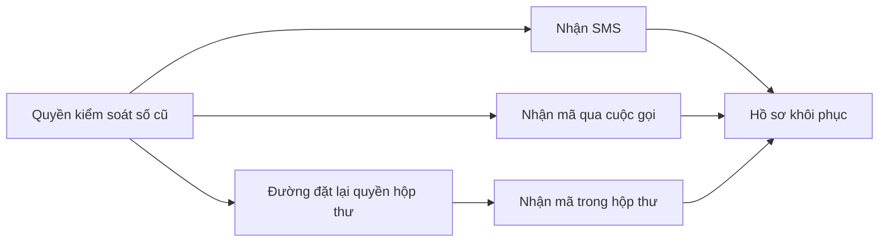
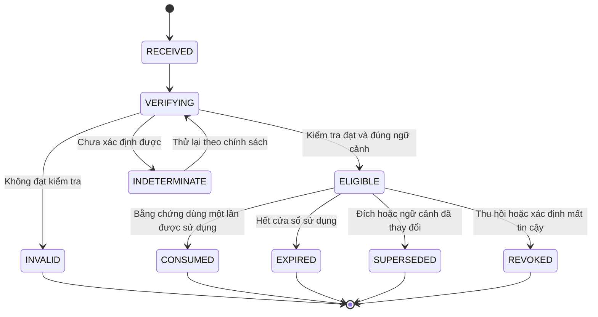

# Phone number recovery evidence — Bằng chứng trong khôi phục số điện thoại

## 1. Mục tiêu và phạm vi

Trong khôi phục tài khoản, câu hỏi quan trọng không chỉ là “người yêu cầu có nhận được SMS không?”, mà còn là “bằng chứng nào cho phép người này thay đổi số điện thoại của tài khoản đã tồn tại?”. Nhận được mã tại số mới, biết số cũ và có ảnh giấy tờ là những dữ kiện khác nhau; chúng không tự tạo ra cùng một quyền.

Bài học thuộc chương **Phone Number Recovery** của module `SECURITY_AUTHENTICATION_ACCOUNT_RECOVERY`, với phạm vi thiết kế luồng khôi phục an toàn khi người dùng mất mật khẩu, MFA, passkey hoặc thiết bị xác thực. Trọng tâm ở đây là cách thu thập, xác minh và kết hợp bằng chứng trước khi thêm, thay thế hoặc loại bỏ quyền bảo mật gắn với một số điện thoại.

Sau bài học, người học có thể:

- Phân biệt lời khai, dữ liệu thô, bằng chứng đã xác minh và tín hiệu rủi ro.
- Xác định chính xác mỗi bằng chứng hỗ trợ khẳng định nào và không hỗ trợ khẳng định nào.
- Đánh giá nguồn gốc, liên kết tài khoản, tính mới, trạng thái và sự độc lập của bằng chứng.
- Thiết kế hồ sơ bằng chứng có phạm vi sử dụng và vòng đời rõ ràng.
- Ra quyết định có căn cứ mà không biến nhánh hỗ trợ thành đường bỏ qua MFA hoặc thu thập quá nhiều dữ liệu cá nhân.

Các schema, quy tắc và ví dụ trong bài là thiết kế minh họa. Chúng không phải một bộ điểm chuẩn để tự tuyên bố đạt mức bảo đảm NIST hay một yêu cầu thu thập giấy tờ cho mọi sản phẩm.

## 2. Bắt đầu từ khẳng định cần chứng minh

### 2.1. Các khẳng định thường bị trộn lẫn

| Khẳng định | Ví dụ bằng chứng liên quan | Giới hạn cần giữ |
| --- | --- | --- |
| Người yêu cầu đang kiểm soát một kênh | Đã trả đúng challenge gửi tới số điện thoại đích | Chưa chứng minh họ có quyền sửa tài khoản cũ |
| Người yêu cầu kiểm soát credential đã gắn với tài khoản | Kết quả xác thực mới bằng authenticator đã đăng ký | Cần xét loại credential, trạng thái và mức xác thực thực tế |
| Người yêu cầu có quyền khôi phục tài khoản | Tổ hợp bằng chứng đáp ứng chính sách khôi phục của tài khoản | Không tự cấp mọi quyền quản trị hoặc bỏ qua mọi MFA |
| Người yêu cầu là người gắn với danh tính đã xác minh trước đây | Kết quả xác minh lại có thể nối về hồ sơ danh tính ban đầu | Giấy tờ thật chưa tự nối với tài khoản bí danh |
| Số cũ không còn an toàn | Báo cáo có căn cứ, sự kiện hoặc thông tin từ nguồn phù hợp | Mức bằng chứng để đình chỉ kênh có thể khác mức để thêm kênh mới |
| Số mới đáp ứng chính sách gắn authenticator | Xác minh quyền kiểm soát số và kiểm tra điều kiện binding | Không có nghĩa số đó mãi thuộc một người hoặc chống được mọi SIM swap |

Một số điện thoại có thể dùng làm bí danh đăng nhập, yếu tố SMS, kênh khôi phục và địa chỉ thông báo. Quyền thay một thông tin liên hệ trong hồ sơ không mặc nhiên là quyền thay yếu tố xác thực hoặc gỡ MFA.

### 2.2. Tách năm lớp dữ liệu

Xét người yêu cầu nói: “Tôi mất số cũ, đây là hóa đơn điện thoại và số mới của tôi”.

1. **Lời khai:** người đó nói họ đã mất số và sở hữu tài khoản. Đây là thông tin đầu vào để chọn cách xử lý.
2. **Dữ liệu thô:** ảnh hóa đơn, nội dung form, mã nhập và tài liệu tải lên. Chúng chưa tự có tính xác thực.
3. **Kết quả xác minh:** hệ thống đã kiểm tra một nguồn hoặc giao thức cụ thể và ghi nhận điều được xác nhận.
4. **Bằng chứng trong hồ sơ:** kết quả đã xác minh cùng nguồn gốc, đối tượng, phạm vi, thời điểm, trạng thái và giới hạn sử dụng.
5. **Quyết định:** chính sách đánh giá một tập bằng chứng để cho phép, yêu cầu bổ sung, chuyển đánh giá hoặc từ chối một hành động cụ thể.

Ảnh chụp màn hình hiện chữ “verified” không tương đương một kết quả xác minh do server tin cậy tạo ra. Tương tự, nhân viên đánh dấu “đã xem giấy tờ” chưa nói rõ giấy tờ được kiểm tra tính thật, người xuất trình hay liên kết với tài khoản.

NIST phân biệt việc kiểm tra tính xác thực, chính xác và hợp lệ của chứng cứ với việc xác minh người xuất trình gắn với danh tính đó. Cách phân biệt này giúp tránh coi một tài liệu có vẻ thật là đủ cho mọi quyết định khôi phục. Xem [NIST SP 800-63A-4 — Identity Proofing Overview](https://pages.nist.gov/800-63-4/sp800-63a/proofing/).

## 3. Khung đánh giá một bằng chứng

Không gắn nhãn “mạnh” chỉ theo tên loại dữ liệu. Một khóa bảo mật mới được thêm sau lần chiếm tài khoản khác với khóa đã đăng ký từ trước và chưa có dấu hiệu bị lộ. Một hóa đơn hợp lệ từ năm trước khác với dữ liệu đang có hiệu lực tại nguồn phát hành.

| Chiều đánh giá | Câu hỏi cần trả lời | Ví dụ điểm yếu |
| --- | --- | --- |
| Nguồn gốc | Ai phát hành hoặc xác minh kết quả? Nguồn có thẩm quyền với khẳng định nào? | Tin ảnh người yêu cầu gửi thay cho kết quả từ nguồn tin cậy |
| Tính xác thực và toàn vẹn | Kết quả có bị giả, sửa, phát lại hoặc tráo ngữ cảnh không? | Webhook không xác thực nguồn hoặc thiếu ràng buộc giao dịch |
| Liên kết đối tượng | Bằng chứng thuộc tài khoản, tenant, người hoặc số đích nào? | OTP đúng nhưng của hồ sơ khác |
| Lịch sử thiết lập | Kênh hoặc credential được gắn từ khi nào và bằng căn cứ gì? | Kênh vừa thêm trong phiên đáng ngờ được coi là phương án dự phòng lâu dài |
| Tính mới | Quan sát được thực hiện lúc nào, còn đáp ứng chính sách không? | Dùng lần kiểm soát số từ nhiều tuần trước để kích hoạt hôm nay |
| Trạng thái hiện tại | Credential hoặc kết quả có bị thu hồi, tiêu thụ, thay thế hay nghi bị chiếm không? | Recovery code đã dùng vẫn được đếm lại |
| Sự độc lập | Các bằng chứng có cùng điểm hỏng hoặc đường khôi phục không? | SMS và hộp thư đều khôi phục bằng chính số đang nghi bị chiếm |
| Phạm vi sử dụng | Kết quả cho phép khẳng định hoặc hành động nào? | Dùng xác minh số mới để phê duyệt bỏ MFA cũ |
| Khả năng kiểm tra lại | Có thể dựng lại nguồn, phương pháp, phiên bản và lý do chấp nhận không? | Chỉ lưu cờ `verified=true` |
| Tính cần thiết của dữ liệu | Có cần giữ dữ liệu thô để đạt mục đích hay chỉ cần kết quả? | Thu toàn bộ giấy tờ dù phương án bằng chứng khác đã đủ |

“Tính mới” và “lịch sử thiết lập” là hai chiều khác nhau. Cần kết quả xác thực mới từ một credential có lịch sử tin cậy; không thể thay cả hai bằng một quy tắc “cũ hơn N ngày là an toàn”. Một kẻ đã giữ tài khoản lâu vẫn có thể sở hữu credential cũ.

Một bằng chứng có nguồn gốc hợp lệ nhưng không liên quan tới khẳng định đang xét phải bị loại khỏi phép suy luận đó. Dữ liệu nhà mạng về trạng thái thuê bao không tự trở thành quyền quản trị tài khoản ứng dụng.

## 4. Các nhóm bằng chứng và giới hạn

### 4.1. Authenticator đã gắn với tài khoản

Kết quả xác thực bằng khóa bảo mật, passkey, mật khẩu hoặc ứng dụng OTP có thể chứng minh việc kiểm soát credential đã gắn với tài khoản. Giá trị của kết quả phụ thuộc giao thức, loại authenticator, kiểm tra tại server và mức xác thực thực tế.

Khi dùng làm căn cứ thay số, cần kiểm tra:

- Credential có đúng binding với tài khoản và tenant đang xử lý không?
- Credential đã tồn tại trước yêu cầu và được gắn qua quy trình phù hợp chưa?
- Có báo cáo mất, thu hồi hoặc nghi bị chiếm đối với credential hay thiết bị chứa nó không?
- Kết quả xác thực có đủ mới và được ràng buộc với hành động có rủi ro không?
- Những yêu cầu của phương thức đã được server kiểm tra đầy đủ hay chỉ tin cờ từ frontend?

Mật khẩu đúng không tự đủ để bỏ yếu tố thứ hai của tài khoản yêu cầu MFA. Cũng không được gắn nhãn mọi lần dùng passkey là cùng một mức bảo đảm chỉ từ tên phương thức; phải xét thuộc tính và kết quả xác minh thực tế theo chính sách.

### 4.2. Saved recovery code và mã khôi phục được phát qua kênh đã thiết lập

Saved recovery code là bí mật đã được chuẩn bị trước để dùng khi mất phương thức thông thường. Mã khôi phục được phát khi có yêu cầu lại dựa vào một phương thức gửi hoặc recovery contact đã thiết lập theo chính sách. Chúng khác OTP gửi tới một số mới do người yêu cầu vừa nhập.

Kiểm tra code theo đúng tài khoản, mục đích, trạng thái dùng một lần và điều kiện tổ hợp. Không nhận mã qua ticket để nhân viên “xác minh hộ”; người dùng cần nhập vào giao diện chính thức có cơ chế bảo vệ phù hợp. Kết quả được lưu là “server đã chấp nhận bằng chứng loại X cho hồ sơ Y”, không phải bản sao bí mật.

NIST mô tả các nhóm khôi phục như saved recovery code, issued recovery code, recovery contact và xác minh lại danh tính; cách kết hợp tùy mức bảo đảm. Ví dụ ở AAL2, tài liệu nêu các tổ hợp code theo phương thức khác nhau, hoặc code cùng authenticator đơn yếu tố còn lại, hoặc xác minh lại khi có căn cứ danh tính ban đầu. Xem [NIST SP 800-63B-4 — Authenticator Event Management](https://pages.nist.gov/800-63-4/sp800-63b/events/).

Không kết luận hai code bất kỳ tương đương hai phương thức độc lập. Hai mã gửi tới cùng một hộp thư, hoặc một SMS và một cuộc gọi vào cùng số, chia sẻ cùng kênh kiểm soát.

### 4.3. Quyền kiểm soát số điện thoại mới

Challenge SMS hoặc gọi thoại tới số mới có thể xác nhận người yêu cầu nhận được mã ở số đó tại một thời điểm và trong một giao dịch cụ thể. Phải gắn challenge với số đã chuẩn hóa, phiên bản số đích, tài khoản, tenant và hồ sơ khôi phục.

Kết quả này phù hợp để xác nhận **kênh đích sẽ được thêm**, sau khi đã có căn cứ cho quyền thay đổi. Nó không chứng minh lịch sử sở hữu tài khoản cũ, danh tính thật của người nhận hay sự an toàn lâu dài của số.

Nhà cung cấp nhận yêu cầu gửi, báo đã giao hoặc báo số có thể nhận SMS không đồng nghĩa người yêu cầu đã trả đúng mã. Tương tự, nhập đúng OTP không loại trừ việc mã bị chuyển tiếp, bị lừa cung cấp hoặc bị người đang kiểm soát SIM trái phép nhận được.

### 4.4. Số cũ và thông tin từ nhà mạng

Thông tin số đang hoạt động, thay SIM gần đây, chuyển mạng hoặc lịch sử thuê bao có thể hỗ trợ đánh giá rủi ro và làm rõ một khẳng định trong phạm vi dữ liệu của nguồn. Cần biết độ phủ, thời điểm quan sát, ý nghĩa kết quả và cách xác thực nguồn cung cấp.

| Dữ kiện | Có thể hỗ trợ | Không tự chứng minh |
| --- | --- | --- |
| Trạng thái số đang hoạt động | Đặc tính kỹ thuật của kênh tại thời điểm kiểm tra | Người yêu cầu là chủ tài khoản ứng dụng |
| Tín hiệu thay SIM hoặc chuyển số | Có biến động cần đánh giá | Mọi biến động đều là gian lận hoặc không có biến động nghĩa là an toàn |
| Xác nhận thuê bao từ nguồn phù hợp | Một quan hệ thuê bao theo dữ liệu của nguồn | Người đứng tên thuê bao là người dùng duy nhất của mọi ứng dụng |
| Hóa đơn hoặc hợp đồng viễn thông | Thông tin về quan hệ hoặc giao dịch được ghi nhận | Người xuất trình hiện kiểm soát số và sở hữu tài khoản cũ |
| OTP nhận ở số cũ sau khi lấy lại SIM | Khả năng nhận mã tại thời điểm đó | Mọi quyền cũ được tự động khôi phục sau báo cáo bị chiếm |

Thuê bao có thể đứng tên doanh nghiệp, người thân hoặc chủ hợp đồng chung. Tên không trùng chưa tự chứng minh gian lận; tên trùng cũng chưa đủ để nối với tài khoản ứng dụng. Số có thể được cấp lại cho người khác, nên quyền nhận SMS hiện tại không chứng minh sự liên tục của chủ tài khoản qua thời gian.

Nếu số cũ đã bị đánh dấu mất tin cậy, việc dùng lại nó làm bằng chứng phải qua chính sách đánh giá lại. Không vừa coi số đó bị chiếm để mở recovery, vừa mặc định coi OTP ở số đó là bằng chứng độc lập để phê duyệt.

### 4.5. Giấy tờ, hồ sơ danh tính và xác nhận của tổ chức

Giấy tờ chỉ có giá trị trong một phương pháp xác minh được thiết kế: kiểm tra nguồn và tính hợp lệ, xác minh người xuất trình khi cần, rồi đối chiếu với liên kết danh tính đã có của tài khoản. Một ảnh rõ nét hoặc một tên hiển thị trùng không thay thế các bước này.

Với tài khoản doanh nghiệp, nguồn nhân sự hoặc quản trị có thẩm quyền có thể hỗ trợ một quy trình đã quy định. Cần xác định ai được xác nhận, xác nhận điều gì, dùng kênh nào và có xung đột lợi ích hay không. Một tin nhắn tự xưng quản lý hoặc địa chỉ email do người yêu cầu đưa ra chưa phải nguồn tin cậy.

Với tài khoản bí danh chưa từng gắn với danh tính thật, giấy tờ thật không tự nối người cầm giấy tờ với tài khoản. Nếu không còn bằng chứng khôi phục phù hợp, không thể giải quyết khoảng trống này bằng cách yêu cầu thêm nhiều giấy tờ không có liên kết gốc.

## 5. Những dữ kiện chỉ nên dùng làm ngữ cảnh hoặc tín hiệu rủi ro

| Dữ kiện | Cách sử dụng hợp lý | Suy luận cần tránh |
| --- | --- | --- |
| Người dùng nhớ số cũ, ngày sinh, địa chỉ | Tìm hồ sơ hoặc chọn nhánh trong phạm vi được phép | Biết thông tin hồ sơ nghĩa là có quyền gỡ MFA |
| Ảnh chụp giao diện đã đăng nhập | Gợi ý cần kiểm tra nguồn độc lập | Ảnh là bằng chứng session hợp lệ hiện tại |
| Caller ID hiện số quen thuộc | Ngữ cảnh liên hệ | Số hiển thị bảo đảm người gọi là chủ tài khoản |
| IP, vùng địa lý, loại trình duyệt | Tín hiệu bổ trợ để điều chỉnh đánh giá | IP quen là chính chủ hoặc IP lạ chắc chắn là kẻ tấn công |
| Cookie thiết bị hoặc session cũ | Ngữ cảnh về phiên và có thể là quyền hiện có | Session đang mở luôn đủ để thay yếu tố MFA |
| Lịch sử hóa đơn, giao dịch hoặc nội dung công khai | Hỗ trợ đối chiếu khi chính sách cho phép | Biết lịch sử là bằng chứng duy nhất đủ để chuyển quyền |
| Không có cảnh báo SIM swap | Không ghi nhận được tín hiệu từ nguồn đã dùng | Đã chứng minh không có SIM swap |
| Người yêu cầu nói rất khẩn cấp | Chọn mức ưu tiên hỗ trợ | Được bỏ điều kiện bằng chứng |

Tín hiệu rủi ro có thể khiến hệ thống yêu cầu thêm bước hoặc chuyển đánh giá, nhưng không thay thế điều kiện chứng minh quyền. Một điểm rủi ro thấp không tạo ra liên kết với tài khoản nếu liên kết đó chưa được xác minh.

OWASP lưu ý không chỉ dựa vào session đang mở khi thay yếu tố MFA và xem đây là hành động có rủi ro. Xem [OWASP Multifactor Authentication Cheat Sheet](https://cheatsheetseries.owasp.org/cheatsheets/Multifactor_Authentication_Cheat_Sheet.html#changing-mfa-factors).

## 6. Tính độc lập: nhiều dữ kiện có thể chỉ là một đường kiểm soát

### 6.1. Vẽ sự phụ thuộc thay vì chỉ đếm số lượng

Giả sử một hồ sơ có ba kết quả: OTP SMS tới số cũ, mã qua cuộc gọi tới số cũ và mã khôi phục gửi vào hộp thư. Nếu hộp thư có thể bị tiếp quản chỉ bằng số cũ, ba kết quả có thể cùng phụ thuộc một điểm hỏng.



Sơ đồ chỉ đúng khi đường khôi phục hộp thư trong tình huống thực tế đủ để tạo quyền nhận mã. Không suy đoán mọi hộp thư hoặc dịch vụ đồng bộ đều có cùng đặc tính. Khi không biết sự phụ thuộc, ghi nhận phần chưa rõ và áp dụng chính sách tương ứng; không mặc định độc lập.

Cần phân biệt **loại yếu tố xác thực** với **miền hỏng**. Hai yếu tố trên cùng thiết bị không tự động bị coi là một yếu tố; ngược lại, hai dịch vụ khác tên không tự động độc lập. Đánh giá cách bảo vệ bí mật, cơ chế kích hoạt, đường khôi phục và khả năng một sự cố tạo quyền ở cả hai.

### 6.2. Phát hiện ba dạng đếm trùng

| Dạng đếm trùng | Ví dụ | Cách xử lý |
| --- | --- | --- |
| Trùng nguồn | Hai ảnh của cùng một hóa đơn | Một hiện vật hoặc cùng một khẳng định, không thành hai căn cứ độc lập |
| Trùng quyền kiểm soát | SMS và cuộc gọi vào cùng số | Xem chung miền kênh khi đánh giá tổ hợp |
| Trùng chuỗi suy luận | Support chấp nhận vì OTP mới; bộ quyết định lại tính phê duyệt support như căn cứ riêng | Kiểm tra căn cứ gốc của từng quyết định và loại vòng lặp |

Một trường hợp nguy hiểm là **hợp thức hóa bằng chứng qua nhiều lớp**: người yêu cầu khai một thông tin; nhân viên ghi “đã xác nhận”; hệ thống sau đó coi bản ghi của nhân viên là nguồn độc lập. Nếu nhân viên chưa thực hiện một phép kiểm tra hợp lệ, thông tin vẫn chỉ là lời khai.

### 6.3. Không dùng chính kênh đích để phê duyệt việc thêm nó

```text
+ OTP ở số mới
+ Email mới do người yêu cầu vừa khai
+ Phê duyệt support chỉ dựa trên hai kênh trên
------------------------------------------------
Không tạo được liên kết độc lập với tài khoản cũ.
```

Nếu email đã được gắn từ trước qua quy trình đáng tin, đánh giá có thể khác; cần lấy lịch sử gắn kênh từ nguồn có thẩm quyền. Không tin trường `registered_before_request=true` do client gửi. Với kênh vừa thay đổi trong một phiên nghi bị chiếm, thời điểm và căn cứ thay đổi là phần của đánh giá.

## 7. Chính sách bằng chứng: điều kiện bắt buộc trước điểm rủi ro

### 7.1. Đánh giá theo hành động được yêu cầu

“Khôi phục số điện thoại” có thể bao gồm các hành động khác nhau:

- Báo mất và đề nghị đình chỉ yếu tố SMS cũ.
- Sửa số liên hệ trong hồ sơ.
- Thay số nhận OTP xác thực.
- Thay kênh nhận mã khôi phục.
- Đăng ký authenticator mới sau khi mất toàn bộ phương thức cũ.

Mỗi hành động cần phạm vi và căn cứ phù hợp. Bằng chứng đủ cho một báo cáo mất credential không mặc nhiên đủ để thêm số của người yêu cầu vào tài khoản. Ngược lại, không nên chờ hoàn tất toàn bộ việc thêm số mới mới xử lý một nguy cơ compromise đã được xác định theo chính sách riêng.

### 7.2. Các cổng quyết định trong mô hình tham chiếu

| Cổng | Điều cần đạt | Nếu chưa đạt |
| --- | --- | --- |
| Liên kết tài khoản | Có đường bằng chứng được chấp thuận nối người yêu cầu với tài khoản đang xét | Yêu cầu phương án phù hợp khác hoặc không cho thay binding |
| Tính hợp lệ của bằng chứng | Nguồn, xác minh, thời hạn và trạng thái đáp ứng yêu cầu | Loại kết quả khỏi phép suy luận hoặc xác minh lại |
| Tổ hợp | Tập bằng chứng đáp ứng chính sách; không đếm trùng hoặc suy luận vòng tròn | Bổ sung căn cứ đúng loại hoặc chuyển đánh giá |
| Kênh đích | Xác minh đúng số mới và phiên bản đích, chưa dùng nó để tự phê duyệt | Chỉ cho hoàn tất bước xác nhận đích khi đã có quyền phù hợp |
| Rủi ro và mâu thuẫn | Không có điều kiện buộc dừng, điều tra hoặc nâng mức kiểm tra | Giữ trạng thái chờ, yêu cầu bổ sung hoặc từ chối theo chính sách |
| Thực thi | Quyền cấp ra có phạm vi, còn hạn và được kiểm tra lại trước kích hoạt | Không thực hiện thay đổi chỉ vì có quyết định cũ |

Đây là mô hình thiết kế, không phải tên các cổng chuẩn của NIST. Nếu sản phẩm tuyên bố đáp ứng một mức AAL/IAL, phải đánh giá đầy đủ yêu cầu tương ứng; không suy ra mức đó từ điểm nội bộ hoặc số ô đã tích.

### 7.3. Vì sao không nên cộng điểm tùy ý?

Một công thức như “biết ngày sinh +20, đúng số cũ +20, có ảnh hóa đơn +30, OTP mới +30; đủ 80 thì đổi số” có thể cho phép nhiều dữ kiện dễ lấy thay thế bằng chứng cốt lõi còn thiếu. Tăng số lượng thông tin công khai không tạo quyền kiểm soát credential đã gắn với tài khoản.

Có thể dùng điểm rủi ro để hỗ trợ chọn nhánh hoặc mức kiểm tra sau khi các điều kiện cần được xác định. Tuy nhiên, không để điểm thấp ghi đè trạng thái credential đã thu hồi, sai tài khoản hoặc thiếu căn cứ khôi phục. Các ngoại lệ cũng phải có căn cứ, phạm vi và người có thẩm quyền theo chính sách.

### 7.4. Kết quả quyết định phải diễn đạt đúng

| Kết quả minh họa | Ý nghĩa |
| --- | --- |
| `ALLOW_SCOPED_ACTION` | Chấp nhận tập bằng chứng cho đúng hành động và phạm vi được ghi nhận |
| `REQUEST_ADDITIONAL_EVIDENCE` | Có thể tiếp tục bằng phương án bổ sung đã được chấp thuận |
| `MANUAL_REVIEW_REQUIRED` | Cần đánh giá có kiểm soát; chưa cho phép đổi binding |
| `DENY_ACTION` | Không cho thực hiện hành động dựa trên hồ sơ hiện tại |
| `VERIFICATION_TEMPORARILY_UNAVAILABLE` | Nguồn hoặc phép kiểm tra chưa sẵn sàng; không tự hạ điều kiện |

Từ chối vì chưa đủ bằng chứng không phải kết luận người dùng gian lận. Một nhà cung cấp timeout cũng không tương đương “đã xác minh thất bại” hay “không có tín hiệu xấu”. Phản hồi cho người dùng cần hữu ích mà không tiết lộ đáp án kiểm tra, trạng thái tài khoản khác hoặc toàn bộ quy tắc chống lạm dụng.

## 8. Biểu diễn bằng chứng thành dữ liệu có hợp đồng

### 8.1. Không dùng một cờ `verified` chung

Một kết quả cần ghi rõ nó xác minh **điều gì**, **cho ai**, **bằng cách nào** và **được dùng tới khi nào**. Ví dụ sau mô tả việc xác nhận số mới, chưa phải quyền thay đổi tài khoản:

```json
{
  "schema_version": "1.0",
  "evidence_id": "ev_example_target_03",
  "case_ref": "rec_example_007",
  "tenant_ref": "tenant_example",
  "account_ref": "acct_opaque_example",
  "claim": "control_of_replacement_phone",
  "source": {
    "type": "server_verified_sms_challenge",
    "verification_ref": "check_example_24",
    "verifier_version": "phone-verifier-example-2"
  },
  "channel": {
    "phone_ref": "phone_candidate_example",
    "binding_status": "candidate",
    "established_before_request": false,
    "target_revision": 3
  },
  "observed_at": "2026-11-23T09:00:00Z",
  "verified_at": "2026-11-23T09:00:05Z",
  "valid_until": "2026-11-23T09:10:05Z",
  "verification_result": "accepted",
  "lifecycle_state": "eligible",
  "allowed_use": [
    "confirm_exact_replacement_phone"
  ],
  "not_sufficient_for": [
    "establish_account_recovery_authority",
    "remove_other_authenticators"
  ],
  "dependency_refs": [
    "channel_phone_candidate_example"
  ],
  "data_classification": "restricted_security"
}
```

Các ID được rút gọn để dễ đọc. Thời hạn trong ví dụ là lựa chọn minh họa cho hiệu lực của kết quả, không phải thời hạn OTP hoặc thời gian chờ bắt buộc cho mọi ứng dụng. Metadata về `allowed_use` giúp diễn đạt ý nghĩa; server vẫn phải thực thi chính sách, không tin trường dữ liệu nếu người gọi có thể sửa nó.

### 8.2. Những trường cần giải thích rõ

- `claim` phân loại khẳng định được hỗ trợ. Không gộp “kiểm soát số mới” và “có quyền thay số tài khoản” vào cùng nhãn.
- `account_ref`, `tenant_ref` và `case_ref` ràng buộc ngữ cảnh. Một kết quả ở tenant khác không được tái sử dụng chỉ vì email hoặc số điện thoại trùng.
- `verification_ref` liên kết phép kiểm tra đã thực hiện; nó không chứa OTP hoặc bearer token.
- `established_before_request` và lịch sử binding lấy từ nguồn nội bộ có thẩm quyền hoặc nguồn đã xác thực, không lấy từ tự khai.
- `observed_at` là lúc quan sát sự kiện; `verified_at` là lúc hoàn tất kiểm tra. Nạp dữ liệu muộn không làm một quan sát cũ trở nên mới.
- `valid_until` và điều kiện trạng thái phải cùng được kiểm tra. Chưa tới hạn không cứu được một bằng chứng đã thu hồi hoặc số đích đã đổi.
- `dependency_refs` hỗ trợ phân tích miền hỏng; danh sách này cần quy tắc tạo và cập nhật, không được coi là đầy đủ khi chưa đánh giá.
- `lifecycle_state` phản ánh khả năng sử dụng trong quyết định hiện tại; không xóa lịch sử chỉ vì bằng chứng không còn đủ điều kiện.

Bằng chứng gốc cần lưu giữ, nếu có, nằm trong kho hạn chế riêng với tham chiếu được bảo vệ. Bản ghi kết quả trong audit hoặc hàng đợi chỉ giữ phần cần thiết. ID tham chiếu không phải quyền đọc hiện vật gốc.

### 8.3. Ghi quyết định tách khỏi bằng chứng

Một decision record có thể chứa:

```text
Decision ID: dec_example_11
Requested action: replace_sms_authenticator
Case / account / tenant: các tham chiếu đã được kiểm tra
Evidence used: ev_account_02, ev_recovery_09, ev_target_03
Claims satisfied:
  - quyền khôi phục trong phạm vi đã duyệt
  - kiểm soát đúng số đích phiên bản 3
Dependency assessment: phiên bản đánh giá và các giới hạn còn lại
Policy version: phone-evidence-policy-example-5
Result: ALLOW_SCOPED_ACTION
Granted scope: thay đúng binding điện thoại trong hồ sơ này
Recheck before activation:
  - thời hạn, trạng thái bằng chứng và phiên bản bảo mật tài khoản
  - số đích không đổi, không có điều kiện rủi ro mới buộc dừng
```

Quyết định phải cho biết căn cứ nào được dùng và căn cứ nào bị loại hoặc chưa rõ. Không cần sao chép nguyên dữ liệu thô vào quyết định. Để quyết định có thể kiểm tra lại, giữ được phiên bản chính sách và cách tham chiếu tới nguồn trong thời hạn lưu phù hợp.

## 9. Xác minh nguồn và quản lý vòng đời bằng chứng

### 9.1. Nguồn có thẩm quyền chỉ trong phạm vi của nó

| Nguồn | Phạm vi có thể tin sau kiểm tra phù hợp | Điều không được mặc định |
| --- | --- | --- |
| Verifier của ứng dụng | Đã kiểm tra challenge hoặc credential theo giao thức của nó | Mọi kết quả đều chứng minh danh tính thật |
| Kho binding tại identity provider | Credential nào đang gắn với tài khoản và trạng thái của nó | Bản sao cũ trong ứng dụng luôn đồng bộ |
| Nhà cung cấp SMS | Trạng thái công việc gửi theo định nghĩa của nhà cung cấp | Người dùng đã đọc hoặc tự nhập đúng mã |
| Nguồn thông tin thuê bao | Thuộc tính viễn thông mà nguồn có dữ liệu và quyền xác nhận | Quyền sở hữu tài khoản ứng dụng hoặc việc người dùng không bị lừa |
| Nguồn xác minh danh tính | Kết quả đã kiểm tra theo phương pháp và phạm vi của nguồn | Đã nối tới đúng tài khoản nếu liên kết này chưa được thiết lập |
| Nhân viên đánh giá | Các kiểm tra họ thực sự thực hiện theo quyền và quy trình | Mọi nội dung trong ghi chú đều là nguồn độc lập |

Với API hoặc callback từ bên ngoài, kiểm tra danh tính nguồn, toàn vẹn thông điệp, liên kết giao dịch, thời điểm và phát lại theo giao thức của nhà cung cấp. Một chữ ký hợp lệ chỉ chứng minh nguồn đã ký dữ liệu đó; vẫn cần xem nguồn có thẩm quyền với khẳng định đang dùng không.

Định nghĩa rõ kết quả `unknown`, `not_supported`, `not_found` và `timeout`. Không đổi chúng thành `safe` chỉ để đơn giản hóa mã xử lý. Có thể cho người dùng một phương án xác minh khác đã được chấp thuận thay vì làm vòng chờ không có lối ra.

### 9.2. Vòng đời tham chiếu



Đây là vòng đời khái niệm. Không phải mọi loại bằng chứng đều có trạng thái `CONSUMED`: một tài liệu có thể được tham chiếu nhiều lần theo chính sách, còn recovery code là bí mật dùng một lần. Bản ghi “code đã được chấp nhận” được giữ làm lịch sử và căn cứ của hồ sơ cụ thể; không biến bản ghi đó thành một code mới để cấp quyền ở hồ sơ khác.

Nếu người dùng đổi số đích, tăng phiên bản đích và thay thế kết quả xác minh số cũ. Nếu tài khoản có thay đổi bảo mật ngoài dự kiến, đánh giá lại quyết định và bằng chứng liên quan. Hủy hồ sơ cần vô hiệu hóa quyền tiếp tục của hồ sơ; nó không tự làm credential đã báo mất trở nên đáng tin.

### 9.3. Tránh khoảng trống giữa quyết định và thực thi

Bằng chứng đủ tại thời điểm đánh giá có thể không còn đủ lúc kích hoạt. Server cần kiểm tra lại các điều kiện bắt buộc ở thời điểm chuyển binding: đúng tài khoản và tenant, trạng thái hồ sơ, phiên bản đích, hiệu lực bằng chứng, quyền thao tác và các tín hiệu buộc dừng mới xuất hiện.

Với bằng chứng dùng một lần, tiêu thụ và ghi nhận kết quả cần cơ chế nguyên tử phù hợp. Với nhiều dịch vụ, xác định đâu là nguồn có thẩm quyền và cách xử lý dữ liệu đến muộn. Không ghi thành công trước khi kết quả nghiệp vụ tương ứng đã được cam kết bền vững.

## 10. Thu thập và bảo vệ bằng chứng

### 10.1. Thu thập theo mục đích, không theo số lượng

Chọn phương án ít xâm phạm dữ liệu nhưng vẫn đáp ứng chính sách. Nếu authenticator còn lại và bằng chứng khôi phục đã thiết lập đủ cho hành động, không mặc định yêu cầu thêm ảnh giấy tờ, video khuôn mặt hoặc sao kê chỉ để hồ sơ trông đầy đủ hơn.

Trước khi thu thập, giải thích dữ liệu cần dùng, mục đích, kênh gửi chính thức, thời hạn xử lý và cách nhận hỗ trợ. Cung cấp đường thay thế phù hợp cho người không có loại tài liệu hoặc thiết bị cụ thể; đường thay thế vẫn phải được thiết kế về mức bảo đảm, không dựa vào sự cảm thông tùy ý.

Nếu cần nhận tệp, dùng cổng tải lên được bảo vệ và ràng buộc hồ sơ. Kiểm soát loại, kích thước, quyền truy cập và xử lý nội dung an toàn; không mở hoặc thực thi nội dung tải lên như mã tin cậy. Tài liệu và ghi chú của người yêu cầu là dữ liệu cần đánh giá, không phải chỉ thị cho hệ thống bỏ qua kiểm tra.

### 10.2. Tách dữ liệu thô, kết quả và audit

| Lớp lưu trữ | Nội dung minh họa | Ranh giới |
| --- | --- | --- |
| Kho hiện vật hạn chế | Tài liệu cần thiết hoặc dữ liệu nguồn được phép giữ | Ít người có quyền đọc; có lý do và thời hạn lưu riêng |
| Kho kết quả xác minh | Claim, nguồn, phương pháp, thời điểm, trạng thái và tham chiếu | Chỉ đủ thông tin để quyết định và kiểm tra lại theo nhiệm vụ |
| Decision record | Tập bằng chứng được dùng, chính sách, kết quả và phạm vi | Không sao chép toàn bộ giấy tờ hoặc bí mật |
| Audit trail | Actor, mốc nghiệp vụ, thay đổi trạng thái và tham chiếu | Không chứa OTP, token, recovery code hoặc dữ liệu thô không cần thiết |

Bảo vệ truyền tải, lưu trữ và khóa theo mức nhạy cảm. Hạn chế quyền xem hiện vật gốc, tải xuống và xuất dữ liệu; ghi nhận việc truy cập và thay đổi quyền. Mã tham chiếu opaque hoặc giá trị giả danh hóa vẫn có thể nối về người dùng, nên không được xem là dữ liệu vô hại.

Bản sao trong ticket, email nội bộ, log debug, hàng đợi lỗi hoặc export thường làm mất các ranh giới trên. Kiểm tra cả đường thu thập và các bản sao phát sinh; một bộ lọc log trong service chính không bảo vệ được dữ liệu đã bị proxy hoặc APM ghi trước đó.

### 10.3. Lưu giữ đủ căn cứ nhưng có giới hạn

Xác định thời hạn theo mục đích xử lý, nhu cầu kiểm tra lại và yêu cầu áp dụng cho tổ chức. Dữ liệu thô và kết quả quyết định có thể có thời hạn khác nhau. Khi không cần giữ hiện vật gốc, chỉ giữ kết quả và metadata đủ cần thiết theo chính sách.

Chính sách cần bao phủ backup, bản xuất, hiện vật đang được giữ phục vụ điều tra và quyền truy cập sau khi hồ sơ đóng. Không coi “có thể cần sau này” là lý do mặc định để lưu mọi giấy tờ vĩnh viễn. Việc băm một tài liệu chỉ hỗ trợ đối chiếu toàn vẹn của bản đã có; nó không chứng minh tài liệu thật hoặc người xuất trình là chính chủ.

## 11. Thuật toán đánh giá minh họa

Ví dụ sau mô tả cách đánh giá **quyền thực hiện một hành động**, không phải triển khai chuẩn của một framework. Các kết quả xác minh được lấy từ kho tin cậy; client không được tự gửi cấu trúc `evidence.accepted=true` để cấp quyền.

```text
evaluatePhoneRecoveryEvidence(caseId, requestedAction):
    case = loadCaseInAuthorizedContext(caseId)
    policy = loadPolicyForAccountAndAction(case.account, requestedAction)
    assertActionIsWithinCaseScope(case, requestedAction)

    results = loadTrustedVerificationResults(
        caseId,
        case.account,
        case.tenant
    )

    eligible = filterBy(
        results,
        sourceAuthenticity,
        exactSubjectAndCaseBinding,
        allowedClaimAndPurpose,
        currentValidityAndLifecycle,
        unchangedRelevantVersions
    )

    dependencies = assessDependenciesAndUnknowns(eligible)
    authority = policy.matchAccountAuthorityBundle(
        eligible,
        dependencies
    )

    if authority.isNotEstablished:
        return policy.allowedNextStepOrDeny(
            reason = INSUFFICIENT_ACCOUNT_AUTHORITY
        )

    if not exactCurrentTargetControlEstablished(eligible, case):
        return REQUEST_TARGET_VERIFICATION

    risk = assessRiskAndConflictingEvidence(case, eligible)
    if risk.requiresReview:
        return MANUAL_REVIEW_REQUIRED
    if risk.blocksRequestedAction:
        return DENY_ACTION

    return persistScopedDecisionWithAtomicProofUseRules(
        account = case.account,
        tenant = case.tenant,
        caseId = case.id,
        action = requestedAction,
        targetRevision = case.targetRevision,
        evidenceIds = authority.usedEvidenceIds,
        targetEvidenceId = currentTargetEvidenceId,
        policyVersion = policy.version,
        recheckConditions = policy.activationConditions
    )
```

Các quy tắc chính sách phải định nghĩa rõ bằng chứng xác nhận số đích không tự tham gia như bằng chứng quyền tài khoản. Nếu xét credential đã gắn từ trước, verifier kiểm tra binding thực tế và đặc tính được yêu cầu, thay vì chỉ nhìn tên loại evidence.

`persistScopedDecisionWithAtomicProofUseRules` đại diện cho cơ chế xử lý bằng chứng dùng một lần và phát lại trong một ranh giới nhất quán. Tùy thiết kế, code có thể đã được tiêu thụ nguyên tử ở bước verifier; kết quả chấp nhận sau đó chỉ được tham chiếu trong đúng hồ sơ đã ràng buộc. Không tiêu thụ lại như một code mới và không cấp nhiều quyền ngoài dự kiến khi xử lý đồng thời.

Quyết định này chưa tự sửa số hoặc tạo session đăng nhập. Khi thực hiện thay binding, hệ thống kiểm tra các điều kiện còn hiệu lực và áp dụng chính sách đối với số cũ, challenge đang chờ và session. Bằng chứng đủ để thay đúng số không tự cấp quyền gỡ passkey, tạo API key hoặc đọc mọi dữ liệu tài khoản.

## 12. Ví dụ đánh giá ba bộ hồ sơ

### 12.1. Hồ sơ A — Có bằng chứng gắn trước với tài khoản

Lan mất quyền dùng số SMS cũ, còn mật khẩu và một saved recovery code đã phát trước khi xảy ra sự cố. Lan muốn thay yếu tố SMS bằng số mới.

| Thành phần | Kết quả kiểm tra | Vai trò trong quyết định |
| --- | --- | --- |
| Mật khẩu | Đúng tài khoản, xác minh mới qua kênh chính thức | Một phần tổ hợp bằng chứng theo chính sách |
| Saved recovery code | Đúng tài khoản, chưa dùng khi xác minh, đã được tiêu thụ đúng quy tắc | Bằng chứng khôi phục đã chuẩn bị trước |
| OTP số mới | Đúng challenge và phiên bản đích hiện tại | Xác nhận kênh đích, không thay thế hai căn cứ trên |
| Lịch sử kênh và credential | Không có thay đổi ngoài dự kiến cần dừng theo chính sách | Ngữ cảnh để đánh giá rủi ro |

Nếu tổ hợp này đáp ứng chính sách cụ thể và không có điều kiện buộc dừng, hệ thống có thể phê duyệt quyền thay binding trong phạm vi. Một lần kiểm tra code thành công không được sao chép sang tài khoản hoặc hồ sơ khác. Trước kích hoạt vẫn phải kiểm tra phiên bản, thời hạn và các điều kiện còn lại.

Nếu phát hiện mật khẩu và recovery code đều được lấy từ thiết bị đã bị chiếm, cần đánh giá nguy cơ chung đó. Nhãn “đã có từ trước” không loại bỏ thông tin compromise mới xuất hiện.

### 12.2. Hồ sơ B — Nhiều dữ kiện nhưng thiếu liên kết tài khoản

Dũng đưa ra số điện thoại mới nhận được từ nhà mạng, trả đúng OTP ở số đó, biết tên hiển thị của một tài khoản cũ và cung cấp ảnh giấy tờ mang tên tương tự. Số này trước đây từng gắn với tài khoản mà Dũng yêu cầu khôi phục.

- OTP xác nhận khả năng nhận mã tại số hiện tại trong phạm vi phép thử.
- Tên hiển thị là dữ kiện có thể công khai hoặc không duy nhất.
- Giấy tờ cần được xác minh; ngay cả khi thật, vẫn thiếu căn cứ nối Dũng với tài khoản cũ.
- Việc số từng gắn với tài khoản không chứng minh người đang được cấp lại số là người đã sử dụng tài khoản trước đây.

Không cho phép chuyển quyền chỉ từ bộ dữ kiện này. Cung cấp phương án khôi phục đã thiết lập nếu có, đồng thời giữ phản hồi không tiết lộ dữ liệu của chủ tài khoản cũ. Đây là ví dụ cho thấy ba dữ kiện đúng vẫn có thể không chứng minh được khẳng định cần thiết.

### 12.3. Hồ sơ C — Tài liệu phù hợp nhưng kết quả chưa xác định

Mai có tài khoản đã từng xác minh danh tính. Mai mất số và phương thức xác thực thường dùng, rồi thực hiện nhánh xác minh lại được sản phẩm hỗ trợ. Dữ liệu liên kết ban đầu có tồn tại, nhưng một nguồn kiểm tra tài liệu đang timeout; tên trên tài liệu cũng thay đổi so với hồ sơ trước do thay đổi thông tin cá nhân.

Không đổi timeout thành “đạt”, cũng không kết luận tên khác nghĩa là gian lận. Hồ sơ cần phương án kiểm tra lại hoặc xử lý sai khác theo quy trình có thẩm quyền. Nhân viên ghi rõ điều đã xác minh, điều còn thiếu, nguồn đã dùng và căn cứ xử lý ngoại lệ.

Nếu cuối cùng đủ bằng chứng nối người yêu cầu với danh tính đã gắn ở tài khoản, chính sách có thể cho phép bước tiếp theo trong phạm vi. Nếu chưa đủ, giữ kết quả chưa xác định hoặc từ chối hành động theo chính sách, thay vì thêm số mới làm kênh tin cậy để hoàn tất bằng chính số đó.

## 13. Ma trận kiểm thử tập trung vào bằng chứng

Các tình huống sau dùng để kiểm tra hợp đồng dữ liệu, phép xác minh và chính sách quyết định trong môi trường được kiểm soát.

| Tình huống | Kết quả cần đạt |
| --- | --- |
| Client gửi `verified=true` hoặc tự khai lịch sử kênh | Không được coi là kết quả từ nguồn tin cậy |
| Kết quả có nguồn hợp lệ nhưng thuộc tenant hoặc tài khoản khác | Không tham gia quyết định của hồ sơ đang xét |
| OTP số mới đúng nhưng không có quyền khôi phục tài khoản | Chỉ xác nhận kênh đích trong phạm vi được phép, không cấp quyền thay binding |
| Hai code từ cùng một kênh được khai là độc lập | Phát hiện sự phụ thuộc theo chính sách tổ hợp |
| Nhân viên phê duyệt chỉ dựa trên thông tin tự khai | Không biến phê duyệt đó thành căn cứ độc lập mới |
| Kênh được thêm trong phiên nghi bị chiếm trước khi mở recovery | Lịch sử và căn cứ binding được đưa vào đánh giá |
| Nhà cung cấp timeout hoặc trả `unknown` | Không tự chuyển thành kết quả an toàn hoặc đã xác minh |
| Kết quả hợp lệ nhưng quan sát quá cũ | Xử lý theo yêu cầu tính mới, không dùng thời điểm nạp làm thời điểm quan sát |
| Người dùng đổi số đích sau khi xác minh | Kết quả cũ bị thay thế, cần xác minh đúng phiên bản mới |
| Credential bị thu hồi sau khi ra quyết định | Không dùng quyết định cũ để bỏ qua kiểm tra trạng thái trước kích hoạt |
| Hai yêu cầu đồng thời dùng cùng code một lần | Không cấp hai quyền ngoài quy tắc dùng một lần |
| Phát lại callback hoặc kết quả verifier | Có idempotency và ràng buộc giao dịch phù hợp |
| Giấy tờ thật nhưng tài khoản không có liên kết danh tính gốc | Không tự suy ra quyền tài khoản từ giấy tờ |
| Chỉ có tên thuê bao không trùng | Không tự kết luận gian lận; xét loại quan hệ và phương án hợp lệ khác |
| Số đã cấp lại vẫn còn gắn với tài khoản cũ | Không tự chuyển quyền hoặc gộp tài khoản theo quyền nhận OTP hiện tại |
| Tệp, OTP hoặc token đi vào log và ticket | Phát hiện rò dữ liệu; bảo vệ và xử lý theo chính sách |
| Người đọc audit có ID hiện vật gốc | Vẫn phải qua kiểm tra quyền đọc hiện vật, không truy cập trực tiếp bằng ID |
| Quyết định cho phép thay số được dùng để gỡ mọi MFA hoặc cấp session đầy đủ | Bị từ chối do sai phạm vi hành động |

Ghi bằng chứng thử gồm môi trường, phiên bản triển khai, chính sách, ID hồ sơ và kết quả đã loại dữ liệu nhạy cảm. Kiểm tra cả đường hỗ trợ thủ công và tích hợp với identity provider, không chỉ nhánh tự động thuận lợi.

## 14. Những lỗi suy luận cần tránh

| Lỗi | Vì sao sai | Cách diễn đạt hoặc xử lý đúng |
| --- | --- | --- |
| “OTP đúng nên là chủ tài khoản” | Chỉ xác nhận quyền nhận mã ở một ngữ cảnh | Nêu đúng kênh, tài khoản và claim được chứng minh |
| “Nhiều giấy tờ hơn thì chắc hơn” | Có thể trùng nguồn, không liên quan hoặc tăng rò dữ liệu | Chọn bằng chứng cần thiết và có liên kết với khẳng định |
| “Tên thuê bao trùng tên hồ sơ là đủ” | Tên có thể không duy nhất và quan hệ thuê bao khác quan hệ ứng dụng | Kiểm tra liên kết có thẩm quyền, không suy ra từ tên |
| “Không có tín hiệu xấu là đã xác minh” | Thiếu dữ liệu không chứng minh an toàn | Ghi rõ điều chưa biết và chính sách xử lý |
| “Support đã duyệt nên độc lập” | Quyết định có thể chỉ lặp lại căn cứ yếu ban đầu | Truy về phép kiểm tra gốc và quyền của người duyệt |
| “Kết quả từng đạt thì dùng mãi” | Credential, kênh, đích hoặc trạng thái có thể thay đổi | Quản lý thời hạn, trạng thái và kiểm tra lại khi kích hoạt |
| “HMAC, hash hoặc chữ ký làm mọi bằng chứng đáng tin” | Cơ chế bảo vệ dữ liệu không tự chứng minh nội dung hoặc thẩm quyền | Kiểm tra cả nguồn, phương pháp và khẳng định được hỗ trợ |
| “Đủ bằng chứng thay số nghĩa là đã đăng nhập đầy đủ” | Quyền thay đổi có thể là quyền khôi phục có phạm vi hẹp | Cấp và thực thi đúng phạm vi, xử lý session theo luồng riêng |

## 15. Tiêu chí cho một hồ sơ bằng chứng có thể bảo vệ được

Một hồ sơ được thiết kế tốt cần trả lời được các câu sau trước khi cho phép hành động:

1. Hành động chính xác là gì, tác động tới vai trò nào của số điện thoại và mức bảo đảm nào được yêu cầu?
2. Bằng chứng nào nối người yêu cầu với tài khoản cũ, và bằng chứng nào chỉ xác nhận số mới?
3. Kết quả đến từ nguồn nào, được kiểm tra bằng phương pháp nào và có ràng buộc đúng đối tượng không?
4. Những căn cứ có thật sự độc lập theo chính sách, hay cùng phụ thuộc một kênh hoặc quyết định trước đó?
5. Các quan sát còn đủ mới, credential chưa bị thu hồi và số đích chưa thay đổi tại thời điểm hành động không?
6. Điều gì chưa biết hoặc mâu thuẫn; kết quả là chấp nhận, cần bổ sung, chuyển đánh giá hay từ chối?
7. Quyền được cấp có đúng phạm vi, còn hạn, chống phát lại và không tự mở rộng sang bỏ MFA hoặc cấp session không?
8. Có thể giải thích quyết định bằng metadata và tham chiếu cần thiết mà không giữ hoặc làm lộ quá nhiều dữ liệu cá nhân không?

Chất lượng của bằng chứng nằm ở điều nó chứng minh được trong đúng ngữ cảnh và giới hạn được giữ khi sử dụng. Quyết định khôi phục phải dựa trên mối liên kết đã được xác minh với tài khoản, cùng quyền kiểm soát kênh đích và chính sách phù hợp cho hành động cần thực hiện.
