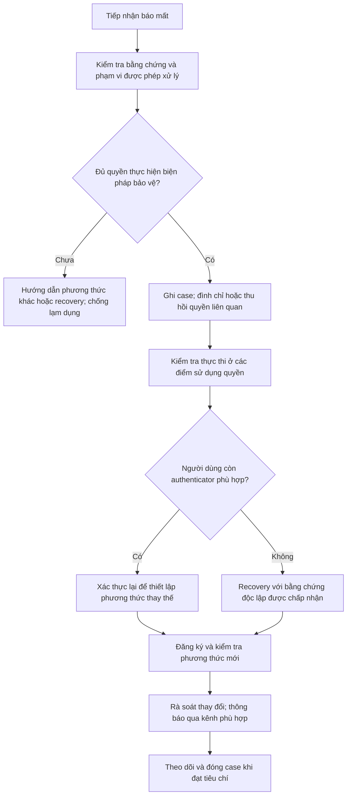

# Lost device response — Ứng phó khi mất thiết bị xác thực

## 1. Mất thiết bị là sự kiện an ninh, không chỉ là lỗi đăng nhập

Trong chương **Device Loss Recovery** của module `SECURITY_AUTHENTICATION_ACCOUNT_RECOVERY`, “mất thiết bị” có thể là mất điện thoại, laptop, khóa bảo mật hoặc thiết bị đang giữ session, mật khẩu, MFA và passkey. Một thiết bị mất có thể đồng thời làm chủ tài khoản không đăng nhập được và để người khác tiếp cận quyền đã có.

**Lost device response** là quy trình tiếp nhận báo mất, đánh giá phạm vi, hạn chế quyền liên quan, xác minh người yêu cầu và khôi phục khả năng truy cập an toàn. Hai mục tiêu cần được xử lý cùng nhau:

- **Ngăn sử dụng quyền từ thiết bị mất:** session, token, authenticator và quan hệ tin cậy phải được đánh giá, đình chỉ hoặc thu hồi theo mức rủi ro.
- **Duy trì đường trở lại cho chủ tài khoản:** dùng phương thức độc lập còn hợp lệ hoặc recovery có bằng chứng phù hợp để thiết lập lại khả năng xác thực.

Ví dụ, điện thoại của Lan có ứng dụng nhận push MFA, TOTP, hộp thư khôi phục và một session đang đăng nhập. Chỉ đổi mật khẩu có thể vẫn để session cũ hoạt động. Chỉ gỡ điện thoại khỏi danh sách “thiết bị tin cậy” cũng chưa chắc thu hồi TOTP, passkey hoặc refresh token.

NIST SP 800-63B-4 coi authenticator bị mất hoặc đánh cắp thuộc nhóm bị compromise và yêu cầu xử lý kịp thời bằng đình chỉ, vô hiệu hoặc hủy phù hợp. Bài học dùng nguyên tắc đó để thiết kế phản ứng theo từng loại quyền; các trạng thái và mô hình dữ liệu bên dưới là minh họa triển khai. [NIST — Loss, Theft, Damage, and Compromise](https://pages.nist.gov/800-63-4/sp800-63b/events/#loss-theft-damage-and-compromise).

Khóa màn hình, mã PIN và phần cứng bảo vệ khóa có thể giảm khả năng khai thác, nhưng không đủ để kết luận thiết bị mất không còn rủi ro. Hệ thống vẫn cần đánh giá quyền đang tồn tại và khả năng truy cập các kênh khôi phục.

## 2. Những việc cần làm từ một môi trường còn kiểm soát được

Người dùng nên tiếp cận dịch vụ qua ứng dụng hoặc tên miền chính thức trên một thiết bị mà họ còn kiểm soát. Không nhập recovery code vào trang được gửi bởi người tự xưng “hỗ trợ tìm lại điện thoại”.

Trình tự minh họa:

1. **Xác định còn phương thức độc lập nào dùng được.** Ví dụ: khóa bảo mật dự phòng, passkey ở môi trường còn an toàn, recovery code đã lưu ngoại tuyến hoặc kênh recovery đã thiết lập.
2. **Báo mất qua luồng chính thức.** Chọn thiết bị hoặc quan hệ xác thực liên quan bằng dữ liệu mà hệ thống cho phép xem; không tự suy ra mọi credential từ một tên thiết bị.
3. **Hạn chế quyền đang có trên thiết bị mất.** Đóng session liên quan, thu hồi refresh token và quan hệ “ghi nhớ thiết bị” theo phạm vi đã được cấp quyền.
4. **Đình chỉ hoặc thu hồi authenticator có nguy cơ.** Xác định rõ việc đó ảnh hưởng tới credential nào và có thể ảnh hưởng tới bản sao trên thiết bị khác hay không.
5. **Bảo vệ các kênh có thể cấp lại quyền.** Kiểm tra hộp thư, số điện thoại, tài khoản đồng bộ passkey và các yêu cầu thay đổi bảo mật đang chờ.
6. **Thiết lập phương thức thay thế trên môi trường an toàn.** Chỉ thực hiện sau khi đáp ứng yêu cầu cấp quyền hoặc hoàn tất recovery tương ứng.
7. **Kiểm tra lại hoạt động và khả năng đăng nhập.** Bảo đảm credential cũ không còn được chấp nhận theo quyết định đã đưa ra, phương thức mới dùng được và không có thay đổi trái phép bị bỏ sót.

Đây không phải một chuỗi phải chờ xong từng bước mới được bắt đầu bước tiếp theo. Nếu đã có dấu hiệu người khác sử dụng thiết bị, biện pháp ngăn truy cập cần được thực hiện sớm trong phạm vi đã xác minh, đồng thời chuẩn bị đường recovery.

### Khóa hoặc xóa thiết bị từ xa có phạm vi riêng

Người sở hữu có thể dùng chức năng khóa hoặc xóa từ xa do nền tảng thiết bị cung cấp, nếu họ có quyền và còn truy cập được tài khoản quản lý tương ứng. Thiết bị ngoại tuyến có thể chưa nhận lệnh ngay.

Khóa hoặc xóa từ xa không tự chứng minh mọi session phía máy chủ đã bị vô hiệu, mọi token đã bị thu hồi hoặc mọi bản sao bí mật đã biến mất. Ngược lại, xóa dữ liệu có thể làm mất một số bằng chứng hoặc phương thức khôi phục còn trên máy. Quy trình cần xem xét cả khả năng bảo vệ dữ liệu lẫn đường lấy lại tài khoản.

Đối với thiết bị do tổ chức quản lý, việc xử lý qua bộ phận quản trị hoặc công cụ quản lý thiết bị là một nhánh có thẩm quyền riêng. Không đồng nhất quyền quản trị thiết bị với quyền bỏ qua mọi yêu cầu xác minh chủ tài khoản ứng dụng.

## 3. Lập bản đồ quyền trước khi quyết định thu hồi

### 3.1. Một thiết bị có thể giữ nhiều loại quyền

| Tài sản hoặc quan hệ | Rủi ro khi thiết bị mất | Phản ứng cần đánh giá |
| --- | --- | --- |
| Session web hoặc ứng dụng | Dùng quyền đã xác thực mà không cần đăng nhập lại | Vô hiệu session phía máy chủ, kể cả ID thay thế còn được chấp nhận |
| Refresh token | Liên tục lấy access token mới | Thu hồi family hoặc grant liên quan, kiểm soát việc phát token đang chạy đồng thời |
| Access token | Truy cập API trong thời hạn còn hiệu lực | Cơ chế kiểm tra thu hồi hoặc giới hạn cửa sổ chấp nhận theo kiến trúc |
| Cookie “ghi nhớ thiết bị” | Bỏ qua thử thách MFA theo chính sách cũ | Xóa quyền tin cậy phía máy chủ, không chỉ yêu cầu xóa cookie |
| TOTP seed | Tạo mã mới từ cùng một bí mật | Vô hiệu binding hoặc xoay seed khi cần; không chỉ chặn một mã hiện tại |
| Push MFA enrollment | Nhận và chấp thuận thử thách | Đình chỉ enrollment, hủy challenge tồn đọng và ngăn sử dụng token push cho xác thực |
| Passkey hoặc khóa bảo mật | Dùng credential đã gắn để đăng nhập | Đình chỉ hoặc thu hồi credential phù hợp, hiểu phạm vi các bản sao |
| Email, SIM và ứng dụng liên lạc | Nhận mã hoặc liên kết recovery | Xác định kênh còn đáng tin, dùng phương thức độc lập khi cần |
| Kho mật khẩu hoặc tài khoản đồng bộ | Phát sinh quyền trên nhiều dịch vụ và thiết bị | Bảo vệ tài khoản gốc, đánh giá thông tin có thể đã lộ |
| API key hoặc token ứng dụng lưu cục bộ | Truy cập ngoài session người dùng thông thường | Kiểm kê và thu hồi theo phạm vi grant thực tế |

Danh sách này không chứng minh mọi thiết bị đều giữ đủ các loại quyền. Hệ thống cần dùng dữ liệu thực tế và thông tin người dùng cung cấp để xác định phạm vi, đồng thời nêu rõ những điểm chưa biết.

Nếu không xác định chắc session nào thuộc thiết bị mất, có thể cần thu hồi rộng hơn. Quyết định đó phải đi cùng cấp quyền phù hợp và giải thích ảnh hưởng tới các thiết bị còn lại.

### 3.2. Thiết bị vật lý không trùng hoàn toàn với bản ghi phần mềm

Tên “Điện thoại của Lan”, cookie trình duyệt hoặc fingerprint có thể giúp nhận diện trong giao diện, nhưng không phải định danh an ninh chắc chắn cho mọi credential trên máy.

Một điện thoại có thể chứa nhiều profile trình duyệt và nhiều session. Một credential đồng bộ có thể xuất hiện trên nhiều thiết bị. Một TOTP seed được sao lưu có thể tạo mã ở nhiều nơi nhưng phía máy chủ chỉ thấy một binding.

Vì vậy, chức năng “thu hồi thiết bị” cần định nghĩa nó thực sự tác động tới những đối tượng nào:

```text
Thiết bị hiển thị
  -> các session được liên kết đáng tin cậy
  -> các grant và refresh-token family tương ứng
  -> các enrollment push thuộc thiết bị
  -> các credential đã xác định nằm trong phạm vi
  -> các quan hệ ghi nhớ và kênh cần đánh giá
```

Không tuyên bố “đã thu hồi toàn bộ quyền trên máy” nếu dữ liệu chỉ đủ để đóng một session trình duyệt.

### 3.3. Nhiều phương thức trên cùng máy không tạo dự phòng độc lập

Mật khẩu trong trình quản lý mật khẩu, email, SMS, TOTP và recovery code đều nằm trên một điện thoại có thể cùng mất hoặc cùng bị tiếp cận. Đếm chúng thành nhiều phương thức dự phòng độc lập sẽ đánh giá quá cao khả năng recovery.

Khi xây dựng chính sách, cần xét nơi lưu, tài khoản đồng bộ, khả năng truy cập và đường khôi phục của từng phương thức. Một recovery code chụp trong thư viện ảnh của chính máy mất không mang cùng tính độc lập với bản lưu ngoại tuyến được giữ riêng.

## 4. Tiếp nhận báo mất mà không tạo đường khóa tài khoản người khác

### 4.1. Quyền báo mất khác với quyền gắn authenticator mới

Một người chỉ biết email của nạn nhân không được phép gọi endpoint rồi lập tức xóa mọi authenticator hoặc đặt email khôi phục mới.

Luồng cần phân biệt:

| Mức thông tin hoặc bằng chứng | Hành động có thể được xem xét theo chính sách | Quyền chưa được cấp chỉ từ mức này |
| --- | --- | --- |
| Báo cáo công khai chưa xác minh | Ghi nhận hạn chế, chống lạm dụng, hướng dẫn bước tiếp theo | Xem danh sách thiết bị, khóa toàn bộ tài khoản hoặc chuyển quyền recovery |
| Bằng chứng đủ cho báo mất và hạn chế phạm vi cụ thể | Đình chỉ hoặc thu hồi đối tượng đã xác định trong phạm vi được cấp quyền | Tự động thêm authenticator mới hoặc mở session đầy đủ |
| Authenticator độc lập còn hợp lệ, đáp ứng yêu cầu thao tác | Quản lý đối tượng liên quan và gắn phương thức mới theo chính sách | Bỏ mọi kiểm tra rủi ro hoặc mở rộng sang tài khoản khác |
| Recovery đã được xác minh theo quy trình phù hợp | Cấp quyền recovery hẹp để thiết lập lại khả năng xác thực | Tin cậy vĩnh viễn mọi thiết bị hoặc chấp nhận mọi địa chỉ mới |

Một chính sách có thể chấp nhận bằng chứng nhẹ hơn cho hành động đình chỉ bảo vệ so với việc gắn credential thay thế. Điều này cần được ghi rõ; không dùng quyền báo mất có phạm vi hẹp như một quyền quản trị tài khoản chung.

### 4.2. Không xác minh bằng chính kênh đang bị báo mất một cách máy móc

Nếu điện thoại mất đang giữ SMS và push MFA, yêu cầu người dùng bấm push trên máy đó để báo mất sẽ tạo vòng lặp hoặc để người giữ máy quyết định.

Hãy cho phép phương thức dự phòng đã gắn hoặc luồng recovery phù hợp. Nếu người dùng còn một session trên laptop, cần đánh giá mức xác thực của session và yêu cầu bổ sung theo hành động; không coi một cookie còn sống là bằng chứng đầy đủ cho mọi thao tác nhạy cảm.

Thiết bị, IP, vị trí và lịch sử sử dụng là tín hiệu rủi ro. Chúng không tự thay thế bằng chứng xác thực hoặc chứng cứ recovery được chấp nhận.

### 4.3. Kiểm soát việc tiết lộ và lạm dụng

Phản hồi công khai không nên cho biết email có tài khoản hay không, đang có bao nhiêu thiết bị, passkey nào đang hoạt động hoặc người dùng còn phương thức dự phòng nào.

Áp dụng giới hạn request, số case đang mở, số thông báo và lần thử bằng chứng ở các phạm vi phù hợp. Một kẻ tấn công không được tạo vô hạn case để spam cảnh báo hoặc liên tục đẩy chủ thật vào trạng thái bị hạn chế.

Đường hỗ trợ cần xác minh theo quy trình của sản phẩm, có dấu vết về nhân viên, bằng chứng và quyết định. Không yêu cầu người dùng đọc mật khẩu, OTP hoặc recovery code cho nhân viên qua cuộc gọi để “mở khóa nhanh”.

## 5. Hạn chế session và token phía máy chủ

### 5.1. Đăng xuất trên giao diện chưa đủ

Việc xóa cookie trên laptop đang dùng không làm session trên điện thoại mất hết hiệu lực. Một thao tác thu hồi cần tác động tới bản ghi hoặc cơ chế kiểm tra quyền phía máy chủ.

OWASP yêu cầu session được vô hiệu phía máy chủ và khuyến nghị cho người dùng xem, quản lý, kết thúc các session đang hoạt động. Với báo mất thiết bị, khả năng này giúp chủ tài khoản đóng các đường truy cập còn tồn tại trên máy không còn kiểm soát. [OWASP — Session Management Cheat Sheet](https://cheatsheetseries.owasp.org/cheatsheets/Session_Management_Cheat_Sheet.html).

Nếu một logical session đã xoay ID, phải xét cả ID cũ còn được chấp nhận trong cửa sổ chuyển tiếp. Đóng ID hiện tại nhưng để ID trước tiếp tục dùng được sẽ để lại đường truy cập.

Cần biết quyết định thu hồi là:

- Chỉ session được xác định thuộc thiết bị mất.
- Toàn bộ session của một ứng dụng hoặc một grant.
- Toàn bộ session người dùng, khi phạm vi không rõ hoặc có dấu hiệu chiếm đoạt rộng hơn.

Việc thu hồi rộng có thể làm người dùng mất session an toàn còn lại. Chuẩn bị đường xác thực hoặc recovery phù hợp, đồng thời không trì hoãn việc ngăn quyền đã biết bị sử dụng trái phép.

### 5.2. Refresh token và access token có vòng đời khác nhau

Thu hồi refresh token nhằm ngăn tiếp tục phát access token mới. Access token đã phát có thể vẫn được API chấp nhận cho đến khi hết hạn, trừ khi kiến trúc có kiểm tra thu hồi hoặc phiên bản quyền tại điểm sử dụng.

| Mô hình | Điều cần có để thực thi quyết định thu hồi |
| --- | --- |
| Session lưu phía máy chủ | Kiểm tra trạng thái session trong kho có thẩm quyền |
| Token opaque có introspection | Kết quả kiểm tra và cache phải phản ánh trạng thái thu hồi theo cam kết |
| JWT tự chứa | API cần cơ chế kiểm tra bổ sung nếu yêu cầu từ chối trước hạn hết hạn |
| Access token chỉ dựa vào TTL ngắn | Phải công bố và chấp nhận cửa sổ rủi ro còn lại; không gọi đó là thu hồi tức thì |
| Refresh token có rotation | Thu hồi family hoặc grant đúng phạm vi, xử lý cạnh tranh với lần refresh đang diễn ra |

JWT còn chữ ký hợp lệ không có nghĩa quyền của nó chưa bị thu hồi. Ngược lại, thêm một cột `revoked=true` ở dịch vụ tài khoản không có tác dụng nếu API chỉ kiểm tra chữ ký và không đọc trạng thái liên quan.

Một cách triển khai là gắn token với phiên bản an ninh của account, grant hoặc thiết bị. Sau quyết định thu hồi, phía xử lý request phải so sánh với phiên bản hiện tại từ nguồn đủ mới. Cache và độ trễ lan truyền phải được tính trong giới hạn bảo vệ.

Các request đang xử lý có thể đã vượt bước kiểm tra quyền trước khi thu hồi. Với hành động khó hoàn tác như chuyển quyền hoặc xuất bí mật, cân nhắc kiểm tra lại tại điểm commit có thẩm quyền. Không tuyên bố đã thu hồi dữ liệu mà thiết bị tải về trước đó.

### 5.3. Ngăn cuộc đua tái tạo quyền

Giả sử worker thu hồi refresh token trong khi một request refresh khác đang phát token mới. Nếu hai đường không phối hợp, token mới có thể thoát khỏi tập bị thu hồi.

Cần tuần tự hóa hoặc kiểm tra có điều kiện trên trạng thái grant, family hoặc phiên bản an ninh. Sau khi quyết định thu hồi đã commit, không được phát thêm token thuộc quyền đã đóng chỉ vì request bắt đầu trước đó.

Tương tự, đăng ký push mới, gắn passkey hoặc hoàn tất đổi email đang chạy song song phải kiểm tra lại sự kiện báo mất nếu nó làm bằng chứng cấp quyền trước đó không còn hợp lệ.

Các kết nối dài như WebSocket cũng cần chính sách thực thi thu hồi. Vô hiệu request HTTP mới không tự đóng mọi kết nối đã được thiết lập.

### 5.4. Gỡ quyền ghi nhớ và endpoint nhận thông báo

“Thiết bị tin cậy” có thể là một grant cho phép bỏ qua MFA. Thu hồi nó phải vô hiệu quyền phía máy chủ, không chỉ xóa một tên hiển thị.

Push endpoint có ít nhất hai vai trò cần phân biệt: nhận thông báo và tham gia xác thực. Dừng gửi thông tin riêng tới endpoint của máy mất, đồng thời đình chỉ enrollment xác thực liên quan nếu nằm trong phạm vi xử lý.

Không coi việc nhà cung cấp push chấp nhận một lệnh hủy là bằng chứng mọi token của tài khoản đã bị thu hồi. Trạng thái nhà cung cấp và quyền truy cập trong ứng dụng là hai lớp khác nhau.

## 6. Xử lý authenticator theo loại bí mật

### 6.1. TOTP, push và khóa bảo mật

Với **TOTP**, chỉ loại một mã hiện tại không giải quyết việc seed còn trên thiết bị. Nếu seed có nguy cơ bị sử dụng, cần đình chỉ binding hoặc thiết lập seed mới theo quy trình cấp quyền; seed cũ không được tiếp tục được chấp nhận.

Nếu cùng seed đã được sao lưu sang máy khác, việc vô hiệu binding thường ảnh hưởng tới mọi nơi tạo mã từ seed đó. Không thể coi một mã TOTP là bằng chứng chắc chắn nó được tạo trên bản sao nào.

Với **push MFA**, hủy các challenge đang chờ mà máy mất có thể phê duyệt. Việc thay enrollment cần ràng buộc đúng tài khoản và có bằng chứng phù hợp; không tự cho cài lại app trên máy mới rồi tiếp nhận mọi thông tin từ đó là đáng tin.

Với **khóa bảo mật vật lý**, xác định credential liên quan ở từng dịch vụ. Thu hồi khóa trong một ứng dụng không tự vô hiệu nó ở các ứng dụng khác. Nếu khóa còn giữ nhiều credential, người dùng hoặc tổ chức cần kiểm kê các tài khoản chịu ảnh hưởng.

### 6.2. Passkey gắn thiết bị và passkey đồng bộ

OWASP phân biệt credential gắn thiết bị và credential đồng bộ: đồng bộ giúp credential có thể dùng ở nhiều nơi, đồng thời làm mức an toàn phụ thuộc thêm vào tài khoản nhà cung cấp, đăng ký thiết bị và cơ chế recovery của họ. Kế hoạch ứng phó cần xét cả lớp này. [OWASP — Synced and Device-Bound Credentials](https://cheatsheetseries.owasp.org/cheatsheets/Passkey_Security_Cheat_Sheet.html#synced-and-device-bound-credentials).

Có hai phạm vi xử lý khác nhau:

**Phía dịch vụ đang đăng nhập:** đình chỉ hoặc thu hồi credential mà dịch vụ nhận diện. Sau đó, các assertion của credential bị vô hiệu không được tạo phiên mới, dù chữ ký có thể vẫn hợp lệ về mật mã.

**Phía nền tảng hoặc tài khoản đồng bộ:** bảo vệ tài khoản nhà cung cấp, gỡ hoặc hạn chế thiết bị mất theo khả năng được hỗ trợ, đánh giá các phương thức recovery và thiết bị mới được thêm.

Nếu các bản sao đồng bộ cùng được dịch vụ nhận diện là một credential, thu hồi credential ở dịch vụ có thể làm các bản sao trên thiết bị còn an toàn cũng ngừng đăng nhập được. Cần giải thích ảnh hưởng và chuẩn bị một phương thức độc lập.

Không giả định dịch vụ biết chính xác mọi thiết bị vật lý đang giữ credential đồng bộ. Các chỉ dấu backup eligibility hoặc backup state không phải danh sách thiết bị, cũng không chứng minh một bản sao cụ thể đã bị xóa.

Một passkey còn dùng được trên máy khác giúp tính sẵn sàng, nhưng không tự giải quyết nguy cơ bản sao trên máy mất. Khi credential đã bị đình chỉ vì sự cố, bản sao còn an toàn của chính credential đó cũng không được dùng để vượt qua trạng thái đình chỉ.

### 6.3. Mật khẩu, recovery code và tài khoản gốc

Đổi mật khẩu có ích khi mật khẩu có thể đã lộ hoặc được lưu trên máy mất. Tuy nhiên, cần kiểm tra tác động thực tế của sản phẩm tới session, refresh token, mật khẩu ứng dụng và các grant khác; không mặc định đổi mật khẩu sẽ thu hồi tất cả.

Nếu recovery code đã lưu trên thiết bị mất hoặc có căn cứ bị sao chép, vô hiệu bộ mã cũ và phát bộ thay thế qua đường đã cấp quyền. Mã đã dùng để recovery phải được tiêu thụ đúng một lần, không được dùng lại do retry hoặc khôi phục dữ liệu cũ.

Nếu hộp thư chính hoặc tài khoản đồng bộ bị tiếp cận, cần bảo vệ chúng trước hoặc song song với recovery các dịch vụ phụ thuộc. Nếu không, người tấn công có thể tiếp tục nhận liên kết và tái cấp quyền sau mỗi lần chủ thật cố thu hồi.

Không yêu cầu người dùng đổi mọi bí mật của mọi dịch vụ một cách máy móc. Phạm vi cần dựa trên dữ liệu có thể truy cập, loại bí mật, hoạt động bất thường và mức tin cậy còn lại của từng tài khoản gốc.

## 7. Vòng đời một case báo mất

Một case giúp theo dõi bằng chứng, phạm vi và kết quả, tránh gộp “đã nhận báo cáo” với “đã bảo vệ xong”.



Mô hình có thể dùng các trạng thái như `REPORTED`, `CONTAINMENT_PENDING`, `CONTAINMENT_EFFECTIVE`, `RECOVERY_REQUIRED`, `RESTORED` và `CLOSED`. Đây là nhãn minh họa; không nhất thiết mọi hệ thống dùng một enum duy nhất cho toàn bộ quá trình.

Nên tách ít nhất hai tiến độ:

- **Tiến độ hạn chế quyền:** quyết định đã được ghi, đã phân phối và đã được thực thi ở đâu.
- **Tiến độ khôi phục:** người dùng đã đủ bằng chứng, đã gắn phương thức mới và đã đăng nhập thử thành công hay chưa.

Có thể đã chặn thiết bị mất nhưng chủ thật vẫn chưa đăng nhập được. Cũng có thể chủ thật đã có máy mới nhưng một API vẫn chấp nhận token cũ. Hai trạng thái này cần cách xử lý khác nhau.

### Thông báo qua kênh còn phù hợp

Thông báo nên đi tới kênh đã thiết lập và còn được đánh giá phù hợp, tránh chỉ gửi push tới chính máy mất. Nội dung cần phân biệt việc “đã nhận báo cáo”, “đã thu hồi một số quyền” và “đã hoàn tất khôi phục”.

Không gửi credential mới, recovery code hoặc URL có quyền rộng tới kênh đang được báo compromise. Nếu kênh cảnh báo không còn dùng được, case cần nhánh xử lý rõ ràng thay vì giả định người dùng đã biết.

Một đường phản đối có thể đưa case vào kiểm tra nếu báo mất là giả mạo. Quyền phản đối không tự khôi phục authenticator bị thu hồi hoặc cấp session cho người đang giữ thiết bị mất.

## 8. Khôi phục truy cập mà không hạ chuẩn xác thực

### 8.1. Khi còn phương thức độc lập đủ tin cậy

Người dùng xác thực bằng một authenticator còn hợp lệ và đáp ứng yêu cầu cho việc gắn phương thức mới. Bằng chứng cần đúng tài khoản, còn hiệu lực và được kiểm tra phía máy chủ.

Nếu chính sách yêu cầu xác thực lại, trạng thái session có từ trước không tự thay thế bước đó. Một credential mới được gắn trong lúc case đang mở cần được đối chiếu với phạm vi cấp quyền và các sự kiện an ninh mới.

Sau đăng ký, kiểm tra người dùng có thể thực sự xác thực bằng phương thức mới. Không chỉ ghi trạng thái `enrolled=true` rồi kết luận đã phục hồi khả năng đăng nhập.

### 8.2. Khi phải dùng account recovery

Recovery có thể dựa trên recovery code, kênh đã thiết lập, recovery contact hoặc quy trình xác minh lại phù hợp với thiết kế tài khoản. Không có một tập bằng chứng duy nhất an toàn cho mọi hệ thống.

Nếu sản phẩm chưa từng xác minh danh tính đời thực, không tự coi giấy tờ mới được gửi là liên kết chắc chắn với tài khoản. Cần một quy trình được thiết kế và đánh giá cho loại dữ liệu thực sự đã thiết lập.

Một recovery grant nên có phạm vi hẹp, ví dụ chỉ cho phép hoàn tất việc gắn authenticator thay thế cho case cụ thể. Nó có thời hạn, chống dùng lại và không tự mở quyền xem mọi dữ liệu hoặc thực hiện giao dịch.

Không dùng việc sở hữu một số điện thoại mới, biết thông tin công khai, trùng địa chỉ IP hoặc đợi đủ thời gian làm bằng chứng duy nhất để lấy lại tài khoản.

### 8.3. Ngăn khôi phục xong nhưng người tấn công vẫn có đường quay lại

Rà soát các thay đổi trong khoảng có nguy cơ: email recovery mới, số điện thoại mới, passkey lạ, khóa API, ứng dụng được cấp quyền và các yêu cầu đổi bảo mật đang chờ.

Không nhất thiết mọi thay đổi trong khoảng thời gian đó đều do người tấn công. Cần bằng chứng và quyết định phù hợp cho việc giữ, hủy hoặc yêu cầu xác thực lại từng thay đổi.

Sau recovery có mức rủi ro cao, sản phẩm có thể hạn chế tạm thời thao tác nhạy cảm hoặc yêu cầu bằng chứng bổ sung. Chính sách phải nêu hành động nào bị hạn chế, điều kiện gỡ hạn chế và cách tránh giữ người dùng trong trạng thái chờ vô hạn.

## 9. Ranh giới triển khai: quyết định thu hồi phải có hiệu lực

### 9.1. Dữ liệu cần liên kết được với phạm vi xử lý

Một mô hình tối thiểu có thể gồm:

```text
DeviceLossCase
  caseId, accountId, reportedAt
  reportEvidenceRef, authorizationScope
  affectedObjectRefs, riskAssessmentVersion
  containmentDecisionAt, containmentStatus
  recoveryStatus, closedAt

SecurityObject
  objectId, accountId, objectType
  deviceAssociationRef
  status, securityVersion
  suspendedAt, revokedAt

ContainmentAction
  actionId, caseId, targetObjectId
  intendedState, appliedVersion
  enforcementStatus, lastCheckedAt
```

Không cần một bảng `SecurityObject` chung trong mọi kiến trúc. Điều quan trọng là có thể xác định đúng account, đối tượng, phiên bản và kết quả thực thi; không dùng một tên thiết bị hiển thị làm khóa thu hồi duy nhất.

`affectedObjectRefs` phải có nguồn gốc đủ tin cậy. Client có thể đề xuất một mục từ danh sách được phép xem, nhưng máy chủ phải kiểm tra mục đó thuộc account và phạm vi được cấp quyền.

Bằng chứng nhạy cảm nên được tham chiếu và bảo vệ theo nhu cầu. Không sao chép mật khẩu, seed TOTP, private key hoặc token thô vào hồ sơ sự cố.

### 9.2. Quyết định cục bộ trong giao dịch

Mã giả sau minh họa phần thu hồi đã được cấp quyền. Nó giả định trạng thái liên quan có thể được khóa hoặc cập nhật nhất quán trong một giao dịch; các dịch vụ từ xa được xử lý ở bước sau.

```text
containLostDevice(accountId, targetRef, proof, idempotencyKey):
    verifyProofMaterialAndRequestShape()

    begin transaction
    account = lockAccount(accountId)
    existing = findIdempotentAction(account.id, idempotencyKey)

    if existing exists:
        requireSameActionPayload(existing, targetRef)
        return existing.result

    targets = resolveAuthorizedTargets(account, targetRef)
    requireProofForContainment(account, targets, proof)
    requireCurrentSecurityContext(account, proof)

    lossCase = createOrAttachCase(account, targets)
    suspendOrRevokeAffectedAuthenticators(targets)
    revokeSessionAndRefreshGrantsInScope(targets)
    removeRememberedDevicePrivilegesInScope(targets)
    invalidatePendingChallengesInScope(targets)
    invalidateDependentPendingChangesByPolicy(account, targets)

    advanceRelevantSecurityVersions(account, targets)
    recordContainmentActions(lossCase, targets)
    consumeOneTimeProofIfRequired(proof)
    appendOutboxEventsOnce(lossCase, targets)
    saveIdempotentResult(idempotencyKey, lossCase)

    commit
    return containmentDecisionRecorded(lossCase)
```

Kết quả trả về là đã ghi quyết định, chưa mặc định là mọi hệ thống từ xa đã thực thi. Các nhánh kết thúc cần giải phóng giao dịch theo cơ chế quản lý giao dịch của chương trình.

Phạm vi xác thực lại có thể khác nhau giữa thu hồi một session, đình chỉ một authenticator và khóa toàn bộ tài khoản. Hàm `requireProofForContainment` phải phản ánh chính sách đó, không chỉ kiểm tra “đã đăng nhập”.

Đường phát session, refresh token và gắn credential phải phối hợp cùng trạng thái hoặc phiên bản được cập nhật tại đây. Nếu chỉ quy trình báo mất dùng khóa mà các đường phát quyền khác bỏ qua, giao dịch này vẫn không ngăn được cuộc đua.

### 9.3. Thực thi phân tán và trạng thái suy giảm

Outbox có thể phát các công việc như thu hồi grant ở dịch vụ khác, hủy push enrollment hoặc gửi cảnh báo. Dùng action ID ổn định để xử lý lại không nhân tác động, đồng thời lưu rõ mục tiêu và phiên bản quyết định.

Khi một vùng hoặc dịch vụ không phản hồi, case không được tự mang trạng thái “đã bảo vệ toàn bộ”. Có thể biểu diễn `PENDING`, `PARTIALLY_ENFORCED` hoặc `ENFORCED` theo phạm vi cam kết.

Các điểm thực thi cần chính sách khi không đọc được trạng thái thu hồi. Với thao tác nhạy cảm yêu cầu dữ liệu quyền hiện tại, việc tiếp tục chấp nhận một trạng thái cache cũ phải được xem là một giới hạn hoặc quyết định suy giảm cụ thể, không phải bảo vệ tức thì.

Cần deadline, retry hữu hạn và cảnh báo vận hành khi hành động bảo vệ chưa thực thi. Không để một job bị kẹt rồi đóng case chỉ vì giao diện đã nhận nút “Báo mất”.

Idempotency cần xét cùng account, loại hành động và nội dung yêu cầu. Một khóa đã dùng cho “đóng session X” không được tái sử dụng để âm thầm trở thành “thu hồi mọi authenticator”.

### 9.4. Phiên bản an ninh không được giảm hoặc bị reset ngoài ý muốn

Nếu dùng `securityVersion` hoặc epoch, bản sao dữ liệu cũ và quy trình khôi phục backup không được vô tình làm credential hay token bị thu hồi trở lại hợp lệ.

Cần cơ chế bảo toàn quyết định thu hồi qua restart, đổi vùng và phục hồi dữ liệu. Các action đã kết thúc vẫn cần dấu vết đủ để phát hiện và xử lý một bản ghi cũ được đưa trở lại hệ thống.

Không cho một request hủy case xóa luôn lịch sử revocation. Trạng thái quản lý hồ sơ và trạng thái hiệu lực của quyền an ninh phải được xử lý riêng.

## 10. Ví dụ: mất điện thoại nhưng còn laptop và khóa dự phòng

Giả sử điện thoại của Lan giữ session ứng dụng, TOTP, một enrollment push và hộp thư recovery. Laptop còn một session; Lan còn khóa bảo mật độc lập.

| Thời điểm tương đối | Tình huống | Phản ứng phù hợp |
| --- | --- | --- |
| Phút 0 | Lan phát hiện điện thoại bị mất | Dùng laptop còn kiểm soát, truy cập dịch vụ chính thức |
| Phút 2 | Bắt đầu báo mất | Dùng khóa dự phòng đáp ứng bước xác minh cho phạm vi bảo vệ |
| Phút 3 | Máy chủ xác định các đối tượng liên quan | Thu hồi session và refresh grant trong phạm vi; đình chỉ TOTP và push bị ảnh hưởng |
| Phút 4 | Một API ở vùng khác chưa xác nhận thực thi | Case thể hiện còn hành động đang chờ; thao tác nhạy cảm tuân theo chính sách kiểm tra phiên bản |
| Phút 5 | Có một lần refresh từ điện thoại mất | Bị từ chối vì grant đã bị thu hồi, không phát family mới |
| Phút 8 | Lan thiết lập phương thức thay thế từ môi trường an toàn | Gắn credential mới bằng quyền phù hợp và kiểm tra đăng nhập |
| Sau đó | Rà soát lịch sử trong thời gian có nguy cơ | Kiểm tra email, số điện thoại, passkey và quyền ứng dụng mới được thêm |
| Khi đạt tiêu chí | Xác nhận kết quả bảo vệ và recovery | Đóng case theo phạm vi đã kiểm tra, tiếp tục giám sát nếu còn rủi ro |

Đây là ví dụ thứ tự và dữ liệu quyết định, không phải mục tiêu thời gian đảm bảo cho mọi dịch vụ. Các phản ứng khẩn cấp có thể diễn ra song song khi chính sách cho phép.

### Nếu không còn khóa dự phòng

Session laptop có thể giúp xác định ngữ cảnh, nhưng không tự cấp quyền gắn authenticator mới nếu nó không đáp ứng chính sách. Lan cần đi qua phương thức còn hợp lệ khác hoặc recovery.

Nếu email recovery chỉ còn truy cập được trên điện thoại mất, gửi liên kết về email đó chưa chắc giúp Lan và có thể giúp người giữ máy. Cần đánh giá kênh khác đã thiết lập hoặc quy trình xác minh được phê duyệt.

Không dùng một số mới mà Lan vừa nhập làm bằng chứng duy nhất. Số mới chỉ là đích đề xuất cho cấu hình sau recovery, cần được xác minh và cấp quyền theo đúng vai trò.

### Nếu có hoạt động trái phép trong lúc đang xử lý

Một session trên máy mất có thể đã đổi email hoặc gắn một passkey trước khi bị thu hồi. Thu hồi session không tự xóa thay đổi đó.

Cần kiểm tra tính hợp lệ của các thay đổi và những grant sinh ra từ chúng. Nếu phạm vi compromise rộng hơn dự kiến, mở rộng biện pháp bảo vệ dựa trên quyết định có thẩm quyền, đồng thời giữ đường recovery độc lập cho Lan.

Không chỉ tìm đăng nhập mới: hành động dùng session cũ, phát refresh token hoặc phê duyệt challenge có thể diễn ra mà không tạo một sự kiện đăng nhập tương tác mới.

## 11. Khi tìm lại được thiết bị

Tìm lại điện thoại không tự chứng minh nó chưa bị mở, sao chép dữ liệu hoặc thay đổi. Người dùng cần đánh giá khoảng thời gian mất kiểm soát, dấu hiệu can thiệp và độ tin cậy còn lại của thiết bị.

Có ba quyết định cần tách:

| Đối tượng | Khi tìm lại thiết bị |
| --- | --- |
| Session hoặc token đã bị thu hồi | Tiếp tục vô hiệu; người dùng xác thực lại để nhận quyền mới |
| Authenticator chỉ bị đình chỉ tạm thời | Chỉ được kích hoạt lại qua chính sách riêng và bằng chứng hợp lệ không phụ thuộc vào trạng thái đình chỉ |
| Authenticator đã bị thu hồi | Không tự làm sống lại từ bản ghi cũ; thực hiện quy trình đăng ký mới nếu còn phù hợp |

Nếu có nguy cơ seed TOTP hoặc recovery code đã bị sao chép, việc cầm lại máy không làm bản sao của người khác biến mất. Nếu một credential đã được thay thế, giữ trạng thái vô hiệu của credential cũ theo quyết định an ninh.

Tương tự, tài khoản đồng bộ passkey đã bị tiếp cận cần được bảo vệ ở lớp nhà cung cấp. Tìm lại phần cứng không tự gỡ thiết bị lạ, phương thức recovery lạ hoặc bản sao credential mà người tấn công có thể giữ.

Không dùng chỉ fingerprint, IP quen thuộc hoặc việc thiết bị xuất hiện lại để tự động đánh dấu `TRUSTED`. Các yếu tố này có thể hỗ trợ đánh giá, nhưng quyền mới cần được thiết lập bằng quy trình thích hợp.

### Tiêu chí đóng case

Một case có thể được đóng khi phạm vi báo mất đã được giải thích và những hành động cần thiết đã có kết quả được xác minh, chẳng hạn:

- Session, grant và authenticator được quyết định thu hồi đã không còn được chấp nhận tại các điểm thực thi trong phạm vi cam kết.
- Chủ tài khoản đã có phương thức đăng nhập đáp ứng chính sách hoặc đã được hướng dẫn rõ nhánh còn lại.
- Các thay đổi bảo mật đáng ngờ đã được đánh giá; những yêu cầu phụ thuộc vào bằng chứng mất hiệu lực đã được xử lý.
- Thông báo và kết quả hỗ trợ có trạng thái rõ ràng, không coi gửi thư là bằng chứng người dùng đã đọc.
- Các giới hạn còn lại, như quyền ở dịch vụ ngoài hoặc dữ liệu đã tải xuống, được ghi nhận trung thực.

Không đóng case chỉ vì người dùng đã mua điện thoại mới, mật khẩu đã đổi hoặc outbox đã hết job.

## 12. Quan sát và các tình huống cần kiểm thử

### 12.1. Dữ liệu quan sát phải phản ánh tác động thật

Các sự kiện có thể gồm `LOSS_REPORTED`, `REPORT_VERIFIED`, `CONTAINMENT_DECIDED`, `SESSION_REVOKED`, `AUTHENTICATOR_SUSPENDED`, `ENFORCEMENT_CONFIRMED`, `RECOVERY_COMPLETED` và `CASE_CLOSED`.

Mỗi sự kiện cần biết case nào, đối tượng nào, phiên bản quyết định nào và tác nhân nào thực hiện. Không ghi session token, refresh token, seed TOTP, recovery code hoặc tài liệu danh tính đầy đủ vào log thông thường.

Các chỉ số hữu ích gồm thời gian từ báo mất đã xác minh đến quyết định bảo vệ, thời gian thực thi theo từng dịch vụ, số hành động bảo vệ còn tồn đọng, số lần token cũ bị từ chối và tỷ lệ người dùng hoàn tất recovery hợp lệ.

Không đo “đã chặn thiết bị” chỉ bằng số click nút báo mất. Cũng không suy ra một lần từ chối chứng minh mọi credential trên thiết bị đã bị vô hiệu.

Theo dõi cả tác động chặn nhầm: báo mất giả mạo, người dùng hết phương thức dự phòng, quyền bị thu hồi quá rộng và case phải xử lý thủ công. Dữ liệu này giúp điều chỉnh chính sách mà không hạ yêu cầu xác minh.

### 12.2. Bảng tình huống kiểm thử

Bảng sau là tiêu chí kiểm thử khi hiện thực, không phải kết quả kiểm thử đã chạy trên một sản phẩm.

| Tình huống | Kết quả cần bảo đảm |
| --- | --- |
| Người ngoài chỉ biết email báo mất thiết bị | Không được xem danh sách quyền hoặc tự thu hồi toàn bộ tài khoản |
| Client gửi ID thiết bị của tài khoản khác | Máy chủ từ chối vì sai chủ thể hoặc phạm vi |
| Có bằng chứng đủ báo mất nhưng chưa đủ gắn credential | Biện pháp bảo vệ được xét riêng, không cấp quyền thay thế vượt phạm vi |
| Luồng báo mất định gửi push tới chính máy mất | Có nhánh xác minh độc lập phù hợp, không buộc vòng lặp |
| Chỉ xóa cookie trên thiết bị đang dùng | Không bị báo nhầm là đã thu hồi session từ xa |
| Session đã xoay ID và còn grace period | Các ID thuộc quyền bị thu hồi không tiếp tục truy cập ngoài chính sách |
| Refresh chạy đồng thời với quyết định thu hồi | Không phát token mới vượt qua trạng thái grant đã đóng |
| JWT còn hạn nhưng không có kiểm tra revocation | Hệ thống thể hiện đúng cửa sổ rủi ro, không tuyên bố thu hồi tức thì |
| API dùng cache phiên bản cũ hoặc một vùng gián đoạn | Có chính sách thực thi và trạng thái bảo vệ phản ánh giới hạn thực tế |
| WebSocket đã kết nối trước khi thu hồi | Quyền truy cập tiếp tục được xử lý theo chính sách kết nối dài |
| Push challenge tồn đọng trên thiết bị mất | Không được phê duyệt thành công sau khi enrollment bị đình chỉ theo quyết định có hiệu lực |
| TOTP seed đã sao lưu ở nhiều nơi | Vô hiệu binding xử lý đúng phạm vi, không chỉ chặn một mã |
| Passkey bị thu hồi vẫn tạo chữ ký hợp lệ | Dịch vụ từ chối vì credential không còn hiệu lực |
| Passkey có nhiều bản sao được nhận diện là cùng credential | Giao diện và recovery phản ánh ảnh hưởng tới các bản sao đó |
| Recovery code có thể nằm trên máy mất | Bộ mã bị ảnh hưởng được xử lý theo chính sách, không tiếp tục tin vì chưa có bằng chứng đã dùng |
| Đổi mật khẩu nhưng còn API key hoặc refresh grant | Không bỏ sót các đường truy cập độc lập |
| Có yêu cầu đổi email hoặc thêm authenticator đang chờ | Kiểm tra lại phụ thuộc chứng cứ và phiên bản an ninh trước khi hoàn tất |
| Worker thực hiện lại cùng một action | Không nhân tác động hoặc thu hồi thêm ngoài nội dung đã cấp quyền |
| Nhà cung cấp hoặc dịch vụ con không xác nhận thu hồi | Case không được đánh dấu toàn bộ đã thực thi |
| Outbox gửi lại thông báo | Không gửi bí mật hoặc cấp quyền mới do retry |
| Thiết bị tìm lại xuất hiện từ IP quen thuộc | Không tự khôi phục token hoặc authenticator đã thu hồi |
| Khôi phục backup dữ liệu trước thời điểm thu hồi | Không vô tình làm sống lại quyền đã bị vô hiệu |
| Recovery tạo một credential mới | Kiểm tra đúng tài khoản, đúng phạm vi và khả năng xác thực thực tế |
| Người dùng phục hồi đăng nhập nhưng còn thay đổi lạ | Case tiếp tục được đánh giá, không đóng chỉ vì đăng nhập được |
| Thiết bị đã tải dữ liệu trước khi mất | Không tuyên bố thu hồi từ xa có thể lấy lại mọi dữ liệu đã sao chép |

Một thiết kế lost device response cần nêu rõ ai được báo mất, bằng chứng nào đủ cho từng hành động, những quyền nào bị ảnh hưởng và cách xác nhận quyết định bảo vệ đã có hiệu lực. Đường recovery phải độc lập phù hợp với rủi ro của chính thiết bị bị mất.

Mục tiêu hoàn tất là chủ tài khoản có thể xác thực an toàn trở lại, trong khi các quyền đã được quyết định thu hồi không tiếp tục được sử dụng. Việc tìm lại phần cứng, đổi mật khẩu hay đăng ký máy mới chỉ là từng phần của kết quả đó.
