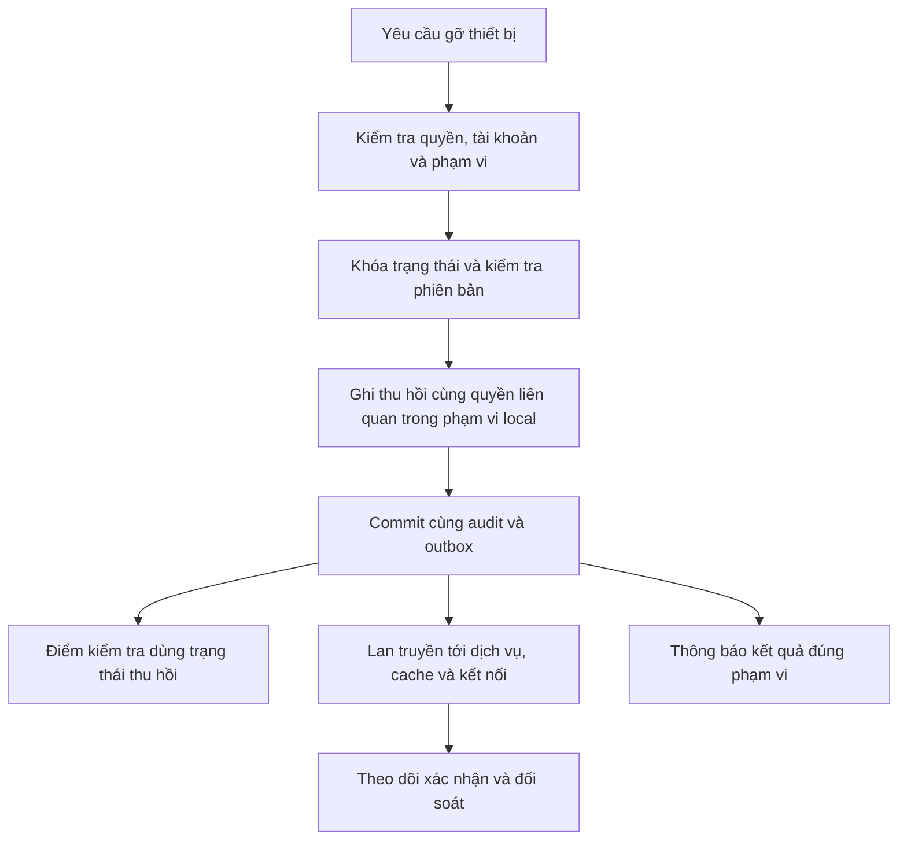

# Gỡ thiết bị tin cậy khi khôi phục tài khoản sau mất thiết bị

## 1. Mục tiêu là thu hồi quyền mà thiết bị còn giữ

Trong chương **Device Loss Recovery**, **Trusted device removal** là quá trình gỡ sự tin cậy đã cấp cho một thiết bị hoặc ngữ cảnh thiết bị, đồng thời xử lý những quyền truy cập liên quan theo phạm vi đã được xác định. Kết quả cần được thực thi ở phía máy chủ, thay vì chỉ làm một dòng biến mất khỏi danh sách thiết bị.

Trong phạm vi `SECURITY_AUTHENTICATION_ACCOUNT_RECOVERY`, người dùng có thể mất mật khẩu, MFA, passkey hoặc thiết bị xác thực. Một chiếc điện thoại bị mất có thể vẫn chứa phiên đăng nhập, refresh token, dấu ghi nhớ MFA, khóa xác thực và khả năng nhận yêu cầu phê duyệt. Khôi phục được quyền truy cập trên máy mới không tự làm những quyền ở máy cũ mất hiệu lực.

Ví dụ, An mất điện thoại D1 và dùng máy tính D2 để lấy lại tài khoản. Nếu hệ thống chỉ xóa D1 khỏi giao diện nhưng refresh token của D1 vẫn đổi được token mới, người đang giữ D1 có thể tiếp tục truy cập. Nếu chỉ thu hồi phiên mà vẫn chấp nhận khóa xác thực riêng của D1, thiết bị đó có thể đăng nhập lại bằng khóa còn hiệu lực.

Một thiết kế đầy đủ phải trả lời được:

- Thiết bị được nhận diện bằng dữ liệu nào và mức chắc chắn của liên kết đó?
- Những quyền nào bị thu hồi, quyền nào cần xử lý riêng?
- Từ thời điểm nào mỗi nơi kiểm tra quyền sẽ từ chối yêu cầu cũ?
- Người dùng còn cách truy cập hoặc khôi phục nào sau thao tác?

Các mô hình dữ liệu, mã giả và trạng thái trong bài là thiết kế tham khảo. Phạm vi thu hồi phải theo mô hình định danh và mức rủi ro của sản phẩm.

## 2. Làm rõ ý nghĩa của “thiết bị tin cậy”

### 2.1. Một tên gọi có thể che nhiều quyền khác nhau

| Đối tượng | Vai trò có thể có | Vì sao cần xử lý riêng |
|---|---|---|
| Bản đăng ký thiết bị của ứng dụng | Liên kết tài khoản với một phiên bản ứng dụng hoặc khóa thiết bị | Không đại diện đầy đủ cho mọi trình duyệt trên cùng máy |
| Phiên đăng nhập | Duy trì trạng thái đã xác thực | Có thể còn hiệu lực dù dấu tin cậy bị gỡ |
| Refresh token hoặc họ refresh token | Cấp tiếp access token | Thu hồi một access token không tự chặn khả năng cấp mới |
| Dấu ghi nhớ MFA | Cho phép bỏ qua một bước xác thực trong điều kiện nhất định | Có thể tồn tại sau khi phiên hiện tại kết thúc |
| Credential xác thực | Cho phép chứng minh quyền đăng nhập | Một credential có thể xuất hiện trên nhiều thiết bị |
| Khóa dùng để phê duyệt push | Xác thực phản hồi phê duyệt | Xóa địa chỉ nhận push chưa chắc thu hồi khóa phê duyệt |
| Push token định tuyến | Giúp dịch vụ gửi thông báo tới ứng dụng | Chủ yếu là đích chuyển phát, không tự là quyền tài khoản |
| Dữ liệu nhận diện như User-Agent hoặc tên máy | Giúp người dùng nhận biết | Có thể thay đổi, trùng hoặc bị giả mạo |

“Tin cậy” cần được diễn đạt bằng các quyền cụ thể, chẳng hạn được nhớ MFA, được duy trì phiên hoặc được phê duyệt đăng nhập. Không dùng một cờ chung để ngầm cấp mọi khả năng đó.

### 2.2. Thiết bị vật lý không luôn trùng với bản ghi phía máy chủ

Một máy có thể có nhiều trình duyệt, hồ sơ người dùng và bản cài ứng dụng. Ngược lại, một credential hoặc cookie bị sao chép có thể được dùng từ nhiều máy khác nhau.

Nếu hệ thống chỉ biết một bản đăng ký ứng dụng, thông báo nên nói đã thu hồi bản đăng ký và những quyền liên kết được xác định. Không hứa rằng mọi ngữ cảnh trên cùng phần cứng đều đã bị tìm thấy và khóa.

Nếu liên kết giữa thiết bị và phiên không đầy đủ, cần ghi nhận giới hạn đó và chọn phạm vi rộng hơn khi rủi ro yêu cầu. Không suy đoán từ tên “Điện thoại của An” rồi thu hồi những phiên có tên tương tự của một người khác hoặc bỏ sót những phiên có nhãn khác.

### 2.3. Dấu vân tay thiết bị không phải bằng chứng sở hữu

IP, loại hệ điều hành, kích thước màn hình và User-Agent có thể hỗ trợ hiển thị hoặc đánh giá rủi ro. Chúng không thay thế được quyền tài khoản và liên kết có thẩm quyền với một đăng ký thiết bị.

`device_id` do client tùy ý gửi cũng không tự tạo liên kết bảo mật. Nếu endpoint cho phép người giữ một token cũ chỉ cần đổi `device_id` để tránh thu hồi, mô hình kiểm soát đang dựa vào dữ liệu không đáng tin.

## 3. Xác định quyền yêu cầu và mức khẩn cấp

### 3.1. Phân biệt đăng xuất, gỡ tin cậy và xử lý mất máy

Đăng xuất phiên hiện tại là một thao tác người dùng cần thực hiện thuận tiện. Không nên áp cùng một yêu cầu xác minh phức tạp cho mọi thao tác kết thúc phiên.

Gỡ quyền của thiết bị khác, thu hồi credential hoặc thay các phương thức khôi phục có tác động rộng hơn. Hệ thống cần kiểm tra người yêu cầu có quyền với đúng tài khoản, đúng phạm vi và hành động đó, kèm xác minh bổ sung khi chính sách yêu cầu.

Một phiên còn sống trên D2 có thể hỗ trợ bắt đầu thao tác nhưng cũng có thể là phiên đã bị chiếm. Không mặc định cookie đang hoạt động là đủ cho mọi quyết định thay phương thức xác thực.

### 3.2. Không bắt thiết bị bị mất phê duyệt việc tự gỡ nó

Nếu D1 đã mất, yêu cầu An phải bấm phê duyệt trên D1 mới được thu hồi sẽ làm luồng khôi phục bế tắc. Cần phương thức đã đăng ký khác còn an toàn hoặc đường xác minh thay thế được chính sách chấp nhận.

Khi phát hiện authenticator bị xâm phạm, NIST SP 800-63B-4 yêu cầu xử lý đình chỉ, vô hiệu hóa hoặc loại bỏ kịp thời. Yêu cầu vô hiệu hóa cũng cần được đánh giá tính xác thực theo rủi ro. [NIST — Loss and invalidation](https://pages.nist.gov/800-63-4/sp800-63b.html#invalidation).

Không nhất thiết đợi hoàn tất toàn bộ khôi phục rồi mới có biện pháp ngăn chặn khẩn cấp. Sản phẩm có thể có đường báo mất với điều kiện và quyền giới hạn, chẳng hạn tạm đình chỉ một phương thức cụ thể để rà soát. Quyền báo mất có thể khác quyền đăng ký phương thức mới hoặc lấy lại toàn bộ tài khoản.

Tuy nhiên, một request công khai chỉ biết tên tài khoản không nên có quyền xóa mọi phương thức hoặc khóa vô hạn chủ tài khoản. Điều kiện đình chỉ, thời hạn, chống lạm dụng và đường xác minh độc lập phải được định nghĩa rõ.

### 3.3. Kiểm tra quyền trên đối tượng cụ thể

Máy chủ phải xác nhận đăng ký thiết bị thuộc tài khoản và phạm vi định danh được phép. Không tin `accountId` trong body chỉ vì nó xuất hiện cùng một `deviceId` hợp lệ.

Quyền quản trị tenant, quyền hỗ trợ và quyền tự quản lý của người dùng cần được phân biệt. Nhân viên hỗ trợ không nên dùng đường sửa dữ liệu trực tiếp để bỏ qua bằng chứng hoặc lịch sử thao tác.

Với phiên dựa trên cookie, hành động thay đổi trạng thái cần cơ chế chống giả mạo yêu cầu phù hợp. Một liên kết `GET` trong email hoặc trang danh sách không nên tự thực hiện việc thu hồi credential nhạy cảm.

## 4. Chọn phạm vi thu hồi trước khi thao tác

### 4.1. Bảng quyết định phạm vi

| Tình huống | Phạm vi tham khảo | Điều cần nói rõ |
|---|---|---|
| Chỉ muốn bỏ ghi nhớ MFA trên một trình duyệt | Thu hồi dấu ghi nhớ liên quan | Phiên và phương thức đăng nhập có thể vẫn còn |
| Đăng xuất một phiên | Thu hồi phiên logic và các mã phiên còn được chấp nhận của nó | Không tự gỡ mọi credential của tài khoản |
| Mất một bản cài ứng dụng có liên kết rõ | Gỡ tin cậy, phiên, grant và khóa riêng của bản đăng ký theo chính sách | Các quyền dùng chung cần đánh giá riêng |
| Không rõ quyền đã bị sao chép tới đâu | Mở rộng phạm vi phiên hoặc grant theo rủi ro | Có thể ảnh hưởng thiết bị còn an toàn |
| Có dấu hiệu chiếm đoạt tài khoản | Quy trình ứng phó toàn tài khoản | Gỡ một dòng thiết bị chưa đủ khắc phục sự cố |
| Credential đồng bộ xuất hiện trên nhiều máy | Thu hồi ở phạm vi credential nếu cần | Có thể mất khả năng dùng credential đó trên cả máy an toàn |

Một thao tác “bỏ ghi nhớ MFA” hợp lệ không cần được quảng cáo như đã đăng xuất máy bị mất. Ngược lại, một luồng “mất thiết bị” cần rà soát nhiều loại quyền hơn việc xóa dấu ghi nhớ.

### 4.2. Đừng đánh đồng thu hồi thiết bị với chặn vĩnh viễn phần cứng

Sau khi bản đăng ký D1 bị thu hồi, cookie, grant và khóa cũ không được tự mang lại quyền tin cậy. Điều đó không có nghĩa dịch vụ có khả năng nhận diện và cấm vĩnh viễn chiếc máy vật lý trong mọi lần cài lại hoặc đổi trình duyệt.

Một lần đăng nhập mới bằng phương thức vẫn hợp lệ phải được xử lý theo chính sách hiện hành và không thừa hưởng tin cậy cũ. Nếu đối thủ còn biết mật khẩu hoặc giữ phương thức khác, cần xử lý những quyền đó trong phạm vi sự cố.

### 4.3. Không trì hoãn ngăn chặn chỉ để đủ phương thức thay thế

Khi người dùng biết D1 bị mất và còn bằng chứng đủ để yêu cầu vô hiệu hóa, không nên buộc giữ D1 hoạt động cho tới khi hoàn tất đăng ký máy mới. Việc chuẩn bị đường truy cập thay thế và việc ngăn quyền đã bị xâm phạm cần được phối hợp theo chính sách.

Giao diện cần giải thích nguy cơ mất đường truy cập còn lại và hướng khôi phục tương ứng, nhưng không biến việc bảo đảm tiện dụng thành lý do giữ một credential bị xác định là không còn an toàn.

## 5. Phải thu hồi ở nơi quyền được kiểm tra

### 5.1. Xóa cookie trên D2 không đăng xuất D1

Một response tới D2 chỉ tác động trực tiếp lên trình duyệt nhận nó. Không thể dựa vào việc xóa cookie, local storage hoặc gửi lệnh cho giao diện D2 để làm cookie tại D1 mất hiệu lực.

OWASP nhấn mạnh việc kết thúc phiên phải có hành động vô hiệu hóa phía máy chủ. Những thao tác phía client chỉ bổ sung cho kiểm soát đó. [OWASP — Manual session expiration](https://cheatsheetseries.owasp.org/cheatsheets/Session_Management_Cheat_Sheet.html#manual-session-expiration).

Nếu D1 đang ngoại tuyến, việc thu hồi vẫn cần được ghi nhận tại máy chủ để lần sử dụng tiếp theo bị từ chối. Không chờ ứng dụng D1 nhận push hoặc trả lời “đã đăng xuất” mới bắt đầu chặn quyền.

### 5.2. Thu hồi refresh token phải bao phủ quan hệ cấp tiếp

Một phiên ứng dụng có thể có cả họ refresh token qua nhiều lần xoay vòng. Chỉ xóa token đang được hiển thị ở một bản ghi có thể bỏ sót token kế tiếp đã được cấp trong một cuộc đua.

RFC 9700 mô tả refresh token rotation với việc giữ quan hệ giữa các token để phát hiện sử dụng lại và xử lý quyền liên quan. Quan hệ đó cũng hữu ích khi xác định phạm vi cần chặn sau mất thiết bị. [RFC 9700 — Refresh token protection](https://www.rfc-editor.org/rfc/rfc9700#section-4.14).

Trong thiết kế tham khảo, họ token và grant liên kết với bản đăng ký bị thu hồi không được cấp thêm token. Các token tiền nhiệm còn được chấp nhận trong cửa sổ dung sai cũng phải nằm trong chính sách thu hồi, thay vì chỉ xử lý giá trị mới nhất.

### 5.3. Access token đã cấp có thể có giới hạn thu hồi khác

Một resource server chỉ kiểm tra chữ ký và hạn dùng của JWT sẽ không tự biết trạng thái thiết bị vừa thay đổi. Cần cơ chế như kiểm tra trạng thái trực tuyến, introspection, danh sách thu hồi hoặc phiên bản quyền có hiệu lực ở điểm kiểm tra.

RFC 7009 lưu ý khả năng có độ trễ lan truyền và trường hợp access token chưa bị vô hiệu hóa ngay sau khi refresh token bị thu hồi. Vì vậy, kết quả thu hồi phải xét cả chính sách của authorization server và cách resource server thực thi. [RFC 7009 — Token revocation](https://www.rfc-editor.org/rfc/rfc7009#section-2.1).

Một token chỉ chứa claim `device_epoch` chưa đủ. Điểm kiểm tra phải đối chiếu nó với trạng thái hiện hành hoặc một cơ chế thu hồi tương ứng; đọc lại chính giá trị trong token không tạo khả năng phát hiện thay đổi.

## 6. Credential, passkey đồng bộ và khóa dùng chung

### 6.1. Khóa riêng của bản đăng ký có thể thu hồi theo bản đăng ký

Nếu D1 có một khóa riêng được gắn độc lập với tài khoản, máy chủ có thể ngừng chấp nhận khóa đó cho những hành động tương ứng. Chữ ký hợp lệ về mặt toán học không có nghĩa khóa vẫn được cấp quyền.

Tương tự, phê duyệt push cần kiểm tra trạng thái khóa và bản đăng ký tại lúc chấp nhận phản hồi. Xóa push token chỉ cắt một đích chuyển phát; một phản hồi đã được ký hoặc yêu cầu đang chờ vẫn cần kiểm tra quyền hiện hành.

### 6.2. Một passkey có thể tồn tại trên nhiều thiết bị

WebAuthn phân biệt credential có thể được sao lưu với credential không thể sao lưu; credential được sao lưu có thể xuất hiện trên authenticator khác. Các cờ backup eligibility và backup state mô tả thuộc tính này, không cung cấp một danh sách đầy đủ những máy vật lý đang giữ bản sao. [W3C WebAuthn — Credential backup state](https://www.w3.org/TR/webauthn-3/#sctn-credential-backup).

Nếu một passkey đồng bộ có cùng credential được dùng trên D1 và D2, thu hồi credential đó tại relying party sẽ làm các bản sao cùng mất khả năng xác thực tại dịch vụ. Hệ thống không nên hứa chỉ vô hiệu hóa riêng bản sao trên D1 nếu không có cơ chế thực sự phân biệt và kiểm soát bản sao đó.

Gỡ một bản đăng ký ứng dụng cũng không tự thu hồi passkey nằm trong trình quản lý credential trên cùng máy. Cần đánh giá credential nào bị ảnh hưởng, phạm vi thu hồi và phương thức thay thế còn an toàn.

### 6.3. TOTP hoặc bí mật đã sao chép cũng có giới hạn tương tự

Nếu cùng một TOTP seed được nhập vào hai ứng dụng, máy chủ thông thường chỉ xác minh mã từ seed đã gắn với tài khoản, không biết ứng dụng vật lý nào sinh mã. Để làm bản sao bị mất không dùng được trong mô hình đó, cần vô hiệu hóa hoặc thay seed, ảnh hưởng cả những bản sao cùng seed.

Việc gỡ tin cậy không chứng minh khóa riêng, seed, mật khẩu lưu cục bộ hoặc dữ liệu đã tải về đã được xóa khỏi D1. Xóa hoặc khóa từ xa ở cấp hệ điều hành là một khả năng quản lý khác; kết quả của nó không được suy ra từ trạng thái thu hồi tại ứng dụng.

## 7. Mô hình dữ liệu giữ được ý nghĩa sau thu hồi

### 7.1. Bản đăng ký và các liên kết quyền

```text
device_registration:
  registration_id
  account_id
  identity_scope
  display_label
  state = ACTIVE | SUSPENDED | REVOKED
  revocation_version
  registered_at
  revoked_at
  revocation_reason_code

related_security_records:
  session_or_grant_id
  refresh_family_id nếu có
  remembered_mfa_grant_id nếu có
  authenticator_binding_reference nếu có
  approval_key_reference nếu có
  pending_security_action_id nếu có
  bound_registration_id
  issued_registration_version
```

Không phải mọi loại quyền đều có liên kết một-một với thiết bị. Credential dùng chung hoặc phiên chưa xác định được nguồn cần quan hệ và chính sách riêng, không ép vào một ánh xạ giả để làm giao diện trông đầy đủ.

### 7.2. Không xóa sạch dấu vết khiến quyền cũ sống lại

Thay vì chỉ xóa hàng thiết bị, có thể giữ bản ghi thu hồi hoặc dấu vết tối thiểu đủ để từ chối những quyền còn có thể được trình ra. Thời hạn giữ phải xét tuổi thọ grant, token, cache và nhu cầu điều tra hợp lệ.

Không diễn giải “không tìm thấy bản đăng ký” là “thiết bị mới nên được tin cậy” khi request đang trình một quyền cũ. Đăng ký mới cần đi qua điều kiện cấp quyền mới, không kế thừa cookie hoặc khóa đã bị thu hồi.

### 7.3. Phiên bản theo thiết bị và phiên bản theo tài khoản có phạm vi khác

Tăng `revocation_version` của D1 giúp đánh dấu những quyền được cấp theo trạng thái cũ của D1. Một phiên bản bảo mật toàn tài khoản có thể được dùng khi chính sách muốn thu hồi rộng hơn.

Không tăng một phiên bản toàn cục rồi vẫn thông báo chỉ D1 bị ảnh hưởng nếu cơ chế đó làm mọi phiên bị từ chối. Phạm vi hiển thị phải khớp với phạm vi mà điểm kiểm tra quyền thực sự áp dụng.

Trong thiết kế minh họa, một bản đăng ký ở trạng thái `REVOKED` không tự chuyển lại `ACTIVE`. Nếu cần tin cậy một lần cài mới, hệ thống tạo quan hệ mới sau xác minh phù hợp và không tái sử dụng quyền cũ.

## 8. Giao dịch thu hồi và việc lan truyền là hai giai đoạn

### 8.1. Ghi quyết định có thẩm quyền trước



Nếu kho dữ liệu và kiến trúc cho phép, việc đánh dấu bản đăng ký bị thu hồi, chặn cấp tiếp token, thu hồi các grant local và ghi sự kiện cần nằm trong một transaction nhất quán.

Một HTTP call tới dịch vụ bên ngoài không tự nằm trong transaction cơ sở dữ liệu. Outbox giúp công việc lan truyền không bị mất sau commit, nhưng bản thân outbox không làm mọi nơi lập tức áp dụng được quyết định.

### 8.2. Mã giả cho quyết định thu hồi

```text
removeTrustedDevice(securityContext, registrationId, requestedScope, requestKey):
    accountId = securityContext.boundAccountId

    transaction:
        account, registration = lockBoundRecordsInSharedOrder(
            accountId, registrationId
        )
        requireAuthorizedAccountScopeAndTarget(securityContext, account, registration)
        requireCurrentEvidenceForRequestedAction(securityContext, requestedScope)

        operation = loadOrCreateBoundIdempotentOperation(
            accountId, registrationId, requestedScope, requestKey
        )
        rejectSameRequestKeyWithDifferentMeaning(operation)
        returnExistingAuthorizedReceiptIfAlreadyCommitted(operation)

        plan = resolveActualRevocationScopeAndSharedCredentialImpact(
            account, registration, requestedScope
        )
        requirePlanWithinGrantedAuthority(plan, securityContext)

        markRegistrationRevokedAndAdvanceVersion(registration)
        revokeLocalSessionsGrantsAndRememberedTrust(plan)
        invalidatePendingApprovalsAndDependentSecurityProofs(plan)
        revokeTargetedAuthenticatorBindingsIfAuthorized(plan)
        applyAccountWideBarrierOnlyWhenPlanRequiresIt(account, plan)

        recordRevocationOperationAndAudit(operation, plan)
        appendPropagationAndNotificationOutboxOnce(operation, plan)

    returnReceiptWithActualScopeAndPropagationState(operation)
```

Nếu người dùng chỉ bỏ ghi nhớ MFA, có thể dùng một hành động hẹp hơn thay vì chạy nguyên luồng mất thiết bị ở trên. Trong ví dụ này, kế hoạch thu hồi phải được xác định và cấp quyền trước khi thay trạng thái.

### 8.3. Không báo hoàn tất mọi nơi chỉ vì đã đưa vào hàng đợi

Có thể tách trạng thái vận hành thành `COMMITTED_LOCALLY`, `PROPAGATING`, `ENFORCED_FOR_REQUIRED_TARGETS` và `NEEDS_RECONCILIATION`. Tên trạng thái cần phản ánh bằng chứng thật mà hệ thống quan sát được.

`COMMITTED_LOCALLY` có nghĩa quyết định đã được ghi ở nguồn có thẩm quyền local, không đồng nghĩa mọi resource server đã xóa cache. Nếu một nơi vẫn chưa xác nhận hoặc chưa vượt qua thời hạn hiệu lực được chứng minh, giao diện không nên tuyên bố mọi truy cập đã dừng.

Các trạng thái vận hành không làm đăng ký cũ được tự hoạt động lại. Worker gặp lỗi gửi thông báo hoặc một dịch vụ chưa phản hồi không được rollback quyết định thu hồi đã commit bằng cách tái cấp quyền cũ.

## 9. Chặn việc cấp quyền mới từ trạng thái đã thu hồi

### 9.1. Refresh phải kiểm tra trạng thái và phiên bản

```text
refreshSession(presentedRefreshToken):
    transaction:
        grant, registration = lockGrantAndRegistrationInSharedOrder(
            presentedRefreshToken
        )
        requireValidTokenAndActiveGrant(grant)
        requireRegistrationNotRevoked(registration)
        requireIssuedVersionMatchesCurrentVersion(grant, registration)
        rotateRefreshTokenAndIssueAccessTokenBoundToCurrentVersion(grant)
```

Tên hàm không tự bảo đảm tính nhất quán. Luồng refresh và luồng thu hồi phải dùng cùng nguồn phân xử hoặc một giao thức có bảo đảm tương đương, với thứ tự khóa được thiết kế chung.

Nếu mỗi dịch vụ chỉ đọc cache của mình rồi cấp token mà không có ràng buộc quyết định cuối, một dịch vụ có thể cấp tiếp token sau khi nơi khác đã thu hồi D1.

### 9.2. Xác thực thành công trước đó chưa đủ cho bước nhạy cảm sau đó

Một yêu cầu đăng ký khóa, đổi email, khôi phục MFA hoặc phê duyệt thiết bị có thể đã bắt đầu trên D1 trước khi An báo mất. Nếu bước cuối chỉ kiểm tra challenge còn hạn mà không kiểm tra nguồn quyền đã bị thu hồi, D1 có thể thêm một đường truy cập mới sau khi bị gỡ.

Bằng chứng cho hành động nhạy cảm cần ghi nhận những phụ thuộc bảo mật thích hợp, chẳng hạn tài khoản, grant, bản đăng ký và phiên bản quyền. Khi phụ thuộc đã bị thu hồi, bước hoàn tất phải từ chối hoặc yêu cầu xác minh lại theo chính sách.

Không chỉ rà soát token đăng nhập. Những capability độc lập như API key, liên kết tải có chữ ký hoặc quyền truy cập đã được cấp cho một dịch vụ khác cần được xác định nếu nằm trong phạm vi sự cố. Gỡ thiết bị không tự vô hiệu hóa mọi loại capability mà hệ thống từng tạo.

### 9.3. Dấu ghi nhớ MFA cũng cần cơ chế mất hiệu lực

Một cookie ghi nhớ MFA có chữ ký hợp lệ có thể vẫn còn hạn sau khi D1 bị gỡ. Validator cần trạng thái grant hoặc cơ chế phiên bản để biết quyền bỏ qua MFA đã bị thu hồi.

Sau thu hồi, việc client trình lại cookie cũ không được tự tạo một grant ghi nhớ mới. Nếu người dùng đăng nhập lại hợp lệ, việc nhớ thiết bị phải là một quyết định cấp quyền mới theo chính sách hiện hành.

## 10. Xử lý cuộc đua bằng thứ tự có thẩm quyền

### 10.1. Ví dụ refresh cạnh tranh với thu hồi

```text
10:00:00  D1 có refresh family F, registration_version=7.
10:00:01  D1 bắt đầu refresh trong lúc D2 yêu cầu gỡ D1.

Nhánh A: Thu hồi commit trước.
         D1 chuyển REVOKED, version=8; F mất quyền cấp tiếp.
         Refresh kiểm tra trạng thái hiện hành và bị từ chối.

Nhánh B: Refresh commit trước.
         Token vừa cấp vẫn gắn với D1 và version=7.
         Thu hồi sau đó chặn F và version=7 theo cơ chế thực thi đã chọn.
```

Trong nhánh B, không được coi token vừa cấp là ngoài phạm vi chỉ vì nó chưa có trong ảnh chụp danh sách token lúc giao diện tải. Quy tắc thu hồi theo grant, đăng ký và phiên bản phải bao phủ quyền đó.

Nếu resource server chỉ xác minh JWT ngoại tuyến, quyền vừa cấp có thể còn được chấp nhận trong giới hạn tuổi thọ token. Đó là giới hạn cần được quản lý và thông báo đúng, không được che bằng việc danh sách refresh token đã trống.

### 10.2. Các cuộc đua khác

| Cuộc đua | Kết quả mong đợi |
|---|---|
| Phê duyệt push đến sau thu hồi | Không được chấp nhận chỉ vì chữ ký còn đúng |
| Request nhớ lại thiết bị chạy cùng thao tác gỡ | Không tái tạo tin cậy từ grant cũ đã bị chặn |
| Hành động thêm phương thức đã bắt đầu trước khi mất máy | Kiểm tra lại phụ thuộc bảo mật ở bước hoàn tất |
| Hai thao tác gỡ cùng một đăng ký | Idempotent, không tạo hai lần cấp hoặc phục hồi quyền |
| Sự kiện thu hồi cũ tới sau sự kiện mới | Không làm trạng thái hoặc phiên bản đi lùi |
| Người dùng đăng ký bản cài mới có cùng tên hiển thị | Không bị nhầm với bản đăng ký cũ hoặc kế thừa quyền của nó |
| Gỡ chính phiên đang gọi API | Quyết định vẫn commit, response không tạo lại phiên vừa bị gỡ |
| Request nghiệp vụ đang chạy khi quyền bị thu hồi | Có quy tắc rõ về điểm kiểm tra quyền cuối và tác động đã commit |

Thu hồi không thể tự đảo ngược dữ liệu đã được tải hoặc hành động nghiệp vụ đã hoàn tất trước đó. Với hành động nhạy cảm đang xử lý, cần xác định điểm kiểm tra quyền gần quyết định cuối thay vì chỉ kiểm tra một lần lúc kết nối được mở.

## 11. Lan truyền tới cache, API và kết nối dài

### 11.1. Consumer phải cập nhật theo phiên bản đơn điệu

Một sự kiện thu hồi có thể mang định danh thao tác, tài khoản nội bộ, đăng ký đích, phiên bản thu hồi, phạm vi và thời điểm. Không cần chứa access token, refresh token hay khóa riêng.

Consumer cần xác thực nguồn sự kiện, xử lý trùng và chỉ áp dụng phiên bản hợp lệ theo quy tắc của hệ thống. Một sự kiện cũ không được ghi đè trạng thái mới hơn. Công việc dọn dẹp cũng phải chỉ đúng đăng ký hoặc thế hệ liên quan, không xóa theo tên máy.

Cần có đường đối soát với nguồn trạng thái có thẩm quyền khi sự kiện bị mất, consumer khởi động lại hoặc cache được tái tạo. Chỉ có một thông điệp “revoke” trên bus không tự bảo đảm mọi nút sẽ luôn nhớ quyết định.

### 11.2. Giới hạn tồn dư phải được tính cho từng đường truy cập

Ví dụ, một access token đã cấp hết hạn lúc 10:05:00 và thiết bị bị thu hồi lúc 10:01:30. Nếu một API chỉ kiểm tra token ngoại tuyến trên từng request, không cấp thêm token và cho phép một khoảng lệch đồng hồ, những request mới có thể còn được chấp nhận trong khoảng thời gian còn lại tới hạn token cộng dung sai thực tế.

Đổi cấu hình thời hạn cấp token mới không làm trường `exp` trong token đã ký trước đó tự ngắn lại. Muốn chặn sớm hơn cần một cơ chế mà điểm kiểm tra thực sự sử dụng.

Với cache trạng thái quyền, cần đo và giới hạn độ cũ tối đa, hành vi khi không truy cập được nguồn chính và thời điểm mỗi dịch vụ áp dụng phiên bản. Không tuyên bố “thu hồi ngay” chỉ vì sự kiện thường được xử lý nhanh.

### 11.3. Kết nối đã mở cần xử lý riêng

WebSocket, luồng sự kiện, tác vụ nền hoặc kết nối đồng bộ có thể chỉ được xác thực khi mở. Token hết hạn hoặc phiên bị thu hồi chưa chắc tự đóng kết nối nếu ứng dụng không kiểm tra tiếp.

Có thể dùng ánh xạ kết nối với phiên hoặc grant để yêu cầu đóng, cùng kiểm tra lại quyền tại những thông điệp hoặc thao tác quan trọng. Khi đóng kết nối thất bại, máy chủ vẫn cần từ chối hành động tiếp theo theo chính sách hiệu lực.

Đối với thiết bị ngoại tuyến, dữ liệu đã lưu cục bộ có thể vẫn đọc được tùy cơ chế bảo vệ tại máy. Trạng thái `REVOKED` ở dịch vụ không phải một biên nhận xóa dữ liệu trên phần cứng.

## 12. Đăng nhập liên kết và dịch vụ bên ngoài

### 12.1. Phiên tại ứng dụng và phiên tại nhà cung cấp danh tính khác nhau

Gỡ thiết bị tại ứng dụng không tự kết thúc mọi phiên tại nhà cung cấp danh tính. Ngược lại, kết thúc phiên tại nhà cung cấp cũng không bảo đảm mọi phiên ứng dụng đã mất hiệu lực nếu chưa có cơ chế phối hợp.

OpenID Connect Back-Channel Logout định nghĩa cách nhà cung cấp gửi yêu cầu logout trực tiếp tới relying party. Bên nhận cần kiểm tra Logout Token và xác định đúng những phiên liên quan trước khi xóa trạng thái. [OpenID Connect — Back-channel logout](https://openid.net/specs/openid-connect-backchannel-1_0.html#LogoutTokenValidation).

Nếu tích hợp chỉ xác định được chủ thể mà không có định danh phiên phù hợp, việc logout có thể tác động nhiều phiên hơn một thiết bị. Sản phẩm cần biết phạm vi thực tế của tích hợp và không gắn nhãn hẹp hơn khả năng mà nó thực thi.

### 12.2. Logout không tự là thu hồi mọi grant bên ngoài

Offline grant, token của ứng dụng khác hoặc API key có vòng đời riêng. Khi mất thiết bị, cần kiểm tra loại quyền nào có thể còn bị sử dụng và API thu hồi nào được bên tích hợp hỗ trợ.

Không đồng nhất một phản hồi thành công của endpoint logout với bằng chứng mọi token bên ngoài đã bị thu hồi. Nếu một phụ thuộc không hỗ trợ phạm vi theo thiết bị hoặc đang lỗi, ghi nhận giới hạn, áp dụng biện pháp ngăn chặn còn khả thi và hiển thị trạng thái phù hợp.

## 13. Idempotency, retry và trạng thái không được tự phục hồi

### 13.1. Retry phải giữ nguyên nghĩa thao tác

Khóa idempotency cần gắn với tài khoản, đăng ký đích và phạm vi thu hồi. Cùng khóa nhưng đổi thiết bị hoặc chuyển từ một phiên sang toàn tài khoản phải được từ chối hoặc xử lý như yêu cầu mới theo chính sách.

Nếu commit thành công nhưng response bị mất, retry trả kết quả đã ghi cho người được phép. Nó không phát hành lại phiên, xóa lịch sử hoặc chuyển đăng ký về `ACTIVE` để “thực hiện lại”.

Khi phiên gọi API cũng đã bị thu hồi, việc đọc kết quả cần một đường được cấp quyền phù hợp. Không miễn kiểm tra quyền cho mọi request retry chỉ vì nó biết mã thao tác.

### 13.2. Worker được phép retry tác động đã xác định

Việc ngừng định tuyến push, gửi sự kiện logout hoặc làm mới cache cần khả năng xử lý trùng. Consumer có thể ghi nhận một đích đã ở trạng thái thu hồi là kết quả phù hợp, nhưng vẫn phải kiểm tra đúng đối tượng.

Thông báo gửi thất bại không làm mất hiệu lực thu hồi. Một dịch vụ chưa phản hồi cần được retry hoặc đối soát với giới hạn rõ, thay vì âm thầm đánh dấu hoàn tất.

### 13.3. Tìm lại máy không khôi phục tin cậy bằng một nút đảo ngược

An có thể tìm lại D1 nhưng không biết thiết bị từng bị mở hoặc bí mật đã bị sao chép hay chưa. Nếu muốn sử dụng lại, cần đăng nhập và đăng ký tin cậy theo điều kiện hiện hành, với các quyền mới.

Không bật lại refresh family, dấu ghi nhớ hoặc khóa cũ chỉ vì người dùng bấm “đã tìm thấy”. Những quyền đã bị thu hồi có thể đã nằm trong tay người khác, dù máy vật lý đã quay về với chủ.

## 14. Trải nghiệm người dùng và thông báo đúng tác động

### 14.1. Giúp nhận diện nhưng không tạo độ chính xác giả

Danh sách có thể hiển thị tên thiết bị, loại ứng dụng, thời gian hoạt động gần nhất và vị trí ước lượng nếu được phép. Cần cho biết những thông tin này chỉ hỗ trợ nhận diện; vị trí từ mạng không phải vị trí chính xác của người cầm máy.

Phân biệt rõ thiết bị đang dùng với thiết bị đích. Nếu một credential đồng bộ hoặc phạm vi toàn tài khoản sẽ bị ảnh hưởng, trình bày tác động đó trước thao tác được người dùng cấp quyền.

Không đặt câu “mọi dữ liệu đã được xóa khỏi thiết bị” vào kết quả gỡ tin cậy. Một thông điệp hoàn tất phù hợp có thể là:

```text
Quyền tin cậy và các phiên liên kết được xác định của thiết bị này
đã được thu hồi theo phạm vi hiển thị.

Trạng thái áp dụng tại các dịch vụ: {{actual_enforcement_status}}.
Thao tác này không xác nhận dữ liệu đã lưu trên máy đã được xóa.
```

Nội dung cuối phải dùng trạng thái thực tế của hệ thống. Không dùng mẫu trên để khẳng định đã thu hồi phiên nếu sản phẩm mới chỉ gỡ dấu ghi nhớ MFA.

### 14.2. Cảnh báo qua kênh còn phù hợp

Thông báo nên gắn với sự kiện đã commit, nêu thời điểm, phạm vi và đường báo bất thường. Không chỉ gửi push tới D1 rồi coi chủ tài khoản đã được cảnh báo.

Không gửi token khôi phục, mã dự phòng, chi tiết khóa hoặc liên kết tự khôi phục lại tin cậy trong thông báo. Nếu có một liên kết báo sự cố, quyền của nó cần được giới hạn đúng mục đích và không tự cấp phiên đầy đủ.

Nếu nghi ngờ một kênh liên hệ cũng đã bị chiếm, cần chọn kênh khác còn được chính sách cho phép hoặc quy trình hỗ trợ phù hợp. Người đọc thông báo có thể không phải chủ tài khoản nên nội dung cần hạn chế tiết lộ.

## 15. Lưu vết, đối soát và chống lạm dụng

Một bản ghi quyết định có thể gồm tài khoản và người thực hiện nội bộ, loại bằng chứng tham chiếu, đăng ký đích, phạm vi, phiên bản trước và sau, thời gian commit, kết quả lan truyền và mã lý do.

Không ghi giá trị cookie, access token, refresh token, mã khôi phục hoặc khóa riêng vào log. Thông tin lịch sử thiết bị và vị trí cũng cần giới hạn truy cập và thời hạn giữ theo mục đích.

Các chỉ số hữu ích gồm thời gian từ yêu cầu hợp lệ đến commit, thời gian áp dụng tại từng nhóm dịch vụ, lỗi đối soát, request bị chặn sau thu hồi và số trường hợp không ánh xạ được đầy đủ quyền với thiết bị.

Một lần resource server đã xác nhận sự kiện không chứng minh thiết bị chưa kịp đọc dữ liệu trước đó. Một khoảng không có truy cập cũng không chứng minh token đã được vô hiệu hóa. Bằng chứng vận hành cần phân biệt trạng thái kiểm soát với việc chưa quan sát thấy hành vi.

Đường báo mất và gỡ thiết bị cần chống request hàng loạt, dò tìm đăng ký của người khác và lạm dụng quyền hỗ trợ. Tuy nhiên, giới hạn chống lạm dụng không nên làm chủ tài khoản mất một đường ngăn chặn khẩn cấp đã được xác minh; cần đường xử lý ngoại lệ có kiểm soát.

## 16. Tình huống xuyên suốt: điện thoại mất còn giữ nhiều loại quyền

An mất D1. Thiết bị có ứng dụng đang đăng nhập, refresh family F1, dấu nhớ MFA M1, khóa phê duyệt push K1 và một passkey đồng bộ P có thể còn xuất hiện trên máy an toàn D2.

1. An dùng một đường xác minh độc lập được chấp nhận trên D2 để yêu cầu xử lý mất thiết bị. Hệ thống không yêu cầu D1 phê duyệt việc tự thu hồi.
2. Máy chủ xác định bản đăng ký R1 của D1 và các liên kết đã biết. Tên hiển thị chỉ giúp An đối chiếu, không là khóa quyết định quyền.
3. Kế hoạch gỡ R1 bao gồm phiên, F1, M1 và K1 trong phạm vi được cấp quyền. Ảnh hưởng của P được đánh giá riêng vì thu hồi credential đồng bộ có thể làm P mất hiệu lực cả trên D2.
4. Quyết định thu hồi R1 được commit cùng phiên bản mới, các trạng thái local và outbox. D1 đang ngoại tuyến nên không thể trả lời, nhưng nguồn cấp quyền đã bắt đầu từ chối quyền cũ.
5. D1 cố refresh. Nếu thao tác thu hồi đã thắng cuộc đua, F1 không được cấp tiếp. Nếu một token được cấp ngay trước đó, nó vẫn thuộc phạm vi thu hồi theo đăng ký và phiên bản, với giới hạn thực thi access token đã được thiết kế.
6. Một phê duyệt push đã tạo trước đó được gửi tới máy chủ bằng K1. Chữ ký đúng nhưng trạng thái quyền đã bị thu hồi nên không được dùng để đăng nhập hoặc đăng ký phương thức mới.
7. Cache và các kết nối dài nhận sự kiện, đối soát trạng thái và thực thi chính sách. Một tích hợp bên ngoài lỗi được ghi đang cần xử lý; giao diện không tuyên bố mọi dịch vụ đã hoàn tất.
8. An nhận thông báo qua kênh còn được phép. Nếu bằng chứng cho thấy P hoặc mật khẩu lưu trên máy cũng có thể đã bị chiếm, các quyền đó được xử lý theo quy trình ứng phó tương ứng.
9. Khi An tìm lại D1, ứng dụng phải đăng nhập và đăng ký lại theo chính sách. R1, F1, M1 và K1 cũ không tự hoạt động trở lại.

Kết quả cần chứng minh là những quyền thuộc phạm vi xử lý không còn được chấp nhận theo bảo đảm hiệu lực đã công bố. Việc tài khoản xuất hiện trên D2 hoặc D1 biến mất khỏi danh sách chỉ là những phần hiển thị của quá trình đó.

## 17. Tiêu chí hành vi để người triển khai kiểm chứng

| Tình huống | Hành vi mong đợi |
|---|---|
| Xóa một dòng trên giao diện | Chỉ hiển thị thành công khi có quyết định máy chủ tương ứng |
| Xóa cookie trên máy đang thao tác | Không coi đó là bằng chứng máy bị mất đã đăng xuất |
| D1 đang ngoại tuyến | Quyền phía máy chủ vẫn được thu hồi mà không chờ D1 xác nhận |
| Client đổi `device_id` | Không thoát khỏi kiểm tra grant hoặc liên kết có thẩm quyền |
| Người gọi chọn đăng ký của tài khoản khác | Bị từ chối, không tiết lộ dữ liệu ngoài quyền |
| Người dùng mất thiết bị cần gỡ | Có đường xác minh phù hợp, không luôn buộc thiết bị đó phê duyệt |
| Request báo mất chưa đủ bằng chứng | Không tự cấp quyền thay phương thức hoặc khóa vô hạn toàn tài khoản |
| Refresh chạy đồng thời với thu hồi | Không cấp tiếp từ trạng thái đã thu hồi; token cấp trước nằm trong chính sách hiệu lực |
| Có refresh token tiền nhiệm còn trong cửa sổ dung sai | Không dùng được để vượt phạm vi thu hồi |
| JWT chỉ được kiểm tra chữ ký và hạn | Ghi nhận đúng giới hạn tồn dư, không hứa chặn tức thời |
| Dấu ghi nhớ MFA còn chữ ký hợp lệ | Không được bỏ qua MFA nếu quyền đã bị thu hồi |
| Phê duyệt push hoặc thêm credential tới muộn | Kiểm tra lại trạng thái và phụ thuộc bảo mật |
| Chỉ xóa push token | Không coi là đã thu hồi khóa phê duyệt hoặc mọi phiên |
| Passkey đồng bộ có bản sao trên nhiều máy | Không hứa thu hồi riêng một bản sao nếu hệ thống không phân biệt được |
| Hai ứng dụng dùng cùng TOTP seed | Không giả định có thể vô hiệu hóa riêng một ứng dụng từ cùng seed |
| Sự kiện bị lặp hoặc sai thứ tự | Không lặp tác động nhạy cảm, không làm trạng thái đi lùi |
| Kết nối dài đã được xác thực trước thu hồi | Có chính sách đóng hoặc kiểm tra lại quyền phù hợp |
| Một tích hợp chưa áp dụng được | Hiển thị và đối soát trạng thái thật, không tự bật lại đăng ký cũ |
| Thu hồi chính phiên gọi API | Không tạo lại phiên hoặc miễn kiểm tra quyền cho retry |
| Đăng ký mới có cùng tên máy cũ | Có quan hệ quyền mới, không kế thừa quyền bị thu hồi |
| Tìm lại thiết bị đã mất | Không khôi phục tự động token hoặc khóa cũ |
| Gỡ thiết bị thành công | Không suy ra dữ liệu offline đã bị xóa hoặc toàn bộ sự cố đã khắc phục |

Đây là các tiêu chí thiết kế và kiểm chứng cho một hệ thống triển khai, không phải kết quả thử nghiệm của sản phẩm cụ thể.

Hồ sơ quyết định cần ghi rõ ý nghĩa của thiết bị tin cậy, nguồn bằng chứng cho yêu cầu gỡ, ánh xạ tới phiên và phương thức, phạm vi tác động của credential dùng chung, cơ chế chống cấp tiếp quyền và giới hạn hiệu lực tại từng nơi thực thi. Người triển khai phải giải thích được vì sao quyền cũ không thể sống lại qua refresh, phê duyệt đang chờ, retry hoặc đăng ký lại ngoài chính sách, đồng thời người dùng biết chính xác phần nào của tài khoản đã được bảo vệ.
