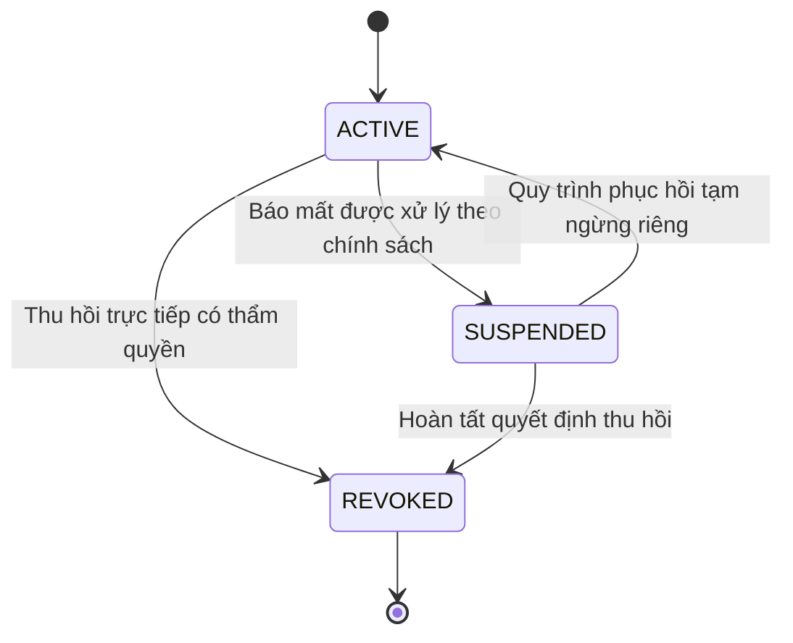
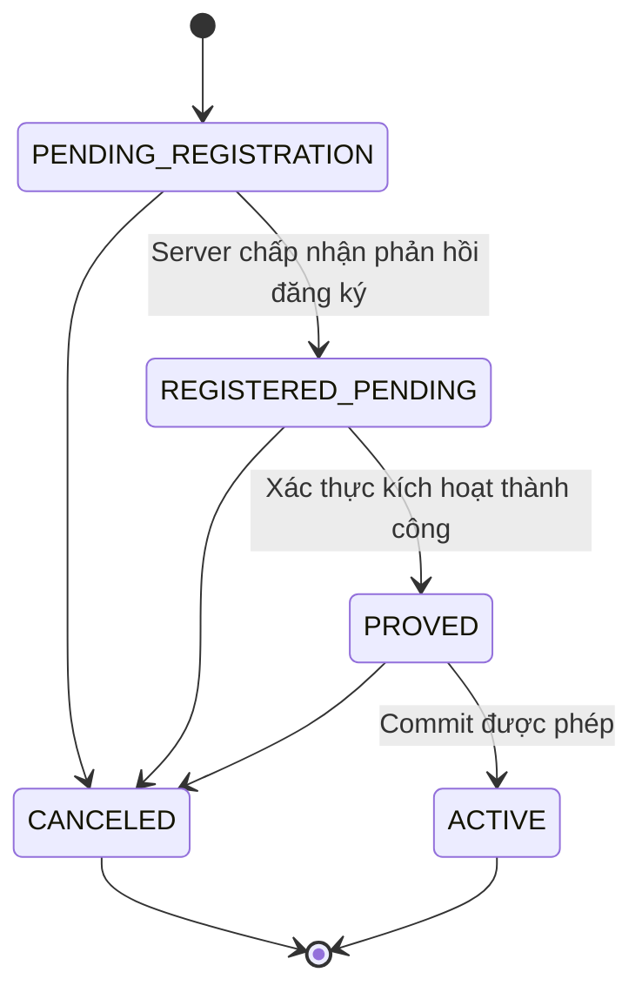
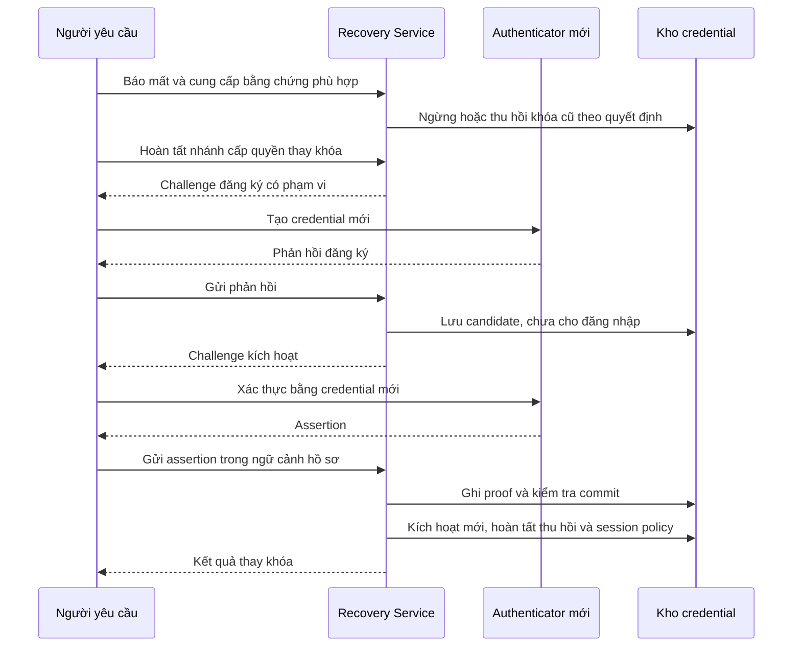

# Device key replacement — Thay thế khóa thiết bị khi khôi phục tài khoản

## 1. Mục tiêu và phạm vi

Trong chương **Device Loss Recovery** của module **SECURITY_AUTHENTICATION_ACCOUNT_RECOVERY**, mất thiết bị có thể đồng thời làm mất khóa xác thực, passkey, session, refresh token và phương tiện nhận mã khôi phục. Việc thay khóa cần khôi phục quyền truy cập cho người dùng hợp lệ mà không cho người đang giữ thiết bị cũ tiếp tục chiếm tài khoản.

Bài học tập trung vào **device key replacement**: thiết lập một khóa xác thực mới, ràng buộc khóa đó với đúng tài khoản qua một quyết định được cấp quyền và chấm dứt quyền của khóa cũ theo chính sách xử lý mất thiết bị.

Ba câu hỏi xuyên suốt là:

1. Ai có quyền yêu cầu thay khóa trên tài khoản?
2. Thiết bị hoặc authenticator mới có thực sự sử dụng được khóa mới không?
3. Khóa cũ và các quyền phát sinh từ thiết bị mất đã bị xử lý đến mức nào?

Sau bài học, người đọc có thể thiết kế vòng đời khóa, quy trình đăng ký và xác nhận khóa mới, kiểm tra cạnh tranh khi commit, thu hồi khóa cũ và kiểm soát session.

Các trạng thái, endpoint và trường dữ liệu dưới đây là thiết kế minh họa. Chúng không tự chứng minh hệ thống đạt một mức AAL cụ thể và không thay thế đặc tả của giao thức xác thực được triển khai.

## 2. Thay khóa khác với khôi phục lại khóa

### 2.1. Đối với khóa bất đối xứng

Một cặp khóa gồm:

- **Private key**: được giữ ở authenticator, thiết bị hoặc môi trường bảo vệ phù hợp.
- **Public key**: được dịch vụ dùng để kiểm tra bằng chứng mật mã.
- **Binding**: liên kết phía server giữa credential và tài khoản, kèm phạm vi quyền, trạng thái và metadata.

Trong thay khóa, một cặp khóa mới được thiết lập và một binding mới được tạo. Dịch vụ không cần lấy private key cũ, cũng không yêu cầu người dùng gửi private key cho bộ phận hỗ trợ.

```text
Trước:
account A -> credential C_old -> public key K_old

Sau thay thế:
account A -> credential C_new -> public key K_new

C_old bị ngừng hoặc thu hồi theo quyết định
K_old không bị sửa thành K_new trong cùng bản ghi lịch sử
```

Tạo bản ghi mới giúp truy vết lần thay thế và ngăn kết quả, challenge hoặc session của credential cũ bị hiểu nhầm là của credential mới.

### 2.2. Các loại khóa không có cùng vòng đời

| Loại | Vai trò | Ý nghĩa của thay thế |
| --- | --- | --- |
| Khóa WebAuthn hoặc passkey | Xác thực người dùng trong phạm vi RP | Đăng ký credential mới và xử lý credential cũ |
| Khóa xác thực của ứng dụng trên thiết bị | Chứng minh quyền giữ khóa theo giao thức của ứng dụng | Đăng ký khóa mới qua giao thức được kiểm tra và gắn đúng tài khoản |
| Khóa gắn với token như DPoP | Ràng buộc việc trình token với khóa của client | Cần xử lý cả khóa và token đang ràng buộc |
| Khóa hoặc chứng thư thiết bị dùng mTLS | Xác thực endpoint theo kiến trúc PKI | Cần quy trình cấp và thu hồi của hệ thống chứng thư |
| Khóa mã hóa dữ liệu | Giải mã nội dung hoặc bảo vệ dữ liệu đầu cuối | Không tự được khôi phục chỉ vì tài khoản đăng nhập lại được |

Bài học dùng **credential xác thực bất đối xứng**, với WebAuthn làm ví dụ chính. Không nên áp dụng nguyên xi ceremony WebAuthn cho một khóa tùy ý hoặc ngược lại.

Khôi phục tài khoản và khôi phục dữ liệu mã hóa là hai vấn đề riêng. Nếu private key giải mã không có bản sao được thiết kế trước, tạo khóa đăng nhập mới không tự giải mã được dữ liệu cũ.

### 2.3. Đổi thiết bị không luôn có nghĩa đổi credential

Với khóa gắn cứng vào một thiết bị và không xuất được, mất thiết bị thường đồng nghĩa không thể tiếp tục dùng khóa đó từ thiết bị mới.

Với passkey có đồng bộ, cùng credential có thể xuất hiện trên thiết bị khác thông qua hệ sinh thái đồng bộ. Việc người dùng đăng nhập được trên máy mới chưa chứng minh một cặp khóa mới đã được tạo.

Cần phân biệt:

- Dùng lại cùng credential qua cơ chế đồng bộ.
- Đăng ký một credential mới.
- Thu hồi credential có thể còn hiện diện trên thiết bị mất.

Khi server thu hồi một credential, mọi bản sao sử dụng cùng credential đó sẽ bị từ chối tại dịch vụ. Server thường không có khả năng thu hồi riêng một bản sao vật lý trong khi vẫn chấp nhận bản sao khác của cùng khóa.

## 3. Mất thiết bị là một tình huống rủi ro, không chỉ lỗi tiện dụng

### 3.1. Tài sản có thể nằm trên thiết bị mất

Một thiết bị có thể chứa:

```text
Khóa xác thực hoặc khả năng dùng passkey
Session cookie
Refresh token
Khóa gắn với token của ứng dụng
Ứng dụng TOTP và seed tương ứng
Email đã đăng nhập
SIM hoặc eSIM
Bản chụp recovery code
Quyền truy cập tài khoản đồng bộ
```

Thu hồi một public key ở server không tự xử lý tất cả các tài sản đó. Đổi mật khẩu cũng không tự xóa mọi session hoặc mọi khóa ứng dụng.

### 3.2. Không đợi đăng ký khóa mới rồi mới xử lý khóa mất

NIST SP 800-63B-4 xem authenticator mất, bị đánh cắp hoặc nghi bị sao chép là thuộc nhóm compromised authenticator và yêu cầu xử lý ngừng hoặc vô hiệu hóa kịp thời. Vì vậy, khi báo mất đã được xác thực theo quy trình phù hợp, không nên để khóa cũ tiếp tục hoạt động chỉ vì người dùng chưa hoàn tất tạo khóa mới. [NIST SP 800-63B-4, mục 4.3](https://pages.nist.gov/800-63-4/sp800-63b.html#loss-theft-damage-and-compromise)

Điều kiện xác nhận báo mất để hạn chế một credential và điều kiện cấp một credential mới có thể khác nhau. Tuy nhiên, một lời khai ẩn danh không được tự trở thành quyền thu hồi mọi khóa của một tài khoản.

Thiết kế cần cân bằng:

- Phản ứng nhanh với báo mất có căn cứ.
- Ngăn kẻ tấn công gây khóa tài khoản bằng báo mất giả.
- Duy trì nhánh khôi phục phù hợp khi không còn authenticator.
- Không biến nhánh báo mất thành nhánh đăng ký khóa mới không cần bằng chứng.

### 3.3. Không tin thiết bị chỉ vì nó vẫn có session

Một trình duyệt còn đăng nhập trên thiết bị mất có thể nằm trong tay người khác. Session cũ không nên tự được dùng để phê duyệt việc thêm khóa mới hoặc xóa khóa còn lại.

Một chữ ký của khóa cũ cũng không phải lúc nào đủ trong bối cảnh đã báo compromise. Nếu khóa cũ đang bị nghi bị chiếm, phải áp dụng nhánh chính sách tương ứng thay vì để chính khóa đó tự hợp thức hóa việc thay thế.

Trong chuyển thiết bị có kế hoạch, khóa cũ còn tin cậy có thể tham gia xác thực lại. Trong mất thiết bị, không buộc người dùng phê duyệt trên đúng thiết bị đã mất.

## 4. Bốn điều kiện cần tách biệt

| Điều kiện | Câu hỏi | Ví dụ kiểm tra |
| --- | --- | --- |
| Quyền thay khóa | Người yêu cầu có quyền thực hiện hành động trên tài khoản không? | Tổ hợp xác thực hoặc khôi phục đáp ứng chính sách |
| Tính phù hợp của khóa mới | Credential có đáp ứng giao thức và chính sách không? | Kiểm tra đăng ký, thuật toán, phạm vi RP và thuộc tính cần thiết |
| Khả năng sử dụng khóa mới | Bên đăng ký có thể thực hiện phép chứng minh bằng khóa mới không? | Lượt xác thực kích hoạt bằng credential mới |
| Hoàn tất chuyển đổi | Trạng thái khóa cũ, session và hồ sơ đã được cập nhật đúng chưa? | Commit có kiểm soát, thu hồi và audit |

Khóa mới hợp lệ về mặt mật mã không chứng minh người đăng ký là chủ tài khoản. Kẻ tấn công cũng có thể tạo một cặp khóa an toàn trên thiết bị của họ.

Ngược lại, người dùng đã vượt qua quy trình khôi phục vẫn có thể đăng ký nhầm credential, hủy thao tác tạo khóa hoặc gặp lỗi lưu khóa. Vì vậy, quyền khôi phục và khả năng sử dụng khóa mới cần được kiểm tra riêng.

Attestation, nếu được dùng, hỗ trợ các kết luận cụ thể về authenticator theo mô hình tin cậy. Nó không thay thế bằng chứng quyền với tài khoản và không phải giấy chứng nhận danh tính của người cầm thiết bị.

## 5. Các bất biến của luồng thay khóa

1. **Không thu thập private key.** Server nhận vật liệu công khai và các phản hồi giao thức cần thiết.
2. **Quyền thêm khóa đến từ trước khi khóa được kích hoạt.** Khóa mới không tự cấp quyền đăng ký cho chính nó.
3. **Mỗi thao tác có phạm vi cụ thể.** Đúng tenant, tài khoản, hồ sơ, tập credential bị thay và candidate revision.
4. **Khóa đang chờ không dùng để đăng nhập thông thường.**
5. **Challenge có mục đích riêng, hạn sử dụng và chống dùng lại.**
6. **Đăng ký hoặc xác nhận từ hồ sơ khác không được chuyển sang hồ sơ hiện tại.**
7. **Không ghi đè khóa của credential cũ.** Tạo binding mới và lưu liên kết thay thế.
8. **Báo mất đã được xử lý không tự bị đảo ngược khi enrollment lỗi hoặc hồ sơ hết hạn.**
9. **Credential đã thu hồi không tự hoạt động trở lại.**
10. **Kích hoạt khóa mới không mặc nhiên cho phép thay email, số điện thoại hoặc xóa tất cả MFA.**
11. **Thu hồi khóa không được hiểu nhầm là thu hồi mọi session.**
12. **Commit kiểm tra trạng thái hiện tại, không chỉ một cờ phê duyệt cũ.**

Một tài khoản có thể có nhiều authenticator hợp lệ. “Thay khóa” trong bài không có nghĩa luôn đưa tài khoản về đúng một khóa duy nhất; phạm vi thay phải được xác định từ thiết bị và sự cố thực tế.

## 6. Mô hình dữ liệu và trạng thái

### 6.1. Đối tượng chính

| Đối tượng | Dữ liệu cần thiết | Trách nhiệm |
| --- | --- | --- |
| `AuthenticatorBinding` | Account, credential ID, public key, giao thức, trạng thái, version | Quản lý quyền xác thực của một credential |
| `KeyReplacementCase` | Account, lý do, tập khóa bị ảnh hưởng, bằng chứng quyền, thời hạn | Quản lý giao dịch thay khóa |
| `KeyCandidate` | Case, revision, public key hoặc credential mới, kết quả kiểm tra | Lưu khóa mới chưa kích hoạt |
| `EnrollmentChallenge` | Case, purpose, challenge, hạn, trạng thái tiêu thụ | Ràng buộc đăng ký và xác nhận |
| `ReplacementDecision` | Scope, candidate revision, mục tiêu thu hồi, policy version, thời hạn | Cấp quyền cho đúng chuyển đổi |
| `RevocationEvent` | Credential, version, nguyên nhân, phạm vi session liên quan | Truyền thay đổi đến các nơi kiểm tra quyền |

Tên thiết bị do người dùng đặt chỉ hỗ trợ nhận biết. Nó không phải định danh mật mã đáng tin cậy. Một nhãn “điện thoại cũ” không đủ để xác định toàn bộ credential hoặc token từng nằm trên thiết bị đó.

### 6.2. Trạng thái credential cũ



Trong thiết kế minh họa:

- `SUSPENDED` không được dùng để xác thực hoặc phê duyệt thay đổi mới.
- Việc khôi phục một trạng thái tạm ngừng, nếu được phép, phải là quy trình riêng có kiểm tra phù hợp.
- `REVOKED` là kết thúc liên kết cũ; tìm lại thiết bị không tự kích hoạt credential đó.
- Nếu cần sử dụng lại authenticator đã tìm được, có thể phải tạo credential mới qua đăng ký được cấp quyền.

### 6.3. Trạng thái candidate mới



Mọi trạng thái đang chờ có thể hết hạn. Candidate chỉ được dùng trong endpoint kích hoạt được giới hạn; không được tìm thấy bởi đường đăng nhập thông thường cho đến khi `ACTIVE`.

Một credential có thể được tạo trên authenticator nhưng enrollment phía server không hoàn tất. Khi đó, credential cục bộ có thể còn tồn tại mà chưa có quyền tại dịch vụ. Không tự phục hồi quyền chỉ vì client gửi lại cùng credential ID.

## 7. Luồng thay khóa từ đầu đến cuối

### Bước 1: Tiếp nhận và đánh giá báo mất

Người dùng mô tả thiết bị hoặc phương tiện bị mất. Server xác định tài khoản qua quy trình phù hợp, kiểm tra bằng chứng để thực hiện hạn chế và xác định phạm vi credential có căn cứ liên quan.

Không cho người gọi tùy ý gửi một danh sách credential ID của người khác để thu hồi. Nếu dữ liệu liên kết thiết bị chưa chắc chắn, cần thể hiện mức không chắc chắn và chọn kiểm soát theo chính sách.

### Bước 2: Ngừng quyền của khóa cũ có căn cứ bị ảnh hưởng

Thực hiện tạm ngừng hoặc thu hồi theo quyết định xử lý mất thiết bị. Ghi version và sự kiện để các nơi xác thực áp dụng.

Đây có thể là một transaction riêng diễn ra trước enrollment. Nếu người dùng bỏ dở ở bước sau, không tự bật lại khóa đã báo mất.

### Bước 3: Xác minh quyền đăng ký khóa thay thế

Dùng authenticator còn tin cậy, recovery code hoặc tổ hợp khôi phục được chính sách chấp nhận. Không coi một link gửi đến địa chỉ mới do người yêu cầu tự nhập là đủ quyền thay khóa.

Nếu tài khoản mất mọi phương tiện, đi qua nhánh khôi phục được thiết kế cho trường hợp đó. Không yêu cầu chữ ký của khóa đã mất như điều kiện bắt buộc để thoát khỏi sự cố.

Bằng chứng và recovery session phải có hạn. Quyền được cấp là quyền thực hiện `REPLACE_DEVICE_AUTH_KEY` cho hồ sơ này, không phải session đăng nhập toàn quyền.

### Bước 4: Phát hành enrollment challenge

Server tạo challenge ngẫu nhiên mật mã, đủ khó đoán, có hạn và ghi các liên kết giao dịch. Ví dụ có thể dùng 32 byte ngẫu nhiên cho challenge; giá trị này minh họa thiết kế, không thay thế yêu cầu riêng của thư viện hoặc giao thức.

```text
challenge_id
account_id
tenant_id nếu có
replacement_case_id
purpose = REGISTER_REPLACEMENT_KEY
candidate_revision
expires_at
consumed_at
```

Challenge xác thực thường không cần bí mật như một recovery token, nhưng phải khó đoán trước, được kiểm tra đúng và chống dùng lại trong phạm vi ceremony.

### Bước 5: Tạo khóa trên authenticator mới

Với WebAuthn, client thực hiện ceremony đăng ký qua API trình duyệt. Private key nằm trong cơ chế bảo vệ của authenticator hoặc hệ sinh thái passkey; ứng dụng không gửi private key về server.

Việc chọn authenticator, yêu cầu user verification, hỗ trợ đồng bộ hoặc attestation phải phù hợp với chính sách sản phẩm. Không áp đặt một chính sách phần cứng lên mọi người dùng nếu sản phẩm chưa xác định nhu cầu đó.

### Bước 6: Kiểm tra và lưu candidate

Server kiểm tra phản hồi đăng ký bằng verifier phù hợp, lưu credential mới ở trạng thái đang chờ và tiêu thụ challenge đăng ký một cách nguyên tử.

Nếu người dùng tạo lại khóa khác, tăng candidate revision và vô hiệu hóa các kết quả không còn đúng phạm vi. Không sửa public key của candidate đã được phê duyệt mà giữ nguyên quyết định cũ.

### Bước 7: Xác nhận khả năng dùng khóa mới

Thiết kế minh họa yêu cầu một ceremony xác thực riêng bằng credential mới, qua endpoint chỉ dành cho candidate. Server dùng challenge kích hoạt mới và ràng buộc với candidate ID, revision, tài khoản và hồ sơ.

Kết quả thành công chứng minh khả năng sử dụng khóa trong phạm vi giao thức. Nó vẫn không thay thế quyền khôi phục đã kiểm tra ở bước 3.

### Bước 8: Commit việc thay thế

Kiểm tra lại quyết định, trạng thái khóa cũ, candidate, bằng chứng và phiên bản tài khoản. Chỉ khi đủ điều kiện, kích hoạt khóa mới và hoàn tất các thay đổi được cấp quyền.

### Bước 9: Đăng nhập và kiểm tra sau thay đổi

Kết thúc recovery capability đã dùng. Người dùng đăng nhập theo cơ chế bình thường bằng khóa mới hoặc nhận session mới chỉ sau khi các yêu cầu xác thực tương ứng đã đáp ứng.

Hiển thị rõ khóa nào đã được thay, những session nào đã bị thu hồi và các bước còn cần thực hiện. Không hiển thị “đã an toàn hoàn toàn” chỉ vì public key mới đã được lưu.



## 8. Kiểm tra WebAuthn và proof của khóa mới

### 8.1. Dùng đúng ceremony và verifier

WebAuthn tách đăng ký credential với xác minh authentication assertion. Server phải kiểm tra dữ liệu theo đúng ceremony, gồm challenge, origin, RP ID, thuật toán và các thuộc tính giao thức liên quan; assertion cần được kiểm tra chữ ký và yêu cầu user presence hoặc user verification tương ứng. [W3C WebAuthn, mục 7.1 và 7.2](https://www.w3.org/TR/webauthn-3/#sctn-registering-a-new-credential)

Trong luồng thay khóa, ngoài kiểm tra giao thức còn phải kiểm tra nghiệp vụ:

- Challenge thuộc đúng replacement case và candidate revision.
- Người gọi có recovery capability còn hiệu lực.
- Credential không đang thuộc tài khoản khác trong phạm vi RP.
- Credential mới không phải credential cũ đã bị thu hồi được đưa trở lại bằng đường đăng ký.
- Kết quả đăng ký không được phát lại để tạo một candidate khác.
- Candidate đáp ứng chính sách tài khoản trước khi được kích hoạt.

Sử dụng thư viện WebAuthn đã được kiểm tra phù hợp với nền tảng Java đang triển khai. Không tự viết parser CBOR/COSE và bộ kiểm tra chữ ký chỉ để hoàn thành luồng khôi phục.

### 8.2. Vì sao bài học có bước xác thực kích hoạt riêng?

Không giả định mọi attestation statement đều là một chữ ký của credential private key mới. Các hình thức attestation có ngữ nghĩa riêng; việc chấp nhận đăng ký cần tuân thủ đặc tả và chính sách tin cậy.

Bước kích hoạt riêng trong thiết kế này tạo một lần kiểm tra rõ ràng rằng candidate có thể thực hiện assertion bằng credential mới. Nó cũng giúp phát hiện lỗi người dùng tạo nhầm credential hoặc lỗi lưu trữ trước khi coi khóa đó là phương tiện truy cập thay thế.

Đây là lựa chọn thiết kế của bài học để tách các điều kiện, không phải tuyên bố rằng mọi hệ thống WebAuthn đều bắt buộc thêm cùng một endpoint như vậy.

### 8.3. Không tự cho candidate tham gia đăng nhập công khai

Một endpoint kích hoạt có thể truy cập public key của candidate nhưng phải kiểm tra đầy đủ ngữ cảnh hồ sơ. Endpoint đăng nhập thông thường chỉ chấp nhận binding đang có quyền xác thực.

Nếu dùng cùng hàm verifier, lớp tra cứu và chính sách vẫn phải phân biệt:

```text
verifyForActivation:
    chỉ candidate của hồ sơ đang có quyền

verifyForLogin:
    chỉ credential ACTIVE của tài khoản tương ứng
```

Một assertion hợp lệ với public key đang chờ không được tự tạo access token của tài khoản.

### 8.4. Thuộc tính backup không phải định danh thiết bị

Credential có khả năng backup hoặc đồng bộ không thể được coi là chỉ tồn tại trên một máy vật lý. Metadata, nhãn do người dùng đặt hoặc trạng thái đồng bộ không cho server quyền xóa từ xa một bản sao khóa.

Nếu mục tiêu là ngăn mọi bản sao của credential cũ xác thực tại RP, phải ngừng binding tương ứng. Nếu cần một credential mới độc lập, phải kiểm tra rằng hệ thống thực sự đã tạo và gắn một credential mới.

## 9. Quyền thay khóa và recovery session

### 9.1. Quyền có phạm vi hẹp

Có thể biểu diễn một grant nội bộ:

```json
{
  "caseId": "kr_opaque",
  "accountId": "acc_42",
  "allowedAction": "REPLACE_DEVICE_AUTH_KEY",
  "affectedCredentialRefs": ["auth_old_7"],
  "candidateRevision": 2,
  "evidenceRefs": ["evidence_11", "evidence_12"],
  "expectedSecurityVersion": 42,
  "policyVersion": "recovery-policy-v5",
  "expiresAt": "2026-11-23T05:15:00Z"
}
```

Các giá trị được server tạo sau khi đánh giá bằng chứng. Client không được tự khai `allowedAction`, `evidenceRefs` hoặc danh sách khóa cần xóa để cấp quyền cho chính request.

Nếu grant được tạo trước khi có candidate, giai đoạn đăng ký chỉ cho phép tạo candidate trong case. Quyết định commit sau đó phải ràng buộc đúng candidate và revision đã được kiểm tra.

### 9.2. Recovery credential cũng cần được bảo vệ

Quyền thay khóa bị đánh cắp có thể cho kẻ tấn công đăng ký khóa của chính họ. Proof-of-possession hoàn hảo của khóa mới không sửa được lỗ hổng ở bước cấp quyền.

Vì vậy:

- Recovery capability có thời hạn ngắn và phạm vi đúng hành động.
- Không đặt credential nhạy cảm trong URL hoặc log.
- Nếu dùng cookie, cấu hình Secure, HttpOnly, SameSite phù hợp và kiểm tra CSRF.
- Kiểm tra quyền và trạng thái hồ sơ ở từng endpoint.
- Khi hoàn tất, hủy hoặc phát hiện rủi ro, thu hồi capability liên quan.
- Không coi IP hoặc fingerprint giống nhau là thay thế xác minh quyền.

Nếu hỗ trợ tiếp tục trên thiết bị khác, dùng một giao thức chuyển tiếp riêng có hạn, chống dùng lại và hiển thị rõ hành động. Một QR code có thể mang capability nhạy cảm; quét QR không tự chứng minh danh tính người quét.

### 9.3. Không đếm nhầm bằng chứng độc lập

Email, recovery code và passkey dự phòng có thể đều nằm trên thiết bị mất hoặc cùng tài khoản đồng bộ. Nhiều mục không chắc là nhiều đường bảo vệ độc lập.

Chính sách cần xét nguồn gốc và lịch sử thiết lập của phương thức khôi phục, đặc biệt khi tài khoản có dấu hiệu bị chiếm. Không chỉ dựa vào kênh vừa được thêm trong session đang bị điều tra.

## 10. Commit nguyên tử và xử lý lỗi

### 10.1. Tách phản ứng sự cố khỏi hoàn tất enrollment

Một thứ tự minh họa:

```text
Transaction A:
    xử lý báo mất đã đủ căn cứ
    SUSPEND hoặc REVOKE credential cũ
    tăng phiên bản bảo mật cần thiết
    ghi sự kiện

Sau đó:
    thu bằng chứng quyền thay
    tạo candidate
    xác thực kích hoạt

Transaction B:
    kiểm tra trạng thái hiện tại
    ACTIVE credential mới
    hoàn tất thu hồi cũ theo quyết định
    xử lý session và đóng hồ sơ
```

Nếu Transaction B lỗi, trạng thái ngừng khóa cũ từ Transaction A vẫn giữ nguyên. Không dùng một cơ chế rollback nghiệp vụ để bật lại khóa đã xác định mất chỉ vì tạo khóa mới thất bại.

Khi tạo hồ sơ hoặc quyết định sau Transaction A, cần ghi snapshot phiên bản mới. Không giữ phiên bản trước khi chính thao tác xử lý sự cố đã thay đổi tài khoản rồi coi đó là lỗi cạnh tranh không giải thích được.

### 10.2. Pseudocode hoàn tất

```text
completeKeyReplacement(recoveryContext, caseId, decisionId):

    Xác thực ngữ cảnh, quyền, request và CSRF nếu cần

    BEGIN

    Khóa account
    Khóa replacement case và decision
    Khóa các credential mục tiêu theo thứ tự thống nhất
    Khóa candidate và proof kích hoạt

    Kiểm tra:
        tenant/account/case đúng phạm vi
        case chưa đóng và chưa hết hạn
        decision chưa dùng và đúng allowed action
        decision ràng buộc đúng candidate revision
        quyền khôi phục và bằng chứng còn hiệu lực
        public key/credential không thay đổi sau kiểm tra
        candidate đã có proof kích hoạt còn mới
        chính sách giao thức và mức bảo đảm được đáp ứng
        credential cũ đúng tập mục tiêu và version
        trạng thái bảo mật hiện tại tương thích với decision
        không có hold có thẩm quyền hoặc hồ sơ cạnh tranh đã hoàn tất
        credential ID không xung đột binding khác

    Kích hoạt binding mới
    Thu hồi các credential cũ thuộc phạm vi được cấp
    Tăng security/session version theo quyết định
    Thu hồi challenge và recovery capability không còn dùng
    Đánh dấu decision đã dùng và case hoàn tất
    Ghi audit và outbox cho thông báo/thu hồi phân tán

    COMMIT

    Trả trạng thái đã hoàn tất
```

Không gọi authenticator, nhà cung cấp bên ngoài hoặc dịch vụ gửi thư trong lúc giữ khóa cơ sở dữ liệu quá lâu. Các kiểm tra từ xa cần được tổ chức thành kết quả có phạm vi và thời hạn phù hợp trước khi commit, kết hợp kiểm tra lại trạng thái khi cần.

### 10.3. Cạnh tranh giữa hai hồ sơ

Nếu hai hồ sơ cùng thay một credential:

- Cả hai có thể đi đến giai đoạn candidate.
- Khi một hồ sơ hoàn tất, version của tài khoản hoặc trạng thái credential thay đổi.
- Hồ sơ còn lại phải được đánh giá lại hoặc kết thúc.
- Không để hồ sơ thứ hai dùng quyết định cũ để kích hoạt thêm một khóa ngoài ý định.

Với credential ID, ràng buộc duy nhất trong phạm vi RP hoặc miền dữ liệu phù hợp bảo vệ việc gắn nhầm cùng credential cho nhiều chủ thể. Không chỉ kiểm tra trên giao diện.

### 10.4. Retry và mất response

Server có thể commit thành công nhưng client không nhận response. Retry cần trả kết quả đã lưu hoặc dùng idempotency key ràng buộc cùng người gọi, hồ sơ và nội dung.

Không tạo thêm credential hoặc lặp việc thu hồi chỉ vì client gửi lại. Nếu cấp session mới là một bước sau commit và bước đó lỗi, người dùng có thể đăng nhập bằng credential đã kích hoạt; không cần bật lại khóa cũ.

### 10.5. Candidate hết hạn hoặc bị hủy

Candidate chưa kích hoạt không được tự chuyển thành `ACTIVE` qua job dọn dữ liệu. Khi hủy, thu hồi challenge và grant liên quan, giữ audit tối thiểu cần thiết và xử lý dữ liệu theo hạn giữ.

Việc hủy enrollment không hủy báo mất đã được xác nhận. Nếu muốn phục hồi một trạng thái tạm ngừng, người dùng phải đi qua quy trình riêng.

## 11. Thu hồi khóa cũ và các session liên quan

### 11.1. Thu hồi ở mọi đường chấp nhận credential

Các nơi cần kiểm tra trạng thái có thể gồm:

- Endpoint đăng nhập.
- Endpoint xác thực lại trước hành động nhạy cảm.
- Endpoint phê duyệt thêm authenticator.
- Endpoint khôi phục dùng credential làm bằng chứng.
- Cache public key hoặc metadata.
- Dịch vụ nội bộ xác minh chữ ký của thiết bị.

Một chữ ký đúng chỉ cho biết chữ ký khớp khóa công khai; quyền sử dụng khóa còn phụ thuộc trạng thái binding. Không chấp nhận credential đã thu hồi chỉ vì thư viện xác minh chữ ký trả thành công.

Sự kiện thu hồi cần mang credential ID và version. Consumer xử lý idempotent và bỏ qua cập nhật cũ hơn; một sự kiện “active” đến muộn không được phục hồi quyền đã bị thu hồi.

### 11.2. Session có thể sống lâu hơn khóa

Một session được tạo trước khi thu hồi credential thường không cần trình lại chữ ký ở mỗi request. Nếu không có cơ chế bổ sung, session đó có thể tiếp tục hoạt động.

Chính sách cần xác định:

| Phạm vi | Cách xử lý có thể cần |
| --- | --- |
| Session trên thiết bị mất được nhận diện chắc chắn | Thu hồi session và refresh token tương ứng |
| Session được cấp qua credential nghi bị chiếm | Rà soát và thu hồi theo bằng chứng, chính sách |
| Không xác định đủ nguồn gốc session | Có thể phải áp dụng phạm vi rộng hơn theo quyết định rủi ro |
| Thiết bị khác còn tin cậy | Giữ hoặc yêu cầu xác thực lại theo chính sách |
| Recovery session đang thay khóa | Chỉ giữ quyền giới hạn đến khi hoàn tất, sau đó thu hồi |

Không coi việc xóa bản ghi “thiết bị được nhớ” là đã thu hồi refresh token. Cũng không coi sign-out ở giao diện là bằng chứng server đã chặn session cũ.

Với access token được xác minh ngoại tuyến, cập nhật trạng thái cơ sở dữ liệu không tự làm token hết hiệu lực ngay. Cần cơ chế session epoch, introspection, revocation hoặc giới hạn thời gian sống phù hợp; tài liệu vận hành phải nêu độ trễ thực tế.

### 11.3. Khóa gắn với token có vòng đời riêng

DPoP ràng buộc token OAuth với khóa chứng minh quyền giữ ở phía client. Token đã gắn với khóa cũ không tự trở thành token của khóa mới chỉ vì ứng dụng tạo một cặp khóa khác. [RFC 9449, DPoP](https://www.rfc-editor.org/rfc/rfc9449.html)

Nếu ứng dụng dùng DPoP:

- Xử lý token và grant liên quan đến khóa cũ theo chính sách thu hồi.
- Cấp token gắn khóa mới qua luồng được authorization server hỗ trợ và cấp quyền phù hợp.
- Không sửa claim hoặc metadata của một token đã ký để chuyển nó sang khóa mới.
- Không yêu cầu fallback sang bearer chỉ để bỏ qua việc mất khóa.

Khóa WebAuthn và khóa DPoP có mục đích, API và giao thức khác nhau. Không mặc định dùng private key WebAuthn để ký JWT DPoP tùy ý.

### 11.4. Giới hạn của dịch vụ

Thu hồi credential tại RP chỉ chặn sử dụng credential tại RP theo cơ chế của dịch vụ. Nó không xóa private key trên thiết bị mất, không đăng xuất mọi tài khoản hệ điều hành và không bảo đảm xóa dữ liệu đã tải xuống.

Người dùng có thể cần khóa hoặc xóa thiết bị qua tính năng của nền tảng, bảo vệ tài khoản đồng bộ và xử lý SIM hoặc email liên quan. Các thao tác đó bổ sung cho thu hồi phía dịch vụ; chúng không thay thế nhau.

## 12. API và trải nghiệm người dùng

### 12.1. Hợp đồng API minh họa

| Endpoint | Chức năng | Điều không được suy diễn |
| --- | --- | --- |
| `POST /device-loss/reports` | Tiếp nhận báo mất và mở bước xác minh | Báo mất chưa có quyền thêm khóa |
| `POST /recovery/key-replacements/current/authorize` | Kiểm tra bằng chứng quyền thay | Không cấp toàn quyền tài khoản |
| `POST /recovery/key-replacements/current/registration-options` | Tạo challenge đăng ký | Challenge chưa tạo binding hoạt động |
| `POST /recovery/key-replacements/current/registration-result` | Kiểm tra và lưu candidate | Đăng ký được chấp nhận chưa hoàn tất khôi phục |
| `POST /recovery/key-replacements/current/activation-options` | Tạo challenge cho candidate | Chỉ dùng cho hồ sơ có quyền |
| `POST /recovery/key-replacements/current/activation-result` | Ghi proof khóa mới | Proof không thay quyền khôi phục |
| `POST /recovery/key-replacements/current/complete` | Kiểm tra lại và commit | Không tự thay các kênh khác ngoài phạm vi |

ID được gửi trong request không thay thế kiểm tra quyền. Các endpoint phải suy ra account, scope và trạng thái từ dữ liệu server tin cậy.

### 12.2. Thông báo tiến độ đúng thực tế

Ví dụ:

- “Khóa của thiết bị được báo mất đã bị ngừng sử dụng.”
- “Bạn đã có quyền đăng ký khóa thay thế cho yêu cầu này.”
- “Khóa mới đã được tạo. Hãy thử xác thực để hoàn tất kiểm tra.”
- “Khóa mới đã được kích hoạt. Khóa cũ đã bị thu hồi.”
- “Một số phiên truy cập cần thời gian hoặc bước xử lý bổ sung để chấm dứt theo kiến trúc dịch vụ.”

Chỉ hiển thị các trạng thái thực sự đã được ghi nhận. Nếu công việc thu hồi phân tán chưa hoàn tất, không mô tả mọi quyền cũ đã chấm dứt ngay lập tức.

### 12.3. Giảm nhầm lẫn và phishing

Giao diện chấp thuận cần cho người dùng biết họ đang thêm khóa mới và khóa nào dự kiến bị thay. Một assertion hợp lệ không bảo đảm người dùng đã đọc đúng nội dung nếu giao diện hoặc ngữ cảnh bị đánh tráo.

Không yêu cầu gửi private key, PIN của authenticator hoặc dữ liệu sinh trắc học cho nhân viên hỗ trợ. Nếu dùng PIN hoặc sinh trắc học để mở authenticator, việc đó diễn ra trong cơ chế của nền tảng, không phải một biểu mẫu do dịch vụ yêu cầu nhập lại tùy ý.

Thư cảnh báo nên gửi qua kênh phù hợp đã thiết lập từ trước và có đường báo cáo hoạt động bất thường. Không chỉ gửi thông báo đến chính thiết bị đang bị báo mất.

## 13. Chống lạm dụng, audit và vận hành

### 13.1. Các kiểu lạm dụng cần kiểm soát

| Rủi ro | Kiểm soát trong thiết kế |
| --- | --- |
| Dùng báo mất để khóa nạn nhân | Kiểm tra thẩm quyền báo mất, giới hạn phạm vi và hạn mức |
| Session bị đánh cắp thêm khóa của kẻ tấn công | Xác minh lại hoặc nhánh khôi phục độc lập, không tin session đơn lẻ |
| Replay phản hồi đăng ký | Challenge dùng một lần, gắn case và revision |
| Tráo candidate sau khi phê duyệt | Quyết định ràng buộc candidate ID, public key và version |
| Dùng credential của tài khoản khác | Kiểm tra uniqueness và quyền sở hữu trong phạm vi RP |
| Dùng khóa mới đang chờ để đăng nhập | Tách đường activation và login |
| Giữ khóa cũ hoạt động vì enrollment lỗi | Phản ứng mất thiết bị là quyết định độc lập |
| Dùng support để vượt chính sách | Quyền tác nghiệp giới hạn, reason code, kiểm tra và audit |
| Tạo vô hạn candidate hoặc challenge | Hạn mức theo tài khoản, hồ sơ và nguồn, dọn dữ liệu hết hạn |
| Sự kiện cũ phục hồi credential đã thu hồi | Version, tính đơn điệu trạng thái và idempotency |

Risk score có thể hỗ trợ chọn nhánh hoặc thời gian chờ. Nó không thay thế bằng chứng quyền thay khóa. Nhiều dữ kiện yếu như IP quen thuộc, tên thiết bị và câu chuyện hợp lý không tự cộng thành quyền đăng ký authenticator.

### 13.2. Nhật ký

Các sự kiện có thể ghi:

```text
DEVICE_LOSS_REPORT_ACCEPTED
AUTHENTICATOR_SUSPENDED
KEY_REPLACEMENT_AUTHORIZED
REPLACEMENT_CANDIDATE_REGISTERED
REPLACEMENT_KEY_PROVED
KEY_REPLACEMENT_COMPLETED
AUTHENTICATOR_REVOKED
DEVICE_SESSIONS_REVOCATION_REQUESTED
DEVICE_SESSIONS_REVOCATION_APPLIED
KEY_REPLACEMENT_CANCELED
```

Lưu account và case ID theo quyền truy cập, credential ID hoặc tham chiếu cần thiết, candidate revision, policy version, reviewer hoặc verifier và mã lý do. Public key không phải bí mật như private key nhưng vẫn là dữ liệu định danh hoặc có thể liên kết, nên không cần đưa toàn bộ vào log phổ thông.

Không ghi recovery token, session cookie, mã khôi phục thô hoặc dữ liệu nhạy cảm không cần thiết. Tách quyền xem bằng chứng, quyền phê duyệt và quyền thực thi với trường hợp cần reviewer.

### 13.3. Chỉ số vận hành

Có thể theo dõi:

- Thời gian từ báo mất có căn cứ đến lúc credential bị chặn.
- Tỷ lệ đăng ký candidate thành công nhưng kích hoạt thất bại.
- Tỷ lệ hồ sơ hết hạn và yêu cầu hỗ trợ.
- Độ trễ truyền trạng thái thu hồi.
- Số phiên còn hoạt động sau mốc hoàn tất.
- Số quyết định bị vô hiệu do version thay đổi.
- Tỷ lệ báo cáo thay khóa không được người dùng chấp nhận.

Nếu verifier hoặc dịch vụ trạng thái bắt buộc đang lỗi, hồ sơ có thể chờ hoặc đi qua nhánh đã được phê duyệt. Không tự bỏ kiểm tra quyền hoặc kích hoạt candidate chỉ để cải thiện tỷ lệ hoàn tất.

## 14. Ví dụ xuyên suốt

Linh mất điện thoại có credential C1 và một session của ứng dụng. Linh còn một phương thức dự phòng được thiết lập trước đó.

1. Linh dùng đường báo mất và đáp ứng yêu cầu xác minh để xử lý C1.
2. Server tạm ngừng C1, ghi phiên bản bảo mật mới và yêu cầu thu hồi session được xác định trên điện thoại mất.
3. Linh hoàn thành nhánh cấp quyền thay khóa. Session khôi phục chỉ cho phép xử lý hồ sơ KR1.
4. Trên thiết bị mới, Linh tạo credential C2. Server kiểm tra đăng ký và lưu C2 ở trạng thái đang chờ.
5. Linh thực hiện assertion kích hoạt bằng C2 với challenge của KR1.
6. Server ghi proof cho đúng candidate và đánh giá điều kiện hoàn tất.
7. Transaction hoàn tất kích hoạt C2, thu hồi C1 theo quyết định và đóng quyền khôi phục đã dùng.
8. Linh đăng nhập bằng C2 theo cơ chế bình thường. Hệ thống báo rõ tình trạng thu hồi session và gửi thông báo phù hợp.

Nếu Linh đóng trình duyệt sau bước 4, C2 chưa được dùng để đăng nhập và C1 vẫn bị ngừng. Nếu response bước 7 bị mất, retry đọc kết quả KR1 thay vì tạo một lần thay khóa mới.

Nếu C1 là passkey đồng bộ, một thiết bị khác cũng có thể đang dùng cùng C1. Thu hồi C1 tại dịch vụ sẽ chặn cả những lần trình cùng credential đó; người dùng cần biết C2 mới là phương tiện thay thế còn được chấp nhận.

Nếu người đang cầm điện thoại mất dùng session cũ để mở một hồ sơ thay khóa khác, việc có session không đủ để bỏ qua nhánh kiểm tra quyền hoặc vượt version của quyết định KR1.

## 15. Các tình huống cần kiểm chứng khi triển khai

| Tình huống | Kết quả mong đợi |
| --- | --- |
| Người chưa có bằng chứng quyền gửi public key hợp lệ | Không được gắn khóa vào tài khoản |
| Báo mất ẩn danh chỉ biết tên đăng nhập | Không tự thu hồi toàn bộ khóa của nạn nhân |
| Báo mất đã đủ căn cứ, chưa có khóa mới | Khóa bị ảnh hưởng được hạn chế theo quyết định, không chờ enrollment |
| Phản hồi đăng ký sai challenge hoặc origin | Bị từ chối |
| Challenge của hồ sơ A được gửi ở hồ sơ B | Bị từ chối dù phản hồi mật mã có thể hợp lệ |
| Replay phản hồi đăng ký đã dùng | Không tạo candidate hoặc quyền mới |
| Candidate đã đăng ký nhưng chưa có proof kích hoạt | Không dùng tại endpoint login thông thường |
| Assertion kích hoạt dùng credential khác candidate | Bị từ chối |
| Client khai user verification thành công | Server vẫn kiểm tra kết quả giao thức thực tế |
| Credential ID đã thuộc account khác | Không chuyển hoặc ghi đè liên kết |
| Credential cũ đã thu hồi được đưa vào enrollment mới | Không tự phục hồi quyền cũ |
| Đổi candidate sau khi có quyết định | Quyết định và proof không còn đúng phạm vi bị vô hiệu |
| Hai hồ sơ cùng thay một credential | Một thay đổi làm trạng thái hoặc version của hồ sơ còn lại cần đánh giá lại |
| Transaction kích hoạt mới thất bại | Không có trạng thái hoàn tất một phần trong transaction đó |
| Enrollment hủy sau khi C1 đã bị tạm ngừng | Không tự bật lại C1 |
| Khóa mới hoạt động nhưng session thiết bị mất vẫn còn | Quy trình tiếp tục xử lý session theo chính sách, không báo hoàn tất sai |
| Token đang gắn với khóa ứng dụng cũ | Không tự dùng được với khóa mới |
| Response commit bị mất | Retry trả trạng thái đã lưu, không tạo credential lần hai |
| Sự kiện active cũ đến sau revocation | Không phục hồi credential đã thu hồi |
| Thiết bị mất được tìm lại | Không tự kích hoạt credential đã thu hồi |
| Người dùng lấy lại đăng nhập nhưng mất khóa mã hóa dữ liệu | Không tuyên bố dữ liệu đã được giải mã hoặc khôi phục |
| Dịch vụ thu hồi phân tán chậm | Thể hiện và giám sát độ trễ thực tế, áp dụng kiểm soát tương ứng |

Một lần **device key replacement** đạt yêu cầu khi khóa mới đã được kiểm tra, được gắn vào đúng tài khoản bằng quyền hợp lệ, khóa cũ đã bị xử lý theo quyết định và các session hoặc token liên quan được kiểm soát với giới hạn rõ ràng. Khả năng ký bằng khóa mới là một phần của kết quả đó, không phải toàn bộ bằng chứng khôi phục tài khoản.
