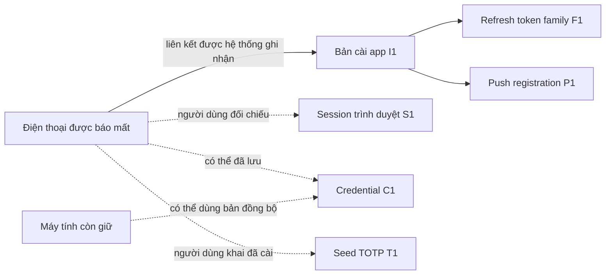
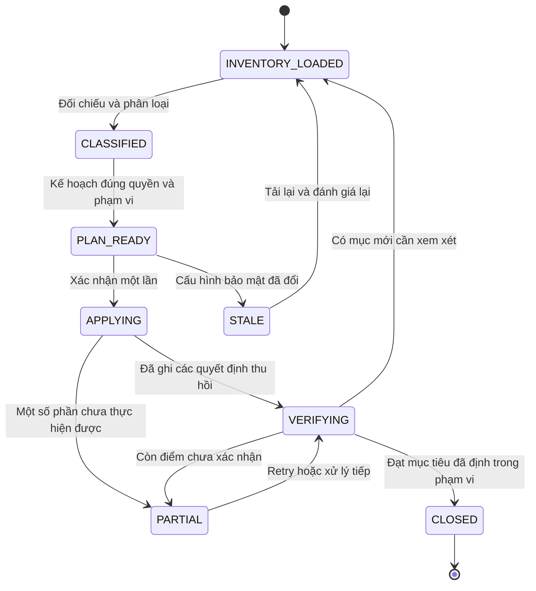

# Rà soát danh sách thiết bị khi khôi phục tài khoản sau mất thiết bị

## 1. Mục tiêu và phạm vi

Bài **Device inventory review**, thuộc chương **Device Loss Recovery**, trình bày cách giúp người dùng và hệ thống xác định những quyền truy cập có thể còn tồn tại trên thiết bị đã mất. Bài thuộc module `SECURITY_AUTHENTICATION_ACCOUNT_RECOVERY`: thiết kế khôi phục an toàn khi mất mật khẩu, MFA, passkey hoặc thiết bị xác thực, với đánh giá rủi ro, token dùng một lần, xác minh danh tính, chống lạm dụng và kiểm soát session.

Trong bối cảnh này, “danh sách thiết bị” không chỉ là một bảng tên điện thoại và máy tính. Nó là góc nhìn về các phiên đăng nhập, ứng dụng, token và phương thức xác thực mà dịch vụ biết được, kèm thông tin giúp người dùng nhận diện và chọn hành động phù hợp.

Một điện thoại mất có thể chứa trình duyệt đang đăng nhập, ứng dụng với refresh token, passkey, ứng dụng TOTP và SIM nhận mã khôi phục. Đăng xuất một phiên trình duyệt chưa vô hiệu hóa tất cả những quyền đó. Ngược lại, thu hồi một passkey được đồng bộ có thể ảnh hưởng cả các thiết bị người dùng vẫn còn giữ.

Sau bài này, người học cần giải thích được:

- Dữ liệu nào thực sự đại diện cho thiết bị, phiên, credential và quyền khôi phục.
- Những gì dịch vụ biết chắc, chỉ suy đoán hoặc không thể quan sát.
- Cách tổ chức rà soát, xác minh người yêu cầu và lập kế hoạch thu hồi đúng phạm vi.
- Cách chống race condition giữa thu hồi, refresh token và tạo phiên mới.
- Cách xác nhận kết quả mà không hứa xóa dữ liệu hoặc khóa thiết bị ngoài quyền kiểm soát của dịch vụ.

Các mô hình dữ liệu, API và tên trạng thái bên dưới là **thiết kế minh họa**. Chúng cần điều chỉnh theo kiến trúc và mức tác động của tài khoản; không phải tuyên bố một hệ thống đã tự đáp ứng các mức bảo đảm của NIST.

## 2. Phân biệt thiết bị với các đối tượng bảo mật

### 2.1. Một hàng “thiết bị” có thể đại diện cho nhiều thứ

| Đối tượng | Ý nghĩa | Việc xóa hoặc thu hồi tác động tới đâu? |
| --- | --- | --- |
| Thiết bị vật lý | Điện thoại, máy tính, khóa bảo mật mà người dùng sở hữu | Dịch vụ web thông thường không tự quản lý toàn bộ thiết bị |
| Bản cài đặt ứng dụng | Một lần cài app hoặc một client instance | Chỉ có giá trị bảo mật khi liên kết và khóa của instance được xác minh phù hợp |
| Phiên trình duyệt | Quyền truy cập gắn với session của dịch vụ | Thu hồi session đó; chưa tự thu hồi mọi quyền khác trên cùng máy |
| Token family | Quan hệ giữa refresh token và các lần cấp lại liên quan | Cần chặn cả khả năng tiếp tục xin token theo family |
| Credential | Passkey, khóa bảo mật, seed TOTP hoặc yếu tố khác đã liên kết | Chặn xác thực tương lai bằng credential theo chính sách |
| Bản ghi “thiết bị tin cậy” | Quyền bỏ qua hoặc giảm bước xác minh trong phạm vi cho phép | Thu hồi quyền tin cậy; chưa chắc đăng xuất phiên đang mở |
| Push registration | Đích gửi thông báo hoặc thử thách tới app | Xóa đích giao nhận chưa tự thu hồi session hoặc khóa đăng nhập |
| Kênh khôi phục | Số điện thoại, email hoặc phương thức dự phòng | Thay đổi cần quy trình riêng; không mặc định làm theo việc xóa một hàng thiết bị |
| Ủy quyền ứng dụng | Quyền ứng dụng khác truy cập tài khoản | Có thể tồn tại ngoài các session hiển thị trong danh sách thông thường |

Không sử dụng một trường `device_id` để thay cho toàn bộ các định danh trên. Nếu mỗi loại quyền có vòng đời khác nhau, cần giữ danh tính và trạng thái riêng cho chúng.

### 2.2. Một thiết bị có nhiều phiên; một credential có thể dùng ở nhiều thiết bị

Người dùng có thể đăng nhập cùng dịch vụ bằng hai trình duyệt và một app trên điện thoại. Ba lần đăng nhập có thể tạo ba nhóm quyền khác nhau. Một máy tính dùng nhiều profile cũng có thể xuất hiện nhiều lần.

Tài liệu Google Account giải thích rằng một thiết bị có thể có nhiều session và thời gian hoạt động hiển thị có thể gồm đồng bộ nền. Đây là ví dụ thực tế cho việc không đồng nhất số hàng với số máy vật lý. Xem [Google — See devices with account access](https://support.google.com/accounts/answer/3067630?hl=en).

Trong chiều ngược lại, một credential đồng bộ có thể được sử dụng từ nhiều thiết bị. Nếu người dùng xác thực trên máy tính thông qua điện thoại, credential sử dụng trong lần xác thực cũng chưa chắc được lưu trên chính máy tính đang mở trình duyệt.

### 2.3. Đồ thị quyền truy cập thay cho một cột tên máy



Nét đứt biểu thị quan hệ cần đối chiếu, không phải bằng chứng hệ thống đã biết chắc vị trí của khóa. Với TOTP, máy chủ thường không có danh sách đầy đủ những nơi seed đã được sao chép. Với passkey đồng bộ, dịch vụ cũng thường không có bản đồ đầy đủ từng bản sao trên từng máy.

Mục đích của đồ thị là giúp chọn đúng quyền cần xử lý. Nó không tự biến danh sách thiết bị của ứng dụng thành hệ thống kiểm kê phần cứng hoặc quản lý thiết bị từ xa.

## 3. Danh sách cần cung cấp những dữ liệu nào?

### 3.1. Thông tin tối thiểu để người dùng nhận diện

| Dữ liệu | Giá trị sử dụng | Giới hạn cần thể hiện |
| --- | --- | --- |
| Nhãn thiết bị do người dùng đặt | Giúp nhận ra máy quen | Có thể cũ, trùng hoặc bị sửa; không là bằng chứng sở hữu |
| Loại client, trình duyệt và hệ điều hành quan sát được | Phân biệt app với browser | Có thể bị giảm chi tiết hoặc giả mạo |
| Thời điểm tạo hoặc liên kết | Nhận biết mục mới xuất hiện quanh sự cố | Chưa chứng minh ai là người tạo |
| Lần xác thực gần nhất | Đối chiếu một sự kiện đăng nhập | Khác thời điểm request hoặc đồng bộ gần nhất |
| Lần giao tiếp gần nhất | Nhận biết quyền còn đang được sử dụng | Có thể là app chạy nền, không phải người đang cầm máy |
| Phương thức dùng để xác thực | Giúp xem session được tạo bằng credential nào | Không chứng minh credential chỉ nằm trên thiết bị đó |
| IP hoặc vị trí gần đúng, nếu cần | Cung cấp tín hiệu để đối chiếu | Không khẳng định vị trí vật lý chính xác hoặc chủ thể đang dùng |
| Nhóm quyền liên quan | Cho biết có session, refresh token, trust hay push | Cần phân biệt liên kết đã xác minh với liên kết suy đoán |
| Trạng thái truy cập máy chủ | Cho biết quyền còn hiệu lực, đình chỉ hoặc bị thu hồi | Không thay bằng nhãn người dùng “không nhận ra” |
| Độ mới của nguồn dữ liệu | Biết danh sách có thể đang chậm | Tránh suy luận không có hàng nghĩa là không có quyền |

Không cần thu thập serial, IMEI, địa chỉ MAC hoặc vị trí chính xác chỉ để tạo một màn hình rà soát cơ bản. Nếu một kiến trúc quản lý thiết bị có nhu cầu riêng, phải xác định nguồn, quyền và mục đích phù hợp; ứng dụng web không được giả định có sẵn những định danh này.

### 3.2. Ba thời điểm không được gọi chung là “hoạt động cuối”

```text
last_authenticated_at: lần chứng minh credential gần nhất
last_request_at:       lần dịch vụ chấp nhận giao tiếp gần nhất
last_observed_at:      lần hệ thống nhận một quan sát, kể cả không thành công
```

Một request bị từ chối sau thu hồi có thể làm tăng `last_observed_at`, nhưng không làm session có hiệu lực trở lại. Nếu giao diện cập nhật “đang hoạt động” từ bất kỳ request nào, người dùng sẽ hiểu nhầm rằng việc thu hồi thất bại.

Thời gian hiển thị cần có múi giờ hoặc định dạng tương đối đủ rõ. Một bản ghi cũ không hoạt động gần đây vẫn có thể chứa refresh token còn hạn. Không tự xếp nó vào nhóm an toàn chỉ vì người dùng không thấy hoạt động mới.

### 3.3. Phân loại nguồn và độ tin cậy

Thiết kế có thể phân biệt:

- **Bản ghi có thẩm quyền:** session hoặc grant mà máy chủ thực sự quản lý.
- **Quan sát đã được xác thực:** client instance chứng minh kiểm soát khóa đã liên kết.
- **Thông tin client tự khai:** nhãn, phiên bản hoặc dữ liệu môi trường chưa có bảo đảm độc lập.
- **Suy luận:** nhóm các session vì tên hoặc dấu hiệu tương tự.
- **Thông tin do người dùng xác nhận:** họ nhận ra hoặc khai đã mất thiết bị, có thời điểm và ngữ cảnh.

Không gắn nhãn “thiết bị đã xác minh” chỉ vì client gửi một chuỗi cài đặt cố định. Chuỗi đó có thể được sao chép hoặc đặt lại. Muốn có ràng buộc mật mã với client instance cần một cơ chế khóa và xác minh riêng.

## 4. Cách đọc các tín hiệu dễ gây hiểu nhầm

### 4.1. Cùng tên không chắc là cùng máy

Hai hàng “Chrome trên Windows” có thể là cùng máy với hai profile, hoặc hai máy hoàn toàn khác. Nếu chỉ dựa vào tên để gộp rồi thu hồi, hệ thống có thể bỏ sót hoặc ảnh hưởng nhầm.

Khi không có liên kết đáng tin cậy, hãy hiển thị các session riêng hoặc ghi rõ rằng đó là một nhóm suy đoán. Hành động “đăng xuất nhóm này” cần liệt kê phạm vi thực tế mà máy chủ sẽ áp dụng.

### 4.2. “Thiết bị này” phải được xác định từ context hiện tại

Đánh dấu session hiện tại dựa trên session đang được máy chủ xác thực. Không so chuỗi User-Agent hoặc nhận một `currentDevice=true` do client gửi để tự loại trừ hàng đó khỏi thao tác thu hồi.

Nếu người dùng đang làm việc trên một trình duyệt mà họ cũng nghi bị xâm phạm, nhãn “thiết bị này” không có nghĩa an toàn. Cần hướng họ chuyển sang một context đáng tin cậy nếu có và thực hiện quy trình khôi phục tương ứng.

### 4.3. Vị trí lạ chưa đủ kết luận bị chiếm đoạt

IP mạng di động, mạng công ty, VPN hoặc proxy có thể tạo vị trí gần đúng khác với nơi người dùng nhớ. Ngược lại, IP quen không bảo đảm người gọi hợp lệ nếu cùng mạng hoặc nếu session đã bị đánh cắp.

Vị trí, thời gian, loại client và phương thức xác thực nên được xem cùng nhau. Chúng hỗ trợ quyết định điều tra hoặc tăng mức kiểm tra; không thay bằng chứng quyền sở hữu tài khoản.

### 4.4. Không nhìn thấy trong danh sách chưa chứng minh không có truy cập

Danh sách có thể chỉ bao phủ session của một dịch vụ, chưa bao gồm API key, app password, grant của ứng dụng khác, session ở nhà cung cấp danh tính hoặc quyền trong một tenant khác.

Cần công bố phạm vi ngay trên luồng rà soát, bằng ngôn ngữ người dùng hiểu: danh sách đang hiển thị quyền nào, dữ liệu cập nhật đến đâu và phần nào cần kiểm tra ở nơi khác. Không trình bày một màn hình chưa đủ nguồn như bằng chứng đã rà soát toàn bộ tài khoản.

## 5. Passkey, TOTP và các phương thức có thể nằm trên thiết bị mất

### 5.1. Passkey đồng bộ không tạo bản đồ máy vật lý đầy đủ

FIDO phân biệt passkey được đồng bộ giữa thiết bị với passkey gắn với một thiết bị. Vì có đồng bộ, một credential có thể vẫn được dùng từ máy người dùng còn giữ. Xem [FIDO Alliance — Passkeys](https://fidoalliance.org/passkeys/).

Hệ quả thiết kế là dịch vụ không được hứa “xóa riêng bản passkey trên điện thoại đã mất” nếu chỉ có quyền từ chối credential tại máy chủ. Thu hồi credential đó có thể chặn cả các bản sao dùng cùng credential ở những máy khác. Ngược lại, đăng xuất riêng một session không thu hồi khả năng xác thực lại bằng passkey còn được chấp nhận.

Nếu cần giảm phạm vi ảnh hưởng, phải có cơ sở về loại credential, liên kết và khả năng quản lý của hệ sinh thái đang dùng; không suy luận từ tên “passkey điện thoại”.

### 5.2. Metadata WebAuthn không phải số serial của thiết bị

Trong WebAuthn, AAGUID biểu thị loại authenticator, không định danh riêng từng thiết bị. Các cờ backup eligibility và backup state mô tả khả năng sao lưu cùng trạng thái sao lưu, không cung cấp danh sách số lượng hoặc tên những máy có bản sao.

Signature counter cũng là tín hiệu cần diễn giải: có authenticator dùng giá trị 0, và giá trị không tăng có thể liên quan clone, lỗi hoặc thứ tự xử lý. Không dùng riêng counter để kết luận chắc chắn máy nào bị chiếm. Tham chiếu [W3C WebAuthn — Authenticator Data](https://www.w3.org/TR/webauthn-3/#sctn-authenticator-data).

Giao diện có thể dùng metadata đã được xác minh để giải thích phạm vi rủi ro, nhưng quyết định thu hồi vẫn phải nói rõ credential nào sẽ không còn được chấp nhận.

### 5.3. TOTP, SIM và push cần quyết định riêng

Với TOTP, seed có thể đã được sao lưu hoặc sao chép mà dịch vụ không quan sát được. Nếu seed bị xác định không an toàn, cần thay seed theo quy trình gắn yếu tố mới; xóa hàng “điện thoại” khỏi danh sách không làm mã TOTP cũ ngừng hợp lệ.

SIM và số điện thoại là một kênh khác với app. Thu hồi push registration không vô hiệu hóa SIM; thay SIM cũng không tự thu hồi session của app. Khả năng nhận email hoặc SMS trên máy mất cần được đánh giá cùng các phương thức khôi phục liên quan.

Khóa bảo mật rời có thể còn ở nơi an toàn dù điện thoại mất. Ngược lại, nếu khóa nằm trong cùng túi bị mất thì cần xem xét nó trong cùng sự cố. Quan hệ thực tế này cần được người dùng đối chiếu; hệ thống không tự biết đầy đủ vị trí vật lý của các vật mang credential.

## 6. Ai được xem và thực hiện rà soát?

### 6.1. Danh sách thiết bị cũng là dữ liệu nhạy cảm

Danh sách có thể tiết lộ thói quen hoạt động, nền tảng đang sử dụng, địa điểm gần đúng và phương thức bảo mật của tài khoản. Một người chỉ biết email hoặc tên đăng nhập không được đọc danh sách đó.

Phân quyền nên tách các khả năng:

| Quyền minh họa | Phạm vi |
| --- | --- |
| `REPORT_DEVICE_LOSS` | Tiếp nhận báo mất theo kênh được chính sách cho phép |
| `VIEW_LIMITED_INVENTORY` | Xem phần dữ liệu tối thiểu trong context khôi phục đã được xác minh |
| `VIEW_SECURITY_INVENTORY` | Xem các thông tin bảo mật được cấp quyền của chính tài khoản |
| `REVOKE_SELECTED_ACCESS` | Thu hồi các đối tượng cụ thể trong kế hoạch được duyệt |
| `REVOKE_ALL_ACCOUNT_ACCESS` | Áp dụng biện pháp rộng với tác động đã được xác nhận |
| `MANAGE_AUTHENTICATORS` | Thu hồi hoặc thay yếu tố theo chính sách riêng |

Một grant xem danh sách không tự có quyền tắt MFA, đổi email hoặc gắn passkey mới. Mỗi tham chiếu trong URL hoặc body đều cần được kiểm tra thuộc đúng tài khoản và tenant, kể cả khi ID khó đoán. Các nguyên tắc từ chối mặc định và kiểm tra quyền trên mọi request được nêu trong [OWASP Authorization](https://cheatsheetseries.owasp.org/cheatsheets/Authorization_Cheat_Sheet.html).

### 6.2. Xác minh bằng phương thức còn phù hợp

Người dùng có thể còn session trên máy khác, khóa bảo mật dự phòng, passkey còn an toàn hoặc mã khôi phục đã cấp. Hệ thống chọn cách xác minh theo hành động và mức rủi ro, không chỉ vì người gọi đang có một cookie.

Nếu người dùng chỉ có grant khôi phục hạn chế, cung cấp đúng mức thông tin cần cho bước rà soát. Không mở toàn bộ lịch sử IP và phương thức bảo mật chỉ để họ chọn một thiết bị có thể đã mất.

Khi không còn bằng chứng đủ cho quyền thay đổi, tiếp tục quy trình khôi phục tương ứng. Không dùng việc người yêu cầu nhận ra đúng tên máy hoặc lịch sử hoạt động làm bằng chứng thay thế: những thông tin đó có thể đã bị lộ hoặc được xem trên chính máy mất.

### 6.3. Bảo vệ trước mắt không phải chờ rà soát xong

Một báo mất có căn cứ có thể cho phép đình chỉ một phương thức theo chính sách, dù người dùng chưa đủ điều kiện gắn yếu tố mới. Quyền làm giảm nguy cơ trước mắt và quyền thiết lập lại truy cập là hai phạm vi cần đánh giá riêng.

NIST có hướng dẫn về đình chỉ hoặc vô hiệu hóa authenticator bị mất, bị đánh cắp hoặc bị xâm phạm, cùng cách báo cáo bằng phương thức dự phòng. Việc xử lý phương thức không an toàn cần kịp thời, không phụ thuộc việc người dùng đã đọc xong toàn bộ danh sách. Tham chiếu [NIST — Loss, Theft, Damage, and Compromise](https://pages.nist.gov/800-63-4/sp800-63b.html).

Tuy nhiên, một thông báo chưa xác minh từ người ngoài không được tự khóa toàn bộ tài khoản. Chính sách cần xét độ tin cậy, tác động và khả năng bị lạm dụng của từng biện pháp bảo vệ.

## 7. Quy trình rà soát theo từng bước

### Bước 1 — Làm việc từ context đáng tin cậy còn lại

Người dùng mở luồng bảo mật trên một thiết bị còn kiểm soát được hoặc qua kênh khôi phục phù hợp. Hệ thống xác minh quyền xem và quyền thao tác; nếu cần xác thực lại thì dùng phương thức không phụ thuộc vào thiết bị đã khai mất theo chính sách.

Không yêu cầu chấp thuận push trên chính máy bị mất làm con đường duy nhất. Cũng không gửi một liên kết có quyền toàn tài khoản tới email vừa được người yêu cầu nhập mà chưa có quan hệ xác minh với tài khoản.

### Bước 2 — Hiển thị phạm vi và độ mới của danh sách

Giao diện cho biết các nhóm đang được kiểm kê: phiên trình duyệt, ứng dụng đã đăng nhập, phương thức xác thực và các quyền liên quan mà dịch vụ quản lý. Mỗi nguồn có thời điểm cập nhật và trạng thái đầy đủ hoặc thiếu dữ liệu.

Nếu nguồn token của app đang không truy cập được, hiển thị phần đó chưa xác nhận được. Không thay lỗi nguồn bằng danh sách rỗng. Phần đã lấy được vẫn có thể giúp thực hiện các biện pháp bảo vệ phù hợp, nhưng kết quả tổng thể không được ghi là đã rà soát đầy đủ.

### Bước 3 — Đối chiếu thiết bị mất và các mục bất thường

Người dùng đối chiếu nhãn, loại client, thời gian xác thực, hoạt động và phương thức sử dụng. Họ có thể phân loại một mục là nhận ra, không còn sử dụng, đã mất hoặc không nhận ra.

Một phân loại của người dùng là thông tin đầu vào, chưa tự thay đổi trạng thái truy cập máy chủ. Đánh dấu “đã mất” có thể mở kế hoạch xử lý, nhưng không được âm thầm biến mọi mục cùng tên thành một thiết bị vật lý.

### Bước 4 — Mở rộng từ hàng được chọn sang các quyền liên quan

Ví dụ, chọn một app trên điện thoại có thể gợi ý xem xét refresh token family, quyền tin cậy và push registration của client instance đó. Quan hệ nào có bằng chứng thì dùng để lập kế hoạch; quan hệ chỉ suy đoán phải được ghi rõ.

Đồng thời, hỏi về những quyền không hiện thành hàng rõ ràng: seed TOTP, SIM nhận SMS, credential đồng bộ, email đang mở trên máy, mã khôi phục lưu trong ảnh hoặc kho mật khẩu. Không yêu cầu người dùng gửi các bí mật này lên để chứng minh.

### Bước 5 — Xác nhận tác động của kế hoạch

Máy chủ xây dựng một kế hoạch có danh sách đích cụ thể và giải thích kết quả. Ví dụ:

> Đăng xuất hai phiên đã chọn, chặn việc cấp token mới từ ứng dụng đã chọn và thu hồi quyền ghi nhớ MFA của ứng dụng đó. Passkey và phương thức nhận SMS sẽ được xem xét riêng.

Nếu kế hoạch thu hồi một credential đồng bộ hoặc đăng xuất toàn tài khoản, nêu phạm vi ảnh hưởng trước khi xác nhận. Không dùng nút “Xóa thiết bị” cho một thao tác vừa gỡ hiển thị, vừa gỡ MFA và xóa lịch sử mà không phân biệt.

### Bước 6 — Thực thi và hiển thị kết quả từng phần

Thao tác có thể gồm những việc dịch vụ áp dụng ngay và những việc chờ hệ thống khác. Cần phân biệt “đã ghi nhận yêu cầu”, “đã chặn tại máy chủ có thẩm quyền” và “đã xác nhận thực thi tại các điểm cần thiết”.

Khi một phần thất bại, giữ nguyên những quyền đã được thu hồi. Không tự bật lại session nguy hiểm để đưa giao diện về trạng thái trước thao tác. Ghi rõ phần còn chờ và cho phép retry có kiểm soát.

### Bước 7 — Rà soát lại và củng cố lối truy cập an toàn

Tải lại danh sách từ trạng thái mới nhất, kiểm tra những mục mới xuất hiện và đối chiếu các phương thức còn lại. Xác nhận người dùng có cách đăng nhập phù hợp, hoặc hồ sơ khôi phục vẫn đang mở nếu chưa đạt điều kiện.

Nếu thiết bị mất chứa yếu tố cuối cùng, không giữ yếu tố đã xác định nguy hiểm chỉ để tránh gián đoạn. Cần xử lý nguy cơ và tiếp tục quy trình thiết lập lại truy cập theo bằng chứng được chấp nhận.

## 8. Phân loại của người dùng và trạng thái bảo mật

### 8.1. Hai chiều dữ liệu riêng biệt

| Chiều dữ liệu | Ví dụ giá trị | Ai quyết định? |
| --- | --- | --- |
| Người dùng nhận diện | `RECOGNIZED`, `NO_LONGER_USED`, `LOST`, `UNRECOGNIZED` | Người dùng được xác minh hoặc người xử lý hồ sơ có quyền |
| Trạng thái quyền truy cập | `ACTIVE`, `SUSPENDED`, `REVOKED`, `EXPIRED` | Thành phần máy chủ có thẩm quyền |
| Độ chắc chắn của liên kết thiết bị | `VERIFIED_BINDING`, `OBSERVED`, `INFERRED`, `UNKNOWN` | Chính sách dựa trên nguồn dữ liệu |
| Kết quả hành động | `REQUESTED`, `ENFORCED`, `PARTIAL`, `FAILED` | Quá trình thực thi và xác nhận |

Một session có thể được người dùng nhận ra nhưng đã bị thu hồi vì nằm trên máy mất. Một hàng không nhận ra có thể thực chất là phiên của chính người dùng sau khi reset máy. Việc họ chọn “nhận ra” không được tự kích hoạt lại quyền đã thu hồi.

### 8.2. Trạng thái của một phiên rà soát



Sơ đồ mô tả luồng chính; mỗi grant và kế hoạch còn có hạn, điều kiện hủy và quyền tiếp tục riêng. Một phiên rà soát có thể hoàn tất trong phạm vi dịch vụ mà hồ sơ khôi phục tài khoản tổng thể vẫn chưa kết thúc.

`CLOSED` không có nghĩa dịch vụ đã chứng minh không còn bản sao dữ liệu trên thiết bị vật lý. Nó chỉ phản ánh mục tiêu đã công bố của phiên rà soát này.

## 9. Mô hình dữ liệu và API minh họa

### 9.1. Tách bản ghi có thẩm quyền khỏi màn hình tổng hợp

```text
AccessSession
  session_ref / account_id / tenant_id
  client_instance_ref
  authenticated_with_credential_ref
  created_at / last_authenticated_at / last_accepted_request_at
  account_epoch_at_issue
  state / revoked_at / version

RefreshTokenFamily
  family_ref / account_id / tenant_id / client_id
  client_instance_ref / originating_session_ref
  state / family_version / revoked_at

AuthenticatorBinding
  binding_ref / account_id / tenant_id
  type / state / enrolled_at / last_used_at
  backup_metadata_if_verified
  version / revoked_at

DeviceInventoryProjection
  entry_ref / account_id / tenant_id
  display_label / client_summary
  source_refs_with_relationship_quality
  last_observed_at / source_updated_at
  source_coverage / projection_revision
```

Các trường tham chiếu phục vụ quản lý; chúng không phải cookie hoặc token bearer. Bảng tổng hợp giúp hiển thị nhanh nhưng không được là nguồn quyết định duy nhất để chấp nhận request hoặc refresh token.

Ngoài các bảng trên, cần quản lý riêng remembered-device grant, push registration và quyền ứng dụng nếu sản phẩm có chúng. Việc liên kết được bao nhiêu loại quyền phải được thể hiện trong phạm vi kiểm kê.

### 9.2. Hai loại phiên bản cho hai mục tiêu

`projection_revision` có thể thay đổi vì cập nhật hiển thị hoặc hoạt động gần nhất. Không nên làm người dùng phải xác nhận lại toàn bộ kế hoạch chỉ vì một lần đồng bộ nền cập nhật timestamp.

`inventory_security_version` thay đổi khi thành phần có ý nghĩa bảo mật được thêm, thu hồi hoặc thay quyền theo mô hình điều phối. Kế hoạch chụp phiên bản này cùng phiên bản của từng đích. Một credential hoặc grant mới xuất hiện có thể khiến kế hoạch phải được xem lại.

`account_security_epoch` phục vụ biện pháp thu hồi toàn tài khoản khi được chọn. Không tăng epoch toàn tài khoản rồi hứa rằng chỉ một thiết bị bị ảnh hưởng. Với thu hồi chọn lọc, cần cơ chế tại session, token family hoặc ràng buộc client tương ứng.

Nếu các nguồn do nhiều miền quản lý, không tự tuyên bố có một số phiên bản toàn cục hoàn hảo. Có thể cần ảnh chụp nhiều phiên bản và trạng thái từng nguồn; kế hoạch phải thừa nhận phần chưa đủ nhất quán.

### 9.3. DTO không chứa bí mật truy cập

Ví dụ Java sau minh họa dữ liệu trả về sau kiểm tra quyền, không phải mô hình xác thực hoàn chỉnh:

```java
import java.time.Instant;
import java.util.List;
import java.util.UUID;

public record DeviceReviewItem(
        UUID reference,
        String displayLabel,
        String clientSummary,
        Instant lastAuthenticatedAt,
        Instant lastAcceptedRequestAt,
        Instant sourceUpdatedAt,
        AccessState accessState,
        LinkQuality linkQuality,
        List<UUID> relatedReferences) {

    public DeviceReviewItem {
        relatedReferences = List.copyOf(relatedReferences);
    }

    public enum AccessState {
        ACTIVE, SUSPENDED, REVOKED, EXPIRED, UNKNOWN
    }

    public enum LinkQuality {
        VERIFIED_BINDING, OBSERVED, INFERRED, UNKNOWN
    }
}
```

Không trả raw session ID dùng để đăng nhập, access token, refresh token, seed TOTP hoặc private key. `reference` chỉ là tham chiếu đối tượng và không thay việc kiểm tra quyền cho thao tác tiếp theo. Nhãn client cần được hiển thị như văn bản, tránh chèn HTML từ giá trị do người dùng hoặc client đặt.

### 9.4. API minh họa

| Endpoint | Quyền và kết quả |
| --- | --- |
| `GET /account/security/inventory` | Đọc danh sách được phép, kèm phạm vi và độ mới từng nguồn |
| `POST /account/security/inventory/reviews` | Tạo phiên rà soát trong context đã xác minh |
| `PUT /account/security/inventory/reviews/{id}/classifications` | Lưu nhận diện của người dùng; chưa tự đổi quyền truy cập |
| `POST /account/security/inventory/reviews/{id}/plans` | Máy chủ lập danh sách tác động dựa trên dữ liệu có thẩm quyền |
| `POST /account/security/inventory/plans/{id}/confirm` | Xác nhận đúng phiên bản kế hoạch và quyền hành động |
| `GET /account/security/inventory/plans/{id}/result` | Đọc kết quả theo quyền, gồm phần còn chờ hoặc thất bại |

API dựa trên cookie cần bảo vệ request thay đổi trạng thái theo cơ chế CSRF phù hợp. `GET` không thu hồi quyền. Phân trang cũng cần giữ phạm vi và context của ảnh chụp, tránh mô tả trang đầu như toàn bộ kết quả.

## 10. Từ lựa chọn trên giao diện tới kế hoạch thu hồi

### 10.1. Không giao quyền quyết định phạm vi cho client

Client có thể gửi các tham chiếu muốn xử lý. Máy chủ phải kiểm tra quyền trên từng đối tượng, xây dựng quan hệ liên quan và tính tác động. Không chấp nhận `account_id` hoặc `keep_current_session` tự khai để vượt kiểm tra.

Một kế hoạch minh họa:

```text
InventoryActionPlan
  plan_id / review_id / account_id / tenant_id
  plan_version
  expected_inventory_security_version
  selected_source_refs_and_versions
  session_targets
  refresh_family_targets
  authenticator_targets
  remembered_device_grant_targets
  push_registration_targets
  global_account_revocation_requested
  evidence_ref / approved_scope / policy_version
  expires_at / confirmation_consumed_at
  execution_status / per_target_results
```

Danh sách đích thuộc phần kế hoạch đã được duyệt. Endpoint xác nhận không nhận thêm một tập ID tùy ý để mở rộng tác động sau khi người dùng đã xem thông tin.

### 10.2. Chọn lọc hay toàn tài khoản?

| Hoàn cảnh | Cách tiếp cận có thể phù hợp | Điều phải làm rõ |
| --- | --- | --- |
| Xác định chắc một session trên máy không còn dùng | Thu hồi session đó và các quyền liên quan có căn cứ | Những session khác có thể vẫn còn trên cùng máy |
| Mất điện thoại có app và nhiều phiên | Thu hồi những nhóm quyền được liên kết đáng tin cậy; rà soát yếu tố nằm trên máy | Tên máy không đủ để khẳng định đã chọn hết |
| Không chắc session nào thuộc máy mất | Cân nhắc biện pháp rộng theo chính sách và bằng chứng | Người dùng có thể phải đăng nhập lại trên các máy còn giữ |
| Có dấu hiệu account takeover | Xử lý sự cố rộng, xem cả phương thức và quyền mới được thêm | Đăng xuất đơn lẻ chưa ngăn xác thực lại bằng credential bị lộ |
| Passkey đồng bộ có thể bị truy cập trái phép | Đánh giá thu hồi credential và bảo vệ hệ sinh thái đồng bộ | Tác động có thể tới nhiều máy cùng dùng credential |

Không áp dụng một lựa chọn duy nhất cho mọi tài khoản. Quyết định cần dựa trên bằng chứng liên kết, mức rủi ro và khả năng thực thi, đồng thời giữ lối khôi phục phù hợp khi quyền còn lại không đủ.

### 10.3. Xác nhận có phạm vi và dùng một lần

Quyền xác nhận kế hoạch cần ngắn hạn, đúng tài khoản, tenant, `plan_id`, `plan_version` và phạm vi. Nếu biểu diễn bằng token bearer, dùng bí mật đủ mạnh, bảo vệ bản lưu và giao nhận, rồi tiêu thụ nguyên tử. Không đưa quyền toàn tài khoản vào một liên kết chỉ dùng để báo mất thiết bị.

Các thay đổi quan trọng của kế hoạch làm quyền xác nhận cũ hết phù hợp. Không kéo dài grant âm thầm khi hồ sơ xem xét mất nhiều thời gian; cấp quyền mới sau đánh giá theo chính sách.

## 11. Thực thi thu hồi mà không tạo cửa sổ truy cập mới

### 11.1. Những thao tác phải được phối hợp

Đối với một miền dữ liệu có thể giao dịch nhất quán, việc xác nhận kế hoạch, đánh dấu quyền bị thu hồi, tiêu thụ quyền xác nhận và ghi sự kiện cần được phối hợp nguyên tử.

Giả mã sau mô tả các bất biến; không phải mã service có thể sao chép chạy ngay:

```text
applyInventoryPlan(callerContext, planId, confirmation):
    validateRequestProtection()
    identity := verifyCallerContext(callerContext)

    begin transaction
        account := lockAccount(identity.accountId)
        plan := lockPlan(planId)
        permission := lockConfirmationPermission(confirmation)
        now := trustedClock()

        require sameAccountAndTenant(identity, account, plan, permission)
        require permission.planId == plan.id
        require permission.planVersion == plan.version
        require permission active and unused and unexpired at now
        require plan.state == PLAN_READY
        require now < plan.expiresAt
        require evidenceStillSatisfiesActionPolicy(identity, plan, now)
        require account.inventorySecurityVersion == plan.expectedSecurityVersion
        require eachTargetStillOwnedByAccountAndMatchesApprovedVersion(plan)
        require scopeAndImpactStillAllowed(plan, account)
        require safeContinuationOrRecoveryPathHasBeenConsidered(plan)
        require consumeConfirmationExactlyOnce(permission)

        for each local session in plan.sessionTargets:
            mark session REVOKED
        for each local refresh family in plan.refreshFamilyTargets:
            mark family REVOKED and increment family version
        for each local authenticator in plan.authenticatorTargets:
            revoke or suspend according to approved action
        for each local remembered-device grant in plan.trustTargets:
            mark grant REVOKED
        for each local push registration in plan.pushTargets:
            mark registration inactive

        if plan.globalAccountRevocationRequested:
            increment account.securityEpoch

        increment account.inventorySecurityVersion
        storePerTargetLocalResults(plan)
        recordAuditWithoutSecrets(plan)
        appendOutboxForProjectionAndExternalActions(plan)
        mark plan LOCAL_ENFORCED_OR_EXTERNAL_PENDING
    commit transaction

    return scopedReceiptWithoutCreatingLoginSession()
```

`safeContinuationOrRecoveryPathHasBeenConsidered` không được hiểu là phải giữ yếu tố đã biết nguy hiểm. Nó yêu cầu quyết định rõ lối tiếp theo, kể cả trường hợp cần tiếp tục khôi phục vì hiện chưa còn phương thức đủ điều kiện.

Các đích bên ngoài miền transaction được ghi thành tác vụ riêng, có kết quả riêng. Không dùng nhãn thành công chung để che việc một phần chưa được thực thi.

### 11.2. Race giữa refresh token và thu hồi

Một token family có thể đang được dùng để cấp access token mới đúng lúc người dùng xác nhận thu hồi. Nếu luồng refresh chỉ đọc trạng thái rồi cấp token ở một bước độc lập, nó có thể tạo thêm quyền sau quyết định thu hồi.

Cần cùng một cơ chế điều phối tại nơi có thẩm quyền: khóa hoặc phiên bản family, kiểm tra trạng thái khi cấp, cùng khả năng chặn token liên quan tại nơi sử dụng. Token được cấp trong khoảng cạnh tranh cũng phải thuộc phạm vi thu hồi có thể thực thi.

Với public client OAuth, RFC 9700 yêu cầu dùng sender-constrained refresh token hoặc refresh token rotation để phát hiện replay. Rotation vẫn cần xử lý cả quan hệ token, không chỉ xóa một token cũ trong family. Tham chiếu [RFC 9700 — Refresh Token Protection](https://www.rfc-editor.org/rfc/rfc9700.html#section-4.14).

Nếu family đã `REVOKED`, một lần refresh cũ đến muộn không được tạo family mới với trạng thái hoạt động. Đổi client-supplied device ID cũng không được làm token đó thoát khỏi quan hệ đã bị thu hồi.

### 11.3. Race giữa xác thực credential và tạo session

Tương tự, có thể xảy ra chuỗi:

```text
T1: kiểm tra chữ ký credential C1, thấy C1 đang ACTIVE
T2: thu hồi C1 do thiết bị bị mất
T3: luồng T1 tiếp tục tạo session mới từ kết quả kiểm tra cũ
```

Chỉ kiểm tra C1 ở T1 là chưa đủ. Việc phát hành session cần đối chiếu trạng thái hoặc phiên bản credential bằng một cơ chế bảo đảm không bỏ lọt quyết định thu hồi tại T2.

Nếu hệ thống chỉ thu hồi session mà vẫn chấp nhận C1, việc đăng nhập lại bằng C1 có thể là hành vi đúng theo phạm vi đã chọn. Vì vậy, giao diện và kế hoạch phải phân biệt “kết thúc phiên hiện tại” với “không cho đăng nhập lại bằng phương thức này”.

### 11.4. Access token và request đang xử lý

Xóa refresh token không tự làm access token JWT đã phát hành mất hiệu lực. Tùy kiến trúc, cần introspection, kiểm tra epoch hoặc trạng thái session, denylist phù hợp hay một cơ chế khác tại resource server. Thời hạn access token ngắn giúp giới hạn một số cửa sổ, nhưng không đồng nghĩa thu hồi ngay.

Với request đã qua kiểm tra quyền và đang thực hiện, cần xác định hành vi tại điểm ghi dữ liệu nhạy cảm. Nếu tác động yêu cầu bảo đảm cao, có thể cần đối chiếu trạng thái lại ở cổng thực hiện. Thu hồi không thể tự đảo ngược dữ liệu đã bị đọc hoặc sao chép trước đó.

### 11.5. Thu hồi toàn tài khoản không ngăn tái đăng nhập bằng bí mật còn lộ

Epoch mới làm các quyền được phát hành theo epoch cũ không còn hợp lệ khi cơ chế kiểm tra được áp dụng. Tuy nhiên, người giữ mật khẩu hoặc credential vẫn được chấp nhận có thể xin một phiên mới.

Do đó, khi nghi account takeover, cần xem xét cả các authenticator và kênh khôi phục bị xâm phạm. Rà soát thiết bị là một bước của xử lý sự cố, không thay thế mọi bước còn lại của khôi phục tài khoản.

## 12. Kết quả từng phần, độ trễ và xác nhận sau thực thi

### 12.1. Nguồn có thẩm quyền và giao diện có thể lệch thời điểm

Sau khi thu hồi session, read model có thể vẫn hiển thị hàng cũ vài giây hoặc lâu hơn theo kiến trúc. Hệ thống nên hiển thị kết quả hành động đã được xác nhận và độ mới của nguồn, thay vì tự suy luận từ việc hàng đã biến mất.

Một request bị từ chối từ thiết bị mất có thể xuất hiện sau đó trong lịch sử. Nó không được cập nhật session thành `ACTIVE` hoặc làm hệ thống tạo lại quyền tin cậy. Tách dữ liệu quan sát khỏi trạng thái quyền giúp tránh hiện tượng quyền bị “sống lại”.

Sự kiện cập nhật đến muộn cũng không được ghi đè một quyết định thu hồi mới hơn. Consumer cần xử lý phiên bản hoặc thứ tự sự kiện theo đối tượng, đồng thời chống xử lý lặp.

### 12.2. Mô tả đúng phạm vi thu hồi OAuth

RFC 7009 định nghĩa thu hồi token và cho phép chính sách ảnh hưởng tới các token liên quan; tài liệu cũng lưu ý độ trễ lan truyền trong thực tế cần được giảm thiểu. Vì vậy, phản hồi từ một endpoint không tự chứng minh mọi quyền của mọi client trong tài khoản đều đã bị chặn. Xem [RFC 7009 — Token Revocation](https://www.rfc-editor.org/rfc/rfc7009.html#section-2).

Biên nhận cần nêu đúng những gì dịch vụ biết đã thực hiện, những phần chờ xác nhận và những nguồn không thuộc phạm vi kiểm soát. Không dùng việc đã gửi thông điệp vào hàng đợi làm bằng chứng tác động đã có hiệu lực ở tất cả resource server.

### 12.3. Xử lý lỗi và retry

Một kế hoạch có thể có kết quả như sau:

| Đích | Kết quả | Cách tiếp tục |
| --- | --- | --- |
| Session S1 của dịch vụ | Đã thu hồi tại nguồn có thẩm quyền | Đối chiếu kết quả thực thi theo mô hình hệ thống |
| Token family F1 | Đã thu hồi | Không cho refresh cũ tạo quyền mới |
| Push registration P1 | Tác vụ bên ngoài đang chờ | Retry có giới hạn, trạng thái riêng |
| Quyền ứng dụng X ở hệ thống khác | Chưa thể xác nhận | Chỉ dẫn bước kiểm tra thích hợp hoặc chuyển vận hành |

Mất phản hồi sau commit không cho phép áp dụng lại tác động tùy ý. Idempotency key gắn với tài khoản, kế hoạch và phiên bản; cùng key với nội dung khác phải bị từ chối.

Nếu phiên hiện tại cũng bị thu hồi, response của request đã được cho phép có thể trả biên nhận hẹp. Việc tải kết quả sau đó cần context còn có quyền hoặc một cơ chế đọc biên nhận được giới hạn riêng. Không tự tạo session đăng nhập mới để tránh người dùng phải xác thực lại.

### 12.4. Điều kiện để đóng phiên rà soát

Một phiên có thể được đóng khi:

- Những nguồn thuộc mục tiêu đã được lấy và đối chiếu ở mức cần thiết, hoặc giới hạn phạm vi đã được ghi rõ.
- Các hành động được duyệt đã có kết quả theo mức bảo đảm đã công bố.
- Mục chưa xử lý được có người hoặc luồng tiếp tục chịu trách nhiệm, thay vì bị mất khỏi giao diện.
- Người dùng đã được thông báo phạm vi và bước tiếp theo; khả năng đăng nhập lại hoặc trạng thái khôi phục còn mở đã rõ.

Không dùng một ô “Tôi đã kiểm tra” làm bằng chứng hệ thống đã thu hồi thành công. Cũng không yêu cầu người dùng khẳng định một điều họ không thể biết, như không còn bản sao credential trên bất kỳ máy nào.

## 13. Những việc danh sách thiết bị không tự làm được

### 13.1. Khóa hoặc xóa dữ liệu trên thiết bị vật lý

Đăng xuất tại dịch vụ không đồng nghĩa remote wipe. Dữ liệu đã tải xuống, tài liệu offline, ảnh chụp hoặc bản sao token trong môi trường bị xâm phạm có vòng đời khác.

Nếu hệ điều hành hoặc một hệ thống quản lý thiết bị có khả năng khóa, tìm hoặc xóa máy từ xa, đó là một phạm vi kiểm soát riêng. Luồng tài khoản có thể hướng người dùng tới công cụ thích hợp, nhưng không khẳng định đã thực hiện tác động đó khi chỉ thu hồi quyền ở ứng dụng.

Thiết bị mất đang offline vẫn phải bị chặn truy cập trong tương lai tại máy chủ theo quyết định thu hồi. Tuy nhiên, việc chặn không làm máy chủ thu hồi dữ liệu đã nằm offline trên máy đó.

### 13.2. Phiên nhà cung cấp danh tính và hệ sinh thái đồng bộ

Đăng xuất khỏi một ứng dụng không tự đăng xuất khỏi nhà cung cấp SSO hoặc xóa một passkey trong trình quản lý credential. Nếu session SSO còn an toàn và được phép, nó có thể hỗ trợ đăng nhập lại; nếu bị xâm phạm, cần xử lý ở phạm vi nhà cung cấp đó.

Tương tự, dịch vụ có thể từ chối credential C1 nhưng không tự xóa mọi bản sao private key tại nhà cung cấp passkey. Việc bảo vệ tài khoản đồng bộ, loại thiết bị mất khỏi hệ sinh thái và thu hồi credential tại dịch vụ là những quyết định có quan hệ nhưng khác thẩm quyền.

### 13.3. Khôi phục bằng mọi giá

Khi người dùng mất thiết bị duy nhất chứa những phương thức cần thiết, việc rà soát có thể dừng ở mức tiếp nhận báo cáo hoặc xử lý bảo vệ được cho phép. Không dùng danh sách thiết bị như một bài hỏi đáp bí mật để vượt qua xác minh.

Việc tạo một passkey mới, thay TOTP, đổi số hoặc đặt lại mật khẩu phải thuộc quy trình được phê duyệt cho loại tài khoản. Nếu không đủ bằng chứng, giữ trạng thái chưa thể hoàn tất khôi phục là một kết quả hợp lệ.

## 14. Quyền riêng tư, hỗ trợ và audit

### 14.1. Chỉ cung cấp thông tin cần cho quyết định

Trang rà soát không cần trở thành bản xuất toàn bộ telemetry. Có thể giảm chi tiết IP hoặc vị trí theo nhu cầu, giữ những dữ liệu sâu hơn cho người có quyền điều tra khi cần.

Nhãn do người dùng đặt có thể chứa thông tin cá nhân. Lịch sử thiết bị và quan hệ giữa các tài khoản cũng có thể nhạy cảm. Không dùng fingerprint để theo dõi xuyên tài khoản hoặc tenant chỉ vì nó thuận tiện cho việc gộp hàng.

Cần thời hạn lưu theo mục đích cho lịch sử và dữ liệu hoạt động. Một bản ghi đã hết hạn lưu không nên bị giữ vô thời hạn chỉ để người dùng còn nhìn thấy “thiết bị cũ”.

### 14.2. Không xóa dấu vết bằng chức năng gỡ hiển thị

Có thể cho người dùng ẩn một hàng lịch sử khỏi giao diện theo chính sách. Hành động đó phải tách khỏi thu hồi quyền và khỏi việc lưu bằng chứng sự cố.

Nếu kẻ tấn công có session rồi xóa các hàng để nạn nhân không nhìn thấy, hệ thống vẫn cần audit được bảo vệ và dấu vết về hành động đó. Dữ liệu hiển thị thuận tiện không được là nơi duy nhất giữ lịch sử quyền truy cập.

### 14.3. Phân quyền cho hỗ trợ

Nhân viên hỗ trợ xem đúng tài khoản, tenant, hồ sơ và lượng dữ liệu cần cho công việc. Không mặc định có quyền đăng nhập thay người dùng hoặc đánh dấu tất cả thiết bị là an toàn.

Các thao tác rộng như thu hồi toàn tài khoản hoặc thay authenticator cần quyền và bằng chứng thích hợp. Với tài khoản tác động cao, có thể thêm phê duyệt độc lập theo chính sách. Số lượng người phê duyệt không tự thay thế bằng chứng chủ tài khoản.

### 14.4. Log phục vụ điều tra, không chứa bí mật truy cập

Audit nên ghi người thực hiện, tài khoản và tenant, hồ sơ, kế hoạch, loại đối tượng đích, quyết định, thời điểm và kết quả từng phần. Có thể dùng tham chiếu hoặc giá trị được bảo vệ để liên kết sự kiện.

Không ghi cookie, raw session token, refresh token, private key, seed TOTP, mật khẩu hoặc mã khôi phục. OWASP Logging nêu việc loại bỏ hoặc bảo vệ các session identifier, access token và bí mật nhạy cảm trong log. Tham chiếu [OWASP Logging](https://cheatsheetseries.owasp.org/cheatsheets/Logging_Cheat_Sheet.html).

Tên thiết bị và chuỗi client cần được giới hạn và xử lý để tránh log injection. Quyền đọc audit, khả năng phát hiện sửa đổi và việc theo dõi truy cập audit cũng cần được thiết kế.

## 15. Ví dụ xuyên suốt

### 15.1. Mất điện thoại nhưng còn laptop và khóa dự phòng

Lan mất điện thoại. Trong dịch vụ học tập, điện thoại có app, một session trình duyệt và quyền ghi nhớ MFA; Lan vẫn giữ laptop cùng khóa bảo mật rời.

1. Lan mở phần bảo mật từ laptop và xác minh quyền thao tác bằng phương thức còn phù hợp.
2. Danh sách hiển thị session của laptop, session trình duyệt có dấu hiệu phù hợp với điện thoại và app instance I1. Quan hệ của app với F1 được máy chủ quản lý.
3. Lan khai điện thoại đã mất. Máy chủ lập kế hoạch thu hồi session đã chọn, F1 và remembered-device grant liên quan, đồng thời xử lý push registration theo phạm vi.
4. Lan được giải thích đây chưa phải thu hồi passkey, TOTP hoặc SIM. Cô tiếp tục đối chiếu những phương thức thực tế có trên máy mất.
5. Sau xác nhận, các quyết định nội bộ được ghi; phần xử lý bên ngoài có trạng thái riêng. Các phiên và token bị thu hồi không được sử dụng lại.
6. Lan kiểm tra danh sách mới và bảo đảm khóa dự phòng vẫn là lối truy cập phù hợp. Những bước xử lý thiết bị vật lý được thực hiện qua công cụ có thẩm quyền riêng.

Nếu hệ thống không xác định được hết các session thuộc điện thoại, kế hoạch cần ghi giới hạn đó và cân nhắc phạm vi rộng hơn theo chính sách, thay vì hứa đã “xóa sạch điện thoại” khỏi tài khoản.

### 15.2. Mất máy có passkey đồng bộ

Minh mất điện thoại nhưng vẫn dùng được một passkey từ máy tính qua cùng hệ sinh thái đồng bộ. Dịch vụ chỉ biết credential C1 và metadata phù hợp, không có bản đồ mọi bản sao trên từng máy.

Đăng xuất session điện thoại chưa chắc chặn được việc dùng lại C1 nếu người giữ điện thoại có thể vượt cơ chế kích hoạt cục bộ. Thu hồi C1 tại dịch vụ có thể ảnh hưởng cả việc Minh sử dụng bản đồng bộ trên máy tính.

Kế hoạch cần giải thích tác động và xử lý nguồn nguy cơ. Nếu phải thay C1, thiết lập lối truy cập mới theo chính sách, thu hồi C1 và bảo vệ hệ sinh thái đồng bộ liên quan. Không chỉ đổi nhãn C1 thành tên máy tính rồi coi điện thoại đã bị loại.

### 15.3. Danh sách có hai hàng giống nhau

Huy thấy hai hàng “Chrome trên Windows” và một hàng ở vị trí gần thành phố anh không nhớ từng tới. Một hàng có thể là profile cũ; vị trí có thể từ mạng hoặc proxy.

Hệ thống cho Huy xem thời điểm, loại session và phương thức xác thực trong phạm vi được phép. Nếu Huy vẫn không nhận ra, có thể thu hồi các session đó theo chính sách mà không cần kết luận chắc chắn là bị tấn công.

Nếu có thêm dấu hiệu đổi phương thức dự phòng hoặc tạo credential lạ, phạm vi chuyển sang xử lý sự cố rộng hơn. Việc Huy nhận ra một tên máy không được dùng để tự động tin cậy credential mới xuất hiện.

### 15.4. Một nguồn kiểm kê không hoạt động

Mai báo mất máy khi nguồn session trình duyệt đang truy cập được nhưng nguồn token của app bị lỗi. Hệ thống vẫn có thể xử lý các session đã biết theo quyền được cấp, đồng thời đánh dấu phần app chưa được xác nhận.

Nó không trả danh sách app rỗng và không thông báo toàn bộ quyền trên máy đã bị thu hồi. Hồ sơ giữ phần còn chờ, có retry hoặc hướng xử lý tiếp; khi nguồn hoạt động trở lại, tiếp tục đối chiếu mà không bật lại các quyền đã thu hồi trước đó.

## 16. Những tình huống triển khai phải xử lý rõ

| Tình huống | Hành vi cần có trong thiết kế minh họa |
| --- | --- |
| Người chỉ biết email mở endpoint inventory | Không lộ danh sách thiết bị hoặc phương thức bảo mật |
| ID của một session thuộc tài khoản hoặc tenant khác | Kiểm tra quyền từng đích và từ chối truy cập chéo |
| Một thiết bị có app cùng nhiều session | Không coi thu hồi một hàng là xử lý toàn bộ các quyền |
| Hai thiết bị có cùng nhãn | Không gộp thành một bằng chứng định danh chắc chắn |
| Người dùng đánh dấu “nhận ra” một mục đã thu hồi | Không tự kích hoạt lại quyền |
| Session bị thu hồi tiếp tục gửi request | Ghi quan sát hoặc từ chối; không chuyển session về hoạt động |
| Refresh token chạy đồng thời với thu hồi | Không tạo quyền có thể thoát khỏi phạm vi thu hồi |
| Credential bị thu hồi giữa kiểm tra assertion và phát session | Luồng phát session nhận biết trạng thái hoặc phiên bản mới |
| Danh sách thay đổi vì thêm credential hoặc grant mới | Kế hoạch cũ được đánh giá lại, không tự mở rộng hoặc bỏ sót tác động |
| Hoạt động nền chỉ cập nhật timestamp | Không bắt xác nhận lại kế hoạch chỉ vì metadata hoạt động thay đổi |
| Thu hồi toàn tài khoản | Phiên cũ bị xử lý theo epoch hoặc cơ chế tương đương; xem cả khả năng tái đăng nhập |
| Thu hồi credential đồng bộ | Giải thích ảnh hưởng tới những nơi dùng cùng credential |
| Thiết bị mất đang offline | Chặn quyền tại máy chủ khi nó quay lại; không hứa xóa dữ liệu offline |
| Nguồn kiểm kê hoặc tác vụ ngoài bị lỗi | Hiển thị thiếu dữ liệu hoặc kết quả từng phần, không giả danh sách rỗng |
| Client mất phản hồi sau commit | Retry có kiểm soát, không áp dụng lại tác động |
| Phiên hiện tại cũng nằm trong phạm vi thu hồi | Không tự cấp session mới; có lối đọc biên nhận và tiếp tục được giới hạn |
| Chỉ ẩn một hàng khỏi giao diện | Không coi là thu hồi quyền và không xóa audit sự cố tùy ý |

Vận hành nên theo dõi độ mới và độ phủ của các nguồn, thời gian từ báo mất có căn cứ tới thu hồi có hiệu lực, số kế hoạch chưa xử lý xong, lỗi lan truyền và truy cập bị từ chối sau thu hồi. Cần quan sát cả việc người dùng bị khóa nhầm hoặc không còn lối khôi phục phù hợp.

Kết quả của rà soát là một tập quyền được đối chiếu và xử lý có căn cứ, với phạm vi cùng giới hạn rõ ràng. Danh sách tên máy chỉ là cách giúp người dùng hiểu và lựa chọn; mức an toàn thực tế nằm ở bằng chứng liên kết, kiểm soát cấp quyền và khả năng thực thi thu hồi tại những nơi đang chấp nhận quyền truy cập.
