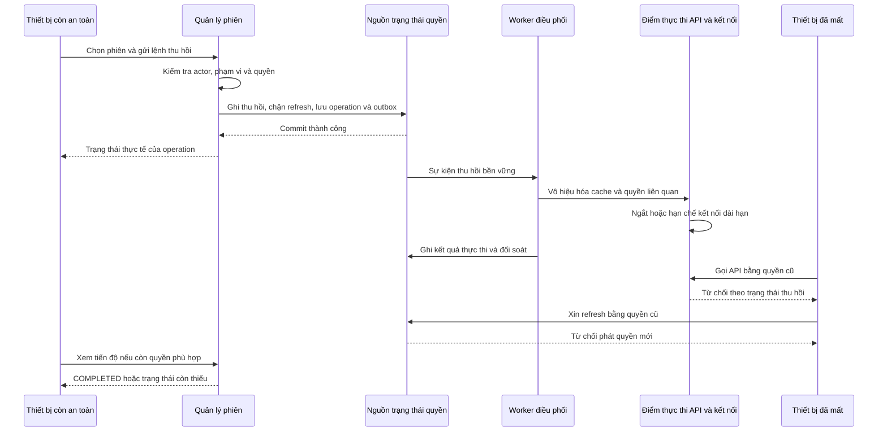

# Remote sign out action — Đăng xuất từ xa khi mất thiết bị

## 1. Mục tiêu và phạm vi

Người dùng mất điện thoại nhưng vẫn đăng nhập được trên máy tính. Họ chọn “Đăng xuất điện thoại đã mất”. Nếu hệ thống chỉ xóa cookie ở máy tính hoặc gửi một push notification yêu cầu điện thoại tự đăng xuất, quyền truy cập trên thiết bị đã mất có thể vẫn còn nguyên.

**Remote sign out** là hành động làm mất hiệu lực quyền phiên trong phạm vi được chọn thông qua các điểm kiểm soát phía server. Kết quả phải được đánh giá bằng khả năng tiếp tục sử dụng session và token, không chỉ bằng việc giao diện đã hiện thông báo thành công.

Bài học thuộc chương **Device Loss Recovery** của module `SECURITY_AUTHENTICATION_ACCOUNT_RECOVERY`, trong phạm vi thiết kế khôi phục tài khoản an toàn khi người dùng mất mật khẩu, MFA, passkey hoặc thiết bị xác thực. Trọng tâm là thu hồi quyền truy cập khi mất thiết bị, phối hợp với luồng khôi phục và giảm khả năng kẻ giữ thiết bị tiếp tục dùng tài khoản.

Sau bài học, người học có thể:

- Xác định chính xác phạm vi đăng xuất từ xa: một session, một nhóm phiên hay toàn bộ phiên đã tồn tại.
- Phân biệt thu hồi session, refresh token, access token và authenticator.
- Thiết kế thao tác có kiểm tra quyền, chống phát lại và xử lý nhất quán với refresh đang chạy đồng thời.
- Xử lý giới hạn của JWT, cache, WebSocket và đăng nhập liên kết qua identity provider.
- Xác định tiêu chí hoàn tất, thông báo đúng trạng thái và bằng chứng vận hành cần giữ.

Các API, schema, tên trạng thái và cơ chế trong bài là thiết kế tham chiếu. Cần điều chỉnh chúng theo kiến trúc và khả năng thực tế của authorization server, identity provider và các resource server.

## 2. Đăng xuất từ xa tác động tới quyền nào?

### 2.1. Kiểm kê các thành phần đang giữ quyền

| Thành phần | Quyền hoặc chức năng | Điều cần làm rõ khi remote sign out |
| --- | --- | --- |
| Session ứng dụng | Duy trì trạng thái xác thực của người dùng | Server có thể đánh dấu không còn hợp lệ và thực thi ở đâu? |
| Cookie chứa session handle | Giúp trình duyệt gửi lại tham chiếu phiên | Xóa ở trình duyệt hiện tại có ảnh hưởng gì tới thiết bị khác? |
| Refresh token | Có thể xin access token mới theo grant | Thu hồi token hiện tại hay cả family/grant thuộc phạm vi? |
| Access token | Cho phép gọi API trong thời hạn và scope | Resource server nhận biết thu hồi bằng cách nào? |
| Remembered-device token | Có thể giảm hoặc bỏ một bước xác thực sau này | Có nằm trong phạm vi phải thu hồi khi mất thiết bị không? |
| Phiên SSO tại identity provider | Có thể tạo phiên mới ở ứng dụng | Đăng xuất ứng dụng đã xử lý phiên này chưa? |
| Kết nối dài hạn | Duy trì WebSocket, stream hoặc kênh tương tác | Có ngắt hoặc kiểm tra lại quyền sau thu hồi không? |
| Passkey, TOTP, khóa hoặc credential khác | Có thể cho phép đăng nhập lại | Có cần đình chỉ hoặc thu hồi qua luồng authenticator riêng không? |

Một thiết bị có thể giữ nhiều thành phần cùng lúc. Thu hồi refresh token chưa tự chứng minh access token đã hết tác dụng. Thu hồi phiên ứng dụng cũng không tự vô hiệu hóa passkey hoặc session SSO còn ở thiết bị đó.

### 2.2. Phân biệt các hành động liên quan

| Hành động | Kết quả trực tiếp | Giới hạn |
| --- | --- | --- |
| Đăng xuất cục bộ | Client ngừng giữ hoặc gửi quyền của phiên hiện tại theo thiết kế | Không chứng minh bản sao token hoặc phiên trên thiết bị khác bị thu hồi |
| Đăng xuất từ xa | Server ngừng chấp nhận quyền phiên được chọn | Không tự xóa dữ liệu đã lưu ngoại tuyến trên thiết bị |
| Thu hồi authenticator | Credential không được dùng để xác thực theo trạng thái mới | Session đã phát trước đó cần chính sách riêng |
| Đổi mật khẩu | Thay bí mật đăng nhập thuộc loại mật khẩu | Không mặc định mọi session, token hoặc passkey đều bị thu hồi |
| Khóa hoặc xóa thiết bị từ xa | Tác động quản lý thiết bị theo khả năng nền tảng | Là hành động khác với đăng xuất tài khoản ứng dụng |
| Khôi phục tài khoản | Tái lập quyền bằng bằng chứng và chính sách khôi phục | Có thể bao gồm remote sign out nhưng phạm vi rộng hơn |

Nếu người giữ thiết bị vẫn có credential hợp lệ hoặc session SSO đủ để đăng nhập lại, một phiên mới có thể được tạo sau khi phiên cũ bị thu hồi. Remote sign out xử lý quyền phiên; quy trình mất thiết bị còn phải đánh giá những credential và đường tạo phiên mới đang bị ảnh hưởng.

### 2.3. Thiết bị ngoại tuyến không phải lý do trì hoãn thu hồi

Server có thể thu hồi quyền dù thiết bị đã mất đang tắt máy hoặc không nhận push notification. Khi thiết bị kết nối lại, request dựa trên quyền đã thu hồi phải bị xử lý theo trạng thái mới.

Điện thoại có thể vẫn hiển thị dữ liệu đã cache khi ngoại tuyến. Việc đó không chứng minh API còn cho phép truy cập, nhưng cũng cho thấy đăng xuất server không xóa được mọi bản sao dữ liệu. Giao diện cần diễn đạt đúng phạm vi thay vì hứa đã xóa toàn bộ thông tin trên thiết bị.

## 3. Chọn phạm vi và nhận diện đối tượng cần thu hồi

### 3.1. Các phạm vi thường gặp

| Phạm vi minh họa | Ý nghĩa cần công bố | Rủi ro cần kiểm soát |
| --- | --- | --- |
| `CURRENT_SESSION` | Kết thúc phiên đang thực hiện thao tác | Không nhầm thành đăng xuất thiết bị đã mất |
| `TARGET_SESSION` | Thu hồi một phiên do server nhận diện | Một thiết bị có thể còn phiên khác |
| `TARGET_SESSION_GROUP` | Thu hồi nhóm phiên theo quan hệ đăng ký được quản lý | Không suy ra nhóm chỉ từ tên máy hoặc user agent |
| `ALL_EXISTING_SESSIONS` | Thu hồi tập phiên thuộc tài khoản tại ranh giới xác định | Cần định nghĩa phiên mới tạo đồng thời và quyền SSO |
| `ALL_EXCEPT_CURRENT` | Thu hồi tập phiên theo chính sách, giữ phiên hiện tại được chấp thuận | Phiên được giữ cũng có thể đáng ngờ hoặc hết mức tin cậy |

Định nghĩa rõ ranh giới của “tất cả”. Trong một thiết kế, nó có thể là tất cả phiên của ứng dụng; trong thiết kế khác là cả các client và session SSO mà hệ thống có quyền điều phối. Không dùng cùng một nhãn cho hai mức bảo đảm khác nhau.

Nếu giữ phiên hiện tại, server xác định phiên được giữ từ ngữ cảnh đã xác thực. Không tin một `keep_session_id` tùy ý do client đưa lên để miễn thu hồi. Khi chính phiên hiện tại là đối tượng bị thu hồi, luồng phản hồi phải xử lý việc mất quyền tiếp tục mà không tự khôi phục session đó.

### 3.2. Nhãn thiết bị chỉ giúp người dùng lựa chọn

Danh sách phiên có thể hiển thị trình duyệt, loại máy, thời điểm hoạt động gần đây và vị trí ước lượng. Đây là thông tin hỗ trợ nhận diện, không phải bằng chứng chắc chắn về một thiết bị vật lý hoặc người đang giữ nó.

User agent có thể trùng hoặc bị thay đổi; IP có thể là mạng dùng chung; tên thiết bị có thể do người dùng đặt. Không cho phép một chuỗi như `deviceName=My Phone` quyết định các token phải thu hồi.

Ở backend, dùng tham chiếu phiên hoặc nhóm đăng ký do server kiểm soát. Quan hệ giữa session, refresh family, client và device registration cần được tạo qua quy trình có căn cứ. Không mặc định mọi passkey đồng bộ cùng tài khoản là credential của một thiết bị riêng biệt.

### 3.3. Định nghĩa tập mục tiêu trước khi thực thi

Với thao tác hàng loạt, cần quy tắc rõ cho phiên tạo đồng thời:

- Thu hồi một tập phiên đã chụp tại thời điểm quyết định có thể bỏ sót phiên mới tạo sau đó.
- Dùng phiên bản bảo mật của tài khoản có thể làm quyền theo phiên bản cũ mất hiệu lực, nhưng điểm kiểm tra quyền và điểm phát token phải thực thi phiên bản đó.
- Nếu giữ một phiên, cần cơ chế di chuyển hoặc miễn đúng phiên đã được chấp thuận, không tạo một ngoại lệ rộng cho mọi token của cùng thiết bị.
- Thu hồi các phiên hiện tại không đồng nghĩa cấm đăng nhập mới bằng credential còn hợp lệ. Muốn ngăn đường đó phải có quyết định và hành động riêng.

Mô hình tham chiếu trong bài lưu tập hoặc quy tắc mục tiêu cùng thao tác, đồng thời quy định cách xử lý các quyền đang chờ phát sinh từ phiên bị thu hồi.

## 4. Ai được phép thực hiện remote sign out?

### 4.1. Kiểm tra quyền từ ngữ cảnh đáng tin

Thông thường, người dùng đăng nhập từ một thiết bị còn an toàn mở mục quản lý phiên và chọn phiên muốn thu hồi. Server lấy account, tenant và quyền của actor từ ngữ cảnh đã xác thực, rồi kiểm tra mục tiêu thuộc phạm vi được phép.

Không chấp nhận một `account_id` trong body như căn cứ để đăng xuất tài khoản đó. Biết ID phiên cũng không cấp quyền thu hồi hoặc đọc metadata của phiên. Nhân viên hỗ trợ hoặc quản trị viên cần quyền theo nhiệm vụ, phạm vi tổ chức và căn cứ hành động rõ ràng.

Với thao tác có tác động rộng hoặc phiên có dấu hiệu đáng ngờ, có thể yêu cầu xác thực lại theo chính sách. Nếu thiết bị chứa MFA đã mất, phải có phương án thay thế phù hợp; không tạo ngõ cụt bằng cách chỉ cho xác nhận qua chính thiết bị đã mất.

### 4.2. Tách containment với việc cấp credential mới

Có thể thiết kế một quyền khôi phục giới hạn chỉ cho báo mất hoặc thu hồi những phiên xác định. Mức bằng chứng để thực hiện containment cần chính sách riêng, cân bằng nguy cơ tiếp tục bị truy cập với nguy cơ người khác gây đăng xuất hàng loạt.

Quyền này không tự cho đọc dữ liệu cá nhân rộng, thay email, gỡ MFA, thêm passkey hoặc cấp session đăng nhập đầy đủ. Hệ thống không được biến “đã cho phép đăng xuất thiết bị mất” thành “đã xác minh đủ cho mọi hành động khôi phục”.

Một người chưa xác thực chỉ nhập email hoặc số điện thoại không được trực tiếp ra lệnh đăng xuất tất cả phiên. Nếu tiếp nhận báo cáo từ kênh này, coi đó là thông tin cần xử lý qua quy trình có kiểm soát.

### 4.3. Chống yêu cầu giả và lạm dụng

- Dùng thao tác thay đổi trạng thái qua phương thức phù hợp, không cho một lần mở liên kết GET thu hồi session.
- Với cookie xác thực, áp dụng cơ chế bảo vệ CSRF và kiểm tra request theo thiết kế của ứng dụng.
- Giới hạn tần suất, phạm vi và số mục tiêu để tránh gây gián đoạn hàng loạt.
- Idempotency phải gắn với actor, tài khoản và nội dung hành động; không dùng key để bỏ qua phân quyền.
- Các lượt hỗ trợ, truy cập danh sách phiên và lệnh thu hồi cần audit theo nhiệm vụ.

Không yêu cầu thiết bị đã mất phải bấm xác nhận đồng ý mới cho phép server thu hồi quyền của nó. Người đang giữ thiết bị không nên có quyền phủ quyết biện pháp containment đã được chủ tài khoản hoặc actor có thẩm quyền thực hiện.

## 5. Hợp đồng thao tác và trạng thái kết quả

### 5.1. Ví dụ API ở cấp ứng dụng

Đây là endpoint minh họa của sản phẩm, không phải endpoint revocation chuẩn OAuth:

```http
POST /v1/account/sessions/session_example_42/revoke
Content-Type: application/json
Idempotency-Key: operation_example_73

{
  "scope": "TARGET_SESSION",
  "reason": "DEVICE_LOST"
}
```

Request vẫn cần ngữ cảnh xác thực hoặc quyền khôi phục phù hợp và bảo vệ request theo cơ chế đang dùng. Session mục tiêu được tra ở server và kiểm tra quan hệ sở hữu. ID trong ví dụ chỉ là nhãn; nó không chứa cookie, access token hoặc refresh token.

Nếu việc thực thi cần điều phối bất đồng bộ, phản hồi có thể là:

```json
{
  "operation_id": "op_example_73",
  "status": "ENFORCING",
  "scope": "TARGET_SESSION",
  "target_ref": "session_example_42",
  "authority_revoked_at": "2026-11-23T10:00:01Z",
  "required_components": [
    "session-authority",
    "api-enforcement",
    "refresh-authority",
    "live-connection-control"
  ],
  "pending_components": [
    "live-connection-control"
  ]
}
```

`authority_revoked_at` là lúc nguồn có thẩm quyền ghi nhận thu hồi. Nó chưa tự chứng minh mọi điểm thực thi đã áp dụng. Danh sách thành phần phải phản ánh kiến trúc thật, không được đưa ra những tên tượng trưng rồi coi là bằng chứng kiểm soát.

### 5.2. Trạng thái cần có ý nghĩa kiểm chứng được

| Trạng thái minh họa | Ý nghĩa |
| --- | --- |
| `ACCEPTED` | Lệnh đã được kiểm tra quyền và lưu bền vững; chưa khẳng định đã thu hồi |
| `ENFORCING` | Đã bắt đầu hoặc đã có hiệu lực tại nguồn, còn điều kiện thực thi cần hoàn tất |
| `COMPLETED` | Điều kiện thu hồi bắt buộc trong phạm vi công bố đã đạt |
| `PARTIAL` | Một phần đã đạt nhưng còn thành phần hoặc phạm vi chưa được bảo đảm |
| `FAILED` | Chưa đạt điều kiện cần để thực hiện lệnh; cần biết phần nào đã xảy ra nếu có |

Một callback push “đã gửi” không đủ để chuyển `COMPLETED`. Ngược lại, thiết bị không gửi ACK không có nghĩa thu hồi server thất bại nếu các điểm thực thi đã từ chối quyền cũ theo hợp đồng.

HTTP `202` phù hợp khi hệ thống mới chấp nhận xử lý bất đồng bộ. Một API đồng bộ có thể trả kết quả đã có hiệu lực, nhưng nội dung và trạng thái phải phản ánh điều kiện thực tế. Endpoint xem tiến độ cũng cần phân quyền; biết operation ID không được đọc hồ sơ thu hồi của người khác.

RFC 7009 quy định endpoint thu hồi token có thể trả HTTP `200` cả khi token đã bị thu hồi và khi token đưa lên không hợp lệ; đồng thời nêu khả năng có độ trễ lan truyền. Vì vậy, phản hồi từ endpoint đó phải được hiểu trong phạm vi token và chính sách của authorization server. Xem [RFC 7009 — OAuth 2.0 Token Revocation](https://www.rfc-editor.org/rfc/rfc7009.html).

## 6. Cơ chế thực thi phía server

### 6.1. Session có trạng thái

Với session handle trỏ tới bản ghi server, một thiết kế đơn giản là lưu `status`, `revoked_at`, phiên bản và lý do. Mỗi lần xác thực request phải kiểm tra phiên còn hoạt động, đúng tài khoản và chưa vượt các điều kiện thời gian.

```text
session_ref: app_session_example_42
account_ref: acct_example
status: REVOKED
revoked_at: 2026-11-23T10:00:01Z
revocation_operation_ref: op_example_73
session_version: 4
```

Cookie ở thiết bị mất có thể vẫn còn nguyên, nhưng server không còn chấp nhận nó. Có thể gửi hướng dẫn xóa cookie khi client kết nối lại để làm sạch trải nghiệm, song việc đó là bước bổ trợ.

Nếu session được cache, cần cơ chế vô hiệu hóa hoặc giới hạn tuổi cache để đáp ứng yêu cầu thu hồi. Đọc được bản `ACTIVE` cũ từ cache không phải lý do hợp lệ để tuyên bố đã thực thi ngay lập tức ở mọi nơi.

Không xóa bản ghi thu hồi quá sớm rồi cho phép một quyền cũ được hiểu là hợp lệ. Với mô hình tra session, session không tồn tại phải có hành vi xác thực rõ ràng, thường là không được chấp nhận; không tự tạo session mới từ cookie lạ.

### 6.2. Access token tự chứa và JWT

Kiểm tra chữ ký, issuer, audience và thời hạn của JWT chỉ xác nhận token phù hợp với các điều kiện đó. Nếu token chưa hết hạn, việc người dùng bấm đăng xuất không tự làm chữ ký mất hiệu lực.

Một số lựa chọn thực thi gồm:

| Lựa chọn | Cách hỗ trợ thu hồi | Điều phải tính tới |
| --- | --- | --- |
| Tra trạng thái session gắn với token | Token mang tham chiếu phiên; API kiểm tra trạng thái tương ứng | Độ trễ, tính sẵn sàng và cache của phép kiểm tra |
| Phiên bản session | Token chỉ được chấp nhận khi phiên bản còn khớp | Các điểm phát và kiểm token phải dùng cùng quy tắc |
| Phiên bản bảo mật tài khoản | Thay phiên bản để quyền theo thế hệ cũ không còn hợp lệ | Có thể ảnh hưởng toàn tài khoản; không dùng tùy tiện cho thu hồi một phiên |
| Danh sách thu hồi theo token ID | Từ chối các token cụ thể trước hạn | Cần định danh phù hợp, bảo vệ dữ liệu và giữ dấu thu hồi đủ lâu |
| Access token ngắn hạn, chặn refresh | Quyền cũ hết dần khi token hết hạn | Còn cửa sổ sử dụng; không được hứa có hiệu lực tức thì |
| Token tham chiếu và kiểm tra tại nguồn | Resource server kiểm tra trạng thái thay vì chỉ đọc token tự chứa | Kết quả kiểm tra vẫn cần quy tắc cache và sự cố nguồn |

Các lựa chọn có thể kết hợp. Quan trọng là mô tả đúng bảo đảm và đo được thời gian còn chấp nhận quyền cũ. Không chọn “JWT stateless” rồi đồng thời hứa có thể vô hiệu hóa ngay mọi access token mà không có thêm điểm thực thi.

Nếu dùng danh sách thu hồi, giữ trạng thái cho tới khi các token bị ảnh hưởng không còn có thể được chấp nhận, bao gồm quy tắc clock skew và thời hạn thực tế. Với cơ chế phiên bản, không quay lại phiên bản cũ hoặc tái sử dụng định danh theo cách làm token cũ hợp lệ trở lại.

### 6.3. Refresh token và token family

Refresh token trên thiết bị mất là đường xin thêm quyền. Thu hồi một access token nhưng giữ đường refresh còn hoạt động có thể chỉ làm gián đoạn rất ngắn.

Khi dùng refresh rotation, cần liên kết các thế hệ token với family hoặc grant và session gốc. Remote sign out trong phạm vi một phiên phải thu hồi đúng family hoặc tập grant thuộc phiên đó theo chính sách, kể cả token con đã được phát trước khi lệnh thu hồi được ghi nhận.

RFC 9700 mô tả rotation và sender-constrained refresh token như các cơ chế chống replay cho public client, đồng thời cho phép authorization server thu hồi refresh token trong sự kiện bảo mật như logout. Điều này không có nghĩa mọi nhà cung cấp đều tự thu hồi theo cùng một chính sách. Xem [RFC 9700 — Best Current Practice for OAuth 2.0 Security](https://www.rfc-editor.org/rfc/rfc9700.html).

Sender-constrained token giúp hạn chế sử dụng token ở nơi không có khóa tương ứng. Nếu người giữ thiết bị mất vẫn dùng được cả token và khóa trên thiết bị, ràng buộc đó không thay thế remote revocation. Rotation cũng không tự là lệnh đăng xuất; nó cần trạng thái family và quy tắc thu hồi được thực thi.

### 6.4. Quyền có thể tái tạo phiên

Kiểm kê remembered-device token, authorization code đang chờ đổi, quy trình đăng nhập chưa hoàn tất và các grant liên quan tới phiên mục tiêu. Nếu một quyền được tạo trước thu hồi vẫn có thể phát session hoặc token mới sau đó, nó có thể tạo đường thoát khỏi phạm vi dự kiến.

Điểm phát token cần kiểm tra trạng thái của session/grant hoặc phiên bản bảo mật liên quan. Không để refresh tạo một session ID không liên quan nhằm vô tình né lệnh thu hồi session gốc.

Các credential dài hạn như mật khẩu, passkey hoặc API key được đánh giá theo phạm vi riêng. Remote sign out không mặc định xóa mọi credential; báo mất thiết bị có thể cần thêm hành động đình chỉ credential trên thiết bị theo bằng chứng và chính sách.

## 7. Workflow và xử lý đồng thời

### 7.1. Luồng tham chiếu



Thiết bị đã mất không cần nhận lệnh hoặc gửi ACK để server ngừng chấp nhận quyền cũ. Push có thể giúp client làm sạch giao diện, nhưng không nằm thay cho các kiểm soát ở nguồn và resource server.

### 7.2. Pseudocode ghi nhận thu hồi

Giả định trạng thái session, refresh family và operation có thể cập nhật trong cùng một ranh giới giao dịch. Nếu chúng nằm ở các nhà cung cấp khác nhau, cần điều phối và đối soát thay vì giả định giao dịch DB bao trùm mọi API.

```text
remoteSignOut(actorContext, command, idempotencyKey):
    requireProtectedStateChangingRequest()
    validateCommandShapeAndAllowedScope(command)

    begin transaction
        actor = resolveTrustedActor(actorContext)
        target = loadTargetInActorAuthorizedScope(command.targetRef)
        authorizeRemoteSignOut(actor, target, command.scope)
        requireAppropriateFreshEvidenceWhenPolicyDemands(actor, command)

        existing = findOperationForActorAndKey(actor, idempotencyKey)
        if existing exists:
            assertSameAuthorizedCommand(existing, command)
            return existing.publicResultWithoutSecrets

        roots = lockSessionAndGrantRootsInConsistentOrder(target)
        recheckOwnershipScopeAndCurrentState(actor, roots, command)

        operation = createOperationWithExactTargetDefinition(command)
        markTargetSessionRootsRevoked(roots, operation)
        revokeRefreshFamiliesAndPendingRightsInApprovedScope(roots)
        applyAccountEpochOnlyIfRequestedScopeRequiresIt(command)
        recordRequiredEnforcementTargets(operation)
        appendOutboxRevocationEvent(operation, roots)
        setOperationStatusFromActualLocalResult(operation)
    commit

    dispatchOrScheduleRequiredEnforcement(operation)
    return currentAuthorizedOperationResult(operation)
```

Kiểm tra quyền trước khi trả kết quả idempotent để người khác không dùng key đọc được thao tác của chủ tài khoản. Cùng key nhưng khác mục tiêu hoặc scope phải được xử lý như xung đột theo hợp đồng, không âm thầm áp dụng kết quả cũ.

Các bước cập nhật trạng thái và outbox cùng giao dịch giúp tránh trường hợp thu hồi đã commit nhưng sự kiện điều phối bị mất vì process dừng ngay sau đó. Consumer xử lý phát lại theo event ID và operation; không cần giả định sự kiện chỉ tới đúng một lần.

### 7.3. Race giữa refresh và thu hồi

Giả sử refresh token `R1` tạo `R2` trong khi người dùng thu hồi phiên:

| Thứ tự thực tế | Rủi ro nếu thiết kế sai | Điều cần bảo đảm |
| --- | --- | --- |
| Refresh commit trước thu hồi | Chỉ thu hồi `R1`, bỏ sót `R2` | Thu hồi family/grant hoặc root liên quan, không chỉ giá trị token được nhìn thấy ban đầu |
| Thu hồi commit trước refresh | Refresh vẫn đọc trạng thái cũ và cấp token | Kiểm tra trạng thái có thẩm quyền và đồng bộ hóa tại điểm phát |
| Hai thao tác thấy cùng snapshot cũ | Cả hai commit kết quả không nhất quán | Khóa, kiểm soát phiên bản hoặc cơ chế nhất quán phù hợp |
| Access token đã phát trước thu hồi | API vẫn nhận token dù refresh đã bị chặn | Điểm thực thi access token áp dụng cơ chế thu hồi đã công bố |

Các endpoint phát và thu hồi quyền cần cùng một quy tắc đồng thời, ví dụ khóa root theo thứ tự nhất quán hoặc cập nhật có điều kiện theo phiên bản. Chỉ đặt khóa ở endpoint logout mà không dùng kiểm tra tương ứng ở refresh không giải quyết được race.

Nếu refresh đã phát token trước commit thu hồi, token vẫn phải mang liên kết tới root bị thu hồi hoặc bị chặn theo cơ chế phù hợp. Không để sự kiện đến muộn đánh dấu family đã thu hồi thành hoạt động trở lại.

### 7.4. Request đã được cho phép trước thời điểm thu hồi

Remote sign out không tự hoàn tác một hành động đã hoàn tất. Một request có thể đã được xác thực và đang thực hiện nghiệp vụ khi lệnh thu hồi xuất hiện.

Cần định nghĩa điểm cắt bảo đảm: từ thời điểm hoặc điều kiện nào, **quyết định cấp quyền mới** dựa trên phiên cũ phải bị từ chối. Với thao tác nhạy cảm đang chạy lâu, có thể cần kiểm tra lại quyền trước bước commit quan trọng hoặc dùng cơ chế hủy riêng theo nghiệp vụ.

Một phản hồi dữ liệu tới client sau thời điểm thu hồi chưa đủ để kết luận mọi cơ chế lỗi; cần biết request được cấp quyền lúc nào và hợp đồng xử lý đang chạy là gì. Ngược lại, không lấy lý do “request đang chạy” để hợp thức hóa việc API tiếp tục cấp quyền mới vô hạn sau thu hồi.

## 8. Cache, kết nối dài hạn và độ trễ lan truyền

### 8.1. Mô hình thời gian cần quan sát

```text
T0: Người có quyền gửi lệnh
T1: Nguồn có thẩm quyền commit trạng thái thu hồi
T2: Các điểm thực thi bắt buộc áp dụng theo hợp đồng
T3: Client nhận phản hồi lỗi hoặc giao diện cập nhật
```

`T3` phụ thuộc thiết bị có kết nối và có thực hiện request hay không. Nó không nên là điều kiện bắt buộc để hoàn thành thu hồi phía server. Khoảng `T2 - T1` là phần quan trọng khi đánh giá độ trễ thực thi trong hệ phân tán.

Thiết kế cần mục tiêu thời gian có căn cứ, cách đo và hành vi khi vượt mục tiêu. Không dùng một con số minh họa làm chuẩn chung cho mọi hệ thống. Nếu access token chỉ hết quyền sau khi hết hạn, hãy đưa cửa sổ đó vào bảo đảm được công bố thay vì gọi là tức thì.

### 8.2. Cache cần cả vô hiệu hóa và phương án phục hồi

Sự kiện invalidation nhanh nhưng có thể bị mất kết nối, đến trễ hoặc xử lý lỗi. Cache còn cần giới hạn tuổi và cơ chế đối soát phù hợp. Consumer xử lý phiên bản hoặc thứ tự để một sự kiện cũ không khôi phục trạng thái `ACTIVE` sau `REVOKED`.

Khi nguồn kiểm tra trạng thái không sẵn sàng, quy tắc có thể khác theo mức nhạy cảm của thao tác. Thiết kế rõ hành vi từ chối, hạn chế hoặc dùng cache trong một giới hạn đã đánh giá; không để một exception vô tình biến thành cho phép mọi request.

Không thể đồng thời mặc định chấp nhận trạng thái cũ vô hạn khi mất kết nối và hứa thu hồi ngay ở mọi điểm. Các giới hạn tính sẵn sàng và bảo đảm an toàn phải được thể hiện trong trạng thái vận hành và báo cáo kết quả.

### 8.3. WebSocket, stream và công việc nền

Nếu chỉ kiểm quyền ở lúc mở WebSocket, kết nối đã mở có thể tiếp tục nhận dữ liệu sau logout. Có thể cần đăng ký kết nối theo session, xử lý sự kiện thu hồi, đóng kết nối và kiểm tra quyền ở thao tác hoặc chu kỳ thích hợp.

Áp dụng cùng tư duy cho stream tải dữ liệu, kênh realtime và tác vụ chạy thay người dùng. Công việc nền có thể mang quyền riêng hoặc quyết định nghiệp vụ đã được chấp thuận; cần phân loại rõ, không hủy hoặc giữ tất cả chỉ từ tên “job của người dùng”.

Đối với đường truyền đã gửi dữ liệu ra khỏi server, logout không thu hồi lại byte dữ liệu đó. Kiểm soát cần tập trung vào quyền tiếp tục phát dữ liệu và các quyết định nghiệp vụ sau thời điểm có hiệu lực.

### 8.4. Đừng hoàn tất dựa trên ACK không đủ ý nghĩa

Một worker nhận sự kiện chưa chứng minh mọi resource server đã ngừng chấp nhận token. Một kết nối đã đóng cũng chưa chứng minh refresh bị chặn. Chọn bằng chứng thực thi theo cơ chế: trạng thái tại nguồn, phiên bản enforcement, trạng thái cache, kết quả đối soát và kiểm tra tích hợp phù hợp.

Nếu kiến trúc không thể xác nhận tới từng thành phần, cần định nghĩa bảo đảm dựa trên giới hạn tuổi token/cache và cơ chế đã kiểm chứng. Không phát minh một trường `all_devices_logged_out=true` để che phần chưa biết.

## 9. Đăng xuất trong hệ thống liên kết và SSO

### 9.1. Session ứng dụng và session tại identity provider khác nhau

Một người dùng có thể đã đăng xuất khỏi ứng dụng A nhưng trình duyệt trên thiết bị mất vẫn có session ở identity provider. Khi mở lại ứng dụng, SSO có thể tạo phiên mới mà không cần người dùng nhập lại mật khẩu. Thu hồi phiên A chưa tự loại bỏ đường đó.

Phải xác định hành động chỉ thuộc ứng dụng, thuộc một phiên SSO hay toàn bộ phạm vi mà hệ thống có thể điều phối. Một ứng dụng không nên thông báo đã đăng xuất mọi dịch vụ khi nó chỉ có quyền kết thúc session cục bộ.

Với tình huống nghi bị chiếm, có thể cần kết hợp kết thúc phiên ở nguồn xác thực, thu hồi grant phù hợp và đánh giá authenticator bị ảnh hưởng. Không dựa vào việc thiết bị đã mất tự đi qua một chuỗi redirect logout mới đạt containment.

### 9.2. Back-channel logout

OpenID Connect Back-Channel Logout dùng thông điệp từ OpenID Provider tới Relying Party qua kênh server để yêu cầu kết thúc các session tương ứng. Logout Token cần được xác minh theo đặc tả; không coi bất kỳ JWT nào có trường `sub` là lệnh đăng xuất hợp lệ. Xem [OpenID Connect Back-Channel Logout 1.0](https://openid.net/specs/openid-connect-backchannel-1_0.html).

Khi tích hợp, kiểm tra các yêu cầu về chữ ký, thuật toán, issuer, audience, thời gian, loại sự kiện và các claim bắt buộc của phiên bản đặc tả áp dụng. Ánh xạ định danh theo đúng issuer và chủ thể hoặc phiên; `sid` của một issuer không phải ID phiên toàn cục cho mọi nhà cung cấp.

Theo đặc tả, Logout Token có `sub`, `sid` hoặc cả hai; khi không có `sid`, phạm vi hướng tới các session của người dùng được nhận diện bởi issuer và subject ở RP. Vì vậy, không thay thế hoặc bỏ mất claim trong quá trình ánh xạ khiến một lệnh theo phiên trở thành lệnh toàn tài khoản.

### 9.3. Không đồng nhất logout SSO với mọi token OAuth

Các quyền OAuth có thể có vòng đời và chính sách khác session trình duyệt. Kiểm tra cụ thể grant, refresh token và access token nào chịu tác động từ một loại logout. Không mặc định một thông báo logout làm mất mọi quyền `offline_access`, API key hoặc grant đã ủy quyền.

Khi cần thu hồi các quyền đó do mất thiết bị, đưa chúng vào kế hoạch được phép và gọi cơ chế tại đúng nguồn có thẩm quyền. Nếu một thành phần bên ngoài chưa hoàn tất, ghi phần còn chờ hoặc giới hạn bảo đảm; không coi phản hồi thành công của một ứng dụng là bằng chứng cho toàn bộ liên kết SSO.

## 10. Thông báo và trải nghiệm người dùng

### 10.1. Cho người dùng thấy đúng đối tượng và tác động

Trước khi gửi lệnh, hiển thị phạm vi dễ hiểu: phiên nào được chọn, thao tác có ảnh hưởng tới phiên hiện tại không và có bao gồm các ứng dụng khác không. Tên máy, IP hoặc vị trí ước lượng chỉ là gợi ý nhận diện; tránh thể hiện chúng như danh tính phần cứng đã được xác minh.

Nếu một nút thực tế chỉ thu hồi một session, dùng cách gọi phù hợp như “Đăng xuất phiên này”. Nếu sản phẩm có cơ chế đáng tin để nhóm các phiên của một đăng ký thiết bị, có thể giải thích phạm vi nhóm đó. Không hứa đăng xuất tất cả ứng dụng trên điện thoại chỉ vì chọn một dòng có biểu tượng điện thoại.

### 10.2. Thông báo theo trạng thái thực tế

| Trạng thái | Ví dụ thông báo phù hợp |
| --- | --- |
| Đã nhận lệnh | “Yêu cầu đăng xuất phiên đã được tiếp nhận. Hệ thống đang thu hồi quyền truy cập.” |
| Nguồn đã thu hồi, còn lan truyền | “Phiên đã bị vô hiệu hóa tại hệ thống xác thực. Một số điểm truy cập còn đang cập nhật.” |
| Hoàn tất trong phạm vi ứng dụng | “Các quyền phiên đã chọn trong ứng dụng này đã được thu hồi theo phạm vi hiển thị.” |
| Chưa bảo đảm toàn phạm vi | “Một phần đã được thu hồi. Thành phần còn chờ xử lý được liệt kê trong tiến độ.” |
| Chưa thực hiện được | “Chưa thể hoàn tất yêu cầu. Bạn có thể thử lại hoặc tiếp tục qua kênh hỗ trợ chính thức.” |

Thông báo cần khớp bảo đảm mà sản phẩm thực sự có, bao gồm cửa sổ access token hoặc cache nếu còn tồn tại. Đừng hiển thị “thiết bị đã an toàn” hoặc “đã xóa dữ liệu” khi chỉ mới chặn quyền phiên.

Nếu chính phiên gửi lệnh bị thu hồi, không duy trì quyền cũ chỉ để tiếp tục polling. Có thể kết thúc giao diện dựa trên kết quả đã nhận, hướng dẫn đăng nhập lại hoặc cung cấp cơ chế xem trạng thái có phạm vi riêng đã được thiết kế. Không âm thầm tạo một session đầy đủ mới để thay session vừa bị thu hồi.

### 10.3. Thông báo bảo mật độc lập

Gửi thông báo về hành động qua kênh đã thiết lập và còn phù hợp theo chính sách, không chỉ tới thiết bị đã mất. Nội dung có thể gồm thời điểm, phạm vi và hướng báo cáo nếu người dùng không nhận ra thao tác; không đính kèm cookie, token hoặc liên kết cho phép phục hồi phiên cũ vô điều kiện.

Một thông báo push tới thiết bị mất có thể là bước cập nhật trạng thái client, nhưng không phải bằng chứng người dùng hợp lệ đã được thông báo. Khi nghi thiết bị bị người khác giữ, hạn chế nội dung nhạy cảm trên thông báo theo chính sách của sản phẩm.

Nếu người dùng tìm lại thiết bị, cho đăng nhập lại qua luồng phù hợp. Không có nút “hoàn tác” làm token hoặc session cũ hoạt động trở lại chỉ vì một operation bị hủy hay một thông báo được mở.

## 11. Audit và các chỉ số vận hành

### 11.1. Những mốc cần ghi

| Sự kiện minh họa | Nội dung cần giải thích |
| --- | --- |
| `remote_signout.requested` | Ai yêu cầu, từ ngữ cảnh nào, mục tiêu và scope nào |
| `remote_signout.authorized` | Căn cứ quyền, chính sách và các yêu cầu xác thực đã đáp ứng |
| `remote_signout.authority_committed` | Trạng thái thu hồi đã bền vững tại nguồn nào |
| `remote_signout.enforcement_reported` | Thành phần nào đã áp dụng, dựa trên loại bằng chứng gì |
| `remote_signout.completed` | Các điều kiện bắt buộc nào trong phạm vi đã đạt |
| `remote_signout.partial` / `failed` | Phần đã đạt, phần còn thiếu và kế hoạch xử lý |
| `session.use_rejected` | Quyền bị từ chối vì thu hồi trong ngữ cảnh nào |
| `refresh.use_rejected` | Family hoặc grant không còn được phép phát quyền |

Trường chung có thể gồm event ID, operation ID, actor reference, account và tenant reference, session reference nội bộ, scope, phiên bản chính sách, thời điểm xảy ra và thời điểm thu thập. Với hỗ trợ hoặc quản trị, ghi thêm nhiệm vụ hoặc ticket phù hợp và quyền được dùng.

**Tham chiếu phiên dùng cho audit cần tách khỏi giá trị bí mật có thể dùng để truy cập.** Không ghi cookie session thực, bearer token, refresh token, OTP hoặc recovery code. ID thao tác cũng không được coi là quyền đọc tiến độ của bất kỳ tài khoản nào.

Giữ audit sau khi thu hồi để có thể điều tra; không xóa dấu vết chỉ vì xóa session hoạt động. Thời hạn lưu và quyền đọc cần phù hợp mục đích, bao phủ cả bản xuất và backup. Metadata thiết bị, vị trí hoặc địa chỉ mạng vẫn có thể là dữ liệu cá nhân cần hạn chế.

### 11.2. Các chỉ số cần định nghĩa chính xác

| Chỉ số | Cách hiểu trong mô hình tham chiếu | Giới hạn |
| --- | --- | --- |
| Thời gian nhận lệnh tới commit nguồn | `authority_committed_at - accepted_at` | Chưa phản ánh mọi điểm thực thi |
| Độ trễ thực thi | `required_enforcement_at - authority_committed_at` | Chỉ có ý nghĩa khi tiêu chí enforcement rõ và đồng hồ đủ tin cậy |
| Tỷ lệ hoàn tất | Số operation hoàn tất / số operation đủ thời gian quan sát trong cohort | Không lấy mọi request lặp làm operation mới |
| Operation còn chờ quá mục tiêu | Số operation chưa đạt điều kiện sau cửa sổ chính sách | Cần phân nhóm theo nguồn lỗi và phạm vi |
| Sử dụng quyền cũ bị từ chối | Số lần từ chối liên quan tới root đã thu hồi | Cho biết có thử sử dụng, chưa chứng minh không có điểm lọt khác |
| Quyết định cấp quyền mới sau điểm cắt | Những lần vẫn chấp nhận root cũ ngoài hợp đồng | Cần đối chiếu thời điểm authorization, không chỉ thời điểm trả response |
| Tỷ lệ lỗi điều phối | Operation gặp lỗi thành phần / số operation thuộc phạm vi đó | Không gộp thiết bị không nhận push với lỗi thu hồi server |

Cohort là tập operation bắt đầu trong cùng khoảng và có đủ thời gian quan sát. Cần xử lý bản phát lại, request retry và sự kiện đến muộn để không đếm sai.

Đối soát với trạng thái nguồn và phép kiểm tra tích hợp độc lập phù hợp. Dashboard dựa hoàn toàn trên các event `completed` do chính worker phát không tự chứng minh API đã ngừng nhận token. Không có request từ thiết bị mất sau logout cũng không chứng minh việc thu hồi đã được thực thi.

### 11.3. Xử lý lỗi không làm sống lại quyền cũ

Nếu nguồn đã commit thu hồi nhưng một consumer lỗi, giữ trạng thái thu hồi và retry điều phối theo chính sách. Không rollback session về `ACTIVE` chỉ để thống nhất với một thành phần cập nhật chậm.

Nếu chưa ghi được trạng thái ở nguồn, phản ánh rõ rằng thu hồi chưa có hiệu lực tại nguồn đó. Một command đã vào hàng đợi có thể được xem là đã tiếp nhận, nhưng chưa đủ để công bố quyền đã bị vô hiệu hóa.

Retry cần backoff, giới hạn tài nguyên, idempotency và cảnh báo khi vượt mục tiêu. Người xử lý sự cố cần biết phần đã xảy ra để tiếp tục an toàn thay vì tạo lệnh mới có phạm vi rộng hơn ngoài dự kiến.

## 12. Hai ví dụ thực tế

### 12.1. Mất điện thoại, còn laptop đủ tin cậy

Lan mất điện thoại, trên đó có ứng dụng di động và một phiên trình duyệt. Laptop vẫn có phiên được Lan kiểm soát và Lan có phương thức xác thực lại độc lập phù hợp. Hệ thống có quan hệ đăng ký đủ rõ để liệt kê hai phiên trên điện thoại, nhưng phạm vi lệnh chỉ thuộc sản phẩm này.

1. Lan mở quản lý phiên, kiểm tra thông tin gợi ý và chọn đúng tập phiên muốn thu hồi.
2. Server kiểm tra quyền và yêu cầu xác thực lại theo chính sách. Phiên laptop được giữ chỉ khi chính sách cho phép và được server nhận diện.
3. Nguồn trạng thái đánh dấu hai session root đã thu hồi, đóng các refresh family liên quan và ghi operation cùng outbox.
4. Gateway và resource server áp dụng trạng thái mới theo cơ chế kiểm tra quyền. Kênh realtime theo các session đó được đóng hoặc hạn chế.
5. Khi điều kiện thực thi bắt buộc đạt, operation chuyển `COMPLETED`. Điện thoại có thể vẫn ngoại tuyến và chưa hiện màn hình đăng nhập.
6. Lan nhận thông báo qua kênh phù hợp. Hệ thống hướng dẫn đánh giá credential còn trên điện thoại và session SSO nếu chúng nằm ngoài phạm vi vừa xử lý.

Kết luận đúng là các quyền phiên đã chọn trong sản phẩm đã bị thu hồi theo hợp đồng. Chưa thể kết luận mọi credential trên điện thoại đã bị xóa, mọi ứng dụng khác đã đăng xuất hoặc dữ liệu ngoại tuyến đã biến mất.

### 12.2. Refresh đã bị chặn nhưng API vẫn nhận JWT

Một hệ thống phát access token có hạn tới 10:10. Người dùng yêu cầu đăng xuất từ xa lúc 10:00. Nguồn chặn refresh vào 10:00:01, nhưng một API chỉ kiểm chữ ký và thời hạn token, không đọc trạng thái session.

| Quan sát | Diễn giải |
| --- | --- |
| Refresh lúc 10:00:02 bị từ chối | Đường phát token mới qua refresh đã bị chặn |
| API chấp nhận token cũ lúc 10:01 | Access token cũ vẫn có hiệu lực tại API đó |
| Client mất kết nối lúc 10:02 | Chưa nói API đã thực thi thu hồi |
| Token hết hạn vào 10:10 | Cửa sổ quyền cũ có thể kéo dài tới hạn theo cơ chế kiểm tra thực tế |

Nếu sản phẩm chỉ cam kết quyền cũ hết khi access token hết hạn và không còn đường tạo quyền mới trong phạm vi, giao diện phải thể hiện bảo đảm đó. Nếu sản phẩm yêu cầu chặn sớm hơn, thiết kế hiện tại chưa đạt; cần bổ sung điểm kiểm tra trạng thái, phiên bản, danh sách thu hồi hoặc cơ chế tương đương.

Không sửa kết luận bằng cách ghi thêm log “logout success”. Cũng không mặc định đổi khóa ký toàn hệ thống là cách phù hợp để đăng xuất một phiên: hành động đó có phạm vi ảnh hưởng lớn và không thay thế mô hình thu hồi theo đối tượng.

## 13. Ma trận kiểm thử remote sign out

Thực hiện với tài khoản, phiên và tích hợp được kiểm soát. Các tình huống dưới đây là kế hoạch xác minh hành vi, không phải bằng chứng rằng một hệ thống cụ thể đã đáp ứng.

| Tình huống | Kết quả cần đạt |
| --- | --- |
| Actor đưa session ID của tài khoản hoặc tenant khác | Không đọc hoặc thu hồi ngoài phạm vi được phép |
| Request thiếu xác thực hoặc quyền recovery phù hợp | Không biến lời khai thành lệnh đăng xuất tài khoản |
| Mở liên kết GET hoặc scanner truy cập thông báo | Không tự thu hồi hoặc phục hồi phiên |
| Request cookie bị giả từ nguồn khác | Cơ chế bảo vệ CSRF và chính sách request được thực thi |
| Gửi lại cùng key và cùng lệnh | Không mở rộng phạm vi hoặc tạo tác động lặp ngoài hợp đồng |
| Cùng key nhưng đổi target hoặc scope | Xử lý xung đột; không âm thầm dùng kết quả cũ |
| Thiết bị mất tắt máy hoặc không nhận push | Server vẫn thu hồi và từ chối quyền cũ theo hợp đồng |
| Chỉ xóa cookie ở thiết bị thực hiện lệnh | Không được coi là đã remote sign out thiết bị khác |
| Dùng cookie phiên đã thu hồi từ bản sao khác | Bị từ chối tại điểm xác thực session |
| Refresh và logout chạy song song | Token con không thoát khỏi root/family bị thu hồi |
| Dùng refresh token thế hệ cũ và mới | Các quyền trong phạm vi family/grant đã thu hồi không tạo quyền mới |
| Dùng access token cũ còn hạn | Bị xử lý đúng cơ chế và giới hạn thời gian đã công bố |
| Một node giữ cache cũ hoặc bỏ lỡ sự kiện | Có giới hạn và phục hồi đáp ứng hợp đồng; không báo hoàn tất sai |
| Consumer nhận sự kiện lặp hoặc sai thứ tự | Không tạo lại trạng thái hoạt động hoặc ghi sai kết quả |
| WebSocket đang mở trước logout | Không tiếp tục được cấp quyền hoặc nhận dữ liệu ngoài hợp đồng |
| Request nghiệp vụ đã được authorize trước điểm cắt | Xử lý đúng quy tắc in-flight, không nhầm với quyết định mới sau thu hồi |
| Phiên SSO còn hoạt động và client thử đăng nhập lại | Hành vi khớp phạm vi; không tuyên bố đã xử lý SSO nếu chưa thực hiện |
| Logout Token sai chữ ký, issuer, audience hoặc ngữ cảnh | Không trở thành lệnh thu hồi hợp lệ |
| Lệnh theo một `sid` bị ánh xạ thành mọi session | Phát hiện và ngăn mở rộng phạm vi sai |
| Nhánh all-sessions có login hoặc token issuance đồng thời | Thực thi đúng ranh giới tập mục tiêu và phiên bản đã định nghĩa |
| Nguồn đã thu hồi nhưng một thành phần bên ngoài lỗi | Trạng thái và retry giữ đúng phần đã đạt, không bật lại quyền cũ |
| Phiên gửi lệnh cũng nằm trong tập bị thu hồi | Không tự tái tạo quyền chỉ để tiếp tục giao diện |
| Tìm lại thiết bị và mở lại ứng dụng | Cần luồng đăng nhập phù hợp; token cũ không tự được phục hồi |
| Log, trace hoặc hàng đợi lỗi ghi token thực | Phát hiện và xử lý rò dữ liệu, thay bằng tham chiếu phù hợp |

Bằng chứng kiểm thử cần gắn môi trường, phiên bản, phạm vi, thời điểm và operation ID. Đối chiếu cả session authority, token issuance, resource server, kết nối dài hạn và các tích hợp thuộc hợp đồng. Một thông báo thành công trên UI hoặc một unit test của endpoint chưa bao phủ toàn bộ cơ chế.

## 14. Những lỗi thiết kế thường gặp

| Lỗi | Vì sao nguy hiểm | Hướng sửa |
| --- | --- | --- |
| Chỉ gửi push yêu cầu client tự logout | Thiết bị có thể ngoại tuyến hoặc không hợp tác | Thu hồi tại nguồn và các điểm thực thi phía server |
| Xóa cookie trên máy hiện tại | Không tác động quyền trên thiết bị mục tiêu | Xác định đúng session hoặc nhóm quyền ở backend |
| Chỉ thu hồi một refresh token nhìn thấy | Token con hoặc grant liên quan có thể còn hiệu lực | Quản lý root/family và phạm vi thu hồi |
| Cho rằng JWT hết hiệu lực khi bấm logout | Chữ ký và thời hạn không đổi chỉ từ thao tác UI | Bổ sung cơ chế thu hồi hoặc công bố rõ cửa sổ hiệu lực còn lại |
| Chỉ kiểm quyền lúc mở WebSocket | Kết nối cũ có thể tiếp tục truyền dữ liệu | Gắn kết nối với session và xử lý trạng thái thu hồi |
| Dùng tên máy hoặc IP làm định danh thu hồi | Có thể nhầm, trùng hoặc bị giả | Dùng quan hệ session/registration do server quản lý |
| Coi logout ứng dụng là logout SSO toàn hệ thống | Phiên ở nguồn khác có thể tái tạo quyền | Điều phối đúng nguồn và giới hạn tuyên bố theo phạm vi |
| Báo hoàn tất khi worker nhận event | Chưa chứng minh các điểm thực thi đã áp dụng | Định nghĩa và đo điều kiện enforcement bắt buộc |
| Rollback bằng cách bật lại session cũ | Có thể khôi phục quyền của kẻ đang giữ thiết bị | Giữ thu hồi, xử lý retry và yêu cầu đăng nhập mới khi phù hợp |
| Dùng quyền containment để gỡ MFA hoặc cấp full session | Mở rộng quyền ngoài căn cứ xác minh | Tách scope và chính sách của từng hành động khôi phục |

## 15. Tiêu chí hoàn tất và giới hạn cần nêu rõ

Một remote sign out action được thiết kế tốt cần chứng minh:

1. Actor có quyền thực hiện đúng hành động với đúng tài khoản, tenant và tập mục tiêu.
2. Phạm vi thu hồi đã được định nghĩa rõ, kể cả phiên mới tạo đồng thời và quyền có thể tái tạo session.
3. Trạng thái thu hồi tại nguồn đã được ghi bền vững; refresh và các quyền liên quan trong phạm vi không tiếp tục phát quyền ngoài dự kiến.
4. Các điểm thực thi access token, session và kết nối dài hạn đáp ứng cơ chế cùng giới hạn thời gian đã công bố.
5. Thành phần SSO hoặc hệ thống bên ngoài được xử lý đúng phạm vi; phần chưa xử lý không bị che bằng thông báo thành công toàn cục.
6. Retry và lỗi cục bộ không làm quyền cũ sống lại, không mở rộng phạm vi và không tạo session mới ngoài thẩm quyền.
7. Audit đủ để dựng lại quyết định và hiệu lực thu hồi mà không làm lộ token hoặc dữ liệu nhạy cảm không cần thiết.
8. Người dùng hiểu bước tiếp theo: đăng nhập lại khi phù hợp, đánh giá credential trên thiết bị mất và tiếp tục khôi phục tài khoản nếu cần.

Đăng xuất từ xa có hiệu quả khi hệ thống ngừng cấp và ngừng chấp nhận quyền cũ đúng phạm vi đã hứa. Trạng thái hiển thị trên thiết bị chỉ là một phần của trải nghiệm; bằng chứng quyết định nằm ở hành vi thực thi quyền phía server và các giới hạn được công bố trung thực.
