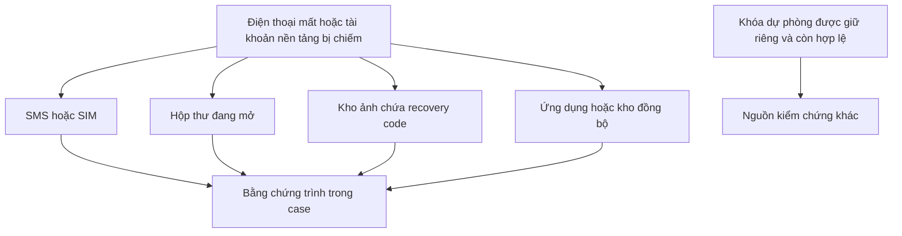
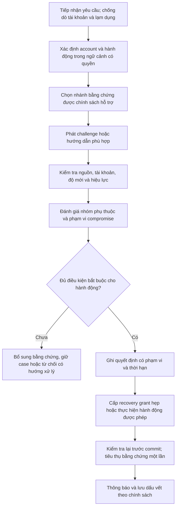

# Device recovery evidence — Bằng chứng khi khôi phục sau mất thiết bị

## 1. Cần chứng minh điều gì khi thiết bị đã mất?

Trong chương **Device Loss Recovery** của module `SECURITY_AUTHENTICATION_ACCOUNT_RECOVERY`, mất điện thoại, laptop hoặc khóa bảo mật có thể làm người dùng mất phương thức xác thực. Hệ thống cần cho chủ tài khoản một đường trở lại, đồng thời ngăn người khác dùng câu chuyện “tôi mất thiết bị” để thay MFA, passkey hoặc kênh khôi phục.

**Device recovery evidence** là những dữ kiện, kết quả xác minh và bằng chứng xác thực được dùng để quyết định người yêu cầu được phép làm gì trong một case khôi phục sau mất thiết bị. Giá trị của bằng chứng phụ thuộc vào nguồn gốc, mối liên hệ đã thiết lập với tài khoản, độ mới, tính toàn vẹn và phạm vi quyền đang xét.

Ba câu hỏi phải được tách:

| Câu hỏi | Ví dụ thông tin liên quan | Vì sao cần tách? |
| --- | --- | --- |
| Người gọi có quyền với tài khoản cũ không? | Authenticator đã gắn, recovery code hợp lệ hoặc quy trình xác minh đã thiết kế | Đây là căn cứ để chuyển quyền quản lý tài khoản |
| Người gọi đang giữ thiết bị hoặc địa chỉ mới không? | Hoàn tất đăng ký khóa mới, nhận mã tại số mới | Điều này chưa nối họ với tài khoản cũ |
| Thiết bị mới có thuộc tính đáp ứng chính sách không? | Kết quả kiểm tra nền tảng hoặc attestation trong trường hợp cần | Thuộc tính thiết bị chưa chứng minh danh tính chủ tài khoản |

Ví dụ, một người trình hóa đơn mua điện thoại mới và xác minh được email mới. Họ có thể thực sự sở hữu điện thoại và email đó, nhưng vẫn chưa chứng minh quyền thay passkey của tài khoản Lan.

Một bộ tài liệu dày không tự tạo bằng chứng mạnh. Điều cần tìm là một chuỗi liên hệ có thể kiểm tra: chủ thể đang yêu cầu, tài khoản cụ thể, phương thức đã thiết lập và hành động được cấp quyền.

OWASP khuyến nghị recovery cho tài khoản passkey dựa trên phương thức đã đăng ký khác, recovery code được bảo vệ riêng hoặc quy trình danh tính phù hợp với rủi ro, thay vì để một đường recovery yếu âm thầm vượt chính sách xác thực mạnh. [OWASP — Account Recovery and Bootstrap](https://cheatsheetseries.owasp.org/cheatsheets/Passkey_Security_Cheat_Sheet.html#account-recovery-and-bootstrap).

## 2. Bằng chứng đủ cho hành động nào?

Không nên có một cờ `identityVerified=true` rồi cho mọi thao tác nhạy cảm cùng sử dụng. Báo mất, đình chỉ thiết bị và gắn authenticator mới có mức tác động khác nhau.

| Hành động | Điều cần được chứng minh theo chính sách | Giới hạn cần giữ |
| --- | --- | --- |
| Ghi nhận báo mất chưa xác minh | Có một báo cáo cần xử lý và chống lạm dụng | Không tiết lộ cấu hình hoặc thay đổi tài khoản ngay |
| Đình chỉ một đối tượng bị báo compromise | Người yêu cầu có quyền bảo vệ phạm vi đó ở mức chính sách chấp nhận | Không tự cấp quyền đăng nhập hoặc thay địa chỉ recovery |
| Gắn authenticator thay thế | Quyền quản lý tài khoản và việc đăng ký đúng credential mới | Không dùng chỉ quyền báo mất để thay MFA |
| Chuyển email hoặc số recovery | Quyền chuyển kênh và kiểm soát đích mới | Xác minh đích mới không thay thế bằng chứng tài khoản cũ |
| Cấp session đầy đủ | Đã đáp ứng luồng xác thực sau khôi phục và điều kiện liên quan | Recovery grant hẹp không tự trở thành session đầy đủ |
| Bỏ hạn chế sau sự cố | Các điều kiện bảo vệ và bằng chứng bổ sung đã hoàn tất | Thời gian trôi qua không tự chứng minh tài khoản an toàn |

Một sản phẩm có thể chấp nhận bằng chứng nhẹ hơn cho việc đình chỉ bảo vệ so với việc gắn credential mới. Chính sách cần nêu rõ khác biệt này và đánh đổi gây gián đoạn cho người dùng thật.

### Còn authenticator hợp lệ khác hay đã mất toàn bộ?

Nếu người dùng còn một phương thức đã gắn và đáp ứng yêu cầu của thao tác, họ có thể xác thực lại rồi quản lý credential. Không cần giả lập rằng họ đã mất mọi phương tiện chỉ vì điện thoại thường dùng không còn.

Nếu không còn phương thức đáp ứng, cần luồng recovery với các loại bằng chứng mà sản phẩm đã thiết kế và chấp nhận. Không tự hạ chuẩn xuống một câu hỏi kiến thức công khai hoặc một địa chỉ mới chỉ vì thao tác đang cấp bách.

NIST SP 800-63B-4 phân biệt yêu cầu recovery theo mức bảo đảm và quan hệ danh tính đã thiết lập. Việc xác minh lại danh tính cần khớp với tài khoản đã được identity-proofed trước đó; một tài khoản chưa có quan hệ đó không thể tự có căn cứ reproofing chỉ từ giấy tờ mới gửi lên. [NIST — Recovery Requirements by IAL/AAL](https://pages.nist.gov/800-63-4/sp800-63b/events/#recovery-requirements-by-ialaal).

Các ví dụ trong bài là mô hình thiết kế ứng dụng, không phải tuyên bố rằng một tập bằng chứng bất kỳ tự đáp ứng mọi mức bảo đảm của NIST.

## 3. Phân loại bằng chứng theo điều nó thật sự hỗ trợ

### 3.1. Bằng chứng đã có quan hệ với tài khoản

| Loại bằng chứng | Giá trị có thể có | Điều kiện và giới hạn |
| --- | --- | --- |
| Authenticator khác đã gắn từ trước | Chứng minh quyền điều khiển phương thức liên kết với tài khoản | Phải còn hiệu lực, đáp ứng chính sách và không thuộc phạm vi compromise đang xét |
| Recovery code đã phát trước | Chứng minh sở hữu một bí mật recovery của tài khoản | Kiểm tra an toàn, dùng một lần, giới hạn thử và đánh giá nguy cơ mã nằm trên máy mất |
| Mã gửi qua kênh recovery đã thiết lập | Chứng minh khả năng nhận tại kênh đó trong lần xác minh | Kênh có thể đã bị chiếm; không coi là độc lập nếu cùng nằm trên thiết bị mất |
| Recovery contact đã được thiết lập | Hỗ trợ theo đúng quan hệ và giao thức đã thiết kế | Người được gọi tự giới thiệu là đồng nghiệp chưa tạo một recovery contact hợp lệ |
| Xác minh lại danh tính có đối chiếu trước đó | Nối chủ thể hiện tại với quan hệ danh tính đã gắn tài khoản | Chỉ dùng trong phạm vi sản phẩm có quy trình và dữ liệu đối chiếu thích hợp |

Được “gắn từ trước” không có nghĩa bằng chứng luôn đáng tin. Một credential có thể vừa bị đình chỉ; email có thể đã bị đổi trong một phiên bị chiếm; recovery code có thể đã bị lộ.

Cần biết quan hệ được thiết lập khi nào, qua luồng nào, bởi quyền nào và có sự kiện an ninh nào ảnh hưởng đến nó sau đó.

### 3.2. Dữ liệu bổ trợ, không tự đủ để cấp quyền

| Dữ liệu | Có thể hỗ trợ điều gì? | Vì sao chưa đủ để khôi phục tài khoản? |
| --- | --- | --- |
| IP, vị trí, trình duyệt hoặc fingerprint quen thuộc | Đánh giá mức bất thường và chọn bước kiểm tra | Có thể dùng chung, thay đổi, bị mô phỏng hoặc đi cùng session bị đánh cắp |
| Session cũ trên máy khác | Cung cấp ngữ cảnh và một mức xác thực đã có | Có thể bị chiếm; độ mới và mức xác thực chưa chắc đủ cho thay MFA |
| Serial, IMEI hoặc tên thiết bị | Đối chiếu kiểm kê hoặc thông tin hỗ trợ | Có thể được biết, chụp hoặc trình lại; chưa chứng minh quyền với tài khoản ứng dụng |
| Hóa đơn mua thiết bị | Hỗ trợ quan hệ mua bán của thiết bị | Người mua máy không nhất thiết là chủ tài khoản đang yêu cầu recovery |
| Ảnh chụp màn hình đã đăng nhập | Cung cấp ngữ cảnh để điều tra | Có thể cũ, chỉnh sửa hoặc lấy từ thiết bị bị chiếm |
| Lịch sử giao dịch hoặc thông tin hồ sơ | Hỗ trợ đối chiếu theo quy trình được thiết kế | Có thể đã lộ, nằm trong email hoặc được người khác biết |
| Xác minh số hoặc email mới | Kiểm tra khả năng nhận tại đích mới | Đích mới chưa có quan hệ đủ tin cậy với tài khoản cũ |

Không biến dữ liệu bổ trợ thành câu hỏi bí mật có thể thử vô hạn. Việc biết ngày sinh, địa chỉ hoặc tên quản lý không nên tạo một đường thay MFA chỉ qua đối thoại hỗ trợ.

Nhiều dữ kiện đúng vẫn có thể cùng đến từ một hộp thư bị chiếm. Độ chính xác của câu trả lời không tự chứng minh tính độc lập hoặc nguồn gốc hợp lệ.

### 3.3. Attestation của thiết bị mới không phải chứng cứ sở hữu tài khoản cũ

Attestation có thể hỗ trợ kiểm tra nguồn gốc hoặc thuộc tính authenticator trong các hệ thống có yêu cầu phù hợp. Nó không tự nói rằng người đăng ký thiết bị này là chủ của một tài khoản bất kỳ.

Một thiết bị chính hãng, không bị phát hiện can thiệp, vẫn có thể do kẻ tấn công sở hữu. Khi gắn passkey mới, cần cả ngữ cảnh tài khoản đã được cấp quyền và kết quả đăng ký credential hợp lệ.

OWASP khuyến nghị hạn chế attestation ở ứng dụng công khai khi không có yêu cầu đã được ghi rõ, đồng thời nêu giới hạn của nó. Không dùng nhãn “thiết bị đáng tin” từ client thay cho kiểm tra bằng chứng tài khoản. [OWASP — Minimize Attestation](https://cheatsheetseries.owasp.org/cheatsheets/Passkey_Security_Cheat_Sheet.html#minimize-attestation).

## 4. Tính độc lập quan trọng hơn số lượng bằng chứng

### 4.1. Nhận diện nguồn compromise chung

Giả sử điện thoại mất giữ:

- SIM nhận SMS.
- Hộp thư recovery đang đăng nhập.
- Ứng dụng TOTP.
- Ảnh chụp recovery code.
- Tài khoản đồng bộ passkey.

Người giữ được điện thoại và vượt được lớp khóa có thể tiếp cận nhiều mục cùng lúc. Thu được SMS, email và recovery code từ cùng môi trường đó không nhất thiết tạo ba lớp bảo đảm độc lập.

Có thể mô hình hóa quan hệ phụ thuộc:



Sơ đồ minh họa một khả năng, không khẳng định mọi điện thoại đều làm lộ mọi bí mật. Cần đánh giá cấu hình, khóa bảo vệ, tài khoản nền tảng và thông tin sự cố thực tế.

### 4.2. “Khác kênh” chưa chắc là “khác nguồn”

SMS và email có thể khác giao thức nhưng cùng đọc được trên máy mất. Hai recovery code khác nhau có thể cùng được chụp trong một ảnh. Một passkey trên laptop và điện thoại có thể là các bản sao đồng bộ được dịch vụ nhận diện là cùng credential.

Vì vậy, bộ bằng chứng cần lưu hoặc suy ra nhóm phụ thuộc phù hợp với mô hình đe dọa. Không cộng điểm lặp cho các biểu hiện của cùng một bí mật.

Nếu một credential đã bị đình chỉ trong sự cố, bản sao của nó trên máy khác không được tự trở thành bằng chứng “độc lập” để vượt trạng thái đình chỉ. Cần phương thức hoặc nhánh được chính sách chấp nhận.

### 4.3. Chưa biết nơi lưu không đồng nghĩa đã chứng minh độc lập

Hệ thống không luôn biết recovery code được cất ở đâu hoặc một email có còn mở trên điện thoại mất hay không. Cần biểu diễn trạng thái chưa biết và quyết định theo mức rủi ro, thay vì tự gán `independent=true`.

Có thể hỏi người dùng các thông tin cần thiết cho đánh giá, nhưng câu trả lời tự khai cần có nguồn gốc được phân biệt với kết quả kiểm tra kỹ thuật. Lời khai hỗ trợ quyết định không tự có cùng trọng lượng với một bằng chứng mật mã đã xác minh.

## 5. Kiểm tra chất lượng từng bằng chứng

Một bằng chứng cần trả lời nhiều câu hỏi hơn “nội dung có đúng không?”.

| Thuộc tính | Câu hỏi cần kiểm tra |
| --- | --- |
| Nguồn gốc | Ai phát hành, ai thu thập và bằng cơ chế nào? |
| Liên kết tài khoản | Bằng chứng nối với account nào, qua quan hệ đã thiết lập nào? |
| Tính toàn vẹn | Dữ liệu có bị sửa, giả mạo hoặc thay thế trên đường xử lý không? |
| Độ mới | Nó chứng minh một hành vi hiện tại hay chỉ một sự kiện quá khứ? |
| Hiệu lực | Credential, mã hoặc quan hệ nguồn còn được chấp nhận không? |
| Phạm vi | Nó dành cho case, hành động và đích thay đổi nào? |
| Chống dùng lại | Một kết quả đã được dùng có thể bị trình lại ở nơi khác không? |
| Tính độc lập | Nó có cùng nguồn compromise với các bằng chứng còn lại không? |

### 5.1. Nguồn gốc và tính toàn vẹn

Một assertion ký số cần được kiểm tra bằng cơ chế của giao thức: nguồn phát hành tin cậy, khóa phù hợp, đối tượng nhận, challenge và quan hệ tài khoản. Chỉ kiểm tra “có chữ ký” không đủ.

Một giá trị `verified=true` do frontend gửi không phải kết quả xác minh. Callback từ bên cung cấp dịch vụ cũng phải được xác thực và ánh xạ đến giao dịch đang tồn tại; không cho một request bất kỳ tự thông báo rằng người dùng đã qua kiểm tra.

Với tài liệu hoặc ảnh được tải lên, hash có thể giúp chứng minh file không đổi kể từ lúc hệ thống tiếp nhận. Hash không chứng minh nội dung ban đầu là thật, người gửi có quyền sử dụng hoặc tài liệu thuộc đúng tài khoản.

Cần giữ rõ dữ liệu tự khai, dữ liệu đã đối chiếu và kết luận của người duyệt. Không nhập chúng vào cùng một field khiến hệ thống sau hiểu lời khai là kết quả kiểm chứng.

### 5.2. Liên kết với đúng tài khoản và đúng case

Một proof hợp lệ của tài khoản X không được dùng để recovery tài khoản Y. Account ID ở request là dữ liệu cần được kiểm tra, không phải nguồn cấp quyền.

Challenge nên gắn với ít nhất account, case, loại hành động, thời hạn và một nonce không dự đoán được. Nếu hành động là gắn authenticator thay thế, bằng chứng cấp quyền cần được ràng buộc với quy trình đăng ký credential mới của chính account đó.

Chứng minh sở hữu khóa mới và chứng minh quyền gắn khóa mới là hai kết quả riêng. Hệ thống phải nối chúng trong cùng một ngữ cảnh cấp quyền, không cho thay public key hoặc đích nhận sau khi người dùng đã chấp thuận nội dung khác.

Một kết quả xác minh từ dịch vụ ngoài cần có subject hoặc quan hệ đối chiếu phù hợp. Không chỉ so email dạng chuỗi rồi cho phép gộp tài khoản hoặc chuyển quyền.

### 5.3. Độ mới và cửa sổ compromise

Một ảnh chụp đăng nhập tuần trước chỉ là thông tin lịch sử. Một session tạo trước khi mất điện thoại vẫn có thể bị sử dụng bởi người giữ máy hôm nay.

Cần lưu thời điểm thực hiện phép xác minh từ nguồn có thẩm quyền, thời hạn chấp nhận và các phiên bản an ninh liên quan. Timestamp do client khai báo không đủ để chứng minh bằng chứng còn mới.

Có thể yêu cầu xác thực lại khi bước quyết định diễn ra sau một khoảng chờ hoặc khi xuất hiện sự kiện rủi ro mới. Không dùng một lần xác minh đã được thu hồi để hoàn tất recovery chỉ vì case vẫn còn mở.

Thời gian sống của case, TTL của challenge và độ mới của bằng chứng là các khoảng khác nhau. Case có thể còn hợp lệ trong khi một token xác minh đã hết hạn và cần được cấp lại đúng cách.

### 5.4. Chống dùng lại và thay thế ngữ cảnh

Recovery code hoặc grant một lần phải được tiêu thụ có kiểm soát. Hai request đồng thời không được cùng nhận hai quyền mới từ một bí mật đã quy định chỉ dùng một lần.

Không chấp nhận token của case cũ cho case mới, token báo mất cho hành động gắn MFA hoặc token xác minh số mới cho hành động đổi email recovery.

Nếu người dùng thay đích hoặc phương thức mới giữa chừng, cần xác định điều gì phải xác minh lại. Không giữ toàn bộ bằng chứng cho thiết bị A rồi thay tham chiếu thành thiết bị B ngay trước commit.

Chống replay không chỉ là thêm TTL. Một token còn hạn vẫn có thể bị dùng lại nhiều lần nếu không có trạng thái tiêu thụ hoặc cơ chế chống lặp tương ứng.

### 5.5. Hiệu lực và dữ liệu mâu thuẫn

Một credential có chữ ký hợp lệ nhưng đã bị đình chỉ không được coi là bằng chứng hoạt động bình thường. Một địa chỉ đã xác minh nhưng vừa được xác định bị chiếm cần được đánh giá theo trạng thái an ninh mới.

Mâu thuẫn không luôn chứng minh gian lận. Người thật có thể dùng thiết bị mới hoặc mạng khác vì máy cũ đã mất. Các dấu hiệu đó có thể dẫn đến bước bổ sung hoặc xét duyệt, thay vì một kết luận tự động từ chối vĩnh viễn.

Nếu một nguồn xác minh không khả dụng, biểu diễn `UNAVAILABLE` hoặc `PENDING`. Không đổi lỗi kỹ thuật thành `VALID`, cũng không coi thiếu dữ liệu là bằng chứng người dùng đã đáp ứng điều kiện.

## 6. Quy trình thu thập và đánh giá bằng chứng

Một luồng minh họa:



Không yêu cầu người dùng tải mọi tài liệu trước khi biết loại nào có thể hỗ trợ nhánh đang xét. Việc thu gom nhiều dữ liệu không liên quan vừa làm tăng phơi lộ vừa không giúp quyết định.

Bằng chứng nhạy cảm như recovery code phải được trình vào endpoint xác minh chính thức, không qua một tin nhắn cho nhân viên. Nhân viên xem trạng thái xác minh và metadata cần thiết, không cần biết bí mật gốc.

### Các kết quả cần phân biệt

- `VALID_FOR_SCOPE`: đã được xác minh và có thể dùng trong phạm vi cụ thể.
- `INVALID`: phép kiểm tra xác định không đáp ứng điều kiện.
- `EXPIRED`: hết thời hạn chấp nhận.
- `REVOKED_OR_COMPROMISED`: nguồn hoặc bằng chứng không còn được tin cho hành động.
- `PENDING`: chưa hoàn tất xác minh.
- `UNAVAILABLE`: không lấy được kết quả do điều kiện kỹ thuật hoặc nguồn.
- `CORROBORATIVE_ONLY`: chỉ hỗ trợ đối chiếu hoặc rủi ro, không tự đủ cấp quyền.

Đây là nhãn thiết kế minh họa. Hệ thống không nên gộp mọi trạng thái vào một boolean rồi để lỗi kỹ thuật đi qua như thành công.

Một bằng chứng có thể hợp lệ cho báo mất nhưng không hợp lệ cho gắn passkey mới. Kết quả xác minh cần đi cùng phạm vi để tránh dịch vụ sau diễn giải rộng hơn.

## 7. Chính sách quyết định không thể chỉ là cộng điểm

### 7.1. Xác định điều kiện bắt buộc trước khi dùng tín hiệu rủi ro

Một mô hình yếu là cộng 10 điểm cho IP quen, 20 điểm cho hóa đơn và 30 điểm cho ảnh màn hình; đủ 60 điểm thì cho thay MFA. Người tấn công có thể tập hợp nhiều dữ liệu yếu mà không kiểm soát bất kỳ phương thức đã gắn nào.

Một chính sách có cấu trúc nên nêu:

1. Hành động và phạm vi tài khoản cần cấp quyền.
2. Những nhánh bằng chứng nào được chấp nhận cho loại tài khoản đó.
3. Điều kiện bắt buộc trong từng nhánh.
4. Những phụ thuộc hoặc sự kiện compromise làm nhánh không còn được dùng.
5. Thời hạn, bước xác minh cuối và giới hạn sau recovery.
6. Khi nào chuyển sang hỗ trợ hoặc kết thúc vì chưa đủ căn cứ.

Tín hiệu rủi ro có thể tăng yêu cầu, chuyển sang xét duyệt hoặc phát hiện mâu thuẫn. Không nên dùng điểm thấp để xóa một điều kiện xác thực bắt buộc.

### 7.2. Ví dụ nhánh chính sách cho một ứng dụng giả định

| Nhánh | Điều kiện phải được thiết kế và đáp ứng | Kết quả có thể cấp |
| --- | --- | --- |
| Còn authenticator độc lập phù hợp | Phương thức đã gắn, còn hiệu lực, đáp ứng mức xác thực và hành động | Quản lý credential theo phạm vi được phê duyệt |
| Dùng bộ bằng chứng recovery đã thiết lập | Các phương thức recovery và tổ hợp yêu cầu của loại tài khoản đều đạt; không phụ thuộc nguồn đã compromise theo đánh giá | Recovery grant hẹp cho việc thiết lập phương thức thay thế |
| Xác minh lại danh tính | Có quan hệ danh tính đã thiết lập và quy trình đối chiếu phù hợp | Quyết định theo quy trình và phạm vi được chấp nhận |
| Chỉ có dữ liệu bổ trợ | Chưa đáp ứng một nhánh cấp quyền | Hướng dẫn hoặc xét duyệt tiếp, chưa gắn authenticator mới |

Bảng không nói rằng một recovery code hoặc một email luôn đủ cho mọi tài khoản. Tổ hợp bằng chứng phải được xác định trước theo mức bảo đảm, rủi ro và thiết kế recovery thực tế.

Nếu sản phẩm có nghĩa vụ tuân theo một chuẩn cụ thể, cần ánh xạ chính sách vào yêu cầu tương ứng thay vì coi ví dụ ở đây là cấu hình hoàn chỉnh.

### 7.3. Xét duyệt thủ công cũng phải có điều kiện kiểm chứng

Nhân viên hỗ trợ có thể xử lý mâu thuẫn và ngoại lệ, nhưng câu “đã nói chuyện thấy đáng tin” không nên trở thành bằng chứng thay thế.

Một quyết định thủ công cần nêu rõ nguồn đã đối chiếu, phép kiểm tra đã thực hiện, kết quả, phạm vi quyền, người duyệt và lý do ngoại lệ. Với trường hợp nhạy cảm, tổ chức có thể yêu cầu người duyệt thứ hai theo chính sách.

Không dùng áp lực “cấp trên đang cần gấp” hoặc “đã là khách hàng lâu năm” để bỏ điều kiện bắt buộc. Ngoại lệ cũng cần một đường cấp quyền và trách nhiệm giải thích.

Khi chưa đủ bằng chứng, có thể cung cấp nhánh thay thế hoặc giải thích bước tiếp theo trong giới hạn không làm lộ tài khoản. Một kết luận từ chối không nên kèm danh sách bí mật mà người tấn công còn phải đoán.

### 7.4. Thời gian chờ hỗ trợ phát hiện, không tạo bằng chứng

Khoảng chờ có thể giúp chủ thật nhận cảnh báo và phản ứng với một yêu cầu lạ. Nhưng một người không đủ căn cứ không trở thành chủ tài khoản chỉ vì đợi hết thời gian.

Thông báo không có phản hồi cũng không phải bằng chứng chấp thuận. Chủ thật có thể mất chính thiết bị hoặc kênh nhận cảnh báo.

Nếu xuất hiện báo cáo mới trong lúc chờ, cần đánh giá lại bằng chứng và phạm vi. Không hoàn tất theo một quyết định cũ đã mất điều kiện hiệu lực.

## 8. Lưu bằng chứng đủ để kiểm toán, hạn chế dữ liệu nhạy cảm

Một record đánh giá có thể gồm:

```text
EvidenceAssessment
  evidenceId, caseId, accountId
  evidenceType, sourceRef, establishedRelationshipRef
  collectionMethod, collectedAt, verifiedAt, validUntil
  verificationResult, verifierRef
  sourceSecurityVersion, dependenceGroupRef
  allowedScope, consumedAt
  protectedArtifactRef, retentionClass
```

Đây là mô hình logic. Không phải loại bằng chứng nào cũng có mọi field; điều chưa biết phải được biểu diễn rõ, tránh điền giá trị giả để vượt kiểm tra.

### Không lưu bí mật gốc vào hồ sơ hỗ trợ

Kết quả xác minh recovery code nên tham chiếu mã nội bộ và thời điểm tiêu thụ, không lưu lại mã dạng rõ trong case. Tương tự, không yêu cầu hoặc lưu private key, seed TOTP, mật khẩu hoặc OTP trong ghi chú của nhân viên.

Với token hoặc mã bí mật, cách lưu phải phù hợp entropy và nguy cơ đoán ngoại tuyến. “Đã hash” không tự đủ nếu bí mật rất ngắn và không có bảo vệ bổ sung cần thiết.

Tài liệu danh tính, hình ảnh và dữ liệu sinh trắc chỉ nên được thu thập khi nhánh quy trình thực sự yêu cầu và có cách xử lý phù hợp. Không dùng “để phòng sau này” làm lý do mặc định giữ mọi file.

### Tách artifact khỏi trạng thái ra quyết định

Có thể giữ tài liệu trong kho được bảo vệ, còn hệ thống điều phối dùng tham chiếu và kết quả xác minh. Kiểm soát quyền xem, thời hạn lưu, tải xuống và lịch sử truy cập theo nhu cầu.

Dấu vết kiểm toán cần giúp giải thích quyết định mà không biến log thành kho bản sao của mọi dữ liệu nhạy cảm. Khi thời hạn giữ artifact kết thúc, vẫn cần giữ phần metadata được phép giữ để hiểu quyết định theo chính sách.

Mã hóa dữ liệu lưu trữ không thay cho phân quyền. Một nhân viên có quyền điều phối case không nhất thiết cần xem toàn bộ tài liệu gốc hoặc dữ liệu thuộc case khác.

Hash và timestamp hệ thống giúp bảo vệ chuỗi xử lý sau tiếp nhận; chúng không thay việc xác minh nguồn và tính xác thực của thông tin bên trong artifact.

## 9. Từ kết quả xác minh đến quyền recovery có giới hạn

### 9.1. Kết quả xác minh chưa phải quyền thao tác tùy ý

Một dịch vụ xác minh có thể nói “mã được trình đúng và đã được tiêu thụ”. Hệ thống quyết định vẫn phải kiểm tra mã đó thuộc account nào, case nào, tổ hợp bằng chứng nào và đủ cho hành động nào.

Có thể tách ba record:

```text
VerifiedEvidence
  Bằng chứng đã được kiểm tra, nguồn và giới hạn sử dụng

RecoveryDecision
  Chính sách, tập bằng chứng, phạm vi và kết luận tại một thời điểm

RecoveryGrant
  Quyền hẹp để thực hiện hành động cụ thể, có hạn và chống dùng lại
```

Tách như vậy giúp tránh việc một endpoint xác minh OTP tự tạo session đầy đủ hoặc một kết quả hỗ trợ bị dùng lại để thay nhiều phương thức không được phê duyệt.

Mã recovery một lần cần được tiêu thụ ở bước xác minh theo giao dịch phù hợp. Kết quả của lần xác minh đó có thể được tham chiếu trong chính case và quyết định đã ràng buộc; không vì mã gốc đã tiêu thụ mà lại yêu cầu người dùng trình cùng mã lần nữa để hoàn tất.

Ngược lại, kết quả đã được dành cho một quyết định không được nhân thành nhiều grant độc lập. Cần kiểm soát riêng việc sử dụng kết quả bằng chứng.

### 9.2. Cấp grant theo quyết định phía máy chủ

Mã giả dưới đây minh họa việc đánh giá và cấp quyền, không phải thư viện recovery chạy sẵn:

```text
issueRecoveryGrant(caseId, action, evidenceRefs, idempotencyKey):
    verifiedResults = loadTrustedVerificationResults(evidenceRefs)

    begin transaction
    recoveryCase = lockCaseAndAccountInConsistentOrder(caseId)

    existing = findIdempotentDecision(recoveryCase, idempotencyKey)
    if existing exists:
        requireSameDecisionPayload(existing, action, evidenceRefs)
        return existing.reference

    requireCaseAllowsEvaluation(recoveryCase)
    evidence = lockAndResolveEvidenceForThisCase(verifiedResults)
    now = authoritativeServerTime()

    requireEvidenceMatchesAccountAndCase(evidence, recoveryCase)
    requireEvidenceFreshAndSourcesValid(evidence, now)
    dependencies = resolveKnownDependenceGroups(evidence, recoveryCase)

    decision = evaluateMandatoryPolicy(
        recoveryCase, action, evidence, dependencies
    )

    if decision is not APPROVED:
        saveDecisionAndNextStep(recoveryCase, decision)
        commit
        return decision.publicNextStep

    decisionId = createScopedDecision(recoveryCase, action, evidence)
    reserveEvidenceUsesForDecision(evidence, decisionId)
    grant = createSingleUseScopedGrant(decisionId, action, now)
    saveIdempotentDecision(idempotencyKey, decisionId)
    appendAuditAndNotificationEvents(recoveryCase, decisionId)

    commit
    return secureGrantDeliveryReference(grant)
```

Các nhánh kết thúc phải giải phóng giao dịch theo cơ chế của chương trình. Những thao tác xác minh tốn thời gian hoặc gọi nhà cung cấp nên được điều phối riêng; không giữ khóa cơ sở dữ liệu trong lúc chờ một cuộc gọi hỗ trợ hoặc kiểm tra tài liệu dài.

`loadTrustedVerificationResults` không tin một JSON tùy ý từ client. Dữ liệu phải đến từ record có thẩm quyền hoặc kết quả giao thức đã kiểm tra, với provenance và thời hạn phù hợp.

`reserveEvidenceUsesForDecision` cần bảo đảm hai worker không cùng dùng một kết quả có giới hạn để tạo hai quyết định mới. Idempotency phải phân biệt nội dung yêu cầu; cùng khóa nhưng đổi action hoặc tập bằng chứng không được coi là retry tương đương.

Grant cần được bảo vệ khi lưu và khi chuyển cho chủ thể có quyền. Nó chỉ cho phép hành động đã duyệt, chẳng hạn hoàn tất đăng ký authenticator cho một account và case; không cấp quyền xem hồ sơ hoặc đổi mọi kênh recovery.

### 9.3. Kiểm tra lại ở thời điểm thực hiện

Trước khi dùng grant để gắn credential mới, hệ thống cần kiểm tra:

1. Grant đúng account, case, hành động và chưa hết hạn hoặc bị tiêu thụ.
2. Quyết định chưa bị hủy, giữ hoặc mất điều kiện vì một sự kiện an ninh mới.
3. Các bằng chứng được dành cho quyết định vẫn phù hợp theo chính sách, kể cả nguồn bị thu hồi hoặc báo compromise.
4. Kết quả đăng ký credential mới được xác minh cho đúng challenge, đúng ngữ cảnh và đúng account.
5. Thao tác gắn credential, tiêu thụ grant và ghi kết quả được thực hiện nhất quán.

Một session mới hoặc hành động đổi recovery sau đó tiếp tục cần chính sách tương ứng. Không để `grant.action = ENROLL_REPLACEMENT_AUTHENTICATOR` được endpoint khác diễn giải thành quyền đăng nhập không giới hạn.

### 9.4. Xử lý cuộc đua và nguồn bên ngoài

Giả sử một bằng chứng được đánh giá hợp lệ lúc 10:00, nhưng nguồn của nó bị thu hồi lúc 10:01. Worker tới 10:05 không được hoàn tất dựa trên một cờ `approved=true` cũ mà bỏ qua phiên bản an ninh liên quan.

Trong cùng một miền dữ liệu, khóa hoặc cập nhật có điều kiện trên phiên bản giúp phối hợp các đường quyết định và thu hồi. Trong hệ phân tán, phải xác định nguồn trạng thái có thẩm quyền, thời hạn của kết quả xác minh và giới hạn độ trễ chấp nhận.

Nếu nguồn ngoài không hỗ trợ kiểm tra trạng thái tức thì, không tuyên bố hệ thống đã loại bỏ hoàn toàn cửa sổ đó. Chọn chính sách phù hợp mức rủi ro, có thể giữ case hoặc yêu cầu xác minh mới khi cần.

Retry không được làm sống lại grant hết hạn hoặc bỏ một báo cáo compromise đã ghi nhận. Đổi phiên bản chính sách cũng cần có quy tắc rõ cho các quyết định đang chờ.

## 10. Ví dụ đánh giá ba bộ bằng chứng

### 10.1. Còn khóa bảo mật dự phòng đã gắn

Lan mất điện thoại thường dùng nhưng còn khóa bảo mật được giữ riêng. Khóa đã được liên kết với tài khoản từ trước và chưa bị đình chỉ.

Hệ thống phát challenge gắn với account, case và thao tác quản lý credential. Lan hoàn tất xác thực; máy chủ kiểm tra kết quả theo giao thức, trạng thái credential và mức xác thực cần thiết.

Nếu phương thức đó đáp ứng chính sách, hệ thống có thể cấp quyền hẹp cho việc gắn phương thức thay thế. Hóa đơn mua điện thoại mới hoặc IP cũ không cần trở thành các điều kiện giả tạo nếu không phục vụ yêu cầu thực tế.

Tuy nhiên, thành công này không tự chứng minh mọi quyền trên điện thoại mất đã bị thu hồi. Việc bảo vệ session, token và credential bị ảnh hưởng là tiến độ riêng của case.

### 10.2. Có SMS, email và ảnh recovery code trên cùng máy mất

Một người trình mã SMS, liên kết email và recovery code lấy từ kho ảnh. Cả ba đều có thể truy cập từ điện thoại đã mất kiểm soát.

| Kết quả kiểm tra | Kết luận được phép |
| --- | --- |
| Mã SMS đúng | Người trình đã nhận được mã tại kênh đó trong giao dịch |
| Token email đúng | Người trình có khả năng tiếp cận liên kết ở kênh đó |
| Recovery code đúng | Người trình biết một bí mật recovery đã phát |
| Cả ba cùng phụ thuộc nguồn bị compromise | Không mặc định coi là ba nguồn độc lập |
| Chưa đạt nhánh chính sách được chấp nhận | Chưa cấp quyền gắn authenticator mới |

Các phép kiểm tra có thể đều thành công về kỹ thuật mà quyết định tổng thể vẫn cần giữ để xác minh thêm. Tính hợp lệ từng vật liệu không xóa được quan hệ phụ thuộc.

Hệ thống nên có hướng xử lý theo nhánh recovery đã thiết kế. Không tự yêu cầu thêm ba câu hỏi công khai để “bù điểm” hoặc kéo dài thời gian chờ rồi coi đã đủ căn cứ.

### 10.3. Có hóa đơn, serial và giấy tờ nhưng tài khoản chưa identity-proofed

Người yêu cầu có hóa đơn laptop và biết serial đúng với thông tin hỗ trợ từng lưu. Họ cũng gửi giấy tờ cá nhân, nhưng tài khoản ban đầu chỉ được tạo bằng một username và email.

Hóa đơn và serial có thể hỗ trợ việc người đó mua hoặc biết thiết bị. Giấy tờ, ngay cả khi thật, chưa tự tạo quan hệ với một tài khoản vốn chưa được nối với danh tính đó.

Nhân viên cần dùng các nhánh recovery có căn cứ của sản phẩm và ghi nhận đúng loại dữ liệu bổ trợ. Không tự kết luận “giấy tờ hợp lệ nên được thay email của username này”.

Nếu ứng dụng có quy trình danh tính đã thiết lập trước đó, việc đối chiếu phải đi qua quy trình phù hợp và kiểm tra tính nhất quán với quan hệ cũ. Không dùng so tên dạng chuỗi làm phép xác minh duy nhất.

Các ví dụ cho thấy hai sai lầm khác nhau: hạ chuẩn khi người dùng có nhiều tài liệu yếu, và thu thêm tài liệu không cần thiết khi đã có một phương thức độc lập đáp ứng chính sách.

## 11. Dấu vết quyết định, phản hồi và quan sát

### 11.1. Giải thích được vì sao đã cấp quyền

Một decision record nên cho phép người có quyền kiểm tra:

- Hành động nào được xét và phạm vi tài khoản nào.
- Nhánh chính sách, phiên bản và điều kiện bắt buộc đã dùng.
- Các evidence reference và kết quả xác minh liên quan.
- Phụ thuộc đã biết, điều chưa biết và rủi ro đã dẫn đến bước bổ sung.
- Người hoặc dịch vụ đưa ra kết luận, thời hạn và điều kiện mất hiệu lực.
- Grant nào được phát, đã được dùng cho hành động nào và kết quả commit.

Không lưu kết luận mơ hồ như “đủ điểm” mà thiếu các điều kiện đã đạt. Khi có xét duyệt thủ công, cần biết phép kiểm tra thực tế và lý do ngoại lệ.

Kiểm toán nên phân biệt “bằng chứng được chấp nhận” với “authenticator mới đã có hiệu lực”. Một grant chưa được dùng không chứng minh người dùng đã khôi phục đăng nhập.

### 11.2. Phản hồi không tiết lộ cấu hình recovery

Trước khi có quyền xem tài khoản, không trả danh sách đầy đủ phương thức đã gắn, số cuối của mọi kênh hoặc loại bằng chứng mà hệ thống còn đang chờ người gọi đoán.

Sau khi xác minh đủ phạm vi, hướng dẫn cần cụ thể để người dùng biết bước tiếp theo. Nếu chưa đủ điều kiện, có thể nói cần phương thức đã đăng ký khác hoặc nhánh hỗ trợ phù hợp, thay vì công bố toàn bộ rule chống gian lận.

Không hứa “chắc chắn được mở tài khoản sau 48 giờ” nếu chính sách vẫn còn yêu cầu bằng chứng hoặc xét duyệt. Khoảng chờ và kết quả cấp quyền cần được giải thích đúng bản chất.

### 11.3. Metric phản ánh cả an toàn và khả năng khôi phục

Có thể theo dõi tỷ lệ hoàn tất theo nhánh recovery, thời gian đến quyết định, tỷ lệ bằng chứng hết hạn, số case cần xét duyệt và số grant phát nhưng chưa dùng.

Các chỉ số an ninh có thể gồm replay bị chặn, nguồn bị thu hồi trước commit, quyết định bị hủy vì sự kiện mới và trường hợp cấp quyền sai được phát hiện sau đó.

Cũng cần quan sát từ chối nhầm và người dùng bị bế tắc vì mọi phương thức cùng mất. Tỷ lệ thành công thấp không tự chứng minh hệ thống an toàn; tỷ lệ thành công cao cũng không chứng minh bằng chứng đủ mạnh.

Không dùng email, số điện thoại, số giấy tờ hoặc bằng chứng thô làm nhãn metric. Các điều tra cụ thể nên dùng reference nội bộ với quyền truy cập phù hợp.

## 12. Các tình huống cần kiểm thử khi hiện thực

Bảng sau mô tả tiêu chí kiểm thử, không phải kết quả kiểm thử đã chạy trên một ứng dụng cụ thể.

| Tình huống | Kết quả cần bảo đảm |
| --- | --- |
| Chỉ xác minh được số hoặc email mới | Chưa được coi là chủ tài khoản cũ |
| Client gửi `identityVerified=true` | Không thay kết quả xác minh phía máy chủ |
| Proof hợp lệ của account X trình cho Y | Bị từ chối do sai liên kết tài khoản |
| Proof đúng account nhưng thuộc case khác | Không được dùng ngoài phạm vi được cấp |
| Token báo mất dùng tại endpoint gắn passkey | Không mở rộng quyền theo tên gọi chung “đã xác minh” |
| Assertion có chữ ký nhưng sai challenge hoặc đối tượng nhận | Bị từ chối theo giao thức và ngữ cảnh |
| Credential đã bị đình chỉ vẫn tạo chữ ký đúng | Không được chấp nhận như nguồn còn hiệu lực |
| Hai bản sao đồng bộ của cùng credential | Không tự đếm thành hai nguồn bằng chứng độc lập |
| SMS, email và recovery code cùng trên máy mất | Đánh giá quan hệ phụ thuộc trước quyết định |
| Không biết bằng chứng được lưu ở đâu | Không tự gắn cờ độc lập một cách vô căn cứ |
| Chỉ có hóa đơn, serial hoặc screenshot | Chỉ hỗ trợ theo vai trò đã định, không tự cấp quyền thay MFA |
| File tải lên có hash đúng từ lúc tiếp nhận | Không coi đó là chứng minh nội dung gốc là thật |
| Giấy tờ thật nhưng không có quan hệ danh tính với tài khoản | Không tự tạo quan hệ sở hữu tài khoản |
| Attestation của thiết bị mới hợp lệ | Không thay bằng chứng quyền quản lý tài khoản cũ |
| Bằng chứng hết hạn nhưng case còn mở | Yêu cầu xác minh phù hợp, không tự kéo dài hiệu lực |
| Nguồn xác minh lỗi hoặc chưa có kết quả | Không chuyển thành `VALID` mặc định |
| Một mã recovery được trình đồng thời nhiều lần | Chỉ một lần tiêu thụ hợp lệ theo chính sách |
| Kết quả xác minh đã dành cho decision A | Không nhân thành grant độc lập cho decision B ngoài quy tắc cho phép |
| Retry với cùng idempotency key nhưng đổi action | Không được coi là cùng quyết định |
| Đổi credential đích sau khi đã cấp quyền | Phạm vi cũ không tự áp dụng cho đích mới |
| Bằng chứng bị thu hồi giữa lúc duyệt và lúc commit | Kiểm tra lại và không hoàn tất mù theo quyết định cũ |
| Recovery grant hết hạn hoặc đã dùng | Không gắn thêm authenticator hoặc tạo session mới |
| Nhân viên chọn ngoại lệ thủ công | Có quyền, điều kiện, lý do và dấu vết; không bỏ kiểm tra chỉ vì cấp bách |
| Người dùng không phản đối trong thời gian chờ | Không coi im lặng là bằng chứng tích cực |
| Hồ sơ hỗ trợ được xuất hoặc ghi log | Không làm lộ mã recovery, OTP, seed hoặc tài liệu ngoài quyền |
| Phương thức mới đăng ký thành công | Vẫn kiểm tra vòng đời quyền cũ và phạm vi sau recovery theo chính sách |

Một thiết kế device recovery evidence cần nêu rõ từng bằng chứng chứng minh điều gì, liên kết với tài khoản bằng cách nào, còn hiệu lực đến khi nào và được phép hỗ trợ hành động nào. Số lượng dữ liệu không thay thế được nguồn gốc và tính độc lập.

Quyết định khôi phục đáng tin cậy nối bằng chứng đã kiểm tra với một quyền cụ thể, trong một case cụ thể, rồi kiểm tra lại điều kiện tại thời điểm thực hiện. Cách đó giúp phục hồi khả năng xác thực mà không biến mất thiết bị thành đường vòng để chiếm tài khoản.
